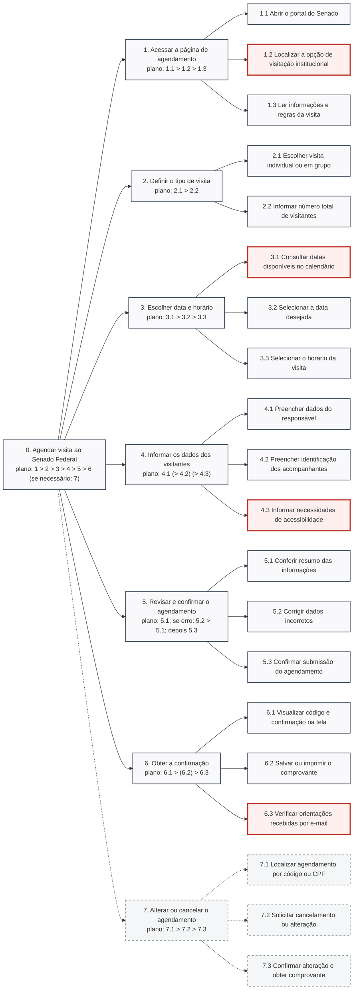

<span class="owner">Responsável: Israel Soares — Análise de tarefas</span>

# Análise de tarefas

## Tabela de contribuição

A Tabela 1 registra quem atuou neste artefato.

| Integrante | Contribuição | Artefato / atividade |
| --- | --- | --- |
| [Israel Soares](https://github.com/IsraelSoares-25) | Definição da tarefa de agendamento de visita e objetivos da análise | [Tarefa analisada](analise-tarefas.md#tarefa-analisada) |
| [Israel Soares](https://github.com/IsraelSoares-25) | Modelagem da Análise Hierárquica de Tarefas (HTA) | [HTA](analise-tarefas.md#analise-hierarquica-de-tarefas-hta) |
| [Israel Soares](https://github.com/IsraelSoares-25) | Modelagem da Árvore de Tarefas Concorrentes (CTT) | [CTT](analise-tarefas.md#arvore-de-tarefas-concorrentes-ctt) |
| Google Gemini | Redação preliminar e formatação Markdown | [Agradecimentos](analise-tarefas.md#agradecimentos) |
| [Bruno Ferreira Dornelas](https://github.com/brunnf) | Revisão técnica da notação de HTA e CTT e alinhamento com a literatura | [HTA e CTT](#analise-hierarquica-de-tarefas-hta) |
| Codex (OpenAI) | Apoio à conferência e rastreabilidade metodológica | [Introdução](#introducao) |

<p class="caption">Tabela 1 — Contribuição neste artefato.</p>
<p class="source">Fonte: elaboração do autor (2026).</p>

## Introdução

Esta página apresenta a modelagem detalhada da tarefa de **Agendamento de visita ao Senado Federal**, protagonizada pela persona [Marta Oliveira](persona.md) no contexto do [cenário](cenario.md) de visitação institucional. A análise investiga como o cidadão interage com o Portal do Senado Federal para programar e confirmar uma visita guiada às instalações do Congresso Nacional, mapeando os fluxos operacionais, as dependências temporais e as barreiras de usabilidade que comprometem a experiência da pessoa usuária.

A modelagem emprega duas técnicas complementares consagradas na literatura de Interação Humano-Computador: a **Análise Hierárquica de Tarefas (HTA)** (BARBOSA; SILVA, 2010; ANNETT; DUNCAN, 1967), que decompõe os objetivos em subtarefas e operações condicionadas por planos formais, e a **Árvore de Tarefas Concorrentes (CTT)** (PATERNÒ, 2000), que expressa as relações temporais e lógicas entre as ações do usuário e as respostas do sistema. O modelo aqui estruturado serve de base para o [Planejamento da Avaliação da Análise de Tarefas](../../../entrega-4/individual/israel/planejamento-avaliacao-analise-tarefas.md) e o respectivo [Planejamento do Relato dos Resultados](../../../entrega-4/individual/israel/planejamento-relato-resultados-analise-tarefas.md).

## Tarefa analisada

A Tabela 2 define a tarefa investigada e os objetivos da análise.

| Campo | Registro |
| --- | --- |
| Tarefa analisada | Agendar visita institucional ao Senado Federal |
| Objetivo do usuário | Programar e confirmar uma visita guiada presencial ao Senado Federal para si e familiares/colegas em data e horário convenientes |
| Usuário | [Marta Oliveira](persona.md), servidora pública com média familiaridade com navegadores e baixa familiaridade com termos legislativos e burocráticos |
| Sistema | Portal do Senado Federal (mecanismo de busca, navegação institucional e sistema de agendamento do Programa de Visitação) |
| Objetivo da análise | Identificar as dificuldades de encontrabilidade, transparência de vagas no calendário, clareza das regras de acesso e geração do comprovante de confirmação |
| Evidência de sucesso | Obtenção do código localizador do agendamento, emissão do comprovante de confirmação e recebimento das orientações de visitação por e-mail |
| Consequência da falha | Frustração do cidadão, desistência da visitação cívica ou comparecimento presencial em data/horário indisponíveis ou sem vestimenta/documentação adequada |
| Fonte dos dados | Sessão de entrevista/observação, cenário de uso de Marta Oliveira e inspeção dos fluxos oficiais de visitação do Senado Federal |

<p class="caption">Tabela 2 — Tarefa analisada e objetivos da análise.</p>
<p class="source">Fonte: elaboração do autor (2026), com base em Barbosa e Silva (2010, p. 195).</p>

## Análise Hierárquica de Tarefas (HTA)

A HTA decompõe o objetivo principal em subtarefas e operações, detalhando as condições e a ordem de execução por meio de **planos** formais (BARBOSA; SILVA, 2010, p. 193).

A Tabela 3 apresenta a legenda da notação adotada na HTA.

| Notação | Significado |
| --- | --- |
| `0`, `1`, `1.1`, `3.2.1` | Posição hierárquica do objetivo; `0` representa o objetivo principal |
| `plano: 1 > 2` | Sequência estrita: a operação 2 só é executada após a conclusão da operação 1 |
| `plano: 1 / 2` | Seleção exclusiva: executa-se 1 ou 2, conforme as condições |
| `plano: 1 + 2` | Paralelismo ou ordem indistinta: 1 e 2 podem ser executadas concomitantemente |
| `plano: 1*` | Repetição ou iteração: o passo é repetido conforme a necessidade |
| `(passo)` | Passo opcional ou condicional |
| Caixa com borda contínua | Passo observado diretamente ou previsto no fluxo padrão do sistema |
| Caixa com borda tracejada | Passo relatado ou de execução sob demanda externa (ex.: alteração/cancelamento posterior) |
| Caixa com borda grossa destacada | Ponto crítico em que foram detectadas barreiras ou problemas de usabilidade |
| *input* · *feedback* | Disparador da operação · indicador perceptível de sua conclusão |
| Problema · Recomendação | Dificuldade observada · diretriz de melhoria proposta para o reprojeto |

<p class="caption">Tabela 3 — Legenda da notação da HTA.</p>
<p class="source">Fonte: elaboração do autor (2026), com base em Barbosa e Silva (2010, p. 193–195).</p>

### Diagrama HTA

A Figura 1 apresenta o diagrama da Análise Hierárquica de Tarefas organizado em árvore horizontal (`flowchart LR`), permitindo visualização fluida e rigorosa de todos os níveis de decomposição e seus respectivos planos.



<p class="caption">Figura 1 — Diagrama HTA do Agendamento de Visita ao Senado Federal.</p>
<p class="source">Fonte: elaboração do autor (2026), com base em Barbosa e Silva (2010, p. 193–195).</p>

### Especificação tabular da HTA

A Tabela 4 apresenta o detalhamento tabular de cada operação da HTA, no formato preconizado por Barbosa e Silva (2010, p. 194–195, Tabela 6.3), com seus inputs, feedbacks, planos associados, problemas identificados e recomendações para o reprojeto.

| Objetivos / operações | Problemas e recomendações |
| --- | --- |
| **0. Agendar visita ao Senado Federal**<br/>*input*: necessidade ou interesse em realizar visita institucional presencial.<br/>*feedback*: visitação agendada com código localizador, comprovante emitido e e-mail enviado.<br/>*plano*: fazer 1, 2, 3, 4, 5 e 6 em sequência. Se houver necessidade de cancelamento ou remarcação futura, executar 7. | **Problema geral**: fluxo disperso entre páginas informativas e o sistema de vagas, gerando incerteza sobre se o agendamento foi finalizado.<br/>**Recomendação**: estruturar um assistente de agendamento em passos contínuos (*wizard*) com indicador de progresso visível. |
| **1. Acessar a página de agendamento**<br/>*input*: navegador aberto.<br/>*feedback*: página do sistema de agendamento de visitação carregada.<br/>*plano*: fazer 1.1 > 1.2 > 1.3 em sequência. | **Problema (1.2 - ponto crítico)**: a opção de visitação institucional não tem destaque na home do portal e os termos coloquiais de busca ("visitar o senado", "agendamento de visita") retornam notícias antes do serviço.<br/>**Recomendação**: criar atalho evidente para "Visite o Congresso / Senado" no cabeçalho ou área de serviços ao cidadão e priorizar a página de agendamento no motor de busca. |
| &emsp;**1.1 Abrir o portal do Senado**<br/>*input*: URL digitada ou busca no buscador.<br/>*feedback*: página inicial do Senado Federal aberta. | Sem problemas registrados neste passo. |
| &emsp;**1.2 Localizar a opção de visitação institucional**<br/>*input*: página inicial carregada.<br/>*feedback*: link ou banner para o serviço de visitação localizado e acionado. | **Problema**: excesso de links legislativos concorre com os serviços ao cidadão.<br/>**Recomendação**: agrupamento claro em seção de serviços públicos cívicos. |
| &emsp;**1.3 Ler informações e regras da visita**<br/>*input*: página do programa de visitação aberta.<br/>*feedback*: compreensão das regras de horários, vestimenta e documentos. | **Problema**: regras de vestimenta (proibições de regatas, bermudas e chinelos em dias específicos) muitas vezes estão em texto longo ou links secundários, passando despercebidas.<br/>**Recomendação**: cards visuais com ícones destacando regras indispensáveis antes do formulário. |
| **2. Definir o tipo de visita**<br/>*input*: página de formulário inicial do agendamento aberta.<br/>*feedback*: modalidade e quantidade de visitantes definidas.<br/>*plano*: fazer 2.1 e 2.2 em sequência. | **Problema**: indefinição entre regras para visita individual/familiar e grupos escolares/institucionais.<br/>**Recomendação**: apresentar opções autoexplicativas com indicação do limite máximo de vagas por reserva. |
| &emsp;**2.1 Escolher visita individual ou em grupo**<br/>*input*: formulário inicial.<br/>*feedback*: modalidade de visita selecionada. | Sem problemas registrados. |
| &emsp;**2.2 Informar número total de visitantes**<br/>*input*: modalidade selecionada.<br/>*feedback*: campo numérico preenchido e validado. | Sem problemas registrados. |
| **3. Escolher data e horário**<br/>*input*: quantidade de visitantes informada.<br/>*feedback*: data e horário válidos com vagas disponíveis selecionados.<br/>*plano*: fazer 3.1 > 3.2 > 3.3 em sequência. Se a data ou horário não possuir vagas, retornar a 3.1 para selecionar outro dia. | **Problema (3.1 - ponto crítico)**: calendário estático sem visualização imediata de vagas; o usuário clica em uma data para só depois descobrir que todos os horários estão esgotados.<br/>**Recomendação**: calendário com cores de disponibilidade (verde com vagas, vermelho esgotado, cinza sem visitação) e número de vagas restantes por horário. |
| &emsp;**3.1 Consultar datas disponíveis no calendário**<br/>*input*: calendário exibido na tela.<br/>*feedback*: percepção de quais dias possuem vagas abertas. | **Problema**: falta de legenda evidente sobre feriados, finais de semana e sessões plenárias restritas.<br/>**Recomendação**: inclusão de legenda clara sobre o calendário de funcionamento institucional. |
| &emsp;**3.2 Selecionar a data desejada**<br/>*input*: data com vagas identificada.<br/>*feedback*: data selecionada e horários disponíveis exibidos. | Sem problemas registrados. |
| &emsp;**3.3 Selecionar o horário da visita**<br/>*input*: lista de horários disponíveis carregada.<br/>*feedback*: horário desejado selecionado. | **Problema**: concorrência de vagas em horários concorridos sem bloqueio temporário durante o preenchimento.<br/>**Recomendação**: pré-reserva temporária das vagas durante o preenchimento do formulário. |
| **4. Informar os dados dos visitantes**<br/>*input*: data e horário selecionados.<br/>*feedback*: campos preenchidos e validados pelo sistema.<br/>*plano*: fazer 4.1. Se for visita em grupo ou com acompanhantes, fazer 4.2. Se houver pessoa com deficiência ou mobilidade reduzida, fazer 4.3. | **Problema (4.3 - ponto crítico)**: campo de acessibilidade pouco visível ou sem detalhamento dos recursos disponíveis (cadeiras de rodas, intérprete de Libras).<br/>**Recomendação**: seção dedicada com checklist de recursos de acessibilidade disponíveis para a visita. |
| &emsp;**4.1 Preencher dados do responsável**<br/>*input*: formulário com campos de nome, CPF, e-mail e telefone.<br/>*feedback*: dados inseridos e máscaras de validação aceitas. | Sem problemas registrados. |
| &emsp;**4.2 Preencher identificação dos acompanhantes**<br/>*input*: formulário de lista de participantes.<br/>*feedback*: nomes e documentos adicionados à lista de visitantes. | **Problema**: obrigatoriedade de documentos de todos os membros em visitas familiares pode travar o agendamento no momento.<br/>**Recomendação**: permitir completar os nomes dos acompanhantes em até 24 horas antes da visita. |
| &emsp;**4.3 Informar necessidades de acessibilidade**<br/>*input*: opção de acessibilidade ativada.<br/>*feedback*: recursos especiais requisitados e registrados. | **Problema**: ausência de confirmação de que o suporte de acessibilidade será de fato providenciado.<br/>**Recomendação**: mensagem explícita assegurando os recursos solicitados. |
| **5. Revisar e confirmar o agendamento**<br/>*input*: formulário totalmente preenchido.<br/>*feedback*: revisão concluída e solicitação enviada com sucesso.<br/>*plano*: fazer 5.1. Se houver divergência, executar 5.2 e repetir 5.1. Em seguida, executar 5.3. | **Problema**: botões com rótulos ambíguos ("Avançar" vs. "Confirmar Agendamento"), gerando receio de envio prematuro.<br/>**Recomendação**: resumo consolidado claro em card antes do botão final "Confirmar Agendamento". |
| &emsp;**5.1 Conferir resumo das informações**<br/>*input*: tela de revisão exibida.<br/>*feedback*: verificação dos dados cadastrados e horários. | Sem problemas registrados. |
| &emsp;**5.2 Corrigir dados incorretos**<br/>*input*: botão de edição de seção clicado.<br/>*feedback*: retorno ao passo desejado sem perda dos demais dados digitados. | Sem problemas registrados. |
| &emsp;**5.3 Confirmar submissão do agendamento**<br/>*input*: clique no botão de confirmação.<br/>*feedback*: indicador de envio processado e tela de sucesso carregada. | Sem problemas registrados. |
| **6. Obter a confirmação**<br/>*input*: agendamento processado pelo servidor.<br/>*feedback*: comprovante em mãos (tela, arquivo e e-mail).<br/>*plano*: fazer 6.1 > (6.2) > 6.3 em sequência. | **Problema (6.3 - ponto crítico)**: atraso ou não recebimento do e-mail de confirmação ou falta de instruções no comprovante.<br/>**Recomendação**: exibição do comprovante com QR Code para download imediato em PDF e disparo imediato de e-mail com instruções anexadas. |
| &emsp;**6.1 Visualizar código e confirmação na tela**<br/>*input*: tela de sucesso carregada.<br/>*feedback*: exibição do código localizador e resumo da visita. | Sem problemas registrados. |
| &emsp;**6.2 Salvar ou imprimir o comprovante**<br/>*input*: clique em "Baixar Comprovante (PDF)" ou "Imprimir".<br/>*feedback*: arquivo baixado ou janela de impressão acionada. | Sem problemas registrados. |
| &emsp;**6.3 Verificar orientações recebidas por e-mail**<br/>*input*: caixa postal do usuário.<br/>*feedback*: e-mail do Senado com o comprovante e as instruções de chegada. | **Problema**: mensagem de e-mail por vezes é direcionada à caixa de spam.<br/>**Recomendação**: instrução explícita na tela avisando sobre a checagem da caixa de spam. |
| **7. Alterar ou cancelar o agendamento**<br/>*input*: necessidade de reagendar data ou cancelar reserva por imprevisto.<br/>*feedback*: alteração ou cancelamento concluído com comprovante atualizado.<br/>*plano*: fazer 7.1 > 7.2 > 7.3 em sequência. | **Problema**: ausência de link direto para gerenciamento da visita no comprovante ou na página principal.<br/>**Recomendação**: inclusão de link e botão "Gerenciar Agendamento" direto no e-mail e na tela de visitação. |
| &emsp;**7.1 Localizar agendamento por código ou CPF**<br/>*input*: código do agendamento e CPF inseridos.<br/>*feedback*: dados do agendamento localizados na base. | Sem problemas registrados. |
| &emsp;**7.2 Solicitar cancelamento ou alteração**<br/>*input*: opção de remarcação de horário ou cancelamento acionada.<br/>*feedback*: nova data selecionada ou cancelamento confirmado. | Sem problemas registrados. |
| &emsp;**7.3 Confirmar alteração e obter comprovante**<br/>*input*: submissão da alteração.<br/>*feedback*: comprovante atualizado emitido e e-mail de aviso disparado. | Sem problemas registrados. |

<p class="caption">Tabela 4 — Operações da HTA, com input, feedback, plano, problemas e recomendações.</p>
<p class="source">Fonte: elaboração do autor (2026), com base em Barbosa e Silva (2010, p. 194–195).</p>

## Árvore de Tarefas Concorrentes (CTT)

A técnica CTT (*ConcurTaskTrees*) complementa a HTA ao formalizar as relações temporais e lógicas entre as atividades executadas pelo usuário e pelo sistema computacional (PATERNÒ, 2000; BARBOSA; SILVA, 2010, p. 203).

A Tabela 5 apresenta os operadores temporais da CTT utilizados nesta modelagem.

| Operador | Nome | Significado |
| :---: | --- | --- |
| `T1 >> T2` | Ativação sequencial | A tarefa `T2` só é habilitada após o término com sucesso da tarefa `T1` |
| `T1 []>> T2` | Ativação com passagem de informação | Além da ativação sequencial, a tarefa `T1` transfere seu resultado informativo para a tarefa `T2` |
| `T1 [] T2` | Escolha concorrente | A inicialização de `T1` desabilita permanentemente `T2` (e vice-versa) durante aquela instância |
| `T1 [> T2` | Desativação / Interrupção | A execução da tarefa `T2` interrompe e finaliza a execução da tarefa `T1` |
| `T1*` | Tarefa iterativa | A tarefa `T1` repete sua execução até que uma condição de parada seja satisfeita |

<p class="caption">Tabela 5 — Operadores temporais da CTT.</p>
<p class="source">Fonte: elaboração do autor (2026), com base em Paternò (2000) e Barbosa e Silva (2010, p. 203–204).</p>

### Notação textual formal da CTT

A especificação textual formal da tarefa de agendamento de visita é apresentada a seguir:

```text
AgendarVisitaSenado = 
    AcessarPaginaAgendamento 
    []>> DefinirTipoVisita 
    []>> EscolherDataEHorario 
    []>> InformarDadosVisitantes 
    []>> RevisarEConfirmarAgendamento 
    []>> ObterConfirmacao 
    [> GerenciarAgendamentoPosterior

AcessarPaginaAgendamento = 
    AbrirPortalSenado 
    >> LocalizarOpcaoVisitacao 
    []>> ConsultarRegrasVisitacao

DefinirTipoVisita = 
    (EscolherVisitaIndividual [] EscolherVisitaGrupo) 
    []>> InformarNumeroVisitantes

EscolherDataEHorario = 
    ConsultarDatasCalendario 
    []>> SelecionarData 
    []>> SelecionarHorario

InformarDadosVisitantes = 
    PreencherDadosResponsavel 
    []>> (PreencherDadosAcompanhantes [] InformarAcessibilidade)

RevisarEConfirmarAgendamento = 
    ConferirInformacoes 
    >> (CorrigirDados >> ConferirInformacoes)* 
    >> ConfirmarSubmissao

ObterConfirmacao = 
    ApresentarComprovanteTela 
    >> (SalvarComprovantePDF [] ImprimirComprovante) 
    >> DispararEmailConfirmacao

GerenciarAgendamentoPosterior = 
    LocalizarAgendamento 
    >> (AlterarDataHorario [] CancelarAgendamento) 
    >> EmitirNovoComprovante
```

<p class="caption">Figura 2 — Notação textual formal da CTT para o Agendamento de Visita.</p>
<p class="source">Fonte: elaboração do autor (2026), com base em Paternò (2000).</p>

### Classificação dos tipos de tarefas da CTT

A Tabela 6 categoriza as tarefas da CTT conforme a taxonomia de Paternò (2000): tarefas de usuário (cognitivas), tarefas de aplicação (sistema), tarefas de interação (usuário com sistema) e tarefas abstratas (decomposição).

| Tarefa | Categoria CTT | Agente executor | Descrição do papel |
| --- | :---: | :---: | --- |
| Agendar visita ao Senado | Abstrata | Usuária e Sistema | Objetivo geral composto pelas atividades da interação |
| Acessar página de agendamento | Abstrata | Usuária e Sistema | Conjunto de passos para atingir o serviço |
| Abrir portal do Senado | Interação | Usuária | Digitar endereço ou acionar link no navegador |
| Localizar opção de visitação | Interação | Usuária | Usar busca ou navegar até a opção institucional |
| Consultar regras de visitação | Cognitiva | Usuária | Interpretar as instruções sobre vestimenta e documentos |
| Definir tipo de visita | Interação | Usuária | Marcar se a visita é individual ou em grupo |
| Informar número de visitantes | Interação | Usuária | Inserir a quantidade de vagas requeridas |
| Consultar datas no calendário | Interação | Usuária e Sistema | Navegar pelo calendário interativo do sistema |
| Selecionar data e horário | Interação | Usuária | Escolher o dia e horário de preferência |
| Preencher dados do responsável | Interação | Usuária | Inserir nome, CPF, e-mail e telefone |
| Preencher dados de acompanhantes | Interação | Usuária | Adicionar os nomes e documentos dos demais participantes |
| Informar acessibilidade | Interação | Usuária | Solicitar recursos especiais de mobilidade ou Libras |
| Conferir informações | Cognitiva | Usuária | Revisar os dados exibidos no resumo antes de enviar |
| Confirmar submissão | Interação | Usuária | Acionar o botão final de confirmação da reserva |
| Apresentar comprovante na tela | Aplicação | Sistema | Gerar código localizador e tela de sucesso |
| Salvar/imprimir comprovante | Interação | Usuária | Realizar download do PDF ou enviar para impressora |
| Disparar e-mail de confirmação | Aplicação | Sistema | Transmitir mensagem automática com orientações completas |
| Gerenciar agendamento posterior | Abstrata | Usuária e Sistema | Fluxo de alteração ou cancelamento sob demanda |

<p class="caption">Tabela 6 — Classificação e atribuição dos tipos de tarefa na CTT.</p>
<p class="source">Fonte: elaboração do autor (2026), com base em Barbosa e Silva (2010, p. 203) e Paternò (2000).</p>

### Diagrama CTT

A Figura 3 apresenta a representação em árvore da CTT (`flowchart LR`), exibindo a estrutura das tarefas e seus operadores de conexão.

```mermaid
flowchart LR
    Root["Agendar Visita ao Senado Federal [Abstrata]"]

    A1["Acessar Página de Agendamento"]
    A2["Definir Tipo de Visita"]
    A3["Escolher Data e Horário"]
    A4["Informar Dados dos Visitantes"]
    A5["Revisar e Confirmar"]
    A6["Obter Confirmação"]
    A7["Gerenciar Agendamento [Sob Demanda]"]

    Root -->|[]>>| A1
    A1 -->|[]>>| A2
    A2 -->|[]>>| A3
    A3 -->|[]>>| A4
    A4 -->|[]>>| A5
    A5 -->|[]>>| A6
    Root -.->|[>]| A7

    A11["1.1 Abrir Portal"]
    A12["1.2 Localizar Visitação"]
    A13["1.3 Ler Regras"]
    A1 --> A11
    A11 -->|>>| A12
    A12 -->|[]>>| A13

    A21["2.1 Escolher Modalidade"]
    A22["2.2 Informar Qtd. Visitantes"]
    A2 --> A21
    A21 -->|[]>>| A22

    A31["3.1 Consultar Calendário"]
    A32["3.2 Selecionar Data"]
    A33["3.3 Selecionar Horário"]
    A3 --> A31
    A31 -->|[]>>| A32
    A32 -->|[]>>| A33

    A41["4.1 Dados do Responsável"]
    A42["4.2 Dados Acompanhantes"]
    A43["4.3 Dados Acessibilidade"]
    A4 --> A41
    A41 -->|[]>>| A42
    A41 -->|[]>>| A43

    A51["5.1 Conferir Resumo"]
    A52["5.2 Corrigir Dados"]
    A53["5.3 Confirmar Submissão"]
    A5 --> A51
    A51 -->|>>| A52
    A51 -->|>>| A53

    A61["6.1 Apresentar na Tela"]
    A62["6.2 Salvar Comprovante"]
    A63["6.3 Disparar E-mail"]
    A6 --> A61
    A61 -->|>>| A62
    A61 -->|>>| A63

    A71["7.1 Localizar por Código/CPF"]
    A72["7.2 Remarcar ou Cancelar"]
    A73["7.3 Emitir Novo Comprovante"]
    A7 --> A71
    A71 -->|>>| A72
    A72 -->|>>| A73

    classDef pontoCritico stroke:#c0392b,stroke-width:2.5px;
    class A12,A31,A43,A63 pontoCritico;
```

<p class="caption">Figura 3 — Árvore CTT da tarefa de Agendamento de Visita ao Senado.</p>
<p class="source">Fonte: elaboração do autor (2026), com base em Paternò (2000).</p>

## Agradecimentos

Esta página contou com o apoio do Google Gemini na formatação Markdown e na estruturação preliminar das tabelas e diagramas. A revisão técnica, a modelagem dos objetivos e a responsabilidade pelo que está publicado são do autor.

## Histórico de versão

| Versão | Data | Descrição | Autor(es) | Revisor(es) |
| :---: | :---: | --- | --- | --- |
| `0.1` | 26/09/2026 | Estrutura inicial do artefato | [Israel Soares](https://github.com/IsraelSoares-25) | [Bruno Ferreira Dornelas](https://github.com/brunnf) |
| `0.2` | 27/09/2026 | HTA e CTT preenchidas inicialmente com foco em busca de disponibilidade | [Israel Soares](https://github.com/IsraelSoares-25) | [Bruno Ferreira Dornelas](https://github.com/brunnf) |
| `0.3` | 03/10/2026 | Nomeia a ferramenta de IA nos agradecimentos e na tabela de contribuição | [Caio Breno de Souza Bezerra](https://github.com/CaioBezerra-Dev) | [Heitor Pinheiro Gonçalves das Chagas](https://github.com/Heitorovski01) |
| `1.0` | 05/10/2026 | Explicita o limite da sequência reconstruída e limites de dados | [Bruno Ferreira Dornelas](https://github.com/brunnf) | [Caio Breno de Souza Bezerra](https://github.com/CaioBezerra-Dev) |
| `2.0` | 22/10/2026 | Reformulação integral da análise de tarefas para a funcionalidade de Agendamento de Visita ao Senado Federal, com diagramas HTA e CTT corrigidos, novos planos, tabela completa e alinhamento com a Entrega 4 | [Israel Soares](https://github.com/IsraelSoares-25) | [Bruno Ferreira Dornelas](https://github.com/brunnf) |

## Referências

[1] ANNETT, John; DUNCAN, Keith D. Task analysis and training design. Occupational Psychology, v. 41, p. 211-221, 1967.

[2] BARBOSA, Simone Diniz Junqueira; SILVA, Bruno Santana da. Interação humano-computador. Rio de Janeiro: Elsevier, 2010.

[3] PATERNÒ, Fabio. Model-based design and evaluation of interactive applications. London: Springer, 2000.
