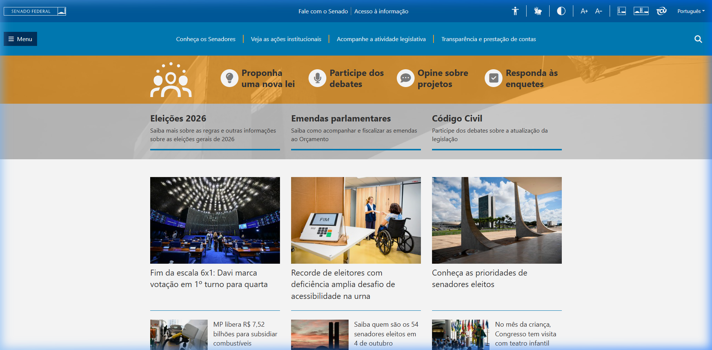
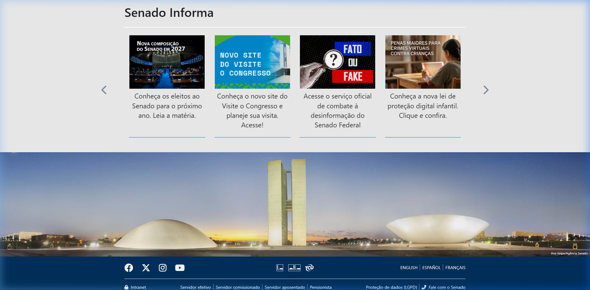
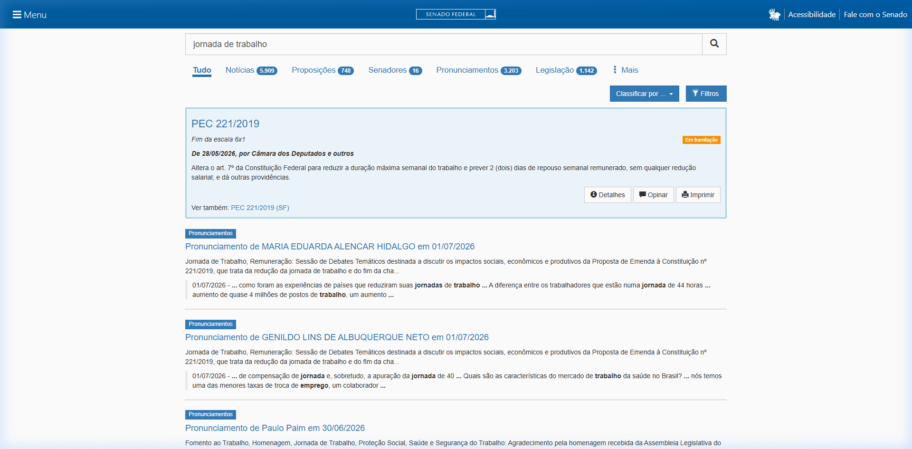
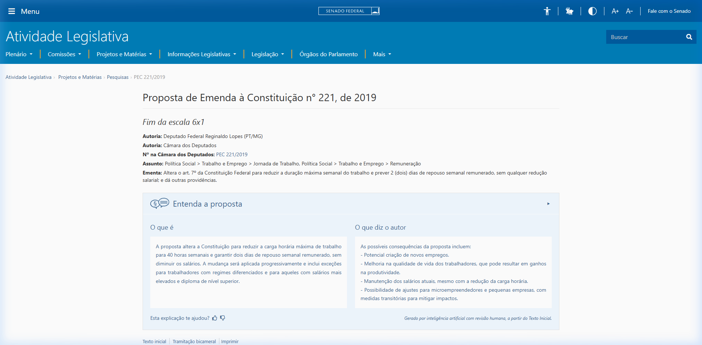
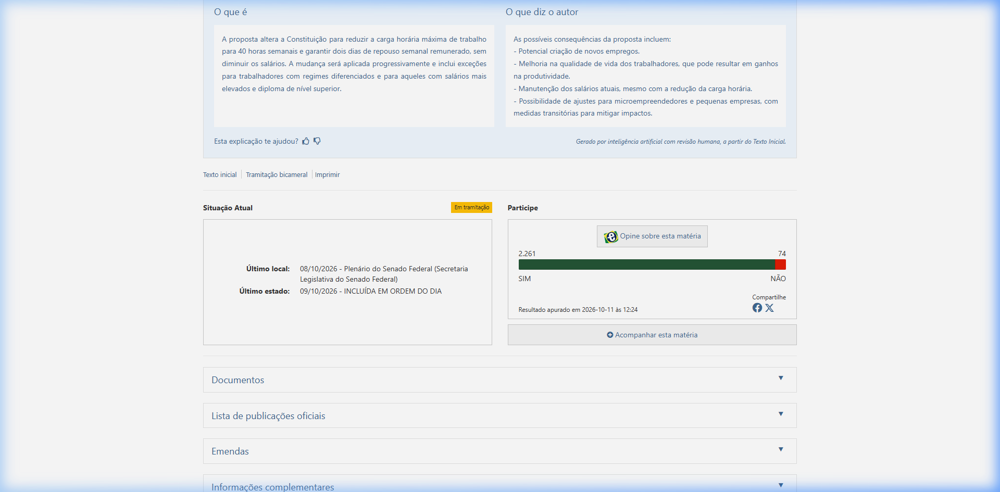
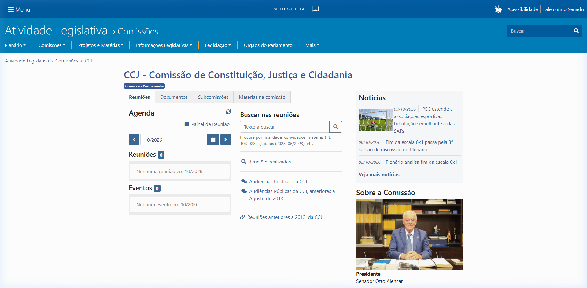
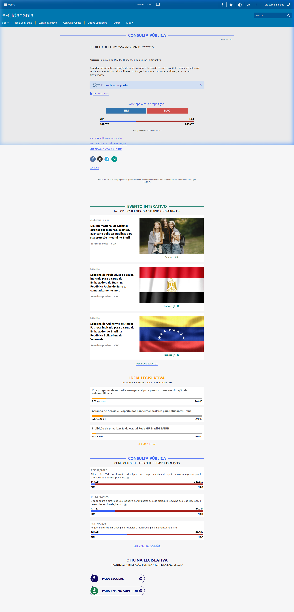
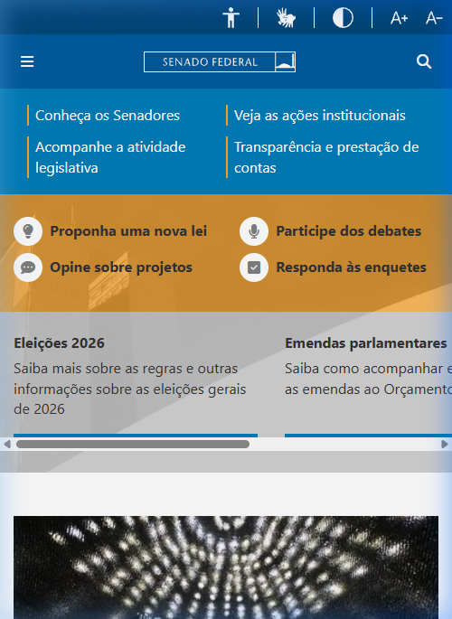
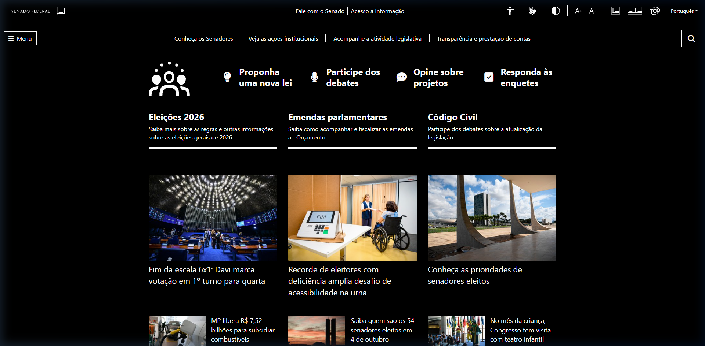

<span class="owner">Responsável: Heitor Pinheiro Gonçalves das Chagas — Telas de interface · Autor dos itens: Heitor Pinheiro Gonçalves das Chagas</span>

# Telas de interface

## Tabela de contribuição

A Tabela 1 registra quem atuou neste artefato.

| Integrante | Contribuição | Artefato / atividade |
| --- | --- | --- |
| [Heitor Pinheiro Gonçalves das Chagas](https://github.com/Heitorovski01) | Definição das telas do reprojeto e do molde de especificação | [Estrutura de cada tela](telas-interface.md#estrutura-de-cada-tela) |
| [Heitor Pinheiro Gonçalves das Chagas](https://github.com/Heitorovski01) | Mapa de elementos, dimensões e estados de cada tela | [Telas](telas-interface.md#telas) |
| Claude Sonnet 5.5 (Anthropic) | Levantamento das evidências da Etapa 2, estruturação das telas e formatação Markdown | [Agradecimentos](telas-interface.md#agradecimentos) |

<p class="caption">Tabela 1 — Contribuição neste artefato.</p>
<p class="source">Fonte: elaboração do Grupo 06 (2026).</p>

## Introdução

Esta página complementa o [Guia de estilo](guia-de-estilo.md) e aplica as decisões de tipografia, cores, grid e interação a **seis telas** do reprojeto do Portal do Senado Federal. Cada tela é detalhada no mesmo molde: objetivo, confronto com o portal atual (evidenciado por capturas reais da plataforma), diagramação de interface (*wireframe* esquemático), posição e especificação de cada elemento, dimensões por tamanho de tela, estados e acessibilidade. Quem for prototipar (Etapas 4 a 7) ou implementar encontra o que usar e onde colocar (BARBOSA; SILVA, 2010, p. 282–283; MAYHEW, 1999).

As telas nascem das evidências da Etapa 2: as tarefas modeladas na [análise de tarefas](../entrega-2/analise-tarefas.md), os [perfis de usuário](../entrega-2/perfil-usuario.md) e os problemas registrados em cada sessão. Os valores de fonte, cor e espaçamento vêm da [Tabela 2 (tipografia)](guia-de-estilo.md#33-tipografia) e da [Tabela 3 (cores)](guia-de-estilo.md#35-cores) do guia. O contexto de uso está em [Características da plataforma](plataforma.md), e as metas M0 a M6 e as tarefas T1 a T6, em [Metas de usabilidade](metas-usabilidade.md).

## Fundamentos comuns às telas

### Tamanhos de tela

A Tabela 2 define os pontos de quebra usados em todas as telas. Eles seguem o grid do guia e os aparelhos do perfil: monitores Full HD em escritório ou casa e smartphones de 5 a 6,7 polegadas ([ambiente de trabalho](guia-de-estilo.md#21-descricao-do-ambiente-de-trabalho-do-usuario)).

| Dispositivo | Largura de referência | Container | Colunas | Margens laterais | Calha |
| --- | :---: | :---: | :---: | :---: | :---: |
| Desktop | 1920 px (mínimo 1024 px) | 1200 px centralizado | 12 | 24 px | 24 px |
| Tablet | 768 px | 100% | 8 | 24 px | 16 px |
| Mobile | 360 px (mínimo 320 px) | 100% | 4 (coluna única) | 16 px | 16 px |

<p class="caption">Tabela 2 — Pontos de quebra das telas.</p>
<p class="source">Fonte: elaboração do Grupo 06 (2026), a partir do grid do guia de estilo e do perfil consolidado (Etapa 2).</p>

### Tokens de espaçamento, forma e foco

A Tabela 3 reúne os valores usados em todos os componentes. Tamanhos de fonte e cores não se repetem aqui: seguem as tabelas do guia.

| Token | Valor | Uso |
| --- | :---: | --- |
| Espaçamento base | 8 px (múltiplos: 8, 16, 24, 32, 48) | Distância entre elementos, *padding* de cartões e seções |
| Raio de borda pequeno | 4 px | Botões, campos e etiquetas retangulares |
| Raio de borda médio | 8 px | Cartões, modais e blocos |
| Sombra de cartão | `0 1px 3px rgba(0, 0, 0, 0.12)` | Cartões em repouso |
| Sombra elevada | `0 4px 12px rgba(0, 0, 0, 0.20)` | Menus abertos, modais e cartões em *hover* |
| Alvo de toque mínimo | 44 × 44 px | Todo elemento clicável, em qualquer dispositivo |
| Anel de foco | contorno de 3 px `#004B87`, distância de 2 px | Foco por teclado; em alto contraste, `#FFFF00` |
| Borda de campo | 2 px `#555555`; em foco, `#004B87` | Campos de texto, seleção e filtros |

<p class="caption">Tabela 3 — Tokens de espaçamento, forma e foco.</p>
<p class="source">Fonte: elaboração do Grupo 06 (2026).</p>

### Componentes reutilizados

A Tabela 4 define os componentes que aparecem em mais de uma tela. Cada tela só combina e posiciona esses componentes.

| Componente | Especificação |
| --- | --- |
| Botão primário | Altura 48 px, *padding* horizontal 24 px, fundo `#002B49`, texto branco 16 px peso 600, *hover* `#004B87` |
| Botão secundário | Altura 48 px, borda 2 px `#002B49`, fundo branco, texto `#002B49` 16 px peso 600 |
| Botão de voto "Sim" / "Não" | Altura 56 px, texto 18 px peso 600, ícone e rótulo juntos; "Sim" em `#1E7E34` e "Não" em `#BD2130`, ambos com texto branco. A cor nunca é a única pista |
| Campo de busca | Altura 48 px, borda 2 px, ícone de lupa 24 px à esquerda, texto 16 px, botão "Buscar" acoplado à direita |
| Cartão de resultado | Fundo branco, borda 1 px `#DCDFE3`, raio 8 px, *padding* 24 px, sombra de cartão |
| Etiqueta de situação | Altura 28 px, *padding* horizontal 12 px, texto 14 px peso 600, raio 14 px; ícone sempre junto do texto |
| Linha do tempo | Linha vertical de 2 px `#DCDFE3`, marcador circular de 16 px, data em 14 px peso 600 e descrição em 16 px |
| Paginação | Botões de 44 × 44 px, página atual em `#002B49` com texto branco, texto "Página X de Y" visível |
| Modal | Largura 560 px no desktop e 100% no mobile, raio 8 px, sobreposição `rgba(0, 0, 0, 0.5)`; fecha com "X", clique fora ou `Esc` |
| Mensagem de retorno | Faixa de 16 px de *padding* com ícone, borda esquerda de 4 px na cor semântica e texto 16 px; nunca some sozinha |

<p class="caption">Tabela 4 — Componentes reutilizados nas telas.</p>
<p class="source">Fonte: elaboração do Grupo 06 (2026), a partir do guia de estilo.</p>

### Elementos fixos

A Tabela 5 descreve o cabeçalho e o rodapé, presentes em todas as telas. O cabeçalho reúne os controles que o portal já oferece (contraste, zoom, Libras e página de acessibilidade), registrados em [Características da plataforma](plataforma.md#identificacao).

| Elemento | Posição e tamanho (desktop) | Conteúdo e comportamento |
| --- | --- | --- |
| Barra de acessibilidade | Topo, 12 colunas, altura 40 px, fundo `#F4F6F8`, texto 14 px | Acessibilidade, VLibras, alternar contraste, aumentar e diminuir texto, com atalhos `Alt + 1`, `Alt + 2` e `Alt + 3`. Estado do contraste fica visível no botão |
| Cabeçalho principal | Abaixo da barra, altura 80 px, fundo `#002B49` | Marca à esquerda (colunas 1–3, símbolo de 48 px); busca universal ao centro (colunas 4–10, [campo de busca](telas-interface.md#componentes-reutilizados) com 48 px); ícone de entrar à direita |
| Menu principal | Faixa abaixo do cabeçalho, altura 56 px, fundo `#004B87`, texto branco 16 px peso 600 | Atividade legislativa, Senadores, Notícias, Orçamento, Transparência e Participe (e-Cidadania). Os rótulos ficam sempre visíveis; submenus abrem por clique, foco ou *hover* e fecham com `Esc` |
| Trilha de navegação | Logo abaixo do menu, 16 px de margem, texto 14 px | Mostra o caminho (por exemplo, Atividade legislativa › Comissões › CCJ); o último item não é link |
| Rodapé institucional | Fim da página, fundo `#002B49`, texto branco 14 px, *padding* 48 px | Links institucionais e de transparência em quatro colunas no desktop e uma coluna no mobile |

<p class="caption">Tabela 5 — Elementos fixos do cabeçalho e do rodapé.</p>
<p class="source">Fonte: elaboração do Grupo 06 (2026), com os controles identificados na inspeção de 03/10/2026.</p>

## Estrutura de cada tela

Cada tela da seção seguinte repete os blocos da Tabela 6. A numeração dos elementos nos *wireframes* é a mesma do mapa de elementos.

| Bloco | O que registra |
| --- | --- |
| Objetivo e tarefa | Tarefa da Etapa 2 atendida, persona, problema do portal atual e *design rationale* |
| Tela atual | Captura de tela do Portal do Senado Federal real com destaque para as falhas observadas |
| *Wireframe* | Desenho esquemático da tela de reprojeto com os elementos numerados |
| Mapa de elementos | Número, elemento, posição no grid, tamanho, fonte, cor e comportamento |
| Dimensões | Desktop, tablet e mobile, com alturas, margens e espaçamentos |
| Estados | Padrão, *hover*, foco, erro, vazio, carregando e alto contraste |
| Acessibilidade | Ordem de tabulação, atalhos, contraste e Libras |
| Metas e princípios | Metas de usabilidade (M0–M6) e tarefas (T1–T6) atendidas |

<p class="caption">Tabela 6 — Molde de especificação de cada tela.</p>
<p class="source">Fonte: elaboração do Grupo 06 (2026), a partir de Mayhew (1999) e Barbosa e Silva (2010).</p>

## Origem das decisões

A Tabela 7 liga cada problema registrado na Etapa 2 à decisão de tela que o enfrenta. É o *design rationale* que Mayhew (1999) recomenda e dá a justificativa de cada elemento citado abaixo.

| Problema registrado (Etapa 2) | Fonte | Decisão de tela | Tela |
| --- | --- | --- | --- |
| A página inicial mostra assuntos demais; Renata quer links diretos para notícias e busca | [P2 — Renata](../entrega-2/individual/caio/analise-tarefas.md#analise-hierarquica-de-tarefas-hta) | Atalhos por tarefa e notícias recentes no topo; busca sempre visível | 1 |
| O menu é pequeno e "Atividade legislativa" tem pouca visibilidade; "eu nunca pensaria em abrir aqui" | [P5 — Marina](../entrega-2/individual/luis/entrevista-observacao.md#resultados) | Menu com rótulos sempre visíveis e submenu aberto por foco ou clique | 1, 4 |
| A lista de resultados não vem em ordem de data e o período não termina com aviso | [P2 — Renata](../entrega-2/individual/caio/analise-tarefas.md#analise-hierarquica-de-tarefas-hta) | Ordem padrão da mais nova para a mais antiga, data em destaque, filtro de período e contagem de resultados | 2 |
| Os termos do dia a dia não coincidem com o vocabulário do portal; a busca não diz que nada foi achado | [P4 — Marta](../entrega-2/individual/israel/analise-tarefas.md#analise-hierarquica-de-tarefas-hta) | Mensagem de resultado vazio com termos alternativos e caminhos diretos | 2 |
| Lucas não distinguiu notícia de proposição nem entendeu "Aguardando despacho" ou a tramitação | [P1 — Lucas](../entrega-2/individual/bruno/analise-tarefas.md) | Abas por tipo de resultado, etiqueta de situação com explicação em linguagem simples e linha do tempo legível | 2, 3 |
| Marina não conhecia a sigla CCJ e levou cerca de oito minutos até a reunião | [P5 — Marina](../entrega-2/individual/luis/analise-tarefas.md) | Nome por extenso junto da sigla, reuniões listadas por data e pauta com resultado de cada item | 4 |
| A área de voto não tem destaque e fica abaixo de blocos institucionais | [P3 — Letícia](../entrega-2/individual/heitor/analise-tarefas.md#analise-hierarquica-de-tarefas-hta) | Botões de voto logo abaixo da ementa, sem rolagem; retorno da autenticação ao mesmo ponto | 5 |
| O portal precisa servir ao computador e ao celular, com contraste e zoom | [Plataforma](plataforma.md#possibilidades) | Versões mobile e de alto contraste das telas | 6 |

<p class="caption">Tabela 7 — Problemas da Etapa 2 e decisões de tela correspondentes.</p>
<p class="source">Fonte: elaboração do Grupo 06 (2026), a partir das análises de tarefas e do perfil de usuário da Etapa 2.</p>

## Telas

### Tela 1 — Página inicial

**Autor do item:** [Heitor Pinheiro Gonçalves das Chagas](https://github.com/Heitorovski01)

#### Objetivo e tarefa

Dar ao cidadão um ponto de partida orientado por tarefa. Atende as personas de uso ocasional (Lucas, Marta e Marina) e a de levantamento de notícias (Renata), e é a porta de entrada das tarefas T1, T2 e T5 de [Metas de usabilidade](metas-usabilidade.md#tarefas-e-criterios-de-conclusao). O *design rationale* está nas duas primeiras linhas da Tabela 7: reduzir a sobrecarga de assuntos concorrentes, valorizar a busca universal e estruturar um menu com opções explícitas.

#### Tela atual do portal

A Figura 1 e a Figura 2 exibem a página inicial atual do Portal do Senado Federal, evidenciando o cabeçalho denso, a grande quantidade de blocos noticiosos concorrentes e o rodapé institucional.

??? note "Figura 1 — Topo da página inicial atual do Senado Federal (Desktop)"

    <figure markdown="span">
      
      <figcaption>Figura 1 — Topo da página inicial atual do Senado Federal (Desktop).</figcaption>
    </figure>
    <p class="source">Fonte: Portal do Senado Federal (captura em 11/10/2026).</p>

??? note "Figura 2 — Rodapé da página inicial atual do Senado Federal (Desktop)"

    <figure markdown="span">
      
      <figcaption>Figura 2 — Rodapé da página inicial atual do Senado Federal (Desktop).</figcaption>
    </figure>
    <p class="source">Fonte: Portal do Senado Federal (captura em 11/10/2026).</p>

#### Wireframe de reprojeto

A Figura 3 mostra o esquema estrutural proposto para o reprojeto da tela inicial no desktop.

```text
+--------------------------------------------------------------------+
| [1] Acessibilidade  VLibras  Contraste  A+  A-                     |
+--------------------------------------------------------------------+
| [2] SENADO   [3] ( Busque por assunto, número ou senador ) [Buscar]|
+--------------------------------------------------------------------+
| [4] Atividade legislativa | Senadores | Notícias | Orçamento | ... |
+--------------------------------------------------------------------+
| [5] O que você quer fazer?                                         |
| +----------------+ +----------------+ +----------------+ +--------+ |
| | Entender uma   | | Acompanhar     | | Ver reunião    | | Votar  | |
| | proposta       | | notícias       | | de comissão    | | consulta| |
| +----------------+ +----------------+ +----------------+ +--------+ |
+--------------------------------------------------------------------+
| [6] Notícias recentes (8 col.)       | [7] Participe agora (4 col.)|
|  12/10/2026  Título da notícia       |  Consultas públicas abertas |
|  11/10/2026  Título da notícia       |  [Participar]               |
+--------------------------------------------------------------------+
| [8] Rodapé institucional                                           |
+--------------------------------------------------------------------+
```

<p class="caption">Figura 3 — Wireframe da página inicial do reprojeto (desktop).</p>
<p class="source">Fonte: elaboração do Grupo 06 (2026).</p>

#### Mapa de elementos

A Tabela 8 apresenta o mapa de elementos da página inicial, detalhando a posição, o tamanho, a tipografia, a cor e o comportamento de cada componente.

| Nº | Elemento | Posição | Tamanho | Fonte | Cor | Comportamento |
| :---: | --- | --- | --- | --- | --- | --- |
| 1 | Barra de acessibilidade | Topo, 12 col. | Altura 40 px | 14 px / 400 | Fundo `#F4F6F8`, texto `#1A1A1A` | Conforme a Tabela 5; atalhos e alternador de alto contraste |
| 2 | Marca | Cabeçalho, col. 1–3 | Símbolo de 48 px | — | Fundo `#002B49`, símbolo branco | Link para a página inicial |
| 3 | Busca universal | Cabeçalho, col. 4–10 | Altura 48 px | 16 px / 400 | Texto `#1A1A1A`, borda `#555555` | Aceita assunto, número (ex.: `PL 1234/2026`) ou nome de parlamentar; `Enter` busca |
| 4 | Menu principal | Faixa de 56 px, 12 col. | Itens com alvo mínimo de 44 px | 16 px / 600 | Fundo `#004B87`, texto branco | Rótulos sempre visíveis; submenu abre por clique, foco ou *hover* |
| 5 | Atalhos por tarefa | Linha de 4 cartões, 3 col. cada | Cartão de 120 px de altura, *padding* 24 px | Título 20 px / 600; apoio 14 px / 400 | Título `#002B49`, apoio `#555555`, fundo branco | Cada cartão leva a uma tarefa principal: busca de proposições, notícias, comissões ou consultas |
| 6 | Notícias recentes | Col. 1–8 | Lista de 5 itens, 24 px entre itens | Título 20 px / 600; data 14 px / 600 | Título `#004B87`; data `#555555` | Data em destaque antes do título; link "Ver todas as notícias" ao final |
| 7 | Participe agora | Col. 9–12 | Cartão de largura total da coluna | Título 20 px / 600 | Fundo branco, botão primário | Lista consultas públicas abertas, cada uma com botão direto para a página de voto |
| 8 | Rodapé | Largura total | *Padding* 48 px | 14 px / 400 | Fundo `#002B49`, texto branco | Conforme a Tabela 5 |

<p class="caption">Tabela 8 — Mapa de elementos da página inicial.</p>
<p class="source">Fonte: elaboração do Grupo 06 (2026).</p>

#### Dimensões

No desktop, o conteúdo ocupa o container de 1200 px, com 48 px de separação vertical entre blocos. No tablet (768 px), os atalhos formam 2 linhas de 2 cartões e o bloco "Participe agora" desce abaixo das notícias. No mobile (360 px), a disposição colapsa em coluna única com margens de 16 px.

#### Estados

Em *hover*, os cartões de atalho ganham a sombra elevada e a borda `#004B87`. Com foco por teclado, qualquer elemento recebe o anel de foco da Tabela 3. Na carga assíncrona, a lista de notícias mostra blocos cinza (*skeleton screens* em `#DCDFE3`). Em erro de carga, uma mensagem semântica substitui a lista, com botão "Tentar novamente".

#### Acessibilidade

A ordem de tabulação segue a ordem lógica visual: barra de acessibilidade, busca, menu, atalhos, notícias, participação e rodapé. Há um link de salto "Ir para o conteúdo principal" como primeiro elemento focável via `Alt + 1`. O texto de apoio `#555555` mantém razão de contraste de 7:1 contra o fundo branco. Em alto contraste, ativa-se o padrão da [Tela 6](telas-interface.md#tela-6-mobile-e-alto-contraste).

#### Metas e princípios

Apoia M1 (aprendizado) e M5 (eficiência) em T1, T2 e T5, ao reduzir o tempo de descoberta do fluxo adequado. Aplica os princípios de correspondência com as expectativas do usuário e de simplicidade nas estruturas das tarefas ([Tópicos dos princípios](topicos-principios.md)).

---

### Tela 2 — Busca e resultados

**Autor do item:** [Heitor Pinheiro Gonçalves das Chagas](https://github.com/Heitorovski01)

#### Objetivo e tarefa

Permitir encontrar proposições legislativas, notícias ou reuniões de comissões, reconhecendo prontamente a natureza de cada resultado. Atende T1 (Lucas), T2 (Renata) e T4 (Marta). O *design rationale* fundamenta-se nas linhas 3, 4 e 5 da Tabela 7: ordenação cronológica decrescente como padrão, filtros facetados e delimitação de período, feedback para busca vazia e distinção clara entre notícia e matéria legislativa.

#### Tela atual do portal

A Figura 4 exibe a interface atual do mecanismo de busca do Senado Federal, evidenciando as opções de filtros, a contagem de resultados e a apresentação dos itens encontrados.

??? note "Figura 4 — Página atual de resultados de busca do Senado Federal"

    <figure markdown="span">
      
      <figcaption>Figura 4 — Página atual de resultados de busca do Senado Federal.</figcaption>
    </figure>
    <p class="source">Fonte: Portal do Senado Federal (captura em 11/10/2026).</p>

#### Wireframe de reprojeto

A Figura 5 apresenta a organização visual da página de busca e resultados do reprojeto.

```text
+--------------------------------------------------------------------+
| Cabeçalho e menu (Tabela 5)                                        |
+--------------------------------------------------------------------+
| Início › Busca                                                     |
| [1] ( jornada de trabalho                         ) [Buscar]       |
| [2] 128 resultados para "jornada de trabalho"                      |
| [3] Todos | Proposições | Notícias | Reuniões | Senadores           |
+--------------------+-----------------------------------------------+
| [4] Filtros        | [5] Ordenar por: [Mais recentes v]            |
|  Período           |  +-----------------------------------------+  |
|  De [__/__/____]   |  | [6] Proposição   12/10/2026             |  |
|  Até [__/__/____]  |  | PL 5253/2026 - título                   |  |
|  Tipo              |  | Resumo em duas linhas...                |  |
|  Situação          |  | [Aguardando despacho]                   |  |
|  [Aplicar]         |  +-----------------------------------------+  |
|                    |  [7] Fim dos resultados do período            |
|                    |  [8] Paginação: < 1 2 3 >                     |
+--------------------+-----------------------------------------------+
```

<p class="caption">Figura 5 — Wireframe da busca e resultados do reprojeto (desktop).</p>
<p class="source">Fonte: elaboração do Grupo 06 (2026).</p>

#### Mapa de elementos

A Tabela 9 apresenta o mapa de elementos da página de busca e resultados, detalhando a função e a apresentação visual de cada componente.

| Nº | Elemento | Posição | Tamanho | Fonte | Cor | Comportamento |
| :---: | --- | --- | --- | --- | --- | --- |
| 1 | Campo de busca preenchido | Col. 1–12, abaixo da trilha | Altura 48 px | 16 px / 400 | Borda `#555555`, foco `#004B87` | Preserva o termo digitado; botão "Buscar" primário |
| 2 | Contagem de resultados | Abaixo do campo | Linha de 24 px | 18 px / 500 | `#1A1A1A` | Exibe total e termo; atualiza dinamicamente ao filtrar |
| 3 | Abas por tipo de documento | Linha de 48 px, 12 col. | Mínimo 44 px de altura por aba | 16 px / 600 | Barra de 4 px `#FFCC00` sob texto `#002B49` na aba ativa | Separa Proposições, Notícias, Reuniões e Senadores com seus respectivos totais |
| 4 | Painel de filtros | Col. 1–3 | Largura 280 px; campos de 48 px | Rótulo 14 px / 600; campo 16 px | Fundo `#F4F6F8`, borda `#DCDFE3` | Filtro de período (data inicial/final) com atalhos "Último mês" e "Último ano"; filtros de tipo e situação; botão "Limpar filtros" |
| 5 | Controle de ordenação | Col. 4–12, topo da lista | Dropdown de 48 px | 16 px / 400 | Borda `#555555` | Padrão "Mais recentes"; opções "Mais antigas" e "Relevância"; controle posicionado visivelmente no topo |
| 6 | Cartão de resultado | Col. 4–12 | *Padding* 24 px; 16 px entre cartões | Tipo 14 px / 600; título 20 px / 600; data 14 px / 600; resumo 16 px / 400 | Título `#004B87`; data `#1A1A1A`; etiqueta conforme situação | Cartão integralmente clicável; tipo e **data sempre em evidência no topo**; etiqueta semântica nas proposições |
| 7 | Sinalizador de fim do período | Fim da listagem | Faixa de 56 px | 16 px / 500 | Fundo `#F4F6F8`, ícone `#004B87` | Informa o término dos itens no recorte temporal selecionado |
| 8 | Paginação | Fim da página | Botões de 44 × 44 px | 16 px / 600 | Página ativa `#002B49` com texto branco | Botões "Anterior" e "Próxima" por extenso; indicador textual "Página X de Y" |

<p class="caption">Tabela 9 — Mapa de elementos da busca e resultados.</p>
<p class="source">Fonte: elaboração do Grupo 06 (2026).</p>

#### Dimensões

No desktop, filtros (3 colunas, 280 px) e resultados (9 colunas) organizam-se lado a lado. No tablet, os filtros colapsam em bloco sanfona acima da lista, ativado por botão de 48 px. No mobile, o botão "Filtrar" abre gaveta modal em tela cheia e os cartões ocupam 100% da largura.

#### Estados

**Vazio:** caso nenhum documento seja retornado, exibe mensagem clara: *"Não encontramos nenhum projeto com os termos digitados"*, sugerindo termos alternativos, sinônimos coloquiais e links rápidos para seções consolidadas. **Carregando:** cartões-esqueleto e aviso sonoro via leitor de tela. **Foco:** anel regulamentar nas abas, campos e cartões.

#### Acessibilidade

A ordem de tabulação estrutura-se em: campo de busca, abas temáticas, filtros laterais, ordenação, cartões e paginação. A contagem de resultados utiliza `aria-live="polite"`. O estado das abas e as etiquetas não dependem exclusivamente da cor, trazendo texto e ícone associados.

#### Metas e princípios

Atende M0 e M5 em T2 (seleção correta e redução do tempo de triagem) e previne confusão entre notícias e matérias regimentais em T1 (M2). Aplica os princípios de visibilidade e reconhecimento, de projeto para erros e de controle do usuário.

---

### Tela 3 — Ficha da proposição

**Autor do item:** [Heitor Pinheiro Gonçalves das Chagas](https://github.com/Heitorovski01)

#### Objetivo e tarefa

Apresentar a íntegra, a situação regimental e o histórico de uma proposição de modo inteligível. Atende T1 (Lucas). O problema empírico identificado foi a incapacidade do participante de compreender o termo "Aguardando despacho" e as linhas de tramitação, abandonando a tarefa sem saber o estado do projeto (Tabela 7, linha 5).

#### Tela atual do portal

A Figura 6 e a Figura 7 mostram a ficha de proposição atual no portal do Senado e o módulo de tramitações legislativas.

??? note "Figura 6 — Ficha de proposição atual no Portal do Senado Federal"

    <figure markdown="span">
      
      <figcaption>Figura 6 — Ficha de proposição atual no Portal do Senado Federal.</figcaption>
    </figure>
    <p class="source">Fonte: Portal do Senado Federal (captura em 11/10/2026).</p>

??? note "Figura 7 — Histórico de tramitação da matéria no sistema legislativo"

    <figure markdown="span">
      
      <figcaption>Figura 7 — Histórico de tramitação da matéria no sistema legislativo.</figcaption>
    </figure>
    <p class="source">Fonte: Portal do Senado Federal (captura em 11/10/2026).</p>

#### Wireframe de reprojeto

A Figura 8 apresenta o layout do reprojeto focado na clareza didática da situação da matéria.

```text
+--------------------------------------------------------------------+
| Cabeçalho e menu (Tabela 5)                                        |
+--------------------------------------------------------------------+
| Início › Atividade legislativa › Proposições › PL 5253/2026        |
| [1] PL 5253/2026                                                   |
| [2] Ementa: texto resumido da proposta...                          |
+----------------------------------------------+---------------------+
| [3] Aguardando despacho                      | [6] Resumo          |
|     O que isso significa? (+)                |  Autor: ...         |
| [4] Atenção: aprovado não quer dizer         |  Apresentado: ...   |
|     que já está em vigor.                    |  Onde está: ...     |
| Abas: Resumo | Tramitação | Textos | Votações|  Próximo passo: ... |
| [5] Linha do tempo                           |  [Texto integral]   |
|   o 10/10/2026  Apresentação                 |  [Participar]       |
|   o 11/10/2026  Leitura em plenário          |                     |
+----------------------------------------------+---------------------+
```

<p class="caption">Figura 8 — Wireframe da ficha de proposição do reprojeto (desktop).</p>
<p class="source">Fonte: elaboração do Grupo 06 (2026).</p>

#### Mapa de elementos

A Tabela 10 apresenta o mapa de elementos da ficha da proposição, especificando a hierarquia das informações e a sinalização didática.

| Nº | Elemento | Posição | Tamanho | Fonte | Cor | Comportamento |
| :---: | --- | --- | --- | --- | --- | --- |
| 1 | Identificação do projeto | Col. 1–12, topo | Linha de 40 px | H1: 32 px / 700 | `#002B49` | Sigla, número e ano da matéria; botão "Copiar link" adjacente |
| 2 | Ementa legislativa | Col. 1–12 | Comprimento de 60 a 80 caracteres | 18 px / 400, entrelinha 1,5 | `#1A1A1A` | Texto oficial da ementa; termos regimentais trazem glossário acionável |
| 3 | Situação atual didática | Col. 1–8, abaixo da ementa | Etiqueta de 28 px + gaveta explicativa | Etiqueta 14 px / 600; texto 16 px / 400 | Cor semântica conforme a Tabela 3 do guia | Etiqueta acompanhada do acionador *"O que isso significa?"*, abrindo explicação curta em linguagem cidadã |
| 4 | Alerta de vigência jurídica | Col. 1–8, abaixo da situação | Faixa de 16 px de *padding* | 16 px / 500 | Fundo `#F4F6F8`, borda esquerda `#004B87` | Alerta didático que esclarece: *"Matéria em tramitação: aprovação em comissão não equivale a lei em vigor"* |
| 5 | Linha do tempo de tramitação | Col. 1–8, aba principal | Marcador circular de 16 px, 24 px entre eventos | Data 14 px / 600; texto 16 px / 400 | Linha `#DCDFE3`; evento corrente em `#002B49` | Ordenação cronológica decrescente; cada termo técnico possui tooltip explicativo |
| 6 | Painel lateral de metadados | Col. 9–12 | Cartão com *padding* de 24 px | Rótulo 14 px / 600; valor 16 px / 400 | Fundo branco, borda `#DCDFE3` | Autor, data de apresentação, localização regimental atual e botões para "Texto integral (PDF)" e "Participar no e-Cidadania" |

<p class="caption">Tabela 10 — Mapa de elementos da ficha da proposição.</p>
<p class="source">Fonte: elaboração do Grupo 06 (2026).</p>

#### Dimensões

No desktop, o corpo principal ocupa 8 colunas e o painel de metadados ocupa 4 colunas. No tablet, o resumo é exibido acima da tramitação. No mobile, a hierarquia organiza-se verticalmente: título, ementa, situação com explicação, alerta de vigência, metadados e abas com botões ocupando 100% da largura.

#### Estados

As situações regimentais empregam cores semânticas padronizadas (verde para sancionadas, amarelo para em tramitação/despacho, vermelho para arquivadas/rejeitadas). A expansão do glossário *"O que isso significa?"* possui persistência e atalho de teclado `Esc`.

#### Acessibilidade

A linha do tempo utiliza marcação semântica em lista ordenada (`<ol>`), anunciando a data antes do texto. Todos os arquivos em PDF trazem a indicação do tamanho e ícone representativo.

#### Metas e princípios

Atende diretamente a M0, M1 e M2 em T1 (assegurar compreensão da situação real sem confundir tramitação com lei em vigor). Aplica os princípios de conteúdo relevante e expressão adequada e de correspondência com o modelo mental do cidadão.

---

### Tela 4 — Comissões e reunião da CCJ

**Autor do item:** [Heitor Pinheiro Gonçalves das Chagas](https://github.com/Heitorovski01)

#### Objetivo e tarefa

Permitir encontrar reuniões de comissões temáticas, acessar suas pautas e consultar o resultado das deliberações. Atende T5 (Marina). A sessão empírica registrou mais de 8 minutos de hesitação devido à sigla opaca "CCJ" e à dispersão de links secundários (Tabela 7, linhas 2 e 6).

#### Tela atual do portal

A Figura 9 exibe a página de comissões do Senado Federal (módulo `www25`), detalhando a organização de reuniões e calendários.

??? note "Figura 9 — Página de reuniões da CCJ no portal atual do Senado"

    <figure markdown="span">
      
      <figcaption>Figura 9 — Página de reuniões da CCJ no portal atual do Senado.</figcaption>
    </figure>
    <p class="source">Fonte: Portal do Senado Federal (captura em 11/10/2026).</p>

#### Wireframe de reprojeto

A Figura 10 mostra a proposta de layout para consulta facilitada a reuniões e resultados.

```text
+--------------------------------------------------------------------+
| Cabeçalho e menu (Tabela 5), com "Atividade legislativa" aberto    |
+--------------------------------------------------------------------+
| Atividade legislativa › Comissões › CCJ › Reunião de 08/10/2026    |
| [1] CCJ - Comissão de Constituição e Justiça                       |
| [2] Reuniões: ( Realizadas ) ( Futuras )  Período [____] [____]    |
+----------------------+---------------------------------------------+
| [3] Lista de reuniões| [4] Reunião de 08/10/2026 - [Realizada]     |
|  08/10/2026          |  Pauta                                      |
|  01/10/2026          |  [5] 1. PL 0000/2026 - título               |
|  24/09/2026          |      [Aprovado] 12 votos a 3                |
|                      |  [5] 2. PL 0000/2026 - título               |
|                      |      [Retirado de pauta]                    |
|                      |  [6] Vídeo da reunião   [7] Notícias        |
+----------------------+---------------------------------------------+
```

<p class="caption">Figura 10 — Wireframe da reunião da CCJ no reprojeto (desktop).</p>
<p class="source">Fonte: elaboração do Grupo 06 (2026).</p>

#### Mapa de elementos

A Tabela 11 apresenta o mapa de elementos da página da comissão e reunião da CCJ, registrando a distribuição espacial e os resultados de pauta.

| Nº | Elemento | Posição | Tamanho | Fonte | Cor | Comportamento |
| :---: | --- | --- | --- | --- | --- | --- |
| 1 | Nome da comissão | Col. 1–12, topo | Linha de 40 px | H1: 32 px / 700 | `#002B49` | Sigla acompanhada do nome por extenso obrigatório (*"CCJ — Comissão de Constituição e Justiça"*) |
| 2 | Filtro de reuniões | Abaixo do nome | Altura 48 px | 16 px / 600 | Item ativo em `#002B49` com texto branco | Alternância direta entre "Realizadas" e "Futuras", com filtro por data |
| 3 | Lista lateral de datas | Col. 1–4 | Itens de 56 px de altura | Data 16 px / 600; status 14 px / 400 | Item ativo com fundo `#F4F6F8` e destaque `#FFCC00` | Listagem em ordem decrescente; destaca reunião selecionada |
| 4 | Cabeçalho da reunião | Col. 5–12 | Altura 56 px | H2: 24 px / 600 | `#1A1A1A`; etiqueta verde `#1E7E34` | Data, horário de abertura e situação da sessão deliberativa |
| 5 | Itens de pauta e resultado | Col. 5–12 | Cartões com *padding* de 16 px | Título 16 px / 600; resultado 14 px / 600 | Etiquetas semânticas (aprovado `#1E7E34`, rejeitado `#BD2130`, adiado `#D39E00`) | Proposição associada e **resultado da deliberação posicionado explicitamente ao lado do item** |
| 6 | Transmissão / Gravação | Col. 5–12, após a pauta | Proporção 16:9 | — | — | Reprodutor de vídeo acessível integrado |
| 7 | Notícias correlatas | Col. 5–12, rodapé | Lista de cartões | Título 16 px / 600; data 14 px / 400 | Título `#004B87` | Conecta as reportagens jornalísticas às decisões daquela sessão |

<p class="caption">Tabela 11 — Mapa de elementos da reunião da CCJ.</p>
<p class="source">Fonte: elaboração do Grupo 06 (2026).</p>

#### Dimensões

No desktop, calendário/lista ocupa 4 colunas e o detalhamento da reunião ocupa 8 colunas. No tablet e mobile, a seleção de reuniões transforma-se em seletor horizontal superior e a pauta exibe os itens em bloco vertical contínuo.

#### Estados

Reuniões futuras exibem os itens de pauta sem etiquetas de votação, com o descritivo *"Deliberação pendente"*. Deliberações concluídas trazem o placar e o link para a ata formal.

#### Acessibilidade

O reprodutor multimídia disponibiliza controles operáveis exclusivamente por teclado, janela de VLibras acoplável e atalhos de legenda.

#### Metas e princípios

Atende M1 e M5 em T5 (localizar a reunião e o resultado deliberado de forma autônoma). Aplica os princípios de visibilidade do estado do sistema e correspondência de vocabulário.

---

### Tela 5 — Consulta pública no e-Cidadania

**Autor do item:** [Heitor Pinheiro Gonçalves das Chagas](https://github.com/Heitorovski01)

#### Objetivo e tarefa

Permitir o registro do voto em consulta pública sobre projeto de lei com foco imediato e sem perda de contexto na autenticação. Atende T3 (Letícia). Na sessão de teste com P3, a área de votação ficava escondida abaixo de textos institucionais e gráficos de votação parcial, exigindo rolagem exaustiva e gerando desorientação após o retorno do Gov.br (Tabela 7, linha 7).

!!! info "Rastreabilidade de escopo na Etapa 4"
    A tarefa da persona Letícia Oliveira evoluiu a partir da Etapa 4 para o módulo de **Eventos Interativos** (audiência pública ao vivo da CRA sobre o PL 1215/2025), aprofundando o envio e direcionamento técnico de perguntas a oradores e o acompanhamento de status de moderação. Os requisitos ergonômicos documentados nesta seção para a consulta pública permanecem como base conceitual e histórica da Etapa 3.

#### Tela atual do portal

A Figura 11 ilustra a consulta pública atual no e-Cidadania, destacando a posição dos botões de opinião e a disputa de atenção com gráficos e blocos institucionais.

??? note "Figura 11 — Consulta pública atual no Portal e-Cidadania"

    <figure markdown="span">
      
      <figcaption>Figura 11 — Consulta pública atual no Portal e-Cidadania.</figcaption>
    </figure>
    <p class="source">Fonte: Portal do Senado Federal (captura em 11/10/2026).</p>

#### Wireframe de reprojeto

A Figura 12 apresenta o reprojeto da consulta pública, trazendo a ação de voto para a primeira dobra de tela (*above the fold*).

```text
+--------------------------------------------------------------------+
| Cabeçalho e menu (Tabela 5)                                        |
+--------------------------------------------------------------------+
| Participe › Consultas públicas › PL 1215/2025                      |
| [1] PL 1215/2025 - título da proposta                              |
| [2] Ementa: aquisição de alimentos e crédito rural...              |
| [3] Você apoia este projeto?                                       |
|     +--------------------+   +--------------------+                |
|     |  ✔  SIM            |   |  ✖  NÃO            |                |
|     +--------------------+   +--------------------+                |
|     [4] Entrar com gov.br é necessário para confirmar o voto.      |
+--------------------------------------------------------------------+
| [5] Resultado parcial (abaixo do voto)  [6] Compartilhar           |
| [7] Sobre a consulta: texto integral, prazo, comissão responsável  |
+--------------------------------------------------------------------+
```

<p class="caption">Figura 12 — Wireframe da consulta pública no reprojeto (desktop).</p>
<p class="source">Fonte: elaboração do Grupo 06 (2026).</p>

#### Mapa de elementos

A Tabela 12 apresenta o mapa de elementos da consulta pública do e-Cidadania, priorizando a ação de manifestação do usuário.

| Nº | Elemento | Posição | Tamanho | Fonte | Cor | Comportamento |
| :---: | --- | --- | --- | --- | --- | --- |
| 1 | Título da matéria | Col. 1–12, topo | Linha de 40 a 80 px | H1: 32 px / 700 | `#002B49` | Identifica a proposição e o tema |
| 2 | Ementa acessível | Col. 1–12 | Comprimento de 60 a 80 caracteres | 18 px / 400 | `#1A1A1A` | Resumo claro com opção de consulta ao texto integral |
| 3 | Bloco de votação direta | Col. 1–12, **logo abaixo da ementa** | Botões com 56 px de altura, 50% de largura cada | Pergunta 20 px / 600; botões 18 px / 600 | "Sim" em verde `#1E7E34`, "Não" em vermelho `#BD2130`, texto branco | Ação prioritária sem rolagem; clique abre modal de confirmação |
| 4 | Aviso de autenticação | Abaixo dos botões | Altura 24 px | 14 px / 400 | `#555555`, ícone `#004B87` | Alerta prévio sobre a autenticação necessária via Gov.br |
| 5 | Resultado parcial | Abaixo do bloco de voto | Barras horizontais de 24 px | 14 px / 600 | Paleta de alto contraste e hachuras | Posicionado intencionalmente **após o voto**, evitando indução de viés |
| 6 | Ação de compartilhamento | Ao lado do resultado | Botão secundário de 48 px | 16 px / 600 | Borda `#002B49` | Copia link com instrução amigável para envio a grupos |
| 7 | Informações detalhadas | Col. 1–12, rodapé | Bloco informativo | Título 24 px / 600; texto 16 px / 400 | `#1A1A1A` | Prazo regimental, comissão responsável e relatoria |

<p class="caption">Tabela 12 — Mapa de elementos da consulta pública.</p>
<p class="source">Fonte: elaboração do Grupo 06 (2026).</p>

#### Fluxo e confirmação de diálogo

1. **Escolha da manifestação:** o usuário aciona "Sim" ou "Não" e um modal com máscara sobreposta bloqueia a tela de fundo, apresentando confirmação explícita: *"Você está registrando voto SIM no PL 1215/2025"*;
2. **Autenticação externa e retomada:** se não autenticado, ocorre o redirecionamento ao Gov.br; ao retornar, o sistema restaura o estado na mesma página, preservando a escolha selecionada no modal;
3. **Comprovante:** confirmada a ação, a interface substitui os botões pelo comprovante com data e horário da manifestação e botão de compartilhamento.

#### Dimensões

No desktop, os botões posicionam-se lado a lado. No mobile (360 px), os botões são empilhados com altura de 56 px cada e uma barra de fixação inferior (*bottom bar*) de 72 px acompanha a rolagem.

#### Acessibilidade

O foco do teclado salta da ementa diretamente para os botões "Sim" e "Não". O modal captura o foco e impede dispersão de leitura. As barras de resultado utilizam padrões de textura e números expressos além de cores.

#### Metas e princípios

Cobre M0 a M6 em T3: assegura prevenção contra votos acidentais (M2) e garante recuperação de contexto após autenticação (M3). Aplica os princípios de prevenção de erros e de equilíbrio entre liberdade e controle.

---

### Tela 6 — Mobile e alto contraste

**Autor do item:** [Heitor Pinheiro Gonçalves das Chagas](https://github.com/Heitorovski01)

#### Objetivo e tarefa

Assegurar plena funcionalidade e conformidade nos dispositivos móveis (smartphones) e sob o modo de alto contraste para baixa visão, recursos já nativos da plataforma do Senado ([Características da plataforma](plataforma.md#possibilidades)). Atende todas as personas, contemplando restrições de tela pequena, conexões móveis e limitações visuais.

#### Telas atuais do portal

As Figuras 13 e 14 apresentam a exibição da página inicial no formato móvel e sob o acionamento do modo alto contraste no portal atual.

??? note "Figura 13 — Página inicial do Senado Federal em dispositivo móvel (360px)"

    <figure markdown="span">
      
      <figcaption>Figura 13 — Página inicial do Senado Federal em dispositivo móvel (360px).</figcaption>
    </figure>
    <p class="source">Fonte: Portal do Senado Federal (captura em 11/10/2026).</p>

??? note "Figura 14 — Página inicial do Senado com modo de alto contraste ativado"

    <figure markdown="span">
      
      <figcaption>Figura 14 — Página inicial do Senado com modo de alto contraste ativado.</figcaption>
    </figure>
    <p class="source">Fonte: Portal do Senado Federal (captura em 11/10/2026).</p>

#### Wireframe de reprojeto (Mobile)

A Figura 15 ilustra o esquema da visualização móvel em coluna única de 360 px.

```text
+-----------------------------+
| [1] Acessibilidade  A+  A-  |
+-----------------------------+
| [2] SENADO          [Menu]  |
| [3] ( Buscar... ) [Buscar]  |
+-----------------------------+
| [4] O que você quer fazer?  |
| +-------------------------+ |
| | Entender uma proposta   | |
| +-------------------------+ |
| | Acompanhar notícias     | |
| +-------------------------+ |
| | Ver reunião de comissão | |
| +-------------------------+ |
| | Votar em consulta       | |
| +-------------------------+ |
+-----------------------------+
| [5] Notícias recentes       |
+-----------------------------+
```

<p class="caption">Figura 15 — Wireframe da versão mobile do reprojeto (360 px).</p>
<p class="source">Fonte: elaboração do Grupo 06 (2026).</p>

#### Mapa de elementos (Mobile)

A Tabela 13 apresenta o mapa de elementos da versão mobile (360 px), demonstrando a adaptação responsiva dos blocos em coluna única.

| Nº | Elemento | Posição | Tamanho | Fonte | Cor | Comportamento |
| :---: | --- | --- | --- | --- | --- | --- |
| 1 | Barra de acessibilidade | Topo | Altura 40 px | 14 px / 400 | Fundo `#F4F6F8` | Ícones com alvos mínimos de 44 px |
| 2 | Cabeçalho e acionador de menu | Abaixo da barra | Altura 64 px; botão 44 × 44 px | Rótulo 16 px / 600 | Fundo `#002B49`, texto branco | Botão com ícone e texto "Menu" explícito; abre gaveta em tela cheia |
| 3 | Campo de busca | Abaixo do cabeçalho | Altura 48 px, largura total | 16 px / 400 | Borda `#555555` | Busca permanente e visível no topo, sem colapso |
| 4 | Cartões de tarefa | Coluna única | Altura 72 px, 16 px de espaçamento | 18 px / 600 | Fundo branco, borda `#002B49` | Um cartão por linha com largura total da tela |
| 5 | Notícias recentes | Coluna única | Cartões verticais de 96 px | Título 18 px / 600; data 14 px / 600 | `#004B87` | Data no topo de cada notícia |

<p class="caption">Tabela 13 — Mapa de elementos da versão mobile.</p>
<p class="source">Fonte: elaboração do Grupo 06 (2026).</p>

#### Especificação do modo Alto Contraste

O acionamento via botão na barra ou atalho `Alt + C` ativa as regras cromáticas normativas:
* **Fundo estrutural:** Preto puro (`#000000`);
* **Tipografia, ícones e bordas ativas:** Amarelo cítrico (`#FFFF00`), assegurando razão de contraste de 19,5:1 (superando amplamente os 7:1 exigidos pela WCAG AAA);
* **Superfícies de cartões e modais:** Fundo `#000000` delimitado por borda sólida de 2 px `#FFFF00`;
* **Anel de foco por teclado:** Contorno duplo em amarelo `#FFFF00`;
* **Imagens e gráficos:** Filtro de alto contraste com borda amarela delimitadora.

#### Metas e princípios

Garante eficácia M0 e eficiência M5 em acessos via smartphone e apoia os princípios de consistência, padronização e design universal.

---

## Correspondência com o guia de estilo

A Tabela 14 conecta formalmente as decisões das telas aos tópicos normativos do [Guia de estilo](guia-de-estilo.md), atendendo ao **Item 17** da avaliação da disciplina.

| Tela de reprojeto | Grid e layout (Seção 3.1) | Modais e diálogos (Seção 3.2 e 6.3) | Escala tipográfica (Seção 3.3) | Iconografia (Seção 3.4) | Cores oficiais (Seção 3.5) | Aceleradores e atalhos (Seção 4.3) | Ações e botões (Seção 5.3) |
| :--- | :---: | :---: | :---: | :---: | :---: | :---: | :---: |
| **Tela 1 — Página inicial** | Grid 12 colunas / 1200 px | — | H1 (32px), H3 (20px), texto (16px) | Lupa, cúpulas, acessibilidade | Azul `#002B49`, Azul `#004B87` | `Alt + 1`, `Alt + 2`, `Alt + 3` | Botão Primário |
| **Tela 2 — Busca e resultados** | 2 colunas (3 col. filtros + 9 col. lista) | — | H2 (24px), H3 (20px), tags (14px) | Filtros, ordenação, calendário | Azul `#004B87`, Amarelo `#FFCC00` | Foco via `Alt + 3` | Botão Secundário e tags |
| **Tela 3 — Ficha da proposição** | 8 col. conteúdo + 4 col. resumo | Diálogo expandido de situação | H1 (32px), subtítulo (18px) | PDF, tramitação, tempo | Cores semânticas de tramitação | Salto para conteúdo principal | Botão Primário e PDF |
| **Tela 4 — Reuniões da CCJ** | 4 col. calendário + 8 col. pauta | — | H1 (32px), H2 (24px) | Calendário, vídeo, deliberação | Verde aprovação, vermelho rejeição | Navegação por abas | Botões de filtro |
| **Tela 5 — Consulta pública** | 12 colunas / dobra superior | Modal de confirmação de voto | H1 (32px), botões (18px) | Ícones Sim (✔) e Não (✖) | Verde `#1E7E34`, Vermelho `#BD2130` | Salto de foco para o voto | Botões de voto (56px) |
| **Tela 6 — Mobile e contraste** | Coluna única (360px) | Menu em tela cheia | Corpo em 16px, H1 em 28px | Ícones com alvos de 44 px | Preto `#000000`, Amarelo `#FFFF00` | Atalho `Alt + C` | Botões em largura total |

<p class="caption">Tabela 14 — Correspondência entre as telas do reprojeto e as normas do Guia de Estilo.</p>
<p class="source">Fonte: elaboração do Grupo 06 (2026).</p>

---

## Limites desta versão

As especificações e posicionamentos acima constituem **decisões técnicas do reprojeto**, fundamentadas nos problemas empíricos da Etapa 2 e nas diretrizes normativas do guia de estilo. As capturas do portal atual inseridas neste artefato comprovam as deficiências diagnosticadas na interface em produção e servem de subsídio para a prototipagem de baixa fidelidade (Etapa 4) e alta fidelidade (Etapa 6). As descrições das situações legislativas devem ser mantidas alinhadas ao vocabulário oficial aprovado.

---

## Agradecimentos

O Claude Sonnet 5.5 (Anthropic) apoiou o levantamento das evidências da Etapa 2, a estruturação das telas, a captura automatizada das evidências da plataforma atual e a formatação Markdown. A definição das telas, as decisões de design e a responsabilidade pelo conteúdo publicado são de Heitor Pinheiro Gonçalves das Chagas.

---

## Histórico de versão

| Versão | Data | Descrição | Autor(es) | Revisor(es) |
| :---: | :---: | --- | --- | --- |
| `0.1` | 11/10/2026 | Abertura da página com o esqueleto das telas | [Heitor Pinheiro Gonçalves das Chagas](https://github.com/Heitorovski01) | [Caio Breno de Souza Bezerra](https://github.com/CaioBezerra-Dev) |
| `0.2` | 11/10/2026 | Preenchimento das seis telas com base nas evidências da Etapa 2 | [Heitor Pinheiro Gonçalves das Chagas](https://github.com/Heitorovski01) | [Caio Breno de Souza Bezerra](https://github.com/CaioBezerra-Dev) |
| `1.0` | 11/10/2026 | Integração das capturas reais do portal, refinamento dos mapas de elementos, confronto de interface e tabela de correspondência | [Heitor Pinheiro Gonçalves das Chagas](https://github.com/Heitorovski01) | [Caio Breno de Souza Bezerra](https://github.com/CaioBezerra-Dev) |
| `1.1` | 24/10/2026 | Adiciona nota de rastreabilidade sobre a evolução do escopo da persona Letícia Oliveira na Etapa 4 | [Heitor Pinheiro Gonçalves das Chagas](https://github.com/Heitorovski01) | [Caio Breno de Souza Bezerra](https://github.com/CaioBezerra-Dev) (pendente) |

---

## Referências

[1] BARBOSA, Simone Diniz Junqueira; SILVA, Bruno Santana da. *Interação humano-computador*. Rio de Janeiro: Elsevier, 2010.

[2] MAYHEW, Deborah J. *The Usability Engineering Lifecycle: A Practitioner's Handbook for User Interface Design*. San Francisco: Morgan Kaufmann, 1999.

[3] SENADO FEDERAL. *Portal do Senado Federal*. Disponível em: <https://www12.senado.leg.br/>. Acesso em: 11 out. 2026.
