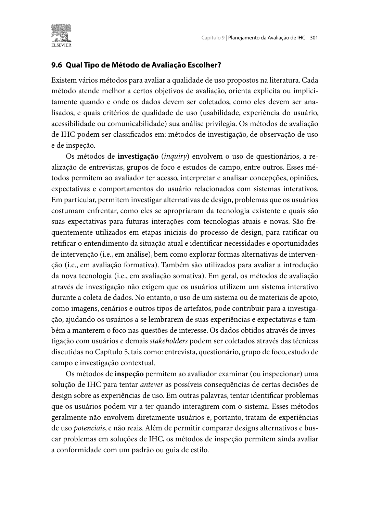
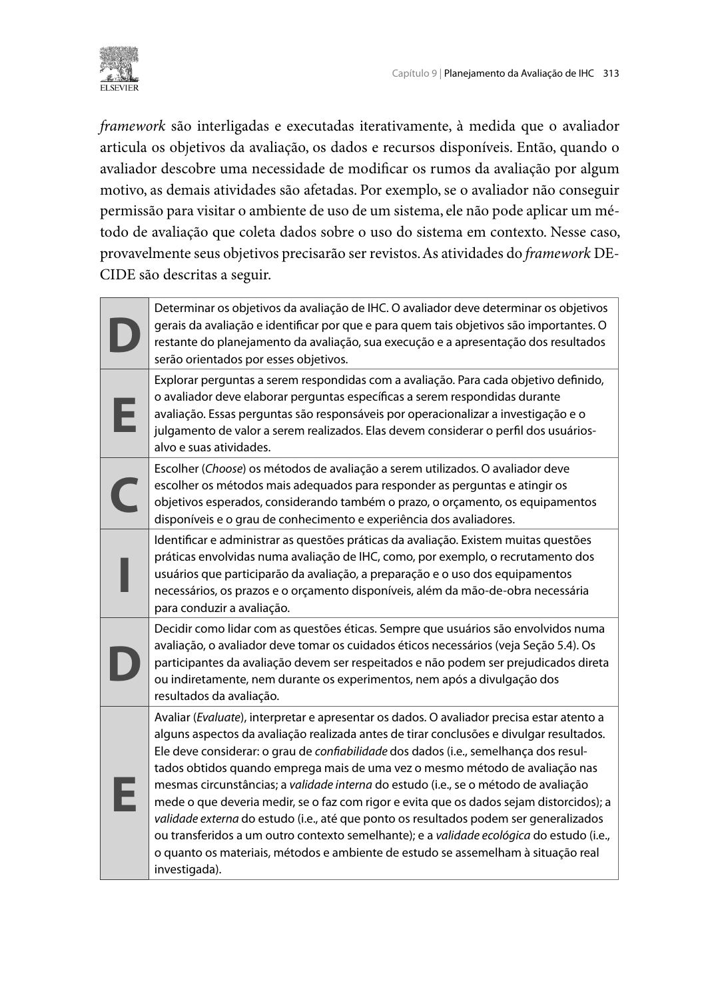

<span class="owner">Responsável: Caio Breno de Souza Bezerra — Etapa 4</span>

# Planejamento da avaliação

## Tabela de contribuição

A Tabela 1 registra a responsabilidade por este artefato.

| Integrante | Contribuição | Artefato / atividade |
| --- | --- | --- |
| [Caio Breno de Souza Bezerra](https://github.com/CaioBezerra-Dev) | Responsável pelo artefato; revisão da proposta pendente | [Conteúdo](#introducao) |
| Codex (OpenAI) | Pesquisa, organização e redação preliminar | [Agradecimentos](#agradecimentos) |

<p class="caption">Tabela 1 — Contribuição neste artefato.</p>
<p class="source">Fonte: organização da entrega individual (2026).</p>


## Introdução

Esta página reúne os planejamentos de avaliação do storyboard e da análise de tarefas. A leitura segue os objetivos e os métodos de cada estudo, depois as condições de aplicação compartilhadas. Os procedimentos são apresentados em texto e tabelas; as imagens das referências ficam recolhidas ao final.

**Objeto:** [roteiro de Camila e modelos de tarefas](index.md). O plano investiga a adequação da ideia de interação e problemas de compreensão na fase conceitual. Não é uma certificação de conformidade, nem uma medida de desempenho do portal. A coleta depende de concluir os desenhos, revisar o material e realizar o piloto.

## 1. Avaliação do storyboard

### DECIDE — planejamento da avaliação do storyboard

**D — Determinar os objetivos.** Examinar se o contexto é plausível para pessoas que desejam propor uma melhoria, se a sequência comunica a necessidade da revisão anterior ao envio e se o resultado é compreendido. Explorar alternativas de representação do compromisso, em articulação com segurança no uso e aprendizado da Etapa 3.

**E — Explorar as perguntas.** A Tabela 2 define perguntas, quadros e evidências esperadas. Aplicar primeiro o reconto espontâneo, sem explicar a história ou ensinar as regras. As evidências são critérios analíticos para o avaliador, não respostas a fornecer ao participante.

| ID | Pergunta a apresentar | Quadros | Evidência a registrar |
| --- | --- | --- | --- |
| SB1 | Conte o que está acontecendo e o que Camila quer conseguir | Q1–Q8 | Objetivo atribuído, sequência e desfecho narrados espontaneamente |
| SB2 | Essa situação faz sentido para alguém que deseja encaminhar uma proposta? O que falta no contexto? | Q1–Q2 | Adequação, experiências relevantes e discordâncias, sem exigir relato político |
| SB3 | Por que ela relê e muda o texto? O que poderia acontecer se deixasse para depois? | Q3–Q5 | Relação entre revisão e compromisso; compreensão espontânea ou após pergunta |
| SB4 | O que você entende que ela concluiu? O que ainda não aconteceu? | Q7–Q8 | Distinção entre envio, publicação e decisão legislativa |
| SB5 | Que parte está pouco clara? Como você a representaria? | Quadro indicado pela pessoa | Ambiguidade, alteração proposta e motivo |

<p class="caption">Tabela 2 — Perguntas da avaliação do storyboard.</p>
<p class="source">Fonte: plano individual baseado no cenário, nas evidências documentais e no DECIDE.</p>

**C — Escolher os métodos.** Entrevista semiestruturada apoiada no storyboard, com reconto inicial e perguntas abertas. Comparar, ao final, duas alternativas textuais de legenda para Q8: A, “Ideia recebida”; B, “Ideia recebida para avaliação; ainda não publicada”. Alternar a ordem A/B entre sessões e perguntar o que cada uma significa. Essas legendas são propostas de design, não mensagens transcritas da interface atual. Registrar conteúdo compreendido e preferência separadamente. A Figura 1 fundamenta a investigação por entrevistas.

**I — Identificar questões práticas.** Três participantes adultos, mais uma pessoa no piloto, recrutados conforme a seção 3. Exibir os oito quadros e sua transcrição em material estático legível. Reservar 17 minutos ao bloco SB. Não iniciar com apenas o roteiro; conferir o storyboard exportado antes do piloto.

**D — Decidir questões éticas.** Consentimento, gravação opcional e dados fictícios. Não perguntar posicionamento partidário nem exigir uma proposta real. A pessoa pode não se reconhecer no cenário, recusar perguntas ou encerrar sem prejuízo.

**E — Avaliar, interpretar e apresentar.** Relacionar cada resposta a SB1–SB5 e Q1–Q8. Classificar interpretação como espontânea, após pergunta, após explicação ou divergente. Ajudas devem ser registradas. Relatar contagens com denominador, falas autorizadas e diferenças entre participantes. Preferência por uma legenda não demonstra superioridade universal. Usar o [plano do relato SB](relatos.md#1-relato-da-avaliacao-do-storyboard).

## 2. Avaliação da análise de tarefas

### DECIDE — planejamento da avaliação da análise de tarefas

**D — Determinar os objetivos.** Investigar se a HTA e a CTT cobrem preparação, revisão, compromisso e interpretação do retorno, com operações e responsabilidades coerentes. Identificar omissões e alternativas antes de detalhar interfaces.

**E — Explorar as perguntas.** A Tabela 3 conecta perguntas aos modelos. O participante não precisa conhecer as notações HTA e CTT.

| ID | Pergunta / situação | Operações | Evidência a registrar |
| --- | --- | --- | --- |
| AT1 | Como você organizaria o trabalho para encaminhar uma ideia própria? | 0–4 | Sequência livre, atividades externas e etapas ausentes |
| AT2 | Você percebe um contato pessoal desnecessário no rascunho. O que faria e em que momento? | 2.1–2.3, 3.3 | Correção anterior ao envio, adiamento ou expectativa de edição posterior |
| AT3 | Você ainda não consegue acessar sua conta. Que parte do trabalho consegue fazer? | 1–3.1 | Distinção entre preparação externa e submissão autenticada |
| AT4 | Depois de tentar enviar, não está claro se o serviço recebeu. Como descreveria o resultado e o próximo passo? | 3.3–4.1 | Reconhecimento da incerteza; evitar tomar tentativa por sucesso |
| AT5 | Quem faz a avaliação posterior e o que significa concluir esta tarefa? | 4.2 | Limite entre trabalho da pessoa e moderação; interpretação do término |

<p class="caption">Tabela 3 — Perguntas da avaliação da análise de tarefas.</p>
<p class="source">Fonte: HTA/CTT e evidências E01–E08; elaboração do plano individual.</p>

**C — Escolher os métodos.** Primeiro, inspeção preparatória documental: Caio confere operações, planos, evidências e correspondência com Q1–Q8; revisor a indicar faz segunda leitura, se disponível. Depois, entrevista com cartões de tarefas em linguagem comum. Pedir sequência livre antes de revelar o modelo; apresentar cartões de preparar, revisar, autenticar, informar, enviar e interpretar, permitindo incluir ou retirar atividades. Explorar AT2–AT5 e só então comparar com a HTA. A inspeção não será nomeada avaliação heurística: não aplica um conjunto formal de heurísticas. Os fundamentos estão na Figura 1.

**I — Identificar questões práticas.** Usar os mesmos três participantes, em bloco de 15 minutos. Os cartões são um instrumento de discussão compartilhado na tela; o participante pode indicar a ordem oralmente. Registrar IDs da HTA na ficha do avaliador. A CTT é examinada tecnicamente na inspeção; seus símbolos não são teste de conhecimento do participante.

**D — Decidir questões éticas.** Explicar que se avalia o modelo, não a capacidade da pessoa. Autenticação e envio serão discutidos, sem abrir conta ou registrar manifestação. Aplicar as condições de consentimento e retirada da seção 3.

**E — Avaliar, interpretar e apresentar.** Classificar achados em omissão, ordem, alternativa, granularidade, feedback ou responsabilidade. Separar achados da inspeção de contribuições de participantes. Uma ordem alternativa, como autenticar antes de escrever, não é erro por diferir do cenário. Registrar o efeito da exposição anterior ao storyboard: esses dados não constituem avaliação independente de primeiro contato. Usar o [plano do relato AT](relatos.md#2-relato-da-avaliacao-da-analise-de-tarefas).

## 3. Aplicação dos estudos

As condições compartilhadas ficam reunidas abaixo. A agenda permanece proposta; nenhum convite ou sessão foi confirmado.

### Participantes, equipe e recursos


**Amostra inicial:** três participantes e uma pessoa adicional, distinta, para o piloto. O número cabe em três sessões individuais e permite comparar interpretações e alternativas neste estudo formativo. Não decorre de uma regra universal de suficiência, não assegura saturação e não representa estatisticamente os usuários do Senado. Não usar autores do material como participantes representativos. Se emergirem lacunas importantes, planejar nova rodada e registrar a limitação da primeira.

**Recrutamento:** convites privados na rede de contatos universitários e comunitários de Caio, buscando adultos que desejem encaminhar uma melhoria por canal institucional. Procurar duas pessoas sem envio anterior e uma com experiência, se disponível. Triagem: idade adulta; interesse no tipo de atividade; experiência com e-Cidadania e envio de ideias; dispositivo disponível; recursos de acessibilidade; disponibilidade. Não exigir alinhamento político nem conta gov.br para discutir os materiais. Registrar desvios da composição pretendida. Não há convites enviados.

**Texto do convite:** “Estamos avaliando uma história e a organização de uma tarefa de envio de ideia legislativa, em atividade acadêmica da UnB. Buscamos pessoas adultas interessadas nesse tipo de participação. A conversa remota dura até 45 minutos; não exige entrar em conta nem enviar proposta. A participação é voluntária e a gravação opcional. Se tiver interesse, podemos combinar um horário e esclarecer o uso dos registros.”

**Equipe necessária:** um facilitador (Caio) para condução e notas, mais um revisor para conferir materiais e interpretação, se confirmado. Com um único facilitador, reservar pausas para notas; não presumir registro simultâneo completo sem gravação.

**Local:** sessão remota individual em sala privada do Google Meet. **Facilitador previsto:** Caio Breno de Souza Bezerra. **Revisor:** integrante a indicar. **Recursos:** computador, conexão, microfone, material visual, transcrição acessível e fichas privadas.

**Duração proposta:** até 45 minutos por sessão, incluindo consentimento, contexto, dois blocos de avaliação e encerramento. **Orçamento incremental:** R$ 0 com recursos existentes, sem compra de licença; o tempo, a energia e a conexão são recursos consumidos. Se o editor exigir licença, essa previsão precisará ser revista antes de uso pago.

### Cronograma proposto


Os horários da tabela usam **Brasília (UTC−3)**. “Previsto” descreve intenção; “confirmado” só poderá ser registrado após aceite. As avaliações ocorrem depois do piloto e antes da entrega dos relatos em 25/10.

| Data | Horário | Atividade | Local e responsável | Situação |
| --- | --- | --- | --- | --- |
| 13/10/2026 | Sem horário de sessão | Preparar artefatos da entrega 4 | Cópia local; Caio | Rascunhos preparados, revisão pendente |
| 14/10/2026 | 18h–19h | Revisar checklist e ajustar materiais | Remoto; Caio + revisor a indicar | Previsto |
| 15/10/2026 | 18h–19h | Recrutar e confirmar sessões | Contato privado; Caio | Previsto |
| 16/10/2026 | 19h–19h45 | Piloto completo, pessoa PP01 | Google Meet, sala privada; Caio | Previsto |
| 17/10/2026 | 10h–11h | Corrigir roteiro e congelar versão | Local; Caio | Previsto |
| 19/10/2026 | 19h–19h45 | Sessão P01: SB 19h10–19h27; AT 19h27–19h42 | Google Meet, sala privada; Caio | Convite não confirmado |
| 20/10/2026 | 19h–19h45 | Sessão P02: SB 19h10–19h27; AT 19h27–19h42 | Google Meet, sala privada; Caio | Convite não confirmado |
| 21/10/2026 | 19h–19h45 | Sessão P03: SB 19h10–19h27; AT 19h27–19h42 | Google Meet, sala privada; Caio | Convite não confirmado |
| 22/10/2026 | 19h–20h30 | Consolidar e analisar SB e AT | Local; Caio | Previsto |
| 23/10/2026 | 19h–20h30 | Redigir os dois relatos e propor correções | Local; Caio | Previsto |
| 24/10/2026 | 10h–11h | Revisão dos relatos e anonimização | Remoto; revisor a indicar + Caio | Previsto |
| 25/10/2026 | Conforme prazo da disciplina | Entrega 5 | Aprender / GitHub Pages | Marco do plano de ensino |


<p class="caption">Tabela 4 — Agenda proposta para preparação, coleta e análise.</p>
<p class="source">Fonte: planejamento proposto para a entrega individual de Caio Breno de Souza Bezerra (2026).</p>


Se houver mudança importante após o piloto, realizar novo piloto antes de P01 e atualizar todas as datas afetadas. Se o prazo não comportar coleta suficiente, registrar a limitação e a pendência; não preencher resultados a partir de expectativas.


### Aspectos éticos e tratamento dos dados


**Participação livre:** reforçar que não há resposta certa e que desempenho acadêmico/profissional não está em avaliação. Pausas, recusa de perguntas e retirada são permitidas sem consequências. Nenhum consentimento será considerado concedido por silêncio.

**Consentimento específico:** usar o termo de consentimento com autorizações distintas para participar, gravar e divulgar trechos anonimizados. A sessão pode ocorrer só com notas. Se a pessoa não autorizar divulgação de citações, apresentar apenas síntese sem identificação. Não divulgar voz, rosto, conta de reunião, termo assinado ou arquivo bruto no site.

**Minimização:** registrar código P01–P03, experiência relevante, familiaridade com o portal, respostas e ocorrências ligadas às perguntas. Usar material fictício e evitar informação pessoal ou institucional. Se algo identificável surgir, interromper o registro quando possível e remover esse trecho antes de análise/divulgação.

**Acesso e retenção:** guardar consentimentos e contatos separadamente das fichas, em pasta privada protegida no equipamento de Caio, fora do repositório. O revisor acessará apenas registros anonimizados necessários à revisão. Apagar contatos, termos e eventuais gravações até 30 dias após o encerramento da disciplina; definir e registrar a data exata no consentimento da sessão. Para retirada, o participante pode usar o mesmo canal do convite até a anonimização definitiva, prevista para 24/10/2026. Após anonimização sem chave de associação, explicar que pode ser impossível localizar uma contribuição individual.

**Divulgação:** publicar no site somente resultados agregados e trechos anonimizados autorizados. Apresentações públicas devem seguir as mesmas escolhas de consentimento. Uma gravação “não listada” não equivale a confidencialidade; a gravação acadêmica da apresentação pode mostrar os artefatos sem mostrar entrevistas.

### Teste piloto — finalidade, data e critérios


**Autor do item de conteúdo:** Caio Breno de Souza Bezerra. Segundo Barbosa e Silva (2010, p. 307), o piloto avalia o planejamento, incluindo instruções, materiais, registro, duração e possibilidade de responder às perguntas com os dados produzidos. A Figura 2 reproduz a fonte.

**Data proposta:** 16/10/2026, 19h–19h45, antes das avaliações de 19–21/10. Aplicar ambos os blocos, testar leitura e registro, analisar brevemente os dados e corrigir o procedimento antes de iniciar a coleta definitiva. Se o storyboard não estiver exportado e conferido ou o material não estiver pronto, reagendar o piloto e as sessões dependentes.

**Critério de liberação:** consentimento compreensível; leitura possível; perguntas específicas aplicáveis; evidências registráveis; duração compatível. Mudança substancial exige novo piloto.

**Separação:** identificar o piloto como PP01 e excluí-lo das contagens, citações e conclusões definitivas. Conservar o registro dos ajustes metodológicos; não misturar suas respostas com P01–P03.

## 4. Fundamentação e instrumentos

**Autor do item de conteúdo: Caio Breno de Souza Bezerra.** Barbosa e Silva (2010, p. 301) distinguem investigação, observação de uso e inspeção. A investigação com entrevistas permite examinar interpretações e expectativas; a inspeção permite antecipar problemas a partir de um artefato. Esses fundamentos orientam, respectivamente, a conversa apoiada no storyboard e a revisão preparatória da análise de tarefas. O DECIDE organiza as decisões do planejamento e sua relação, conforme a sistematização apresentada pelos autores na p. 313. As Figuras 1–3 mostram as fontes de métodos, piloto e DECIDE. Os instrumentos serão preenchidos em cópias privadas. SB1–SB5 e AT1–AT5 identificam as perguntas; a versão dos quadros e modelos ficará registrada em cada sessão.

### Roteiro de condução

1. **0–5 minutos:** esclarecer objetivo, privacidade, contato e prazo de retenção; registrar consentimento.
2. **5–10 minutos:** registrar experiência pertinente e testar leitura/áudio; não explicar previamente o desfecho esperado.
3. **10–27 minutos:** apresentar storyboard, pedir reconto e aplicar SB1–SB5; discutir alternativas de legenda ao final.
4. **27–42 minutos:** obter sequência livre e discutir cartões e AT1–AT5; mostrar o modelo depois das respostas iniciais.
5. **42–45 minutos:** recolher observações finais, esclarecer dúvidas e lembrar o canal de retirada.

Durante os blocos, anotar momento, pergunta, quadro/operação, fala ou paráfrase, intervenção e problema. Se surgir dificuldade, perguntar “O que você esperava?” antes de explicar. Se precisar dar uma explicação para prosseguir, marcar a resposta subsequente como assistida. Não pressionar a pessoa a concluir. Problemas não resolvidos entram na [ficha de priorização](relatos.md#ficha-de-problema-e-plano-de-correcao).

### Ficha de sessão e observações


```text
Participante (código), data, início/fim e avaliador:
Versão dos materiais e confirmação do consentimento:
Perfil relevante para os critérios de recrutamento:
Pergunta / quadro ou operação de tarefa:
Fala autorizada ou paráfrase identificada:
Ocorrência observada:
Interpretação do avaliador:
Ajuda ou intervenção:
Questões não avaliadas e motivos:
```

### Termo de consentimento — modelo a adaptar


**Texto a apresentar e esclarecer antes da sessão:**

“Esta é uma atividade acadêmica de Interação Humano-Computador da UnB. Caio Breno de Souza Bezerra investigará a preparação, revisão e envio de uma ideia legislativa pelo e-Cidadania. A sessão remota dura até 45 minutos e usa uma história e cartões de tarefas. Avaliamos a proposta; não avaliamos você. Você pode pular qualquer pergunta, pedir pausa ou encerrar sem justificativa ou prejuízo. Pode haver desconforto ao comentar sua rotina; não é necessário identificar seu trabalho ou mostrar documentos privados. Não há remuneração nem benefício individual garantido.

Registraremos apenas experiência relevante, respostas e observações. Áudio/tela só serão gravados se você aceitar separadamente; sua câmera não é necessária. Registros brutos e consentimento ficarão privados com o responsável; o revisor poderá acessar registros anonimizados. Os resultados acadêmicos poderão aparecer no site e na apresentação, sem sua identificação. Contatos, termos e gravações serão apagados até 30 dias após o encerramento da disciplina, em data que será registrada abaixo. Você pode solicitar retirada pelo mesmo canal do convite até a anonimização definitiva, prevista para 24/10/2026 (a reconfirmar). Depois de desfeita a associação entre registro e pessoa, pode não ser possível localizar sua contribuição. Você pode pedir esclarecimentos agora ou pelo canal do convite.”

```text
Responsável: Caio Breno de Souza Bezerra
Contato efetivo para dúvidas/retirada: [preencher e entregar à pessoa antes da sessão]
Data exata prevista para exclusão dos registros privados: [preencher antes da sessão]
Participar da avaliação: [ ] aceito  [ ] não aceito
Gravar áudio e tela dos materiais: [ ] autorizo  [ ] não autorizo
Publicar trechos de fala anonimizados: [ ] autorizo  [ ] não autorizo
Data e forma de registro da manifestação: [preencher em ambiente privado]
```

Não iniciar a coleta sem contato e prazo preenchidos e manifestação afirmativa de participação. Recusa de gravação não impede a sessão; recusa de citação limita o relato a sínteses anônimas.


## Agradecimentos

A organização e a redação preliminar tiveram apoio de Codex (OpenAI). A revisão humana está pendente. Nenhuma sessão de avaliação foi realizada nesta versão.

## Histórico de versão

| Versão | Data | Descrição | Autor(es) | Revisor(es) |
| --- | --- | --- | --- | --- |
| 0.1 | 13/10/2026 | Primeira proposta, substituída após revisão do escopo | Caio Breno de Souza Bezerra | Pendente |
| 0.2 | 13/10/2026 | Consolidação em três páginas e retirada do recorte anterior; novo cenário pendente | Caio Breno de Souza Bezerra | Pendente |
| 0.3 | 13/10/2026 | Texto e tabelas visíveis, mantendo recolhidas somente as imagens das fontes | Caio Breno de Souza Bezerra | Pendente |
| 0.4 | 13/10/2026 | Vincula o novo perfil, cenário e instrumentos; referências visuais em anexo final | Caio Breno de Souza Bezerra, com apoio de Codex | Pendente |

## Referências

[1] BARBOSA, Simone Diniz Junqueira; SILVA, Bruno Santana da. **Interação humano-computador**. Rio de Janeiro: Elsevier, 2010. Cap. 9, p. 301–313.

[2] SALES, André Barros de. **Plano de Ensino FIHC 022026 — Turma 01**, v1. FCTE/UnB, 2026. Apresentação 4.

[3] OCR. **The OCR guide to storyboards**. Version 2, 2020. p. 3, 7–10.

## Anexo A — Trechos das referências

As figuras citadas no texto estão reunidas abaixo.

??? note "Figura 1 — Métodos de investigação e inspeção"

    

    <p class="caption">Figura 1 — Métodos de investigação e inspeção.</p>
    <p class="source">Fonte: Barbosa e Silva (2010, p. 301), PDF fornecido na disciplina.</p>

??? note "Figura 2 — Teste piloto"

    

    <p class="caption">Figura 2 — Teste piloto.</p>
    <p class="source">Fonte: Barbosa e Silva (2010, p. 307), PDF fornecido na disciplina.</p>

??? note "Figura 3 — Framework DECIDE"

    

    <p class="caption">Figura 3 — Framework DECIDE.</p>
    <p class="source">Fonte: Barbosa e Silva (2010, p. 313), PDF fornecido na disciplina.</p>
