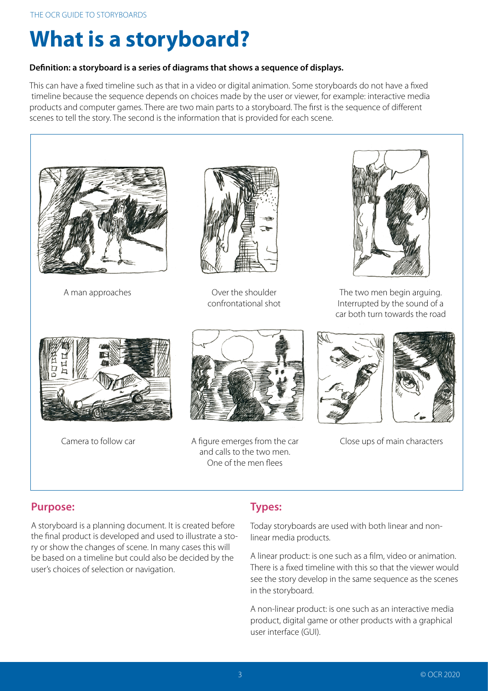

Responsável: Caio Breno de Souza Bezerra — Etapa 4

# Caio Breno — Storyboard e análise de tarefas

## Tabela de contribuição

A Tabela 1 registra a responsabilidade por este artefato.

| Integrante | Contribuição | Artefato / atividade |
| --- | --- | --- |
| [Caio Breno de Souza Bezerra](https://github.com/CaioBezerra-Dev) | Responsável pelo artefato; revisão da proposta pendente | [Conteúdo](#introducao) |
| Codex (OpenAI) | Pesquisa, organização e redação preliminar | [Agradecimentos](#agradecimentos) |

Tabela 1 — Contribuição neste artefato.

Fonte: organização da entrega individual (2026).

## Introdução

O trabalho de Caio utiliza [Camila Nogueira](../../entrega-2/individual/caio/perfil-2/persona.md), persona provisória do novo perfil **Proponente de ideia legislativa**. O objetivo é preparar, revisar e enviar uma ideia própria no e-Cidadania, compreendendo o compromisso e o resultado da submissão. A [análise documental](../../entrega-2/individual/caio/perfil-2/analise-documental.md) distingue regras oficiais de hipóteses de design.

A sequência de leitura é: **cenário e tarefas**, nesta página; **[planejamento das duas avaliações](avaliacao.md)**; **[planejamento dos dois relatos](relatos.md)**. São três páginas para reunir os artefatos individuais da entrega.

## Persona e atividade

Camila deseja formalizar uma melhoria e tem um rascunho preparado. No [cenário](../../entrega-2/individual/caio/perfil-2/cenario.md), percebe um contato pessoal desnecessário no texto e o remove antes de enviar. O episódio permite examinar prevenção de erro, autonomia e compreensão de estados, articulados às [metas da etapa 3](../../entrega-3/metas-usabilidade.md).

A escolha considera o elenco atualizado: o recorte de autoria complementa a votação de Letícia e a coordenação docente de Rafael. Os perfis de consulta e levantamento de notícias permanecem documentados, mas não são o objetivo desta atividade. As habilidades e expectativas de Camila são hipóteses; não foram coletadas numa nova entrevista.

## Storyboard — roteiro para produção

**Situação:** roteiro concluído; montagem e exportação em editor online pendentes. A tabela abaixo é a especificação dos quadros, não um storyboard finalizado. A produção deverá usar personagens, cenários e objetos do editor, com identificação da ferramenta e créditos. A figura exportada será chamada no texto e anexada ao final desta página.

O storyboard representará uma situação de uso do serviço atual, sem desenhar campos ou mensagens autenticadas que ainda não foram verificados. O retorno aparecerá de modo conceitual, identificado como resultado esperado. A Tabela 2 orienta a montagem e fornece a transcrição acessível planejada.

| Quadro | Cena a montar no editor | Texto / ação da personagem | HTA relacionada |
| --- | --- | --- | --- |
| Q1 — Motivação | Camila em casa, com computador e anotações | “Quero encaminhar minha proposta sobre clareza das orientações de serviços públicos.” | Objetivo 0; entrada de 1.2 |
| Q2 — Preparação | Rascunho e página de orientações, sem detalhes de interface inventados | Examina as regras e verifica se há ideia própria equivalente ainda aberta | 1.1–1.2 |
| Q3 — Compromisso | Camila relendo as orientações ao lado do rascunho | Percebe que deve revisar antes de enviar | 2.1; regra E06 |
| Q4 — Incidente | Rascunho com marcador “[contato pessoal fictício]”, sem número real | Identifica informação desnecessária no texto público | 2.1; regra E05 |
| Q5 — Correção | Camila ajustando e relendo o rascunho | Remove o contato e confere se a proposta mantém sua intenção | 2.2–2.3 |
| Q6 — Acesso e preenchimento | Computador, indicação conceitual de acesso pessoal e inserção da proposta | Acessa a ferramenta e informa o conteúdo revisado | 3.1–3.2 |
| Q7 — Envio | Camila confere o conteúdo antes de concluir | Decide efetivar o envio uma vez, após a conferência | 3.3 |
| Q8 — Resultado | Camila examina o retorno; legenda “resultado esperado” | Reconhece o recebimento e distingue o que ainda depende de avaliação | 4.1–4.2 |

Tabela 2 — Roteiro de oito quadros e correspondência com a HTA.

Fonte: elaboração de Caio com apoio de Codex; cenário e evidências E01–E08 do segundo perfil. Falas são ficcionais, não depoimentos.

Não incluir campanha de divulgação, conquista de apoios ou transformação automática em lei como desfecho. O objetivo desta sequência termina na submissão compreendida. O incidente deve ser legível também na transcrição. Após exportar, conferir a imagem quadro a quadro: a correspondência da Tabela 2 ainda não comprova a correspondência de desenhos não produzidos.

## Análise de tarefas

A [HTA e a CTT completas](../../entrega-2/individual/caio/perfil-2/analise-tarefas.md) são a fonte única do modelo, evitando manter versões divergentes em duas etapas. A hierarquia principal é:

1. **Preparar:** examinar regras e preparar o texto.
2. **Revisar:** conferir, corrigir quando necessário e decidir prosseguir.
3. **Submeter:** obter acesso, informar conteúdo e conferir antes de enviar.
4. **Interpretar:** examinar o retorno e distinguir as etapas posteriores.

O plano principal é `1 > 2 > 3 > 4`. A revisão pode se repetir. Adiar ou desistir antes de enviar é uma alternativa legítima, registrada como objetivo não concluído. Sem autenticação ou sem confirmação de recebimento, não presumir sucesso. A moderação é externa ao objetivo de envio.

A avaliação verificará se essas operações cobrem o trabalho e se os quadros comunicam seus limites. Não haverá submissão real durante a pesquisa.

## Fundamentação do storyboard

**Autor do item:** Caio Breno de Souza Bezerra. O guia OCR (2020, p. 3) apresenta o storyboard como uma sequência de cenas acompanhada de informações sobre cada cena. Na atividade de IHC, a narrativa deve tornar visíveis a pessoa, o contexto, a intenção, as ações e suas consequências. A Figura 1 apresenta a definição consultada.

## Agradecimentos

A organização, a pesquisa documental e a redação preliminar tiveram apoio de Codex (OpenAI). A revisão humana está pendente. Os desenhos do storyboard deverão ser montados em editor especializado; não foram gerados por IA nesta versão.

## Histórico de versão

| Versão | Data | Descrição | Autor(es) | Revisor(es) |
| --- | --- | --- | --- | --- |
| 0.1 | 13/10/2026 | Primeira proposta, substituída após revisão do escopo | Caio Breno de Souza Bezerra | Pendente |
| 0.2 | 13/10/2026 | Consolidação em três páginas e retirada do recorte anterior; novo cenário pendente | Caio Breno de Souza Bezerra | Pendente |
| 0.3 | 13/10/2026 | Texto e tabelas visíveis, mantendo recolhidas somente as imagens das fontes | Caio Breno de Souza Bezerra | Pendente |
| 0.4 | 13/10/2026 | Vincula o novo perfil, cenário e instrumentos; referências visuais em anexo final | Caio Breno de Souza Bezerra, com apoio de Codex | Pendente |

## Referências

[1] BARBOSA, Simone Diniz Junqueira; SILVA, Bruno Santana da. **Interação humano-computador**. Rio de Janeiro: Elsevier, 2010. Cap. 9, p. 301–313.

[2] SALES, André Barros de. **Plano de Ensino FIHC 022026 — Turma 01**, v1. FCTE/UnB, 2026. Apresentação 4.

[3] OCR. **The OCR guide to storyboards**. Version 2, 2020. p. 3, 7–10.

## Anexo A — Trechos das referências

As figuras citadas no texto estão reunidas abaixo.

??? note "Figura 1 — Definição de storyboard"

    <figure markdown="span">
    
    <figcaption>Figura 1 — Conceito de storyboard.</figcaption>
    </figure>
    
Fonte: OCR (2020, p. 3), PDF fornecido na disciplina.

