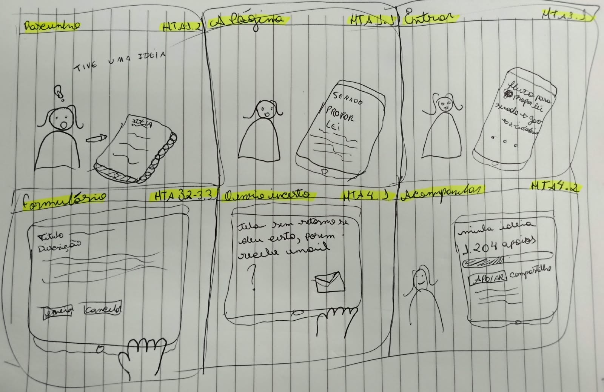

Responsável: Caio Breno de Souza Bezerra — Proponente de ideia legislativa · Autor do item: Caio Breno de Souza Bezerra

# Storyboard — Camila envia uma ideia legislativa

## Tabela de contribuição

A Tabela 1 identifica as contribuições neste artefato.

| Integrante | Contribuição | Artefato / atividade |
| --- | --- | --- |
| [Caio Breno de Souza Bezerra](https://github.com/CaioBezerra-Dev) | Seleção do storyboard manual e definição das melhorias | [Conteúdo](#recorte-do-reprojeto) |
| Codex (OpenAI) | Apoio à consulta das fontes, redação e organização documental | [Agradecimentos](#agradecimentos) |

Tabela 1 — Contribuições neste artefato.

Fonte: elaboração para o Grupo 06 (2026).

## Introdução

O storyboard de [Camila Nogueira](../../entrega-2/individual/caio/perfil-2/persona.md) apresenta uma pessoa que prepara uma ideia, procura o serviço do Senado, acessa o formulário, envia o texto e tenta entender o retorno. A Figura 1 é o desenho manual fornecido por Caio, em substituição aos seis quadros SVG anteriores. O [cenário](../../entrega-2/individual/caio/perfil-2/cenario.md) e a [HTA/CTT](../../entrega-2/individual/caio/perfil-2/analise-tarefas.md) continuam como referências da tarefa.

## Recorte do reprojeto

**Funcionalidade existente a melhorar:** preparar, revisar, enviar e acompanhar uma **ideia legislativa**. O projeto aperfeiçoará a continuidade da navegação, a revisão anterior ao envio e a compreensão do resultado. Não se trata de criar o direito de participação nem de transformar o envio do cidadão diretamente em projeto de lei aprovado.

O e-Cidadania **já é um serviço do Senado Federal**. A proposta de realizar o percurso “no próprio site do Senado” significa oferecer uma entrada clara pelo portal principal e manter contexto, identificação do serviço e caminho de retorno ao longo da participação. A integração é uma hipótese de interface, preservando a autenticação necessária e as regras do serviço.

O quadro “Envio incerto” motiva uma segunda hipótese: exibir, no próprio percurso, uma confirmação de recebimento com identificação da ideia, data e próximo passo, além de um acesso ao acompanhamento. Uma mensagem proposta seria: **“Ideia recebida. Ela será avaliada conforme os Termos de Uso. Recebimento não significa publicação nem aprovação de uma lei.”** A mensagem será testada no protótipo; não é uma transcrição da interface atual. A ausência de uma tela na documentação anterior não comprova que o serviço real deixe de oferecê-la.

A Tabela 2 delimita as melhorias e suas relações com a tarefa.

| ID | Melhoria proposta | Ponto de partida | Critério a investigar |
| --- | --- | --- | --- |
| RP01 | Entrada “Enviar ideia legislativa” pelo portal do Senado, com contexto e retorno consistentes | QD02–QD03; HTA 1.1 e 3.1 | A pessoa identifica o serviço, a instituição e como continuar após autenticar |
| RP02 | Confirmação explícita de recebimento e próximo passo no próprio percurso | Dúvida desenhada em QD05; HTA 4.1 | Distingue envio realizado de publicação e aprovação, sem repetir a submissão |
| RP03 | Revisão antes da confirmação final, com opção de voltar e aviso sobre conteúdo pessoal | HTA 2.1–2.3 e 3.3; revisão pouco visível em QD04 | Detecta e corrige conteúdo inadequado antes de enviar |
| RP04 | Acompanhamento contextualizado da própria ideia, com estado e explicação dos próximos passos | QD06; HTA 4.1–4.2 | Localiza a ideia e explica o significado do estado apresentado |

Tabela 2 — Escopo das melhorias propostas.

Fonte: hipóteses do projeto a partir do desenho manual, da HTA/CTT e das metas da Etapa 3.

## Quadros

A Figura 1 deve ser lida da esquerda para a direita: primeiro a linha superior e depois a inferior. A [avaliação do storyboard](planejamento-avaliacao-storyboard.md) usará esta versão **1.1, de 22/10/2026**. Os desenhos mostram a situação de partida e a dúvida a trabalhar; as soluções da Tabela 2 serão detalhadas no protótipo de papel.

<figure markdown="span">

<figcaption>Figura 1 — Storyboard manual de Camila Nogueira, versão 1.1.</figcaption>
</figure>

Fonte: desenho manual fornecido por Caio Breno de Souza Bezerra em 22 out. 2026. Imagem original preservada, sem redesenho por IA.

### Transcrição acessível e rastreabilidade

A Tabela 3 descreve o que está efetivamente desenhado e as lacunas que deverão ser discutidas na avaliação.

| ID / quadro | Conteúdo do desenho | Relação com a HTA | Questão para avaliação |
| --- | --- | --- | --- |
| QD01 — Rascunho | Camila pensa “Tive uma ideia” e prepara uma anotação | 1.2 — Preparar título e descrição | O rascunho inicial não dispensa consultar as regras antes de concluir a preparação |
| QD02 — A página | Acessa uma página identificada como “Senado / Propor lei” | 1.1 — Examinar regras e ideias abertas | “Propor lei” é linguagem do esboço; o rótulo proposto será “Enviar ideia legislativa”. Consulta às regras e às ideias não está detalhada no desenho |
| QD03 — Entrar | Encontra uma transição entre Senado, conta e e-Cidadania | 3.1 — Obter acesso autenticado | Identifica onde está e por que precisa entrar? O desenho não especifica a tela real de autenticação |
| QD04 — Formulário | Campos “Título” e “Descrição”; ações “Enviar” e “Cancelar” | 3.2–3.3 — Informar conteúdo e conferir/enviar | A revisão 2.1–2.3 está implícita e precisa ficar visível no reprojeto; não há telefone desenhado |
| QD05 — Envio incerto | Camila pergunta se deu certo; um envelope representa o e-mail | 4.1 — Verificar o retorno | Como reconhecer o recebimento no próprio percurso, sem depender apenas de esperar um e-mail? A cena é uma dúvida narrativa, não uma falha observada no portal |
| QD06 — Acompanhar | “Minha ideia”, “1.204 apoios”, barra de progresso, “Apoiar” e “Compartilhe” | 4.2 — Interpretar estado e apoios | Há passagem de tempo: esta cena pressupõe publicação posterior. O número é ilustrativo, não resultado da avaliação |

Tabela 3 — Transcrição dos seis quadros e relação com as tarefas.

Fonte: elaboração para o Grupo 06 (2026).

Os quadros não representam todas as operações em detalhe. A revisão anterior ao envio, a consulta às regras e a distinção entre recebimento e publicação são pontos deliberados de discussão. A ordem narrativa começa com um rascunho; a HTA exige consultar as regras antes de concluir o texto. Essa diferença deve ser explicitada, em vez de declarar correspondência integral entre narrativa e modelo.

## Fundamentação

**Autor do item:** Caio Breno de Souza Bezerra.

Barbosa e Silva (2010, p. 294, 301) situam a avaliação formativa durante o desenvolvimento e descrevem a investigação apoiada em materiais que permitam discutir expectativas. O storyboard apresenta contexto, intenção e consequências para essa discussão. A relação entre quadro, objetivo e operação permite examinar a cobertura das tarefas (p. 191–196). As metas de segurança e aprendizado da [Etapa 3](../../entrega-3/metas-usabilidade.md) orientam RP02 e RP03; linguagem e feedback seguem o [guia de estilo](../../entrega-3/guia-de-estilo.md).

As regras oficiais distinguem ideia, publicação, apoios e análise legislativa. O envio não permite alteração posterior do texto. Por isso a proposta preserva a revisão **antes** de enviar. Fontes: [Como funciona a Ideia Legislativa](https://www12.senado.leg.br/ecidadania/comofuncionaideia) e [Termos de Uso](https://www12.senado.leg.br/ecidadania/termo), consultados em 22/10/2026.

## Continuidade

Consultar o [planejamento da avaliação](planejamento-avaliacao-storyboard.md), o [planejamento do relato](planejamento-relato-storyboard.md) e os [artefatos de Caio na Etapa 5](../../entrega-5/individual/caio/index.md). A confirmação de RP01–RP04 dependerá da discussão do material e, depois, da execução de tarefas no protótipo.

## Agradecimentos

Os quadros desta versão são do desenho manual fornecido por Caio. Grok (xAI) produziu os SVG da versão anterior, substituídos nesta revisão. Codex (OpenAI) apoiou a transcrição acessível, o esclarecimento do escopo e a organização do texto.

## Histórico de versão

| Versão | Data | Descrição | Autor(es) | Revisor(es) |
| :---: | :---: | --- | --- | --- |
| 1.0 | 13/10/2026 | Seis quadros SVG do envio de uma ideia, do rascunho ao acompanhamento | [Caio Breno de Souza Bezerra](https://github.com/CaioBezerra-Dev) | [Bruno Ferreira Dornelas](https://github.com/brunnf) |
| 1.1 | 22/10/2026 | Substitui os SVG pelo storyboard manual; explicita dúvidas, lacunas e melhorias RP01–RP04 | [Caio Breno de Souza Bezerra](https://github.com/CaioBezerra-Dev) | [Bruno Ferreira Dornelas](https://github.com/brunnf) |

## Referências

[1] BARBOSA, Simone Diniz Junqueira; SILVA, Bruno Santana da. *Interação humano-computador*. Rio de Janeiro: Elsevier, 2010. p. 191–196, 294, 301.

[2] OCR. *The OCR guide to storyboards*. Version 2, 2020. p. 3.

[3] SENADO FEDERAL. [Como funciona a Ideia Legislativa](https://www12.senado.leg.br/ecidadania/comofuncionaideia); [Termos de Uso](https://www12.senado.leg.br/ecidadania/termo). Acesso em: 22 out. 2026.

[4] GRUPO 06. [Análise de tarefas de Camila](../../entrega-2/individual/caio/perfil-2/analise-tarefas.md); [metas de usabilidade](../../entrega-3/metas-usabilidade.md); [guia de estilo](../../entrega-3/guia-de-estilo.md). 2026.
