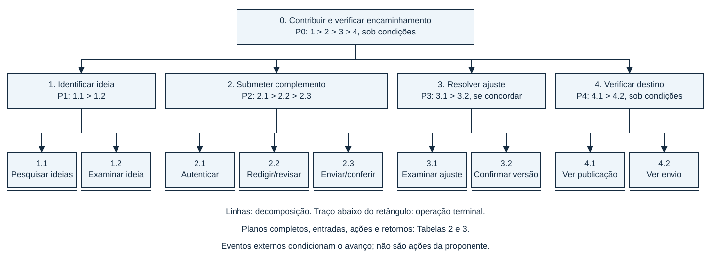
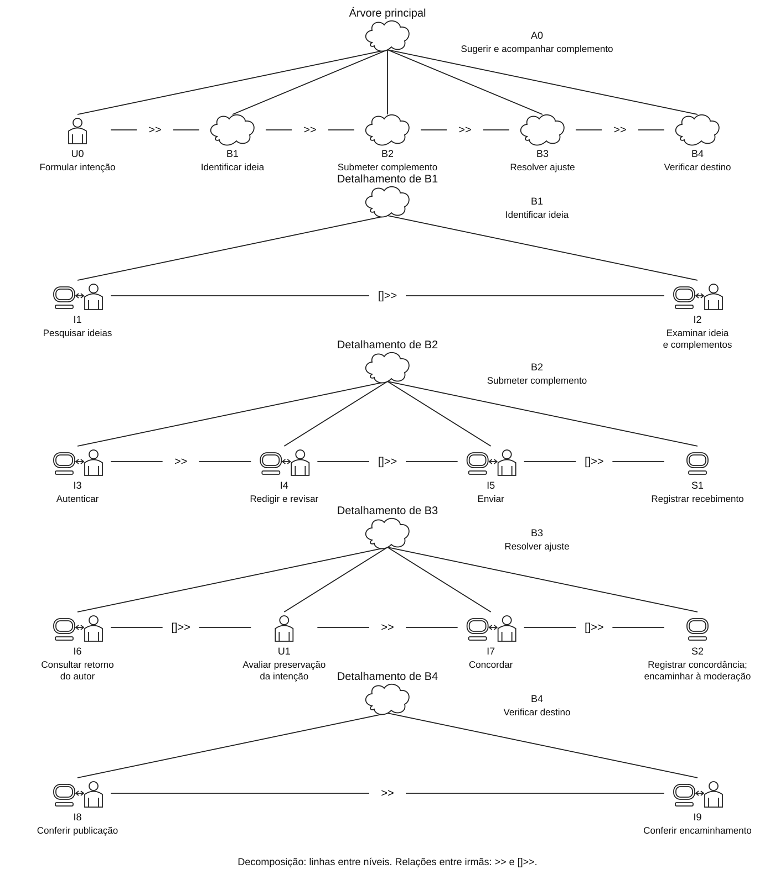

Responsável: Bruno Ferreira Dornelas — Complementos de ideias legislativas · Autor do item: Bruno Ferreira Dornelas

# Análise de tarefas — Sugerir e acompanhar um complemento

## Tabela de contribuição

A Tabela 1 registra as contribuições neste artefato.

| Integrante / ferramenta | Contribuição | Artefato / atividade |
| --- | --- | --- |
| [Bruno Ferreira Dornelas](https://github.com/brunnf) | Definição do recorte e organização da avaliação | [Introdução](#introducao) |
| Codex (OpenAI) | Apoio à reformulação do conteúdo, instrumentos e fundamentação | [Agradecimentos](#agradecimentos) |

Tabela 1 — Contribuições.

Fonte: elaboração do projeto (2026).

## Introdução

A avaliação aborda a proposta de **sugerir complementos a ideias legislativas**, com **Letícia Oliveira**, do perfil participante, como referência. A [persona](../../../entrega-2/individual/heitor/persona.md) e a [entrevista](../../../entrega-2/individual/heitor/entrevista-observacao.md) sustentam participação em pautas coletivas, escrita de comunicações e acesso sob demanda. A situação da biblioteca e a disposição para negociar um complemento são hipóteses do cenário. A entrevista de 24/10/2026 e seus limites estão analisados no [relato da Etapa 5](../../../entrega-5/individual/bruno/relato-analise-tarefas.md). A entrevista anterior observou votação em consulta pública; não comprovou o uso ou a necessidade desta nova funcionalidade.

O recorte acompanha quem sugere: identificar uma necessidade antes de abrir o computador, pesquisar, encontrar ideia semelhante, enviar complemento, examinar ajuste, confirmar material, conferir publicação e verificar encaminhamento. Autor da ideia e moderação são agentes externos. O serviço proposto preserva o texto original, separa os apoios e inclui complementos publicados como anexos consultivos no encaminhamento confirmado. Essas regras são hipóteses de projeto, não funcionalidades implantadas ou garantias do Senado.

Modelo prospectivo do caminho com sessão inicialmente ausente, ajuste aceito, publicação e encaminhamento confirmado. O caminho já autenticado não faz parte desta decomposição. A análise da Oficina Legislativa permanece na Etapa 2 como registro de outro recorte.

## Item de conteúdo da disciplina

**Autor do item:** Bruno Ferreira Dornelas.

A HTA decompõe objetivos e explicita planos, entradas, ações e feedbacks; a decomposição deve ser verificada com as partes interessadas (BARBOSA; SILVA, 2010, p. 193–196). A CTT distingue tarefas do usuário, sistema, interativas e abstratas e relações temporais (p. 203–205). A HTA abaixo tem diagrama e tabela; a CTT tem árvore com os símbolos de tipos de tarefa e operadores do livro, acompanhada de descrição textual. O modelo é uma hipótese a avaliar, não observação de uso real.

## Objetivo, fronteiras e critérios de conclusão

**Objetivo 0:** apresentar uma contribuição que preserve a intenção da proponente e verificar se a versão publicada integra o encaminhamento da ideia.

A ativação ocorre quando Letícia formula a necessidade de atendimento noturno. O êxito narrativo é localizar o mesmo texto confirmado entre os anexos do encaminhamento, com identificação e apoios próprios. Na avaliação, registrar se a pessoa reconhece a redação, os responsáveis e o resultado. São indicadores propostos para discussão, não métricas já acordadas nem taxa de sucesso de uma interface.

Falhas relevantes: confirmar texto contrário à intenção; confundir apoio ao original com apoio ao complemento; entender publicação ou envio como aprovação legislativa. Rejeição pelo autor, discordância, reprovação na moderação e encerramento sem a meta são caminhos alternativos fora desta decomposição, a aprofundar antes da implementação.

## HTA — Hierarquia e planos

A Figura 1 apresenta a hierarquia. As operações terminais possuem um traço adicional abaixo do retângulo; as conexões representam decomposição, não sequência. A ordem está nos planos.

Figura 1 — Decomposição hierárquica do complemento.

Fonte: elaboração do projeto, orientada por Barbosa e Silva (2010, p. 193–196).

A Tabela 2 apresenta os planos. O símbolo `>` representa sequência, conforme a Figura 6.1 do livro (p. 193). As condições são descritas em texto, fora da notação. Não há seleção `/` ou paralelismo `+` neste caminho.

| Plano | Regra |
| --- | --- |
| P0 | 1 > 2 > 3 > 4, no caminho de ajuste aceito, publicação e encaminhamento confirmado. Aguardar eventos externos antes das operações dependentes. |
| P1 | 1.1 > 1.2; repetir pesquisa se necessário. Prosseguir se existir ideia pertinente e o complemento ainda fizer sentido. |
| P2 | 2.1 > 2.2 > 2.3; revisar 2.2 até decidir enviar. |
| P3 | Após retorno do autor: 3.1 > 3.2 se concordar. Discordância exige outro ramo, não concordância automática. |
| P4 | 4.1 > 4.2. Após aprovação na moderação/publicação: 4.1; após encaminhamento confirmado: 4.2. A confirmação da proponente não produz esses eventos. |

Tabela 2 — Planos da HTA.

Fonte: elaboração do projeto (2026).

A Tabela 3 detalha as operações terminais.

| Operação | Entrada | Ação | Feedback |
| --- | --- | --- | --- |
| 1.1 | Intenção de contribuir | Buscar como participar e pesquisar bibliotecas | Resultados de ideias |
| 1.2 | Resultados | Ler ideia e complementos, identificar lacuna | Decisão de complementar |
| 2.1 | Ideia selecionada; sessão ausente | Entrar em conta | Identificação e formulário disponíveis |
| 2.2 | Formulário | Escrever título, texto, justificativa e revisar | Versão coerente com a intenção |
| 2.3 | Texto revisado | Enviar e conferir confirmação | Aguardando avaliação do autor |
| 3.1 | Retorno com ajuste | Comparar versões e avaliar intenção | Decisão sobre o ajuste |
| 3.2 | Concordância | Confirmar versão e conferir retorno | Versão confirmada; em moderação |
| 4.1 | Publicação aprovada | Ler texto, autoria e apoios próprios | Versão acordada reconhecida, original preservado |
| 4.2 | Encaminhamento confirmado | Abrir material e localizar complemento | Contribuição em anexo consultivo, sem garantia de aprovação |

Tabela 3 — Entradas, ações e feedbacks.

Fonte: elaboração do projeto (2026).

## CTT — Tipos e relações temporais

A Figura 2 apresenta a árvore CTT: pessoa para tarefa do usuário, computador para tarefa do sistema, pessoa e computador ligados por seta dupla para tarefa interativa e nuvem para tarefa abstrata (Figura 6.4, p. 203). As linhas contínuas indicam decomposição; as relações entre tarefas irmãs usam os operadores da Figura 6.5 (p. 204). Os detalhes B1–B4 expandem os nós da mesma árvore.

Figura 2 — Árvore CTT do caminho de sugestão e acompanhamento.

Fonte: elaboração do projeto segundo Barbosa e Silva (2010, Figuras 6.4–6.6, p. 203–205).

A Tabela 4 registra as folhas. U = usuário (atividade cognitiva fora do diálogo); I = interativa; S = sistema. A0 e B1–B4 são tarefas abstratas. Autor e moderação não são tarefas do sistema de Letícia: suas decisões são condições externas.

| ID / tipo | Tarefa |
| --- | --- |
| U0 / usuário | Formular intenção |
| I1 / interativa | Pesquisar ideias |
| I2 / interativa | Examinar ideia e complementos |
| I3 / interativa | Autenticar |
| I4 / interativa | Redigir e revisar |
| I5 / interativa | Enviar |
| S1 / sistema | Registrar recebimento |
| I6 / interativa | Consultar retorno do autor |
| U1 / usuário | Avaliar preservação da intenção |
| I7 / interativa | Concordar |
| S2 / sistema | Registrar concordância e encaminhar à moderação |
| I8 / interativa | Conferir publicação |
| I9 / interativa | Conferir encaminhamento |

Tabela 4 — Tarefas da CTT.

Fonte: elaboração do projeto (2026).

A leitura textual equivalente da árvore usa `>>` (ativação) e `[]>>` (ativação com passagem de informação), conforme as p. 203–204. A0 e B1–B4 identificam tarefas abstratas; U, I e S são identificadores auxiliares, não substitutos dos símbolos gráficos.

- A0 decompõe-se em U0 >> B1 >> B2 >> B3 >> B4.
- B1 decompõe-se em I1 []>> I2: os resultados da pesquisa são examinados.
- B2 decompõe-se em I3 >> I4 []>> I5 []>> S1: a versão revisada é enviada e o conteúdo enviado é registrado.
- B3 decompõe-se em I6 []>> U1 >> I7 []>> S2: o ajuste recebido fundamenta a avaliação; a concordância e a versão escolhida são registradas.
- B4 decompõe-se em I8 >> I9.

`>>` exige que a tarefa anterior termine, mas não garante que todas as condições para a próxima já estejam satisfeitas. Neste cenário, consultar o retorno depende da resposta do autor; conferir a publicação depende da aprovação na moderação; conferir o encaminhamento depende de sua confirmação após a meta. São precondições do cenário, não símbolos nem operadores adicionais da CTT. U1 resulta em concordância no caminho modelado; a discordância exige outro ramo, ainda fora deste recorte.

A correspondência com QD01–QD08 está na [Tabela 3 do storyboard](storyboard.md#uso-na-avaliacao).

## Conferência técnica e avaliação

A conferência técnica inclui: CT01, hierarquia, operações e planos HTA; CT02, entradas, ações, feedbacks e cobertura; CT03, tipos CTT; CT04, operadores e informação transmitida; CT05, consistência entre modelos, tabelas e quadros; CT06, fontes, hipóteses e dependências externas. Registrar conforme/não conforme/não verificado com evidência e material. A entrevista foi realizada em 24/10/2026, após o ensaio individual de 23/10/2026. O [relato concluído](../../../entrega-5/individual/bruno/relato-analise-tarefas.md) responde AT-Q1–AT-Q6 e apresenta CT01–CT06, incluindo a ambiguidade de ordem no QD04. As decisões para o próximo protótipo estão no [planejamento do papel](../../../entrega-5/individual/bruno/planejamento-avaliacao-prototipo-papel.md#decisoes-a-partir-das-entrevistas).

A Figura 3 reproduz a referência de decomposição e validação.

Figura 3 — Verificação da decomposição.

Fonte: Barbosa e Silva (2010, p. 196).

## Agradecimentos

O Codex (OpenAI) apoiou a redação, a organização dos instrumentos e a conferência das referências. A responsabilidade acadêmica é de Bruno Ferreira Dornelas.

## Histórico de versão

| Versão | Data | Descrição | Autor(es) | Revisor(es) |
| --- | --- | --- | --- | --- |
| 0.1 | 23/10/2026 | Modela o caminho prospectivo do complemento com Letícia, HTA e expressões CTT. | [Bruno Ferreira Dornelas](https://github.com/brunnf) | [Caio Breno de Souza Bezerra](https://github.com/CaioBezerra-Dev) |
| 0.2 | 24/10/2026 | Retira versão do corpo e alinha a conferência técnica aos planejamentos | [Bruno Ferreira Dornelas](https://github.com/brunnf) | [Caio Breno de Souza Bezerra](https://github.com/CaioBezerra-Dev) |

## Referências

[1] BARBOSA, Simone Diniz Junqueira; SILVA, Bruno Santana da. **Interação humano-computador**. Rio de Janeiro: Elsevier, 2010.
