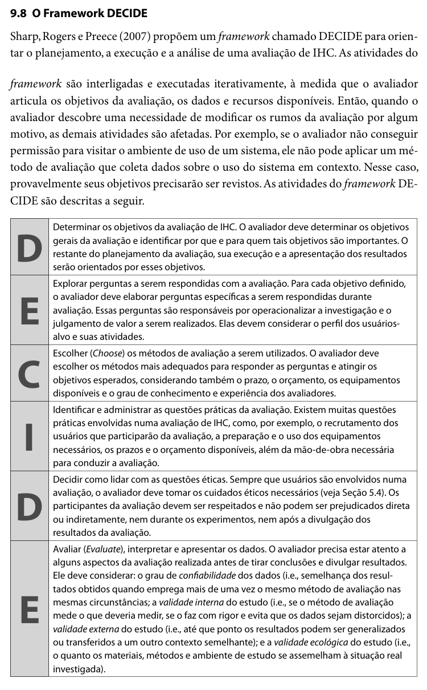
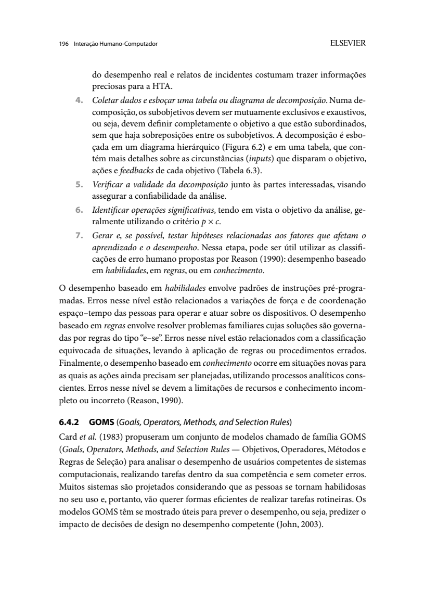
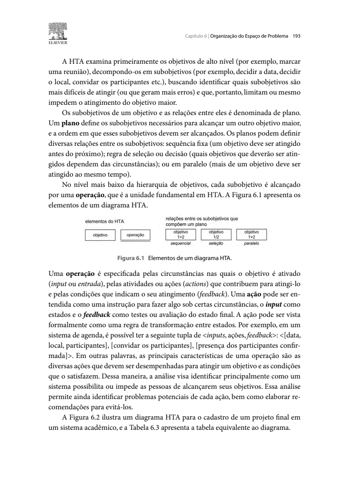
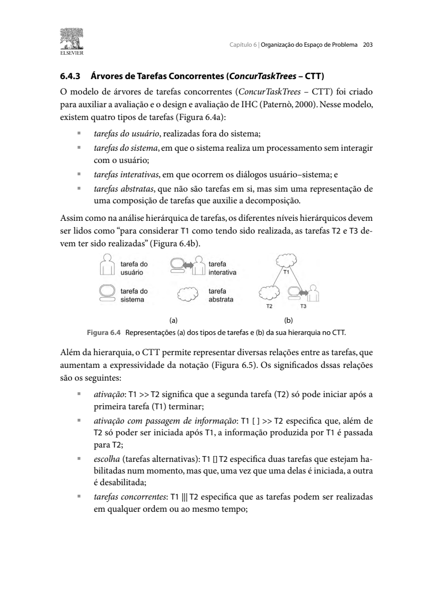
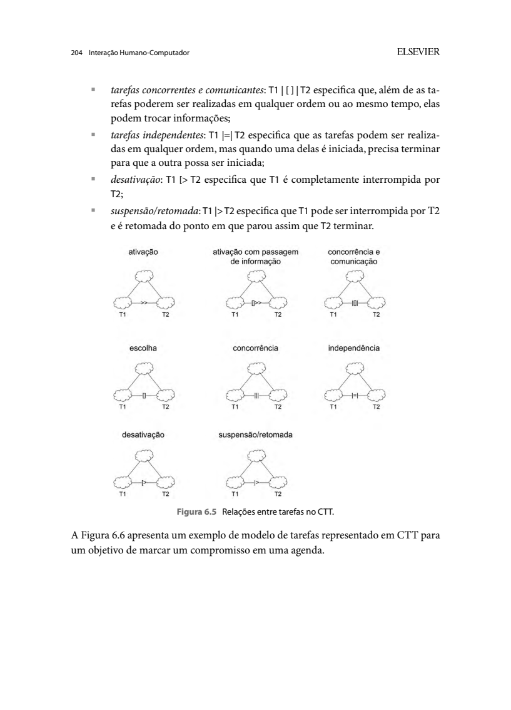
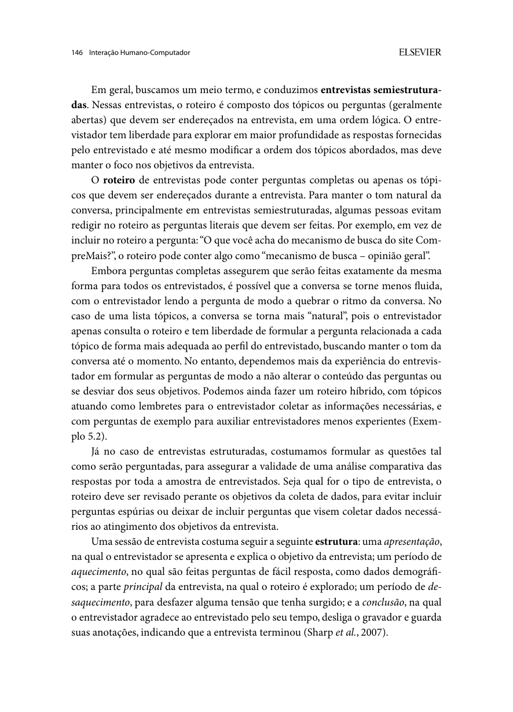
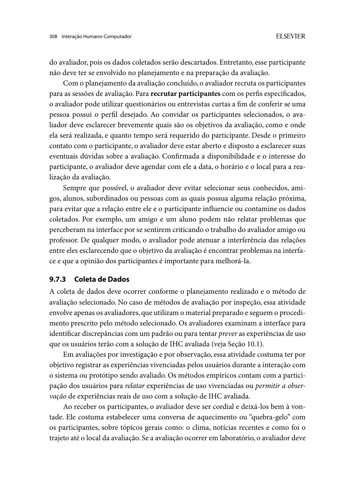
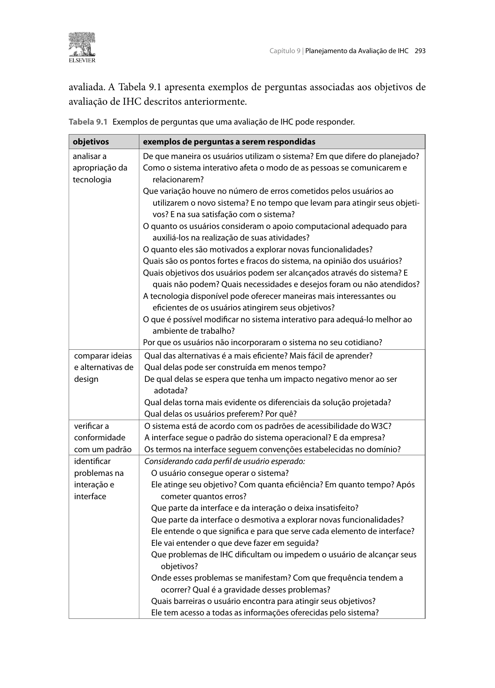

Responsável: Bruno Ferreira Dornelas — Complementos de ideias legislativas · Autor do item: Bruno Ferreira Dornelas

# Planejamento da avaliação da análise de tarefas

## Tabela de contribuição

A Tabela 1 registra quem contribuiu neste artefato.

| Integrante | Contribuição | Artefato / atividade |
| --- | --- | --- |
| [Bruno Ferreira Dornelas](https://github.com/brunnf) | Definição do escopo e do perfil da avaliação | [Contextualização](#contextualizacao) |
| Codex (OpenAI) | Apoio à redação e à organização do documento | [Agradecimentos](#agradecimentos) |

Tabela 1 — Contribuição no planejamento.

Fonte: elaboração para o Grupo 06 (2026).

## Introdução

Este planejamento organiza a avaliação formativa da análise de tarefas da proposta de **sugerir e acompanhar complementos de ideias legislativas**, por entrevista semiestruturada remota. A participante é identificada como **P01**. O ensaio individual ocorreu em **23/10/2026** e a entrevista foi realizada e gravada em **24/10/2026**. A execução, a caracterização da participante e os resultados estão descritos no [relato da Etapa 5](../../../entrega-5/individual/bruno/relato-analise-tarefas.md).

## Contextualização

A referência é [Letícia Oliveira](../../../entrega-2/individual/heitor/persona.md), do perfil participante. A [entrevista anterior](../../../entrega-2/individual/heitor/entrevista-observacao.md) sustenta participação em pautas coletivas e escrita de comunicações; a biblioteca e a negociação de complementos são hipóteses do cenário. O recorte acompanha quem sugere; autor, moderação e encaminhamento institucional são dependências externas. Não haverá acesso a contas ou publicação real no portal.

## Item de conteúdo da disciplina

**Autor do item:** Bruno Ferreira Dornelas.

A HTA organiza objetivos, planos e operações; a decomposição deve ser verificada com as partes interessadas (BARBOSA; SILVA, 2010, p. 193–196). A CTT diferencia tipos de tarefas e relações temporais (p. 203–205). O DECIDE organiza o estudo (p. 313). As Figuras 1–10 do [Apêndice A](#apendice-a-trechos-do-livro) apresentam as referências de planejamento, modelos, entrevista e piloto.

## D — Determinar os objetivos

- **O1 — Avaliar a adequação da ideia de design:** investigar quais necessidades relatadas podem ser atendidas pela proposta e quais condições exigem sua revisão. O resultado orientará o Grupo 06 a manter, modificar ou aprofundar o recorte.
- **O2 — Identificar problemas na representação da interação:** localizar dificuldades de compreensão, lacunas, decisões e dependências que possam prejudicar o percurso proposto. O resultado orientará a revisão dos materiais antes de desenvolver a interface.

O1 se apoia na avaliação de ideias de design, que pode ser comparativa ou não; O2 delimita a identificação de problemas ao modelo conceitual (BARBOSA; SILVA, 2010, p. 291–294). São dois objetivos operacionais do projeto, não uma quantidade exigida pelo DECIDE. A apropriação no cotidiano, o desempenho e a usabilidade do serviço implementado ficam fora deste estudo, pois a funcionalidade ainda é uma proposta.

## E — Explorar perguntas a serem respondidas

As perguntas da Tabela 2 são **questões de avaliação a serem respondidas por Bruno na análise**, usando os dados da entrevista e as fontes pertinentes. Elas não são perguntas a ler diretamente para P01. O roteiro de coleta aparece em seção própria: uma conversa pode produzir evidências para várias questões, e uma questão pode exigir diferentes evidências. A formulação segue a operacionalização do DECIDE (BARBOSA; SILVA, 2010, p. 292–293, 313).

| ID | Objetivo | Questão de avaliação | Evidências a analisar |
| --- | --- | --- | --- |
| AT-Q1 | O1 | O objetivo modelado corresponde a resultados relevantes nas situações relatadas? | Relato inicial, finalidade e critério de conclusão; HTA 0 |
| AT-Q2 | O1 | Quais condições e informações tornam o percurso adequado ou inadequado ao contexto relatado? | Recursos, dependências e condições de execução; HTA 1–4 |
| AT-Q3 | O2 | A decomposição cobre o caminho declarado, sem lacunas internas, sobreposições ou ordem incoerente? | Discussão das etapas e conferência CT01–CT05; planos P0–P4 |
| AT-Q4 | O2 | O modelo distingue ações da proponente, respostas do sistema e decisões externas? | Interpretação das responsabilidades e conferência dos tipos e condições; HTA 3–4 |
| AT-Q5 | O2 | Que necessidades de revisão surgem diante de discordância, espera ou ausência de encaminhamento? | Expectativas e limites dos ramos excluídos do modelo |
| AT-Q6 | O2 | Os critérios de conclusão permitem reconhecer o encaminhamento sem confundi-lo com aprovação? | Explicação do resultado, condições e feedback; HTA 4.2 |

Tabela 2 — Questões que orientarão a análise das tarefas.

Fonte: questões do projeto, orientadas por Barbosa e Silva (2010, p. 193–196, 291–294, 313).

## C — Escolher os métodos

Será realizada **entrevista semiestruturada apoiada nos modelos e em descrição em linguagem comum** (BARBOSA; SILVA, 2010, p. 145–149, 196, 301). P01 discutirá o trabalho proposto sem precisar dominar HTA/CTT. Bruno explicará a leitura por exemplo neutro, registrando esclarecimentos. A equipe realizará separadamente a conferência CT01–CT06; seus resultados apoiarão a análise de coerência dos modelos, sem serem atribuídos à entrevistada.

Esta entrevista investiga compreensão e adequação esperada. A aplicação do item 7 da lista da disciplina, que menciona prototipação em papel, permanece uma questão de adequação ao enunciado oficial, registrada na [conferência dos planejamentos](conferencia-planejamentos.md#metodo-a-descrever-nos-relatos).

## I — Identificar e administrar questões práticas

### Participantes, recrutamento e equipe

**P01** foi convidada de forma voluntária por **contato direto na rede acadêmica e comunitária** de adultos interessados ou com experiência prévia em participação pública digital, sem vínculo de subordinação nem participação na elaboração dos modelos. Sua caracterização considera participação cívica ou coletiva, envio de sugestões, navegação e escrita digital e necessidades de acessibilidade, quando abordados. Não é necessário ter a mesma profissão ou idade de Letícia. Um caso exploratório permite identificar indícios e questões de revisão, sem representar todo o público; lacunas relevantes poderão exigir coleta adicional (BARBOSA; SILVA, 2010, p. 305, 312).

O planejamento prevê sessão piloto anterior à coleta oficial (`23/10/2026`) e entrevistas em `24/10/2026`. Na execução efetiva, o ensaio individual de Bruno ocorreu em 23/10/2026 sem exigir ajustes, e as duas entrevistas ocorreram presencialmente em 24/10/2026, no mesmo encontro; as condições efetivas e os resultados estão registrados no [relato da Etapa 5](../../../entrega-5/individual/bruno/relato-analise-tarefas.md).

O planejamento atribui a Bruno o convite, a moderação, o registro e a análise, e a Caio a revisão. O ambiente previsto é sessão remota via Google Meet (link privado) ou encontro presencial em sala/ambiente reservado silencioso na FCTE/UnB ou local acordado com a participante, com dispositivo para ampliação dos diagramas, áudio e conexão. O orçamento previsto é de **R$ 0,00** (custo zero, com equipamentos próprios e participação voluntária sem despesas adicionais). Fazer pausas para notas; se acesso, legibilidade ou conexão impedirem a discussão, reagendar. O registro prevê anotações acompanhadas de áudio e/ou vídeo mediante autorização prévia expressa no TCLE.

Conferir a ordem efetiva, as pausas e as explicações nas gravações: P01 é a mesma pessoa nos dois relatos, de modo que a segunda discussão não constitui observação independente.

### Materiais e delimitação da leitura

Preparar [HTA e CTT](analise-tarefas.md), descrição equivalente, exemplo neutro de leitura, roteiro, ficha de evidências, conferência técnica e TCLE. A HTA e a CTT possuem diagramas e descrições textuais equivalentes. A Tabela 3 delimita o material a discutir.

| Bloco | HTA / CTT | Aspecto |
| --- | --- | --- |
| Identificar ideia | 1.1–1.2 / B1, I1–I2 | Pesquisa, pertinência e lacuna |
| Submeter complemento | 2.1–2.3 / B2, I3–I5, S1 | Autenticação, redação, revisão e envio |
| Resolver ajuste | 3.1–3.2 / B3, I6, U1, I7, S2 | Preservação da intenção e decisão |
| Verificar destino | 4.1–4.2 / B4, I8–I9 | Publicação e encaminhamento condicionado |
| Conjunto | 0, P0 / A0, U0 | Objetivo e fronteiras |

Tabela 3 — Cobertura da leitura dos modelos.

Fonte: elaboração do projeto (2026).

O modelo representa o caminho de ajuste aceito, publicação e encaminhamento confirmado. Discordância, rejeição e ausência de encaminhamento serão discutidas para identificar necessidades de ampliação; a entrevista não demonstrará cobertura de ramos ainda não modelados.

### Notação exata e conferência técnica

Aplicar a Tabela 4 antes do ensaio individual e após alterações. Preservar operações terminais, hierarquia e planos HTA; distinguir decomposição de ordem temporal. Na CTT, conferir os tipos e os operadores `>>` e `[]>>`, sem substituir a notação por fluxograma genérico.

| ID | Critério de conferência | Evidência exigida |
| --- | --- | --- |
| CT01 | Hierarquia, operações terminais, numeração e planos HTA seguem a notação | Nó, plano e comparação com Figuras 6.1–6.2, p. 193–194 |
| CT02 | Subobjetivos são exclusivos e cobrem o caminho declarado; entradas, ações e feedbacks são coerentes | Operação e condição; distinguir exclusão explícita de escopo de lacuna interna, que exige correção; p. 193–196 |
| CT03 | Tipos CTT correspondem à natureza das tarefas; símbolos são conferidos quando houver diagrama | Tarefa, tipo e justificativa; Figura 6.4, p. 203 |
| CT04 | Operadores e relações temporais são coerentes; cada passagem identifica informação, origem e destino | Par de tarefas e informação transmitida; Figuras 6.5–6.6, p. 204–205 |
| CT05 | Modelos, planos, tabelas e quadros descrevem o mesmo trabalho | Correspondências e divergências entre elementos |
| CT06 | Fontes, hipóteses de design e dependências externas estão distinguíveis | Fonte/localizador e condição externa; sem atribuir ao portal comportamento não verificado |

Tabela 4 — Conferência técnica da HTA e da CTT.

Fonte: critérios do projeto baseados em Barbosa e Silva (2010, p. 193–196, 203–205).

### Roteiro da sessão remota

A Tabela 5 contém **estímulos de coleta**, distintos das questões do DECIDE. Prevê 45 minutos, com reserva de até 50 minutos, como duração planejada; conferir a duração efetiva nas gravações.

| Momento | Tempo | Condução e estímulos à entrevistada | Questões apoiadas |
| --- | --- | --- | --- |
| Acolhimento | 5 min | Confirmar consentimento, testar leitura e esclarecer que os modelos estão sendo avaliados | Condições da coleta |
| Contexto | 7 min | Retomar o relato inicial colhido antes dos materiais: “Que resultado você procurava? Como tentou alcançá-lo?” | AT-Q1–AT-Q2 |
| Orientação | 3 min | Explicar hierarquia e sequência com exemplo neutro; oferecer descrição equivalente | Acesso aos modelos |
| Discussão dos blocos | 18 min | “Como você faria isso?”; “De que informação precisaria?”; “O que falta ou está fora de ordem?”; “Quem precisa agir aqui?” | AT-Q1–AT-Q4 |
| Exceções e conclusão | 7 min | “Se discordasse do ajuste, como esperaria prosseguir?”; “O que já aconteceu ao final? O que ainda depende de outras pessoas?”; “O que muda se não houver encaminhamento?” | AT-Q5–AT-Q6 |
| Encerramento | 5 min | Conferir a síntese, acolher correções e relembrar contato e uso dos dados | Conferência da interpretação |

Tabela 5 — Roteiro de coleta da análise de tarefas.

Fonte: instrumento do projeto, orientado por Barbosa e Silva (2010, p. 145–149, 196, 301).

Não exigir aprovação da proposta: registrar discordâncias, razões e alternativas. Separar experiência vivida, expectativa e informação aprendida ao ler os materiais.

### Piloto, cronograma e condições de início

**Autor do item:** Bruno Ferreira Dornelas.

Conforme Barbosa e Silva (2010, p. 307–308 [1]; Figuras 8 e 9 do [Apêndice A](#apendice-a-trechos-do-livro)), o **teste-piloto** consiste no ensaio prévio completo do procedimento de avaliação — verificando consentimento, acesso e legibilidade dos diagramas HTA/CTT e das descrições equivalentes, clareza das perguntas, duração estimada e funcionamento do registro, com análise breve para corrigir os instrumentos — realizado **antes da avaliação oficial** com pessoa distinta de `P01` e não envolvida na elaboração dos modelos. Os dados do teste-piloto destinam-se apenas à calibragem do estudo e **não integram os resultados oficiais da avaliação**.

Na preparação de **23/10/2026**, Bruno realizou um **ensaio individual** dos instrumentos (sem segundo participante), que não exigiu ajustes; respostas simuladas permanecem separadas dos dados de P01, registrando-se como limitação não ter verificado previamente a compreensão com outra pessoa.

### Cronograma e registro da execução

A Tabela 6 apresenta as datas, janelas horárias em horário de Brasília (UTC−3) e local/modalidade previstos no planejamento, junto ao registro efetivo de execução articulado à [agenda comum](conferencia-planejamentos.md#agenda-e-preparacao) e ao [relato da Etapa 5](../../../entrega-5/individual/bruno/relato-analise-tarefas.md).

| Atividade / sessão | Data | Horário previsto (UTC−3) | Local / modalidade prevista | Registro efetivo na execução |
| --- | :---: | :---: | --- | --- |
| Conferência técnica `CT01–CT06` e teste-piloto / ensaio | `23/10/2026` | `19h00–19h50` (50 min) | Remoto via Google Meet ou ambiente privado silencioso | Ensaio individual gravado em `23/10/2026`, sem ajustes e excluído dos resultados |
| Avaliação oficial do storyboard (`P01`) | `24/10/2026` | `19h00–19h40` (35–40 min) | Remoto via Google Meet ou sala/ambiente reservado privado | Realizada presencialmente em `24/10/2026` antes das tarefas (gravação de `10min50s`) |
| Avaliação oficial da análise de tarefas (`P01`) | `24/10/2026` | `19h45–20h35` (45–50 min) | Remoto via Google Meet ou mesmo ambiente reservado privado | Realizada presencialmente em sequência em `24/10/2026` (gravação de `8min09s`; horários exatos de início/fim não anotados) |

Tabela 6 — Cronograma planejado e registro de execução da avaliação das tarefas.

Fonte: planejamento operacional e registros da coleta de Bruno Ferreira Dornelas (2026).

## D — Decidir como lidar com questões éticas

O [protocolo ético comum](planejamento-avaliacao-storyboard.md#d-decidir-como-lidar-com-questoes-eticas) e as [diretrizes do Grupo 06](../../../entrega-2/etica.md) orientam participação voluntária, liberdade de recusa ou desistência sem prejuízo, preservação do anonimato em todas as mídias e autorização prévia específica para gravação (BARBOSA; SILVA, 2010, p. 138–142 [1]). Não foram previstas credenciais nem operações reais no portal.

??? note "Minuta do Termo de Consentimento Livre e Esclarecido (TCLE) — Avaliação da Análise de Tarefas (Etapa 4)"

    **TERMO DE CONSENTIMENTO LIVRE E ESCLARECIDO (TCLE)**

    **Projeto acadêmico:** Avaliação e Reprojeto de IHC do Portal e-Cidadania (Senado Federal) — Grupo 06  
    **Instituição e disciplina:** Universidade de Brasília (FCTE/UnB) — Interação Humano-Computador (`2026.2`), Prof. Dr. André Barros de Sales  
    **Avaliador responsável:** Bruno Ferreira Dornelas (contato informado diretamente à pessoa participante)

    **1. Objetivo, duração e procedimentos:** Você está sendo convidado(a) a participar voluntariamente da avaliação formativa conceitual dos modelos de **Análise de Tarefas (`HTA` e `CTT`) da sugestão e acompanhamento de complementos de ideias legislativas**. A atividade consiste na apresentação guiada em linguagem acessível das etapas da tarefa seguida de entrevista semiestruturada sobre completude, ordem, responsabilidades e exceções, com duração estimada de **45 a 50 minutos** (ou até **90 minutos** quando conduzida no mesmo encontro do Storyboard). Avalia-se apenas o modelo conceitual, sem exigir domínio prévio de notações técnicas. Os dados destinam-se exclusivamente a fins acadêmicos.

    **2. Voluntariedade e direito de recusa ou desistência sem ônus:** Sua participação é voluntária e gratuita. Você tem plena liberdade para não responder a qualquer pergunta, pedir pausas ou **interromper a sessão e retirar seu consentimento a qualquer momento, sem sofrer qualquer penalização, constrangimento ou prejuízo**.

    **3. Confidencialidade, anonimato e guarda dos dados:** Sua identidade será preservada em todas as mídias impressas ou digitais publicadas (relatos escritos, transcrições, áudios, imagens ou vídeos), substituindo-se qualquer identificação nominal pelo código **`P01`**. Os termos assinados e arquivos originais ficarão sob guarda privada do avaliador responsável e serão descartados até **dezembro de 2026** (em até 30 dias após o término da disciplina).

    **4. Permissão específica e prévia para gravação:** Nenhuma captura será iniciada antes da sua manifestação expressa:  
    - `[ ] AUTORIZO` · `[ ] NÃO AUTORIZO` a gravação de **áudio (voz)** durante a entrevista.  
    - `[ ] AUTORIZO` · `[ ] NÃO AUTORIZO` a gravação de **imagem/vídeo e/ou tela** durante a sessão.  
    - `[ ] AUTORIZO` · `[ ] NÃO AUTORIZO` a publicação acadêmica do registro desidentificado como vídeo **não listado** no YouTube vinculado ao repositório da disciplina.

    **Declaração de consentimento:** Declaro que fui esclarecido(a) sobre objetivos, duração, procedimentos e garantias éticas deste estudo, recebi cópia deste termo e concordo voluntariamente em participar.  
    Local e data: \_\_\_\_\_\_\_\_\_\_\_\_\_\_\_\_\_\_, \_\_\_\_/\_\_\_\_/2026.  
    Assinatura da pessoa participante: \_\_\_\_\_\_\_\_\_\_\_\_\_\_\_\_\_\_\_\_\_\_\_\_\_\_\_\_\_\_\_\_  
    Assinatura do avaliador responsável (Bruno Ferreira Dornelas): \_\_\_\_\_\_\_\_\_\_\_\_\_\_\_\_\_\_\_\_\_\_

Na execução de 24/10/2026, o TCLE formalizado em 25/10/2026 abrangeu as duas entrevistas, permanece em arquivo privado e autorizou gravação e disponibilização no YouTube como não listado com supressão das identificações nominais (`P01`) e exclusão dos originais em dezembro de 2026.

## E — Avaliar, interpretar e apresentar os dados

Bruno responderá **AT-Q1–AT-Q6** com as evidências da entrevista, dos documentos e de CT01–CT06. O [planejamento do relato](planejamento-relato-analise-tarefas.md#instrumentos-para-registrar-e-analisar-os-dados) define registros e critérios. Comparar a proposta com experiências análogas e expectativas; não há uso observado desta funcionalidade.

Preservar materiais e intervenções para permitir revisão das conclusões. Considerar influência da notação e do storyboard anterior, limites de um caso e diferenças entre discussão remota e trabalho real — confiabilidade e validades interna, externa e ecológica (BARBOSA; SILVA, 2010, p. 313). Concordância da entrevistada não certifica toda a árvore nem sua notação. O relato seguirá os sete componentes das p. 311–312.

## Agradecimentos

O Codex (OpenAI) apoiou a revisão metodológica, a redação e a organização dos instrumentos. A responsabilidade acadêmica é de Bruno Ferreira Dornelas.

## Histórico de versão

A Tabela 7 registra o histórico de versões deste planejamento.

| Versão | Data | Descrição | Autor(es) | Revisor(es) |
| :---: | :---: | --- | --- | --- |
| `1.0` | 13/10/2026 | Planejamento DECIDE inicial da avaliação da HTA/CTT | [Bruno Ferreira Dornelas](https://github.com/brunnf) | [Caio Breno de Souza Bezerra](https://github.com/CaioBezerra-Dev) |
| `1.1` | 13/10/2026 | Fundamentação de método e piloto, recrutamento e logística | [Bruno Ferreira Dornelas](https://github.com/brunnf) | [Caio Breno de Souza Bezerra](https://github.com/CaioBezerra-Dev) |
| `1.2` | 13/10/2026 | Simplificação do texto e consolidação dos instrumentos | [Bruno Ferreira Dornelas](https://github.com/brunnf) | [Caio Breno de Souza Bezerra](https://github.com/CaioBezerra-Dev) |
| `1.3` | 13/10/2026 | Definição de participante, equipe e agenda provisória | [Bruno Ferreira Dornelas](https://github.com/brunnf) | [Caio Breno de Souza Bezerra](https://github.com/CaioBezerra-Dev) |
| `1.4` | 13/10/2026 | Revisão de linguagem e padronização das contribuições | [Bruno Ferreira Dornelas](https://github.com/brunnf) | [Caio Breno de Souza Bezerra](https://github.com/CaioBezerra-Dev) |
| `1.5` | 23/10/2026 | Adaptação do recorte para Letícia, instrumentos e agenda | [Bruno Ferreira Dornelas](https://github.com/brunnf) | [Caio Breno de Souza Bezerra](https://github.com/CaioBezerra-Dev) |
| `1.6` | 24/10/2026 | Padronização da estrutura do planejamento para complementos | [Bruno Ferreira Dornelas](https://github.com/brunnf) | [Caio Breno de Souza Bezerra](https://github.com/CaioBezerra-Dev) |
| `2.0` | 24/10/2026 | Reorganização do DECIDE, separação do roteiro e agenda | [Bruno Ferreira Dornelas](https://github.com/brunnf) | [Caio Breno de Souza Bezerra](https://github.com/CaioBezerra-Dev) |
| `2.1` | 25/11/2026 | Explicitação do recrutamento, janelas horárias e local previstos, definição do teste-piloto e minuta completa do TCLE | [Bruno Ferreira Dornelas](https://github.com/brunnf) | [Caio Breno de Souza Bezerra](https://github.com/CaioBezerra-Dev) |

Tabela 7 — Histórico de versão.

Fonte: elaboração para o Grupo 06 (2026).

## Referências

[1] BARBOSA, Simone Diniz Junqueira; SILVA, Bruno Santana da. **Interação humano-computador**. Rio de Janeiro: Elsevier, 2010. p. 138–149, 193–196, 203–205, 291–294, 301, 307–313.

[2] GRUPO 06. **Complementos de ideias legislativas**. [Storyboard](storyboard.md), [análise de tarefas](analise-tarefas.md) e [conferência dos planejamentos](conferencia-planejamentos.md). Brasília: FCTE/UnB, 2026.

## Apêndice A — Trechos do livro

As figuras abaixo fundamentam o DECIDE, a verificação com partes interessadas e a notação exigida para os diagramas. A conferência usará também os exemplos das p. 194–195 e 205 do livro.

??? note "Figura 1 — Framework DECIDE"

    
    
Figura 1 — Organização da avaliação pelo DECIDE.

    
Fonte: Barbosa e Silva (2010, p. 312–313).

??? note "Figura 2 — Verificação da validade da decomposição"

    
    
Figura 2 — Coleta, decomposição e verificação na HTA.

    
Fonte: Barbosa e Silva (2010, p. 196).

??? note "Figura 3 — Elementos e planos da HTA"

    
    
Figura 3 — Elementos do diagrama HTA e especificação de operações.

    
Fonte: Barbosa e Silva (2010, p. 193, Figura 6.1).

??? note "Figura 4 — Tipos de tarefa e hierarquia da CTT"

    
    
Figura 4 — Tipos de tarefa e decomposição na CTT.

    
Fonte: Barbosa e Silva (2010, p. 203, Figura 6.4).

??? note "Figura 5 — Operadores de relações da CTT"

    
    
Figura 5 — Relações entre tarefas da CTT.

    
Fonte: Barbosa e Silva (2010, p. 204, Figura 6.5).

As figuras a seguir fundamentam a escolha da entrevista, a preparação do piloto e o recrutamento. A numeração das páginas corresponde à edição de 2010.

??? note "Figura 6 — Entrevista semiestruturada"

    
    
Figura 6 — Entrevista semiestruturada.

    
Fonte: Barbosa e Silva (2010, p. 146), reprodução do exemplar do projeto.

??? note "Figura 7 — Investigação com materiais de apoio"

    
    
Figura 7 — Investigação com materiais de apoio.

    
Fonte: Barbosa e Silva (2010, p. 301), reprodução do exemplar do projeto.

??? note "Figura 8 — Definição e finalidade do teste-piloto"

    
    
Figura 8 — Definição e finalidade do teste-piloto.

    
Fonte: Barbosa e Silva (2010, p. 307), reprodução do exemplar do projeto.

??? note "Figura 9 — Participante do piloto, recrutamento e agendamento"

    
    
Figura 9 — Participante do piloto, recrutamento e agendamento.

    
Fonte: Barbosa e Silva (2010, p. 308), reprodução do exemplar do projeto.

A tabela de objetivos e perguntas do livro está reproduzida abaixo.

??? note "Objetivos e perguntas — Tabela 9.1"

    
    
Figura 10 — Objetivos e perguntas de avaliação.

    
Fonte: Barbosa e Silva (2010, p. 293).

