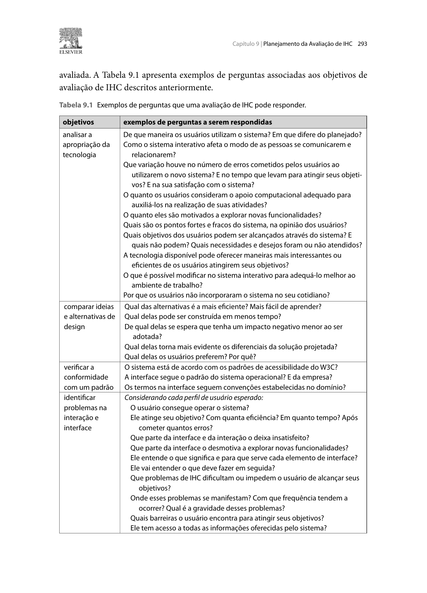

Responsável: Bruno Ferreira Dornelas — Complementos de ideias legislativas · Autor do item: Bruno Ferreira Dornelas

# Planejamento da avaliação do storyboard

## Tabela de contribuição

A Tabela 1 registra quem contribuiu neste artefato.

| Integrante | Contribuição | Artefato / atividade |
| --- | --- | --- |
| [Bruno Ferreira Dornelas](https://github.com/brunnf) | Definição do escopo, do perfil e da modalidade de avaliação | [Contextualização](#contextualizacao) |
| Codex (OpenAI) | Apoio à redação e à organização do documento | [Agradecimentos](#agradecimentos) |

Tabela 1 — Contribuição no planejamento.

Fonte: elaboração para o Grupo 06 (2026).

## Introdução

Este planejamento organiza a avaliação formativa do storyboard da proposta de **sugerir e acompanhar complementos de ideias legislativas**, por entrevista semiestruturada remota. A participante é identificada como **P01**. O ensaio individual ocorreu em **23/10/2026** e a entrevista foi realizada e gravada em **24/10/2026**. A execução, a caracterização da participante e os resultados estão descritos no [relato da Etapa 5](../../../entrega-5/individual/bruno/relato-storyboard.md).

## Contextualização

A referência é [Letícia Oliveira](../../../entrega-2/individual/heitor/persona.md), do perfil participante. A [entrevista anterior](../../../entrega-2/individual/heitor/entrevista-observacao.md) sustenta participação em pautas coletivas e escrita de comunicações; a biblioteca e a negociação de complementos são hipóteses do cenário. O recorte acompanha quem sugere; autor, moderação e encaminhamento institucional são dependências externas. Não haverá acesso a contas ou publicação real no portal.

## Item de conteúdo da disciplina

**Autor do item:** Bruno Ferreira Dornelas.

O DECIDE articula objetivos, perguntas, método, questões práticas, ética e análise (BARBOSA; SILVA, 2010, p. 313). Storyboards apoiam avaliação formativa, e entrevistas podem usar imagens e cenários (p. 294, 301). As Figuras 1–6 do [Apêndice A](#apendice-a-trechos-sobre-metodo-e-piloto) fundamentam o planejamento.

## D — Determinar os objetivos

- **O1 — Avaliar a adequação da ideia de design:** investigar quais necessidades relatadas podem ser atendidas pela proposta e quais condições exigem sua revisão. O resultado orientará o Grupo 06 a manter, modificar ou aprofundar o recorte.
- **O2 — Identificar problemas na representação da interação:** localizar dificuldades de compreensão, lacunas, decisões e dependências que possam prejudicar o percurso proposto. O resultado orientará a revisão dos materiais antes de desenvolver a interface.

O1 se apoia na avaliação de ideias de design, que pode ser comparativa ou não; O2 delimita a identificação de problemas ao modelo conceitual (BARBOSA; SILVA, 2010, p. 291–294). São dois objetivos operacionais do projeto, não uma quantidade exigida pelo DECIDE. A apropriação no cotidiano, o desempenho e a usabilidade do serviço implementado ficam fora deste estudo, pois a funcionalidade ainda é uma proposta.

## E — Explorar perguntas a serem respondidas

As perguntas da Tabela 2 são **questões de avaliação a serem respondidas por Bruno na análise**, usando os dados da entrevista e as fontes pertinentes. Elas não são perguntas a ler diretamente para P01. O roteiro de coleta aparece em seção própria: uma conversa pode produzir evidências para várias questões, e uma questão pode exigir diferentes evidências. A formulação segue a operacionalização do DECIDE (BARBOSA; SILVA, 2010, p. 292–293, 313).

| ID | Objetivo | Questão de avaliação | Evidências a analisar |
| --- | --- | --- | --- |
| SB-Q1 | O1 | Que necessidades relatadas a proposta poderia atender e quais permanecem sem apoio? | Experiências anteriores à apresentação e razões de relevância ou rejeição |
| SB-Q2 | O1 | Que condições do contexto favorecem ou limitam a adequação da história? | Recursos, motivação, informações e adaptações necessárias |
| SB-Q3 | O2 | A representação permite distinguir ideia original, complemento e apoios próprios? | Interpretação e trechos que a sustentam; QD03–04 e QD07 |
| SB-Q4 | O2 | As ações, responsabilidades e esperas entre envio, ajuste e moderação são compreensíveis? | Explicação da sequência e dúvidas; QD04–06 |
| SB-Q5 | O2 | A decisão sobre o ajuste está compreensível e quais lacunas surgem quando há discordância? | Critérios usados para avaliar a intenção e alternativas esperadas; QD05–06 |
| SB-Q6 | O2 | O desfecho comunica publicação e encaminhamento sem sugerir aprovação legislativa? | Interpretação do resultado e das decisões ainda pendentes; QD07–08 |

Tabela 2 — Questões que orientarão a análise do storyboard.

Fonte: questões do projeto, orientadas por Barbosa e Silva (2010, p. 291–294, 313).

## C — Escolher os métodos

Será realizada **entrevista semiestruturada apoiada no storyboard** (BARBOSA; SILVA, 2010, p. 145–149, 301). P01 poderá ler livremente, voltar aos quadros e explicar sua interpretação. Bruno usará perguntas abertas e registrará respostas anteriores e posteriores a esclarecimentos. O tempo reservado organiza a sessão; não mede desempenho no portal.

Esta entrevista investiga compreensão e adequação esperada. A aplicação do item 7 da lista da disciplina, que menciona prototipação em papel, permanece uma questão de adequação ao enunciado oficial, registrada na [conferência dos planejamentos](conferencia-planejamentos.md#metodo-a-descrever-nos-relatos).

## I — Identificar e administrar questões práticas

### Participante e recrutamento

**P01** participou da entrevista de 24/10/2026. Sua caracterização será extraída dos registros: participação cívica ou coletiva, envio de sugestões, navegação e escrita digital e necessidades de acessibilidade, quando abordados. Não é necessário ter a mesma profissão ou idade de Letícia. Um caso exploratório permite identificar indícios e questões de revisão, sem representar todo o público; lacunas relevantes poderão exigir coleta adicional.

O ensaio individual de Bruno foi realizado em 23/10/2026 e não exigiu ajustes. As entrevistas ocorreram presencialmente em 24/10/2026; as condições efetivas e os resultados estão registrados nos relatos da Etapa 5.

As duas entrevistas foram realizadas em 24/10/2026, no mesmo encontro. Conferir a ordem efetiva, as pausas e as explicações nas gravações. P01 é a mesma pessoa nos dois relatos; a segunda discussão não constitui observação independente.

### Equipe, ambiente e materiais

A Tabela 3 reúne os recursos necessários.

| Item | Definição |
| --- | --- |
| Equipe | Bruno: convite, moderação, notas e análise; Caio: revisão dos materiais e do relato |
| Ambiente | Google Meet; locais privados, áudio, conexão e dispositivo que permita ampliar os quadros; link enviado em privado |
| Material | [Storyboard](storyboard.md) manual digitalizado, QD01–QD08, descrição equivalente e [correspondência com as tarefas](storyboard.md#uso-na-avaliacao) |
| Instrumentos | TCLE específico, caracterização, roteiro abaixo e [formulário de evidências](planejamento-relato-storyboard.md#instrumentos-para-organizar-os-resultados) |
| Registro | Notas com pausas para conferência; áudio opcional autorizado, sem gravação facial |
| Custos e contingência | Sem despesas adicionais previstas; ampliar ou fornecer cópia se necessário; pausar e reagendar se acesso, áudio ou conexão impedirem a coleta |

Tabela 3 — Recursos e responsabilidades.

Fonte: elaboração do projeto (2026).

O [desenho manual fotografado](storyboard.md#storyboard-desenhado-a-mao) substitui a referência de IA. A descrição dos quadros acompanha a fotografia; as diferenças em relação ao roteiro anterior estão registradas no storyboard e deverão ser consideradas na análise. A preparação dos demais storyboards continua sob responsabilidade de seus autores.

### Roteiro da sessão

A Tabela 4 apresenta **perguntas e estímulos de coleta**, que podem ser adaptados sem antecipar a interpretação esperada. Ela prevê 35 minutos, com reserva de até 40 minutos, como duração planejada; conferir a duração efetiva nas gravações.

| Momento | Tempo | Condução e estímulos à entrevistada | Questões apoiadas |
| --- | --- | --- | --- |
| Acolhimento | 5 min | Confirmar consentimento e autorizações, testar leitura e explicar que o material está sendo avaliado | Condições da coleta |
| Relato inicial | 5 min | “Conte uma situação em que quis propor uma melhoria coletiva. Como tentou fazer isso? O que facilitou ou dificultou?”; colher antes dos dois materiais | SB-Q1–SB-Q2 |
| Leitura livre | 5 min | “Conte com suas palavras o que acontece nesta história.”; permitir retorno aos quadros | SB-Q3–SB-Q6 |
| Aprofundamento | 15 min | “O que essa informação significa para você?”; “De quem depende o próximo passo?”; “O que faria diante desse ajuste?”; “O que já aconteceu no final e o que ainda está pendente?”; “O que mudaria no seu caso?” | SB-Q1–SB-Q6 |
| Encerramento | 5 min | Resumir o entendimento, pedir correções e comentários e relembrar contato e uso dos dados | Conferência da interpretação |

Tabela 4 — Roteiro de coleta do storyboard.

Fonte: instrumento do projeto, orientado por Barbosa e Silva (2010, p. 145–149, 301).

Usar “O que nessa cena levou você a entender assim?” para localizar evidências. Não apresentar os critérios de compreensão como explicação inicial nem tratar discordância da proposta como erro.

### Teste-piloto

Bruno realizou o **ensaio individual em 23/10/2026**. O procedimento previa conferir acesso, legibilidade, roteiro, duração estimada, registro e análise. Não houve ajustes decorrentes do ensaio; respostas fictícias permanecem separadas dos dados de P01. Essa adaptação não verifica compreensão por outra pessoa e não equivale ao piloto com participante descrito por Barbosa e Silva (2010, p. 307–308).

### Registro da execução

Ensaio individual: **23/10/2026**. Entrevista gravada com P01: **24/10/2026**, no encontro das duas avaliações. A [agenda comum](conferencia-planejamentos.md#agenda-e-preparacao) registra as datas; o [relato da Etapa 5](../../../entrega-5/individual/bruno/relato-storyboard.md) apresenta a duração da gravação, o procedimento efetivo e os resultados.

## D — Decidir como lidar com questões éticas

O TCLE específico deve informar objetivo, atividades, duração, responsáveis, contato, registros, acesso, retenção e uso acadêmico (BARBOSA; SILVA, 2010, p. 138–142). A participação deve ser voluntária, com liberdade para não responder, pausar ou desistir sem prejuízo. Oferecer ampliação, descrição textual e pausas; evitar dados de terceiros e operações reais.

O planejamento previa notas e áudio opcional, sem gravação facial. Na execução presencial, foram gravadas imagem e voz. O TCLE assinado em 25/10/2026 abrange as duas entrevistas de 24/10 e autoriza publicação no YouTube como não listado e incorporação no site público do grupo, com supressão das identificações nominais.

Os artefatos usam **P01**. Bruno mantém o termo, os contatos e os dados de análise em arquivo privado. As gravações são acessadas pelos links do YouTube; o termo prevê exclusão dos originais ao fim da disciplina, em dezembro de 2026. Dúvidas e pedidos de retirada são encaminhados pelo contato do entrevistador informado no TCLE. A assinatura de 25/10 não comprova, por si só, consentimento anterior à coleta.

## E — Avaliar, interpretar e apresentar os dados

Bruno responderá **SB-Q1–SB-Q6**, relacionando cada conclusão a evidências ou registrando dados insuficientes. Os critérios de interpretação e as fichas estão no [planejamento do relato](planejamento-relato-storyboard.md#instrumentos-para-organizar-os-resultados). Preservar respostas espontâneas, intervenções e explicações alternativas, distinguindo problemas do desenho, dúvidas sobre regras hipotéticas e sugestões de design.

O relato seguirá sete componentes (BARBOSA; SILVA, 2010, p. 311–312). A análise discutirá confiabilidade dos registros, influência das explicações e da ordem das sessões, limites de um caso e diferenças entre leitura remota e uso real — confiabilidade e validades interna, externa e ecológica do DECIDE (p. 313).

## Agradecimentos

O Codex (OpenAI) apoiou a revisão metodológica, a redação e a organização dos instrumentos. A responsabilidade acadêmica é de Bruno Ferreira Dornelas.

## Histórico de versão

| Versão | Data | Descrição | Autor(es) | Revisor(es) |
| :---: | :---: | --- | --- | --- |
| 0.1 | 13/10/2026 | Planejamento DECIDE da avaliação remota do storyboard da Oficina Legislativa, com instrumentos e agendamentos a confirmar | [Bruno Ferreira Dornelas](https://github.com/brunnf) | [Caio Breno de Souza Bezerra](https://github.com/CaioBezerra-Dev) |
| 1.0 | 13/10/2026 | Completa fundamentação visual de métodos e piloto, recrutamento, justificativa da quantidade, agendamento e delimitação do método; explicita todos os integrantes | [Bruno Ferreira Dornelas](https://github.com/brunnf) | [Caio Breno de Souza Bezerra](https://github.com/CaioBezerra-Dev) |
| 1.1 | 13/10/2026 | Simplifica o texto e consolida instrumentos, preservando critérios e referências | [Bruno Ferreira Dornelas](https://github.com/brunnf) | [Caio Breno de Souza Bezerra](https://github.com/CaioBezerra-Dev) |
| 1.2 | 13/10/2026 | Indica Alisson dos Santos, professor de Física, e define agenda provisória até 24/10, equipe e preparação | [Bruno Ferreira Dornelas](https://github.com/brunnf) | [Caio Breno de Souza Bezerra](https://github.com/CaioBezerra-Dev) |
| 1.3 | 13/10/2026 | Vincula o storyboard ilustrado v0.1 e atualiza a preparação para revisão e piloto | [Bruno Ferreira Dornelas](https://github.com/brunnf) | [Caio Breno de Souza Bezerra](https://github.com/CaioBezerra-Dev) |
| 1.4 | 13/10/2026 | Revisão de linguagem e padronização das contribuições | [Bruno Ferreira Dornelas](https://github.com/brunnf) | [Caio Breno de Souza Bezerra](https://github.com/CaioBezerra-Dev) |
| 1.5 | 23/10/2026 | Alinha recorte a Letícia, objetivos e perguntas à Tabela 9.1; atualiza instrumentos e agenda para 23 e 24/10. | [Bruno Ferreira Dornelas](https://github.com/brunnf) | [Caio Breno de Souza Bezerra](https://github.com/CaioBezerra-Dev) |
| 1.6 | 24/10/2026 | Retoma a estrutura dos planejamentos do professor, adaptada ao complemento e a Letícia; retira identificação de versões do corpo | [Bruno Ferreira Dornelas](https://github.com/brunnf) | [Caio Breno de Souza Bezerra](https://github.com/CaioBezerra-Dev) |
| 2.0 | 24/10/2026 | Reorganiza o DECIDE para a proposta de complementos, separa questões de avaliação e roteiro, indica P01 e substitui a agenda anterior por coleta a agendar; simplifica instrumentos e preserva o histórico do recorte docente | [Bruno Ferreira Dornelas](https://github.com/brunnf) | [Caio Breno de Souza Bezerra](https://github.com/CaioBezerra-Dev) |

## Referências

[1] BARBOSA, Simone Diniz Junqueira; SILVA, Bruno Santana da. **Interação humano-computador**. Rio de Janeiro: Elsevier, 2010. p. 138–149, 193–196, 203–205, 291–294, 301, 307–313.

[2] GRUPO 06. **Complementos de ideias legislativas**. [Storyboard](storyboard.md), [análise de tarefas](analise-tarefas.md) e [conferência dos planejamentos](conferencia-planejamentos.md). Brasília: FCTE/UnB, 2026.

## Apêndice A — Trechos sobre método e piloto

A Figura 1 apresenta o DECIDE; as Figuras 2–5 fundamentam método e piloto, e a Figura 6 apresenta exemplos de objetivos e perguntas.

??? note "Figura 1 — Framework DECIDE"

    
    
Figura 1 — Framework DECIDE.

    
Fonte: Barbosa e Silva (2010, seção 9.8, p. 312–313).

As figuras a seguir fundamentam a escolha da entrevista, a preparação do piloto e o recrutamento. A numeração das páginas corresponde à edição de 2010.

??? note "Figura 2 — Entrevista semiestruturada"

    
    
Figura 2 — Entrevista semiestruturada.

    
Fonte: Barbosa e Silva (2010, p. 146), reprodução do exemplar do projeto.

??? note "Figura 3 — Investigação com materiais de apoio"

    
    
Figura 3 — Investigação com materiais de apoio.

    
Fonte: Barbosa e Silva (2010, p. 301), reprodução do exemplar do projeto.

??? note "Figura 4 — Definição e finalidade do teste-piloto"

    
    
Figura 4 — Definição e finalidade do teste-piloto.

    
Fonte: Barbosa e Silva (2010, p. 307), reprodução do exemplar do projeto.

??? note "Figura 5 — Participante do piloto, recrutamento e agendamento"

    
    
Figura 5 — Participante do piloto, recrutamento e agendamento.

    
Fonte: Barbosa e Silva (2010, p. 308), reprodução do exemplar do projeto.

A tabela de objetivos e perguntas do livro está reproduzida abaixo.

??? note "Objetivos e perguntas — Tabela 9.1"

    
    
Figura 6 — Objetivos e perguntas de avaliação.

    
Fonte: Barbosa e Silva (2010, p. 293).

