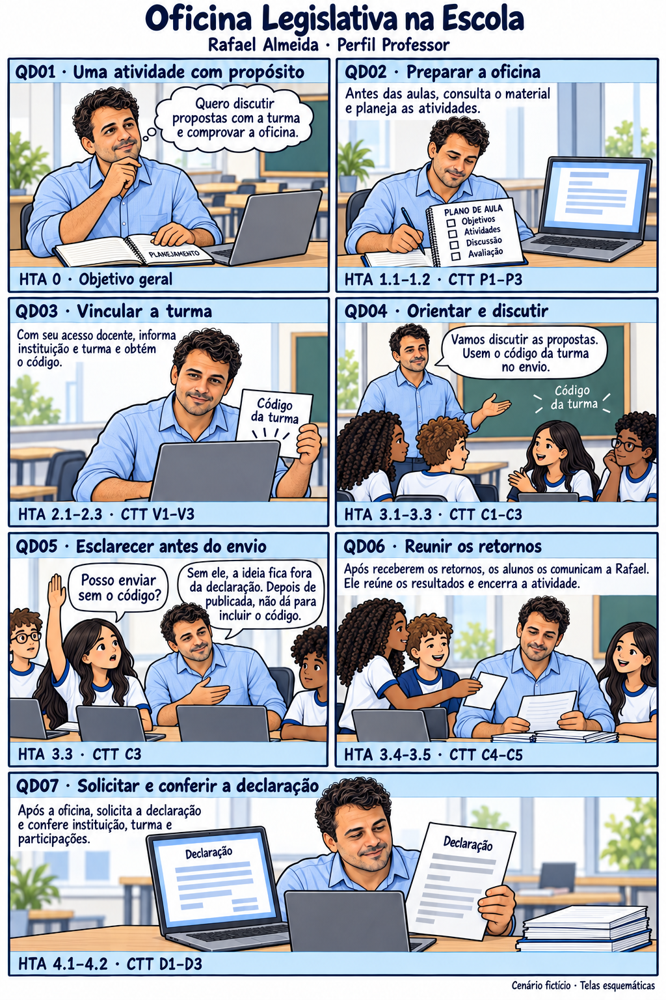
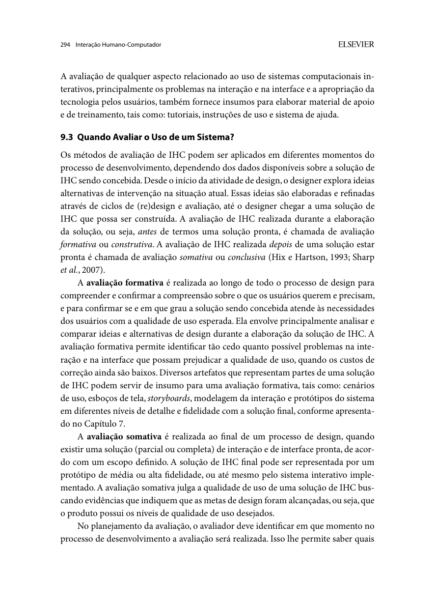

Responsável: Bruno Ferreira Dornelas — Oficina Legislativa · Autor do item: Bruno Ferreira Dornelas

# Storyboard — Oficina Legislativa

## Tabela de contribuição

A Tabela 1 registra as contribuições neste artefato.

| Integrante / ferramenta | Contribuição | Artefato / atividade |
| --- | --- | --- |
| [Bruno Ferreira Dornelas](https://github.com/brunnf) | Definição do cenário e da sequência dos sete quadros | [Introdução](#introducao) |
| Codex (OpenAI) | Apoio à redação e à organização do roteiro | [Agradecimentos](#agradecimentos) |
| image_gen (OpenAI) | Geração da ilustração | [Agradecimentos](#agradecimentos) |

Tabela 1 — Contribuições no storyboard.

Fonte: elaboração para o Grupo 06 (2026).

## Introdução

O storyboard acompanha **Rafael Almeida**, persona do perfil **Professor**, na organização de uma Oficina Legislativa na Escola e na obtenção de sua declaração. Os **sete quadros formam uma única história**, conforme o [planejamento da avaliação](planejamento-avaliacao-storyboard.md#material-que-devera-estar-pronto-para-avaliacao), o [cenário](../../../entrega-2/individual/bruno/perfil-2/cenario.md) e a [análise de tarefas](../../../entrega-2/individual/bruno/perfil-2/analise-tarefas.md).

**Versão 0.2 — 13/10/2026:** material com textos ampliados e passagem do tempo esclarecida no QD06. Os personagens e diálogos são fictícios. As interfaces e a declaração são representações esquemáticas baseadas na documentação pública do serviço.

## Item de conteúdo da disciplina

**Autor do item:** Bruno Ferreira Dornelas.

Barbosa e Silva (2010, p. 112) apresentam o storyboard como recurso para explorar a prática de trabalho apoiada pela tecnologia. Os autores também o incluem entre os artefatos que podem apoiar uma avaliação formativa (p. 294). Neste projeto, a narrativa representa o processo documental para discutir sua compreensão e adequação ao contexto docente, antes de propor mudanças. A [Figura 2](#fundamentacao-no-livro) reproduz o trecho sobre avaliação formativa.

## Storyboard ilustrado

A Figura 1 apresenta a história. A leitura segue da esquerda para a direita, de cima para baixo, terminando no quadro inferior de largura completa. Cada quadro contém seu identificador e as referências de tarefas. A seção seguinte permite ampliar cada quadro individualmente. Clique para ampliar ou [abra a imagem completa](../../../assets/img/storyboard/bruno/oficina-legislativa-v0-2.png).

Figura 1 — Storyboard da Oficina Legislativa na Escola, perfil Professor, versão 0.2.

Fonte: roteiro baseado no cenário e na HTA/CTT de Rafael Almeida, Grupo 06 (2026); ilustração gerada com image_gen (OpenAI), com apoio do Codex, em 13/10/2026.

## Quadros ampliados

Abra o quadro desejado para ler seus textos e referências em tamanho maior. São ampliações da Figura 1, com o mesmo conteúdo; as descrições equivalentes estão na Tabela 2.

??? note "QD01 — Uma atividade com propósito"

    

    {: .no-lightbox style="position: absolute; width: 206.451613%; max-width: none; left: -2.419355%; top: -24.653740%; margin: 0;"}

    

    
Figura 1a — QD01: Uma atividade com propósito.

    
Fonte: ampliação do respectivo quadro da Figura 1, Grupo 06 / image_gen (OpenAI), 2026.

??? note "QD02 — Preparar a oficina"

    

    {: .no-lightbox style="position: absolute; width: 206.036217%; max-width: none; left: -103.822938%; top: -24.653740%; margin: 0;"}

    

    
Figura 1b — QD02: Preparar a oficina.

    
Fonte: ampliação do respectivo quadro da Figura 1, Grupo 06 / image_gen (OpenAI), 2026.

??? note "QD03 — Vincular a turma"

    

    {: .no-lightbox style="position: absolute; width: 206.451613%; max-width: none; left: -2.419355%; top: -129.461756%; margin: 0;"}

    

    
Figura 1c — QD03: Vincular a turma.

    
Fonte: ampliação do respectivo quadro da Figura 1, Grupo 06 / image_gen (OpenAI), 2026.

??? note "QD04 — Orientar e discutir"

    

    {: .no-lightbox style="position: absolute; width: 206.036217%; max-width: none; left: -103.822938%; top: -129.461756%; margin: 0;"}

    

    
Figura 1d — QD04: Orientar e discutir.

    
Fonte: ampliação do respectivo quadro da Figura 1, Grupo 06 / image_gen (OpenAI), 2026.

??? note "QD05 — Esclarecer antes do envio"

    

    {: .no-lightbox style="position: absolute; width: 206.451613%; max-width: none; left: -2.419355%; top: -225.690608%; margin: 0;"}

    

    
Figura 1e — QD05: Esclarecer antes do envio.

    
Fonte: ampliação do respectivo quadro da Figura 1, Grupo 06 / image_gen (OpenAI), 2026.

??? note "QD06 — Reunir os retornos"

    

    {: .no-lightbox style="position: absolute; width: 206.036217%; max-width: none; left: -103.822938%; top: -225.690608%; margin: 0;"}

    

    
Figura 1f — QD06: Reunir os retornos.

    
Fonte: ampliação do respectivo quadro da Figura 1, Grupo 06 / image_gen (OpenAI), 2026.

??? note "QD07 — Solicitar e conferir a declaração"

    

    {: .no-lightbox style="position: absolute; width: 102.297702%; max-width: none; left: -1.198801%; top: -377.707006%; margin: 0;"}

    

    
Figura 1g — QD07: Solicitar e conferir a declaração.

    
Fonte: ampliação do respectivo quadro da Figura 1, Grupo 06 / image_gen (OpenAI), 2026.

## Descrição dos quadros e análise de tarefas

A Tabela 2 oferece a descrição textual equivalente das ações e dos diálogos relevantes e relaciona cada quadro aos modelos existentes. Os identificadores remetem às seções de [HTA](../../../entrega-2/individual/bruno/perfil-2/analise-tarefas.md#analise-hierarquica-de-tarefas-hta) e [CTT](../../../entrega-2/individual/bruno/perfil-2/analise-tarefas.md#arvore-de-tarefas-concorrentes-ctt); os diagramas mantêm as notações do livro.

| Quadro | Cena e diálogo fictício | Relação com a análise de tarefas |
| --- | --- | --- |
| **QD01 — Uma atividade com propósito** | Na escola, Rafael está diante do computador, com a mão sobre o caderno de planejamento aberto. Pensa: “Quero discutir propostas com a turma e comprovar a oficina.” A motivação reúne o objetivo educativo e a comprovação. | **HTA 0:** organizar a participação e obter a declaração. Contexto da tarefa geral **OrganizarOficina** na CTT; não acrescenta uma operação ao modelo. |
| **QD02 — Preparar a oficina** | Antes das aulas, Rafael consulta as orientações no computador e anota as atividades no plano de aula. A preparação inclui leitura e organização pedagógica fora do portal. | **HTA 1.1–1.2:** examinar orientações e planejar atividades. **CTT P1–P3:** acessar material, apresentação pelo sistema e planejamento pelo professor. |
| **QD03 — Vincular a turma** | Com seu acesso docente, Rafael informa instituição e turma e obtém o código. Guarda a informação para repassá-la aos alunos. O desenho representa o resultado esperado sem detalhar campos do serviço. | **HTA 2.1–2.3:** autenticar professor, informar instituição/turma e obter código. **CTT V1–V3:** interação docente e disponibilização do código pelo sistema. |
| **QD04 — Orientar e discutir** | Em sala, Rafael conduz a discussão de propostas, compartilha o código e orienta o envio. Diz: “Vamos discutir as propostas. Usem o código da turma no envio.” Os alunos participam do debate. | **HTA 3.1–3.3:** repassar código, conduzir etapas iniciais e orientar envio. **CTT C1–C3:** atividades do professor fora do sistema. |
| **QD05 — Esclarecer antes do envio** | Uma aluna pausa e pergunta: “Posso enviar sem o código?”. Rafael esclarece: “Sem ele, a ideia fica fora da declaração. Depois de publicada, não dá para incluir o código.” A dúvida é resolvida antes do envio; não há correção posterior presumida. | **HTA 3.3 / CTT C3:** retomada da orientação. O episódio ilustra a condição de usar o código no envio, sustentada pela evidência **E03** da análise documental. |
| **QD06 — Reunir os retornos** | A cena ocorre depois dos envios e do recebimento dos retornos. Os alunos comunicam os resultados a Rafael, que reúne as informações e encerra a atividade. A legenda explicita: “Após receberem os retornos, os alunos os comunicam a Rafael. Ele reúne os resultados e encerra a atividade.” | **HTA 3.4–3.5 / CTT C4–C5:** reunir resultados e encerrar a oficina. Envio, análise pelo Senado e retorno aos alunos são **dependências externas** à árvore do professor; não há aprovação imediata presumida. |
| **QD07 — Solicitar e conferir a declaração** | Após a oficina, Rafael solicita a declaração e, com o documento disponível, compara instituição, turma e participações com suas anotações. O desfecho esperado é reconhecer que a comprovação corresponde à atividade realizada. | **HTA 4.1–4.2:** solicitar declaração e conferir comprovação. **CTT D1–D3:** solicitação, disponibilização pelo sistema e conferência pelo professor. É o resultado esperado do cenário, não uma emissão observada. |

Tabela 2 — Descrição equivalente e correspondência dos sete quadros com HTA/CTT.

Fonte: cenário, análise de tarefas e planejamento da avaliação do storyboard do perfil Professor, Grupo 06 (2026).

A regra do código vem da [análise documental, evidência E03](../../../entrega-2/individual/bruno/perfil-2/analise-documental.md#e03). A dúvida da aluna é uma construção narrativa. A passagem do tempo não estabelece prazo para o Senado, e a conferência da declaração é o critério de conclusão adotado no cenário. Detalhes de autenticação, emissão e tratamento de divergências ainda exigem investigação.

## Uso na avaliação

Na sessão, o professor poderá ler a imagem ampliada e consultar a descrição textual. Os códigos de HTA/CTT são referências do projeto; não será exigido que o participante domine essas notações. O moderador seguirá [Q1–Q7 e o roteiro planejado](planejamento-avaliacao-storyboard.md#e-explorar-as-perguntas), registrando dúvidas pelo ID do quadro e pela versão apresentada.

A revisão de Caio abrange legibilidade, sequência e correspondência com a análise de tarefas, conforme o cronograma do planejamento. Alterações gerarão uma nova versão, preservando a cópia efetivamente avaliada. Os registros e encaminhamentos seguirão o [planejamento do relato](planejamento-relato-storyboard.md). Este artefato corresponde ao storyboard individual de Bruno; a consolidação dos demais storyboards pertence ao grupo.

## Agradecimentos

O Codex (OpenAI) foi utilizado como apoio à redação do roteiro e à organização das correspondências com a análise de tarefas. A ilustração foi gerada com image_gen (OpenAI). A responsabilidade pelo conteúdo é de Bruno Ferreira Dornelas.

## Histórico de versão

| Versão | Data | Descrição | Autor(es) | Revisor(es) |
| :---: | :---: | --- | --- | --- |
| 0.1 | 13/10/2026 | Storyboard com sete quadros, descrição textual e correspondência com a HTA/CTT da Oficina Legislativa | [Bruno Ferreira Dornelas](https://github.com/brunnf) | [Caio Breno de Souza Bezerra](https://github.com/CaioBezerra-Dev) |
| 0.2 | 13/10/2026 | Amplia textos, esclarece retornos no QD06, simplifica o cenário, retira a versão da imagem e oferece visualização por quadro | [Bruno Ferreira Dornelas](https://github.com/brunnf) | [Caio Breno de Souza Bezerra](https://github.com/CaioBezerra-Dev) |
| 0.3 | 13/10/2026 | Revisão de linguagem e padronização das contribuições | [Bruno Ferreira Dornelas](https://github.com/brunnf) | [Caio Breno de Souza Bezerra](https://github.com/CaioBezerra-Dev) |

## Referências

[1] BARBOSA, Simone Diniz Junqueira; SILVA, Bruno Santana da. **Interação humano-computador**. Rio de Janeiro: Elsevier, 2010. p. 112, 191–196, 203–205 e 294.

[2] GRUPO 06. **Perfil Professor — Rafael Almeida**. Brasília: FCTE/UnB, 2026. [Persona](../../../entrega-2/individual/bruno/perfil-2/persona.md), [cenário](../../../entrega-2/individual/bruno/perfil-2/cenario.md), [análise documental](../../../entrega-2/individual/bruno/perfil-2/analise-documental.md) e [análise de tarefas](../../../entrega-2/individual/bruno/perfil-2/analise-tarefas.md).

[3] GRUPO 06. **Planejamento da avaliação do storyboard da Oficina Legislativa**. Brasília: FCTE/UnB, 2026. [Planejamento DECIDE](planejamento-avaliacao-storyboard.md).

## Fundamentação no livro

A Figura 2 apresenta a fundamentação sobre o uso de storyboards na avaliação formativa, citada neste artefato.

??? note "Figura 2 — Storyboards na avaliação formativa"

    
    
Figura 2 — Artefatos que apoiam a avaliação formativa.

    
Fonte: Barbosa e Silva (2010, p. 294), reprodução do exemplar do projeto.

