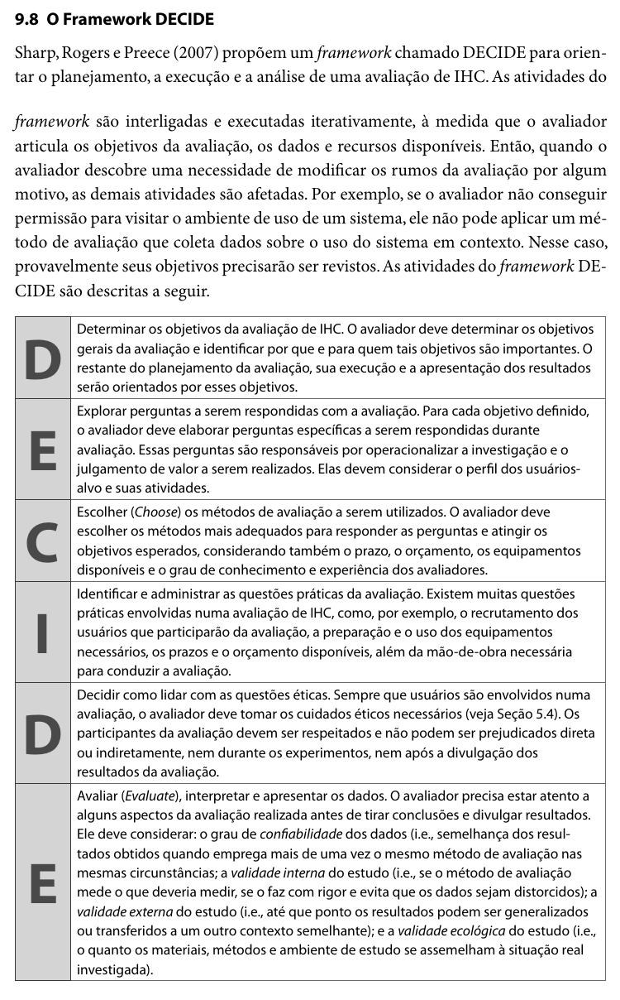

Responsável: Heitor Pinheiro Gonçalves das Chagas — Votação em consulta pública (e-Cidadania) · Autor do item: Heitor Pinheiro Gonçalves das Chagas

# Planejamento da avaliação da análise de tarefas

## Tabela de contribuição

A Tabela 1 registra as atividades e os responsáveis neste artefato.

| Integrante | Contribuição | Artefato / atividade |
| --- | --- | --- |
| [Heitor Pinheiro Gonçalves das Chagas](https://github.com/Heitorovski01) | Planejamento da avaliação pelo framework DECIDE, modelo e diagrama da HTA | [Planejamento da avaliação](#d-determinar-os-objetivos) |
| [Caio Breno de Souza Bezerra](https://github.com/CaioBezerra-Dev) | Revisão técnica da notação e conformidade do planejamento | [Histórico de versão](#historico-de-versao) |
| Google Gemini e Claude (Anthropic) | Apoio na estruturação do texto, diagramação de tabelas e vetores SVG | [Agradecimentos](#agradecimentos) |

Tabela 1 — Contribuição no planejamento da avaliação da análise de tarefas.

Fonte: elaboração para o Grupo 06 (2026).

## Introdução

Este artefato apresenta o planejamento da avaliação formativa da **Análise Hierárquica de Tarefas (HTA)** desenvolvida para a tarefa de **votar em consulta pública sobre o PL 1215/2025** no módulo **e-Cidadania** do Portal do Senado Federal, com a persona **Letícia Oliveira** (sintetizada a partir da coleta empírica com a participante P3 na Etapa 2).

Nesta Etapa 4, o foco recai exclusivamente sobre o **planejamento** da avaliação do modelo conceitual: não há resultados coletados, falas de usuários ou validações empíricas simuladas. O planejamento organiza o método de investigação por validação de modelo com entrevista semiestruturada, o cronograma, o teste piloto, as salvaguardas éticas e os instrumentos necessários. A execução ocorrerá após a apresentação da Etapa 4, e os resultados consolidados serão relatados na Etapa 5 (entrega em 25/10/2026), conforme especificado no [planejamento do relato dos resultados da HTA](planejamento-relato-analise-tarefas.md).

## Contextualização

O objeto avaliado é a [Análise de Tarefas de Letícia Oliveira](../../../entrega-2/individual/heitor/analise-tarefas.md), complementada pelo [perfil de usuário](../../../entrega-2/individual/heitor/persona.md) e pelo [cenário de interação](../../../entrega-2/individual/heitor/cenario.md) elaborados na Etapa 2.

A tarefa escolhida — votar na consulta pública de proposição legislativa — constitui o serviço mais demandado da plataforma e-Cidadania. Na observação da Etapa 2, constatou-se que a participante localizou a matéria com rapidez pela busca textual, mas encontrou severa barreira de usabilidade na operação 4.1 (localizar a área de votação), devido ao layout que posiciona os botões "Sim" e "Não" abaixo de múltiplos blocos institucionais e gráficos de estatísticas parciais.

## Item de conteúdo da disciplina

**Autor do item:** Heitor Pinheiro Gonçalves das Chagas.

Segundo Barbosa e Silva (2010, p. 191–192), a análise de tarefas tem por objetivo entender o trabalho realizado, seus objetivos e as eventuais disparidades entre a prescrição formal e a prática cotidiana. A HTA decompõe um objetivo geral em subtarefas e operações, vinculadas por planos que especificam a ordem e as condições de execução (p. 192–195). Uma das fases indispensáveis da HTA é a **verificação da validade da decomposição junto às partes interessadas** (p. 196, reproduzida na Figura 2 deste documento).

A avaliação é estruturada segundo o framework **DECIDE** (BARBOSA; SILVA, 2010, p. 312–313, Figura 1), contemplando:
- **D** — Determinar os objetivos gerais;
- **E** — Explorar as perguntas a serem respondidas;
- **C** — Escolher os métodos de avaliação;
- **I** — Identificar e administrar as questões práticas;
- **D** — Decidir como lidar com as questões éticas;
- **E** — Avaliar, interpretar e apresentar os dados.

## D — Determinar os objetivos

**Objetivo geral:** verificar empiricamente se o modelo hierárquico da HTA representa com fidelidade o percurso cognitivo e motor de cidadãos com o perfil de Letícia Oliveira ao votarem em consultas do e-Cidadania, identificando omissões, sequências inadequadas e confirmando a severidade do ponto crítico de affordance na operação 4.1.

Os objetivos específicos alinham-se às quatro dimensões de avaliação descritas por Barbosa e Silva (2010):

1. **Apropriação da tecnologia:** verificar como cidadãos e lideranças comunitárias encaixam o portal e-Cidadania na sua rotina de participação política e acompanhamento legislativo;
2. **Conformidade com um padrão:** avaliar se o fluxo de votação respeita os padrões ergonômicos e convenções da web pública (acessibilidade e clareza);
3. **Comparação de alternativas:** levantar dados para comparar, na Etapa 5, o posicionamento atual da área de voto com alternativas de redesenho no protótipo de papel;
4. **Identificação de problemas:** confrontar a árvore de subtarefas, operações e planos com a prática do usuário para revelar incongruências de modelagem.

- **Para quem é importante:** para cidadãos e lideranças sociais que dependem da clareza do portal, e para a equipe de desenvolvimento, que usará este modelo como base para os protótipos de baixa e média fidelidade.
- **Por que é importante:** validar o modelo antes do desenvolvimento de protótipos previne retrabalho e assegura que o reprojeto resolva os gargalos reais de usabilidade.

## E — Explorar as perguntas

A Tabela 2 sintetiza as perguntas norteadoras da avaliação da HTA articuladas aos objetivos e às evidências esperadas.

| ID | Objetivo | Pergunta norteadora | Evidência pretendida |
| :---: | :---: | --- | --- |
| AT-Q1 | Dimensão 4 | A decomposição nas 4 subtarefas (Acessar, Localizar matéria, Avaliar projeto e Registrar voto) reflete a estrutura lógica real da tarefa? | Confirmação ou contestação da árvore e dos nós principais |
| AT-Q2 | Dimensão 1 | O Plano 1 expressa adequadamente a realidade (busca via portal 1.1>1.2 vs. link direto recebido em mensagem 1.3)? | Frequência de uso do atalho por mensagens instantâneas |
| AT-Q3 | Dimensão 4 | A operação 4.1 (localizar a área de voto) é reconhecida como o principal ponto crítico da tarefa? | Relato de dificuldade, tempo de varredura visual e frustração |
| AT-Q4 | Dimensão 4 | Há passos intermediários executados pelo participante que não foram contemplados na HTA (ou operações redundantes)? | Sugestão de inclusão/exclusão de nós operacionais |
| AT-Q5 | Dimensões 2 e 3 | Em que região da página o participante espera encontrar os botões de voto e quais elementos concorrem por sua atenção? | Subsídios de layout espacial para o futuro protótipo de papel |

Tabela 2 — Perguntas de avaliação da HTA e evidências pretendidas.

Fonte: elaboração do autor (2026).

### Roteiro estruturado de perguntas para a sessão

Para orientar a condução da entrevista semiestruturada com o participante durante a apresentação da HTA, utiliza-se o roteiro detalhado na Tabela 3.

| Nº | Foco na HTA | Pergunta formulada ao participante | Objetivo da pergunta | Resposta esperada |
| :---: | :--- | --- | --- | --- |
| **P01** | Contextualização | Você já participou ou votou em alguma consulta pública no e-Cidadania ou outro portal governamental? Como costuma acessar? | Validar a adequação do participante ao perfil de Letícia Oliveira. | Resposta aberta qualitativa. |
| **P02** | Subtarefas gerais | Observando a árvore da HTA, a divisão nas quatro etapas (Acessar, Localizar, Avaliar e Registrar) reflete a sua linha de raciocínio ao votar? | Validar a completude do objetivo 0 e a clareza das subtarefas 1 a 4. | Escala binária (Sim/Não) com justificativa. |
| **P03** | Planos e atalhos | Em relação ao Plano 1, quando você recebe um link no WhatsApp/Telegram (1.3), costuma abri-lo direto ou prefere buscar pelo Google/Portal (1.1 e 1.2)? | Validar a representação da alternância lógica no Plano 1. | Escolha de preferência com relato de hábito. |
| **P04** | Ponto crítico (4.1) | Ao abrir a tela da proposição, você já sentiu hesitação ou dificuldade para achar onde clicar para votar (operação 4.1)? | Confirmar empiricamente a criticidade do ponto destacado na HTA. | Escala Likert de 1 a 5 (1 = Muito fácil a 5 = Muito difícil). |
| **P05** | Completude | Existe alguma ação indispensável que você realiza e que não está nesta árvore, ou alguma operação que parece desnecessária? | Mapear lacunas e calibrar o nível de detalhamento do modelo. | Resposta aberta de acréscimo ou supressão. |

Tabela 3 — Roteiro de perguntas da entrevista de validação da HTA.

Fonte: elaboração do autor (2026).

## C — Escolher os métodos

O método selecionado é a **investigação por entrevista semiestruturada apoiada no modelo de tarefas**, acompanhada de conferência técnica de notação (BARBOSA; SILVA, 2010, p. 196, p. 272–280).

- **Justificativa técnica:** a validação de modelo não exige observação em laboratório com software rodando, pois o objetivo é averiguar se as intenções, objetivos e operações descritas no modelo batem com a prática real de quem realiza a tarefa. A entrevista permite flexibilidade para aprofundar hesitações e explorar operações ausentes.
- **Restrições operacionais:**
  - *Prazo:* a avaliação cabe no intervalo entre a apresentação da Etapa 4 (15/10/2026) e a entrega da Etapa 5 (25/10/2026);
  - *Orçamento:* custo zero, utilizando infraestrutura já disponível (Google Meet, laboratório da FCTE/UnB e notebook do avaliador);
  - *Equipamentos:* notebook do avaliador para exibição do diagrama ampliado, roteiro impresso e gravação de áudio em celular;
  - *Experiência do avaliador:* estudante de Engenharia de Software capacitado em técnicas de entrevista e observação na Etapa 2.

**Transição metodológica para a Etapa 5:** a validação do modelo de análise de tarefas (HTA) e a leitura do storyboard servem como insumo para a concepção das alternativas de design. Conforme preconiza o plano de ensino da disciplina, esses modelos conceituais orientam diretamente a criação e a avaliação do **método de prototipação em papel**, cujo planejamento e testes serão executados na Etapa 5.

## I — Identificar e administrar questões práticas

### Participantes e recrutamento

- **Perfil dos participantes:** cidadãos entre 18 e 30 anos que atuam em movimentos sociais ou coletivos universitários, que já participaram ou têm interesse em consultas legislativas e usam computador pessoal com frequência — o perfil sintetizado na persona Letícia Oliveira.
- **Estratégia de recrutamento:** convite direto à participante P3 da Etapa 2 (garantindo continuidade longitudinal) e, por indicação em rede (snowballing), a outros integrantes de coletivos e estudantes da FCTE/UnB.
- **Quantidade e justificativa:** **3 participantes** (dado fechado de planejamento). Nielsen (2000) e Krug (2014) demonstram que 3 a 5 participantes são suficientes para revelar a grande maioria dos problemas qualitativos de interação e validar modelos conceituais em ciclos formativos ágeis. Como se trata de validação conceitual e não de teste estatístico, 3 participantes cabem perfeitamente no cronograma da disciplina.

### Modalidade e ambiente

- **Modalidade:** sessões presenciais no Laboratório de Informática da FCTE/UnB ou remotas via Google Meet (para participantes com restrição de deslocamento), com compartilhamento de tela dos diagramas em alta resolução.
- **Duração prevista:** 40 minutos por sessão (5 min de acolhimento e TCLE, 15 min de discussão da HTA, 15 min de Storyboard e 5 min de encerramento).

### Cronograma de execução da avaliação

A Tabela 4 fixa as datas, horários e locais fechados das sessões de avaliação. O teste piloto é executado estritamente antes das sessões oficiais.

| Atividade | Avaliador | Participante / Perfil | Data | Horário (Brasília) | Local / Plataforma |
| :--- | :--- | :--- | :---: | :---: | :--- |
| **Teste piloto** | Heitor Pinheiro | Estudante da FCTE/UnB (fora da amostra oficial) | 19/10/2026 | 14h00–14h40 | FCTE/UnB |
| **Sessão 1** | Heitor Pinheiro | P1 — Liderança comunitária (perfil Letícia) | 20/10/2026 | 14h00–14h40 | Presencial (FCTE/UnB) |
| **Sessão 2** | Heitor Pinheiro | P2 — Integrante de movimento social (perfil Letícia) | 20/10/2026 | 15h00–15h40 | Presencial (FCTE/UnB) |
| **Sessão 3** | Heitor Pinheiro | P3 — Participante da Etapa 2 / Coletivo estudantil | 21/10/2026 | 19h00–19h40 | Remota (Google Meet) |

Tabela 4 — Cronograma oficial de execução das avaliações.

Fonte: elaboração do autor (2026).

### Teste piloto

O teste piloto consiste em um ensaio prévio e em pequena escala da sessão de avaliação, destinado a verificar se os instrumentos de coleta, o roteiro de perguntas, os diagramas visuais, os equipamentos de gravação e a gestão do tempo operam conforme o planejado (BARBOSA; SILVA, 2010, p. 278, p. 307–308).

O ensaio piloto ocorrerá em **19/10/2026, das 14h00 às 14h40, na FCTE/UnB**, com um estudante de perfil próximo que não faz parte da amostra oficial.

!!! warning "Uso exclusivo do resultado do teste piloto"
    **O resultado do teste piloto servirá exclusivamente para calibrar os instrumentos, a linguagem das perguntas e o ambiente de teste; portanto, os dados e achados do teste piloto NÃO serão apresentados nem contabilizados no relato final dos resultados da avaliação.**

### Papel do avaliador durante a sessão

Durante as sessões, o avaliador (Heitor Pinheiro) deverá:
1. **Anotar divergências e sugestões:** registrar cada hesitação, contradição ou operação ausente, associando-a imediatamente ao identificador da operação da HTA (ex.: 4.1);
2. **Priorizar problemas:** classificar preliminarmente os atritos observados por ordem de gravidade para alimentar o plano de reprojeto do protótipo de papel;
3. **Não induzir respostas:** formular questões neutras ("Como você procede quando chega nesta etapa?") em vez de perguntas tendenciosas ("Você clica aqui, certo?");
4. **Respeitar o ritmo do participante:** permitir pausas para análise do diagrama e conceder tempo hábil para reflexão espontânea.

## D — Decidir como lidar com questões éticas

Em respeito irrestrito à Resolução CNS nº 510/2016 e às diretrizes éticas da disciplina de IHC da FCTE/UnB, os participantes serão tratados com dignidade e resguardados contra qualquer prejuízo direto ou indireto.

- **Foco no artefato:** o participante é informado de que a avaliação recai sobre a adequação dos modelos de IHC e da interface pública, e nunca sobre suas competências ou habilidades pessoais;
- **Voluntariedade e liberdade de desistência:** a participação é livre e espontânea, podendo ser encerrada a qualquer instante sem qualquer penalidade acadêmica ou constrangimento;
- **Anonimato rigoroso:** os participantes são identificados nos relatórios públicos unicamente por códigos alfanuméricos (P1, P2, P3);
- **Permissão de gravação:** **o avaliador solicitará formalmente a autorização verbal e escrita do participante antes de iniciar qualquer gravação de áudio, vídeo ou tela**, mantendo os arquivos brutos sob guarda segura e restrita.

??? note "Modelo do Termo de Consentimento Livre e Esclarecido (TCLE) e Solicitação de Gravação"
    **TERMO DE CONSENTIMENTO LIVRE E ESCLARECIDO (TCLE)**
    
    **Projeto de Ensino e Pesquisa:** Avaliação e Reprojeto de IHC do Portal e-Cidadania do Senado Federal  
    **Instituição:** Faculdade de Ciências e Tecnologias em Engenharia (FCTE) — Universidade de Brasília (UnB)  
    **Disciplina:** Interação Humano-Computador (2026.2) — Professor Responsável: Dr. André Barros de Sales  
    **Avaliador Responsável:** Heitor Pinheiro Gonçalves das Chagas  

    **1. Objetivos da Avaliação:** Você está sendo convidado(a) a participar de uma sessão de validação da Análise Hierárquica de Tarefas (HTA) referente à votação em consultas públicas no Portal e-Cidadania. O objetivo é aprimorar a qualidade de uso e a acessibilidade da interface pública do Senado Federal.

    **2. Procedimentos:** A atividade terá duração média de 40 minutos. O avaliador exibirá o diagrama hierárquico e conduzirá uma entrevista semiestruturada. Não se trata de uma avaliação das suas habilidades, mas sim da clareza dos artefatos de IHC.

    **3. Riscos e Benefícios:** Os riscos são mínimos, equivalentes aos de atividades rotineiras no computador. Não há qualquer custo financeiro ou risco à sua integridade moral ou física. O benefício é contribuir diretamente para o design de soluções de governo eletrônico mais acessíveis.

    **4. Confidencialidade e Voluntariedade:** Sua participação é estritamente voluntária. É garantido o direito de recusar perguntas ou interromper a sessão a qualquer instante. Seus dados serão mantidos em sigilo e publicados somente de forma anonimizada (ex.: Participante P1).

    **5. Consentimento para Gravação:** Para viabilizar a conferência fidedigna dos relatos, solicita-se autorização para gravação de áudio/vídeo da sessão. **O avaliador solicitará autorização imediata antes de ligar o gravador.**

    ---
    **Declaração de Consentimento:**  
    Eu, ______________________________________________________, concordo voluntariamente em participar deste estudo acadêmico de IHC.  
    [ &nbsp; ] AUTORIZO a gravação de áudio/vídeo da sessão.  
    [ &nbsp; ] NÃO AUTORIZO a gravação audiovisual (apenas anotações manuais).  

    Brasília-DF, _____ de outubro de 2026.  
    Assinatura do Participante: ____________________________________________________  
    Assinatura do Avaliador Responsável: __________________________________________

## E — Avaliar, interpretar e apresentar os dados

Os dados obtidos na validação da HTA serão interpretados considerando a ressalva metodológica de Barbosa e Silva (2010): os resultados de uma avaliação indicam tendências de problemas, e não a certeza absoluta de que ocorrerão em todas as situações de uso; igualmente, a ausência de problemas não comprova alta qualidade de uso geral, apenas que o escopo avaliado não os manifestou.

A análise considerará os quatro critérios de validade:
- **Confiabilidade:** a consistência da categorização de problemas observados;
- **Validade interna:** garantia de que o avaliador não induziu respostas nos tópicos críticos;
- **Validade externa:** representatividade dos achados para a comunidade de cidadãos mobilizados;
- **Validade ecológica:** verossimilhança das discussões em relação ao ambiente cotidiano de participação cidadã.

A consolidação detalhada e os componentes do relatório final estão estruturados no [planejamento do relato dos resultados da análise de tarefas](planejamento-relato-analise-tarefas.md).

## Modelo da Análise Hierárquica de Tarefas (HTA)

Segundo Barbosa e Silva (2010, p. 195–196), a elaboração e o exame de uma Análise Hierárquica de Tarefas estruturam-se em etapas essenciais: definição dos objetivos da análise, obtenção de consenso sobre medidas de sucesso, identificação de fontes de dados, decomposição exaustiva e mutuamente exclusiva de objetivos em subobjetivos e operações, representação gráfica e tabular, especificação dos planos e validação com os envolvidos.

### Definição da tarefa, consenso e medidas de sucesso

A Tabela 5 consolida os objetivos, as partes interessadas, as métricas consensuais de desempenho mensurável e as consequências de falha da tarefa principal analisada, conforme preconizado por Barbosa e Silva (2010, p. 195–196).

| Dimensão metodológica | Especificação no projeto |
| --- | --- |
| **Objetivo da análise HTA** | **Modificar e aperfeiçoar um sistema existente** (módulo e-Cidadania do Senado Federal), diagnosticando atritos de usabilidade no fluxo atual de votação para fundamentar o reprojeto no método de prototipação em papel (Etapa 5). |
| **Objetivo do usuário** | Localizar a consulta pública do Projeto de Lei nº 1215/2025 e registrar o voto favorável ("Sim") no e-Cidadania para fortalecer pauta de interesse social. |
| **Partes interessadas (stakeholders)** | Cidadãos mobilizados e lideranças comunitárias (persona Letícia Oliveira), analistas de IHC/avaliadores (Heitor Pinheiro) e equipe gestora do Senado Federal. |
| **Medidas de sucesso mensuráveis acordadas** | • **Tempo máximo para concluir:** $\le 2$ minutos (120 s) entre a abertura da matéria e a emissão do comprovante; • **Frequência de erros ao localizar a votação (CTA):** 0 erros na interface reprojetada (na interface atual constatou-se 1 erro crítico de varredura com hesitação $> 40$ s na operação 4.1); • **Taxa de eficácia de autenticação:** 100% de sucesso na confirmação do voto via gov.br. |
| **Evidência objetiva de sucesso** | Registro formal do voto no banco de dados do e-Cidadania e emissão do feedback visual com comprovante na tela: *"Voto registrado com sucesso no PL 1215/2025"*. |
| **Consequência da falha** | Frustração do cidadão, abandono da consulta pública sem votar, sensação de ineficácia da participação popular e distorção da representatividade democrática. |
| **Fontes de dados e métodos de aquisição** | Observação direta com protocolo de relato em voz alta (*think aloud*) da participante P3 em 27/09/2026, entrevista semiestruturada retrospectiva e inspeção documental da plataforma. |

Tabela 5 — Definição da tarefa, consenso sobre medidas de sucesso e fontes de dados.

Fonte: elaboração do autor (2026), com base em Barbosa e Silva (2010, p. 195–196).

### Decomposição de objetivos: critérios de exclusividade e exaustão

A decomposição do Objetivo 0 nos subobjetivos 1 a 4 atende estritamente às diretrizes de Barbosa e Silva (2010, p. 195–196):
- **Mutuamente exclusivos:** os subobjetivos 1 (*Acessar o e-Cidadania*), 2 (*Localizar a proposição*), 3 (*Avaliar a matéria*) e 4 (*Registrar o voto*) delimitam fronteiras operacionais bem definidas, sem redundâncias ou sobreposições funcionais no mesmo nível hierárquico;
- **Exaustivos:** a execução sequencial desses quatro subobjetivos define completamente o escopo da tarefa global; se o participante executá-los conforme os planos, o objetivo 0 estará integralmente atingido sem depender de etapas não documentadas.

### Representação da decomposição e planos de execução

A representação da HTA é realizada em duas visões complementares (BARBOSA; SILVA, 2010, p. 195–196): o **diagrama hierárquico em árvore** (Figura 1) e a **tabela estruturada de detalhamento** (Tabela 6).

A Figura 1 apresenta o diagrama em árvore da HTA da tarefa de votar em consulta pública no e-Cidadania.

  <svg viewBox="0 0 1200 618" role="img" aria-labelledby="hta-title hta-desc">
    <title id="hta-title">Diagrama da HTA: votar em consulta pública no e-Cidadania</title>
    <desc id="hta-desc">Objetivo 0 com plano 1 > 2 > 3 > 4, dividido em: 1 Acessar o e-Cidadania (1.1, 1.2, 1.3); 2 Localizar a proposição (2.1, 2.2); 3 Avaliar a matéria (3.1, 3.2); 4 Registrar o voto (4.1 a 4.4), com 4.1 destacada como ponto crítico.</desc>

    <!-- Conectores do objetivo 0 às subtarefas -->
    <g stroke="#4a5a6a" stroke-width="2" fill="none">
      <line x1="600" y1="92" x2="600" y2="116"/>
      <line x1="150" y1="116" x2="1050" y2="116"/>
      <line x1="150" y1="116" x2="150" y2="140"/>
      <line x1="450" y1="116" x2="450" y2="140"/>
      <line x1="750" y1="116" x2="750" y2="140"/>
      <line x1="1050" y1="116" x2="1050" y2="140"/>
      <!-- Hastes das operações -->
      <polyline points="30,210 30,377"/>
      <line x1="30" y1="283" x2="45" y2="283"/><line x1="30" y1="330" x2="45" y2="330"/><line x1="30" y1="377" x2="45" y2="377"/>
      <polyline points="330,210 330,330"/>
      <line x1="330" y1="283" x2="345" y2="283"/><line x1="330" y1="330" x2="345" y2="330"/>
      <polyline points="630,210 630,330"/>
      <line x1="630" y1="283" x2="645" y2="283"/><line x1="630" y1="330" x2="645" y2="330"/>
      <polyline points="930,210 930,424"/>
      <line x1="930" y1="283" x2="945" y2="283"/><line x1="930" y1="330" x2="945" y2="330"/><line x1="930" y1="377" x2="945" y2="377"/><line x1="930" y1="424" x2="945" y2="424"/>
    </g>

    <!-- Objetivo 0 -->
    <rect x="370" y="20" width="460" height="72" rx="8" fill="#00305c"/>
    <text x="600" y="50" text-anchor="middle" fill="#ffffff" font-size="17" font-weight="700">0. Votar em consulta pública no e-Cidadania</text>
    <text x="600" y="76" text-anchor="middle" fill="#faa731" font-size="14" font-family="IBM Plex Mono, monospace">plano 0: 1 &gt; 2 &gt; 3 &gt; 4</text>

    <!-- Subtarefas -->
    <g font-size="15" font-weight="700" text-anchor="middle">
      <rect x="15" y="140" width="270" height="70" rx="8" fill="#e6eef5" stroke="#005b9e" stroke-width="2"/>
      <text x="150" y="168" fill="#00305c">1. Acessar o e-Cidadania</text>
      <rect x="315" y="140" width="270" height="70" rx="8" fill="#e6eef5" stroke="#005b9e" stroke-width="2"/>
      <text x="450" y="168" fill="#00305c">2. Localizar a proposição</text>
      <rect x="615" y="140" width="270" height="70" rx="8" fill="#e6eef5" stroke="#005b9e" stroke-width="2"/>
      <text x="750" y="168" fill="#00305c">3. Avaliar a matéria</text>
      <rect x="915" y="140" width="270" height="70" rx="8" fill="#e6eef5" stroke="#005b9e" stroke-width="2"/>
      <text x="1050" y="168" fill="#00305c">4. Registrar o voto</text>
    </g>
    <g font-size="12.5" text-anchor="middle" fill="#005b9e" font-family="IBM Plex Mono, monospace">
      <text x="150" y="194">plano 1: 1.1 &gt; 1.2 / 1.3</text>
      <text x="450" y="194">plano 2: 2.1 &gt; 2.2</text>
      <text x="750" y="194">plano 3: 3.1 &gt; 3.2</text>
      <text x="1050" y="194">plano 4: 4.1 &gt; 4.2 &gt; 4.3 (&gt; 4.4)</text>
    </g>

    <!-- Operações: retângulo + linha inferior -->
    <g font-size="13" fill="#1b1b1b">
      <!-- Coluna 1 -->
      <rect x="45" y="260" width="240" height="46" rx="6" fill="#ffffff" stroke="#4a5a6a" stroke-width="1.5"/>
      <line x1="45" y1="306" x2="285" y2="306" stroke="#00305c" stroke-width="3"/>
      <text x="57" y="288">1.1 Buscar "e-Cidadania" no navegador</text>
      <rect x="45" y="307" width="240" height="46" rx="6" fill="#ffffff" stroke="#4a5a6a" stroke-width="1.5"/>
      <line x1="45" y1="353" x2="285" y2="353" stroke="#00305c" stroke-width="3"/>
      <text x="57" y="335">1.2 Abrir página do e-Cidadania</text>
      <rect x="45" y="354" width="240" height="46" rx="6" fill="#ffffff" stroke="#4a5a6a" stroke-width="1.5" stroke-dasharray="6 4"/>
      <line x1="45" y1="400" x2="285" y2="400" stroke="#00305c" stroke-width="3"/>
      <text x="57" y="382">1.3 Abrir link recebido em mensagem</text>

      <!-- Coluna 2 -->
      <rect x="345" y="260" width="240" height="46" rx="6" fill="#ffffff" stroke="#4a5a6a" stroke-width="1.5"/>
      <line x1="345" y1="306" x2="585" y2="306" stroke="#00305c" stroke-width="3"/>
      <text x="357" y="288">2.1 Digitar "PL 1215/2025" na busca</text>
      <rect x="345" y="307" width="240" height="46" rx="6" fill="#ffffff" stroke="#4a5a6a" stroke-width="1.5"/>
      <line x1="345" y1="353" x2="585" y2="353" stroke="#00305c" stroke-width="3"/>
      <text x="357" y="335">2.2 Selecionar o PL nos resultados</text>

      <!-- Coluna 3 -->
      <rect x="645" y="260" width="240" height="46" rx="6" fill="#ffffff" stroke="#4a5a6a" stroke-width="1.5"/>
      <line x1="645" y1="306" x2="885" y2="306" stroke="#00305c" stroke-width="3"/>
      <text x="657" y="288">3.1 Ler título e ementa</text>
      <rect x="645" y="307" width="240" height="46" rx="6" fill="#ffffff" stroke="#4a5a6a" stroke-width="1.5"/>
      <line x1="645" y1="353" x2="885" y2="353" stroke="#00305c" stroke-width="3"/>
      <text x="657" y="335">3.2 Definir voto favorável ("Sim")</text>

      <!-- Coluna 4 -->
      <rect x="945" y="260" width="240" height="46" rx="6" fill="#fff5f5" stroke="#b91c1c" stroke-width="3"/>
      <line x1="945" y1="306" x2="1185" y2="306" stroke="#00305c" stroke-width="3"/>
      <text x="957" y="288" font-weight="700" fill="#b91c1c">4.1 Localizar a área de votação ⚠</text>
      <rect x="945" y="307" width="240" height="46" rx="6" fill="#ffffff" stroke="#4a5a6a" stroke-width="1.5"/>
      <line x1="945" y1="353" x2="1185" y2="353" stroke="#00305c" stroke-width="3"/>
      <text x="957" y="335">4.2 Clicar na opção "Sim"</text>
      <rect x="945" y="354" width="240" height="46" rx="6" fill="#ffffff" stroke="#4a5a6a" stroke-width="1.5"/>
      <line x1="945" y1="400" x2="1185" y2="400" stroke="#00305c" stroke-width="3"/>
      <text x="957" y="382">4.3 Autenticar e confirmar o voto</text>
      <rect x="945" y="401" width="240" height="46" rx="6" fill="#ffffff" stroke="#4a5a6a" stroke-width="1.5" stroke-dasharray="6 4"/>
      <line x1="945" y1="447" x2="1185" y2="447" stroke="#00305c" stroke-width="3"/>
      <text x="957" y="429">4.4 Compartilhar link com instrução</text>
    </g>

    <!-- Legenda com altura corrigida para não transbordar -->
    <g font-size="13" fill="#1b1b1b">
      <rect x="15" y="500" width="1170" height="104" rx="8" fill="#ffffff" stroke="#cccccc"/>
      <text x="35" y="526" font-weight="700" fill="#00305c">Legenda</text>
      <rect x="35" y="540" width="40" height="22" rx="4" fill="#00305c"/>
      <text x="83" y="556">Objetivo geral</text>
      <rect x="200" y="540" width="40" height="22" rx="4" fill="#e6eef5" stroke="#005b9e" stroke-width="2"/>
      <text x="248" y="556">Subtarefa e plano</text>
      <rect x="385" y="540" width="40" height="22" rx="4" fill="#ffffff" stroke="#4a5a6a" stroke-width="1.5"/>
      <line x1="385" y1="562" x2="425" y2="562" stroke="#00305c" stroke-width="3"/>
      <text x="433" y="556">Operação (observada)</text>
      <rect x="600" y="540" width="40" height="22" rx="4" fill="#ffffff" stroke="#4a5a6a" stroke-width="1.5" stroke-dasharray="6 4"/>
      <text x="648" y="556">Operação relatada, não observada</text>
      <rect x="890" y="540" width="40" height="22" rx="4" fill="#fff5f5" stroke="#b91c1c" stroke-width="3"/>
      <text x="938" y="556">Ponto crítico de usabilidade</text>
      <text x="35" y="596" font-size="12" fill="#4a5a6a" font-family="IBM Plex Mono, monospace">"&gt;" sequência · "/" alternativa · "( )" opcional</text>
    </g>
  </svg>

Figura 1 — Diagrama da Análise Hierárquica de Tarefas (HTA) de Letícia Oliveira.

Fonte: elaboração do autor (2026), com base na sessão de 27/09/2026 e na notação de Barbosa e Silva (2010, p. 193–194).

A Tabela 6 detalha cada objetivo, subtarefa e operação no formato da Tabela 6.3 de Barbosa e Silva (2010, p. 194–195), com a especificação formal de *input*, *ação*, *feedback*, problemas e recomendações.

| Objetivos / subtarefas / operações | Plano / relação lógica | Especificação (&lt;input, ação, feedback&gt;), problemas e recomendações |
| --- | --- | --- |
| **0. Votar em consulta pública no e-Cidadania** | **Plano 0:** 1 > 2 > 3 > 4 (sequência fixa) | **Input:** convocação do movimento social ou interesse cívico em apoiar a agricultura familiar. **Ação:** cumprir o percurso completo de acesso, localização da proposição, leitura da ementa e votação. **Feedback:** confirmação visual do voto registrado e exibição do comprovante na tela. |
| **1. Acessar o e-Cidadania** | **Plano 1:** fazer (1.1 > 1.2) ou 1.3 (seleção) | **Input:** dispositivo conectado à internet e motivação para participar. **Ação:** realizar a busca pelo portal institucional ou acessar via link recebido em aplicativo. **Feedback:** tela inicial do e-Cidadania ou página da matéria legislativa carregada. |
| &nbsp;&nbsp;1.1 Buscar "e-Cidadania Senado" no navegador Operação | Sequencial fixa | **Input:** aba do navegador aberta no smartphone ou computador. **Ação:** digitar os termos "e-Cidadania Senado" no mecanismo de busca e acionar a pesquisa. **Feedback:** lista de resultados de busca com o link oficial exibido no topo. Observado. |
| &nbsp;&nbsp;1.2 Abrir a página do e-Cidadania Operação | Sequencial fixa | **Input:** link oficial do e-Cidadania retornado nos resultados da busca. **Ação:** clicar ou tocar no link de acesso ao portal do Senado. **Feedback:** página principal do portal e-Cidadania carregada na tela. Observado. |
| &nbsp;&nbsp;1.3 Clicar em link direto recebido em mensagem Operação | Seleção alternativa a 1.1 > 1.2 | **Input:** notificação ou mensagem recebida no WhatsApp/Telegram contendo link direto da matéria. **Ação:** clicar no hiperlink enviado no grupo comunitário. **Feedback:** página da consulta pública do PL 1215/2025 aberta diretamente no navegador. Relatado na entrevista, não observado na sessão. |
| **2. Localizar a proposição (PL 1215/2025)** | **Plano 2:** 2.1 > 2.2 (sequência fixa) | **Input:** página do e-Cidadania aberta com campo de busca visível. **Ação:** pesquisar a proposição pelo identificador numérico e selecioná-la. **Feedback:** página de consulta pública do PL 1215/2025 aberta. |
| &nbsp;&nbsp;2.1 Digitar "PL 1215/2025" na busca Operação | Entrada de dados | **Input:** campo de busca textual no e-Cidadania. **Ação:** digitar "PL 1215/2025" na caixa de pesquisa e submeter a consulta. **Feedback:** lista de proposições correspondentes exibida com o PL em destaque. Observado: a participante achou fácil encontrar a matéria. |
| &nbsp;&nbsp;2.2 Selecionar o PL nos resultados Operação | Seleção | **Input:** cartão ou link do PL 1215/2025 retornado na lista. **Ação:** clicar no cartão da proposição legislativa. **Feedback:** página de detalhamento da consulta pública carregada. Observado. |
| **3. Avaliar a matéria** | **Plano 3:** 3.1 > 3.2 (sequência fixa) | **Input:** página da consulta pública do projeto carregada. **Ação:** leitura do resumo legislativo e juízo de valor pessoal. **Feedback:** decisão interna de voto estabelecida. |
| &nbsp;&nbsp;3.1 Ler título e ementa Operação | Cognitiva | **Input:** cabeçalho e resumo legislativo do projeto visíveis na tela. **Ação:** realizar leitura atenta do título e da ementa sobre crédito e aquisição de alimentos. **Feedback:** compreensão cognitiva do mérito e teor da matéria. Observado: leitura rápida e sem atritos. |
| &nbsp;&nbsp;3.2 Definir voto favorável ("Sim") Operação | Decisão interna | **Input:** ementa do projeto lida e compreendida. **Ação:** realizar julgamento cognitivo e estabelecer a decisão interna de apoiar a proposta. **Feedback:** intenção de voto "Sim" firmada internamente pelo participante. Observado. |
| **4. Registrar o voto** | **Plano 4:** 4.1 > 4.2 > 4.3 (> 4.4) (sequência fixa com passo final opcional) | **Input:** intenção de votar favoravelmente ao projeto. **Ação:** localizar os botões de ação, selecionar a opção, autenticar e compartilhar. **Feedback:** voto computado no banco de dados e comprovante emitido. |
| &nbsp;&nbsp;4.1 Localizar a área de votação na página Operação | Varredura visual | **Input:** página do PL 1215/2025 aberta e ementa lida pela participante. **Ação:** realizar varredura visual e sucessivas rolagens de tela procurando onde clicar para votar. **Feedback:** botões "Sim" e "Não" localizados no terço inferior da tela. Observado. Problema A área de voto não possui destaque visual (*affordance* fraca), estando posicionada abaixo de blocos institucionais e gráficos de votação parcial, forçando varredura repetida e hesitação severa. Recomendação Reposicionar os botões de ação ("Votar a Favor" / "Votar Contra") em local de destaque no topo (*above the fold*), logo abaixo da ementa, sem exigir rolagem de tela. |
| &nbsp;&nbsp;4.2 Clicar na opção "Sim" Operação | Seleção | **Input:** botão "Sim" visível na área de votação. **Ação:** clicar ou tocar na opção de voto favorável. **Feedback:** opção visualmente selecionada e abertura do diálogo/modal solicitando autenticação. Observado. |
| &nbsp;&nbsp;4.3 Autenticar e confirmar o voto Operação | Interação / segurança | **Input:** modal de autenticação solicitando identificação gov.br. **Ação:** inserir credenciais e autorizar o registro do voto no sistema. **Feedback:** mensagem de confirmação de voto computado e comprovante emitido na tela. Observado. |
| &nbsp;&nbsp;4.4 Compartilhar link com instrução para a base Operação | Opcional / compensatória | **Input:** comprovante de voto emitido e consciência do atrito enfrentado na localização do botão. **Ação:** copiar o link da consulta e enviar mensagem de áudio ou texto nos grupos comunitários alertando onde fica o botão de votar. **Feedback:** mensagem de orientação enviada aos colegas de base. Relatado na entrevista como comportamento compensatório decorrente de falha de usabilidade. |

Tabela 6 — Análise Hierárquica de Tarefas (HTA) da votação de Letícia Oliveira (Tabela 6.3 de Barbosa e Silva).

Fonte: elaboração do autor (2026), a partir da sessão de 27/09/2026; formato de Barbosa e Silva (2010, p. 194–195).

## Agradecimentos

Em consonância com as recomendações de integridade acadêmica da Sociedade Brasileira de Computação (SBC) e as diretrizes do Plano de Ensino da FCTE/UnB, registra-se a declaração formal do uso de ferramentas de Inteligência Artificial Generativa (Google Gemini e Claude, da Anthropic):
- **Onde as ferramentas foram empregadas:** na assistência à redação do framework DECIDE, na estruturação de tabelas Markdown e no código dos gráficos vetoriais SVG (diagrama da árvore HTA);
- **Facilidades:** alta agilidade na conversão para o padrão MkDocs Material e na renderização dos componentes vetoriais responsivos;
- **Dificuldades e controle de qualidade:** tendência dos modelos a confundir o planejamento prospectivo da Etapa 4 com a execução da Etapa 5 e imprecisões no alinhamento fino das caixas SVG. Toda a coleta empírica prévia da Etapa 2, modelagem da tarefa e decisões do planejamento foram estritamente conduzidas e validadas pelo autor.

## Histórico de versão

Revisor designado: [Caio Breno de Souza Bezerra](https://github.com/CaioBezerra-Dev). A revisão será registrada quando realizada.

| Versão | Data | Descrição | Autor(es) | Revisor(es) |
| :---: | :---: | --- | --- | --- |
| 0.1 | 13/10/2026 | Estruturação inicial do planejamento DECIDE da avaliação da HTA (Letícia Oliveira — PL 1215/2025) | [Heitor Pinheiro Gonçalves das Chagas](https://github.com/Heitorovski01) | [Caio Breno de Souza Bezerra](https://github.com/CaioBezerra-Dev) |
| 1.0 | 13/10/2026 | Conclusão do planejamento DECIDE com cronograma fechado, teste piloto, roteiro de perguntas (P01–P05), TCLE, diagrama SVG e tabela HTA | [Heitor Pinheiro Gonçalves das Chagas](https://github.com/Heitorovski01) | [Caio Breno de Souza Bezerra](https://github.com/CaioBezerra-Dev) |

## Referências

[1] BARBOSA, Simone Diniz Junqueira; SILVA, Bruno Santana da. *Interação humano-computador*. Rio de Janeiro: Elsevier, 2010. p. 191–196, 272–280, 307–313.

[2] BRASIL. Conselho Nacional de Saúde. *Resolução nº 510, de 7 de abril de 2016*. Brasília: CNS, 2016.

[3] KRUG, Steve. *Não me faça pensar: atualizado*. 3. ed. Rio de Janeiro: Alta Books, 2014.

[4] NIELSEN, Jakob. *Why you only need to test with 5 users*. Nielsen Norman Group, 2000. Disponível em: <https://www.nngroup.com/articles/why-you-only-need-to-test-with-5-users/>. Acesso em: 13 out. 2026.

[5] PREECE, Jennifer; ROGERS, Yvonne; SHARP, Helen. *Design de interação: além da interação humano-computador*. 3. ed. Porto Alegre: Bookman, 2013.

[6] SALES, André Barros de. *Plano de Ensino FIHC 022026 — Turma 01*. Brasília: FCTE/UnB, 2026.

[7] SENADO FEDERAL. *Portal e-Cidadania: consulta pública sobre o PL 1215/2025*. Disponível em: <https://www12.senado.leg.br/ecidadania>. Acesso em: 27 set. 2026.

## Apêndice A — Trechos do livro

As figuras abaixo fundamentam a aplicação do framework DECIDE, a validação da HTA com partes interessadas, a notação adotada e o teste piloto.

??? note "Figura 2 — Framework DECIDE (Barbosa e Silva, 2010, p. 312–313)"
    
    
Figura 2 — Organização da avaliação pelo DECIDE.

    
Fonte: Barbosa e Silva (2010, p. 312–313).

??? note "Figura 3 — Verificação da decomposição na HTA (Barbosa e Silva, 2010, p. 196)"
    
    
Figura 3 — Coleta, decomposição e verificação na HTA.

    
Fonte: Barbosa e Silva (2010, p. 196).

??? note "Figura 4 — Elementos e planos da HTA (Barbosa e Silva, 2010, p. 193)"
    
    
Figura 4 — Elementos do diagrama HTA e especificação de operações.

    
Fonte: Barbosa e Silva (2010, p. 193, Figura 6.1).

??? note "Figura 5 — Métodos de avaliação de IHC (Barbosa e Silva, 2010, p. 272–280)"
    
    
Figura 5 — Métodos de avaliação e investigação em IHC.

    
Fonte: Barbosa e Silva (2010, p. 272–280, p. 301).

??? note "Figura 6 — Definição e finalidade do teste piloto (Barbosa e Silva, 2010, p. 278, p. 307–308)"
    
    
Figura 6 — Definição e finalidade do teste piloto.

    
Fonte: Barbosa e Silva (2010, p. 278, p. 307).

