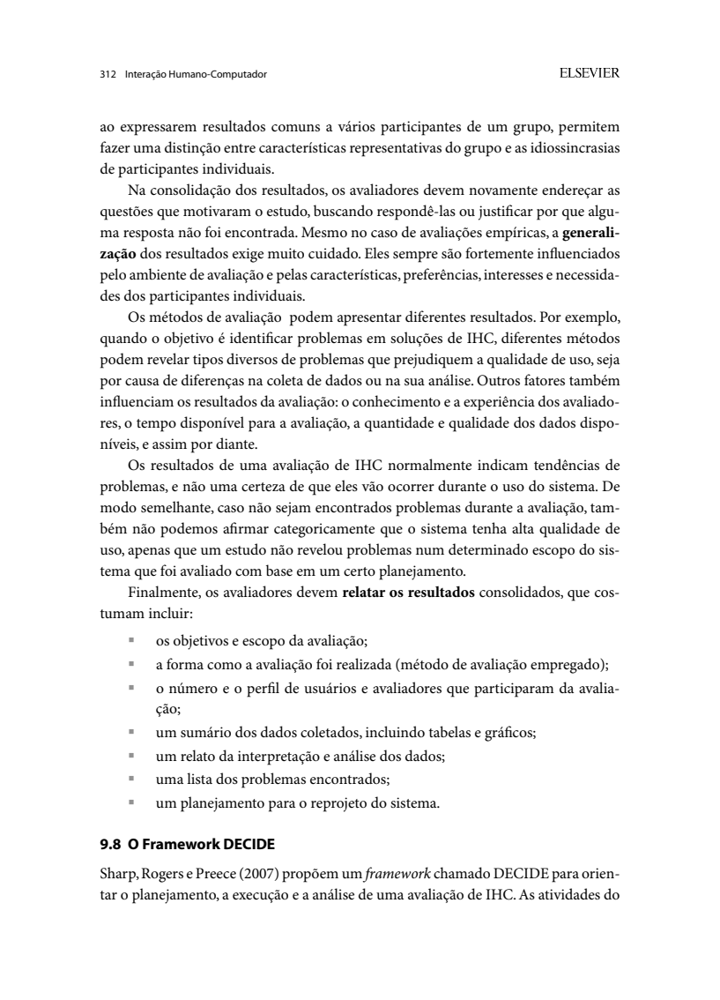

Responsável: Heitor Pinheiro Gonçalves das Chagas — Participação em Evento Interativo (e-Cidadania) · Autor do item: Heitor Pinheiro Gonçalves das Chagas

# Planejamento do relato dos resultados da avaliação do storyboard

## Tabela de contribuição

A Tabela 1 registra as contribuições no planejamento do relato do Storyboard.

| Integrante | Contribuição | Artefato / atividade |
| --- | --- | --- |
| [Heitor Pinheiro Gonçalves das Chagas](https://github.com/Heitorovski01) | Definição da matriz de consolidação por quadro, análise de reações e severidade de atritos | [Estrutura prevista do relato](#estrutura-prevista-do-relato-do-storyboard) |
| [Caio Breno de Souza Bezerra](https://github.com/CaioBezerra-Dev) | Revisão técnica e conferência dos critérios metodológicos | [Histórico de versão](#historico-de-versao) |
| Google Gemini e Claude (Anthropic) | Apoio na redação, organização de tabelas Markdown e adequação às normas da SBC | [Agradecimentos](#agradecimentos) |

Tabela 1 — Contribuição no planejamento do relato do Storyboard.

Fonte: elaboração para o Grupo 06 (2026).

## Introdução

Este artefato define o protocolo para organizar, interpretar e relatar os resultados que serão obtidos na futura avaliação do **Storyboard** da persona **Letícia Oliveira** no módulo **e-Cidadania** do Senado Federal, focada na participação em audiência pública da Comissão de Agricultura e Reforma Agrária (CRA) sobre o **PL 1215/2025** e no envio de pergunta técnica direcionada a orador.

O relato documentará em que medida a narrativa em cinco quadros foi considerada clara, verossímil e representativa da experiência real de cidadãos mobilizados em transmissões legislativas, destacando as confirmações, percepções sobre a interface proposta de reprojeto (Quadro 4) e sugestões que subsidiarão o protótipo de papel na Etapa 5.

**Situação em 24/10/2026:** trata-se exclusivamente do **planejamento do relato**. Nenhuma avaliação com usuários foi conduzida até este momento e nenhum formulário desta página contém resultados empíricos simulados. A coleta de dados e a geração do relatório definitivo ocorrerão na Etapa 5 (entrega em 25/10/2026).

## Item de conteúdo da disciplina

**Autor do item:** Heitor Pinheiro Gonçalves das Chagas.

Barbosa e Silva (2010, p. 310–313) orientam consolidar os resultados de avaliações formativas retomando os objetivos iniciais e apresentando tanto as confirmações conceituais quanto os problemas detectados. Os autores sublinham que os achados qualitativos revelam tendências de uso, demandando cautela na generalização de resultados obtidos com amostras pequenas.

A estrutura deste planejamento fundamenta-se nos componentes de consolidação de resultados descritos na seção 9.7.5 do livro (p. 311–312, Figura 1).

## Finalidade e público do relato

O relato apoiará duas decisões fundamentais da equipe do Grupo 06:
1. **Refinamento do Storyboard:** identificar quais quadros ou balões de fala precisam de ajustes contextuais ou gráficos;
2. **Requisitos de usabilidade para o Reprojeto:** extrair as necessidades e expectativas manifestadas pelos participantes (em especial quanto aos controles dedicados para direcionamento a oradores) para orientar o desenho do protótipo de papel na Etapa 5.

A versão pública do relato protegerá a privacidade dos participantes por meio de anonimização (P1, P2, P3).

## Preparação e organização dos registros por quadro

Durante a sessão de leitura guiada, o avaliador preencherá uma matriz de anotações organizada pelas cinco cenas do Storyboard (**QD01 a QD05**):

- **QD01 (Contexto / Motivação):** registro sobre a verossimilhança da demanda técnica urgente durante audiência ao vivo da comissão;
- **QD02 (Acesso e Busca):** avaliação da facilidade de navegação no módulo "Eventos Interativos" e filtro da audiência da CRA;
- **QD03 (Barreira de Usabilidade / Conflito):** concordância quanto ao atrito da caixa única de texto livre e receio de descarte da pergunta sem campo para orador;
- **QD04 (Interface Proposta de Reprojeto):** avaliação da solução conceitual proposta (seleção de "Pergunta a Orador", escolha de orador em menu e autenticação gov.br);
- **QD05 (Ação Colaborativa / Desfecho):** validação empírica da orientação repassada ao coletivo para garantir a triagem das perguntas enviadas.

As anotações separarão expressamente falas espontâneas do participante de respostas formuladas após intervenção explicativa do avaliador. Os dados do teste piloto serão descartados do cômputo final dos resultados.

### Ficha de evidências localizadas e matriz de questões do DECIDE

Para assegurar rastreabilidade intraparticipante e separar o dado observado da interpretação analítica (BARBOSA; SILVA, 2010, p. 310, 312), cada apontamento colhido nas sessões será registrado na ficha da Tabela 2 com código anônimo (`P1–P3`), quadro (`QD01–QD05`), pergunta do roteiro, **localizador temporal exato no áudio/vídeo (`mm:ss`) ou identificador da nota de sessão** e condição da manifestação.

| ID Evidência | Participante | Quadro (`QD01–QD05`) | Questão / Roteiro | Localizador (`mm:ss` / nota) | Condição (`Espontânea` / `Após esclarecimento`) | Evidência observada (fala / reação) | Interpretação separada do avaliador |
| :---: | :---: | :---: | :---: | :---: | :---: | --- | --- |
| `SB-EV01` | `[P1..P3]` | `[QD01..QD05]` | `[SB-Q1..Q5 / P01, P06–P09]` | `[00:00–00:00]` | `[ ]` | `[ ]` | `[ ]` |

Tabela 2 — Ficha individual de evidências do Storyboard com localizador temporal.

Fonte: elaboração do autor (2026), com base em Barbosa e Silva (2010, p. 310).

Na consolidação, as fichas `SB-EV` respondem diretamente às questões específicas do DECIDE (`SB-Q1` a `SB-Q5`, definidas no [Planejamento da avaliação](planejamento-avaliacao-storyboard.md#e-explorar-as-perguntas)) por meio da matriz da Tabela 3.

**Regra explícita para questões inconclusivas (BARBOSA; SILVA, 2010, p. 312):** cada questão será classificada como **Validada**, **Parcial / Divergente** ou **Inconclusiva / Dados insuficientes**. Caso os registros coletados não bastem para responder com segurança a alguma questão norteadora (por ausência de evidência empírica, interrupção ou ambiguidade), o relato registrará expressamente o status **Inconclusiva**, justificará a limitação observada e indicará como a hipótese será reexaminada no protótipo de papel na Etapa 5, vedando-se inferências sem lastro.

| Questão DECIDE | Síntese analítica por participante e consolidada | Evidências e localizadores (`SB-EV` · `mm:ss`) | Status (`Validada` / `Parcial` / `Inconclusiva`) | Justificativa de inconclusão ou encaminhamento |
| :---: | --- | --- | :---: | --- |
| `SB-Q1` (`SB-O1`) | `[ ]` | `[ ]` | `[ ]` | `[ ]` |
| `SB-Q2` (`SB-O1`) | `[ ]` | `[ ]` | `[ ]` | `[ ]` |
| `SB-Q3` (`SB-O2`) | `[ ]` | `[ ]` | `[ ]` | `[ ]` |
| `SB-Q4` (`SB-O3`) | `[ ]` | `[ ]` | `[ ]` | `[ ]` |
| `SB-Q5` (`SB-O3`) | `[ ]` | `[ ]` | `[ ]` | `[ ]` |

Tabela 3 — Matriz de fechamento das questões específicas do DECIDE para o Storyboard.

Fonte: elaboração do autor (2026), com base em Barbosa e Silva (2010, p. 310, 312).

## Estrutura prevista do relato do Storyboard

A Tabela 4 define a estrutura dos 8 tópicos que comporão o relatório oficial na Etapa 5, cumprindo integralmente os critérios da disciplina.

| Nº | Componente do relato | Conteúdo a ser preenchido na Etapa 5 | Fonte dos dados |
| :---: | :--- | --- | --- |
| **1** | **Objetivos e escopo da avaliação** | Definição clara de que se avaliou a compreensibilidade e verossimilhança do Storyboard de Letícia Oliveira na participação em evento interativo (audiência da CRA sobre o PL 1215/2025) e envio de pergunta direcionada no e-Cidadania. | Planejamento da avaliação (Seção D) |
| **2** | **Breve descrição do método utilizado** | Descrição formal do método: *validação do modelo de análise de tarefas HTA, leitura guiada do Storyboard como prototipação conceitual de baixa fidelidade e sua transição para o método de prototipação em papel*. | Protocolo metodológico da Seção C |
| **3** | **Número e perfil do avaliador e participantes** | Registro dos 3 participantes (jovens atuantes em coletivos e movimentos sociais), do avaliador (Heitor Pinheiro) e do revisor (Caio Breno), sob estrito anonimato. | Fichas de triagem e TCLE assinado |
| **4** | **Tarefas executadas pelos participantes** | Descrição do percurso de leitura sequencial dos 5 quadros e resposta às perguntas P01, P06 a P09 do roteiro semiestruturado. | Registro em áudio e notas da sessão |
| **5** | **Sumário dos dados coletados** | Matriz de evidências por cena (QD01 a QD05): pontos validados, elementos contestados e reações à interface proposta de reprojeto. | Formulário de evidências do Storyboard |
| **6** | **Interpretação e análise dos dados** | Análise crítica sobre o alinhamento da narrativa com a prática real em audiências públicas e avaliação da aceitação da interface proposta no Quadro 4. | Matriz interpretativa de respostas |
| **7** | **Lista de problemas classificados por severidade** | Relação de barreiras e incoerências apontadas, categorizadas na escala de gravidade de Nielsen (1994) de 0 a 4 (0 = sem problema; 1 = cosmético; 2 = simples; 3 = grave; 4 = catastrófico). | Matriz de severidade acordada na equipe |
| **8** | **Planejamento do reprojeto** | Recomendações ergonômicas colhidas nas perguntas P08 e P09 sobre a estruturação de campos de perguntas a oradores para guiar o protótipo de papel na Etapa 5. | Recomendações de design participativo |

Tabela 4 — Estrutura de consolidação do relato do Storyboard.

Fonte: elaboração do autor com base em Barbosa e Silva (2010, p. 311–312) e SALES (2026).

## Qualidade, limitações e validades da avaliação

O relato conterá análise técnica das validades de pesquisa (BARBOSA; SILVA, 2010, p. 312–313):
- **Confiabilidade:** reprodutibilidade da compreensão da narrativa em amostras similares, amparada nos localizadores temporais (`mm:ss`) das gravações;
- **Validade interna:** garantia de que o avaliador manteve postura neutra ao apresentar a interface proposta no Quadro 4, separando manifestações espontâneas daquelas obtidas após esclarecimento;
- **Validade externa:** reflexão sobre em que medida a experiência de militantes no DF reflete a diversidade do público usuário do e-Cidadania em transmissões legislativas, tratando os resultados como indícios qualitativos sem generalização estatística;
- **Validade ecológica:** verificação de como a leitura de pranchas ilustradas em ambiente controlado se aproximou das condições reais de acompanhamento de transmissões ao vivo;
- **Limites de representações estáticas:** ressalva explícita de que a aprovação conceitual dos quadros do Storyboard não comprova ausência de problemas de interação, os quais dependem de ensaio com protótipos navegáveis/manipuláveis nas etapas seguintes.

## Agradecimentos

Em atenção às recomendações de integridade acadêmica da Sociedade Brasileira de Computação (SBC) e aos critérios do Plano de Ensino da FCTE/UnB, registra-se a declaração formal do uso de ferramentas de Inteligência Artificial Generativa (Google Gemini, Claude da Anthropic e Antigravity da Google DeepMind):
- **Onde as ferramentas foram empregadas:** na formatação dos componentes de relato, ficha de evidências e organização estruturada das tabelas Markdown;
- **Facilidades:** alta agilidade na diagramação tabular compatível com o tema MkDocs Material;
- **Dificuldades e controle de qualidade:** propensão dos modelos a produzir dados empíricos fictícios, exigindo curadoria rigorosa para assegurar que esta página permaneça estritamente como planejamento prospectivo.

## Histórico de versão

A Tabela 5 registra o histórico de versões deste planejamento do relato.

| Versão | Data | Descrição | Autor(es) | Revisor(es) |
| :---: | :---: | --- | --- | --- |
| `0.1` | 13/10/2026 | Estruturação inicial dos tópicos e instrumentos do planejamento do relato do Storyboard | [Heitor Pinheiro Gonçalves das Chagas](https://github.com/Heitorovski01) | [Caio Breno de Souza Bezerra](https://github.com/CaioBezerra-Dev) |
| `1.0` | 13/10/2026 | Conclusão do planejamento do relato estruturado nos componentes de Barbosa e Silva (2010), matriz por cena e severidades | [Heitor Pinheiro Gonçalves das Chagas](https://github.com/Heitorovski01) | [Caio Breno de Souza Bezerra](https://github.com/CaioBezerra-Dev) |
| `2.0` | 24/10/2026 | Refatoração do escopo do relato para a narrativa de Eventos Interativos da CRA e acolhimento da interface proposta de reprojeto | [Heitor Pinheiro Gonçalves das Chagas](https://github.com/Heitorovski01) | [Caio Breno de Souza Bezerra](https://github.com/CaioBezerra-Dev) |
| `2.1` | 26/11/2026 | Inclusão da ficha `SB-EV` com localizador temporal (`mm:ss`), matriz `SB-Q1..Q5` com regra para questões inconclusivas e limites de representações estáticas | [Heitor Pinheiro Gonçalves das Chagas](https://github.com/Heitorovski01) | [Bruno Ferreira Dornelas](https://github.com/brunnf) |

Tabela 5 — Histórico de versão.

Fonte: elaboração para o Grupo 06 (2026).

## Referências

[1] BARBOSA, Simone Diniz Junqueira; SILVA, Bruno Santana da. *Interação humano-computador*. Rio de Janeiro: Elsevier, 2010. p. 310–313.

[2] NIELSEN, Jakob. *Usability Engineering*. San Francisco: Morgan Kaufmann, 1994.

[3] SALES, André Barros de. *Plano de Ensino FIHC 022026 — Turma 01*. Brasília: FCTE/UnB, 2026.

## Apêndice A — Trechos do livro

A figura abaixo reproduz as orientações de Barbosa e Silva (2010) para o relato dos resultados de avaliações formativas em IHC.

??? note "Figura 1 — Consolidação e relato dos resultados (Barbosa e Silva, 2010, p. 312)"
    
    
Figura 1 — Consolidação e relato dos resultados em IHC.

    
Fonte: Barbosa e Silva (2010, p. 312).

