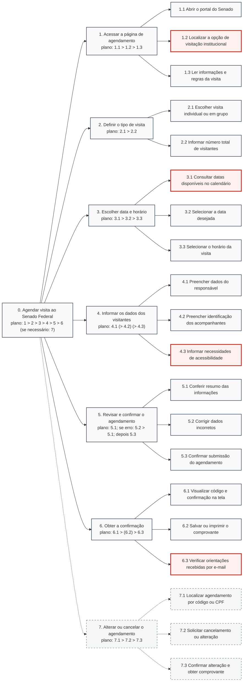

<span class="owner">Responsável: Israel Soares · Autor do item: Israel Soares</span>

# Planejamento da avaliação da Análise de Tarefas com HTA (DECIDE)

## Tabela de contribuição

A Tabela 1 registra quem atuou neste artefato.

| Integrante | Contribuição | Artefato / atividade |
| --- | --- | --- |
| [Israel Soares](https://github.com/IsraelSoares-25) | Elaboração do planejamento da avaliação da Análise de Tarefas | [Introdução](./planejamento-avaliacao-analise-tarefas.md#introducao) |
| Claude (Anthropic) | Apoio na organização do texto, na formatação Markdown e na consolidação das tabelas | [Agradecimentos](./planejamento-avaliacao-analise-tarefas.md#agradecimentos) |

<p class="caption">Tabela 1 — Contribuição neste artefato.</p>
<p class="source">Fonte: elaboração do Grupo 06 (2026).</p>

## Introdução

Este artefato planeja a avaliação da Análise de Tarefas da funcionalidade de agendamento de visita ao Senado Federal, modelada com HTA (*Hierarchical Task Analysis*, ou Análise Hierárquica de Tarefas), no projeto de IHC sobre o portal do Senado. O foco é verificar se o modelo representa fielmente como o cidadão realiza, ou realizaria, o agendamento. O planejamento segue o framework DECIDE, como no [Planejamento StoryBoard](./planejamento-avaliacao-storyboard.md), e os resultados serão relatados no [Resultados HTA](./planejamento-relato-resultados-analise-tarefas.md).

## Item de conteúdo da disciplina

**Autor do item:** Israel Soares

A HTA decompõe uma tarefa em subtarefas e operações organizadas hierarquicamente, acompanhadas de planos que determinam a ordem e as condições de execução (ANNETT; DUNCAN, 1967). Neste artefato, o HTA do agendamento de visita é o objeto da avaliação, e seu modelo é apresentado na Figura 1, na seção [Estrutura e diagrama do HTA avaliado](#estrutura-e-diagrama-do-hta-avaliado).

## D: Determinar os objetivos da avaliação

**Objetivo geral:** avaliar se o modelo HTA do agendamento de visita ao Senado Federal representa de forma adequada as tarefas, a ordem de execução e as alternativas que o cidadão realiza ao agendar uma visita.

**Objetivos específicos:**

- Verificar se a decomposição hierárquica (tarefa principal, subtarefas e operações) está correta e no nível de detalhe adequado.
- Verificar se os **planos** (ordem, condições, repetições e escolhas) refletem como o usuário realmente executa a atividade.
- Identificar tarefas ausentes, desnecessárias ou fora de ordem.
- Identificar situações de exceção e erro não consideradas (ex.: data ou horário indisponível, dados inválidos, necessidade de alterar ou cancelar o agendamento).

## E: Explorar as perguntas a serem respondidas

**Perguntas de avaliação:**

1. As tarefas e subtarefas do modelo correspondem ao que o cidadão realmente faz para agendar uma visita?
2. A ordem das tarefas e as condições descritas nos planos são realistas?
3. Existem tarefas importantes que não aparecem no modelo?
4. As situações de erro e de exceção foram consideradas?
5. O nível de detalhamento do HTA é adequado e compreensível?

**Roteiro de perguntas (usado na entrevista):**

*Antes de mostrar o modelo:*

1. Conte como você faria para agendar uma visita a um lugar como o Senado Federal, do início ao fim.
2. O que você precisaria saber ou ter em mãos antes de agendar?

*Depois de apresentar o HTA:*

1. Você realiza essa tarefa dessa forma?
2. Existe alguma etapa faltando, desnecessária ou fora de ordem?
3. O que você faria se a data ou o horário que deseja não estivessem disponíveis?
4. O que você faria se precisasse alterar ou cancelar o agendamento?
5. Há alguma tarefa importante para você que não aparece no modelo?
6. Algum termo ou etapa do modelo ficou difícil de entender?

## C: Escolher os métodos de avaliação

**Método selecionado:** entrevista guiada com apresentação do modelo HTA ao participante (*walkthrough* do modelo), combinada com relato espontâneo da tarefa antes da apresentação.

**Justificativa:** pedir primeiro que o participante descreva sua própria forma de agendar permite comparar o comportamento real com o modelo, sem influenciá-lo. A apresentação posterior do HTA permite validar a decomposição, a ordem das tarefas e os planos, e coletar sugestões de ajuste a baixo custo, antes de avançar para protótipos de maior fidelidade.

**Como funciona:** o facilitador pede que o participante descreva como realizaria o agendamento; em seguida, apresenta o HTA (em diagrama ou lista hierárquica), percorre as tarefas e planos e faz as perguntas do roteiro. O observador registra divergências entre o relato do participante e o modelo. Após cada ciclo, o HTA é ajustado antes do ciclo seguinte.

## I: Identificar e administrar as questões práticas

**Artefato avaliado:** HTA do Agendamento de Visita ao Senado Federal, versão 2.0, disponível em [Análise de Tarefas — Agendamento de Visita](../../../entrega-2/individual/israel/analise-tarefas.md).

**Perfil dos participantes:** de preferência, pessoas que já agendaram visitas a locais públicos ou que têm interesse em visitar o Senado (estudantes, professores, famílias, turistas). Quando possível, será incluído ao menos um especialista ou conhecedor do tema (ex.: professor que organiza visitas de turmas).

**Quantidade:** 3 a 5 participantes.

**Local e duração:** [presencial na UnB/Gama ou remoto via Google Meet], com sessões de cerca de 20 a 25 minutos por participante.

A Tabela 2 define os papéis dos avaliadores, e a Tabela 3 apresenta o cronograma das atividades.

| Papel | Responsabilidade | Responsável |
| --- | --- | --- |
| Facilitador | Conduz a entrevista e apresenta o HTA | [Nome do integrante] |
| Observador | Registra divergências entre o relato do participante e o modelo | [Nome do integrante] |
| Responsável pelo registro | Gerencia gravação (se autorizada) e organiza os dados | [Nome do integrante] |

<p class="caption">Tabela 2 — Papéis dos avaliadores.</p>
<p class="source">Fonte: elaboração do Grupo 06 (2026).</p>

| Atividade | Data prevista |
| --- | --- |
| Recrutamento dos participantes | 15/10 |
| Teste-piloto do roteiro entre os integrantes | 16/10 |
| Realização das sessões (ciclo 1) | 17/10 |
| Ajuste do HTA e novo ciclo (ciclo 2) | 18/10 |
| Consolidação e análise dos dados | 19/10 |
| Elaboração do relato dos resultados | 22/10 |

<p class="caption">Tabela 3 — Cronograma da avaliação.</p>
<p class="source">Fonte: elaboração do Grupo 06 (2026).</p>

**Recursos necessários:**

- HTA impresso ou digital (diagrama e lista hierárquica)
- Roteiro de perguntas
- Termo de Consentimento Livre e Esclarecido (TCLE)
- Questionário de perfil do participante
- Folha ou planilha de anotações
- Gravador de áudio/tela (opcional, com autorização)

**Procedimento de cada sessão:**

1. Recepção e explicação do objetivo da avaliação.
2. Leitura e assinatura do TCLE.
3. Aplicação do questionário de perfil (idade, escolaridade, familiaridade com agendamentos on-line).
4. Relato espontâneo do participante sobre como agendaria a visita.
5. Apresentação do HTA e perguntas do roteiro.
6. Perguntas finais e sugestões.
7. Agradecimento e encerramento.

## D: Decidir como lidar com as questões éticas

**Termo de Consentimento Livre e Esclarecido (TCLE):** antes de qualquer coleta, o participante será informado sobre o objetivo da avaliação, o uso dos dados e a possibilidade de desistir a qualquer momento, e então autorizará formalmente sua participação.

**Cuidados éticos:**

- Garantia de anonimato dos dados: os participantes serão identificados por códigos (P1, P2, P3...).
- Esclarecimento de que a avaliação se destina ao modelo de tarefas e não ao desempenho do participante. Não existem respostas certas ou erradas.
- Gravações só serão feitas com autorização expressa e usadas apenas para fins da disciplina.
- Os dados serão armazenados de forma restrita aos integrantes do grupo.

## E: Avaliar, interpretar e apresentar os dados

**Análise dos dados:** comparação qualitativa entre o relato espontâneo de cada participante e o HTA, identificando divergências de tarefas, ordem, planos e exceções. A Tabela 4 define os níveis de impacto usados para classificar as divergências, agrupadas por tarefa.

| Impacto | Critério |
| --- | --- |
| Alto | Tarefa ausente ou ordem incorreta que altera o modelo de forma relevante |
| Médio | Subtarefa, condição ou exceção faltando, sem comprometer a estrutura geral |
| Baixo | Sugestão de nomenclatura ou de detalhamento |

<p class="caption">Tabela 4 — Níveis de impacto das divergências.</p>
<p class="source">Fonte: elaboração do Grupo 06 (2026).</p>

A Tabela 5 mostra o modelo de registro das divergências encontradas.

| ID | Tarefa/subtarefa | Divergência encontrada | Evidência (fala/observação) | Impacto | Ajuste no HTA |
| --- | --- | --- | --- | --- | --- |
| D01 | | | | | |

<p class="caption">Tabela 5 — Modelo de registro das divergências identificadas.</p>
<p class="source">Fonte: elaboração do Grupo 06 (2026).</p>

**Verificação de validade:** serão avaliadas a confiabilidade e a validade ecológica do estudo, isto é, o quanto o HTA reflete a forma real como os cidadãos agendam visitas e o quanto o perfil dos participantes representa o público-alvo.

**Apresentação dos resultados:** os resultados e os ajustes no HTA serão apresentados no [Artefato 4](./planejamento-relato-resultados-analise-tarefas.md).

## Estrutura e diagrama do HTA avaliado

A Figura 1 apresenta o diagrama da Análise Hierárquica de Tarefas (HTA) do Agendamento de Visita ao Senado Federal (versão 2.0), modelado na [Análise de Tarefas da Entrega 2](../../../entrega-2/individual/israel/analise-tarefas.md#analise-hierarquica-de-tarefas-hta), que servirá como objeto de avaliação durante as sessões com os participantes.



<p class="caption">Figura 1 — Diagrama HTA do Agendamento de Visita ao Senado Federal.</p>
<p class="source">Fonte: elaboração do autor (2026), com base em Barbosa e Silva (2010, p. 193–195).</p>

O Quadro 1 detalha os planos formais e a especificação textual hierárquica correspondente.

??? note "Quadro 1 — Estrutura hierárquica e planos do HTA"

    ```text
    0. Agendar visita ao Senado Federal
       Plano 0: fazer 1, 2, 3, 4, 5 e 6 em sequência.
                Se for necessário mudar o agendamento depois, fazer 7.

       1. Acessar a página de agendamento de visita
          1.1 Abrir o portal do Senado
          1.2 Localizar a opção de visitação
          1.3 Ler as informações e regras da visita
          Plano 1: fazer 1.1, 1.2 e 1.3 em sequência.

       2. Definir o tipo de visita
          2.1 Escolher visita individual ou em grupo
          2.2 Informar o número de visitantes
          Plano 2: fazer 2.1 e 2.2 em sequência.

       3. Escolher data e horário
          3.1 Consultar datas disponíveis
          3.2 Selecionar a data
          3.3 Selecionar o horário
          Plano 3: fazer 3.1, 3.2 e 3.3 em sequência.
                   Se não houver disponibilidade, voltar a 3.1.

       4. Informar os dados dos visitantes
          4.1 Preencher os dados do responsável
          4.2 Preencher os dados dos demais visitantes
          4.3 Informar necessidades de acessibilidade
          Plano 4: fazer 4.1. Se for visita em grupo, fazer 4.2.
                   Se houver necessidade especial, fazer 4.3.

       5. Revisar e confirmar o agendamento
          5.1 Conferir as informações
          5.2 Corrigir dados, se necessário
          5.3 Confirmar o agendamento
          Plano 5: fazer 5.1. Se houver erro, fazer 5.2 e repetir 5.1.
                   Depois, fazer 5.3.

       6. Receber a confirmação
          6.1 Visualizar o comprovante
          6.2 Salvar ou imprimir o comprovante
          6.3 Ler as orientações para o dia da visita
          Plano 6: fazer 6.1, 6.2 e 6.3 em sequência.

       7. Alterar ou cancelar o agendamento
          7.1 Localizar o agendamento
          7.2 Alterar ou cancelar
          7.3 Receber a nova confirmação
          Plano 7: fazer 7.1, 7.2 e 7.3 em sequência.
    ```

    <p class="caption">Quadro 1 — Estrutura hierárquica e planos formais do HTA.</p>
    <p class="source">Fonte: elaboração do Grupo 06 (2026).</p>

## Agradecimentos

O Claude, assistente de inteligência artificial desenvolvido pela Anthropic, apoiou a organização do texto, a formatação Markdown e a consolidação das tabelas. A responsabilidade pelo conteúdo publicado é do autor.

## Histórico de versão

| Versão | Data | Descrição | Autor(es) | Revisor(es) |
| :---: | :---: | --- | --- | --- |
| `1.0` | 13/10/2026 | Criação do planejamento da avaliação da Análise de Tarefas (HTA) com base no framework DECIDE | [Israel Soares](https://github.com/IsraelSoares-25) | [Heitor Pinheiro Gonçalves das Chagas](https://github.com/Heitorovski01) |
| `1.1` | 13/10/2026 | Adequação ao template padrão de artefato | [Israel Soares](https://github.com/IsraelSoares-25) | [Heitor Pinheiro Gonçalves das Chagas](https://github.com/Heitorovski01) |
| `1.2` | 22/10/2026 | Vinculação direta ao HTA versão 2.0 do Agendamento de Visita da Entrega 2 | [Israel Soares](https://github.com/IsraelSoares-25) | [Bruno Ferreira Dornelas](https://github.com/brunnf) |

## Referências

[1] ANNETT, John; DUNCAN, Keith D. Task analysis and training design. Occupational Psychology, v. 41, p. 211-221, 1967.
