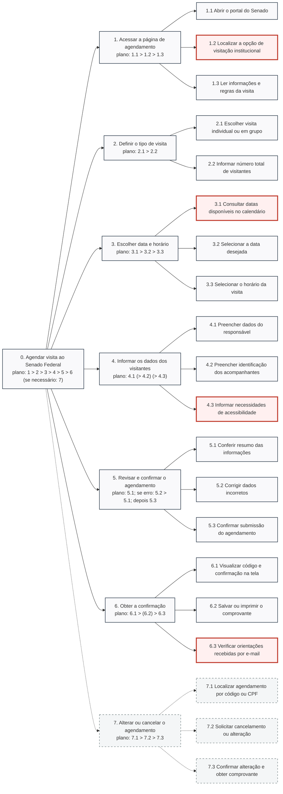
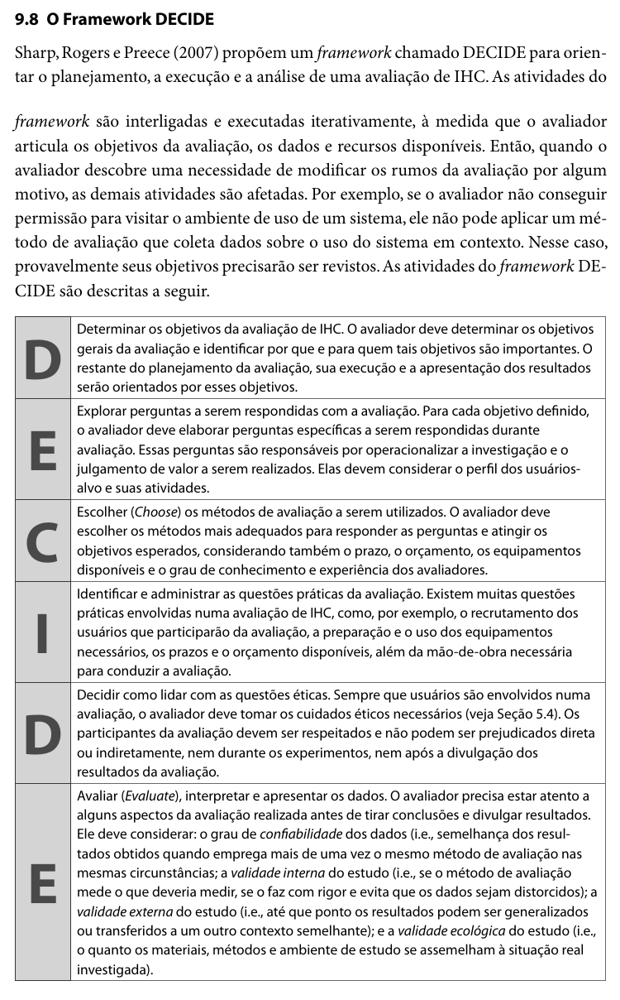
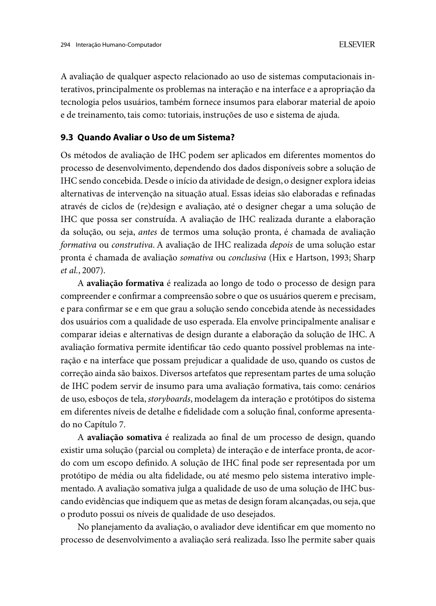
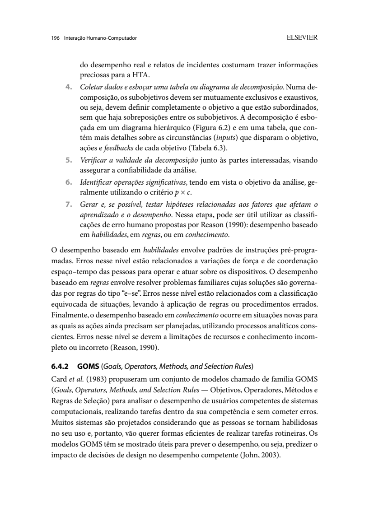
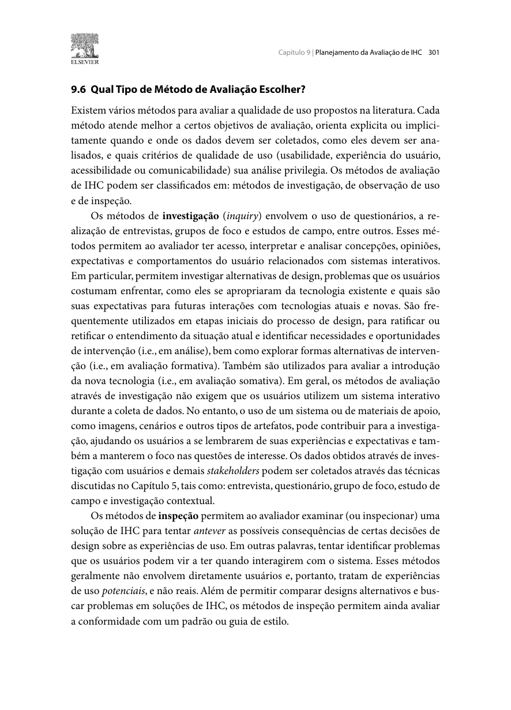
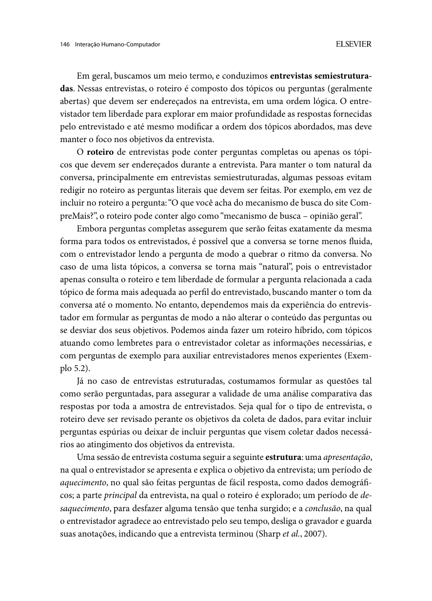

<span class="owner">Responsável: Israel Soares de Paiva · Autor do item: Israel Soares de Paiva</span>

# Planejamento da avaliação da Análise de Tarefas com HTA (DECIDE)

## Tabela de contribuição

A Tabela 1 registra quem atuou neste artefato.

| Integrante / ferramenta | Contribuição | Artefato / atividade |
| --- | --- | --- |
| [Israel Soares de Paiva](https://github.com/IsraelSoares-25) | Elaboração do planejamento DECIDE da avaliação da HTA, roteiro, protocolo de piloto e minuta de TCLE | [Objetivos](#d-determinar-os-objetivos-da-avaliacao) · [Métodos](#c-escolher-os-metodos-de-avaliacao) · [HTA avaliado](#estrutura-e-diagrama-do-hta-avaliado) |
| [Bruno Ferreira Dornelas](https://github.com/brunnf) | Revisão metodológica cruzada, conferência da notação HTA/CTT e revisão das referências | [Histórico de versão](#historico-de-versao) |
| Claude (Anthropic) e Antigravity (Google DeepMind) | Apoio na organização do texto, formatação Markdown e consolidação das tabelas | [Agradecimentos](#agradecimentos) |

<p class="caption">Tabela 1 — Contribuição neste artefato.</p>
<p class="source">Fonte: elaboração do Grupo 06 (2026).</p>

## Introdução

Este artefato planeja a **avaliação formativa** da [Análise de Tarefas (HTA e CTT, versão 2.0)](../../../entrega-2/individual/israel/analise-tarefas.md) da funcionalidade de **Agendamento de visita ao Senado Federal**, protagonizada pela persona [Marta Oliveira](../../../entrega-2/individual/israel/persona.md) [1, 2]. Conforme Barbosa e Silva (2010, p. 196, 294, 304; Figuras 2 e 3 do [Apêndice A](#apendice-a-trechos-da-literatura)), esta avaliação ocorre na etapa de concepção — antes da implementação de telas interativas — para verificar junto a partes interessadas se a decomposição hierárquica, os planos e as exceções representam com fidelidade a atividade esperada pelo cidadão.

**Delimitação justificada do escopo:** entram na avaliação o objetivo principal `0. Agendar visita ao Senado Federal`, os seis subobjetivos do fluxo principal de reserva (`1. Acessar a página de agendamento` a `6. Obter a confirmação`) e o ramo condicional pós-reserva **`7. Alterar ou cancelar o agendamento` (`7.1–7.3`)**, modelado como tarefa sob demanda (tracejada na Figura 1). A inclusão explícita da Tarefa `7` nesta entrevista justifica-se porque o [Storyboard (`QD01–QD07`)](storyboard.md) cobre apenas o agendamento inicial bem-sucedido (`1 a 6`), cabendo à avaliação da HTA validar também como o cidadão espera localizar e remarcar/cancelar sua visita em caso de imprevisto. Ficam fora do escopo medições cronometradas de cliques em interface pronta e regras internas de retaguarda administrativa dos servidores da portaria do Senado. A estrutura de reporte está definida no [Planejamento do relato dos resultados da Análise de Tarefas](planejamento-relato-resultados-analise-tarefas.md).

## Item de conteúdo da disciplina

**Autor do item:** Israel Soares de Paiva.

A Análise Hierárquica de Tarefas (*Hierarchical Task Analysis* — HTA) decompõe objetivos de alto nível em subobjetivos e operações, regidos por planos que especificam ordem e condições de execução (ANNETT; DUNCAN, 1967 [1]; BARBOSA; SILVA, 2010, p. 191–196 [2]). Barbosa e Silva (2010, p. 196; Figura 3 do [Apêndice A](#apendice-a-trechos-da-literatura)) recomendam revisar e verificar a validade da decomposição junto a partes interessadas, articulando essa checagem ao planejamento sistemático das seis etapas do framework **DECIDE** (p. 312–313; Figura 1 do [Apêndice A](#apendice-a-trechos-da-literatura)).

## D: Determinar os objetivos da avaliação { #d-determinar-os-objetivos-da-avaliacao }

**Objetivo geral:** avaliar, na fase conceitual do projeto, se a decomposição hierárquica, os planos e os tratamentos de exceção do modelo HTA v2.0 de agendamento de visita ao Senado Federal refletem com completude e clareza o fluxo mental e prático de cidadãos no perfil de Marta Oliveira.

**Objetivos específicos:**

- **AT-O1 — Validade e granularidade da decomposição:** verificar se a divisão do objetivo `0` nos ramos `1` a `7` e suas 20 operações elementares está completa e em nível de detalhe compreensível;
- **AT-O2 — Coerência dos planos e dependências:** confirmar se a ordem sequencial (ex.: definir tipo/grupo antes do calendário e revisar antes de confirmar) corresponde ao percurso esperado pela pessoa usuária;
- **AT-O3 — Cobertura de omissões, pontos críticos e exceções:** identificar passos esquecidos (como consulta prévia de trajes/documentos) e validar os desvios para datas sem vagas (`Plano 3`) e alteração/cancelamento posterior (`Tarefa 7`);
- **AT-O4 — Conformidade técnica da notação (`CT01–CT06`):** inspecionar internamente pela equipe se os diagramas e tabelas HTA/CTT cumprem as convenções formais de Barbosa e Silva (2010, p. 193–205) e Paternò (2000).

## E: Explorar as perguntas a serem respondidas { #e-explorar-as-perguntas-a-serem-respondidas }

A Tabela 2 desdobra os objetivos `AT-O1` a `AT-O4` em **questões específicas de avaliação (`AT-Q1` a `AT-Q6`)**, vinculando cada questão aos nós do modelo e às evidências que permitirão respondê-la (BARBOSA; SILVA, 2010, p. 292–293, 313).

| ID | Objetivo vinculado | Pergunta específica de avaliação (do avaliador) | Parte do modelo | Evidência pretendida e critério de análise |
| :---: | :---: | --- | --- | --- |
| **AT-Q1** | `AT-O1` | As tarefas e subtarefas do modelo correspondem ao que o cidadão realmente faria para agendar uma visita ao Senado? | Objetivo `0` e ramos `1–6` | Convergência ou discrepância entre o relato espontâneo inicial (`ANT-01/02`) e os ramos apresentados |
| **AT-Q2** | `AT-O2` | A ordem das tarefas e as condições descritas nos planos (`Plano 0` a `Plano 6`) são realistas para visitas individuais e em grupo? | `Planos 0–6` (`2 > 3 > 4 > 5 > 6`) | Confirmação da precedência lógica entre tipo/quantidade, escolha de data/horário e revisão final |
| **AT-Q3** | `AT-O1`, `AT-O3` | Existem operações ou informações prévias indispensáveis ausentes, redundantes ou mal posicionadas (ex.: regras de vestimenta em `1.3`)? | `1.1–1.3`, `4.1–4.3`, `6.1–6.3` | Apontamento de etapas omitidas ou necessidade de antecipar regras antes do calendário/formulário |
| **AT-Q4** | `AT-O3` | As situações de erro e exceção — indisponibilidade de horário (`Plano 3`), correção na revisão (`5.2`) e remarcação/cancelamento (`Tarefa 7`) — atendem às expectativas do cidadão? | `3.1–3.3`, `5.1–5.2`, `7.1–7.3` | Descrição de como a participante reagiria diante de agenda lotada ou imprevisto após confirmar |
| **AT-Q5** | `AT-O1` | O nível de detalhamento e os termos traduzidos em linguagem natural são compreendidos sem exigir jargão técnico? | HTA completo (`1–7`) | Ausência de dúvidas terminológicas durante a leitura guiada (`HTA-05`, `DEP-05`) |
| **AT-Q6** | `AT-O4` | Os modelos HTA e CTT publicados na Etapa 2 cumprem os critérios técnicos `CT01–CT06` (hierarquia, planos, tríade `<input, ação, feedback>` e operadores temporais)? | [HTA e CTT v2.0](../../../entrega-2/individual/israel/analise-tarefas.md) | Conferência analítica documental pela equipe (sem submeter notação formal ao participante) |

<p class="caption">Tabela 2 — Matriz de perguntas específicas de avaliação da Análise de Tarefas vinculadas aos objetivos do DECIDE.</p>
<p class="source">Fonte: elaboração de Israel Soares de Paiva (2026), com base em Barbosa e Silva (2010, p. 196, 292–293, 313).</p>

### Roteiro de perguntas para a entrevista (linguagem acessível)

Para evitar jargões técnicos da notação HTA/CTT (BARBOSA; SILVA, 2010, p. 148) e não induzir respostas (p. 147), a sessão com a participante divide-se em três momentos:

1. **Momento prévio (`ANTES` — relato espontâneo sem ver o diagrama):**
   - `ANT-01`: *Conte, com suas palavras, como você faria do início ao fim para agendar pela internet uma visita ao Senado Federal.*
   - `ANT-02`: *O que você precisaria saber ou ter em mãos antes de iniciar esse agendamento?*
2. **Apresentação guiada em linguagem comum (`AVALIAÇÃO HTA` — percorrendo os blocos 1 a 7):**
   - `HTA-01`: *Essas etapas (acessar e ler regras, definir grupo, escolher dia/horário, preencher dados, revisar, pegar comprovante e alterar/cancelar) correspondem ao que você faria?*
   - `HTA-02`: *A ordem entre escolher o tipo/tamanho do grupo antes de ver o calendário e revisar antes de confirmar faz sentido para você?*
   - `HTA-03`: *Há alguma etapa importante que faltou ser mostrada antes ou durante o preenchimento?*
   - `HTA-04`: *As alternativas previstas para dia sem vaga, erro de digitação e cancelamento cobrem o que pode dar errado?*
   - `HTA-05`: *A divisão das etapas está clara ou algum passo pareceu detalhado demais ou difícil de entender?*
3. **Consolidação final (`DEPOIS`):**
   - `DEP-01`: *No geral, você realizaria o agendamento seguindo esse percurso?*
   - `DEP-02`: *Mudaria alguma etapa de lugar ou retiraria algo desnecessário?*
   - `DEP-03`: *O que você faria na prática se a data ou o horário desejado estivesse esgotado?*
   - `DEP-04`: *Se surgisse um imprevisto depois de confirmar, como esperaria alterar ou cancelar a visita no site?*
   - `DEP-05`: *Algum termo usado na explicação soou burocrático ou confuso?*

## C: Escolher os métodos de avaliação { #c-escolher-os-metodos-de-avaliacao }

**Autor do item:** Israel Soares de Paiva.

À luz da classificação de Barbosa e Silva (2010, Seção 9.6, p. 301–303 [2]; Figura 4 do [Apêndice A](#apendice-a-trechos-da-literatura)), o planejamento combina dois procedimentos complementares compatíveis com artefatos conceituais estáticos:

1. **Método de investigação com usuário:** **entrevista semiestruturada individual** combinando relato espontâneo prévio com **percurso guiado (*walkthrough* conceitual) dos ramos da HTA em linguagem comum** (BARBOSA; SILVA, 2010, p. 146–148, 196 [2]; Figuras 3 e 5 do [Apêndice A](#apendice-a-trechos-da-literatura)). Pedir o relato livre antes de exibir os blocos evita viés de confirmação, enquanto o percurso subsequente verifica completude e exceções (`AT-Q1` a `AT-Q5`).
2. **Método de inspeção documental pela equipe:** **conferência técnica analítica (`CT01–CT06`)** da sintaxe da HTA e da CTT realizada pelos integrantes (`AT-Q6`), poupando a participante de operadores simbólicos.

**Justificativa frente ao estágio do projeto, prazo e orçamento:** como ainda não há interface construída para observação direta de cliques em laboratório, a combinação de investigação guiada + inspeção documental valida o modelo conceitual com alta precisão qualitativa, dentro do prazo de uma semana até a Etapa 5 e com **custo financeiro zero (`R$ 0,00`)**.

## I: Identificar e administrar as questões práticas { #i-identificar-e-administrar-as-questoes-praticas }

1. **Artefato avaliado:** [HTA e CTT versão 2.0 do Agendamento de Visita](../../../entrega-2/individual/israel/analise-tarefas.md) (reproduzido na Figura 1 e no Quadro 1 desta página).
2. **Perfil e canal de recrutamento:** pessoas adultas externas ao Senado alinhadas à persona [Marta Oliveira](../../../entrega-2/individual/israel/persona.md) (interesse real em visitação institucional/familiar e experiência básica ou média com agendamentos online). Convite voluntário direto via **WhatsApp e rede comunitária/profissional no DF**, sem vínculo com a equipe autora.
3. **Quantidade e justificativa:** **1 a 3 participantes** na avaliação oficial (`AT-PART01` confirmada, além de `1` participante exclusiva para o teste-piloto `PP-PILOTO01`). Para validação formativa de decomposição de tarefas na fase conceitual, esse recorte qualitativo identifica omissões de passos e expectativas de exceção no prazo disponível, sem pretensão de amostragem estatística (BARBOSA; SILVA, 2010, p. 196, 305, 312).
4. **Modalidade, local e duração:** sessão **presencial** em ambiente reservado e silencioso (residência da participante ou sala na FCTE/UnB Gama, com Google Meet privado como contingência), com duração estimada de **20 a 25 minutos**, realizada no mesmo encontro logo após o Storyboard.
5. **Equipamentos e materiais:** notebook exibindo o diagrama HTA ampliado e os blocos em linguagem simples, roteiro impresso/digital, minuta específica de TCLE e gravador de áudio/tela mediante aceite prévio.
6. **Orçamento:** **custo zero (`R$ 0,00`)**, empregando dispositivos próprios da equipe e participação voluntária gratuita.
7. **Equipe nominal e cronograma:** detalhados nas Tabelas 3 e 4.

A Tabela 3 identifica nominalmente os papéis da equipe, e a Tabela 4 fixa datas, horários (`UTC−3`) e locais previstos.

| Papel | Responsabilidade operacional | Integrante responsável |
| --- | --- | --- |
| **Moderador / Facilitador** | Condução do relato espontâneo, apresentação guiada da HTA em linguagem comum e perguntas do roteiro | [Israel Soares de Paiva](https://github.com/IsraelSoares-25) |
| **Responsável pelo registro e inspeção `CT01–CT06`** | Gravação autorizada, anotação de divergências com minutagem e conferência sintática dos modelos | [Israel Soares de Paiva](https://github.com/IsraelSoares-25) |
| **Observador / Revisor metodológico** | Acompanhamento metodológico, verificação de neutralidade e revisão cruzada da notação HTA/CTT e do relato | [Bruno Ferreira Dornelas](https://github.com/brunnf) |

<p class="caption">Tabela 3 — Papéis nominais da equipe na avaliação da Análise de Tarefas.</p>
<p class="source">Fonte: elaboração do Grupo 06 (2026).</p>

| Atividade | Data prevista | Horário (UTC−3) | Local / Modalidade | Participantes / Responsáveis |
| --- | :---: | :---: | --- | --- |
| Preparação dos blocos em linguagem comum e convite aos voluntários | 15/10/2026 | 14h00–18h00 | Contato direto / WhatsApp | Israel Soares de Paiva |
| **Teste-piloto** do roteiro e da leitura guiada da HTA (`PP-PILOTO01`) | **16/10/2026** | **19h00–19h45** | Presencial (sala silenciosa) / Google Meet | Israel Soares e `PP-PILOTO01` *(dados descartados)* |
| **Sessão oficial de avaliação da HTA (`AT-PART01`)** | **17/10/2026** *(reagendada na execução para 23/10)* | **19h30–20h15** | Presencial (residência da participante, após o Storyboard) | `AT-PART01`, Israel Soares e observador do Grupo 06 |
| Conferência técnica `CT01–CT06` e consolidação do relato (Etapa 5) | 18–23/10/2026 | 14h00–18h00 | Repositório do Grupo 06 | Israel Soares (autor) e Bruno Ferreira (revisor) |

<p class="caption">Tabela 4 — Cronograma planejado com datas, horários e local da avaliação da Análise de Tarefas.</p>
<p class="source">Fonte: elaboração de Israel Soares de Paiva (2026), alinhado ao [hub individual](../israel.md#cronograma-planejado-das-atividades).</p>

### Teste-piloto { #teste-piloto }

**Autor do item:** Israel Soares de Paiva.

De acordo com Barbosa e Silva (2010, Seção 9.7.3, p. 307–308 [2]; Figura 6 do [Apêndice A](#apendice-a-trechos-da-literatura)), o **teste-piloto** é o ensaio prévio completo da sessão planejada, realizado **antes da coleta oficial** com pessoa de perfil semelhante (`PP-PILOTO01`) não incluída na amostra definitiva, para validar se a tradução dos blocos da HTA em linguagem comum evita jargões, se os equipamentos de gravação funcionam adequadamente e se a entrevista cabe na janela de 20 a 25 minutos.

O teste-piloto está agendado para **16/10/2026, das 19h00 às 19h45**, antecedendo as sessões principais.

!!! warning "Exclusão obrigatória dos dados do teste-piloto"
    Em estrita observância a Barbosa e Silva (2010, p. 307) e ao Plano de Ensino (SALES, 2026), **todos os dados colhidos no teste-piloto (`PP-PILOTO01`) servem apenas para calibrar o roteiro e a apresentação do modelo, sendo descartados e NÃO apresentados junto aos resultados oficiais da avaliação na Etapa 5.**

## D: Decidir como lidar com as questões éticas { #d-decidir-como-lidar-com-as-questoes-eticas }

Seguindo Barbosa e Silva (2010, Seção 5.4, p. 138–142 [2]) e os [aspectos éticos do Grupo 06](../../../entrega-2/etica.md), garante-se respeito, autonomia, não maleficência e confidencialidade antes, durante e após a divulgação dos resultados. O consentimento do Storyboard não é presumido automaticamente sem esclarecimento específico sobre esta etapa de análise de tarefas.

??? note "Minuta do Termo de Consentimento Livre e Esclarecido (TCLE) — Avaliação da Análise de Tarefas (Etapa 4)"

    **TERMO DE CONSENTIMENTO LIVRE E ESCLARECIDO (TCLE)**

    **Projeto acadêmico:** Avaliação e Reprojeto de IHC do Portal do Senado Federal — Agendamento de Visita Institucional (Grupo 06)  
    **Instituição e disciplina:** Universidade de Brasília (FCTE/UnB) — Interação Humano-Computador (`2026.2`), Prof. Dr. André Barros de Sales  
    **Avaliador responsável:** Israel Soares de Paiva (contato direto informado na via entregue à pessoa participante)

    **1. Objetivo, duração e procedimentos:** Você está sendo convidado(a) a participar voluntariamente da avaliação formativa do modelo de **Análise de Tarefas (`HTA`) do Agendamento de Visita ao Senado Federal**. A sessão compreende um breve relato livre sobre como você agendaria uma visita seguido de conversa guiada em linguagem simples sobre as etapas previstas no modelo (incluindo escolha de data/horário, conferência e eventual cancelamento), com duração estimada de **20 a 25 minutos**. Não é exigido nenhum conhecimento técnico prévio; avalia-se exclusivamente o modelo elaborado pela equipe. Os dados têm finalidade estritamente acadêmica.

    **2. Liberdade de recusa ou desistência sem penalização:** Sua participação é livre e gratuita. Você pode recusar qualquer pergunta, solicitar pausas ou **retirar seu consentimento e encerrar a participação a qualquer momento sem sofrer qualquer penalidade, constrangimento ou prejuízo**.

    **3. Anonimato em todas as mídias e guarda restrita:** Sua identidade civil será preservada em todos os textos, tabelas, transcrições, áudios, imagens ou vídeos publicados na documentação da disciplina, sendo substituída pelo código anônimo **`AT-PART01`**. Termo assinado e arquivos brutos originais ficarão sob guarda privada restrita aos avaliadores e serão excluídos até **dezembro de 2026** (em até 30 dias após o término da disciplina).

    **4. Permissão prévia e específica para gravação:** Nenhuma captura será iniciada sem sua manifestação prévia abaixo:  
    - `[ ] AUTORIZO` · `[ ] NÃO AUTORIZO` a gravação de **voz (áudio)** durante a entrevista.  
    - `[ ] AUTORIZO` · `[ ] NÃO AUTORIZO` a gravação de **imagem/vídeo e/ou tela** durante a sessão.  
    - `[ ] AUTORIZO` · `[ ] NÃO AUTORIZO` a publicação acadêmica do registro desidentificado como vídeo **não listado** no YouTube vinculado ao repositório da disciplina.

    **Declaração de consentimento:** Declaro que fui esclarecido(a) sobre os objetivos, duração, procedimentos e garantias éticas deste estudo, recebi cópia deste termo e concordo voluntariamente em participar.  
    Local e data: \_\_\_\_\_\_\_\_\_\_\_\_\_\_\_\_\_\_, \_\_\_\_/\_\_\_\_/2026.  
    Assinatura da pessoa participante: \_\_\_\_\_\_\_\_\_\_\_\_\_\_\_\_\_\_\_\_\_\_\_\_\_\_\_\_\_\_\_\_  
    Assinatura do avaliador responsável (Israel Soares de Paiva): \_\_\_\_\_\_\_\_\_\_\_\_\_\_\_\_\_\_\_\_\_\_

## E: Avaliar, interpretar e apresentar os dados { #e-avaliar-interpretar-e-apresentar-os-dados }

A análise confrontará o relato espontâneo (`ANT-01/02`) com as respostas sobre os ramos `1 a 7` (`HTA-01..05` e `DEP-01..05`), mantendo em colunas distintas o dado observado (fala com minutagem `mm:ss` no vídeo) e a interpretação técnica do avaliador, além da tabela separada de conferência `CT01–CT06`. Os dados do piloto `PP-PILOTO01` permanecem fora dos resultados.

A Tabela 5 define os critérios de impacto das divergências, e a Tabela 6 apresenta o modelo de registro detalhado no [Planejamento do relato](planejamento-relato-resultados-analise-tarefas.md).

| Impacto | Critério sobre a modelagem da tarefa |
| :---: | --- |
| **Alto** | Subtarefa essencial omitida, plano com ordem inviável ou falha de tratamento de exceção que impediria concluir o agendamento |
| **Médio** | Operação intermediária, regra prévia ou condição opcional incompleta, sem invalidar a decomposição principal |
| **Baixo** | Ajuste de nomenclatura, clareza de rótulo ou refinamento documental da notação |

<p class="caption">Tabela 5 — Níveis de impacto das divergências identificadas na HTA.</p>
<p class="source">Fonte: elaboração do Grupo 06 (2026), com base em Barbosa e Silva (2010, p. 292, 312).</p>

| ID | Nó / Plano da HTA | Questão DECIDE | Evidência e localizador (`mm:ss`) | Impacto e ajuste no modelo | Encaminhamento para o Protótipo de Papel |
| :---: | :---: | :---: | --- | --- | --- |
| `AT-P01` | | | | | |

<p class="caption">Tabela 6 — Modelo de registro de divergências e encaminhamentos da HTA.</p>
<p class="source">Fonte: elaboração do Grupo 06 (2026).</p>

**Confiabilidade, validades e limites:** o relato examinará explicitamente a **confiabilidade** (rastreabilidade entre vídeo e síntese), a **validade interna** (efeito de ordem por ocorrer logo após o Storyboard com a mesma participante e neutralidade das explicações), a **validade externa** (amostra formativa reduzida sem generalização estatística), a **validade ecológica** (discussão conceitual fora de agendamento real) e os **limites de modelos estáticos** (validação da árvore HTA não substitui o teste de interação com telas) (BARBOSA; SILVA, 2010, p. 312–313).

## Estrutura e diagrama do HTA avaliado { #estrutura-e-diagrama-do-hta-avaliado }

A Figura 1 apresenta o diagrama da Análise Hierárquica de Tarefas (HTA) do Agendamento de Visita ao Senado Federal (versão 2.0), modelado na [Análise de Tarefas da Entrega 2](../../../entrega-2/individual/israel/analise-tarefas.md#analise-hierarquica-de-tarefas-hta), que servirá como objeto de avaliação nas sessões.



<p class="caption">Figura 1 — Diagrama HTA do Agendamento de Visita ao Senado Federal.</p>
<p class="source">Fonte: elaboração do autor (2026), com base em Barbosa e Silva (2010, p. 193–195).</p>

O Quadro 1 detalha os planos formais e a especificação textual hierárquica correspondente.

??? note "Quadro 1 — Estrutura hierárquica e planos do HTA"

    ```text
    0. Agendar visita ao Senado Federal
       Plano 0: fazer 1, 2, 3, 4, 5 e 6 em sequência.
                Se for necessário mudar o agendamento depois, fazer 7.

       1. Acessar a página de agendamento de visita
          1.1 Abrir o portal do Senado
          1.2 Localizar a opção de visitação
          1.3 Ler as informações e regras da visita
          Plano 1: fazer 1.1, 1.2 e 1.3 em sequência.

       2. Definir o tipo de visita
          2.1 Escolher visita individual ou em grupo
          2.2 Informar o número de visitantes
          Plano 2: fazer 2.1 e 2.2 em sequência.

       3. Escolher data e horário
          3.1 Consultar datas disponíveis
          3.2 Selecionar a data
          3.3 Selecionar o horário
          Plano 3: fazer 3.1, 3.2 e 3.3 em sequência.
                   Se não houver disponibilidade, voltar a 3.1.

       4. Informar os dados dos visitantes
          4.1 Preencher os dados do responsável
          4.2 Preencher os dados dos demais visitantes
          4.3 Informar necessidades de acessibilidade
          Plano 4: fazer 4.1. Se for visita em grupo, fazer 4.2.
                   Se houver necessidade especial, fazer 4.3.

       5. Revisar e confirmar o agendamento
          5.1 Conferir as informações
          5.2 Corrigir dados, se necessário
          5.3 Confirmar o agendamento
          Plano 5: fazer 5.1. Se houver erro, fazer 5.2 e repetir 5.1.
                   Depois, fazer 5.3.

       6. Receber a confirmação
          6.1 Visualizar o comprovante
          6.2 Salvar ou imprimir o comprovante
          6.3 Ler as orientações para o dia da visita
          Plano 6: fazer 6.1, 6.2 e 6.3 em sequência.

       7. Alterar ou cancelar o agendamento
          7.1 Localizar o agendamento
          7.2 Alterar ou cancelar
          7.3 Receber a nova confirmação
          Plano 7: fazer 7.1, 7.2 e 7.3 em sequência.
    ```

    <p class="caption">Quadro 1 — Estrutura hierárquica e planos formais do HTA.</p>
    <p class="source">Fonte: elaboração do Grupo 06 (2026).</p>

## Agradecimentos

O Claude (Anthropic) e o Antigravity (Google DeepMind) apoiaram a organização do texto, a formatação Markdown e a consolidação das tabelas metodológicas e referências. A responsabilidade acadêmica pelo conteúdo publicado é do autor.

## Histórico de versão

A Tabela 7 registra o histórico de versões deste planejamento.

| Versão | Data | Descrição | Autor(es) | Revisor(es) |
| :---: | :---: | --- | --- | --- |
| `1.0` | 13/10/2026 | Criação do planejamento da avaliação da Análise de Tarefas (HTA) com base no framework DECIDE | [Israel Soares de Paiva](https://github.com/IsraelSoares-25) | [Heitor Pinheiro Gonçalves das Chagas](https://github.com/Heitorovski01) |
| `1.1` | 13/10/2026 | Adequação ao template padrão de artefato | [Israel Soares de Paiva](https://github.com/IsraelSoares-25) | [Heitor Pinheiro Gonçalves das Chagas](https://github.com/Heitorovski01) |
| `1.2` | 22/10/2026 | Vinculação direta ao HTA versão 2.0 do Agendamento de Visita da Entrega 2 | [Israel Soares de Paiva](https://github.com/IsraelSoares-25) | [Bruno Ferreira Dornelas](https://github.com/brunnf) |
| `1.3` | 26/11/2026 | Caracterização da avaliação formativa e escopo da Tarefa 7, matriz `AT-O1..O4` ↔ `AT-Q1..Q6`, taxonomia e recortes do método/piloto (Apêndice A), equipe/agenda/orçamento zero, exclusão do piloto, minuta de TCLE e inclusão de Barbosa e Silva (2010) nas referências | [Israel Soares de Paiva](https://github.com/IsraelSoares-25) | [Bruno Ferreira Dornelas](https://github.com/brunnf) |

<p class="caption">Tabela 7 — Histórico de versão.</p>
<p class="source">Fonte: elaboração do Grupo 06 (2026).</p>

## Referências { #referencias }

[1] ANNETT, John; DUNCAN, Keith D. *Task analysis and training design*. Occupational Psychology, v. 41, p. 211–221, 1967.

[2] BARBOSA, Simone Diniz Junqueira; SILVA, Bruno Santana da. *Interação humano-computador*. Rio de Janeiro: Elsevier, 2010. p. 138–148, 191–205, 291–294, 301–313.

[3] PATERNÒ, Fabio. *Model-Based Design and Evaluation of Interactive Applications*. London: Springer, 2000.

[4] SALES, André Barros de. *Plano de Ensino FIHC 022026 — Turma 01*. Brasília: FCTE/UnB, 2026. Apresentação 4.

## Apêndice A — Trechos da literatura { #apendice-a-trechos-da-literatura }

As Figuras 2 a 6 fundamentam o framework DECIDE, a avaliação formativa, a verificação da decomposição HTA junto às partes interessadas, a condução da entrevista e o teste-piloto.

??? note "Figura 2 — Framework DECIDE e avaliação formativa (Barbosa e Silva, 2010, p. 294, 312–313)"

    
    <p class="caption">Figura 2a — Atividades do framework DECIDE.</p>
    <p class="source">Fonte: Barbosa e Silva (2010, p. 312–313).</p>

    
    <p class="caption">Figura 2b — Avaliação formativa na fase conceitual.</p>
    <p class="source">Fonte: Barbosa e Silva (2010, p. 294).</p>

??? note "Figura 3 — Verificação da validade da decomposição HTA com partes interessadas (Barbosa e Silva, 2010, p. 196)"

    
    <p class="caption">Figura 3 — Revisão e validação da decomposição HTA junto a stakeholders.</p>
    <p class="source">Fonte: Barbosa e Silva (2010, p. 196).</p>

??? note "Figura 4 — Classificação dos métodos de avaliação de IHC (Barbosa e Silva, 2010, p. 301)"

    
    <p class="caption">Figura 4 — Taxonomia dos métodos de avaliação de IHC.</p>
    <p class="source">Fonte: Barbosa e Silva (2010, p. 301).</p>

??? note "Figura 5 — Estrutura de entrevista semiestruturada (Barbosa e Silva, 2010, p. 146)"

    
    <p class="caption">Figura 5 — Etapas de condução de entrevista semiestruturada.</p>
    <p class="source">Fonte: Barbosa e Silva (2010, p. 146).</p>

??? note "Figura 6 — Definição do teste-piloto e exclusão de seus dados (Barbosa e Silva, 2010, p. 307)"

    
    <p class="caption">Figura 6 — Definição e separação dos dados do teste-piloto.</p>
    <p class="source">Fonte: Barbosa e Silva (2010, p. 307).</p>
