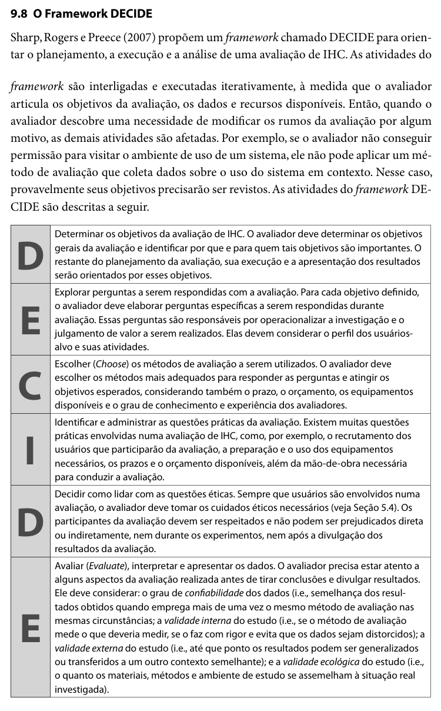
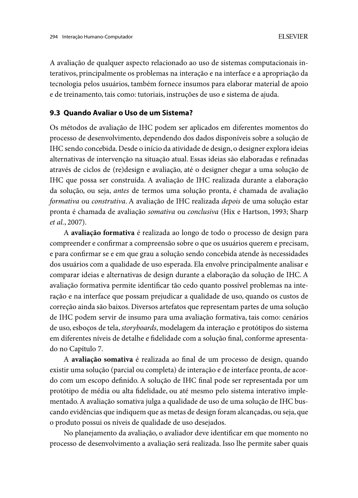
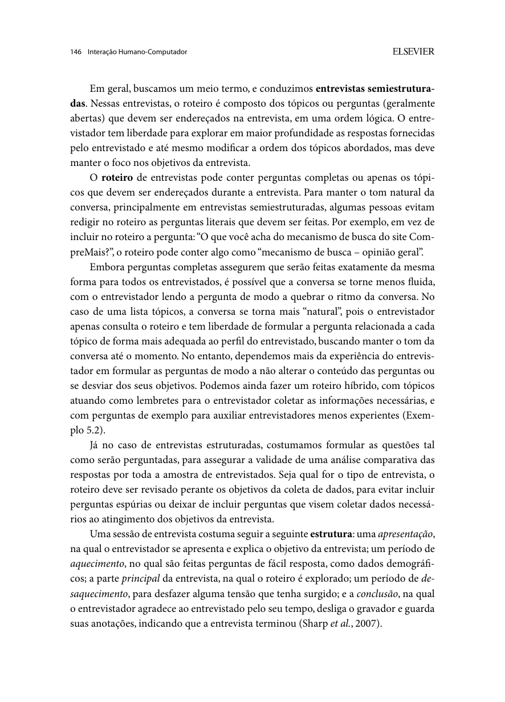
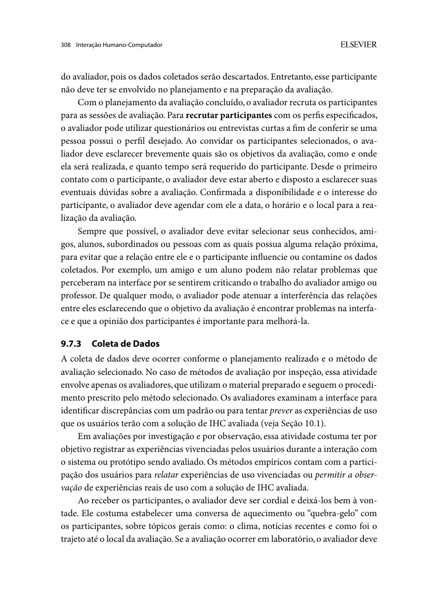

Responsável: Israel Soares de Paiva · Autor do item: Israel Soares de Paiva

# Planejamento da avaliação do Storyboard (DECIDE)

## Tabela de contribuição

A Tabela 1 registra quem atuou neste artefato.

| Integrante / ferramenta | Contribuição | Artefato / atividade |
| --- | --- | --- |
| [Israel Soares de Paiva](https://github.com/IsraelSoares-25) | Elaboração do planejamento DECIDE da avaliação do Storyboard, roteiro, protocolo de teste-piloto e minuta de TCLE | [Objetivos](#d-determinar-os-objetivos-da-avaliacao) · [Métodos](#c-escolher-os-metodos-de-avaliacao) · [Questões práticas](#i-identificar-e-administrar-as-questoes-praticas) |
| [Bruno Ferreira Dornelas](https://github.com/brunnf) | Revisão metodológica cruzada, alinhamento com os quadros `QD01–QD07` e conferência bibliográfica | [Histórico de versão](#historico-de-versao) |
| Claude (Anthropic) e Antigravity (Google DeepMind) | Apoio na organização do texto, formatação Markdown e consolidação das tabelas e referências | [Agradecimentos](#agradecimentos) |

Tabela 1 — Contribuição neste artefato.

Fonte: elaboração do Grupo 06 (2026).

## Introdução

Este artefato planeja a **avaliação formativa conceitual** do [Storyboard manual (`QD01–QD07`)](storyboard.md) da funcionalidade de **Agendamento de visita ao Senado Federal**, centrada na persona [Marta Oliveira](../../../entrega-2/individual/israel/persona.md) [1, 2]. Conforme Barbosa e Silva (2010, p. 294, 304; Figura 2 do [Apêndice A](#apendice-a-trechos-da-literatura)), trata-se de uma **avaliação formativa** realizada ainda durante a concepção da solução — antes da construção de telas interativas — utilizando representações estáticas de baixa fidelidade para verificar clareza narrativa, aderência ao vocabulário cotidiano do cidadão e lacunas de informação.

**Delimitação justificada do escopo:** entram na avaliação os sete quadros desenhados (`QD01–QD07`), cobrindo motivação doméstica (`QD01`), entrada no portal e busca em linguagem natural `"visita senado"` (`QD02–QD03`), compreensão do resumo `"Como funciona"` e escolha do tipo de visita (`QD04`), consulta de dias/horários livres (`QD05`), conferência prévia dos dados (`QD06`) e dupla confirmação na tela e por e-mail (`QD07`), sob o perfil de visitantes externos como Marta Oliveira. Ficam fora do escopo deste instrumento estático medições de desempenho (tempo de tarefa ou contagem de cliques), transações reais no portal do Senado e a simulação interativa de remarcação/cancelamento (`HTA 7`), que é sondada apenas como expectativa conceitual em `SB-Q6` para alimentar o protótipo de papel na Etapa 5. A consolidação seguirá a estrutura definida no [Planejamento do relato dos resultados do Storyboard](planejamento-relato-resultados-storyboard.md).

## Item de conteúdo da disciplina

**Autor do item:** Israel Soares de Paiva.

O framework **DECIDE** orienta o planejamento de avaliações de IHC em seis atividades interligadas: **(D)** determinar os objetivos gerais, **(E)** explorar perguntas específicas a serem respondidas, **(C)** escolher os métodos de avaliação, **(I)** identificar e administrar as questões práticas, **(D)** decidir como lidar com as questões éticas e **(E)** avaliar, interpretar e apresentar os dados (BARBOSA; SILVA, 2010, p. 312–313 [1]; PREECE; ROGERS; SHARP, 2013 [2]; Figura 1 do [Apêndice A](#apendice-a-trechos-da-literatura)). Neste documento, cada letra do acrônimo é operacionalizada em seção própria.

## D: Determinar os objetivos da avaliação { #d-determinar-os-objetivos-da-avaliacao }

**Objetivo geral:** avaliar, na fase do modelo conceitual, a clareza narrativa, a verossimilhança do contexto de uso e a adequação das ideias iniciais de design (`RP01–RP05`) representadas nos quadros `QD01–QD07` do Storyboard de agendamento de visita ao Senado Federal.

**Objetivos específicos (BARBOSA; SILVA, 2010, p. 291–293):**

- **SB-O1 — Compreensão da narrativa e sequência conceitual:** verificar se a pessoa participante compreende sem auxílio externo a motivação inicial de Marta (`QD01–QD02`), a transição entre os sete quadros e o desfecho de confirmação (`QD07`);
- **SB-O2 — Adequação ao vocabulário e à rotina do público-alvo:** investigar se o problema retratado na busca por palavras do dia a dia (`"visita senado"`, `QD03`) e a organização da visita com colegas/familiares correspondem às expectativas reais do perfil de Marta Oliveira;
- **SB-O3 — Identificação de lacunas informacionais e problemas conceituais:** detectar etapas, regras institucionais (como vestimenta permitida, documentos exigidos ou cancelamento/remarcação) ou retornos visuais sentidos como ausentes ou ambíguos nos quadros `QD04–QD06`;
- **SB-O4 — Validação das alternativas iniciais para o reprojeto:** coletar subsídios diretos sobre o resumo `"Como funciona"` (`QD04`), a grade semanal de horários (`QD05`), a revisão prévia (`QD06`) e o aviso por e-mail (`QD07`) para orientar o desenho das telas do protótipo de papel na Etapa 5.

## E: Explorar as perguntas a serem respondidas { #e-explorar-as-perguntas-a-serem-respondidas }

Para operacionalizar os objetivos `SB-O1` a `SB-O4` sem confundi-los com as falas diretas da entrevista (BARBOSA; SILVA, 2010, p. 292–293, 313), a Tabela 2 vincula cada **questão analítica de avaliação (`SB-Q1` a `SB-Q8`)** ao objetivo correspondente, aos quadros inspecionados e às evidências qualitativas esperadas.

| ID | Objetivo vinculado | Pergunta específica de avaliação (do avaliador) | Quadros foco | Evidência pretendida e critério de análise |
| :---: | :---: | --- | :---: | --- |
| **SB-Q1** | `SB-O1` | O cidadão compreende o contexto e a motivação inicial retratados no Storyboard sem explicações externas? | `QD01–QD02` | Reconto espontâneo identificando a intenção de visitar o Senado com colegas e a necessidade de agendar online |
| **SB-Q2** | `SB-O1`, `SB-O4` | A sequência de ações (busca coloquial, leitura de como funciona, escolha de horário, revisão e confirmação) reflete um caminho lógico e realista? | `QD02–QD07` | Confirmação da ordem lógica das cenas ou apontamento de saltos narrativos entre os quadros |
| **SB-Q3** | `SB-O3` | Existem etapas, regras institucionais ou feedbacks do sistema que o cidadão sentiu falta nos quadros (ex.: regras de vestimenta, documentos, código/PDF)? | `QD04–QD07` | Menções espontâneas ou estimuladas a informações indispensáveis antes de sair de casa rumo ao Congresso |
| **SB-Q4** | `SB-O2` | As reações e motivações da personagem (quase desistir na busca, conferir antes de enviar e aliviar-se com o e-mail) condizem com o usuário real? | `QD03`, `QD04`, `QD06`, `QD07` | Reconhecimento empático das dores de encontrabilidade e da insegurança quanto à reserva |
| **SB-Q5** | `SB-O2` | O contexto doméstico/cotidiano e o problema de localizar serviços públicos retratados condizem com a rotina da pessoa participante? | `QD01–QD03` | Relato de experiências próprias semelhantes em agendamentos de órgãos públicos ou pontos cívicos |
| **SB-Q6** | `SB-O3`, `SB-O4` | Quais objetivos da persona seriam alcançados com a proposta ilustrada e quais demandas permanecem fora da cobertura (ex.: cancelar/remarcar)? | `QD04–QD07` | Distinção entre o sucesso do agendamento inicial e cenários de imprevisto pós-reserva (`HTA 7`) |
| **SB-Q7** | `SB-O4` | O quanto o apoio computacional esboçado (resumo em 3 passos, grade semanal livre e confirmação na tela/e-mail) é percebido como útil e claro? | `QD04–QD07` | Apreciação qualitativa e justificativa atribuída aos elementos de interface esboçados |
| **SB-Q8** | `SB-O4` | Que ajustes prioritários o participante sugere para orientar a construção do protótipo de papel na Etapa 5? | `QD01–QD07` | Propostas concretas de destaque na home, avisos visuais de trajes/documentos e comprovante |

Tabela 2 — Matriz de perguntas específicas de avaliação do Storyboard vinculadas aos objetivos do DECIDE.

Fonte: elaboração de Israel Soares de Paiva (2026), com base em Barbosa e Silva (2010, p. 292–293, 313).

A Tabela 3 sintetiza a sequência real dos sete quadros (`QD01–QD07`) do [Storyboard avaliado](storyboard.md) apresentada durante a sessão.

| Quadro | Síntese visual do quadro apresentado na sessão | Vínculo na HTA |
| :---: | --- | --- |
| **`QD01`** | De manhã, em casa, Marta toma café, lê e lembra da vontade de visitar o Senado Federal. | Gatilho do Objetivo `0` |
| **`QD02`** | Marta decide levar colegas e abre a página inicial (`PORTAL`) perguntando onde agendar. | `HTA 1.1` |
| **`QD03`** | Busca com palavras do cotidiano sem termos técnicos: `"visita senado"`. | `HTA 1.2` |
| **`QD04`** | Quase desiste, mas encontra o agendamento, lê `"Como funciona"` (3 passos) e escolhe o tipo de visita. | `HTA 1.3`, `2.1–2.2` |
| **`QD05`** | Consulta a grade semanal (`D S T Q Q S S`) e escolhe `"Quarta, às 10h"` entre os horários livres. | `HTA 3.1–3.3` |
| **`QD06`** | Confere na tela `DADOS` o resumo `"Quarta-10"` antes de acionar `"Confirma"`. | `HTA 4.1`, `5.1`, `5.3` |
| **`QD07`** | Recebe `"Agendamento confirmado"` no monitor e aviso no e-mail pelo celular (*"Agora tenho certeza!"*). | `HTA 6.1`, `6.3` |

Tabela 3 — Sequência dos quadros QD01–QD07 do Storyboard avaliado.

Fonte: [Storyboard de Agendamento de Visita](storyboard.md) (2026).

### Roteiro de entrevista aplicado ao participante

Diferentemente das questões analíticas da Tabela 2, o moderador conduzirá a conversa em linguagem aberta e neutra (sem induzir aprovação da proposta), organizada em quatro etapas (BARBOSA; SILVA, 2010, p. 146–148):

1. **Apresentação e acolhimento:** explicação do objetivo acadêmico, esclarecimento de que o objeto avaliado é o desenho (não a pessoa participante) e assinatura prévia do TCLE com opção específica de gravação.
2. **Aquecimento / perfil breve:** idade aproximada, ocupação e experiência prévia com visitas a órgãos públicos ou agendamentos online.
3. **Exploração principal por quadro (`QD01` a `QD07`, leitura livre seguida de sondagem neutra):**
   - *O que você entendeu que está acontecendo neste quadro?*
   - *O que a personagem pretende fazer neste momento e o que chamou sua atenção na tela desenhada?*
   - *Há algo confuso, ambíguo ou alguma informação importante que você sentiu falta aqui?*
   - *O que você esperaria encontrar no passo seguinte?*
4. **Fechamento e síntese geral (cobrindo `SB-Q1` a `SB-Q8`):**
   - *Essa situação condiz com a realidade de quem quer organizar uma visita ao Senado?*
   - *Quais necessidades ficam resolvidas por essa proposta e o que ainda ficaria faltando caso surgisse algum imprevisto ou dúvida sobre regras de entrada?*
   - *De 1 a 5, o quanto a história ficou clara para você e o que você mudaria antes de desenharmos as telas em papel?*

## C: Escolher os métodos de avaliação { #c-escolher-os-metodos-de-avaliacao }

**Autor do item:** Israel Soares de Paiva.

Segundo a taxonomia de métodos de avaliação de IHC de Barbosa e Silva (2010, Seção 9.6, p. 301–303 [1]; Figura 3 do [Apêndice A](#apendice-a-trechos-da-literatura)), os métodos dividem-se em **investigação** (coleta de opiniões, expectativas e concepções dos usuários), **observação de uso** (registro de interação com sistema ou protótipo executável/manipulável) e **inspeção** (exame analítico por especialistas).

- **Método selecionado e classificação:** adota-se o método de **investigação** por meio de **entrevista semiestruturada individual apoiada na leitura guiada dos quadros estáticos do Storyboard (`QD01–QD07`)** (BARBOSA; SILVA, 2010, p. 146–148, 301 [1]; Figuras 3 e 4 do [Apêndice A](#apendice-a-trechos-da-literatura)).
- **Justificativa metodológica e adequação às restrições:** como na Etapa 4 o artefato ainda é uma narrativa visual estática (sem telas interativas nem operador simulando respostas em tempo real), métodos de observação de ensaio de interação e ciclos iterativos de prototipação em papel ainda não se aplicam — estes serão planejados na Etapa 5 e executados na Etapa 6. A entrevista apoiada em imagens permite investigar em profundidade se o modelo conceitual comunica a proposta e quais regras ou feedbacks faltam, cabendo integralmente no prazo curto entre as Etapas 4 e 5, com **custo financeiro zero (`R$ 0,00`)** e infraestrutura própria da equipe.

## I: Identificar e administrar as questões práticas { #i-identificar-e-administrar-as-questoes-praticas }

Os sete aspectos práticos exigidos pelo planejamento operacional (BARBOSA; SILVA, 2010, p. 304–309 [1]; SALES, 2026 [4]) estão definidos a seguir:

1. **Perfil e canal de recrutamento:** cidadãos adultos externos ao Senado Federal, alinhados à persona [Marta Oliveira](../../../entrega-2/individual/israel/persona.md) (servidores, trabalhadores ou estudantes que organizam passeios familiares/institucionais em Brasília e possuem familiaridade básica ou intermediária com navegadores, sem domínio do vocabulário legislativo). O recrutamento ocorre por **convite voluntário direto via WhatsApp e rede comunitária/profissional dos integrantes no Distrito Federal**, aplicando triagem rápida para excluir pessoas envolvidas no projeto.
2. **Quantidade de participantes e justificativa:** **1 a 3 participantes** na coleta oficial (sendo `1` participante confirmada, código `SB-PART01`, além de `1` participante distinta exclusiva para o teste-piloto, código `PP-PILOTO01`). Em avaliação formativa conceitual sobre narrativa estática, uma amostra qualitativa enxuta basta para revelar falhas de compreensão, termos opacos e omissões de regras antes da prototipação em papel, respeitando o cronograma acadêmico sem pretensão de inferência estatística (BARBOSA; SILVA, 2010, p. 305, 312).
3. **Modalidade, local e duração:** sessão **presencial** em ambiente silencioso e reservado (residência da pessoa participante ou sala de estudos na FCTE/UnB Gama, mantendo Google Meet privado como contingência remota), com duração prevista de **15 a 20 minutos** para a avaliação do Storyboard.
4. **Preparação e equipamentos:** notebook para exibição nítida da Figura 1 (`QD01–QD07`) com zoom, cópia impressa de apoio, roteiro estruturado, via do TCLE específico e smartphone/gravador para captura audiovisual mediante autorização prévia.
5. **Orçamento:** **custo zero (`R$ 0,00`)**, utilizando equipamentos pessoais já disponíveis e participação estritamente voluntária, sem remuneração ou deslocamento pago.
6. **Prazos:** preparação e recrutamento em `15/10/2026`, teste-piloto em `16/10/2026`, janela principal prevista a partir de `17/10/2026` (com execução efetiva consolidada em `23/10/2026`) e entrega do relato até `25/10/2026`.
7. **Mão de obra e papéis da equipe:** detalhados nominalmente na Tabela 4.

A Tabela 4 define os responsáveis nominais da equipe, e a Tabela 5 apresenta o cronograma com datas, horários de Brasília (`UTC−3`) e locais previstos.

| Papel | Responsabilidade operacional | Integrante responsável |
| --- | --- | --- |
| **Moderador / Facilitador** | Recrutamento, acolhimento, aplicação do TCLE, apresentação sequencial de `QD01–QD07` e condução neutra do roteiro | [Israel Soares de Paiva](https://github.com/IsraelSoares-25) |
| **Responsável pelo registro e análise** | Gerenciamento da gravação autorizada, minutagem das falas e tabulação inicial dos achados | [Israel Soares de Paiva](https://github.com/IsraelSoares-25) |
| **Observador / Revisor metodológico** | Apoio na observação da sessão, conferência de não indução e revisão cruzada dos instrumentos e do relato | [Bruno Ferreira Dornelas](https://github.com/brunnf) |

Tabela 4 — Papéis nominais da equipe na avaliação do Storyboard.

Fonte: elaboração do Grupo 06 (2026).

| Atividade | Data prevista | Horário (UTC−3) | Local / Modalidade | Participantes / Responsáveis |
| --- | :---: | :---: | --- | --- |
| Preparação dos materiais, recrutamento e envio prévio de convite | 15/10/2026 | 14h00–18h00 | Contato direto / WhatsApp | Israel Soares de Paiva |
| **Teste-piloto** do roteiro e da exibição dos quadros (`PP-PILOTO01`) | **16/10/2026** | **19h00–19h45** | Presencial (sala silenciosa) / Google Meet | Israel Soares e `PP-PILOTO01` *(dados descartados)* |
| **Sessão oficial de avaliação do Storyboard (`SB-PART01`)** | **17/10/2026** *(reagendada na execução para 23/10)* | **18h30–19h15** | Presencial (residência da participante) | `SB-PART01`, Israel Soares e observador do Grupo 06 |
| Transcrição, minutagem e consolidação do relato (Etapa 5) | 23–25/10/2026 | 10h00–17h00 | Repositório do Grupo 06 | Israel Soares (autor) e Bruno Ferreira (revisor) |

Tabela 5 — Cronograma planejado com datas, horários e local da avaliação do Storyboard.

Fonte: elaboração de Israel Soares de Paiva (2026), alinhado ao [hub individual](../israel.md#cronograma-planejado-das-atividades).

### Teste-piloto { #teste-piloto }

**Autor do item:** Israel Soares de Paiva.

Segundo Barbosa e Silva (2010, Seção 9.7.3, p. 307–308 [1]; Figuras 5 e 6 do [Apêndice A](#apendice-a-trechos-da-literatura)), o **teste-piloto** consiste em uma aplicação prévia completa do planejamento da avaliação — em condições equivalentes às da sessão definitiva — com o objetivo de verificar a viabilidade e corrigir eventuais falhas de legibilidade dos quadros, clareza das perguntas do roteiro, enquadramento/áudio da gravação e estimativa de tempo antes de abordar os participantes reais.

O teste-piloto está agendado para **16/10/2026, das 19h00 às 19h45** (data estritamente **anterior** à avaliação oficial), contando com uma pessoa voluntária de perfil próximo (`PP-PILOTO01`) que não integra a amostra principal.

!!! warning "Exclusão obrigatória dos dados do teste-piloto"
    Conforme determinam Barbosa e Silva (2010, p. 307) e o Plano de Ensino (SALES, 2026), **as respostas, opiniões e registros obtidos no teste-piloto (`PP-PILOTO01`) destinam-se exclusivamente à calibragem do procedimento e do roteiro, sendo integralmente descartados e NÃO apresentados nem contabilizados junto ao resultado oficial da avaliação na Etapa 5.**

## D: Decidir como lidar com as questões éticas { #d-decidir-como-lidar-com-as-questoes-eticas }

Em conformidade com Barbosa e Silva (2010, Seção 5.4, p. 138–142 [1]) e com os [aspectos éticos do projeto](../../../entrega-2/etica.md), a condução assegura respeito integral, conforto e ausência de prejuízos diretos ou indiretos antes, durante e após a divulgação acadêmica dos resultados:

- **Foco exclusivo no artefato:** esclarece-se na abertura que apenas o Storyboard está em avaliação, não existindo respostas certas ou erradas;
- **Autonomia e desistência sem ônus:** participação voluntária, com direito explícito de recusar qualquer pergunta, pedir pausas ou retirar o consentimento em qualquer fase sem penalização;
- **Anonimato em todas as mídias:** supressão de nomes, rostos identificáveis ou dados pessoais em textos, tabelas, áudios e vídeos publicados, empregando exclusivamente o código **`SB-PART01`**;
- **Permissão prévia específica para gravação:** nenhuma captura de voz, imagem ou tela é iniciada sem manifestação expressa e prévia no TCLE específico abaixo.

??? note "Minuta do Termo de Consentimento Livre e Esclarecido (TCLE) — Avaliação do Storyboard (Etapa 4)"

    **TERMO DE CONSENTIMENTO LIVRE E ESCLARECIDO (TCLE)**

    **Projeto acadêmico:** Avaliação e Reprojeto de IHC do Portal do Senado Federal — Agendamento de Visita Institucional (Grupo 06)  
    **Instituição e disciplina:** Universidade de Brasília (FCTE/UnB) — Interação Humano-Computador (`2026.2`), Prof. Dr. André Barros de Sales  
    **Avaliador responsável:** Israel Soares de Paiva (canal de contato direto informado na via entregue à pessoa participante)

    **1. Objetivo, duração e procedimentos:** Você está sendo convidado(a) a participar voluntariamente de uma avaliação formativa conceitual sobre o **Storyboard de Agendamento de Visita ao Senado Federal (`QD01–QD07`)**. A atividade consiste na visualização comentada de sete quadros desenhados à mão seguida de entrevista semiestruturada sobre clareza da história e informações necessárias para agendar uma visita, com duração estimada de **15 a 20 minutos**. Avalia-se exclusivamente o material ilustrado, e nunca o seu desempenho pessoal. Os dados serão utilizados apenas para fins acadêmicos nesta disciplina.

    **2. Liberdade de recusa ou desistência sem penalização:** Sua participação é inteiramente voluntária e não remunerada. Você tem plena liberdade para deixar de responder a qualquer pergunta, solicitar pausas ou **interromper a sessão e retirar seu consentimento a qualquer momento, mesmo após o início da entrevista, sem qualquer penalidade, constrangimento ou prejuízo**.

    **3. Anonimato e confidencialidade em todas as mídias:** Sua identidade civil será mantida sob sigilo. Em todos os relatórios escritos, transcrições, áudios, imagens ou vídeos publicados na documentação pública do projeto (GitHub Pages), seu nome e dados pessoais serão suprimidos e substituídos pelo código anônimo **`SB-PART01`**. A via assinada deste termo e os arquivos originais brutos permanecerão em pasta privada restrita aos avaliadores e serão descartados até **dezembro de 2026** (em até 30 dias após o encerramento do semestre).

    **4. Permissão prévia e específica para gravação:** Nenhum registro de áudio, imagem ou tela será realizado sem sua autorização prévia abaixo:  
    - `[ ] AUTORIZO` · `[ ] NÃO AUTORIZO` a gravação de **voz (áudio)** durante a entrevista.  
    - `[ ] AUTORIZO` · `[ ] NÃO AUTORIZO` a gravação de **imagem/vídeo e/ou tela** durante a sessão.  
    - `[ ] AUTORIZO` · `[ ] NÃO AUTORIZO` a disponibilização acadêmica do registro desidentificado como vídeo **não listado** no YouTube vinculado à documentação da disciplina.

    **Declaração de consentimento:** Declaro que fui devidamente informado(a) sobre os objetivos, duração, procedimentos e garantias éticas deste estudo, recebi cópia deste termo e concordo voluntariamente em participar.  
    Local e data: \_\_\_\_\_\_\_\_\_\_\_\_\_\_\_\_\_\_, \_\_\_\_/\_\_\_\_/2026.  
    Assinatura da pessoa participante: \_\_\_\_\_\_\_\_\_\_\_\_\_\_\_\_\_\_\_\_\_\_\_\_\_\_\_\_\_\_\_\_  
    Assinatura do avaliador responsável (Israel Soares de Paiva): \_\_\_\_\_\_\_\_\_\_\_\_\_\_\_\_\_\_\_\_\_\_

## E: Avaliar, interpretar e apresentar os dados { #e-avaliar-interpretar-e-apresentar-os-dados }

A análise será estritamente qualitativa e rastreável às questões `SB-Q1`–`SB-Q8`, separando o **dado observado** (fala literal com localizador temporal `mm:ss` no vídeo e indicação se foi espontânea ou após esclarecimento) da **interpretação da equipe** (BARBOSA; SILVA, 2010, p. 310–313). Os dados de `PP-PILOTO01` ficam fora da análise.

A Tabela 6 define os critérios objetivos de gravidade para classificar os problemas conceituais identificados, e a Tabela 7 apresenta o modelo resumido de registro (detalhado no [Planejamento do relato](planejamento-relato-resultados-storyboard.md)).

| Gravidade | Critério de impacto na compreensão e no fluxo |
| :---: | --- |
| **Alta** | Impede a compreensão do quadro/fluxo ou omite informação crítica de acesso (ex.: regras eliminatórias na portaria ou confirmação da vaga) |
| **Média** | Gera dúvida ou hesitação interpretativa em algum quadro, mas o participante compreende a progressão geral |
| **Baixa** | Sugestão pontual de vocabulário, legenda ou preferência visual sem comprometer o entendimento |

Tabela 6 — Níveis de gravidade dos problemas identificados no Storyboard.

Fonte: elaboração do Grupo 06 (2026), com base em Barbosa e Silva (2010, p. 292, 312).

| ID | Quadro (`QD01–QD07`) | Questão DECIDE | Evidência e localizador (`mm:ss`) | Interpretação e gravidade | Encaminhamento para o Protótipo de Papel |
| :---: | :---: | :---: | --- | --- | --- |
| `SB-P01` | | | | | |

Tabela 7 — Modelo de consolidação de problemas e encaminhamento ao reprojeto.

Fonte: elaboração do Grupo 06 (2026).

**Confiabilidade, validades e limites:** antes de divulgar as conclusões no [relato da Etapa 5](../../../entrega-5/individual/israel/relato-storyboard.md), serão examinadas a **confiabilidade** (consistência entre gravação, transcrição e minutagem), a **validade interna** (postura neutra do moderador sem induzir aprovação), a **validade externa** (limites de generalização de amostra formativa reduzida por conveniência), a **validade ecológica** (diferença entre comentar desenhos em ambiente calmo e agendar uma visita real) e os **limites próprios de representações estáticas** (ausência de críticas aos quadros não comprova usabilidade da interface final) (BARBOSA; SILVA, 2010, p. 312–313).

## Agradecimentos

O Claude (Anthropic) e o Antigravity (Google DeepMind) apoiaram a organização do texto, a formatação Markdown e a consolidação das matrizes metodológicas e referências bibliográficas. A responsabilidade acadêmica pelo conteúdo publicado é do autor.

## Histórico de versão

A Tabela 8 registra o histórico de versões deste planejamento.

| Versão | Data | Descrição | Autor(es) | Revisor(es) |
| :---: | :---: | --- | --- | --- |
| `1.0` | 13/10/2026 | Criação do planejamento da avaliação do Storyboard com base no framework DECIDE | [Israel Soares de Paiva](https://github.com/IsraelSoares-25) | [Heitor Pinheiro Gonçalves das Chagas](https://github.com/Heitorovski01) |
| `1.1` | 13/10/2026 | Adaptação para a funcionalidade Agendamento de Visita | [Israel Soares de Paiva](https://github.com/IsraelSoares-25) | [Heitor Pinheiro Gonçalves das Chagas](https://github.com/Heitorovski01) |
| `1.2` | 13/10/2026 | Adequação ao template padrão de artefato | [Israel Soares de Paiva](https://github.com/IsraelSoares-25) | [Heitor Pinheiro Gonçalves das Chagas](https://github.com/Heitorovski01) |
| `1.3` | 26/11/2026 | Delimitação da avaliação formativa, vínculo `SB-O1..O4` ↔ `SB-Q1..Q8`, classificação taxonômica e recortes do método/piloto (Apêndice A), fechamento de equipe/agenda/orçamento zero, exclusão explícita do piloto e minuta completa de TCLE | [Israel Soares de Paiva](https://github.com/IsraelSoares-25) | [Bruno Ferreira Dornelas](https://github.com/brunnf) |

Tabela 8 — Histórico de versão.

Fonte: elaboração do Grupo 06 (2026).

## Referências

[1] BARBOSA, Simone Diniz Junqueira; SILVA, Bruno Santana da. *Interação humano-computador*. Rio de Janeiro: Elsevier, 2010. p. 138–148, 291–294, 301–313.

[2] PREECE, Jenny; ROGERS, Yvonne; SHARP, Helen. *Design de interação: além da interação humano-computador*. 3. ed. Porto Alegre: Bookman, 2013.

[3] VIANNA, Maurício et al. *Design Thinking: inovação em negócios*. Rio de Janeiro: MJV Press, 2012. p. 135–137.

[4] SALES, André Barros de. *Plano de Ensino FIHC 022026 — Turma 01*. Brasília: FCTE/UnB, 2026. Apresentação 4.

## Apêndice A — Trechos da literatura { #apendice-a-trechos-da-literatura }

As Figuras 1 a 6 reproduzem os trechos de Barbosa e Silva (2010) que fundamentam o framework DECIDE, a caracterização da avaliação formativa, a escolha do método de investigação por entrevista e o protocolo de teste-piloto.

??? note "Figura 1 — Framework DECIDE (Barbosa e Silva, 2010, p. 312–313)"

    
    
Figura 1 — Atividades do framework DECIDE.

    
Fonte: Barbosa e Silva (2010, p. 312–313).

??? note "Figura 2 — Avaliação formativa durante a concepção (Barbosa e Silva, 2010, p. 294)"

    
    
Figura 2 — Caracterização da avaliação formativa.

    
Fonte: Barbosa e Silva (2010, p. 294).

??? note "Figura 3 — Métodos de investigação apoiados em imagens e cenários (Barbosa e Silva, 2010, p. 301)"

    
    
Figura 3 — Grupos de métodos de avaliação e investigação com artefatos visuais.

    
Fonte: Barbosa e Silva (2010, p. 301).

??? note "Figura 4 — Estrutura e condução de entrevista semiestruturada (Barbosa e Silva, 2010, p. 146)"

    
    
Figura 4 — Condução de entrevista semiestruturada.

    
Fonte: Barbosa e Silva (2010, p. 146).

??? note "Figura 5 — Definição, finalidade e descarte dos dados do teste-piloto (Barbosa e Silva, 2010, p. 307)"

    
    
Figura 5 — Definição e finalidade do teste-piloto.

    
Fonte: Barbosa e Silva (2010, p. 307).

??? note "Figura 6 — Participante do piloto, recrutamento e agendamento (Barbosa e Silva, 2010, p. 308)"

    
    
Figura 6 — Participante do piloto, recrutamento e agendamento.

    
Fonte: Barbosa e Silva (2010, p. 308).

