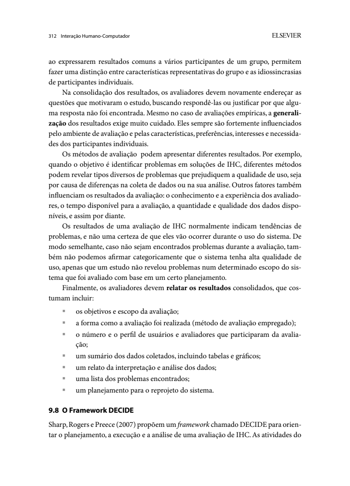

Responsável: Israel Soares de Paiva · Autor do item: Israel Soares de Paiva

# Planejamento do relato dos resultados da avaliação da Análise de Tarefas (HTA)

## Tabela de contribuição

A Tabela 1 registra quem atuou neste artefato.

| Integrante / ferramenta | Contribuição | Artefato / atividade |
| --- | --- | --- |
| [Israel Soares de Paiva](https://github.com/IsraelSoares-25) | Elaboração da estrutura do relato, fichas com localizador temporal, matriz DECIDE, critérios de impacto e validades | [Instrumentos](#instrumentos-de-registro-e-interpretacao-por-participante) · [Limitações](#consideracoes-finais-limitacoes-e-validades) |
| [Bruno Ferreira Dornelas](https://github.com/brunnf) | Revisão metodológica cruzada e alinhamento com o plano de avaliação da HTA | [Histórico de versão](#historico-de-versao) |
| Claude (Anthropic) e Antigravity (Google DeepMind) | Apoio na organização do texto, formatação Markdown e consolidação das tabelas | [Agradecimentos](#agradecimentos) |

Tabela 1 — Contribuição neste artefato.

Fonte: elaboração do Grupo 06 (2026).

## Introdução

Este artefato define prospectivamente a estrutura e os instrumentos de consolidação do relato dos resultados da avaliação formativa da [Análise de Tarefas (HTA e CTT, versão 2.0)](../../../entrega-2/individual/israel/analise-tarefas.md) da funcionalidade de **Agendamento de visita ao Senado Federal**. O relatório definitivo será redigido na Etapa 5 ([Relato da avaliação da análise de tarefas](../../../entrega-5/individual/israel/relato-analise-tarefas.md)) após a execução das sessões previstas no [Planejamento da avaliação da Análise de Tarefas](planejamento-avaliacao-analise-tarefas.md), preservando todos os campos em branco nesta Etapa 4 (sem dados empíricos simulados) [1, 2].

## Item de conteúdo da disciplina

**Autor do item:** Israel Soares de Paiva.

Segundo Barbosa e Silva (2010, Seção 9.7.4 e 9.7.5, p. 310–313 [2]; Figura 1 do [Apêndice A](#apendice-a-trecho-do-livro)), a consolidação do relato de avaliação de IHC deve retomar os objetivos e questões específicas do planejamento DECIDE, descrever método, avaliadores e perfil desidentificado dos participantes, sintetizar os dados separando observação de interpretação, listar problemas/divergências classificados por gravidade e direcionar o planejamento do reprojeto, explicitando ainda os limites de confiabilidade e validade do estudo.

## Objetivos da avaliação

O relato retomará os quatro objetivos definidos no [Planejamento da avaliação da HTA](planejamento-avaliacao-analise-tarefas.md#d-determinar-os-objetivos-da-avaliacao):

- **Objetivo geral:** avaliar se a decomposição hierárquica, os planos e as exceções do modelo HTA v2.0 de agendamento de visita ao Senado Federal refletem com completude e clareza o percurso esperado pelo cidadão;
- **Objetivos específicos:** `AT-O1` (validade e granularidade dos ramos `1–7`), `AT-O2` (coerência dos planos `0–6`), `AT-O3` (cobertura de omissões, pontos críticos e exceções como agenda lotada e remarcação/cancelamento na Tarefa `7`) e `AT-O4` (conformidade técnica `CT01–CT06` da notação HTA/CTT).

Eventuais desvios operacionais entre o protocolo planejado e a sessão efetivamente realizada serão documentados de forma transparente.

## Descrição do método de avaliação

Esta seção do relato documentará:

- **Método efetivamente aplicado:** investigação por entrevista semiestruturada individual combinando relato espontâneo prévio (`ANT-01/02`) com percurso guiado (*walkthrough* conceitual) dos blocos `1 a 7` da HTA em linguagem acessível (`HTA-01..05` e `DEP-01..05`), complementada pela inspeção técnica documental `CT01–CT06` conduzida pela equipe;
- **Artefato avaliado:** [HTA e CTT versão 2.0 do Agendamento de Visita](../../../entrega-2/individual/israel/analise-tarefas.md);
- **Exclusão explícita do teste-piloto:** confirmação de que o ensaio prévio com `PP-PILOTO01` serviu exclusivamente para calibrar o tempo e a clareza das explicações, sendo seus registros descartados e mantidos fora das tabelas de resultados oficiais.

## Avaliadores e participantes

A Tabela 2 especificará os papéis efetivos da equipe, e a Tabela 3 caracterizará de forma desidentificada os participantes da coleta oficial (previstos de `1 a 3` casos formativos, código `AT-PART01`, alinhados ao [hub individual](../israel.md#cronograma-planejado-das-atividades)).

| Avaliador | Papel na avaliação | Formação / vínculo |
| --- | --- | --- |
| Israel Soares de Paiva | Moderador / Facilitador e responsável pelo registro e conferência `CT01–CT06` | Estudante de Engenharia de Software — FCTE/UnB |
| Bruno Ferreira Dornelas | Observador metodológico e revisor cruzado | Estudante de Engenharia de Software — FCTE/UnB |

Tabela 2 — Perfil e papéis dos avaliadores.

Fonte: elaboração do Grupo 06 (2026).

| Código anônimo | Faixa etária | Ocupação / perfil | Experiência com agendamentos de visita | Modalidade e duração da gravação |
| :---: | :---: | --- | --- | --- |
| `AT-PART01` | `[a preencher]` | `[a preencher — perfil Marta Oliveira]` | `[nenhuma / baixa / média / alta]` | `[presencial / remoto · mm:ss]` |

Tabela 3 — Modelo de caracterização desidentificada dos participantes oficiais (excluído `PP-PILOTO01`).

Fonte: elaboração do Grupo 06 (2026).

## Atividades percorridas na sessão

A Tabela 4 registrará as etapas percorridas pela pessoa participante e pela equipe técnica durante a avaliação.

| ID | Atividade realizada | Escopo no modelo | Participante / Equipe | Situação / Observações |
| :---: | --- | --- | --- | --- |
| `T1` | Relato espontâneo prévio de como agendaria a visita (`ANT-01/02`) | Objetivo `0` (antes de ver o diagrama) | `[AT-PART01]` | `[ ]` |
| `T2` | Percurso guiado pelos ramos principais e planos (`HTA-01/02`, `DEP-01/02`) | Tarefas `1` a `6` | `[AT-PART01]` | `[ ]` |
| `T3` | Discussão de indisponibilidade de data/horário e omissões (`HTA-03/04`, `DEP-03`) | Tarefa `1.3` e Tarefa `3` (`Plano 3`) | `[AT-PART01]` | `[ ]` |
| `T4` | Discussão sobre alteração ou cancelamento pós-reserva (`HTA-04`, `DEP-04`) | Tarefa `7` (`7.1–7.3`, sob demanda) | `[AT-PART01]` | `[ ]` |
| `T5` | Avaliação da compreensibilidade da linguagem (`HTA-05`, `DEP-05`) | HTA completo | `[AT-PART01]` | `[ ]` |
| `T6` | Inspeção sintática documental `CT01–CT06` da HTA e da CTT | Diagramas e tabelas da Etapa 2 | Equipe (`Israel` e `Bruno`) | `[ ]` |

Tabela 4 — Atividades previstas para registro no relato da HTA.

Fonte: elaboração do Grupo 06 (2026).

## Instrumentos de registro e interpretação por participante { #instrumentos-de-registro-e-interpretacao-por-participante }

Para assegurar rastreabilidade empírica e separar estritamente **dado observado** de **interpretação analítica** (BARBOSA; SILVA, 2010, p. 310, 312), cada apontamento colhido na entrevista será registrado na ficha da Tabela 5 com código do participante, nó da HTA, **localizador temporal exato no vídeo/áudio (`mm:ss`) ou número da nota** e condição da resposta (*espontânea* vs. *após esclarecimento do moderador*).

| ID Evidência | Participante | Questão DECIDE | Nó / Plano HTA | Localizador (`mm:ss` / nota) | Condição da fala | Dado observado (fala literal / reação) | Interpretação técnica separada |
| :---: | :---: | :---: | :---: | :---: | :---: | --- | --- |
| `AT-EV01` | `[AT-PART01]` | `[AT-Q1..Q5]` | `[ex.: 1.3 / 3.1 / 7]` | `[00:00–00:00]` | `[Espontânea / Após esclarecimento]` | `[ ]` | `[ ]` |

Tabela 5 — Ficha de evidências localizadas para interpretação intraparticipante da HTA.

Fonte: elaboração de Israel Soares de Paiva (2026), com base em Barbosa e Silva (2010, p. 310).

Em seguida, os registros `AT-EV` alimentarão a **Matriz de consolidação das questões específicas do DECIDE** (Tabela 6).

**Regra para julgamento e questões inconclusivas (BARBOSA; SILVA, 2010, p. 312):** cada questão `AT-Q1` a `AT-Q6` será classificada como **Validada**, **Parcial / Com divergências** ou **Inconclusiva / Dados insuficientes**. Caso o tempo da entrevista ou as respostas obtidas não forneçam evidência suficiente para responder a alguma pergunta planejada, o avaliador deverá marcá-la expressamente como **Inconclusiva**, justificando o motivo (ex.: ramo não explorado em profundidade ou ambiguidade na pergunta) e indicando qual verificação adicional será feita no protótipo de papel, sendo vedado extrapolar conclusões sem lastro.

| Questão DECIDE | Síntese analítica do avaliador | Evidências vinculadas (`AT-EV` e `mm:ss`) | Julgamento (`Validada` / `Parcial` / `Inconclusiva`) | Justificativa de inconclusão ou encaminhamento |
| :---: | --- | --- | :---: | --- |
| `AT-Q1` | `[ ]` | `[ ]` | `[ ]` | `[ ]` |
| `AT-Q2` | `[ ]` | `[ ]` | `[ ]` | `[ ]` |
| `AT-Q3` | `[ ]` | `[ ]` | `[ ]` | `[ ]` |
| `AT-Q4` | `[ ]` | `[ ]` | `[ ]` | `[ ]` |
| `AT-Q5` | `[ ]` | `[ ]` | `[ ]` | `[ ]` |
| `AT-Q6` (`CT01–CT06`) | `[ ]` | `[ ]` | `[ ]` | `[ ]` |

Tabela 6 — Matriz de fechamento das questões específicas do DECIDE para a Análise de Tarefas.

Fonte: elaboração do autor (2026), com base em Barbosa e Silva (2010, p. 310, 312).

## Divergências identificadas, priorização e planejamento do reprojeto { #partes-do-sistema-que-podem-ser-mais-bem-elaboradas }

As divergências e omissões detectadas na validação da HTA serão classificadas segundo os critérios de gravidade/impacto da Tabela 7 (considerando impacto nocivo sobre a conclusão da tarefa, frequência esperada e fatores de usabilidade de Nielsen afetados: facilidade de aprendizado, eficiência, prevenção de erros e satisfação) e listadas na Tabela 8, distinguindo ajustes imediatos no modelo de requisitos encaminhados ao **Protótipo de Papel na Etapa 5**.

| Prioridade / Impacto | Critério objetivo de priorização |
| :---: | --- |
| **Alta** | Subtarefa crítica ausente, ordem de plano inviável ou falha de prevenção de erro que impediria o agendamento ou o acesso presencial ao Senado |
| **Média** | Condição opcional, regra prévia ou passo de exceção incompleto que causa dúvida, mas não inviabiliza o fluxo principal |
| **Baixa** | Refinamento de rótulo, vocabulário ou padronização gráfica da notação HTA/CTT |

Tabela 7 — Critério de gravidade e priorização das divergências na HTA.

Fonte: elaboração do Grupo 06 (2026), com base em Barbosa e Silva (2010, p. 292, 312).

| ID | Nó / Plano HTA | Fatores de usabilidade afetados | Descrição, evidência (`AT-EV` / `mm:ss`) e justificativa | Prioridade | Status no modelo (`Corrigido` / `Pendente`) | Encaminhamento para o Protótipo de Papel (Etapa 5) |
| :---: | :---: | --- | --- | :---: | :---: | --- |
| `AT-P01` | `[ex.: 1.3]` | `[ex.: prevenção de erros]` | `[ ]` | `[Alta / Média / Baixa]` | `[ ]` | `[ex.: card de regras antes do formulário]` |

Tabela 8 — Lista de divergências, status de correção e encaminhamento ao reprojeto em papel.

Fonte: elaboração do Grupo 06 (2026).

## Considerações finais, limitações e validades { #consideracoes-finais }

Na seção final do relato na Etapa 5, as conclusões serão obrigatoriamente circunscritas aos limites metodológicos do estudo (BARBOSA; SILVA, 2010, p. 312–313 [2]; Figura 1 do [Apêndice A](#apendice-a-trecho-do-livro)):

1. **Confiabilidade dos registros:** análise baseada na gravação audiovisual autorizada e na minutagem verificável (`mm:ss`), ressalvando que a condução e a tabulação inicial concentram-se em uma equipe reduzida, mitigada pela revisão cruzada;
2. **Validade interna e efeito de intervenções:** como a entrevista da HTA ocorre no mesmo encontro logo após a leitura do Storyboard com a mesma pessoa participante (`SB-PART01` / `AT-PART01`), o contato prévio com os quadros pode facilitar a compreensão das etapas; por isso, o relato separa o relato espontâneo inicial (`ANT-01/02`) das respostas pós-apresentação e registra eventuais esclarecimentos do moderador;
3. **Validade externa (alcance da amostra):** trata-se de estudo formativo qualitativo com amostra reduzida recrutada por conveniência no perfil de Marta Oliveira; os achados indicam tendências e hipóteses de reprojeto dentro do escopo avaliado, **não podendo ser generalizados estatisticamente** para toda a população de visitantes do Congresso Nacional (escolas, turistas estrangeiros ou comitivas oficiais);
4. **Validade ecológica:** a discussão verbal sobre um diagrama em ambiente tranquilo não reproduz a pressão real de tempo, distrações domésticas ou falhas de rede durante um agendamento real;
5. **Limites de representações estáticas:** a ausência de críticas a um ramo da HTA ou da CTT **não comprova que a futura interface terá alta qualidade de uso**, pois modelos de tarefas validam intenções e etapas conceituais, exigindo avaliação empírica de interação a partir do protótipo de papel na Etapa 5 e 6.

## Agradecimentos

O Claude (Anthropic) e o Antigravity (Google DeepMind) apoiaram a organização do texto, a formatação Markdown e a consolidação das fichas de evidências e matrizes do DECIDE. A responsabilidade acadêmica pelo conteúdo publicado é do autor.

## Histórico de versão

A Tabela 9 registra o histórico de versões deste planejamento do relato.

| Versão | Data | Descrição | Autor(es) | Revisor(es) |
| :---: | :---: | --- | --- | --- |
| `1.0` | 13/10/2026 | Criação do planejamento do relato dos resultados da avaliação da Análise de Tarefas (HTA) | [Israel Soares de Paiva](https://github.com/IsraelSoares-25) | [Heitor Pinheiro Gonçalves das Chagas](https://github.com/Heitorovski01) |
| `1.1` | 13/10/2026 | Adequação ao template padrão de artefato | [Israel Soares de Paiva](https://github.com/IsraelSoares-25) | [Heitor Pinheiro Gonçalves das Chagas](https://github.com/Heitorovski01) |
| `1.2` | 22/10/2026 | Vinculação com o HTA versão 2.0 de Agendamento de Visita | [Israel Soares de Paiva](https://github.com/IsraelSoares-25) | [Bruno Ferreira Dornelas](https://github.com/brunnf) |
| `1.3` | 26/11/2026 | Inclusão da ficha `AT-EV` com localizador temporal, matriz de consolidação `AT-Q1..Q6` com regra para inconclusivos, alinhamento de equipe/amostra (`AT-PART01` e exclusão de `PP-PILOTO01`), seção completa de validades/limites estáticos e Apêndice A | [Israel Soares de Paiva](https://github.com/IsraelSoares-25) | [Bruno Ferreira Dornelas](https://github.com/brunnf) |

Tabela 9 — Histórico de versão.

Fonte: elaboração do Grupo 06 (2026).

## Referências

[1] ANNETT, John; DUNCAN, Keith D. *Task analysis and training design*. Occupational Psychology, v. 41, p. 211–221, 1967.

[2] BARBOSA, Simone Diniz Junqueira; SILVA, Bruno Santana da. *Interação humano-computador*. Rio de Janeiro: Elsevier, 2010. p. 193–196, 292, 310–313.

[3] SALES, André Barros de. *Plano de Ensino FIHC 022026 — Turma 01*. Brasília: FCTE/UnB, 2026. Apresentação 4.

## Apêndice A — Trecho do livro { #apendice-a-trecho-do-livro }

A Figura 1 reproduz as diretrizes de Barbosa e Silva (2010, p. 312) sobre consolidação de resultados, endereçamento das questões do estudo e limites de interpretação em avaliações de IHC.

??? note "Figura 1 — Consolidação e relato dos resultados (Barbosa e Silva, 2010, p. 312)"

    
    
Figura 1 — Componentes do relato consolidado e limites de interpretação.

    
Fonte: Barbosa e Silva (2010, p. 312).

