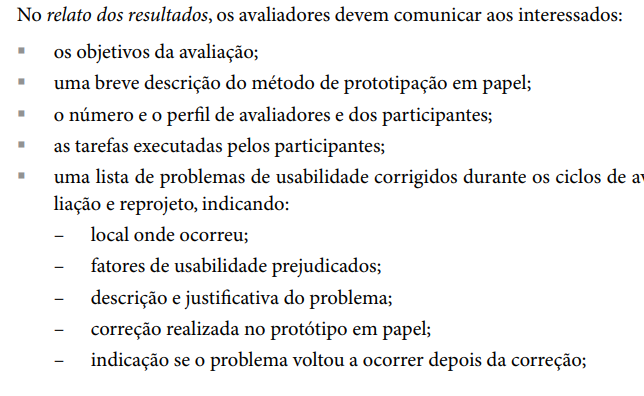
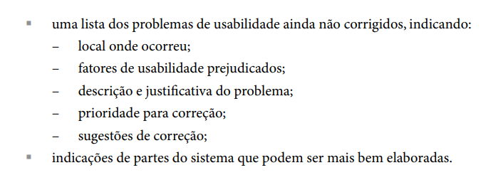

Responsável: Israel Soares  · Autor do item: Israel Soares

# Planejamento do relato dos resultados da avaliação do Storyboard

## Tabela de contribuição

A Tabela 1 registra quem atuou neste artefato.

| Integrante | Contribuição | Artefato / atividade |
| --- | --- | --- |
| [Israel Soares](https://github.com/IsraelSoares-25) | Elaboração do planejamento do relato dos resultados do Storyboard | [Introdução](./planejamento-relato-resultados-storyboard.md#introducao) |
| Claude (Anthropic) | Apoio na organização do texto, na formatação Markdown e na consolidação das tabelas | [Agradecimentos](./planejamento-relato-resultados-storyboard.md#agradecimentos) |

Tabela 1 — Contribuição neste artefato.

Fonte: elaboração do Grupo 06 (2026).

## Introdução

Este artefato define a estrutura do relato dos resultados da avaliação do Storyboard, protótipo de baixa fidelidade em papel, da funcionalidade de agendamento de visita ao Senado Federal. O relato será escrito depois das sessões previstas no [Planejamento StoryBoard](./planejamento-avaliacao-storyboard.md) e comunicará os resultados à equipe do projeto, ao professor da disciplina e aos demais interessados. Os campos entre colchetes serão preenchidos com os dados reais coletados nas sessões.

## Item de conteúdo da disciplina

**Autor do item:** Israel Soares

Segundo o material da disciplina, o relato dos resultados deve comunicar aos interessados os objetivos da avaliação, uma breve descrição do método de prototipação em papel, o número e o perfil de avaliadores e participantes, as tarefas executadas pelos participantes e a lista de problemas de usabilidade corrigidos, com local, fatores prejudicados, descrição e justificativa, correção realizada e indicação de reincidência (SOBRENOME, ano, p. X). A Figura 1 reproduz essa parte do material.

  
  <figcaption>Figura 1 — Itens que o relato dos resultados deve comunicar (parte 1).</figcaption>
</figure>

Fonte: BARBOSA, Simone Diniz Junqueira; SILVA, Bruno Santana da. Interação humano-computador. Rio de Janeiro: Elsevier, 2010.

O mesmo material pede ainda a lista dos problemas ainda não corrigidos, com local, fatores prejudicados, descrição e justificativa, prioridade e sugestões de correção, além de indicações de partes do sistema que podem ser mais bem elaboradas (SOBRENOME, ano, p. X). A Figura 2 reproduz essa parte.

  
  <figcaption>Figura 2 — Itens que o relato dos resultados deve comunicar (parte 2).</figcaption>
</figure>

Fonte: BARBOSA, Simone Diniz Junqueira; SILVA, Bruno Santana da. Interação humano-computador. Rio de Janeiro: Elsevier, 2010.

## Objetivos da avaliação

O relato retomará, de forma resumida, os objetivos definidos no planejamento da avaliação:

- **Objetivo geral:** avaliar a clareza, a coerência e a satisfação do usuário em relação à história e ao fluxo do cidadão retratados no Storyboard do agendamento de visita ao Senado Federal.
- **Objetivos específicos:** verificar se o cidadão compreende a sequência de cenas; identificar se o fluxo do agendamento atende às expectativas de diferentes perfis de visitantes; e encontrar ambiguidades, lacunas ou etapas ausentes antes de avançar para protótipos de maior fidelidade.

Também será informado se algum objetivo foi ajustado durante a avaliação e por quê.

## Descrição do método de prototipação em papel

Esta seção terá um ou dois parágrafos com:

- O que é a prototipação em papel e por que o Storyboard foi escolhido: técnica de baixa fidelidade, rápida e barata, adequada para explorar ideias nas fases iniciais e corrigir o projeto antes de investir em protótipos mais elaborados.
- Como o método foi aplicado: entrevista guiada, com o facilitador apresentando o Storyboard cena a cena, o participante comentando em voz alta o que entende e o observador registrando reações e comentários.
- Quantos **ciclos de avaliação e reprojeto** foram realizados: [número de ciclos]. Em cada ciclo, o Storyboard foi avaliado, os problemas foram analisados e as correções aplicadas ao protótipo em papel antes do ciclo seguinte.
- A versão do Storyboard avaliada em cada ciclo, com link no GitPages: [Versão 1: link] e [Versão 2: link].

## Avaliadores e participantes

A Tabela 2 apresentará o número e o perfil dos avaliadores, e a Tabela 3, o dos participantes.

| Avaliador | Papel na avaliação | Formação / experiência |
| --- | --- | --- |
| [Nome] | Facilitador | [ex.: estudante de Engenharia de Software, UnB/Gama] |
| [Nome] | Observador | [ex.: estudante de Engenharia de Software, UnB/Gama] |
| [Nome] | Responsável pelo registro | [ex.: estudante de Engenharia de Software, UnB/Gama] |

Tabela 2 — Perfil dos avaliadores.

Fonte: elaboração do Grupo 06 (2026).

**Total de avaliadores:** [número].

| Código | Faixa etária | Escolaridade | Ocupação | Familiaridade com o portal do Senado e com agendamentos on-line | Ciclo em que participou |
| --- | --- | --- | --- | --- | --- |
| P1 | [ ] | [ ] | [ ] | [nenhuma / baixa / média / alta] | [ ] |
| P2 | [ ] | [ ] | [ ] | [ ] | [ ] |
| P3 | [ ] | [ ] | [ ] | [ ] | [ ] |

Tabela 3 — Perfil dos participantes.

Fonte: elaboração do Grupo 06 (2026).

**Total de participantes:** [número] (previsto no planejamento: 3 a 5).

Também será indicado se o perfil real dos participantes correspondeu às personas do projeto (ex.: estudantes, professores, famílias, turistas) e, caso contrário, quais diferenças foram observadas.

## Tarefas executadas pelos participantes

A Tabela 4 descreve as tarefas realizadas pelos participantes durante a sessão, ligadas ao cenário do Storyboard de agendamento de visita.

| ID | Tarefa / atividade | Cenas envolvidas | Participantes que realizaram | Observações |
| --- | --- | --- | --- | --- |
| T1 | Explicar com as próprias palavras o que acontece em cada cena | [cenas 1 a 7] | [P1, P2, P3] | [ ] |
| T2 | Descrever o que o personagem pretende fazer e o que esperaria na cena seguinte | [cenas 1 a 7] | [P1, P2, P3] | [ ] |
| T3 | Indicar informações ou etapas ausentes no agendamento (ex.: regras da visita, documentos, cancelamento) | [cenas 3 a 6] | [P1, P2, P3] | [ ] |
| T4 | Indicar elementos confusos ou desnecessários | [cenas 1 a 7] | [P1, P2, P3] | [ ] |
| T5 | Avaliar se a situação é realista e atribuir nota de clareza (1 a 5) | História completa | [P1, P2, P3] | [ ] |

Tabela 4 — Tarefas executadas pelos participantes.

Fonte: elaboração do Grupo 06 (2026).

Será incluída a nota média de clareza por ciclo, quando aplicável: [média].

## Problemas de usabilidade corrigidos

Esta seção lista os problemas identificados e corrigidos durante os ciclos de avaliação e reprojeto, conforme o modelo da Tabela 5.

Os fatores de usabilidade considerados são facilidade de aprendizado, eficiência de uso, facilidade de memorização, segurança no uso (prevenção de erros) e satisfação do usuário, ou os adotados pela disciplina, se forem diferentes. No caso do Storyboard, também será indicado se o problema afeta a **compreensão da história**.

| ID | Local onde ocorreu | Fatores de usabilidade prejudicados | Descrição e justificativa do problema | Correção realizada no protótipo em papel | Voltou a ocorrer após a correção? |
| --- | --- | --- | --- | --- | --- |
| C01 | [Cena X] | [ex.: facilidade de aprendizado] | [O que ocorreu, evidência (fala ou observação do participante) e por que é um problema] | [O que foi alterado no Storyboard] | [Sim / Não, e em qual ciclo] |
| C02 | | | | | |

Tabela 5 — Problemas de usabilidade corrigidos.

Fonte: elaboração do Grupo 06 (2026).

Cada problema terá o que foi observado, a evidência que o sustenta (fala ou comportamento, identificado pelo código do participante) e a razão pela qual afeta a experiência do cidadão ao agendar a visita. Quando um problema corrigido voltar a ocorrer no ciclo seguinte, isso será registrado e a correção será revista.

## Problemas de usabilidade ainda não corrigidos

A Tabela 6 apresenta o critério de prioridade, e a Tabela 7, o modelo da lista de problemas que permanecem sem correção ao final da avaliação.

| Prioridade | Critério |
| --- | --- |
| Alta | Impede a compreensão da cena ou do fluxo; deve ser corrigido antes do próximo artefato |
| Média | Causa dúvida, mas o participante consegue prosseguir |
| Baixa | Sugestão de melhoria ou questão de preferência |

Tabela 6 — Critério de prioridade para correção.

Fonte: elaboração do Grupo 06 (2026).

| ID | Local onde ocorreu | Fatores de usabilidade prejudicados | Descrição e justificativa do problema | Prioridade para correção | Sugestão de correção |
| --- | --- | --- | --- | --- | --- |
| N01 | [Cena X] | [ ] | [O que ocorreu, evidência e por que é um problema] | [Alta / Média / Baixa] | [Como o problema poderia ser resolvido] |
| N02 | | | | | |

Tabela 7 — Problemas de usabilidade ainda não corrigidos.

Fonte: elaboração do Grupo 06 (2026).

Será explicado por que cada problema não foi corrigido (ex.: falta de tempo, dependência de decisão do grupo, necessidade de nova avaliação).

## Partes do sistema que podem ser mais bem elaboradas

A Tabela 8 reúne observações e recomendações sobre partes do agendamento de visita, ou do próprio projeto, que merecem maior atenção nas próximas etapas, mesmo sem terem sido apontadas como problemas.

| Parte do sistema / fluxo | Observação dos participantes ou avaliadores | Recomendação para as próximas etapas |
| --- | --- | --- |
| [ex.: escolha de data e horário] | [ ] | [ ] |
| [ex.: agendamento para grupos] | [ ] | [ ] |
| [ex.: alteração e cancelamento do agendamento] | [ ] | [ ] |

Tabela 8 — Partes do sistema que podem ser mais bem elaboradas.

Fonte: elaboração do Grupo 06 (2026).

Esta seção conectará os resultados do Storyboard às próximas etapas, como a Análise de Tarefas (HTA) e os protótipos de maior fidelidade.

## Considerações finais

- Resumo dos principais achados: [ ].
- Respostas às perguntas de avaliação definidas no planejamento: [ ].
- Limitações da avaliação: número reduzido de participantes, perfil dos participantes e condições da sessão. A validade ecológica do estudo, isto é, o quanto o cenário do Storyboard reflete o contexto real de agendamento de uma visita, será discutida aqui.
- Próximos passos: [ ].

## Agradecimentos

O Claude, assistente de inteligência artificial desenvolvido pela Anthropic, apoiou a organização do texto, a formatação Markdown e a consolidação das tabelas. A responsabilidade pelo conteúdo publicado é do autor.

## Histórico de versão

| Versão | Data | Descrição | Autor(es) | Revisor(es) |
| :---: | :---: | --- | --- | --- |
| `1.0` | 13/10/2026 | Criação do planejamento do relato dos resultados da avaliação do Storyboard | [Israel Soares](https://github.com/IsraelSoares-25) | [Nome](https://github.com/usuario) |
| `1.1` | 13/10/2026 | Adaptação para a funcionalidade Agendamento de Visita | [Israel Soares](https://github.com/IsraelSoares-25) | [Nome](https://github.com/usuario) |
| `1.2` | 13/10/2026 | Adequação ao template padrão de artefato | [Israel Soares](https://github.com/IsraelSoares-25) | [Nome](https://github.com/usuario) |

## Referências

[1] BARBOSA, Simone Diniz Junqueira; SILVA, Bruno Santana da. *Interação humano-computador*. Rio de Janeiro: Elsevier, 2010.
