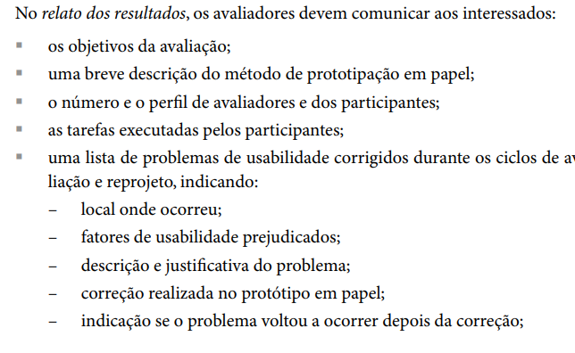
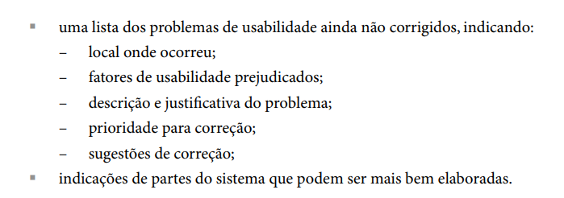
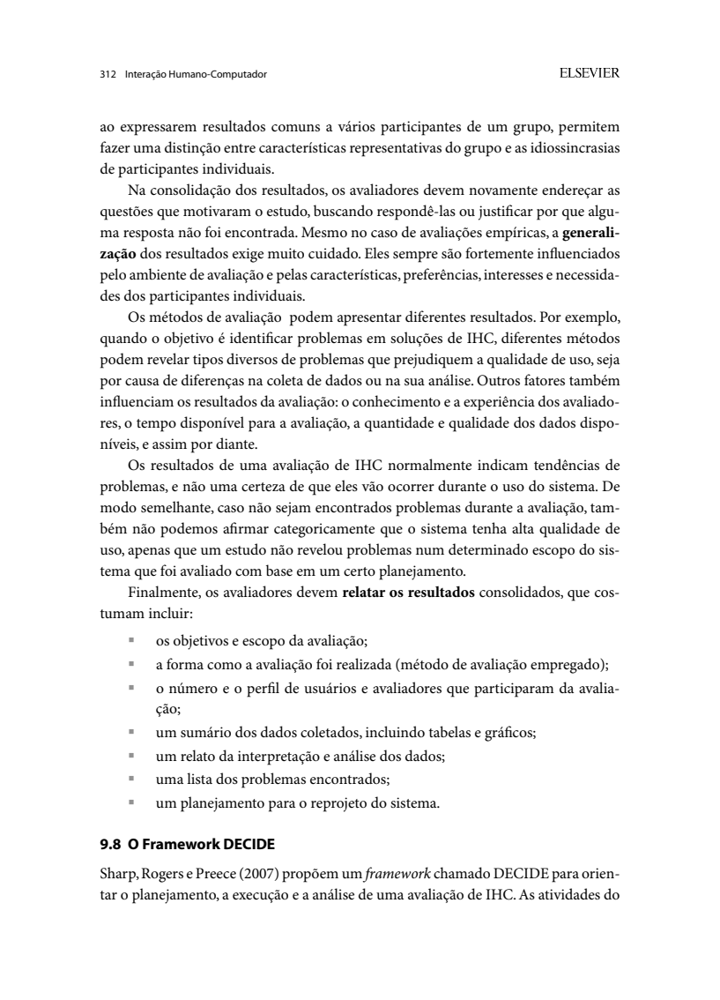

Responsável: Israel Soares de Paiva · Autor do item: Israel Soares de Paiva

# Planejamento do relato dos resultados da avaliação do Storyboard

## Tabela de contribuição

A Tabela 1 registra quem atuou neste artefato.

| Integrante / ferramenta | Contribuição | Artefato / atividade |
| --- | --- | --- |
| [Israel Soares de Paiva](https://github.com/IsraelSoares-25) | Elaboração da estrutura do relato do Storyboard, fichas com localizador temporal, matriz DECIDE, critérios de gravidade e validades | [Instrumentos](#instrumentos-de-registro-e-interpretacao-por-participante) · [Limitações](#consideracoes-finais) |
| [Bruno Ferreira Dornelas](https://github.com/brunnf) | Revisão metodológica cruzada, correção das citações bibliográficas e alinhamento com `QD01–QD07` | [Item de conteúdo](#item-de-conteudo-da-disciplina) · [Histórico de versão](#historico-de-versao) |
| Claude (Anthropic) e Antigravity (Google DeepMind) | Apoio na organização do texto, formatação Markdown e consolidação das tabelas | [Agradecimentos](#agradecimentos) |

Tabela 1 — Contribuição neste artefato.

Fonte: elaboração do Grupo 06 (2026).

## Introdução

Este artefato define prospectivamente a estrutura e os instrumentos de consolidação do relato dos resultados da avaliação formativa do [Storyboard manual (`QD01–QD07`)](storyboard.md) da funcionalidade de **Agendamento de visita ao Senado Federal**. O relatório definitivo será elaborado na Etapa 5 ([Relato da avaliação do storyboard](../../../entrega-5/individual/israel/relato-storyboard.md)) após a realização das sessões previstas no [Planejamento da avaliação do Storyboard](planejamento-avaliacao-storyboard.md). Nenhum formulário desta página contém dados empíricos simulados [1, 2].

## Item de conteúdo da disciplina { #item-de-conteudo-da-disciplina }

**Autor do item:** Israel Soares de Paiva.

Segundo Barbosa e Silva (2010, Seção 9.7.5, p. 311–312; Seção 10.2.3, p. 361–362 [1]), o relato dos resultados de uma avaliação formativa em baixa fidelidade deve comunicar aos interessados os objetivos da avaliação, uma breve descrição do método empregado, o número e o perfil de avaliadores e participantes, as atividades realizadas pelos participantes e a relação dos problemas identificados e corrigidos — indicando local onde ocorreu, fatores de usabilidade prejudicados, descrição e justificativa, ajuste realizado e eventual reincidência. A Figura 1 reproduz a primeira parte dessa listagem no livro-texto.

<figure markdown="span">
  { loading=lazy }
  <figcaption>Figura 1 — Itens que o relato dos resultados deve comunicar (parte 1).</figcaption>
</figure>

Fonte: Barbosa e Silva (2010, p. 361).

Na sequência imediata, Barbosa e Silva (2010, p. 362 [1]) determinam incluir também a lista dos problemas ainda não corrigidos — com local, fatores prejudicados, descrição e justificativa, prioridade para correção e sugestões de melhoria —, além de indicações de partes do sistema que podem ser mais bem elaboradas e da consolidação analítica das questões que motivaram o estudo (BARBOSA; SILVA, 2010, p. 312 [1]). As Figuras 2 e 3 reproduzem esses trechos.

<figure markdown="span">
  { loading=lazy }
  <figcaption>Figura 2 — Itens que o relato dos resultados deve comunicar (parte 2).</figcaption>
</figure>

Fonte: Barbosa e Silva (2010, p. 362).

<figure markdown="span">
  { loading=lazy }
  <figcaption>Figura 3 — Consolidação analítica, endereçamento das questões do estudo e limites de interpretação.</figcaption>
</figure>

Fonte: Barbosa e Silva (2010, p. 312).

## Objetivos da avaliação

O relato retomará de forma objetiva os propósitos definidos no [Planejamento da avaliação do Storyboard](planejamento-avaliacao-storyboard.md#d-determinar-os-objetivos-da-avaliacao):

- **Objetivo geral:** avaliar a clareza narrativa, a verossimilhança do contexto doméstico/cotidiano e a adequação das propostas iniciais (`RP01–RP05`) nos quadros `QD01–QD07` do agendamento de visita ao Senado Federal;
- **Objetivos específicos:** `SB-O1` (compreensão da sequência `QD01–QD07`), `SB-O2` (adequação à rotina e à busca coloquial `"visita senado"` de Marta Oliveira), `SB-O3` (identificação de regras ou retornos ausentes) e `SB-O4` (subsídios diretos para o protótipo de papel da Etapa 5).

Também será informado caso ocorra qualquer ajuste de agendamento ou de condução entre o plano e a coleta efetiva.

## Descrição do método aplicado na avaliação

Adapta-se ao estágio conceitual da Etapa 4 a rubrica do Item 7 do Plano de Ensino [2]: como o Storyboard é uma **narrativa visual estática de baixa fidelidade** (anterior às telas interativas de papel da Etapa 5/6), esta seção do relato documentará:

- **Método efetivamente utilizado:** **investigação por entrevista semiestruturada individual apoiada na leitura guiada sequencial dos sete quadros (`QD01–QD07`)** (BARBOSA; SILVA, 2010, p. 146–148, 301), sem simulação interativa de cliques;
- **Versão do artefato avaliado:** [Storyboard manual `v1.1` (`QD01–QD07`)](storyboard.md);
- **Exclusão obrigatória do teste-piloto:** declaração expressa de que os dados obtidos no ensaio prévio com `PP-PILOTO01` (`16/10/2026`) destinaram-se apenas à calibragem do roteiro e **foram descartados, não compondo as tabelas nem as conclusões do relato oficial**.

## Avaliadores e participantes

A Tabela 2 identificará os papéis da equipe avaliadora, e a Tabela 3 apresentará o perfil desidentificado das pessoas participantes da amostra oficial (`1 a 3` casos previstos, código `SB-PART01`, em consonância com o [hub individual](../israel.md#cronograma-planejado-das-atividades)).

| Avaliador | Papel na avaliação | Formação / vínculo |
| --- | --- | --- |
| Israel Soares de Paiva | Moderador / Facilitador e responsável pelo registro e minutagem | Estudante de Engenharia de Software — FCTE/UnB |
| Bruno Ferreira Dornelas | Observador metodológico e revisor cruzado | Estudante de Engenharia de Software — FCTE/UnB |

Tabela 2 — Perfil e papéis dos avaliadores.

Fonte: elaboração do Grupo 06 (2026).

| Código anônimo | Faixa etária | Ocupação / perfil | Familiaridade com o portal do Senado e agendamentos online | Modalidade e duração do vídeo |
| :---: | :---: | --- | --- | --- |
| `SB-PART01` | `[a preencher]` | `[a preencher — perfil Marta Oliveira]` | `[nenhuma / baixa / média / alta]` | `[presencial / remoto · mm:ss]` |

Tabela 3 — Modelo de caracterização desidentificada dos participantes oficiais (excluído `PP-PILOTO01`).

Fonte: elaboração do Grupo 06 (2026).

## Atividades percorridas na sessão

A Tabela 4 descreve as atividades previstas na entrevista guiada sobre os sete quadros (`QD01–QD07`).

| ID | Atividade realizada pela pessoa participante | Quadros envolvidos | Participante | Situação / Observações |
| :---: | --- | :---: | :---: | --- |
| `SB-AT01` | Visualização livre e reconto com as próprias palavras do enredo ilustrado | `QD01` a `QD07` | `[SB-PART01]` | `[ ]` |
| `SB-AT02` | Discussão sobre motivação, abertura do portal e busca coloquial `"visita senado"` | `QD01` a `QD03` | `[SB-PART01]` | `[ ]` |
| `SB-AT03` | Avaliação do resumo `"Como funciona"`, da grade de horários e da conferência de dados | `QD04` a `QD06` | `[SB-PART01]` | `[ ]` |
| `SB-AT04` | Avaliação da dupla confirmação (tela + e-mail), regras ausentes e sugestões para o papel | `QD07` e visão geral | `[SB-PART01]` | `[ ]` |

Tabela 4 — Atividades percorridas pelos participantes durante a sessão.

Fonte: elaboração do Grupo 06 (2026).

## Instrumentos de registro e interpretação por participante { #instrumentos-de-registro-e-interpretacao-por-participante }

Para vincular cada achado a evidências verificáveis e separar **dado bruto observado** de **interpretação analítica** (BARBOSA; SILVA, 2010, p. 310, 312), o avaliador preencherá a ficha da Tabela 5 para cada fala ou reação relevante, informando participante, quadro (`QD01–QD07`), questão do DECIDE, **localizador temporal exato na gravação (`mm:ss`) ou número da nota** e se a manifestação ocorreu de forma *espontânea* ou *após esclarecimento*.

| ID Evidência | Participante | Quadro | Questão DECIDE | Localizador (`mm:ss` / nota) | Condição da fala | Fala literal / observação registrada | Interpretação separada da equipe |
| :---: | :---: | :---: | :---: | :---: | :---: | --- | --- |
| `SB-EV01` | `[SB-PART01]` | `[QD01..QD07]` | `[SB-Q1..Q8]` | `[00:00–00:00]` | `[Espontânea / Após esclarecimento]` | `[ ]` | `[ ]` |

Tabela 5 — Ficha individual de evidências localizadas do Storyboard.

Fonte: elaboração de Israel Soares de Paiva (2026), com base em Barbosa e Silva (2010, p. 310).

As fichas `SB-EV` alimentarão a **Matriz de consolidação das questões específicas do DECIDE** (`SB-Q1` a `SB-Q8`, Tabela 6).

**Regra explícita para questões inconclusivas (BARBOSA; SILVA, 2010, p. 312):** cada pergunta será classificada como **Compreensão demonstrada / Validada**, **Parcial / Com ressalvas** ou **Inconclusiva / Dados insuficientes**. Quando a entrevista não gerar evidência suficiente para responder a alguma pergunta planejada, o campo de julgamento registrará **Inconclusiva**, explicando objetivamente a causa (ex.: ausência de manifestação espontânea sobre o tópico ou tempo insuficiente) e definindo como a dúvida será investigada no protótipo de papel na Etapa 5.

| Questão DECIDE | Resposta analítica consolidada | Evidências e localizadores (`SB-EV` · `mm:ss`) | Julgamento (`Validada` / `Parcial` / `Inconclusiva`) | Justificativa de inconclusão ou encaminhamento |
| :---: | --- | --- | :---: | --- |
| `SB-Q1` | `[ ]` | `[ ]` | `[ ]` | `[ ]` |
| `SB-Q2` | `[ ]` | `[ ]` | `[ ]` | `[ ]` |
| `SB-Q3` | `[ ]` | `[ ]` | `[ ]` | `[ ]` |
| `SB-Q4` | `[ ]` | `[ ]` | `[ ]` | `[ ]` |
| `SB-Q5` | `[ ]` | `[ ]` | `[ ]` | `[ ]` |
| `SB-Q6` | `[ ]` | `[ ]` | `[ ]` | `[ ]` |
| `SB-Q7` | `[ ]` | `[ ]` | `[ ]` | `[ ]` |
| `SB-Q8` | `[ ]` | `[ ]` | `[ ]` | `[ ]` |

Tabela 6 — Matriz de fechamento das questões específicas do DECIDE para o Storyboard.

Fonte: elaboração do autor (2026), com base em Barbosa e Silva (2010, p. 310, 312).

## Problemas identificados, priorização e encaminhamento ao reprojeto { #problemas-de-usabilidade-ainda-nao-corrigidos }

Como a entrevista da Etapa 4 avalia uma prancha narrativa estática em rodada formativa única antes da construção das telas em papel, eventuais ajustes imediatos na narrativa/legendas e problemas conceituais ainda pendentes serão priorizados pela Tabela 7 (considerando impacto nocivo sobre a compreensão/execução, frequência esperada e fatores de usabilidade prejudicados: facilidade de aprendizado, prevenção de erros e satisfação) e consolidados nas Tabelas 8 e 9 para guiar diretamente as telas `PP-S01` a `PP-S07` do **Protótipo de Papel na Etapa 5**.

| Prioridade | Critério objetivo de gravidade e urgência |
| :---: | --- |
| **Alta** | Impede compreender o fluxo ou omite informação essencial para o acesso presencial ao Senado (ex.: regras de vestimenta/documentos ou comprovante verificável); deve entrar obrigatoriamente no protótipo de papel |
| **Média** | Gera dúvida parcial sobre rótulos, calendário ou conferência de dados, mas não bloqueia o entendimento global da jornada |
| **Baixa** | Sugestão estética, de redação de balão ou preferência individual de menor impacto |

Tabela 7 — Critério de gravidade e priorização dos problemas identificados.

Fonte: elaboração do Grupo 06 (2026), com base em Barbosa e Silva (2010, p. 292, 312, 362).

| ID | Quadro (`QD01–QD07`) | Fatores de usabilidade prejudicados | Descrição, evidência (`SB-EV` · `mm:ss`) e justificativa | Ajuste documental realizado (se aplicável) | Status de verificação posterior |
| :---: | :---: | --- | --- | --- | --- |
| `C01` | `[QD0x]` | `[ex.: facilidade de aprendizado]` | `[ ]` | `[ ]` | `[A verificar no protótipo de papel]` |

Tabela 8 — Registro de problemas ajustados imediatamente na documentação conceitual.

Fonte: elaboração do Grupo 06 (2026), adaptado de Barbosa e Silva (2010, p. 361).

| ID | Quadro / Etapa | Fatores de usabilidade prejudicados | Descrição, evidência (`SB-EV` · `mm:ss`) e justificativa | Prioridade | Diretriz de reprojeto para o Protótipo de Papel (Etapa 5) |
| :---: | :---: | --- | --- | :---: | --- |
| `SB-P01` | `[QD0x]` | `[ex.: prevenção de erros]` | `[ ]` | `[Alta / Média / Baixa]` | `[RP01..RP05 — tela destino no papel]` |

Tabela 9 — Problemas pendentes e encaminhamentos priorizados para o Protótipo de Papel.

Fonte: elaboração do Grupo 06 (2026), adaptado de Barbosa e Silva (2010, p. 312, 362).

## Partes do sistema que podem ser mais bem elaboradas

A Tabela 10 reunirá oportunidades de aperfeiçoamento observadas durante a entrevista sobre aspectos complementares do serviço de visitação (mesmo quando não configurarem falha direta dos quadros desenhados).

| Parte do fluxo / serviço | Observação colhida (`SB-EV` · `mm:ss`) | Recomendação para o Protótipo de Papel (Etapa 5) |
| --- | --- | --- |
| Visibilidade de regras de trajes e documentos antes do agendamento | `[ ]` | `[ ]` |
| Cadastro de grupos/acompanhantes e necessidades de acessibilidade | `[ ]` | `[ ]` |
| Consulta, remarcação ou cancelamento posterior (`HTA 7`) | `[ ]` | `[ ]` |

Tabela 10 — Indicações de partes do sistema que podem ser mais bem elaboradas.

Fonte: elaboração do Grupo 06 (2026), com base em Barbosa e Silva (2010, p. 362).

## Considerações finais, limitações e validades { #consideracoes-finais }

O encerramento do relato na Etapa 5 apresentará a síntese dos achados acompanhada da análise crítica explícita dos limites metodológicos e de generalização do estudo (BARBOSA; SILVA, 2010, p. 312–313 [1]):

1. **Confiabilidade:** consistência assegurada pela gravação audiovisual autorizada e pela vinculação de cada síntese a localizadores temporais verificáveis (`mm:ss`), ressalvando-se que a condução por avaliador único do recorte exige revisão cruzada por outro integrante;
2. **Validade interna (controle de viés e intervenções):** avaliação de eventuais efeitos de apresentação ou esclarecimentos do moderador durante a leitura dos quadros, registrando separadamente falas espontâneas e respostas após sondagem para evitar confundir concordância cordial com validação plena;
3. **Validade externa (limites de generalização):** por tratar-se de amostra formativa reduzida recrutada por conveniência no perfil de Marta Oliveira, os resultados revelam indícios e prioridades de design dentro do recorte investigado, **não autorizando generalização estatística** para todos os perfis de visitantes do Senado Federal;
4. **Validade ecológica:** comentar pranchas desenhadas à mão em conversa tranquila difere da experiência real de procurar o agendamento no portal completo sob restrições cotidianas de tempo ou dispositivo móvel;
5. **Limites de representações estáticas:** o Storyboard valida pertinência do contexto, motivação e encadeamento conceitual, mas **a ausência de críticas a um quadro estático não comprova usabilidade nem eficiência da interface**, tornando indispensável o teste interativo com protótipo de papel na Etapa 5/6.

## Agradecimentos { #agradecimentos }

O Claude (Anthropic) e o Antigravity (Google DeepMind) apoiaram a organização do texto, a formatação Markdown e a estruturação das fichas de evidências e matrizes do DECIDE. A responsabilidade acadêmica pelo conteúdo publicado é do autor.

## Histórico de versão { #historico-de-versao }

A Tabela 11 registra o histórico de versões deste planejamento do relato.

| Versão | Data | Descrição | Autor(es) | Revisor(es) |
| :---: | :---: | --- | --- | --- |
| `1.0` | 13/10/2026 | Criação do planejamento do relato dos resultados da avaliação do Storyboard | [Israel Soares de Paiva](https://github.com/IsraelSoares-25) | [Heitor Pinheiro Gonçalves das Chagas](https://github.com/Heitorovski01) |
| `1.1` | 13/10/2026 | Adaptação para a funcionalidade Agendamento de Visita | [Israel Soares de Paiva](https://github.com/IsraelSoares-25) | [Heitor Pinheiro Gonçalves das Chagas](https://github.com/Heitorovski01) |
| `1.2` | 13/10/2026 | Adequação ao template padrão de artefato | [Israel Soares de Paiva](https://github.com/IsraelSoares-25) | [Heitor Pinheiro Gonçalves das Chagas](https://github.com/Heitorovski01) |
| `1.3` | 26/11/2026 | Substituição dos marcadores de citação por Barbosa e Silva (2010, p. 311–312, 361–362), correção das tags `<figure>`, adequação metodológica à leitura de storyboard estático, ficha `SB-EV` com minutagem, matriz `SB-Q1..Q8` com regra para inconclusivos, exclusão do piloto e seção completa de validades | [Israel Soares de Paiva](https://github.com/IsraelSoares-25) | [Bruno Ferreira Dornelas](https://github.com/brunnf) |

Tabela 11 — Histórico de versão.

Fonte: elaboração do Grupo 06 (2026).

## Referências

[1] BARBOSA, Simone Diniz Junqueira; SILVA, Bruno Santana da. *Interação humano-computador*. Rio de Janeiro: Elsevier, 2010. p. 146–148, 292, 301, 307, 310–313, 361–362.

[2] SALES, André Barros de. *Plano de Ensino FIHC 022026 — Turma 01*. Brasília: FCTE/UnB, 2026. Apresentação 4.
