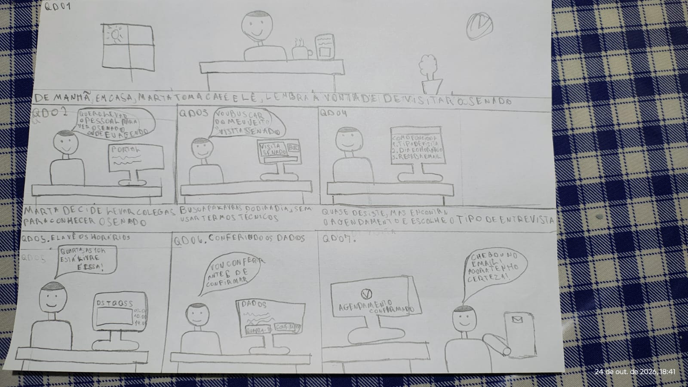

Responsável: Israel Soares de Paiva — Agendamento de visita ao Senado · Autor do item: Israel Soares de Paiva

# Storyboard — Marta agenda visita institucional ao Senado Federal

## Tabela de contribuição

A Tabela 1 registra as contribuições na concepção e elaboração deste artefato.

| Integrante | Contribuição | Artefato / atividade |
| --- | --- | --- |
| [Israel Soares de Paiva](https://github.com/IsraelSoares-25) | Roteiro narrativo, definição das cenas, hipóteses de melhoria e rastreabilidade formal com a HTA | [Conteúdo](#recorte-do-reprojeto-e-hipoteses-de-melhoria) |
| [Bruno Ferreira Dornelas](https://github.com/brunnf) | Revisão técnica de consistência | [Histórico de versão](#historico-de-versao) |
| Google Gemini | Apoio na estruturação das tabelas e formatação Markdown | [Agradecimentos](#agradecimentos) |

Tabela 1 — Contribuições neste artefato.

Fonte: elaboração para o Grupo 06 (2026).

## Introdução

Este storyboard acompanha a persona [Marta Oliveira](../../../entrega-2/individual/israel/persona.md), servidora pública de 47 anos, que deseja programar um passeio cívico com familiares e colegas de trabalho para conhecer as dependências e o funcionamento do Senado Federal no Palácio do Congresso Nacional. 

A narrativa retrata visualmente o percurso de agendamento no Portal do Senado, desde a motivação inicial até o desfecho satisfatório no dia da visita, articulando as hipóteses de reprojeto com a [Análise Hierárquica de Tarefas (HTA)](../../../entrega-2/individual/israel/analise-tarefas.md) e preparando o terreno para a avaliação formativa detalhada no [Planejamento da avaliação do storyboard](planejamento-avaliacao-storyboard.md).

## Recorte do reprojeto e hipóteses de melhoria

O Programa de Visitação Institucional do Congresso Nacional recebe milhares de cidadãos mensalmente. No portal atual, entretanto, a encontrabilidade do serviço de visitação é prejudicada pelo foco excessivo em matérias legislativas na página inicial, as regras de trajes muitas vezes passam despercebidas e a visualização de vagas no calendário gera atrito por tentativa e erro.

A Tabela 2 apresenta as melhorias propostas (**RP01 a RP05**) que orientam a sequência das cenas do Storyboard.

| ID | Melhoria proposta | Ponto de partida | Critério investigado no Storyboard |
| :---: | --- | --- | --- |
| **RP01** | Entrada evidente e direta para "Visitação / Agendar Visita" na home do portal | Cena 2; HTA 1.1–1.2 | A cidadã localiza o serviço imediatamente sem se perder na busca legislativa |
| **RP02** | Apresentação transparente das regras de trajes, identificação e horários antes do agendamento | Cena 2 e 4; HTA 1.3 | O visitante fica ciente das normas de vestimenta (proibições de regatas, bermudas e chinelos) e documentos |
| **RP03** | Calendário interativo com sinalização de cores para disponibilidade de vagas e horários | Cena 3; HTA 3.1–3.3 | Visão clara de dias com vagas abertas (verde) e dias esgotados (vermelho) |
| **RP04** | Tela de revisão de dados com botão de edição rápida por bloco | Cena 5; HTA 5.1–5.3 | Permite conferir nomes e dados de contato e corrigir equívocos antes do envio final |
| **RP05** | Emissão imediata de comprovante com código localizador e envio de confirmação por e-mail | Cena 6 e 7; HTA 6.1–6.3 | Garante segurança ao cidadão e acesso ágil na portaria do Congresso Nacional |

Tabela 2 — Escopo das melhorias propostas para a interação.

Fonte: elaboração do autor (2026).

## Storyboard (Desenho)

[]

## Sequência narrativa do Storyboard

A história é estruturada em 7 cenas sequenciais que ilustram a jornada completa do usuário.

### Cena 1 — Motivação e decisão de visita
Marta está em seu escritório e colegas de trabalho decidem organizar uma visita institucional ao Palácio do Congresso Nacional para conhecer o plenário do Senado. Ela lembra que é necessário fazer um agendamento prévio pela internet para garantir a entrada de todos.

### Cena 2 — Acesso ao portal e localização do serviço
No computador pessoal em sua casa, Marta abre a página inicial do Portal do Senado Federal. Ela encontra com facilidade uma seção de destaque com o botão **"Visite o Senado / Agendar Visita"**, que a direciona para a página informativa do Programa de Visitação, onde lê com atenção as orientações sobre documentos obrigatórios e trajes permitidos.

### Cena 3 — Definição do grupo e consulta ao calendário de vagas
Marta seleciona a opção "Visita em grupo" e informa que o grupo é composto por 4 pessoas. Ao avançar, ela visualiza o calendário mensal interativo: as datas com vagas abertas aparecem destacadas em verde e as datas esgotadas em vermelho. Ela escolhe um sábado pela manhã com vagas suficientes para todos.

### Cena 4 — Preenchimento dos dados cadastrais e acessibilidade
Marta preenche seus dados como responsável (nome, CPF, e-mail e telefone de contato) e insere os nomes completos dos outros três visitantes. Ela nota a seção de acessibilidade e assinala que um dos acompanhantes possui mobilidade reduzida, solicitando apoio na portaria.

### Cena 5 — Revisão e conferência das informações
Antes de finalizar, o sistema apresenta uma tela de revisão consolidada. Marta confere a data, o horário, os nomes e nota que havia digitado um número incorreto no telefone de contato. Ela clica no botão "Editar" ao lado dos dados de contato, corrige o telefone e clica no botão verde **"Confirmar Agendamento"**.

### Cena 6 — Confirmação e emissão do comprovante
A tela exibe uma mensagem de sucesso acompanhada de um **Código Localizador (ex.: VIS-2026-8941)** e um resumo da visita. Marta clica em "Baixar Comprovante em PDF" para salvar no computador e visualiza um aviso informando que as orientações completas também foram enviadas para seu e-mail.

### Cena 7 — Realização tranquila da visita no Senado
No sábado agendado, Marta chega com seu grupo à entrada de visitantes do Senado Federal. Ela apresenta o comprovante no celular para o recepcionista, que valida o código rapidamente. Todos entram sem filas, de acordo com as regras de vestimenta, e realizam a visita guiada com total satisfação.

## Transcrição acessível e rastreabilidade formal com a HTA

A Tabela 3 estabelece o cruzamento formal entre cada cena do Storyboard, a operação correspondente da [Análise Hierárquica de Tarefas (HTA)](../../../entrega-2/individual/israel/analise-tarefas.md) e as perguntas investigativas formuladas para a avaliação formativa com usuários.

| Cena | Título da cena | Descrição visual e de ação | Relação com a HTA | Pergunta investigada na avaliação |
| :---: | --- | --- | :---: | --- |
| **1** | *Decisão de visitar o Senado* | Marta na sala combinando a visita com familiares e colegas no computador. | **Cenário** e Objetivo 0 | **Q1 / Q5:** O contexto e a motivação inicial são claros e realistas sem explicações externas? |
| **2** | *Localização do serviço no portal* | Página inicial do Senado com atalho destacado para o Programa de Visitação e leitura de regras. | **HTA 1.1, 1.2 e 1.3** | **Q2 / Q3:** A entrada no serviço é evidente e as regras de trajes/documentos ficam claras? |
| **3** | *Escolha de grupo e calendário* | Tela de seleção de quantidade e calendário mensal com cores de disponibilidade (verde/vermelho). | **HTA 2.1, 2.2, 3.1, 3.2 e 3.3** | **Q2 / Q3:** A visualização de vagas no calendário transmite com clareza os dias disponíveis? |
| **4** | *Preenchimento e acessibilidade* | Formulário com dados do responsável, nomes do grupo e opção de mobilidade reduzida. | **HTA 4.1, 4.2 e 4.3** | **Q3 / Q6:** Os campos atendem às necessidades de cadastro e inclusão do grupo? |
| **5** | *Revisão e correção de dado* | Tela de resumo com botões de edição por bloco e botão final de confirmação. | **HTA 5.1, 5.2 e 5.3** | **Q2 / Q8:** A tela de revisão oferece oportunidade segura de recuperar erros antes do envio? |
| **6** | *Confirmação e comprovante* | Tela de sucesso com código localizador, botão de download em PDF e aviso de e-mail. | **HTA 6.1, 6.2 e 6.3** | **Q3 / Q7:** A confirmação transmite segurança de que o agendamento foi efetivado com sucesso? |
| **7** | *Realização da visita no local* | Grupo entrando no Palácio do Congresso Nacional apresentando o comprovante na recepção. | **Cenário** (desfecho) | **Q4 / Q7:** O desfecho condiz com o objetivo alcançado e a utilidade prática da proposta? |

Tabela 3 — Rastreabilidade entre cenas do Storyboard, operações da HTA e perguntas de avaliação.

Fonte: elaboração do autor (2026).

## Agradecimentos

Esta página contou com o apoio do Google Gemini na formatação Markdown e na estruturação da matriz de rastreabilidade entre o Storyboard e a HTA. A autoria do roteiro e a responsabilidade pelo conteúdo são do autor.

## Histórico de versão

| Versão | Data | Descrição | Autor(es) | Revisor(es) |
| :---: | :---: | --- | --- | --- |
| `1.0` | 25/10/2026 | Concepção da narrativa de 7 cenas do Storyboard de Agendamento de Visita, hipóteses de melhoria e rastreabilidade formal com a HTA | [Israel Soares de Paiva](https://github.com/IsraelSoares-25) | [Bruno Ferreira Dornelas](https://github.com/brunnf) |

## Referências

[1] BARBOSA, Simone Diniz Junqueira; SILVA, Bruno Santana da. *Interação humano-computador*. Rio de Janeiro: Elsevier, 2010.

[2] SNYDER, Carolyn. *Paper Prototyping: The Fast and Easy Way to Design and Refine User Interfaces*. San Francisco: Morgan Kaufmann, 2003.

