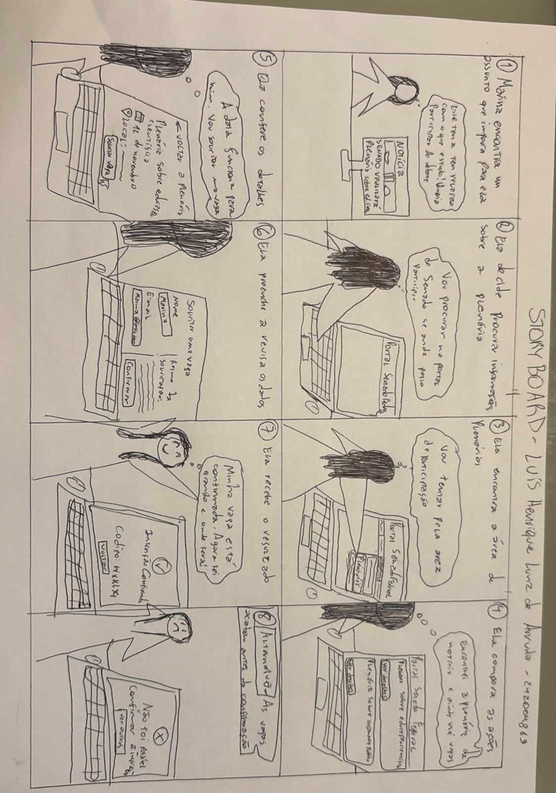

Responsável: Luís Henrique Arruda Luna — Materiais relacionados ao recorte individual

# Luís Henrique — Materiais do recorte

Esta página reúne os materiais de Luís relacionados ao projeto de agendamento em plenárias. O planejamento individual original da Etapa 4 não está documentado como artefato separado nesta cópia do repositório; os registros de avaliação realizados e publicados estão na Etapa 5.

## Storyboard manual

O storyboard abaixo apresenta a busca por uma plenária, a consulta de informações, a conferência de dados e dois resultados: inscrição confirmada ou indisponibilidade após o envio. A entrevista posterior identificou como ponto de revisão avisar sobre a disponibilidade antes do preenchimento e explicar o esgotamento da última vaga.

  

Figura 1 — Storyboard manual da proposta de participação em plenárias.

Fonte: Luís Henrique Arruda Luna, arquivo fornecido para inclusão no registro do projeto.

[Abrir a imagem original do storyboard](../../assets/img/entrega-4/luis/storyboard-plenarias.jpeg).

## Base do recorte

| Material | Conteúdo |
| --- | --- |
| [Persona Marina Alves](../../entrega-2/individual/luis/persona.md) | Perfil usado como referência inicial do recorte. |
| [Cenário de consulta a reuniões](../../entrega-2/individual/luis/cenario.md) | Contexto de navegação relacionado à descoberta de reuniões no portal. |
| [Análise de tarefas inicial](../../entrega-2/individual/luis/analise-tarefas.md) | HTA e CTT anteriores; consulte também a [modelagem atual de plenárias](../../entrega-5/individual/luis/modelagem-tarefas.md). |

## Registros e entregas relacionadas

| Artefato | Registro |
| --- | --- |
| [Modelagem HTA/CTT para plenárias](../../entrega-5/individual/luis/modelagem-tarefas.md) | Fluxo proposto de busca, conferência, solicitação e interpretação do resultado. |
| [Inspeção documental dos modelos](../../entrega-5/individual/luis/inspecao-modelos.md) | Cobertura, lacunas e questões técnicas a conferir pela equipe. |
| [Relato da entrevista sobre o storyboard](../../entrega-5/individual/luis/relato-storyboard.md) | Compreensão da narrativa e recomendações para disponibilidade e desfecho. |
| [Relato da entrevista sobre HTA e CTT](../../entrega-5/individual/luis/relato-analise-tarefas.md) | Respostas sobre etapas, informações necessárias, indisponibilidade e confirmação. |
| [Índice do trabalho individual na Etapa 5](../../entrega-5/individual/luis/index.md) | Planejamento do protótipo de papel, transcrições e situação das regras pendentes. |

## Vídeos e transcrições

- [Entrevista sobre HTA e CTT](https://youtu.be/hxmxnHQyGSk) · [transcrição PDF](../../entrega-5/individual/luis/transcricoes/entrevista-hta-ctt.pdf)
- [Entrevista sobre o storyboard](https://youtu.be/3iwosR0pnZI) · [transcrição PDF](../../entrega-5/individual/luis/transcricoes/entrevista-storyboard.pdf)
- [Teste piloto, gravação conjunta com Caio](https://youtu.be/XroAJouSclE)

[Voltar à Etapa 4](../index.md){ .md-button }

## Histórico de versão

| Versão | Data | Alteração | Autor(es) | Revisor(es) |
| --- | --- | --- | --- | --- |
| 0.1 | 13/10/2026 | Reserva de espaço individual | Caio Breno de Souza Bezerra, com apoio de Codex/OpenAI | [Bruno Ferreira Dornelas](https://github.com/brunnf) |
| 0.2 | 25/10/2026 | Preenche o índice com materiais existentes e liga os registros das entrevistas da Etapa 5 | Luís Henrique Arruda Luna | [Bruno Ferreira Dornelas](https://github.com/brunnf) |

## Referência

SALES, André Barros de. **Plano de Ensino FIHC 022026 — Turma 01**, v1. FCTE/UnB, 2026. Apresentação 4.
