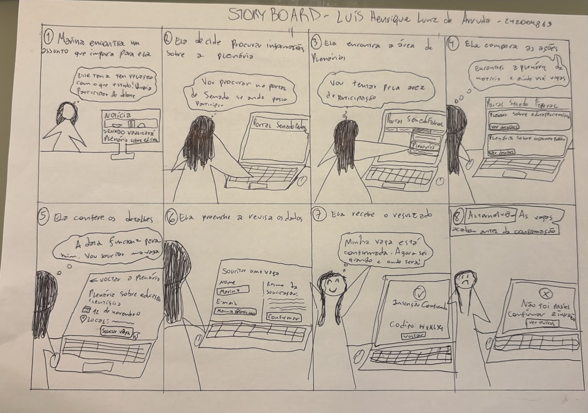

Responsável: Luís Henrique Arruda Luna — Materiais relacionados ao recorte individual

# Luís Henrique — Materiais do recorte

## Tabela de contribuição

A Tabela 1 registra quem atuou nesta página.

| Integrante / ferramenta | Contribuição | Artefato / atividade |
| --- | --- | --- |
| [Luís Henrique Arruda Luna](https://github.com/Donnk61) | Desenho do storyboard, roteiro dos quadros, correspondência com a HTA/CTT e planejamento da avaliação e do relato | [Storyboard](#storyboard-manual) · [Roteiro](#roteiro-dos-quadros) · [Planejamento](#planejamento-da-avaliacao-e-do-relato) |
| [Caio Breno de Souza Bezerra](https://github.com/CaioBezerra-Dev) | Reserva inicial do espaço individual | [Histórico de versão](#historico-de-versao) |
| Codex (OpenAI) | Apoio à reserva inicial da página | [Agradecimentos](#agradecimentos) |
| Claude (Anthropic) | Apoio à redação das correções da versão 0.4 | [Agradecimentos](#agradecimentos) |

Tabela 1 — Contribuição nesta página.

Fonte: elaboração para o Grupo 06 (2026).

## Introdução

Esta página reúne o storyboard de Luís sobre uma funcionalidade proposta para o Portal do Senado: encontrar uma plenária e solicitar uma vaga, com limite de vagas. A funcionalidade não existe no portal. A página também registra como o storyboard se liga à análise de tarefas e como a avaliação foi planejada. As entrevistas e os resultados estão na Etapa 5.

## Storyboard manual

**Autor do item:** Luís Henrique Arruda Luna.

**Finalidade.** O storyboard serve para dois fins antes de existirem telas. Primeiro, **comunicar o conceito**: mostrar, em linguagem de história, quem é a pessoa, o que a motiva e como ela chega à plenária, para que alguém de fora do grupo entenda a proposta sem ler um modelo técnico. Segundo, **explorar pontos em aberto**: os quadros deixam à vista as decisões ainda não tomadas (quando a vaga aparece, quando ela é confirmada e o que acontece se acabar) para que sejam discutidas com uma pessoa usuária. Na avaliação formativa, materiais como este permitem discutir expectativas durante o desenvolvimento (BARBOSA; SILVA, 2010, p. 294, 301).

A Figura 1 apresenta a busca por uma plenária, a consulta de informações, a conferência de dados e dois resultados: inscrição confirmada ou indisponibilidade após o envio. A entrevista posterior identificou como ponto de revisão avisar sobre a disponibilidade antes do preenchimento e explicar o esgotamento da última vaga.

{ loading=lazy }

Figura 1 — Storyboard manual da proposta de participação em plenárias.

Fonte: Luís Henrique Arruda Luna, arquivo fornecido para inclusão no registro do projeto.

[Abrir a imagem original do storyboard](../../assets/img/entrega-4/luis/storyboard-plenarias.jpeg).

**Hipóteses sob teste.** O storyboard foi feito para verificar se a pessoa:

- **H1** entende o objetivo da personagem e os dois finais da história;
- **H2** percebe que a disponibilidade de vagas aparece antes do preenchimento (quadros 4 e 5);
- **H3** distingue a vaga confirmada (quadro 7) da tentativa que não deu certo (quadro 8);
- **H4** entende que, no final alternativo, nenhuma inscrição foi criada e que há como escolher outra plenária.

### Roteiro dos quadros { #roteiro-dos-quadros }

A Tabela 2 descreve cada quadro em texto: o que está escrito e desenhado, o ambiente, quem aparece e o enquadramento. A última coluna liga o quadro às operações da [HTA e da CTT](../../entrega-5/individual/luis/modelagem-tarefas.md). A protagonista é Marina, baseada na persona [Marina Alves](../../entrega-2/individual/luis/persona.md). Não há outros atores humanos; o sistema aparece apenas pela tela.

| Quadro | Roteiro (legenda e fala) | Ambiente e personagens | Enquadramento | HTA / CTT |
| :---: | --- | --- | --- | --- |
| 1 | “Marina encontra um assunto que importa para ela.” Na tela, uma notícia: o Senado realizará uma plenária sobre educação científica. Fala: “Esse tema tem relação com o que estudo! Queria participar do debate.” | Mesa com computador; Marina sozinha | Plano médio: Marina de frente e a notícia ampliada no monitor | Motivação, antes da tarefa 0 |
| 2 | “Ela decide procurar informações sobre a plenária.” Fala: “Vou procurar no portal do Senado se e onde posso participar.” | Notebook aberto no Portal do Senado Federal; Marina | Por cima do ombro, com a tela do portal em destaque | Início da tarefa 0 |
| 3 | “Ela encontra a área de Plenárias.” Fala: “Vou tentar pela área de participação.” Na tela, o menu com “Plenárias” | Notebook; Marina | Por cima do ombro; Marina aponta o item do menu | 1.1–1.2 · U1 (`AbrirParticipacao >> AbrirPlenarias`) |
| 4 | “Ela compara as ações.” Na tela, duas plenárias (educação científica e orçamento público), cada uma com “Ver detalhes”. Fala: “Encontrei a plenária da notícia e ainda há vagas.” | Notebook; Marina | Por cima do ombro, com a lista em destaque | 2.1–2.2 e 3.1 · U2, S1 |
| 5 | “Ela confere os detalhes.” Na tela: tema, 12 de novembro, local e o botão “Solicitar vaga”. Fala: “A data funciona para mim. Vou solicitar uma vaga.” | Notebook; Marina | Marina de perfil, à esquerda, e a tela de detalhes | 2.3 e 3.2 · U3, U4 |
| 6 | “Ela preenche e revisa os dados.” Na tela, “Solicitar uma vaga”, com nome, e-mail, resumo da solicitação e “Confirmar” | Notebook; Marina | Marina de costas, à esquerda, e o formulário em destaque | 4.1–4.3 · U5, U6 |
| 7 | “Ela recebe o resultado.” Na tela, “Inscrição confirmada”, um código e “Voltar”. Fala: “Minha vaga está confirmada. Agora sei quando e onde será!” | Notebook; Marina comemora | Marina de frente, braço erguido, e a tela de confirmação | 5.1–5.2 · S2, S3, U7 (`VagaConfirmada >> ExibirConfirmacao`) |
| 8 | “Alternativa: as vagas acabam antes da confirmação.” Na tela, “Não foi possível confirmar a inscrição” e “Ver outras” | Notebook; Marina desapontada | Marina de frente, expressão triste, e a tela de erro | 5.2 e 6.1–6.2 · S2, S3, U7 (`VagasEsgotadas >> ExibirIndisponibilidade >> VoltarALista`) |

Tabela 2 — Roteiro, ambiente, enquadramento e correspondência de cada quadro com a HTA/CTT.

Fonte: elaboração do autor (2026), a partir da Figura 1 e da modelagem de tarefas.

**Lacuna de cobertura.** Nenhum quadro mostra o caso em que a plenária já está sem vagas ou com inscrições encerradas antes do formulário (HTA, plano 3 → tarefa 6; CTT, `InscricaoFechadaOuSemVagas`). O quadro 8 cobre só a perda da última vaga durante o envio. Essa lacuna foi levada ao [protótipo de papel](../../entrega-5/individual/luis/planejamento-avaliacao-prototipo-papel.md) como a tela PP-S06.

## Base do recorte

A Tabela 3 lista os materiais das etapas anteriores que servem de base ao recorte.

| Material | Conteúdo |
| --- | --- |
| [Persona Marina Alves](../../entrega-2/individual/luis/persona.md) | Perfil usado como referência inicial do recorte. |
| [Cenário de consulta a reuniões](../../entrega-2/individual/luis/cenario.md) | Contexto de navegação relacionado à descoberta de reuniões no portal. |
| [Análise de tarefas inicial](../../entrega-2/individual/luis/analise-tarefas.md) | HTA e CTT anteriores; consulte também a [modelagem atual de plenárias](../../entrega-5/individual/luis/modelagem-tarefas.md). |

Tabela 3 — Materiais de base do recorte.

Fonte: elaboração do autor (2026).

## Planejamento da avaliação e do relato { #planejamento-da-avaliacao-e-do-relato }

!!! note "Registro retroativo"

    O planejamento não foi publicado na Etapa 4. Esta seção foi escrita em 26/11/2026, após a inspeção da Etapa 8, e registra o protocolo que de fato orientou as duas entrevistas relatadas na Etapa 5. Não deve ser lida como um documento anterior às sessões.

### Avaliação

A Tabela 4 resume o planejamento pelas atividades do DECIDE (BARBOSA; SILVA, 2010, p. 312–313).

| Atividade | Storyboard | Análise de tarefas (HTA/CTT) |
| --- | --- | --- |
| Objetivos | Verificar se a história comunica o objetivo, a ordem e os dois finais, e o que a pessoa espera saber antes de pedir a vaga (H1–H4) | Verificar se as etapas, a ordem, as informações necessárias, o término e o tratamento da indisponibilidade correspondem ao que a pessoa espera |
| Perguntas | SB-Q1 a SB-Q7: objetivo e final, ordem, momento da confirmação, informação necessária no quadro 4, expectativa depois dele, o que fazer sem vaga e o que ficou confuso | Relato livre antes de ver o modelo; depois, oito perguntas em linguagem comum sobre etapas, informações, disponibilidade, revisão, resposta, indisponibilidade e última vaga |
| Método | Entrevista com o storyboard em papel, lido no ritmo da pessoa, e síntese final confirmada por ela | Relato livre, leitura dos passos da HTA e da CTT em tela e síntese final confirmada |
| Questões práticas | Uma pessoa adulta, recrutada por conveniência; sessão presencial, gravada em vídeo, com transcrição pelo Granola; Luís como moderador. Sem custo financeiro | A mesma pessoa e o mesmo encontro, logo após o storyboard |
| Ética | Termo assinado antes da sessão, autorizando voz e imagem, e confirmação verbal no início da gravação; participante identificada por código | Idem |
| Análise | Separar a fala (com localizador na transcrição), a leitura do moderador e o encaminhamento | Idem, ligando cada achado a um nó do modelo |

Tabela 4 — Planejamento da avaliação do storyboard e da análise de tarefas.

Fonte: elaboração do autor (2026), a partir dos relatos da Etapa 5.

**Tipo e escopo.** A avaliação é **formativa**: discute uma proposta ainda em construção para corrigi-la antes do protótipo, sem medir desempenho (BARBOSA; SILVA, 2010, p. 294). **Inclui** o caminho de sucesso (HTA 1 a 5) e a perda da última vaga durante o envio (HTA 5 → 6). **Exclui** lista de espera, cancelamento, autenticação, envio de e-mail e o caso de plenária sem vagas antes do formulário, que não tem quadro. O perfil é o de uma pessoa adulta que usa serviços públicos digitais; a adequação de Marina a esse objetivo é uma hipótese.

**Fundamentação do método, piloto, agenda e TCLE.** O método enquadra-se no grupo de **investigação** apoiada em artefatos estáticos (BARBOSA; SILVA, 2010, p. 146, 196, 301–303; Figura 2), complementada pela [inspeção documental](../../entrega-5/individual/luis/inspecao-modelos.md) pela equipe, com custo previsto de `R$ 0,00`. O **teste-piloto** — ensaio prévio do procedimento realizado antes da coleta oficial para calibrar roteiro e materiais (BARBOSA; SILVA, 2010, p. 307; Figura 3) — foi gravado em conjunto com Caio em **22/10/2026 (`18h30–20h10`, presencial)**, **sendo seus dados integralmente descartados e mantidos fora dos resultados oficiais**. As entrevistas oficiais com `PART-ST01` ocorreram presencialmente antes da entrega de `25/10/2026` (durações gravadas de `6 min 17 s` no storyboard e `8 min 14 s` na HTA/CTT; horário exato de relógio não anotado), precedidas do TCLE abaixo.

??? note "Figuras 2 e 3 — Fundamentação bibliográfica do método e do teste-piloto (Barbosa e Silva, 2010, p. 301 e 307)"

    
    
Figura 2 — Métodos de investigação apoiados em cenários e imagens.

    
Fonte: Barbosa e Silva (2010, p. 301).

    
    
Figura 3 — Definição e descarte dos dados do teste-piloto.

    
Fonte: Barbosa e Silva (2010, p. 307).

??? note "Minuta do Termo de Consentimento Livre e Esclarecido (TCLE) — Recorte de Plenárias (Etapa 4)"

    **TERMO DE CONSENTIMENTO LIVRE E ESCLARECIDO (TCLE)** — Universidade de Brasília (FCTE/UnB) · IHC `2026.2` · Avaliador: Luís Henrique Arruda Luna.  
    **1. Objetivo, duração e procedimentos:** Avaliação formativa conceitual do Storyboard (`8` quadros) e dos modelos `HTA`/`CTT` de solicitação de vaga em plenárias do Senado Federal (~15 a 25 min), avaliando exclusivamente os artefatos para fins acadêmicos.  
    **2. Liberdade de recusa ou desistência sem ônus:** Participação voluntária e gratuita, podendo recusar perguntas, pausar ou retirar o consentimento a qualquer momento sem penalização.  
    **3. Anonimato em todas as mídias:** Identidade civil preservada em textos, transcrições, áudios e vídeos mediante o código **`PART-ST01`**, com guarda privada dos originais até exclusão ao final da disciplina (dezembro de 2026).  
    **4. Permissão prévia para gravação:** `[ ] AUTORIZO` · `[ ] NÃO AUTORIZO` gravação de voz/imagem e publicação acadêmica desidentificada como vídeo **não listado** no YouTube.  
    Local/data e assinaturas da pessoa participante e do avaliador responsável.

### Relato

O relato de cada entrevista deve trazer: registros da sessão (moderador, material, procedimento, participante, modalidade, consentimento, data e duração); respostas por pergunta, com evidência, localizador (página/trecho da transcrição ou minutagem) e leitura do moderador separados (registrando e justificando expressamente caso alguma questão permaneça **inconclusiva / sem dados suficientes**, conforme Barbosa e Silva, 2010, p. 312); encaminhamentos com origem, prioridade e destino no protótipo de papel; e as limitações abaixo. Os relatos publicados estão na Etapa 5: [storyboard](../../entrega-5/individual/luis/relato-storyboard.md) e [análise de tarefas](../../entrega-5/individual/luis/relato-analise-tarefas.md).

**Limitações que o relato deve discutir** (BARBOSA; SILVA, 2010, p. 312–313):

- **Confiabilidade:** uma única entrevista, conduzida e analisada pela mesma pessoa, com transcrição automática; outra equipe poderia chegar a leituras diferentes.
- **Validade interna:** o moderador é o autor do storyboard e do modelo, o que pode induzir respostas; a entrevista da HTA veio logo depois da do storyboard, com a pessoa já conhecendo a proposta.
- **Validade externa:** uma pessoa, recrutada por conveniência; os resultados não se generalizam para outros perfis.
- **Validade ecológica:** a pessoa leu desenhos e modelos, sem usar o portal nem uma interface interativa.
- **Limite da representação estática:** a ausência de críticas a um quadro não prova que a interface funciona; o storyboard não testa a interação.

## Registros e entregas relacionadas

A Tabela 5 liga esta página aos registros da Etapa 5.

| Artefato | Registro |
| --- | --- |
| [Modelagem HTA/CTT para plenárias](../../entrega-5/individual/luis/modelagem-tarefas.md) | Fluxo proposto de busca, conferência, solicitação e interpretação do resultado. |
| [Inspeção documental dos modelos](../../entrega-5/individual/luis/inspecao-modelos.md) | Cobertura, lacunas e questões técnicas a conferir pela equipe. |
| [Relato da entrevista sobre o storyboard](../../entrega-5/individual/luis/relato-storyboard.md) | Compreensão da narrativa e recomendações para disponibilidade e desfecho. |
| [Relato da entrevista sobre HTA e CTT](../../entrega-5/individual/luis/relato-analise-tarefas.md) | Respostas sobre etapas, informações necessárias, indisponibilidade e confirmação. |
| [Índice do trabalho individual na Etapa 5](../../entrega-5/individual/luis/index.md) | Planejamento do protótipo de papel, transcrições e situação das regras pendentes. |

Tabela 5 — Registros da Etapa 5 relacionados ao recorte.

Fonte: elaboração do autor (2026).

## Vídeos e transcrições

As gravações e transcrições abaixo são os registros das entrevistas.

- [Entrevista sobre HTA e CTT](https://youtu.be/hxmxnHQyGSk) · [transcrição PDF](../../entrega-5/individual/luis/transcricoes/entrevista-hta-ctt.pdf)
- [Entrevista sobre o storyboard](https://youtu.be/3iwosR0pnZI) · [transcrição PDF](../../entrega-5/individual/luis/transcricoes/entrevista-storyboard.pdf)
- [Teste piloto, gravação conjunta com Caio](https://youtu.be/XroAJouSclE)

[Voltar à Etapa 4](../index.md){ .md-button }

## Agradecimentos

O Codex (OpenAI) apoiou a reserva inicial desta página (versão 0.1). O Claude (Anthropic) apoiou a redação das correções da versão 0.4 e o Antigravity (Google DeepMind) apoiou a complementação documental da versão 0.5. Luís Henrique Arruda Luna responde pelo conteúdo.

## Histórico de versão

A Tabela 6 registra o histórico de versões desta página.

| Versão | Data | Alteração | Autor(es) | Revisor(es) |
| :---: | :---: | --- | --- | --- |
| `0.1` | 13/10/2026 | Reserva de espaço individual | [Caio Breno de Souza Bezerra](https://github.com/CaioBezerra-Dev) | [Bruno Ferreira Dornelas](https://github.com/brunnf) |
| `0.2` | 25/10/2026 | Preenche o índice com materiais existentes e liga os registros das entrevistas da Etapa 5 | [Luís Henrique Arruda Luna](https://github.com/Donnk61) | [Bruno Ferreira Dornelas](https://github.com/brunnf) |
| `0.3` | 26/11/2026 | Gira o arquivo do storyboard para a horizontal, para que a imagem original também abra deitada, e remove a rotação feita por CSS | [Luís Henrique Arruda Luna](https://github.com/Donnk61) | [Bruno Ferreira Dornelas](https://github.com/brunnf) |
| `0.4` | 26/11/2026 | Corrige os achados da inspeção V2 da Etapa 4 (D04, D10, D11, E4-02, E4-04, E4-05, E4-06, E4-19, E4-29): contribuição, finalidade e hipóteses, roteiro dos quadros com HTA/CTT, planejamento retroativo da avaliação e do relato, legendas e agradecimentos | [Luís Henrique Arruda Luna](https://github.com/Donnk61) | [Bruno Ferreira Dornelas](https://github.com/brunnf) |
| `0.5` | 26/11/2026 | Detalha no registro retroativo os recortes bibliográficos do método e do piloto, a exclusão dos dados do piloto, a minuta de TCLE e a regra para questões inconclusivas | [Luís Henrique Arruda Luna](https://github.com/Donnk61) | [Bruno Ferreira Dornelas](https://github.com/brunnf) |

Tabela 6 — Histórico de versão.

Fonte: elaboração do autor (2026).

## Referências

[1] BARBOSA, Simone Diniz Junqueira; SILVA, Bruno Santana da. *Interação humano-computador*. Rio de Janeiro: Elsevier, 2010.

[2] SALES, André Barros de. **Plano de Ensino FIHC 022026 — Turma 01**, v1. FCTE/UnB, 2026. Apresentação 4.
