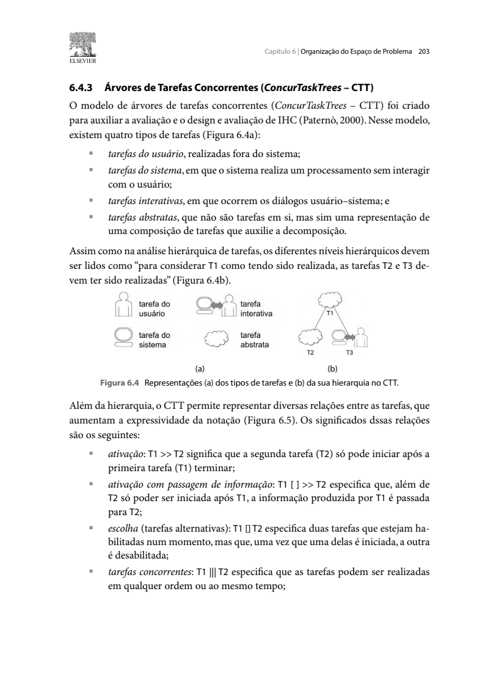
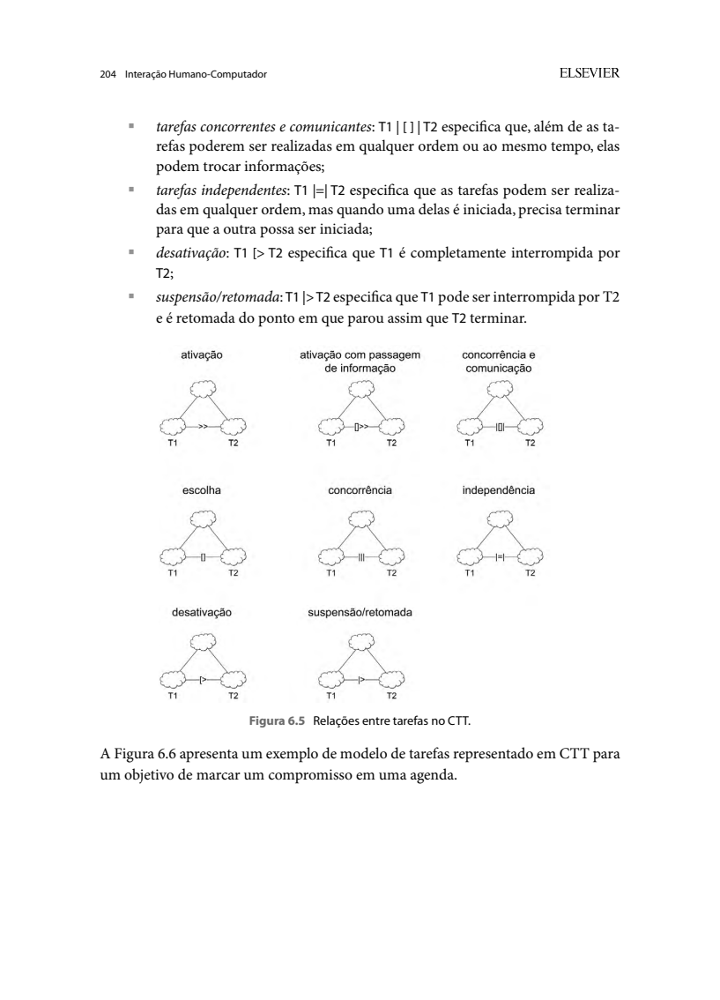

Responsável: Bruno Ferreira Dornelas — Oficina Legislativa · Autor do item: Bruno Ferreira Dornelas

# Planejamento da avaliação da análise de tarefas

## Tabela de contribuição

A Tabela 1 registra quem contribuiu neste artefato.

| Integrante | Contribuição | Artefato / atividade |
| --- | --- | --- |
| [Bruno Ferreira Dornelas](https://github.com/brunnf) | Definição da funcionalidade, do perfil e da responsabilidade pelo planejamento | [Contextualização](#contextualizacao) |
| Codex (OpenAI) | Apoio à redação, à organização e à conferência das referências | [Agradecimentos](#agradecimentos) |

Tabela 1 — Contribuição no planejamento.

Fonte: elaboração para o Grupo 06 (2026).

## Introdução

Este planejamento organiza a avaliação formativa da **análise de tarefas da Oficina Legislativa na Escola**, no Portal e-Cidadania, com o perfil **Professor**. O objetivo da tarefa é organizar a participação da turma e obter a declaração da oficina. A avaliação investigará se a decomposição em HTA e as relações representadas na CTT contemplam objetivos, ações, condições, responsabilidades e dependências pertinentes ao trabalho docente.

Será realizada uma entrevista semiestruturada remota apoiada nos modelos, precedida de conferência técnica da notação pela equipe. O [planejamento do relato dos resultados](planejamento-relato-analise-tarefas.md) define os registros e o tratamento das evidências.

**Situação em 13/10/2026:** planejamento para revisão interna. Professor participante, pessoa do piloto, observador, datas e horários estão a confirmar. Os modelos existem, mas a cópia de avaliação, a apresentação em linguagem comum e o TCLE específico devem ser preparados antes do piloto. Não houve coleta ou validação com professor neste recorte.

## Contextualização

O objeto é a [análise de tarefas de Rafael Almeida](../entrega-2/individual/bruno/perfil-2/analise-tarefas.md), versão textual 1.1 de 05/10/2026: objetivo 0, quatro subobjetivos, operações 1.1–4.2, planos HTA e CTT geral com expansões P, V, C e D. O [perfil Professor](../entrega-2/individual/bruno/perfil-2/perfil-usuario.md), a [persona](../entrega-2/individual/bruno/perfil-2/persona.md) e o [cenário](../entrega-2/individual/bruno/perfil-2/cenario.md) delimitam a atividade.

Esses artefatos derivam da [análise documental](../entrega-2/individual/bruno/perfil-2/analise-documental.md), com evidências E01–E09. A sequência atual é um percurso escolhido para o cenário; não demonstra que o serviço imponha toda a ordem como bloqueio técnico. As ações dos alunos, a análise das ideias pelo Senado e a comunicação dos retornos são dependências externas ao trabalho do professor representado.

O escopo inclui preparar a oficina, estabelecer o vínculo de instituição e turma, orientar a participação, reunir os retornos e obter/conferir a comprovação. Não inclui observar uma oficina completa, medir desempenho de uso do portal, inspecionar a área autenticada ou atribuir ao professor a autoria das ideias dos alunos. Campos, mensagens e condições de emissão não verificados permanecerão como questões abertas.

## Item de conteúdo da disciplina

**Autor do item:** Bruno Ferreira Dornelas.

Barbosa e Silva (2010, p. 191–192) apresentam a análise de tarefas como investigação do trabalho, de sua realização e de seus objetivos, considerando inclusive disparidades entre documentos e prática. A HTA decompõe objetivos, relaciona subobjetivos por planos e descreve operações com entrada, ação e condição de atingimento (p. 192–195). Entre seus passos está verificar a validade da decomposição junto às partes interessadas (p. 196, Figura 2 deste documento).

A CTT distingue tarefas do usuário, do sistema, interativas e abstratas e explicita relações temporais (p. 203–205). A avaliação será organizada pelo DECIDE (p. 312–313, Figura 1), com investigação por entrevista apoiada em artefatos (p. 301). O procedimento remoto, a quantidade de participantes e os instrumentos abaixo são decisões do projeto, não um protocolo específico de validação de HTA/CTT prescrito pelo livro.

O [modelo anterior de Bruno](../assets/docs/sites/07_Bruno_Dornelas_Planejamento_Avaliacao_DECIDE.pdf) orienta a organização do documento. As citações e as notações deste planejamento seguem a edição de **Barbosa e Silva de 2010**, sem transportar a paginação de 2021 do modelo anterior.

## D — Determinar os objetivos

**Objetivo geral:** identificar omissões, inadequações e dúvidas na modelagem da tarefa docente, confrontando a HTA/CTT documental com as contribuições de um professor e com a notação do livro, para orientar revisões fundamentadas.

- **AT-O1 — Objetivos e cobertura:** investigar se o objetivo geral, os subobjetivos e as operações representam o trabalho necessário e seus critérios de conclusão.
- **AT-O2 — Condições e relações:** examinar entradas, responsabilidades, ordem, dependências, transmissão de informações e situações de interrupção ou retomada relevantes para esse trabalho.
- **AT-O3 — Coerência e revisão:** verificar a consistência da notação e da correspondência entre HTA, CTT, tabelas e fontes, distinguindo correções sustentadas de hipóteses a investigar.

Os resultados interessam à equipe, que usará os modelos no reprojeto, e aos professores, cujo trabalho deve ser representado de modo pertinente. Compreender um diagrama não basta para demonstrar que sua decomposição corresponde ao trabalho real.

## E — Explorar as perguntas

A Tabela 2 relaciona perguntas, objetivos e pontos a examinar. AT-Q1–AT-Q7 serão investigadas com o professor; AT-Q8 será respondida pela conferência técnica da equipe.

| Objetivo | Pergunta de avaliação | Evidência e localização |
| --- | --- | --- |
| AT-O1 | AT-Q1 — O objetivo e os critérios de conclusão são pertinentes? “O que você pretende alcançar ao conduzir uma oficina assim? Como reconheceria sua conclusão?” | Relato inicial; objetivo 0; HTA 4.2; CTT D3 |
| AT-O1 | AT-Q2 — Faltam etapas ou há ações desnecessárias/sobrepostas? “Que atividades faltam nesta organização? Alguma se repete ou poderia ser agrupada?” | Operações apontadas; HTA 1–4; CTT P, V, C, D |
| AT-O2 | AT-Q3 — A ordem representa o trabalho e suas alternativas? “O que precisa vir antes? O que poderia ocorrer em outra ordem ou ao mesmo tempo? Em quais condições?” | Planos HTA e relações entre tarefas da CTT; exemplos do professor |
| AT-O2 | AT-Q4 — Entradas e condições de atingimento são suficientes? “O que você precisa ter para começar esta etapa? Como sabe que terminou?” | Entrada, ação e condição de cada operação discutida; informação transmitida na CTT |
| AT-O2 | AT-Q5 — As responsabilidades e fronteiras estão corretas? “O que depende de você, dos alunos e do serviço? Como a informação chega a quem precisa dela?” | HTA 3.1–3.5 e 4.1; tipos de tarefa e dependências externas |
| AT-O2, AT-O3 | AT-Q6 — A modelagem contempla as condições que impedem prosseguir? “Se faltar o código, um retorno ou a comprovação, o que fica pendente e o que você precisaria esclarecer?” | Operações 2.3, 3.3–3.5, 4.1–4.2; alternativas e dúvidas, sem presumir funções de correção |
| AT-O1, AT-O3 | AT-Q7 — O nível de detalhe e a linguagem permitem discutir o trabalho? “Qual etapa precisa ser explicada ou detalhada? Você consegue dar um exemplo?” | Nós e rótulos específicos; detalhe necessário para a finalidade da análise |
| AT-O3 | AT-Q8 — Diagramas, planos, tipos, operadores, tabelas e fontes são coerentes com a notação do livro e entre si? | Conferência CT01–CT06 pela equipe, com figura/página e elemento localizado |

Tabela 2 — Objetivos, perguntas e evidências previstas.

Fonte: elaboração do projeto com base em Barbosa e Silva (2010, p. 191–196, 203–205, 313).

As perguntas não pressupõem que exista uma falha. O professor poderá confirmar um trecho, propor outra organização ou dizer que não sabe. Para quem nunca realizou a Oficina, perguntas sobre seu funcionamento produzirão expectativas e dúvidas, não comprovação de prática observada.

## C — Escolher os métodos

O método principal será **investigação por entrevista semiestruturada**, com discussão guiada da análise de tarefas. Antes de apresentar os modelos, o moderador ouvirá uma descrição livre de como o professor organiza atividades semelhantes e, se houver experiência, a própria Oficina. Em seguida, percorrerá os quatro blocos da HTA e as relações correspondentes da CTT, usando também uma descrição em linguagem comum.

O participante discutirá o trabalho representado; não será solicitado a escolher símbolos ou demonstrar domínio de HTA/CTT. O moderador explicará apenas a leitura necessária, usando um exemplo neutro e distinguindo decomposição de ordem temporal. A tradução oral das relações seguirá um roteiro preparado e será registrada quando houver esclarecimento adicional. A investigação é fundamentada em Barbosa e Silva (2010, p. 145–149, 196, 301).

As Figuras 6 e 7 do [Apêndice A](#apendice-a-trechos-do-livro) apresentam os trechos sobre entrevista semiestruturada e investigação com materiais de apoio. A Figura 2 fundamenta a verificação da decomposição com partes interessadas. **Autores da fundamentação:** Simone Diniz Junqueira Barbosa e Bruno Santana da Silva (2010).

**Aplicação do item 7 da lista:** o futuro relato descreverá a entrevista e a conferência técnica que integram este planejamento. HTA e CTT representam o trabalho e suas relações; não são um protótipo de interface em papel. O projeto prevê o planejamento da avaliação desse protótipo na [Etapa 5](../proximas/etapa-05.md). A aplicação da estrutura do relato ao método adequado ao artefato é a interpretação adotada neste recorte, fundamentada em Barbosa e Silva (2010, p. 196, 301, 311–312), sem presumir dispensa concedida pelo professor.

A equipe realizará, separadamente, uma **conferência técnica dos artefatos** contra as notações e a correspondência documental. Essa atividade responde a AT-Q8 e integra o controle de qualidade da modelagem; não será apresentada como opinião do professor nem como avaliação heurística de Nielsen. A discussão guiada também não será denominada percurso cognitivo, pois não aplica esse método.

A sessão será remota síncrona, com compartilhamento de tela e cópia legível dos modelos. Sua duração será usada para organizar a sessão, não para estimar tempo de execução da oficina, eficiência no site ou probabilidades de falha. Não será calculado o critério p × c sem dados que sustentem seus componentes; o nível de decomposição será discutido conforme as informações necessárias ao objetivo da análise (BARBOSA; SILVA, 2010, p. 195).

## I — Identificar e administrar questões práticas

### Participantes e equipe

Planeja-se **um professor em uma sessão exploratória**, além de **um piloto com outra pessoa**. Essa quantidade é uma decisão inicial do recorte acadêmico, sujeita a revisão conforme as exigências da disciplina e o recrutamento; não é um mínimo universal do DECIDE. Uma sessão não comprova saturação ou representatividade do perfil (BARBOSA; SILVA, 2010, p. 305, 312).

O professor deverá ser adulto, atuar no ensino fundamental ou médio e ter experiência de conduzir atividades com turmas compatíveis com a modalidade escolar. Priorizar quem já realizou a Oficina Legislativa, pois poderá relatar práticas e incidentes específicos. Se não houver essa experiência, a sessão poderá investigar a adequação ao contexto docente e a plausibilidade do trabalho previsto, mantendo essa limitação em cada conclusão sobre o serviço. Professor do ensino superior exigirá revisão do recorte e dos materiais para a modalidade correspondente antes da sessão.

**Onde e como recrutar:** Bruno buscará indicações por contatos acadêmicos do grupo e solicitará, por e-mail institucional às coordenações de escolas de ensino fundamental ou médio, o encaminhamento de um convite voluntário aos docentes. Nenhuma escola ou pessoa está confirmada. O docente interessado autorizará o contato individual; serão priorizadas pessoas sem relação de dependência com o avaliador. Sem interessado elegível, ampliar os contatos institucionais e as indicações, mantendo o perfil e ajustando a agenda. Identidades e contatos não serão publicados.

**Triagem prevista:** confirmar atuação na educação básica, experiência com turmas, experiência específica com a Oficina, exposição prévia ao storyboard, necessidades de acessibilidade, condições de leitura/áudio e disponibilidade para 45–50 minutos. O convite apresentará objetivo, discussão dos modelos, modalidade remota, duração, voluntariedade e contato do responsável. A Figura 9 do apêndice reproduz as orientações de Barbosa e Silva (2010, p. 308) sobre triagem e agendamento.

**Justificativa da quantidade:** um caso permite discutir os quatro blocos da tarefa com profundidade dentro da sessão prevista, com um moderador responsável pela análise e recursos sem despesa adicional. O objetivo inicial é explorar lacunas e dependências do modelo no contexto de um professor; a conformidade da notação será examinada pela equipe. O piloto é separado e não aumenta a amostra principal. Se faltarem evidências para perguntas centrais, se for necessária experiência efetiva com a Oficina que o participante não possua ou se o escopo passar a comparar contextos, planejar recrutamento adicional antes de concluir sobre esses aspectos. A quantidade não garante cobertura de todos os problemas.

Bruno ficará responsável pelo convite, consentimento, condução, organização e análise. Caio Breno de Souza Bezerra será o revisor. Um observador ainda será indicado pelo grupo. Sem observador, o moderador fará pausas para registrar e conferir as notas e relatará essa limitação. O conhecimento do participante sobre a Oficina, sua relação com o avaliador e sua exposição prévia ao storyboard serão registrados.

O mesmo professor poderá participar da avaliação do storyboard e desta avaliação em sessões distintas. Os consentimentos deverão abranger as atividades realizadas; a participação anterior não autoriza automaticamente nova coleta. Esta sessão não será tratada como independente de exposição prévia: a ordem e as versões vistas serão registradas. Seus dados terão identificação própria, **AT-PROF01**, sem presumir que seja a mesma pessoa de PROF01 do storyboard.

### Materiais e delimitação da leitura

A Tabela 3 relaciona os blocos e materiais a apresentar. A cópia de avaliação preservará os identificadores dos modelos originais.

| Bloco | HTA | CTT | Foco da discussão |
| --- | --- | --- | --- |
| Preparar | 1, operações 1.1–1.2 | P, tarefas P1–P3 | Orientações, planejamento e trabalho fora do portal |
| Estabelecer vínculo | 2, operações 2.1–2.3 | V, tarefas V1–V3 | Identidade docente, instituição/turma, disponibilidade e reconhecimento do código |
| Coordenar | 3, operações 3.1–3.5 | C, tarefas C1–C5 | Orientação, autoria dos alunos, retornos, espera e encerramento |
| Comprovar | 4, operações 4.1–4.2 | D, tarefas D1–D3 | Solicitação, disponibilização e conferência da declaração |
| Visão geral | Objetivo 0 e plano dos quatro blocos | OrganizarOficina, P, V, C, D | Ordem global, alternativas, fronteiras e critério de conclusão |

Tabela 3 — Cobertura da leitura dos modelos.

Fonte: HTA/CTT da Oficina Legislativa, Grupo 06 (2026), versão 1.1.

Materiais necessários: diagramas SVG existentes e suas tabelas; versão identificada da descrição em linguagem comum; roteiro AT-Q1–AT-Q7; formulário de evidências; ficha de conferência técnica; TCLE específico e perguntas de caracterização. A descrição comum manterá ações e relações dos modelos, com indicação dos nós correspondentes, sem simplificar silenciosamente uma dependência.

Cada avaliador e participante usará ambiente com privacidade, áudio e conexão adequados. Prevê-se Google Meet, a confirmar no piloto, e computador ou dispositivo que permita ampliar os diagramas por ramo. O link da chamada será privado. Não há custos adicionais previstos com os recursos disponíveis. Diante de falta de legibilidade, usar a cópia ampliável e a descrição equivalente; se a barreira persistir ou a conexão impedir a discussão, pausar e reagendar.

### Notação exata e conferência técnica

Os diagramas de HTA e CTT e suas revisões deverão seguir **as figuras originais de Barbosa e Silva (2010)**, reproduzidas no [Apêndice A](#apendice-a-trechos-do-livro). Não serão substituídos por fluxogramas genéricos, raias, losangos de decisão, emojis ou ícones que alterem o significado dos elementos. A descrição em linguagem comum será um material auxiliar vinculado aos modelos, não outra notação.

Na **HTA**, usar os elementos de objetivo, operação e plano da Figura 6.1 (p. 193), a composição hierárquica da Figura 6.2 e a tabela equivalente das p. 194–195. Preservar a marca gráfica inferior das operações terminais, os números hierárquicos e os planos junto aos objetivos. As ligações pai–filho indicam decomposição; a ordem é expressa no plano. No modelo atual, a sequência usa o sinal maior que entre números dos filhos, como no exemplo do livro; operadores da CTT não substituirão os planos da HTA.

Na **CTT**, reproduzir os símbolos dos quatro tipos de tarefa da Figura 6.4 (p. 203), os operadores da Figura 6.5 (p. 204) e a organização da Figura 6.6 (p. 205). O modelo atual utiliza ativação (&gt;&gt;) e ativação com passagem de informação ([]&gt;&gt;), entre tarefas irmãs, separadas das ligações de decomposição. Uma mudança para escolha, concorrência ou outra relação exige a evidência correspondente e o operador exato do livro. Não serão acrescentados operadores apenas para tornar o desenho mais complexo.

A Tabela 4 será aplicada antes do piloto e novamente a cada versão revisada. Achados serão documentados, e correções não serão feitas silenciosamente sobre a cópia já avaliada.

| ID | Critério de conferência | Referência / registro exigido |
| --- | --- | --- |
| CT01 | Elementos HTA, marca de operação terminal, numeração, decomposição e planos correspondem à notação | Figuras 6.1–6.2, p. 193–194; identificar nó e localização do plano |
| CT02 | Entradas, ações e condições de atingimento estão coerentes com os objetivos; sobreposição ou lacuna tem justificativa | Tabela 6.3 e discussão, p. 193–196; identificar operação e condição |
| CT03 | Tipos de tarefa CTT usam os símbolos exatos e classificações adequadas | Figura 6.4, p. 203; identificar tarefa, tipo e justificativa |
| CT04 | Operadores, posição e significado temporal são corretos; passagem de informação identifica qual informação é transmitida | Figuras 6.5–6.6, p. 203–205; identificar relação entre tarefas |
| CT05 | Diagramas, expressões, legendas, tabelas e correspondência HTA/CTT descrevem o mesmo trabalho, ainda que em granularidades diferentes | Comparação da versão avaliada e da tabela de correspondência; registrar elementos de ambos os modelos |
| CT06 | Regras documentadas, decisões de modelagem e dependências externas são distinguíveis; interfaces não verificadas não aparecem como fatos | Evidências E01–E09 e limites da análise documental; identificar fonte/localizador |

Tabela 4 — Conferência técnica da HTA e da CTT.

Fonte: critérios operacionais do grupo baseados em Barbosa e Silva (2010, p. 191–196, 203–205).

Erros e condições excepcionais serão registrados nas tabelas e anotações pertinentes. A CTT tem limitações para representar mecanismos de prevenção e tratamento de erros (BARBOSA; SILVA, 2010, p. 205); a equipe não inventará um novo símbolo para suprir essa limitação.

### Roteiro da sessão remota

A Tabela 5 prevê 45 minutos de atividades, com reserva de até cinco minutos para pausa ou ajuste técnico. A estimativa deverá ser revista após o piloto.

| Momento | Tempo | Procedimento |
| --- | --- | --- |
| Acolhimento e consentimento | 5 min | Confirmar aceite, autorizações e conforto; testar áudio e leitura; esclarecer que a análise de tarefas está sendo avaliada |
| Contexto e relato livre | 7 min | Registrar etapa de ensino, experiência com atividades de turma e com a Oficina; perguntar como organiza trabalho semelhante, antes de mostrar os modelos |
| Orientação de leitura | 3 min | Explicar objetivos, decomposição, planos, responsabilidades e relações com exemplo neutro; oferecer descrição textual equivalente |
| Discussão dos quatro blocos | 18 min | Percorrer preparação, vínculo, coordenação e comprovação; explorar AT-Q1–AT-Q5 e AT-Q7 com perguntas abertas |
| Dependências e situações de exceção | 7 min | Retomar AT-Q3–AT-Q6 para falta de código antes do envio, retorno pendente e documento indisponível/divergente; registrar limites e dúvidas |
| Encerramento | 5 min | Conferir síntese, permitir correções e recolher comentário final; relembrar uso dos dados e contato |

Tabela 5 — Sequência prevista da sessão.

Fonte: operacionalização do projeto a partir de Barbosa e Silva (2010, p. 145–149, 196, 301, 305–308).

**Instrução inicial:** “Organizamos uma representação do trabalho de um professor que conduz uma Oficina Legislativa e busca sua comprovação. Queremos discutir se as etapas, informações e responsabilidades fazem sentido para sua prática e o que precisa ser revisto. Você não precisa conhecer as notações dos diagramas. Pode discordar, pedir explicações, não responder ou interromper a conversa.”

O moderador usará perguntas como “O que faz essa etapa ser necessária?” e “Pode contar um exemplo?”. Distinguirá o que o professor já fez, o que espera fazer e o que leu no material. Quando precisar esclarecer uma regra, registrará a resposta inicial e a explicação; respostas posteriores serão marcadas como após intervenção. Não ensinará um percurso para depois tratar sua repetição como confirmação independente.

### Piloto, cronograma e condições de início

**Definição:** o teste-piloto é um ensaio da avaliação para verificar se planejamento, materiais e registros geram os dados necessários aos objetivos. Inclui executar o procedimento, analisar brevemente os dados e corrigir as falhas antes da sessão principal. As Figuras 8 e 9 do [Apêndice A](#apendice-a-trechos-do-livro) reproduzem a explicação. **Autores:** Barbosa e Silva (2010, p. 307–308).

O piloto será realizado em data anterior à avaliação principal, com uma pessoa que não tenha elaborado os materiais, preferencialmente docente, e que não será o participante principal. Se tiver perfil próximo, servirá para verificar o procedimento, não para representar o professor. Serão ensaiados consentimento, legibilidade, orientação, duração, registro e análise breve das respostas. Verificar especialmente se é possível identificar nós/relações e distinguir experiência relatada de hipótese. Os dados do piloto não serão incorporados aos resultados principais; conservar apenas o registro desidentificado das alterações metodológicas (BARBOSA; SILVA, 2010, p. 307–308).

A Tabela 6 usa **T-AT** como data ainda não agendada da avaliação da análise de tarefas, distinta da data da avaliação do storyboard. Datas e horários deverão ser registrados no fuso de Brasília quando confirmados.

| Atividade | Janela prevista | Esforço estimado | Produto |
| --- | --- | --- | --- |
| Conferir CT01–CT06 e preparar cópia, descrição comum, roteiro e TCLE | T-AT−7 a T-AT−3 dias | 3 h | Material versionado e achados técnicos registrados |
| Recrutar e confirmar perfil/disponibilidade | Antes das sessões | 30 min de contato, além da espera | Pessoas e agendamentos confirmados |
| Realizar piloto | T-AT−2 dias, antes da sessão principal | 45–50 min | Procedimento e dados ensaiados |
| Analisar piloto e ajustar materiais | T-AT−2 a T-AT−1 dias | 1 h | Nova versão; outro piloto se mudanças extensas |
| Entrevistar o professor | T-AT | 45–50 min | Registros da discussão dos modelos |
| Interpretar e confrontar evidências | T-AT a T-AT+1 dia | 2 h | Matriz de respostas e divergências |
| Consolidar, redigir e revisar relato | T-AT+1 a T-AT+3 dias | 2 h | Relato e recomendações fundamentadas |

Tabela 6 — Cronograma relativo da avaliação.

Fonte: estimativas do projeto; atividades de avaliação de Barbosa e Silva (2010, seção 9.7).

Antes do piloto, confirmar pessoa, data/horário, plataforma, disponibilidade do observador ou condução individual, versões dos materiais, TCLE e armazenamento privado. Antes da sessão principal, confirmar AT-PROF01, data/horário, contato do responsável, versões após o piloto e revisor. As janelas não representam agendamentos; a data de entrega acadêmica não será usada como data fictícia de coleta.

### Registro de agendamento previsto

A Tabela 7 organiza os campos de calendário e local. Bruno os preencherá após o aceite e antes do piloto; as datas e os horários seguem a confirmar porque ainda não há participante. O intervalo entre piloto e sessão principal deverá comportar as correções e eventual novo ensaio. Se o mesmo professor participar do storyboard, combinar sessões distintas e registrar a ordem de exposição.

| Sessão | Data prevista | Horário de Brasília (UTC−3) | Duração reservada | Local / plataforma prevista | Condição |
| --- | --- | --- | --- | --- | --- |
| Piloto da análise de tarefas | A confirmar; T-AT−2 dias | A confirmar | 50 min | Remota, Google Meet; cada pessoa em ambiente privado | Pessoa diferente de AT-PROF01 e não envolvida na elaboração |
| Avaliação da análise de tarefas | A confirmar; T-AT | A confirmar | 50 min | Remota, Google Meet; link enviado em privado | Professor elegível, CT01–CT06 conferidos, ajustes do piloto e consentimento |

Tabela 7 — Agendamento a completar antes das sessões.

Fonte: planejamento operacional do projeto, orientado por Barbosa e Silva (2010, p. 307–308).

Caio Breno de Souza Bezerra é o responsável designado pela revisão do planejamento, da notação e dos materiais antes do piloto e, posteriormente, do relato. Bruno combinará os prazos de revisão com ele. O observador poderá ser outro integrante; sem disponibilidade, a condução individual seguirá as pausas de registro previstas. A indicação dos nomes e o aceite serão registrados como atribuições futuras. Esses papéis dizem respeito ao recorte da Oficina, articulado aos responsáveis pela consolidação coletiva, e não comprovam revisão já realizada.

## D — Decidir como lidar com questões éticas

Os cuidados seguem Barbosa e Silva (2010, seção 5.4, p. 138–142) e os [aspectos éticos do grupo](../entrega-2/etica.md). O TCLE específico descreverá entrevista remota, leitura da HTA/CTT, duração, registros, uso acadêmico e contato de Bruno. Participação, gravação de áudio e uso de trechos desidentificados terão condições explícitas. A autorização do storyboard não será presumida para esta atividade.

- **Autonomia:** aceite documentado antes da coleta, participação voluntária, liberdade de recusar perguntas e de interromper sem prejuízo; evitar pressão por vínculo acadêmico ou profissional.
- **Beneficência:** usar os dados para aperfeiçoar os modelos e orientar o projeto, sem prometer mudanças no serviço do Senado.
- **Não maleficência:** avaliar os artefatos, não a competência docente. Não solicitar dados identificadores de alunos, credenciais ou operações reais no portal; usar exemplos fictícios e interromper diante de desconforto.
- **Justiça e equidade:** selecionar pela relação com o trabalho, não pela idade fictícia de Rafael; oferecer ampliação, descrição equivalente e pausas conforme a necessidade.

O registro padrão será por notas; áudio será opcional, com autorização e recurso disponível. Câmera facial não será exigida nem gravada. Gravação e transcrição automática permanecerão desativadas sem autorização específica. Sem áudio, as notas serão identificadas como paráfrases e conferidas com o participante quando necessário.

Bruno manterá dados brutos em pasta privada acessível apenas aos avaliadores e ao revisor informados no consentimento. Identidade, contato e TCLE ficarão separados das evidências analíticas. Nada disso, nem o link da chamada, será incluído no repositório público. Como política proposta, registros brutos e chave de identificação serão excluídos até 30 dias após o encerramento da disciplina; a data correspondente e o canal de contato serão preenchidos no TCLE. A retirada será possível enquanto os dados forem identificáveis, com explicação prévia dos limites após divulgação de sínteses desidentificadas.

## E — Avaliar, interpretar e apresentar os dados

### Análise e registro

Os dados terão três origens identificadas: **conferência técnica**, **relato/expectativa do participante** e **fonte documental**. A ficha conterá código da evidência, origem, versão, pergunta, nó ou relação, localizador, registro, intervenção e interpretação separados. Identificadores AT-EV01 e seguintes distinguirão esta coleta das evidências E01–E09 da análise documental e dos registros do storyboard.

Cada AT-Q terá uma resposta fundamentada ou uma justificativa de insuficiência de dados. Os achados poderão apontar cobertura insuficiente, condição ausente, ordem inadequada, responsabilidade incorreta, problema de notação, falta de clareza ou regra a investigar. Nenhum desses estados será automaticamente atribuído ao portal real. Concordância do professor será registrada no contexto de sua experiência e das explicações recebidas, sem certificar integralmente o modelo.

O [planejamento do relato](planejamento-relato-analise-tarefas.md) define a matriz de respostas, a comparação entre fontes, prioridades e o controle das revisões. Será mantida uma cópia da versão avaliada para permitir conferir os resultados mesmo depois de alterar os diagramas.

### Qualidade e limitações

O último E do DECIDE orienta considerar confiabilidade e validades interna, externa e ecológica (BARBOSA; SILVA, 2010, p. 313):

- **Confiabilidade:** preservar versões, localizadores, roteiro e registro das traduções/intervenções; submeter a relação entre evidência e conclusão à revisão. Uma sessão não demonstra repetibilidade.
- **Validade interna:** colher relato livre antes dos modelos, não confundir desconhecimento da notação com falha da tarefa, distinguir contribuição espontânea e após esclarecimento e registrar exposição ao storyboard.
- **Validade externa:** um caso não representa todos os professores. Sem experiência prévia na Oficina, a sessão não confirma o fluxo real do serviço.
- **Validade ecológica:** a conversa não reproduz aulas, submissões dos alunos, espera por retornos ou uso autenticado. As condições efetivas e as diferenças para a prática serão descritas.

A CTT não oferece representação completa do tratamento de erros (p. 205), e as fontes documentais não cobrem todos os detalhes autenticados. Esses limites deverão orientar novas investigações, sem preencher lacunas com funcionalidades supostas.

### Apresentação

O relato seguirá os sete componentes de Barbosa e Silva (2010, p. 311–312), com os achados técnicos e as contribuições do professor identificados separadamente. Recomendações indicarão os nós/planos/relações afetados, a evidência que as sustenta e como verificar a nova versão, preservando as notações exatas do livro.

## Agradecimentos

O Codex (OpenAI) apoiou a consulta das fontes, a redação e a organização dos instrumentos. Bruno Ferreira Dornelas definiu o recorte e permanece responsável pela revisão e pelo conteúdo do artefato.

## Histórico de versão

Revisor designado: [Caio Breno de Souza Bezerra](https://github.com/CaioBezerra-Dev). A revisão será registrada quando realizada.

| Versão | Data | Descrição | Autor(es) | Revisor(es) |
| :---: | :---: | --- | --- | --- |
| 0.1 | 13/10/2026 | Planejamento DECIDE da avaliação da HTA/CTT da Oficina Legislativa, com conferência de notação e entrevista remota | [Bruno Ferreira Dornelas](https://github.com/brunnf) | [Caio Breno de Souza Bezerra](https://github.com/CaioBezerra-Dev) |
| 1.0 | 13/10/2026 | Completa fundamentação visual de métodos e piloto, recrutamento, justificativa da quantidade, agendamento e delimitação do método; explicita todos os integrantes | [Bruno Ferreira Dornelas](https://github.com/brunnf) | [Caio Breno de Souza Bezerra](https://github.com/CaioBezerra-Dev) |

## Referências

[1] BARBOSA, Simone Diniz Junqueira; SILVA, Bruno Santana da. **Interação humano-computador**. Rio de Janeiro: Elsevier, 2010. p. 138–149, 191–196, 203–205, 294–313.

[2] GRUPO 06. **Análise de tarefas — Oficina Legislativa**. Versão 1.1. Brasília: FCTE/UnB, 2026. [HTA, CTT e tabelas](../entrega-2/individual/bruno/perfil-2/analise-tarefas.md).

[3] GRUPO 06. **Análise documental — Professor**. Brasília: FCTE/UnB, 2026. [Fontes oficiais e evidências E01–E09](../entrega-2/individual/bruno/perfil-2/analise-documental.md).

[4] DORNELAS, Bruno Ferreira. **Planejamento de avaliação de IHC: framework DECIDE — Prefeitura de Unaí**. Brasília: FCTE/UnB, 2026. [PDF do modelo](../assets/docs/sites/07_Bruno_Dornelas_Planejamento_Avaliacao_DECIDE.pdf).

## Apêndice A — Trechos do livro

As figuras abaixo fundamentam o DECIDE, a verificação com partes interessadas e a notação exigida para os diagramas. A conferência usará também os exemplos das p. 194–195 e 205 do livro.

??? note "Figura 1 — Framework DECIDE"

    
    
Figura 1 — Organização da avaliação pelo DECIDE.

    
Fonte: Barbosa e Silva (2010, p. 312–313).

??? note "Figura 2 — Verificação da validade da decomposição"

    
    
Figura 2 — Coleta, decomposição e verificação na HTA.

    
Fonte: Barbosa e Silva (2010, p. 196).

??? note "Figura 3 — Elementos e planos da HTA"

    
    
Figura 3 — Elementos do diagrama HTA e especificação de operações.

    
Fonte: Barbosa e Silva (2010, p. 193, Figura 6.1).

??? note "Figura 4 — Tipos de tarefa e hierarquia da CTT"

    
    
Figura 4 — Tipos de tarefa e decomposição na CTT.

    
Fonte: Barbosa e Silva (2010, p. 203, Figura 6.4).

??? note "Figura 5 — Operadores de relações da CTT"

    
    
Figura 5 — Relações entre tarefas da CTT.

    
Fonte: Barbosa e Silva (2010, p. 204, Figura 6.5).

As figuras a seguir fundamentam a escolha da entrevista, a preparação do piloto e o recrutamento. A numeração das páginas corresponde à edição de 2010.

??? note "Figura 6 — Entrevista semiestruturada"

    
    
Figura 6 — Entrevista semiestruturada.

    
Fonte: Barbosa e Silva (2010, p. 146), reprodução do exemplar do projeto.

??? note "Figura 7 — Investigação com materiais de apoio"

    
    
Figura 7 — Investigação com materiais de apoio.

    
Fonte: Barbosa e Silva (2010, p. 301), reprodução do exemplar do projeto.

??? note "Figura 8 — Definição e finalidade do teste-piloto"

    
    
Figura 8 — Definição e finalidade do teste-piloto.

    
Fonte: Barbosa e Silva (2010, p. 307), reprodução do exemplar do projeto.

??? note "Figura 9 — Participante do piloto, recrutamento e agendamento"

    
    
Figura 9 — Participante do piloto, recrutamento e agendamento.

    
Fonte: Barbosa e Silva (2010, p. 308), reprodução do exemplar do projeto.

