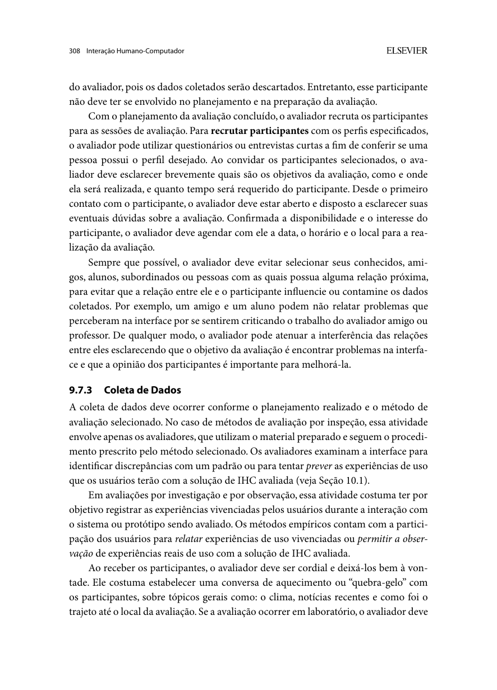

Responsável: Bruno Ferreira Dornelas — Oficina Legislativa · Autor do item: Bruno Ferreira Dornelas

# Planejamento da avaliação do storyboard

## Tabela de contribuição

A Tabela 1 registra quem contribuiu neste artefato.

| Integrante | Contribuição | Artefato / atividade |
| --- | --- | --- |
| [Bruno Ferreira Dornelas](https://github.com/brunnf) | Definição da funcionalidade, do perfil e da avaliação remota; responsabilidade pelo planejamento | [Contextualização](#contextualizacao) |
| Codex (OpenAI) | Apoio à redação, à organização e à conferência das referências | [Agradecimentos](#agradecimentos) |

Tabela 1 — Contribuição no planejamento.

Fonte: elaboração para o Grupo 06 (2026).

## Introdução

Este planejamento organiza uma avaliação formativa do storyboard da **Oficina Legislativa na Escola**, no Portal e-Cidadania do Senado Federal, com uma pessoa do perfil **Professor**. O recorte é organizar a participação da turma e obter a declaração da oficina. Uma entrevista semiestruturada remota, apoiada na leitura do storyboard, investigará a compreensão da história, sua adequação ao trabalho docente e as informações necessárias para conduzir a atividade.

**Situação em 13/10/2026:** planejamento elaborado para revisão interna; participante, observador, datas e horários ainda não confirmados. O storyboard visual e o TCLE específico da sessão deverão ser preparados antes do piloto. Nenhuma sessão ou coleta é relatada como realizada. O [planejamento do relato](planejamento-relato-storyboard.md) define como organizar os resultados futuros.

## Contextualização

O trabalho dá continuidade ao [perfil Professor](../entrega-2/individual/bruno/perfil-2/perfil-usuario.md), à [persona Rafael Almeida](../entrega-2/individual/bruno/perfil-2/persona.md), ao [cenário da oficina](../entrega-2/individual/bruno/perfil-2/cenario.md) e à [análise de tarefas HTA/CTT](../entrega-2/individual/bruno/perfil-2/analise-tarefas.md). Esses artefatos derivam de [análise documental](../entrega-2/individual/bruno/perfil-2/analise-documental.md); Rafael não representa uma pessoa já entrevistada.

O serviço associa as ideias dos alunos à turma por um código. Segundo as orientações oficiais, uma ideia enviada sem esse código não constará na declaração do professor, e o código não pode ser incluído depois da publicação. As ideias são cadastradas pelos alunos. A declaração reúne dados da instituição, turmas, ideias e carga horária estimada [2]. Essas dependências tornam relevante investigar como o processo é compreendido pelo docente.

O storyboard representará o processo atual descrito nas fontes, com um episódio fictício de dúvida sobre o código. A sessão examinará essa representação e a experiência relatada pelo professor. Não envolverá cadastro real, acesso a contas de alunos, publicação de ideias ou emissão de declaração. Campos e mensagens da área autenticada ainda não verificados serão representados de forma geral, sem inventar telas como se fossem existentes.

## Item de conteúdo da disciplina

**Autor do item:** Bruno Ferreira Dornelas.

Barbosa e Silva (2010, p. 294) incluem storyboards entre os artefatos que podem apoiar a avaliação formativa. Os métodos de investigação permitem examinar concepções, expectativas e experiências com auxílio de imagens e cenários, sem exigir o uso de um sistema durante a sessão (p. 301). O DECIDE organiza seis atividades interligadas e iterativas: objetivos, perguntas, métodos, questões práticas, ética e avaliação dos dados (p. 312–313). A Figura 1 reproduz a fundamentação utilizada.

Figura 1 — Framework DECIDE.

Fonte: Barbosa e Silva (2010, seção 9.8, p. 312–313).

O [planejamento anterior de Bruno](../assets/docs/sites/07_Bruno_Dornelas_Planejamento_Avaliacao_DECIDE.pdf) é referência de organização: objetivos e perguntas articulados, justificativa do método, tarefas, recursos, cronograma, ética, registro e relato. A avaliação heurística daquele trabalho não é transportada para este estudo. As referências teóricas deste documento usam a edição de **2010**, cuja numeração difere da edição de 2021 citada no modelo.

## D — Determinar os objetivos

**Objetivo geral:** identificar dificuldades de compreensão e lacunas na representação do trabalho do professor no storyboard, para orientar sua revisão e levantar necessidades a investigar no reprojeto da Oficina Legislativa.

- **O1 — Compreensão:** verificar se o professor compreende objetivo, sequência, responsabilidades e relação entre código, participação dos alunos e declaração.
- **O2 — Adequação ao contexto:** investigar se a história é compatível com sua prática docente e quais ações, recursos ou dependências estão ausentes.
- **O3 — Revisão:** identificar trechos confusos e sugestões justificadas, distinguindo alterações do storyboard de hipóteses sobre o serviço.

Os objetivos interessam ao professor, que precisa coordenar a atividade, e à equipe, que precisa fundamentar as próximas decisões de design. A avaliação não medirá a eficiência de uso do site nem comparará alternativas inexistentes. A distinção entre objetivos e perguntas segue Barbosa e Silva (2010, p. 313).

## E — Explorar as perguntas

A Tabela 2 vincula cada pergunta à evidência pretendida. As formulações serão usadas após a leitura livre, sem apresentar ao participante os critérios de interpretação.

| Objetivo | Pergunta de avaliação e formulação ao participante | Evidência a registrar |
| --- | --- | --- |
| O1 | Q1 — O objetivo e o desfecho são compreendidos? “Conte com suas palavras o que Rafael pretende fazer e como a história termina.” | Explicação espontânea e partes não compreendidas |
| O1 | Q2 — A relação entre turma, código e ideias está clara? “Que papel o código tem nessa história? O que acontece na situação apresentada pelo aluno?” | Relações reconhecidas, dúvidas e quadro usado na resposta |
| O1 | Q3 — As responsabilidades estão claras? “O que cabe ao professor, aos alunos e ao serviço do Senado?” | Atribuições identificadas e eventuais trocas de responsabilidade |
| O1, O2 | Q4 — A sequência e as dependências fazem sentido? “O que precisa acontecer antes de Rafael concluir a atividade? Você mudaria alguma etapa de lugar?” | Dependências, saltos temporais e justificativas |
| O2 | Q5 — A história é compatível com a prática docente? “O que seria diferente com uma turma sua? De quais recursos ou informações você precisaria?” | Contexto relatado, ações ausentes e condições de realização |
| O1, O2 | Q6 — O resultado é reconhecível? “O que você conferiria para considerar a oficina comprovada?” | Critérios de conclusão do professor e dúvidas sobre a declaração |
| O3 | Q7 — O que precisa ser revisto? “Qual trecho ficou confuso ou incompleto? O que você mudaria e por quê?” | Quadro, dificuldade específica e sugestão fundamentada |

Tabela 2 — Objetivos, perguntas e evidências.

Fonte: elaboração para o Grupo 06, orientada por Barbosa e Silva (2010, p. 313).

## C — Escolher os métodos

Será realizada uma **avaliação formativa por investigação**, com **entrevista semiestruturada apoiada no storyboard**, em sessão remota síncrona. A entrevista permite aprofundar respostas e levantar experiências e expectativas (BARBOSA; SILVA, 2010, p. 145–149, 301). A leitura da história oferece uma referência comum para discutir a tarefa e localizar dúvidas.

As Figuras 2 e 3 do [Apêndice A](#apendice-a-trechos-sobre-metodo-e-piloto) reproduzem a explicação da entrevista semiestruturada e dos métodos de investigação. **Autores da fundamentação:** Simone Diniz Junqueira Barbosa e Bruno Santana da Silva (2010).

**Aplicação do item 7 da lista:** a estrutura do relato descreverá o método efetivamente planejado para este artefato. O storyboard é uma narrativa visual usada na entrevista; a prototipação em papel, mencionada na lista, tem planejamento próprio previsto na [Etapa 5](../proximas/etapa-05.md). Para este recorte, a investigação com material de apoio é justificada pelos objetivos de compreensão e adequação ao contexto, conforme Barbosa e Silva (2010, p. 301). Essa delimitação é a interpretação adotada no projeto, não uma dispensa concedida pelo professor.

A modalidade remota é uma decisão operacional do projeto: compartilhamento de tela e cópia acessível do material permitem conversar sobre os mesmos quadros. Ela não é apresentada como protocolo específico prescrito pelo livro. Não haverá teste de execução no portal, prototipação interativa em papel ou medição de tempo de tarefa. Tempo de leitura e pausas serão registros de contexto, não indicadores de desempenho da funcionalidade.

Durante a leitura, o participante poderá comentar espontaneamente. As perguntas serão feitas depois, evitando interrupções que expliquem antecipadamente a história. Para aprofundar uma resposta, o moderador usará perguntas neutras, como “O que nessa cena fez você entender dessa forma?”. Não perguntará “Você entendeu que o aluno precisa usar o código, certo?”.

## I — Identificar e administrar questões práticas

### Participante e recrutamento

Planeja-se **uma sessão exploratória com um professor**, além de **um piloto com outra pessoa**. A quantidade é uma escolha inicial para este recorte individual; não é um mínimo universal do DECIDE nem permite afirmar representatividade, saturação ou validação de todo o perfil. A definição de perfil e quantidade deve considerar objetivos e escopo (BARBOSA; SILVA, 2010, p. 305). Se a disciplina exigir mais participantes, o planejamento será atualizado antes da coleta.

O participante principal deverá ser adulto, atuar como professor do ensino fundamental ou médio e ter experiência de conduzir atividades com turmas compatíveis com a modalidade escolar da oficina. Conhecimento prévio da Oficina Legislativa não é obrigatório; será registrado para interpretar as respostas. Nome, idade fictícia e aparência de Rafael não são critérios de seleção. Caso o acesso seja apenas a um docente do ensino superior, o cenário e a modalidade do serviço deverão ser revistos antes do recrutamento.

**Onde e como recrutar:** Bruno buscará um professor por indicação de contatos acadêmicos do grupo e por contato com coordenações de escolas de ensino fundamental ou médio, usando e-mail institucional para solicitar o encaminhamento de um convite voluntário. A indicação não equivalerá à inscrição: o docente interessado deverá aceitar o contato individual. Serão priorizados docentes sem relação de dependência acadêmica/profissional com o avaliador. Nenhuma escola ou pessoa está confirmada; nomes e contatos permanecerão privados. Se a primeira tentativa não produzir interessado elegível, ampliar as indicações e os contatos institucionais, mantendo o perfil e reagendando as sessões.

**Triagem prevista:** confirmar atuação atual na educação básica, experiência com turmas, familiaridade com a Oficina, condições de leitura/áudio, necessidades de acessibilidade e disponibilidade para 35–40 minutos. O convite informará objetivo, atividades, duração, modalidade remota, voluntariedade e contato do responsável. Esses procedimentos seguem Barbosa e Silva (2010, p. 308), reproduzidos na Figura 5 do apêndice.

**Justificativa da quantidade:** um caso permite percorrer os sete quadros e aprofundar as sete perguntas dentro da sessão prevista, com condução e análise sob responsabilidade de um moderador e sem verba adicional. O objetivo é obter evidências exploratórias sobre a compreensão deste storyboard, não comparar grupos. O piloto tem finalidade distinta e não aumenta a amostra principal. Se o docente não puder discutir o contexto necessário, se faltarem evidências para perguntas centrais ou se o escopo passar a comparar experiências, revisar o roteiro e o recrutamento e planejar sessão adicional antes de concluir sobre esses pontos.

Bruno realizará o convite individual, apresentará objetivo, duração, modalidade e voluntariedade e confirmará o perfil por perguntas breves sobre etapa de ensino, condução de atividades com turmas e experiência com a Oficina. Não serão solicitados nomes de alunos ou identificação da escola. Uma relação prévia entre avaliador e participante deverá ser registrada como possível influência; não se fará convite sob pressão acadêmica ou profissional. O participante receberá o código **PROF01**; sua identidade e contato ficarão separados dos registros analíticos.

### Equipe, ambiente e materiais

A Tabela 3 estabelece os recursos e responsabilidades previstos.

| Item | Definição |
| --- | --- |
| Moderador e responsável pelos dados | Bruno Ferreira Dornelas: convite, consentimento, condução, organização e análise |
| Observador | Um integrante do grupo, a confirmar; registrará evidências e intervenções sem conduzir respostas |
| Revisor | [Caio Breno de Souza Bezerra](https://github.com/CaioBezerra-Dev): conferirá fontes, análise e relato |
| Local | Sessão remota; cada pessoa em ambiente escolhido por ela, com privacidade e pouco ruído |
| Plataforma | Google Meet como opção prevista; confirmar acesso, compartilhamento e recursos de acessibilidade no piloto; link enviado em privado |
| Equipamentos | Computador ou dispositivo que permita ler os quadros, conexão e áudio; câmera facial opcional |
| Material de avaliação | Storyboard numerado QD01–QD07, versão e data, legendas legíveis, descrição textual equivalente e cópia para ampliação |
| Instrumentos | TCLE específico, perguntas de caracterização, roteiro desta página e formulário de registro |
| Registro | Anotações; áudio opcional somente se autorizado e tecnicamente disponível; sem gravação facial prevista |
| Custo | Uso de recursos disponíveis, sem despesas adicionais previstas; custo eventual exige revisão do planejamento |
| Contingência | Se os quadros não estiverem legíveis, ampliar ou fornecer cópia; se áudio/conexão impedirem a coleta, pausar e reagendar |

Tabela 3 — Recursos e responsabilidades.

Fonte: decisões operacionais do projeto; questões práticas de Barbosa e Silva (2010, p. 305–308, 313).

Se não houver observador disponível, Bruno registrará as respostas por escrito, reservará pausas para conferência e indicará essa limitação. A ausência de autorização para áudio não impede a participação. A ferramenta de chamada não deverá ativar gravação ou transcrição automática sem consentimento específico.

### Material que deverá estar pronto para avaliação

A Tabela 4 define a cobertura prevista do storyboard a produzir. Os quadros vinculam a história aos quatro objetivos da HTA e às tarefas abstratas P, V, C e D da CTT. Esta tabela é uma especificação do material, não substitui o storyboard visual.

| Quadro | Situação a representar | Vínculo com a análise de tarefas |
| --- | --- | --- |
| QD01 | Rafael quer realizar uma atividade educativa e comprovar sua realização | Objetivo geral da HTA; contexto do cenário |
| QD02 | Consulta orientações e prepara a oficina | HTA 1.1–1.2; CTT P1–P3 |
| QD03 | Usa seu acesso docente, estabelece instituição/turma e obtém o código | HTA 2.1–2.3; CTT V1–V3 |
| QD04 | Repassa o código, conduz as atividades iniciais e orienta o envio | HTA 3.1–3.3; CTT C1–C3 |
| QD05 | Um aluno pergunta se pode enviar sem código; Rafael retoma a orientação antes do envio | HTA 3.3; CTT C3; episódio fictício do cenário |
| QD06 | Alunos enviam suas ideias e comunicam retornos; Rafael reúne os resultados e encerra a atividade | HTA 3.4–3.5; CTT C4–C5; envio e retorno aos alunos são dependências externas à árvore do professor |
| QD07 | Rafael solicita a declaração e confere a comprovação | HTA 4.1–4.2; CTT D1–D3; D2 representa disponibilização pelo sistema |

Tabela 4 — Cobertura prevista dos quadros e rastreabilidade.

Fonte: cenário e HTA/CTT de Rafael Almeida, Grupo 06 (2026).

As orientações conhecidas podem aparecer na história; o que será investigado é sua interpretação após a leitura, não a capacidade de adivinhar regras. O moderador não fornecerá explicações adicionais antes de registrar a resposta inicial. Qualquer mudança na quantidade ou ordem dos quadros deverá atualizar as referências desta tabela e dos instrumentos.

**Critério de preparação:** cada desenho deverá apresentar ID, legenda, vínculo da Tabela 4 e versão; a revisão interna conferirá a correspondência antes do piloto. O plano coletivo prevê **cinco storyboards, um por integrante** (Bruno, Caio, Heitor, Israel e Luis). Este documento especifica o de Bruno, com sete quadros; os demais integrantes deverão produzir suas narrativas ligadas às respectivas análises de tarefas. A contagem será de storyboards completos, não de quadros. A produção dos desenhos e a conferência do conjunto são atividades futuras de preparação, sem indicar que esses cinco materiais já existem.

### Roteiro da sessão

A Tabela 5 distribui aproximadamente 35 minutos. Até cinco minutos adicionais poderão ser usados para pausas e ajustes técnicos, mediante concordância do participante. Os tempos serão conferidos no piloto.

| Momento | Tempo previsto | Procedimento |
| --- | --- | --- |
| Acolhimento | 5 min | Confirmar leitura e aceite do TCLE, esclarecer dúvidas e autorização de áudio; testar legibilidade e reforçar que o material está sendo avaliado |
| Caracterização | 5 min | Perguntar etapa de ensino, experiência com atividades de turma, familiaridade com o serviço e recursos normalmente disponíveis |
| Leitura | 5 min | Apresentar o contexto e deixar o professor percorrer a história, voltar aos quadros e comentar livremente |
| Entrevista | 15 min | Explorar Q1–Q7, começando pelo relato livre; registrar referências aos quadros e aprofundar respostas sem indução |
| Encerramento | 5 min | Resumir o entendimento do avaliador, permitir correções, colher comentário final e relembrar contato e uso dos dados |

Tabela 5 — Sequência prevista da sessão remota.

Fonte: operacionalização do grupo a partir de Barbosa e Silva (2010, p. 145–149, 305–308).

**Instrução inicial prevista:** “Esta história mostra um professor organizando uma Oficina Legislativa e buscando sua comprovação. Queremos saber como você interpreta essa situação e como ela se relaciona com seu trabalho. Você pode ler no seu ritmo, voltar aos quadros e apontar dúvidas ou discordâncias. Estamos avaliando o material; você não precisa conhecer as regras do serviço.”

Quando uma dúvida impedir a continuidade, o moderador primeiro registrará a interpretação e depois poderá esclarecer, marcando o momento da intervenção. Respostas posteriores serão identificadas como dadas após esclarecimento. Diante de desconforto, pedido de pausa ou desistência, a sessão será interrompida. A impossibilidade de concluir uma pergunta será registrada, sem pressionar por resposta.

### Teste-piloto

**Definição:** o teste-piloto é o ensaio do procedimento de avaliação para verificar se o planejamento, os materiais e os registros permitem responder aos objetivos e às perguntas. Inclui uma breve análise dos dados do ensaio e correções antes da sessão principal. A Figura 4 e a continuação na Figura 5 do [Apêndice A](#apendice-a-trechos-sobre-metodo-e-piloto) apresentam essa fundamentação. **Autores:** Barbosa e Silva (2010, p. 307–308).

O piloto ocorrerá em **data anterior à sessão principal**, com uma pessoa que não tenha participado da elaboração do material, preferencialmente docente. Se não for possível recrutar esse perfil para o piloto, uma pessoa com perfil próximo poderá verificar linguagem, funcionamento e duração; isso não substituirá o professor da avaliação principal. O participante do piloto não será reutilizado na sessão principal.

Será ensaiado todo o procedimento: consentimento, acesso remoto, leitura, entrevista, registro e uma breve análise dos dados. O piloto deverá verificar se as respostas permitem abordar Q1–Q7, se os quadros podem ser identificados, se a linguagem é neutra e se há tempo suficiente. Seus dados serão excluídos do conjunto de resultados da avaliação; o registro metodológico preservará somente problemas do procedimento e ajustes realizados, sem falas pessoais. Mudanças extensas exigirão novo piloto. Essas decisões seguem Barbosa e Silva (2010, p. 307–308).

### Cronograma e pendências de agendamento

A Tabela 6 define a ordem e o esforço previsto. **T** representa a data ainda não agendada da avaliação principal. As janelas são propostas de organização, não compromissos confirmados. A data de entrega acadêmica não será tratada como data fictícia de coleta.

| Atividade | Janela prevista | Esforço estimado | Produto / condição de conclusão |
| --- | --- | --- | --- |
| Preparar storyboard e instrumentos; revisão interna | T−7 a T−3 dias | 3 h | Versões identificadas; TCLE e roteiro conferidos |
| Recrutar e confirmar disponibilidade | Antes do piloto e da avaliação | 30 min de contato, além da espera | Perfis conferidos e agendamentos privados confirmados |
| Executar piloto | T−2 dias, em data anterior a T | 35–40 min | Funcionamento e qualidade dos dados verificados |
| Interpretar piloto e corrigir materiais | T−2 a T−1 dias | 1 h | Ajustes registrados; nova versão; novo piloto se necessário |
| Conduzir sessão com PROF01 | T | 35–40 min | Consentimento confirmado e registros produzidos |
| Organizar e interpretar dados | T a T+1 dia | 2 h | Evidências e respostas por pergunta |
| Consolidar, redigir e revisar relato | T+1 a T+3 dias | 2 h | Relato conferido e recomendações rastreáveis |

Tabela 6 — Cronograma relativo da avaliação.

Fonte: estimativas do projeto; atividades básicas de avaliação de Barbosa e Silva (2010, seção 9.7).

Antes de realizar o piloto, preencher: pessoa do piloto; data e horário com fuso de Brasília; observador ou registro de condução individual; plataforma e recursos testados. Antes da avaliação principal, preencher: confirmação de PROF01; data e horário; revisor; versão final do storyboard e dos instrumentos; canal privado de contato e local de armazenamento restrito dos dados. As datas efetivas deverão substituir as janelas relativas no registro operacional.

### Registro de agendamento previsto

A Tabela 7 explicita os campos de calendário e o local. Como ainda não há participante, as datas e os horários permanecem a confirmar, conforme informado pelo responsável. Bruno deverá preenchê-los após o aceite e antes do piloto, preservando o intervalo para ajustes. A sessão será remarcada se o piloto indicar correções que não caibam nesse intervalo.

| Sessão | Data prevista | Horário de Brasília (UTC−3) | Duração reservada | Local / plataforma prevista | Condição |
| --- | --- | --- | --- | --- | --- |
| Piloto do storyboard | A confirmar; T−2 dias | A confirmar | 40 min | Remota, Google Meet; cada pessoa em ambiente privado | Pessoa diferente de PROF01 e não envolvida na elaboração |
| Avaliação do storyboard | A confirmar; T | A confirmar | 40 min | Remota, Google Meet; link enviado em privado | Professor elegível, materiais ajustados e consentimento |

Tabela 7 — Agendamento a completar antes das sessões.

Fonte: planejamento operacional do projeto, orientado por Barbosa e Silva (2010, p. 307–308).

O moderador acumulará o registro se não houver observador. Caio Breno de Souza Bezerra é o responsável designado pela revisão do planejamento e dos materiais antes do piloto e, posteriormente, do relato. Bruno combinará os prazos de revisão com ele. Esses papéis pertencem ao recorte individual da Oficina e deverão ser articulados com os responsáveis pela consolidação da entrega coletiva.

## D — Decidir como lidar com questões éticas

Os cuidados seguem Barbosa e Silva (2010, seção 5.4, p. 138–142) e os [aspectos éticos do projeto](../entrega-2/etica.md). O TCLE deverá descrever esta sessão remota, seu objetivo, duração, registros, uso acadêmico e canal de contato; o termo anterior do grupo será adaptado, sem presumir que autoriza outra coleta.

- **Autonomia:** participação voluntária, consentimento documentado antes da coleta, possibilidade de não responder, pausar ou desistir sem prejuízo. Gravação de áudio será uma opção separada.
- **Beneficência:** usar as contribuições para aperfeiçoar a representação e orientar melhorias no apoio ao trabalho docente, sem prometer mudança no serviço do Senado.
- **Não maleficência:** evitar avaliação do desempenho profissional, exposição de escola/alunos e qualquer operação real que altere registros no portal. Situações e códigos do material serão fictícios.
- **Justiça e equidade:** selecionar pelo vínculo com a atividade e oferecer material legível, ampliação e descrição textual equivalente; registrar adaptações que alterem as condições da sessão.

Bruno custodiará os dados em pasta privada com acesso limitado aos avaliadores e ao revisor identificados no consentimento. A chave entre PROF01 e sua identidade, contatos e TCLE ficará separada das anotações. Áudio, TCLE, convite e link da chamada não serão incluídos no repositório público. O relato conterá somente dados desidentificados e trechos autorizados, com retirada de referências que permitam reconhecer a pessoa.

Como política proposta do estudo, registros brutos e chave de identificação serão excluídos até 30 dias após o encerramento da disciplina, prazo a informar no TCLE. Solicitações de retirada serão atendidas enquanto os dados forem identificáveis; limites após divulgação de síntese desidentificada serão explicados previamente. O canal de contato e a data correspondente ao prazo deverão estar preenchidos antes do consentimento.

## E — Avaliar, interpretar e apresentar os dados

### Registro e interpretação

Cada anotação terá identificador, código do participante, versão do storyboard, pergunta Q1–Q7, quadro QD01–QD07, localizador no áudio (se houver) ou sequência da nota, resposta, intervenção do moderador e interpretação em campos separados. Falas literais só serão usadas quando conferíveis; anotações de memória serão paráfrases. O formulário e as matrizes de análise estão no [planejamento do relato](planejamento-relato-storyboard.md#instrumentos-para-organizar-os-resultados).

Para cada pergunta, a análise indicará **compreensão demonstrada**, **compreensão parcial ou divergente**, ou **dados insuficientes**, acompanhada da evidência e da condição “espontânea” ou “após esclarecimento”. Essa classificação é operacional do projeto, não uma escala validada. Em Q5 e Q7, opiniões diferentes do cenário não serão classificadas como erro: serão examinadas quanto à justificativa e à pertinência para o contexto relatado.

Os achados serão separados entre problema de representação, necessidade/contexto do professor, dúvida sobre o serviço e sugestão de design. Uma interpretação equivocada do desenho não será automaticamente atribuída à interface real. Regras do serviço serão confrontadas com as fontes oficiais antes de fundamentar recomendações.

### Qualidade e limites

Conforme o último E do DECIDE (BARBOSA; SILVA, 2010, p. 313), serão considerados:

- **Confiabilidade:** guardar versões, roteiro, critérios, evidências e intervenções; um revisor conferirá a correspondência entre registros e conclusões. Isso melhora a rastreabilidade, sem demonstrar repetibilidade com uma sessão.
- **Validade interna:** usar perguntas abertas, separar resposta inicial e esclarecimento e não interpretar tempo de leitura como eficiência do site.
- **Validade externa:** uma sessão exploratória não representa todos os professores; não haverá generalização estatística, taxa populacional ou alegação de saturação.
- **Validade ecológica:** a história comprime uma atividade realizada ao longo de aulas e depende de alunos e do serviço. A conversa remota não reproduz a oficina real; serão registradas diferenças apontadas pelo professor e dificuldades de acesso ao material.

O conhecimento prévio da Oficina, a relação com o moderador e o caráter documental do cenário serão considerados na interpretação. Uma resposta positiva não comprova usabilidade do portal ou validação integral da persona.

### Apresentação e encaminhamento

O relato seguirá os sete componentes de Barbosa e Silva (2010, p. 311–312): objetivos e escopo; método realizado; participantes e avaliadores; síntese dos dados; interpretação; problemas; encaminhamentos para o reprojeto. O [planejamento específico do relato](planejamento-relato-storyboard.md) estabelece os campos, critérios de prioridade, tratamento de limitações e revisão antes da publicação.

## Agradecimentos

O Codex (OpenAI) apoiou a consulta das fontes, a redação e a organização dos instrumentos. Bruno Ferreira Dornelas definiu o recorte e permanece responsável pela revisão e pelo conteúdo do artefato.

## Histórico de versão

Revisor designado: [Caio Breno de Souza Bezerra](https://github.com/CaioBezerra-Dev). A revisão será registrada quando realizada.

| Versão | Data | Descrição | Autor(es) | Revisor(es) |
| :---: | :---: | --- | --- | --- |
| 0.1 | 13/10/2026 | Planejamento DECIDE da avaliação remota do storyboard da Oficina Legislativa, com instrumentos e agendamentos a confirmar | [Bruno Ferreira Dornelas](https://github.com/brunnf) | [Caio Breno de Souza Bezerra](https://github.com/CaioBezerra-Dev) |
| 1.0 | 13/10/2026 | Completa fundamentação visual de métodos e piloto, recrutamento, justificativa da quantidade, agendamento e delimitação do método; explicita todos os integrantes | [Bruno Ferreira Dornelas](https://github.com/brunnf) | [Caio Breno de Souza Bezerra](https://github.com/CaioBezerra-Dev) |

## Referências

[1] BARBOSA, Simone Diniz Junqueira; SILVA, Bruno Santana da. **Interação humano-computador**. Rio de Janeiro: Elsevier, 2010. p. 138–149, 294–313.

[2] SENADO FEDERAL. **Como funciona a Oficina Legislativa**. Seção “Oficina Legislativa na Escola”, perguntas sobre declaração, autoria e código da turma. Disponível em: [Portal e-Cidadania](https://www12.senado.leg.br/ecidadania/comofuncionaoficinalegislativa). Acesso em: 13 out. 2026.

[3] GRUPO 06. **Professor: análise documental, perfil, persona, cenário e análise de tarefas**. Brasília: FCTE/UnB, 2026. Disponível na [documentação do perfil Professor](../entrega-2/individual/bruno/perfil-2/analise-documental.md).

[4] DORNELAS, Bruno Ferreira. **Planejamento de avaliação de IHC: framework DECIDE — Prefeitura de Unaí**. Brasília: FCTE/UnB, 2026. [PDF do modelo](../assets/docs/sites/07_Bruno_Dornelas_Planejamento_Avaliacao_DECIDE.pdf).

## Apêndice A — Trechos sobre método e piloto

As figuras a seguir fundamentam a escolha da entrevista, a preparação do piloto e o recrutamento. A numeração das páginas corresponde à edição de 2010.

??? note "Figura 2 — Entrevista semiestruturada"

    
    
Figura 2 — Entrevista semiestruturada.

    
Fonte: Barbosa e Silva (2010, p. 146), reprodução do exemplar do projeto.

??? note "Figura 3 — Investigação com materiais de apoio"

    
    
Figura 3 — Investigação com materiais de apoio.

    
Fonte: Barbosa e Silva (2010, p. 301), reprodução do exemplar do projeto.

??? note "Figura 4 — Definição e finalidade do teste-piloto"

    
    
Figura 4 — Definição e finalidade do teste-piloto.

    
Fonte: Barbosa e Silva (2010, p. 307), reprodução do exemplar do projeto.

??? note "Figura 5 — Participante do piloto, recrutamento e agendamento"

    
    
Figura 5 — Participante do piloto, recrutamento e agendamento.

    
Fonte: Barbosa e Silva (2010, p. 308), reprodução do exemplar do projeto.

