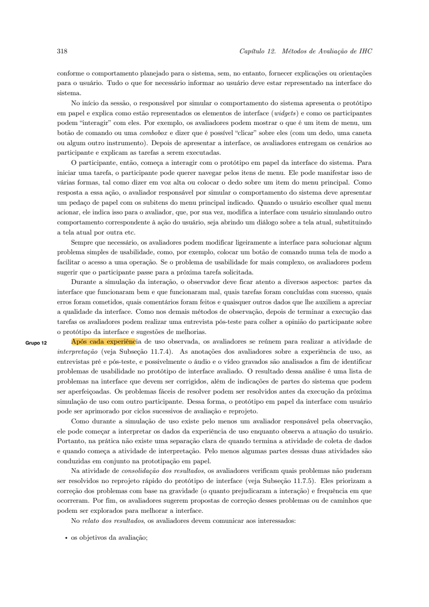

Responsável: Bruno Ferreira Dornelas — Complementos de ideias legislativas · Autor do item: Bruno Ferreira Dornelas

# Planejamento da avaliação do protótipo de papel

## Tabela de contribuição

A Tabela 1 registra as contribuições.

| Integrante / ferramenta | Contribuição | Artefato / atividade |
| --- | --- | --- |
| [Bruno Ferreira Dornelas](https://github.com/brunnf) | Definição do recorte e organização da avaliação | [Introdução](#introducao) |
| Codex (OpenAI) | Apoio à redação, ao protocolo e aos instrumentos | [Agradecimentos](#agradecimentos) |

Tabela 1 — Contribuições.

Fonte: elaboração do projeto (2026).

## Introdução

Este planejamento organiza um teste moderado da proposta de **sugerir e acompanhar complementos de ideias legislativas**, na perspectiva de quem sugere. Integra a Etapa 5; a execução e o relato pertencem à Etapa 6. Participante, equipe de coleta e datas ainda serão confirmados. O [planejamento do relato](planejamento-relato-prototipo-papel.md) define os registros e a análise.

## Contextualização

A referência é a persona [Letícia Oliveira](../../../entrega-2/individual/heitor/persona.md), com o cenário de atendimento noturno em bibliotecas comunitárias. O [storyboard](../../../entrega-4/individual/bruno/storyboard.md) e a [HTA/CTT](../../../entrega-4/individual/bruno/analise-tarefas.md) descrevem pesquisa, envio, ajuste, publicação e encaminhamento. As entrevistas com P01 foram realizadas e gravadas em 24/10/2026, após o ensaio individual de 23/10/2026. Os resultados estão consolidados nos [relatos do storyboard](relato-storyboard.md) e [das tarefas](relato-analise-tarefas.md). As [decisões para o papel](#decisoes-a-partir-das-entrevistas) orientam sua construção; o ensaio individual não exigiu ajustes.

Complementos separados, apoios próprios, negociação e anexos consultivos são hipóteses do projeto. O protótipo não representa funcionalidades implantadas do Senado. Autor, moderação e encaminhamento serão simulados como eventos externos, sem contas ou operações reais.

## Item de conteúdo da disciplina

**Autor do item:** Bruno Ferreira Dornelas.

O DECIDE articula objetivos, perguntas, método, prática, ética e análise ([1], seção 11.8, p. 279–280). Na prototipação em papel, uma pessoa simula o sistema e outra observa o uso ([2], seção 12.2.3). A Figura 1 reproduz essa orientação; modalidade remota, tarefas e duração abaixo são decisões do projeto.

??? note "Figura 1 — Operação e observação do protótipo"

    
    
Figura 1 — Coleta com protótipo de papel.

    
Fonte: capítulo Métodos de avaliação de IHC enviado ao projeto [2], p. 318 (página 38 do PDF).

## D — Determinar os objetivos

- **PP-O1:** identificar dificuldades para localizar, preparar, revisar e enviar uma contribuição preservando sua intenção.
- **PP-O2:** identificar problemas de compreensão das versões, responsabilidades, apoios separados e estados do acompanhamento.

Ambos detalham **identificar problemas na interação e interface**, um dos quatro objetivos da Tabela 11.1 ([1], p. 264–266). Interessam à equipe para corrigir o papel antes da implementação e às pessoas que sugerem complementos, para preservar sua intenção e compreender o andamento. Os outros três são analisar a apropriação da tecnologia, comparar ideias e alternativas de design e verificar a conformidade com um padrão. Não são objetivos deste teste: não há uso cotidiano, comparação entre alternativas ou inspeção de um padrão definido. Avaliar os quatro não é uma exigência do DECIDE.

## E — Explorar as perguntas

A Tabela 2 contém questões que **Bruno responderá após analisar os dados**. Não são perguntas para ler à participante antes das tarefas.

| ID | Questão de avaliação | Objetivo / evidência |
| --- | --- | --- |
| PP-Q1 | A pessoa encontra uma ideia pertinente e distingue complementar de criar outra ideia? | O1; PP-T1, percurso e justificativa |
| PP-Q2 | Consegue redigir, revisar e enviar a contribuição, reconhecendo a confirmação? | O1; PP-T2, ações, ajuda e retorno |
| PP-Q3 | Compara versões e decide sobre o ajuste preservando sua intenção? | O1/O2; PP-T3, decisão e justificativa |
| PP-Q4 | Distingue ações próprias, retorno do autor e moderação, reconhecendo quem pode agir durante as esperas? | O2; PP-T2–T4, interpretação dos estados e consultas sem atualização |
| PP-Q5 | Distingue ideia original, complemento e respectivos apoios? | O2; PP-T1/T4, leitura dos textos e apoios |
| PP-Q6 | Distingue publicação e encaminhamento, reconhece o término do acompanhamento proposto e interpreta o envio para análise sem confundi-lo com aprovação legislativa? | O2; PP-T4, interpretação antes e depois da atualização e consulta ao anexo |

Tabela 2 — Questões de avaliação.

Fonte: elaboração do projeto (2026), com base na Tabela 11.1 de [1], p. 266.

Correspondência com as perguntas do livro: **operar o sistema e atingir o objetivo** → PP-Q1–Q3; **entender o significado e a função dos elementos** → PP-Q4–Q6; **entender o que fazer em seguida** → PP-Q2/Q4. Erros, ajuda e dificuldades complementam essas respostas. Insatisfação será explorada nas perguntas pós-tarefa; eficiência temporal e motivação para explorar funcionalidades não serão medidas. As perguntas do livro são exemplos para operacionalizar objetivos, não um questionário obrigatório.

## C — Escolher os métodos

O teste moderado em papel permite observar execução e compreensão antes de implementar, com baixo custo de alteração. Pelo Google Meet, câmera fixa mostrará apenas o papel, sem espelhamento. A pessoa indicará controles e dados fictícios; o operador trocará as folhas conforme as escolhas. Um exercício neutro ensinará essa forma de interação.

Bruno operará o protótipo; **um segundo avaliador, a confirmar**, observará, conduzirá as perguntas e registrará intervenções. Confirmar esse papel antes da coleta. Luis Henrique é o revisor do documento; a função de observador da sessão será definida separadamente.

Não antecipar caminhos ou explicar controles durante a execução. Diante de bloqueio, perguntar “O que tentaria agora?”; se houver ajuda, registrá-la. Ausência de uma resposta preparada será anotada como lacuna do protótipo. Se a imagem ficar ilegível, interromper e ajustar; persistindo o problema, reagendar.

## I — Identificar e administrar questões práticas

### Participantes e materiais

Prever uma pessoa adulta com experiência ou interesse em participação coletiva e acesso digital, a recrutar. Verificar experiência, vínculo com o avaliador, dispositivo e acessibilidade. A eventual participação de P01 exige novo aceite para esta atividade; registrar exposição anterior ao storyboard e às tarefas. Um caso exploratório não representa todo o público.

Preparar folhas, cartões, câmera, suporte, áudio, enunciados, ficha de registro e TCLE. Usar recursos disponíveis; registrar eventuais custos. A Tabela 3 descreve o conjunto **a construir**, com ID e versão.

| Material | Conteúdo | Vínculo |
| --- | --- | --- |
| PP-S01 | Pesquisa, resultados, ideia e complementos | HTA 1.1–1.2; QD02–03 |
| PP-S02 | Entrada na conta simulada, texto e justificativa, prévia, edição e confirmação de envio | HTA 2.1–2.3; QD03–04 |
| PP-S03 | Retorno do autor, comparação e confirmação do ajuste | HTA 3.1–3.2; QD05–06 |
| PP-S04 | Publicação, texto acordado e apoios separados | HTA 4.1; QD07 |
| PP-S05 | Material encaminhado e anexos consultivos | HTA 4.2; QD08 |
| PP-X01 | Espera pelo autor, moderação e confirmação do encaminhamento | Condições externas do cenário |
| PP-X02 | Não concordar: manter decisão em aberto e registrar motivo | Hipótese de extensão; ramo ainda não detalhado na HTA/CTT |

Tabela 3 — Inventário previsto.

Fonte: elaboração do projeto (2026).

Construir as folhas com estas transições mínimas:

- PP-S01: pesquisar → resultados → abrir ideia → escolher complementar → PP-S02.
- PP-S02: entrada simulada → redação → prévia; editar → redação; enviar → confirmação/espera PP-X01.
- PP-X01: distinguir os cartões “Aguardando análise do autor”, “Aguardando moderação” e “Sem confirmação de encaminhamento”. Consultar sem atualização mantém o estado e identifica de quem depende o próximo evento; o retorno externo do autor leva a PP-S03 e a liberação externa da moderação leva a PP-S04.
- PP-S03: comparar → concordar → espera de moderação PP-X01; discordar → PP-X02, decisão em aberto. Não simular negociação posterior.
- PP-S04: abrir complemento → texto/autoria/apoios; atualização externa de encaminhamento → PP-S05 → consultar documento/anexo.

Identificar cada subestado nas folhas e fotografar a versão usada. PP-T4 inicia separadamente em PP-S04; não pressupõe que a pessoa concordou em PP-T3.

Em PP-S03, identificar quem escreveu cada texto e destacar a alteração “conforme a demanda da comunidade e as condições de cada biblioteca”. A intenção registrada em PP-T2 será a referência para interpretar a decisão da pessoa. Em PP-X02, informar que não houve concordância e que o complemento não seguiu para publicação; registrar o motivo, sem simular uma negociação ainda não definida.

Em PP-S04, apresentar a ideia original e o complemento como textos distintos, com autoria e contadores próprios: por exemplo, 12.400 apoios na ideia e 35 no complemento, identificados como dados fictícios. Em PP-S05, mostrar a ideia com 20.000 apoios e a confirmação simulada do encaminhamento à CDH, com o complemento identificado como anexo consultivo e seus 35 apoios preservados. O anexo não altera o texto original nem transfere seus apoios; o estado informa envio para análise, sem garantia de incorporação ou aprovação. Essas são regras do cenário proposto, não resultados das entrevistas.

### Tarefas, dados de teste e critérios de conclusão

Usar identidade fictícia, ideia “Incentivo às bibliotecas comunitárias” e sugestão “Atendimento noturno”. O ajuste será “Incentivar atendimento noturno conforme a demanda da comunidade e as condições de cada biblioteca”. Credenciais serão fictícias. Os critérios da Tabela 4 ficam com a equipe; apresentar somente um enunciado por vez.

| Tarefa e enunciado | Estado inicial | Critério observável |
| --- | --- | --- |
| PP-T1 — “Você quer contribuir para que pessoas ocupadas de dia possam usar bibliotecas à noite. Procure o que existe e decida como participar.” | PP-S01, sem autenticação | Localiza ideia pertinente, examina conteúdo e explica sua decisão sobre complementar |
| PP-T2 — “Apresente sua contribuição e confira o que acontece depois do envio.” | Ideia selecionada; PP-S02 | Redige texto e justificativa, revisa sua intenção, envia e reconhece que aguarda avaliação do autor, inclusive ao consultar novamente sem atualização |
| PP-T3 — “Chegou um retorno sobre sua contribuição. Examine-o e decida como prosseguir.” | PP-S03 com versões inicial e ajustada | Compara versões, justifica concordância ou discordância e reconhece o retorno correspondente; concordar não é obrigatório |
| PP-T4 — “Vamos iniciar uma situação independente. Consulte sua contribuição e descubra o que aconteceu e o que pode fazer agora.” | Reinício explícito em PP-S04; depois PP-S05 | Confere versão e autoria, distingue apoios e localiza anexo; reconhece publicação e encaminhamento sem concluir aprovação legislativa |

Tabela 4 — Tarefas e critérios.

Fonte: operacionalização do cenário pelo projeto (2026).

Se a pessoa preferir criar uma ideia em PP-T1, registrar percurso e motivo; a escolha não é erro por si só. Para PP-T2, anunciar um cenário independente com a ideia selecionada e a intenção de complementá-la, sem reclassificar PP-T1 como concluída. PP-T4 também usa estado preparado, inclusive após discordância em PP-T3; registrar os reinícios. Ao apresentar PP-S05, dizer apenas “Passou algum tempo; consulte a atualização”. Publicação, apoios e encaminhamento devem ser compreendidos pelas folhas, sem pistas do moderador. Excluir esperas fictícias do tempo de interação.

Em PP-T2, após o envio, pedir uma nova consulta sem atualizar o cartão. Em PP-T3, observar a resposta ao ajuste antes de oferecer explicações; se houver concordância, apresentar a espera de moderação e perguntar o que acontece agora. Se houver discordância, registrar o caminho PP-X02 e sua justificativa. O ramo não escolhido não será classificado como avaliado.

Executar PP-T4 em dois momentos. Primeiro, mostrar somente PP-S04, ainda sem confirmação de encaminhamento, e pedir que a pessoa explique o estado, os números apresentados e o que considera concluído ou ainda por acontecer. Registrar essa interpretação antes de apresentar PP-S05. Depois da atualização, solicitar a consulta ao material encaminhado e perguntar o que mudou e o que ela entende que ocorrerá em seguida. Registrar separadamente publicação, significado dos apoios, localização do anexo e interpretação do encaminhamento; localizar a página não comprova compreensão de todos esses elementos.

### Roteiro da sessão

Reservar até 50 minutos: 5 para consentimento e acesso, 5 para contexto e exercício neutro, 25 para tarefas, 10 para perguntas finais e 5 para encerramento/pausas. O piloto verificará a duração.

Na caracterização inicial, registrar experiência, vínculo com o avaliador e condições de acesso. Perguntar: “Conte uma situação em que quis sugerir uma mudança ou contribuir com uma proposta. Como fez e o que aconteceu?”. Esse contexto complementa as lacunas anteriores, sem substituir a observação das tarefas.

Aprofundar, uma pergunta por vez: “Como você acompanhou o que aconteceu?”, “O que dificultaria voltar para consultar uma resposta?” e “Que recursos costuma usar para participar?”. Registrar condições de acesso e necessidades de adaptação. O cenário da biblioteca permanece fictício; não será apresentado como necessidade comprovada de P01. Se P01 participar novamente, suas duas entrevistas anteriores serão tratadas como experiência prévia da mesma pessoa.

Abertura: “Estamos avaliando a proposta de interface. As folhas representam telas. Indique o que faria e use os dados fictícios. Você pode pedir uma pausa ou encerrar.”

Após cada tarefa: “O que esperava que acontecesse?”, “O que facilitou ou dificultou?”, “Algo incomodou você?”. No final: “O que esses elementos representam?”, “O que aconteceu e o que ainda falta?”, “Quem pode agir agora?”. Registrar respostas anteriores e posteriores a qualquer esclarecimento.

### Piloto e condições de início

Prever piloto com outra pessoa, sem envolvimento na elaboração, e os dois avaliadores. Ensaiar legibilidade, transições, roteiro, registros e análise; corrigir problemas antes da coleta principal ([1], p. 275–276). Descartar os dados do piloto da análise principal, conservando o registro dos ajustes de procedimento. O ensaio individual da Etapa 4 não substitui este piloto.

### Cronograma e registro de agendamento previsto

A Tabela 5 apresenta uma **agenda proposta, sem confirmação de disponibilidade**, em horário de Brasília. Bruno confirmará observador, participante principal e pessoa do piloto antes das sessões. O cronograma do projeto prevê a entrega da Etapa 6 em 03/11/2026.

| Atividade | Agenda / condição | Responsável |
| --- | --- | --- |
| Preparar papel, TCLE e fichas com as decisões dos relatos | 27/10, 19h–20h30 | Bruno |
| Confirmar participante, observador e pessoa do piloto | Até 27/10, 18h | Bruno |
| Piloto remoto | 28/10, 19h–19h50, Google Meet | Bruno, observador e pessoa do piloto |
| Ajustar materiais e procedimento após o piloto | 29/10, 19h–20h | Bruno e observador |
| Sessão principal | 30/10, 19h–19h50, Google Meet | Bruno, observador e participante |
| Análise dos registros e redação | 31/10, 14h–16h | Bruno e observador na análise; Bruno na redação |
| Revisão e fechamento do relato | 01/11, 14h–15h; ajustes até 02/11, 20h | Luis Henrique na revisão; Bruno nos ajustes |

Tabela 5 — Agenda proposta para a Etapa 6.

Fonte: planejamento do projeto (2026).

## D — Decidir como lidar com questões éticas

Antes da coleta, obter consentimento para participação, notas e registros opcionais. O TCLE terá contato, finalidade, acesso, prazo de exclusão até 30 dias após o encerramento da disciplina e condições de retirada. Áudio, transcrição e publicação de trechos ou vídeo exigem autorizações específicas; não exigir gravação facial.

Usar código PP-P01 e guardar identidade/consentimento separados dos dados, em pasta privada acessível aos avaliadores e revisor informados no termo. Publicar apenas sínteses desidentificadas autorizadas. A pessoa poderá recusar perguntas, pausar ou desistir sem prejuízo.

## E — Avaliar, interpretar e apresentar os dados

Responder PP-Q1–PP-Q6 com evidências localizáveis, conforme o [plano do relato](planejamento-relato-prototipo-papel.md). Classificar tarefas como concluída sem ajuda, concluída com ajuda, não concluída ou não avaliada. Separar dificuldade de interface, operação do papel, conexão e regra ainda indefinida.

Operador e observador interpretarão os registros em conjunto, preservando divergências. Relacionar achados anteriores → decisão de design → tela/tarefa → resultado observado. Priorizar por impacto e frequência observada, com número de ocorrências e oportunidades; repetições não são novos participantes. Não inferir eficiência real, aprendizagem ou representatividade deste caso. Correção sem novo teste permanecerá “não reavaliada”.

### Decisões a partir das entrevistas

A Tabela 6 relaciona os achados aos materiais a construir. As alterações são decisões de design ainda não testadas; os materiais apresentados em 24/10 permanecem preservados. Os IDs A01–A03 pertencem ao [relato do storyboard](relato-storyboard.md), e AT-A01–AT-A03 ao [relato das tarefas](relato-analise-tarefas.md).

| Origem | Decisão para o papel | Material / tarefa / questão |
| --- | --- | --- |
| A01: decisão da proponente pouco explícita na interpretação | Comparar texto enviado e ajuste do autor; oferecer concordância e discordância, sem escolher pela pessoa | PP-S03/PP-X02; PP-T3; PP-Q3/Q4 |
| AT-A01: publicação tomada como término; A02: apoios e desfecho não verificados | Separar “Publicado” de “Encaminhado para análise”; identificar apoios de cada texto e o complemento no anexo, sem sugerir aprovação legislativa | PP-S04/PP-S05; PP-T4; PP-Q5/Q6 |
| A03 e AT-A03: ordem ambígua no QD04, identificada na conferência documental | Explicitar a sequência proposta: autor → decisão da proponente → moderação → publicação; mostrar o responsável pela espera | PP-S02/PP-S03/PP-X01; PP-T2–T4; PP-Q2/Q4 |
| AT-A02: lacunas de contexto, responsabilidades e exceções | Registrar contexto inicial; consultar estados sem atualização, observar a decisão sobre o ajuste e separar respostas espontâneas das obtidas após ajuda | Caracterização, PP-X01/PP-X02; PP-T2–T4; PP-Q3/Q4/Q6 |

Tabela 6 — Rastreabilidade dos resultados para o protótipo de papel.

Fonte: relatos das entrevistas de 24/10/2026, consolidados em 25/10/2026.

## Agradecimentos

O Codex (OpenAI) apoiou a redação e a organização dos instrumentos. A responsabilidade acadêmica é de Bruno Ferreira Dornelas.

## Histórico de versão

| Versão | Data | Descrição | Autor(es) | Revisor(es) |
| --- | --- | --- | --- | --- |
| 1.0 | 24/10/2026 | Planejamento do protótipo de papel para complementos de ideias legislativas | [Bruno Ferreira Dornelas](https://github.com/brunnf) | [Luis Henrique Arruda Luna](https://github.com/Donnk61) |
| 1.1 | 25/10/2026 | Detalha tarefas, estados de espera, apoios e critérios de acompanhamento a partir dos relatos das entrevistas | [Bruno Ferreira Dornelas](https://github.com/brunnf) | [Luis Henrique Arruda Luna](https://github.com/Donnk61) |

## Referências

[1] **Planejamento da avaliação de IHC**. Capítulo 11 do material enviado, arquivo *Cap. Planejamento ihc-ux.pdf*. Seção 11.2 e Tabela 11.1, p. 264–266; preparação e piloto, p. 275–276; DECIDE, p. 279–280.

[2] **Métodos de avaliação de IHC**. Capítulo 12 do material enviado, arquivo *Cap Metodos de avaliacao de IHC.pdf*. Seção 12.2.3, prototipação em papel, p. 315–319.

As páginas citadas são as impressas nos capítulos enviados. Os recortes não incluem ficha bibliográfica para confirmar autoria, ano e edição; não se atribui esta paginação à edição de Barbosa e Silva (2010).

[3] GRUPO 06. **Complementos de ideias legislativas**. [Storyboard](../../../entrega-4/individual/bruno/storyboard.md) e [análise de tarefas](../../../entrega-4/individual/bruno/analise-tarefas.md). 2026.
