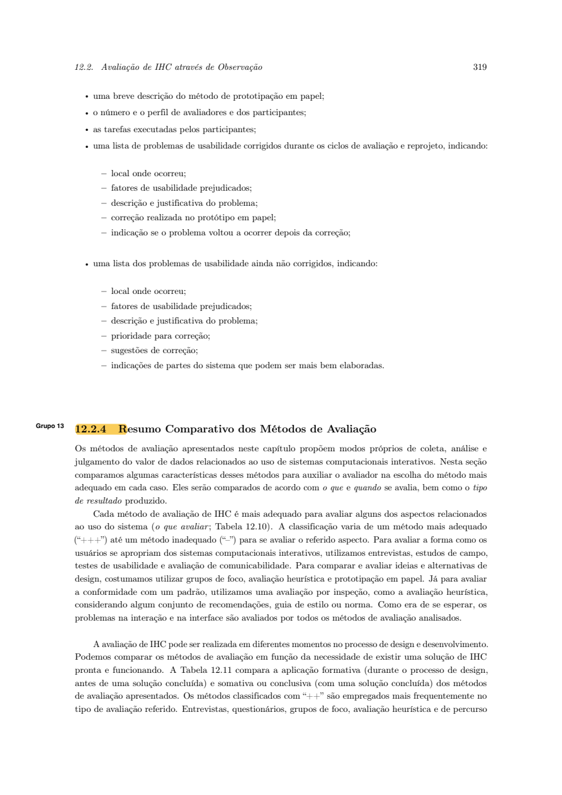

Responsável: Bruno Ferreira Dornelas — Complementos de ideias legislativas · Autor do item: Bruno Ferreira Dornelas

# Planejamento do relato da avaliação do protótipo de papel

## Tabela de contribuição

A Tabela 1 registra as contribuições.

| Integrante / ferramenta | Contribuição | Artefato / atividade |
| --- | --- | --- |
| [Bruno Ferreira Dornelas](https://github.com/brunnf) | Definição do recorte e organização da avaliação | [Introdução](#introducao) |
| Codex (OpenAI) | Apoio à redação, ao protocolo e aos instrumentos | [Agradecimentos](#agradecimentos) |

Tabela 1 — Contribuições.

Fonte: elaboração do projeto (2026).

## Introdução

Este documento define o relato futuro da avaliação de **complementos de ideias legislativas**, conforme o [plano da avaliação](planejamento-avaliacao-prototipo-papel.md). O planejamento integra a Etapa 5; o relato com dados reais pertence à Etapa 6. A coleta tem agenda proposta para 30/10/2026, sujeita à confirmação; os campos de resultado serão preenchidos somente após a sessão.

Bruno e o observador interpretarão os dados em conjunto; Bruno redigirá. Luis Henrique Arruda Luna é o revisor. Datas seguirão a [agenda da avaliação](planejamento-avaliacao-prototipo-papel.md#cronograma-e-registro-de-agendamento-previsto).

## Item de conteúdo da disciplina

**Autor do item:** Bruno Ferreira Dornelas.

O relato da prototipação em papel descreve objetivos, método, participantes, tarefas, problemas corrigidos e pendentes e partes a desenvolver ([2], p. 318–319). A análise conjunta considera gravidade, frequência, correções e recorrência. As Figuras 1–2 reproduzem essa orientação. O DECIDE orienta a interpretação e os limites das conclusões ([1], p. 280).

??? note "Figura 1 — Interpretação e consolidação"

    
    
Figura 1 — Interpretação e consolidação.

    
Fonte: capítulo Métodos de avaliação de IHC enviado ao projeto [2], p. 318 (página 38 do PDF).

??? note "Figura 2 — Conteúdo do relato"

    
    
Figura 2 — Correções, pendências e continuidade.

    
Fonte: capítulo Métodos de avaliação de IHC enviado ao projeto [2], p. 319 (página 39 do PDF).

## Estrutura prevista do relato

A Tabela 2 reúne o conteúdo a produzir após a coleta.

| Parte | Conteúdo |
| --- | --- |
| Objetivos e escopo | PP-O1/O2: identificar problemas de execução e compreensão; PP-Q1–PP-Q6, versão e limites |
| Método e execução | Data, duração, local, folhas e transições, operação, observação, ajuda e desvios; ajustes do piloto separados |
| Participantes e avaliadores | Quantidades, perfil, recrutamento, papéis efetivos e exposição anterior; códigos desidentificados |
| Tarefas e dados | PP-T1–PP-T4, estados iniciais, escolhas, resultados, reinícios e registros |
| Análise | Respostas às questões DECIDE com evidências, divergências e limites |
| Problemas e correções | Local, fatores, impacto, frequência, justificativa e prioridade; correções, pendências e recorrência |
| Continuidade | Alterações ou investigações, responsáveis, prazos e partes a desenvolver |

Tabela 2 — Estrutura do relato.

Fonte: adaptação de [1], p. 280, e [2], p. 318–319.

## Instrumentos para organizar os resultados

Preparar ficha privada de sessão: código, data/hora, consentimento, perfil, experiência anterior, avaliadores/papéis, modalidade, material/versão e duração. Guardar fotografias das folhas e mapa de transições apresentados.

Cada evidência **PP-EV01, PP-EV02…** conterá tarefa, tela/estado, questão PP-Q, localizador em nota ou gravação autorizada, ação, retorno, fala verificável ou paráfrase identificada, ajuda e interpretação separada. Registrar falhas da simulação e da conexão sem atribuí-las automaticamente à interface.

Registrar a pergunta ou explicação do avaliador e se ocorreu antes ou depois da resposta. Em PP-T2, conservar texto, justificativa e intenção declarada. Em PP-T3, registrar a diferença percebida entre os textos, a autoria atribuída a cada um, a decisão e o motivo. Nas esperas, registrar o responsável identificado, a próxima ação esperada e a reação à consulta sem atualização. Esses registros permitem examinar as lacunas das entrevistas sem repetir a condução baseada em explicações prévias.

### Registro das tarefas efetivamente executadas

A Tabela 3 será preenchida após a sessão. Classificar como concluída sem ajuda, concluída com ajuda, não concluída ou não avaliada, aplicando os critérios do plano.

| Tarefa | Estado / material efetivo | Resultado | Evidências, ajuda e desvios |
| --- | --- | --- | --- |
| PP-T1 — Localizar ideia e decidir como participar | | | |
| PP-T2 — Redigir, revisar e enviar | | | |
| PP-T3 — Examinar ajuste e decidir | | | |
| PP-T4 — Conferir publicação e encaminhamento | | | |

Tabela 3 — Registro das tarefas.

Fonte: instrumento do projeto (2026).

Preferir criar uma ideia em PP-T1 ou discordar em PP-T3 não é falhar por si só. Registrar justificativas e eventuais reinícios em PP-T2/PP-T4, sem reclassificar escolhas anteriores como sucesso ou erro. Espera fictícia entre estados não é tempo de desempenho.

Para PP-T4, registrar separadamente a interpretação de PP-S04 antes da atualização e a de PP-S05 depois dela. Anotar o que a pessoa considera concluído em cada momento, o significado atribuído aos dois contadores, a localização do complemento no anexo e o sentido do encaminhamento. Se apenas parte desses critérios for demonstrada, descrever quais foram atendidos; a tarefa completa só será considerada concluída quando todos os critérios previstos forem observados. Um ramo não percorrido ou uma pergunta não explorada permanecerá identificado como não avaliado.

### Respostas às perguntas de avaliação

Bruno preencherá a Tabela 4 após análise conjunta; sem evidência, registrará dados insuficientes. PP-Q1–Q3 operacionalizam executar e atingir objetivos; PP-Q4–Q6, compreender elementos e estados; PP-Q2/Q4 também verificam o próximo passo ([1], Tabela 11.1, p. 266). São respostas do avaliador, não falas exigidas da participante. O relato não afirmará cobrir os outros três objetivos do livro.

| Questão | Resposta analítica | Evidências | Limites / encaminhamento |
| --- | --- | --- | --- |
| PP-Q1 — Localizar ideia e decidir como participar (O1) | | | |
| PP-Q2 — Redigir, revisar, enviar e reconhecer o retorno (O1) | | | |
| PP-Q3 — Comparar textos e decidir preservando a intenção (O1/O2) | | | |
| PP-Q4 — Distinguir responsabilidades e esperas (O2) | | | |
| PP-Q5 — Distinguir textos e apoios próprios (O2) | | | |
| PP-Q6 — Distinguir publicação, encaminhamento e término do acompanhamento (O2) | | | |

Tabela 4 — Matriz de análise do DECIDE.

Fonte: instrumento do projeto (2026).

### Achados, correções e recorrência

As respostas relacionarão os resultados às questões completas do plano da avaliação, incluindo a distinção entre encaminhamento e aprovação legislativa em PP-Q6. Serão redigidas diretamente com a evidência e o alcance da interpretação, sem rótulos iniciais em negrito. A falta de observação será explicada em texto, sem completar campos com respostas esperadas.

Para cada **PP-A01, PP-A02…**, registrar: tarefa/tela, fator afetado, descrição, impacto, frequência (ocorrências/oportunidades observadas), evidências, justificativa, prioridade, proposta, responsável e prazo. Distinguir problema de interface, limitação do papel, dificuldade técnica, regra indefinida e sugestão.

Prioridades do projeto: **alta**, se impede atividade essencial ou compromete intenção, autoria ou interpretação; **média**, se provoca ajuda, retrabalho ou ambiguidade relevante; **baixa**, se tem impacto limitado. Ordenar problemas de impacto semelhante pela frequência observada; um problema grave isolado continua prioritário. Não generalizar a frequência de uma pessoa para o público.

Manter duas listas:
- **Corrigidos:** mudança concreta, imagens/versões, data e estado “não reavaliado”, “reavaliado, não observado nessa condição” ou “recorrente”, com evidência.
- **Pendentes:** localização, fator afetado, descrição, justificativa, prioridade, sugestão, responsável e impedimento.

Guardar a versão efetivamente avaliada para sustentar os achados, independentemente da tabela de histórico documental. Não declarar correção validada apenas porque o desenho mudou.

## Procedimento de interpretação e consolidação

1. Conferir autorizações, materiais e registros; desidentificar dados e separar o piloto.
2. Classificar tarefas, preservando falhas, abandonos, ajuda e motivos de não avaliação.
3. Operador e observador confrontam registros e respondem PP-Q1–PP-Q6, distinguindo observação, opinião e divergências de interpretação.
4. Consolidar impacto e frequência, sem contar repetições de uma pessoa como novos participantes.
5. Usar a [matriz de decisões anteriores](planejamento-avaliacao-prototipo-papel.md#decisoes-a-partir-das-entrevistas): registrar o ID do achado de origem, a mudança efetivamente construída, a folha/tarefa e a evidência do papel. Lacuna da entrevista não equivale a problema confirmado; ausência de repetição sem teste equivalente não significa correção validada.
6. Priorizar mudanças e revisar com Luis Henrique; registrar eventual novo teste sem apagar a primeira observação.

A comparação com as entrevistas contemplará quatro pontos: decisão sobre ajustes (A01), apoios e encaminhamento (A02 e AT-A01), ordem entre autor e moderação (A03 e AT-A03) e contexto, esperas e alternativas (AT-A02). Para cada ponto, registrar origem, decisão, material efetivamente testado, nova evidência e encaminhamento. A incompreensão do término indicada em AT-A01 será distinguida dos aspectos que não chegaram a ser investigados. A divergência de ordem é documental e exige conferir as folhas construídas; não será atribuída à participante.

Respostas obtidas após explicação serão analisadas separadamente das interpretações anteriores à ajuda. Se a participante for P01, explicitar a exposição prévia; as entrevistas e o teste não serão contados como três participantes nem como confirmações independentes. O relato de contexto orientará novas hipóteses, sem demonstrar adoção cotidiana, aumento de apoios ou necessidade real de atendimento noturno nas bibliotecas.

## Apresentação e limites das conclusões

Apresentar síntese, tarefas, respostas analíticas e achados com localizadores verificáveis. Registros brutos, identidade e TCLE ficam privados, conforme o [protocolo ético](planejamento-avaliacao-prototipo-papel.md#d-decidir-como-lidar-com-questoes-eticas).

Discutir limites de um caso, exposição prévia, mediação remota, operação do papel e passagem fictícia do tempo. Não concluir sobre desempenho real, aprovação institucional, autenticação ou acessibilidade técnica. Ausência de problema observado não comprova ausência de problemas.

## Responsabilidades e cronograma do relato

Preparar fichas antes do piloto e corrigir o procedimento antes da coleta principal. Após a sessão, Bruno e observador analisam; Bruno redige e Luis Henrique revisa antes da Etapa 6, prevista para 03/11/2026. A agenda proposta reserva 31/10 para análise e redação, 01/11 para revisão e 02/11 para ajustes; a disponibilidade será confirmada na [agenda comum](planejamento-avaliacao-prototipo-papel.md#cronograma-e-registro-de-agendamento-previsto).

## Agradecimentos

O Codex (OpenAI) apoiou a redação e a organização dos instrumentos. A responsabilidade acadêmica é de Bruno Ferreira Dornelas.

## Histórico de versão

| Versão | Data | Descrição | Autor(es) | Revisor(es) |
| --- | --- | --- | --- | --- |
| 1.0 | 24/10/2026 | Planejamento do protótipo de papel para complementos de ideias legislativas | [Bruno Ferreira Dornelas](https://github.com/brunnf) | [Luis Henrique Arruda Luna](https://github.com/Donnk61) |
| 1.1 | 25/10/2026 | Alinha registros, critérios de conclusão e interpretação aos achados das entrevistas e às tarefas do papel | [Bruno Ferreira Dornelas](https://github.com/brunnf) | — |

## Referências

[1] **Planejamento da avaliação de IHC**. Capítulo 11 do material enviado, arquivo *Cap. Planejamento ihc-ux.pdf*. Objetivos e perguntas, p. 264–266; DECIDE, p. 279–280.

[2] **Métodos de avaliação de IHC**. Capítulo 12 do material enviado, arquivo *Cap Metodos de avaliacao de IHC.pdf*. Seção 12.2.3, prototipação em papel, p. 315–319; interpretação, consolidação e relato, p. 318–319.

As páginas citadas são as impressas nos capítulos enviados. Os recortes não incluem ficha bibliográfica para confirmar autoria, ano e edição; não se atribui esta paginação à edição de Barbosa e Silva (2010).

[3] GRUPO 06. **Complementos de ideias legislativas**. [Storyboard](../../../entrega-4/individual/bruno/storyboard.md) e [análise de tarefas](../../../entrega-4/individual/bruno/analise-tarefas.md). 2026.
