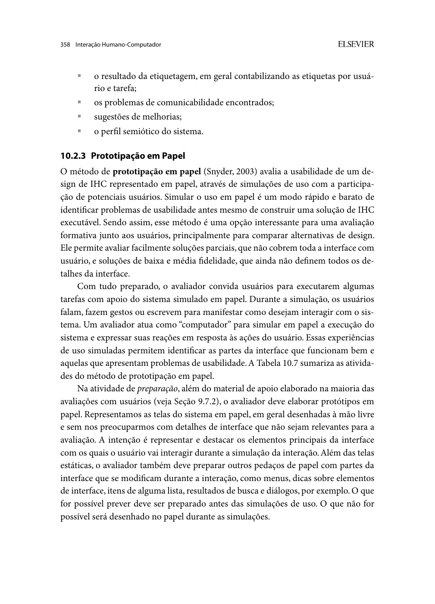
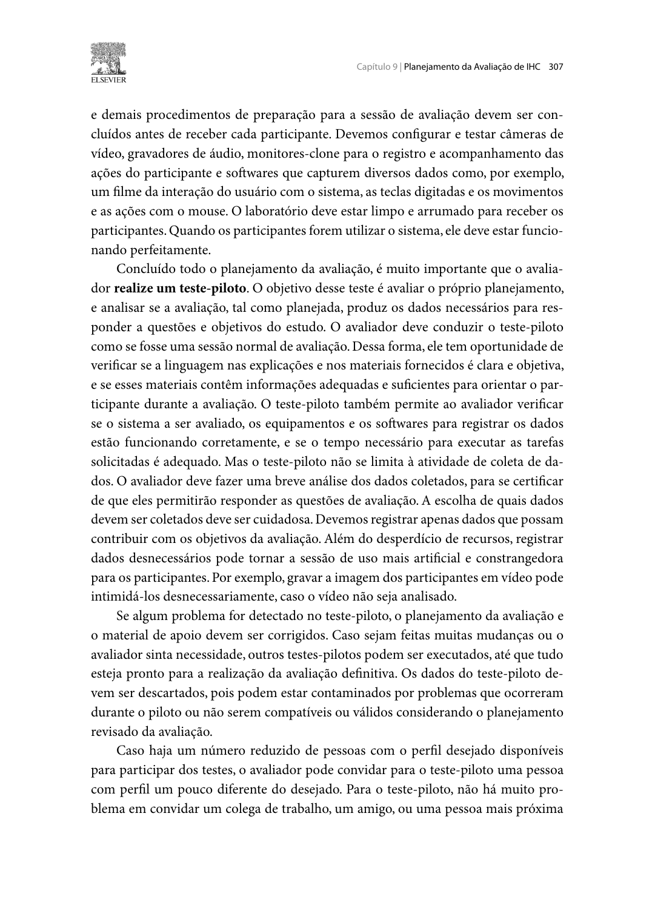

Responsável: Caio Breno de Souza Bezerra — Proponente de ideia legislativa · Autor do item: Caio Breno de Souza Bezerra

# Planejamento da avaliação do protótipo de papel — Ideia legislativa

## Tabela de contribuição

A Tabela 1 identifica as contribuições neste artefato.

| Integrante | Contribuição | Artefato / atividade |
| --- | --- | --- |
| [Caio Breno de Souza Bezerra](https://github.com/CaioBezerra-Dev) | Definição do protocolo DECIDE e das tarefas de avaliação | [Conteúdo](#contextualizacao) |
| Codex (OpenAI) | Apoio à consulta das fontes, redação e organização documental | [Agradecimentos](#agradecimentos) |

Tabela 1 — Contribuições neste artefato.

Fonte: elaboração para o Grupo 06 (2026).

## Introdução

Este documento planeja a avaliação formativa de uma proposta de interface para **enviar e acompanhar uma ideia legislativa**, com entrada pelo portal do Senado. É um reprojeto da experiência existente, orientado por RP01–RP04 do [storyboard](../../../entrega-4/caio/storyboard.md). A Etapa 5 entrega o planejamento; a execução e o relato do papel pertencem à **Etapa 6, em 03/11/2026**.

## Contextualização

A proposta parte do [perfil Proponente](../../../entrega-2/individual/caio/perfil-2/perfil-usuario.md), da persona Camila e da HTA/CTT documental. Os [relatos do storyboard](relato-storyboard.md) e da [análise de tarefas](relato-analise-tarefas.md) reúnem perguntas, respostas e recomendações para o reprojeto. Os registros serão conferidos com as gravações. As recomendações orientam hipóteses a experimentar no protótipo.

O e-Cidadania já integra os serviços do Senado. “No próprio site do Senado” significa continuidade de navegação, identificação institucional e retorno ao percurso após autenticar. As telas de revisão, identificação de recebimento e acompanhamento deste plano são propostas de interface. Não serão usadas contas reais, textos de propostas reais ou submissão ao serviço.

## Item de conteúdo da disciplina

**Autor do item:** Caio Breno de Souza Bezerra.

Barbosa e Silva (2010, seção 10.2.3, p. 358–362) descrevem a prototipação em papel como avaliação do design pela interação com uma interface representada em folhas. Uma pessoa simula as respostas do sistema; outra observa as ações. O material inclui telas e elementos móveis preparados antes da sessão. Pequenas correções podem ser testadas em ciclos sucessivos, preservando o registro das versões. As Figuras 1–2 do [Apêndice A](#apendice-a-fundamentacao) apresentam o método e os papéis. O DECIDE (p. 312–313) organiza o planejamento abaixo.

## D — Determinar os objetivos

**Objetivo geral:** verificar se a interface proposta permite encontrar o serviço, revisar a ideia antes do envio, reconhecer o recebimento e compreender o acompanhamento.

- **PP-O1:** examinar a descoberta do percurso e a continuidade após autenticação.
- **PP-O2:** investigar prevenção de conteúdo inadequado e recuperação antes da confirmação definitiva.
- **PP-O3:** examinar a distinção entre envio, recebimento, avaliação, publicação e aprovação de lei.
- **PP-O4:** identificar problemas de linguagem e navegação para orientar o próximo protótipo.

## E — Explorar as perguntas

A Tabela 2 operacionaliza os objetivos e a ligação com as hipóteses anteriores.

| ID | Pergunta de avaliação | Tarefa / origem | Evidência necessária |
| --- | --- | --- | --- |
| PP-Q1 | A pessoa encontra o envio de ideia pelo portal e entende a transição de acesso? | PP-T1; RP01; SB-P02 | Percurso escolhido, expectativa e ajuda solicitada |
| PP-Q2 | A revisão permite perceber e retirar dado pessoal antes de confirmar? | PP-T2; RP03; SB-P03 / AT-P01 | Dado removido, texto conferido e retorno à revisão |
| PP-Q3 | A confirmação comunica recebimento sem sugerir publicação ou lei aprovada? | PP-T3; RP02; SB-P01 / AT-P02 | Explicação da mensagem, identificação e próximo passo |
| PP-Q4 | O acompanhamento distingue os estados e evita repetir envio incerto? | PP-T4; RP04; SB-P04 / AT-P04 | Estado localizado e decisão sobre o que fazer |
| PP-Q5 | Que termos, informações ou controles precisam mudar? | Todas; PP-O4 | Comentários associados a tela, ação e consequência |

Tabela 2 — Objetivos, perguntas e evidências da avaliação.

Fonte: elaboração para o Grupo 06 (2026).

## C — Escolher os métodos

Será usada **prototipação em papel com execução de tarefas e entrevista pós-tarefa**. O participante indica onde tocaria, fala o que espera e escreve os dados fictícios. O operador troca as folhas de acordo com a escolha; a pessoa observadora registra comportamento, dificuldades e intervenções. O método examina o uso da proposta, não apenas a opinião sobre um desenho.

Modalidade proposta: **remota síncrona**, com câmera superior mostrando as folhas e áudio bidirecional. A adaptação remota é uma decisão operacional do projeto: o participante indicará o controle por seu rótulo ou posição e o operador registrará o texto ditado. O piloto deve demonstrar legibilidade e controle da interação. Se isso não for viável, reagendar em modalidade presencial, com local e consentimento atualizados. Não substituir a execução por uma entrevista sem registrar a mudança de método.

## I — Identificar e administrar questões práticas

### Pessoas, recrutamento e papéis

Prevê-se **uma pessoa adulta com interesse em propor uma melhoria**, além de **uma pessoa diferente para o piloto**. É um estudo exploratório individual, com escopo e recursos limitados; não há pretensão de representatividade. Registrar experiência com o serviço, familiaridade digital, necessidades de leitura e exposição anterior aos materiais. Convidar voluntariamente por indicação de contatos acadêmicos ou comunitários, sem seleção por posicionamento político. Identidade e contato ficam privados.

A Tabela 3 define a equipe mínima. Para o papel, uma pessoa participante e Caio, sozinhos, não cobrem a separação de papéis indicada na p. 360 do livro.

| Papel | Responsabilidade | Pessoa / situação |
| --- | --- | --- |
| Operador e moderador | Apresentar enunciados, simular respostas nas folhas e conduzir entrevista | Caio Breno de Souza Bezerra |
| Observador | Registrar ações, erros, ajuda, mudanças de tela e falhas da simulação | Segundo integrante do grupo, a confirmar antes do piloto |
| Pessoa participante | Executar tarefas usando os dados fictícios | PAP-P01, a recrutar; não é um avaliador |
| Pessoa do piloto | Ensaiar procedimento e instrumentos | PP-PAP01, diferente de PAP-P01 |
| Revisor do relato | Conferir rastreabilidade, análise e limites | [Bruno Ferreira Dornelas](https://github.com/brunnf) |

Tabela 3 — Papéis previstos para a avaliação em papel.

Fonte: elaboração para o Grupo 06 (2026).

### Materiais e estados

A Tabela 4 é a especificação para desenhar as folhas. Não é um protótipo já produzido. Usar papel, canetas, cartões móveis, suporte de câmera, computador, conexão, áudio, roteiro e ficha. Recursos próprios; orçamento adicional previsto de R$ 0, a rever se houver compra ou impressão. Seguir rótulos, contraste e feedback do guia de estilo, com legibilidade priorizada no esboço.

| ID | Folha / cartão a preparar | Relação |
| --- | --- | --- |
| PP-S01 | Portal do Senado com entrada “Enviar ideia legislativa” | RP01; HTA 1.1; QD02 |
| PP-S02 | Orientações e aviso de autenticação; cartão “acesso realizado” sem credenciais | HTA 1.1 e 3.1; QD03 |
| PP-S03 | Formulário com título, descrição, ajuda e “Revisar ideia” | HTA 3.2; QD04 |
| PP-S04 | Revisão do texto completo, aviso de dado pessoal, “Voltar e corrigir” e “Confirmar envio” | RP03; HTA 2.1–2.3 e 3.3 |
| PP-S05 | Recebimento: título, identificador DEMO-001, data fictícia, estado “Recebida”, próximo passo e acesso ao acompanhamento | RP02; QD05; novo critério de conclusão |
| PP-S06 | Acompanhamento: recebida → em avaliação → publicada ou arquivada, com explicações | RP04; HTA 4.1–4.2; QD06 |
| PP-X01 | Variante “Não foi possível confirmar o recebimento. Consulte o estado antes de tentar novamente” | Retorno incerto; AT-Q6 |
| PP-X02 | Variante “Publicada para receber apoios”, com aviso de que isso não equivale a lei aprovada | Passagem de tempo e interpretação de estado |

Tabela 4 — Inventário do protótipo a construir.

Fonte: elaboração para o Grupo 06 (2026).

Identificador, data e estados são **dados do protótipo**, sem valor oficial. “Em avaliação” é um rótulo de reprojeto, não uma tela autenticada comprovada. A moderação é representada por mudança fictícia de contexto e não será apresentada como instantânea. Autenticação é apenas um cartão: nunca solicitar senha ou CPF.

### Tarefas e critérios de conclusão

A Tabela 5 separa enunciados dados à pessoa dos critérios usados pelos avaliadores. Para a avaliação efetiva do papel, não fornecer o caminho correto nem respostas para decorar: o uso deve permitir descobrir problemas da proposta.

| ID / enunciado | Estado e dados fictícios | Critério observável, reservado à equipe |
| --- | --- | --- |
| PP-T1 — “Você quer encaminhar uma ideia ao Senado. Mostre por onde começaria e como continuaria até o espaço de escrever.” | PP-S01→PP-S03; acesso por cartão | Encontra o serviço, identifica o vínculo com o Senado e retoma o preenchimento após o acesso |
| PP-T2 — “Confira o rascunho preparado e deixe a ideia pronta para envio. Prossiga quando considerar adequado.” | PP-S03: título “Orientações claras nos serviços”; descrição “Explicar documentos e etapas em linguagem simples. Contato: [telefone fictício]” | Identifica o contato desnecessário, corrige, confere o texto em PP-S04 e confirma uma vez; nenhuma informação pessoal inadequada é efetivada |
| PP-T3 — “Você acabou de confirmar. Explique o que aconteceu e o que faria em seguida.” | Início independente em PP-S05, mesmo se PP-T2 não tiver sido concluída | Identifica recebimento e referência DEMO-001, aponta o próximo passo e distingue recebida de publicada ou lei aprovada |
| PP-T4 — “O retorno ficou incerto. Mostre como verificaria a situação. Mais tarde, consulte a atualização apresentada e explique o estado.” | Primeiro PP-X01 e PP-S06 com recebimento; depois, anunciar passagem de tempo e apresentar PP-X02 | Procura o estado sem nova submissão automática; reconhece publicação para apoios como etapa posterior, sem prometer aprovação |

Tabela 5 — Tarefas, estados e critérios de conclusão.

Fonte: elaboração para o Grupo 06 (2026).

PP-T3 e PP-T4 têm estados iniciais preparados para que uma falha anterior não impeça discutir o retorno. Registrar cada reinício. Se a pessoa confirmar com o contato indevido, marcar a falha de prevenção em PP-T2; depois fornecer um estado seguro para prosseguir, sem transformar esse auxílio em sucesso autônomo.

### Roteiro e instrumentos

Reservar **50 minutos**: consentimento e caracterização (8), exercício neutro com as folhas (5), PP-T1–PP-T4 (25), entrevista final (7) e fechamento/pausas (5). Exercício neutro: escolher um item de uma lista sem relação com envio de ideia. Explicar como apontar e ditar texto; não antecipar rótulos nem critérios das tarefas reais.

Instrução: “Estas folhas representam uma proposta de interface. Indique o que faria e o que espera que aconteça. Vou trocar o papel conforme suas escolhas. Estamos avaliando o material. Você pode discordar, parar ou pedir uma pausa.”

Após cada tarefa, perguntar “O que aconteceu?”, “O que ficou pouco claro?” e, opcionalmente, a pergunta de satisfação M6 da Etapa 3, de 1 a 5, com justificativa. Ao encerrar: “O que mudaria para conseguir enviar e acompanhar sua ideia?”. Registrar a fala literal somente quando conferível.

### Piloto e agenda proposta

O piloto verifica legibilidade, enquadramento, trocas, enunciados, consentimento, duração e possibilidade de analisar as fichas (BARBOSA; SILVA, 2010, p. 307–308). Realizar com outra pessoa, corrigir o procedimento antes da coleta e manter seus dados fora dos resultados principais. A Tabela 6 propõe datas, sem declarar confirmações.

| Atividade | Data / horário propostos, Brasília | Produto / condição |
| --- | --- | --- |
| Preparar e revisar planos para a Etapa 5 | 22–24/10; revisão em 24/10, 14h–17h | Quatro artefatos conferidos para 25/10 |
| Desenhar folhas e confirmar equipe/participantes | 26–27/10, horário a combinar | Material versionado, dois avaliadores e consentimentos |
| Piloto PP-PAP01 | 28/10, 18h30–19h20 | Procedimento e análise de registro ensaiados |
| Ajustes e nova conferência | 29/10, 18h30–19h30 | Versão fixada; repetir piloto se a mudança for extensa |
| Sessão PAP-P01 | 30/10, 18h30–19h20 | Tarefas observadas e registradas |
| Interpretação e consolidação | 31/10, 14h–16h | Evidências e problemas priorizados |
| Revisão do relato | 01–02/11, horário a combinar | Relato da Etapa 6; entrega em 03/11 |

Tabela 6 — Agenda proposta para a avaliação e o relato do papel.

Fonte: elaboração para o Grupo 06 (2026).

Antes de iniciar: confirmar segundo avaliador, participante distinto do piloto, autorizações, materiais legíveis, estados preparados e fichas. Se essas condições não forem atendidas, reagendar; a tabela não é prova de execução.

## D — Decidir como lidar com questões éticas

Seguir os [aspectos éticos do projeto](../../../entrega-2/etica.md) e Barbosa e Silva (2010, p. 138–142): participação voluntária, possibilidade de recusar perguntas, pausa e retirada sem prejuízo. Usar apenas os exemplos fictícios, sem discutir preferência política ou coletar documentos e credenciais.

O consentimento deve distinguir participação, gravação de voz, imagem quando houver e disponibilização do vídeo para a disciplina. Um vídeo “não listado” pode ser acessado por quem possui o link; informar essa condição antes de autorizar. Priorizar folhas e voz, sem rosto quando desnecessário. Guardar TCLE, contato, arquivo bruto e chave de identificação em pasta privada, fora do site. Publicar apenas material autorizado e desidentificado.

Caio será o responsável pelos registros. Proposta de retenção: excluir os arquivos brutos e a chave até 30 dias após o encerramento da disciplina; definir a data exata e um contato real no TCLE antes da sessão. Atender retirada enquanto os dados forem identificáveis e explicar limites após divulgação.

## E — Avaliar, interpretar e apresentar os dados

Para cada tarefa, registrar versão, tela, ação, resultado, ajuda, erro, comentário e localizador. Classificar **concluída sem ajuda**, **concluída com ajuda**, **não concluída** ou **não executada**, preservando o motivo. Falha da câmera, troca errada de folha e orientação do operador são problemas da condução; não imputar automaticamente à interface.

As metas M0 (eficácia), M2 (prevenção), M3 (recuperação) e M6 (satisfação, se respondida) terão registros exploratórios. Com uma pessoa, apresentar casos e denominadores, sem declarar as metas populacionais cumpridas. M1 não terá duas tentativas equivalentes; M4 não terá retorno após sete dias; M5 não terá comparação controlada com o portal. Esses indicadores ficam **não avaliados** neste protocolo, sem inferir eficiência pelo tempo de troca das folhas.

Priorizar pela consequência para a tarefa e pela recorrência realmente observada. Corrigir problemas simples entre ciclos, anotando versão, motivo e se houve novo teste. Usar “não retestado” quando faltar execução posterior. O [planejamento do relato](planejamento-relato-prototipo-papel.md) contém os formulários e a estrutura de consolidação. A análise deverá considerar exposição prévia aos materiais, tamanho da amostra e adaptação remota como limites.

## Apêndice A — Fundamentação

As Figuras 1–2 apresentam as páginas do livro usadas para o método e a separação dos papéis. A Figura 3 apresenta a definição do piloto.

??? note "Figura 1 — Prototipação em papel"

    
    
Figura 1 — Definição e preparação da prototipação em papel.

    
Fonte: Barbosa e Silva (2010, p. 358).

??? note "Figura 2 — Operação do sistema e observação"

    
    
Figura 2 — Papéis e coleta de dados na avaliação em papel.

    
Fonte: Barbosa e Silva (2010, p. 360).

??? note "Figura 3 — Teste-piloto"

    
    
Figura 3 — Finalidade do teste-piloto.

    
Fonte: Barbosa e Silva (2010, p. 307).

## Agradecimentos

O Codex (OpenAI) apoiou a consulta bibliográfica, a redação e a organização deste artefato. Caio Breno de Souza Bezerra responde pelo conteúdo. A revisão humana desta versão é de responsabilidade de [Bruno Ferreira Dornelas](https://github.com/brunnf).

## Histórico de versão

| Versão | Data | Descrição | Autor(es) | Revisor(es) |
| :---: | :---: | --- | --- | --- |
| `0.1` | 22/10/2026 | Planejamento DECIDE, tarefas, papéis, agenda e critérios para a avaliação do papel | [Caio Breno de Souza Bezerra](https://github.com/CaioBezerra-Dev) | [Bruno Ferreira Dornelas](https://github.com/brunnf) |
| `0.2` | 22/10/2026 | Simplifica títulos, rótulos e avisos; concentra o procedimento nos relatos e preserva os campos de conferência | [Caio Breno de Souza Bezerra](https://github.com/CaioBezerra-Dev) | [Bruno Ferreira Dornelas](https://github.com/brunnf) |

## Referências

[1] BARBOSA, Simone Diniz Junqueira; SILVA, Bruno Santana da. *Interação humano-computador*. Rio de Janeiro: Elsevier, 2010. p. 29–32, 105–106, 307–313, 358–362.

[2] SALES, André Barros de. *Plano de Ensino FIHC 022026 — Turma 01*, v1. FCTE/UnB, 2026. Cronograma das Etapas 5–6.

[3] GRUPO 06. [Metas de usabilidade](../../../entrega-3/metas-usabilidade.md); [guia de estilo](../../../entrega-3/guia-de-estilo.md); [storyboard de Camila](../../../entrega-4/caio/storyboard.md). 2026.

[4] SENADO FEDERAL. [Como funciona a Ideia Legislativa](https://www12.senado.leg.br/ecidadania/comofuncionaideia). Acesso em: 22 out. 2026.
