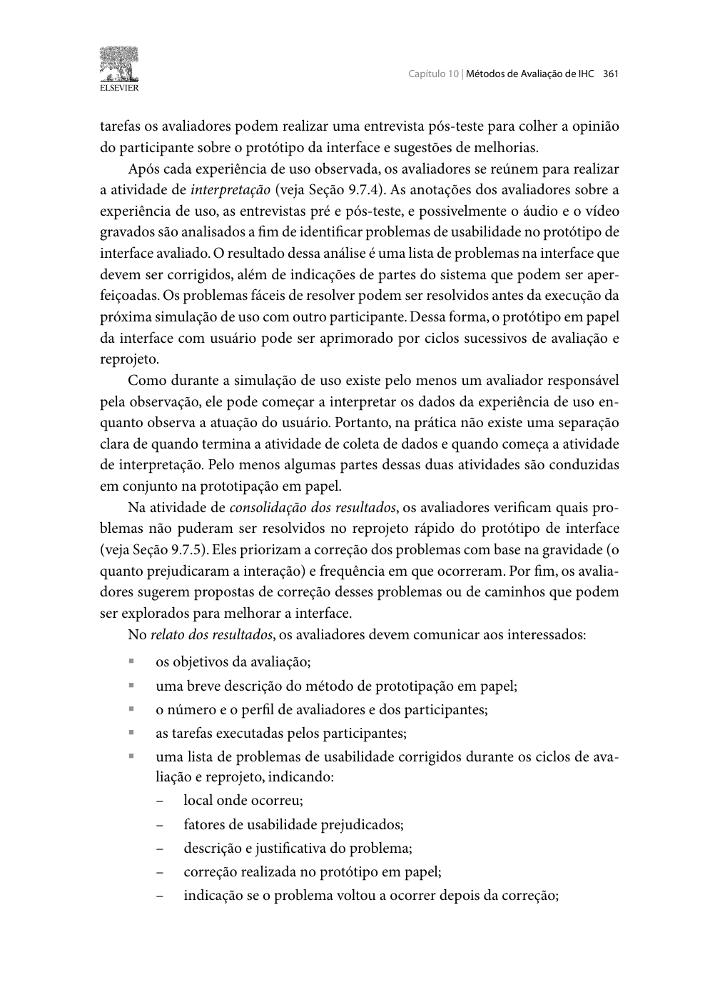
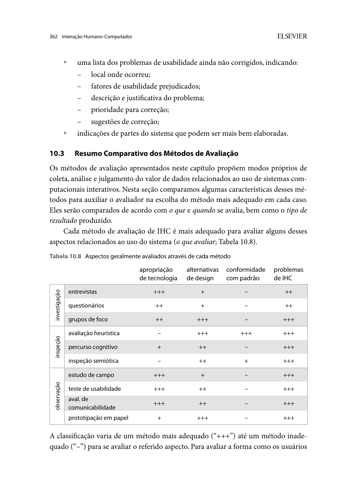

Responsável: Heitor Pinheiro Gonçalves das Chagas — Participação em Evento Interativo (e-Cidadania) · Autor do item: Heitor Pinheiro Gonçalves das Chagas

# Planejamento do relato dos resultados do protótipo de papel

## Tabela de contribuição

A Tabela 1 registra as contribuições neste artefato.

| Integrante / ferramenta | Contribuição | Artefato / atividade |
| --- | --- | --- |
| [Heitor Pinheiro Gonçalves das Chagas](https://github.com/Heitorovski01) | Estrutura do relato, fichas de registro, critérios de prioridade e controle de ciclos | [Conteúdo](#estrutura-do-relato) |
| Antigravity (IA generativa) | Apoio à organização das tabelas e à redação | [Agradecimentos](#agradecimentos) |

Tabela 1 — Contribuições neste artefato.

Fonte: elaboração para o Grupo 06 (2026).

## Introdução

Este documento define como serão organizados e apresentados os resultados da avaliação do protótipo de papel planejada no [planejamento da avaliação](planejamento-avaliacao-prototipo-papel.md). O relato será publicado na **Etapa 6 (03/11/2026)**.

**Situação em 24/10/2026:** este é apenas o **planejamento** do relato. Nenhuma sessão com o protótipo de papel foi realizada, e as fichas abaixo não contêm dados.

## Fundamentação

**Autor do item:** Heitor Pinheiro Gonçalves das Chagas.

Barbosa e Silva (2010, p. 361–362) orientam que o relato de uma avaliação por prototipação em papel apresente os problemas encontrados. Para os problemas **corrigidos** entre sessões, o relato informa a correção feita e se o problema voltou a ocorrer. Para os problemas **não corrigidos**, informa a prioridade e uma sugestão de solução. O relato também retoma objetivos, método, participantes e tarefas (p. 311–313). As Figuras 1 e 2 reproduzem esses trechos.

## Estrutura do relato

O relato da Etapa 6 terá as seções da Tabela 2.

| Nº | Seção | Conteúdo |
| :---: | --- | --- |
| 1 | Introdução e objetivos | Objetivos PP-O1–PP-O5 e escopo; vínculo com os relatos da Etapa 5 |
| 2 | Método de prototipação em papel | Breve descrição do método, versão do protótipo avaliada e fotos das folhas |
| 3 | Avaliadores e participantes | Facilitador/"computador", observador, número e perfil das participantes (códigos), datas, duração e local |
| 4 | Tarefas executadas | T1–T4, com estado inicial e critério de conclusão |
| 5 | Resultados por tarefa | Ficha de execução (Tabela 3) consolidada |
| 6 | Problemas encontrados | Ficha de problemas (Tabela 4), com prioridade e situação |
| 7 | Respostas às perguntas | PP-Q1–PP-Q6, cada uma com as evidências que a sustentam |
| 8 | Correções e ciclos | O que mudou entre sessões e se o problema voltou a ocorrer |
| 9 | Limitações | Amostra pequena, simulação manual e diferenças em relação ao sistema real |
| 10 | Encaminhamentos | Decisões para o protótipo de alta fidelidade (Etapa 7) |
| 11 | Gravações e anexos | Vídeos não listados autorizados, com localizadores; TCLEs guardados fora do repositório |

Tabela 2 — Estrutura prevista do relato.

Fonte: elaboração do autor (2026), com base em Barbosa e Silva (2010, p. 311–313, 361–362).

## Preparação e controle dos registros

- Cada sessão recebe um código (PP-H01 a PP-H03), com data, hora de início e fim, versão do protótipo e responsáveis;
- O piloto (PP-PILOTO-H01) fica em registro separado e **não entra** nas tabelas do relato;
- O observador anota em ficha impressa e indica o minuto da gravação de cada evento importante;
- As anotações são passadas a limpo no mesmo dia, com a fala literal entre aspas e a interpretação em coluna separada.

## Ficha de execução por tarefa

A Tabela 3 é o modelo a preencher para cada participante e tarefa.

| Sessão | Tarefa | Conclusão | Tempo aprox. | Erros / desvios | Ajuda dada | Fala relevante | Localizador |
| :---: | :---: | :---: | :---: | --- | --- | --- | :---: |
| PP-H0x | T1–T4 | Sem ajuda / Com ajuda / Não concluiu | mm:ss | | | | mm:ss |

Tabela 3 — Modelo da ficha de execução por tarefa.

Fonte: elaboração do autor (2026).

**Falhas da simulação** (por exemplo, folha errada mostrada pelo "computador") são marcadas à parte e não contam como problema da interface.

## Ficha de problemas e controle de ciclos

A Tabela 4 é o modelo de registro dos problemas.

| ID | Tela / tarefa | Descrição do problema | Consequência | Princípio ou meta afetada | Sessões em que ocorreu | Prioridade | Situação | Correção feita | Voltou a ocorrer? |
| :---: | :---: | --- | --- | --- | :---: | :---: | :---: | --- | :---: |
| PPP-01 | PP-S0x / Tx | | | | | Alta / Média / Baixa | Corrigido / Pendente | | Sim / Não / Não retestado |

Tabela 4 — Modelo da ficha de problemas e ciclos de correção.

Fonte: elaboração do autor (2026), com base em Barbosa e Silva (2010, p. 361–362).

Uma correção feita depois da última sessão é registrada como **"não retestado"**. Ela não é chamada de validada.

### Critérios de prioridade

| Prioridade | Critério |
| :---: | --- |
| Alta | Impede concluir a tarefa ou faz a pergunta ir para o destino errado (ex.: enviar como comentário) |
| Média | A tarefa é concluída, mas com ajuda, erro recuperado ou hesitação longa |
| Baixa | Incômodo ou dúvida de vocabulário que não afeta a conclusão |

Tabela 5 — Critérios de prioridade dos problemas.

Fonte: elaboração do autor (2026).

## Consolidação e respostas às perguntas

| Pergunta | Resposta | Evidências (sessão, tarefa, localizador) | Grau de confiança |
| :---: | --- | --- | :---: |
| PP-Q1 … PP-Q6 | A preencher na Etapa 6 | | Observado em todas / em parte / em nenhuma das sessões |

Tabela 6 — Modelo de consolidação por pergunta.

Fonte: elaboração do autor (2026).

As conclusões ficam limitadas ao que foi observado com 2 a 3 pessoas em papel. Os requisitos que não foram testados continuam como hipóteses para o protótipo de alta fidelidade.

## Agradecimentos

O Antigravity (IA generativa) apoiou a organização das tabelas e a redação. A responsabilidade pelo conteúdo é de Heitor Pinheiro Gonçalves das Chagas.

## Histórico de versão

| Versão | Data | Descrição | Autor(es) | Revisor(es) |
| :---: | :---: | --- | --- | --- |
| `0.1` | 24/10/2026 | Estrutura do relato, fichas de execução e de problemas, prioridades e controle de ciclos | [Heitor Pinheiro Gonçalves das Chagas](https://github.com/Heitorovski01) | A solicitar |

## Referências

[1] BARBOSA, Simone Diniz Junqueira; SILVA, Bruno Santana da. *Interação humano-computador*. Rio de Janeiro: Elsevier, 2010. p. 311–313, 358–362.

[2] SALES, André Barros de. *Plano de Ensino FIHC 022026 — Turma 01*, v1. Brasília: FCTE/UnB, 2026.

## Apêndice A — Trechos do livro

??? note "Figura 1 — Problemas corrigidos e recorrência (Barbosa e Silva, 2010, p. 361)"
    
    
Figura 1 — Correções e recorrência.

    
Fonte: Barbosa e Silva (2010, p. 361).

??? note "Figura 2 — Problemas pendentes (Barbosa e Silva, 2010, p. 362)"
    
    
Figura 2 — Problemas pendentes e prioridades.

    
Fonte: Barbosa e Silva (2010, p. 362).

