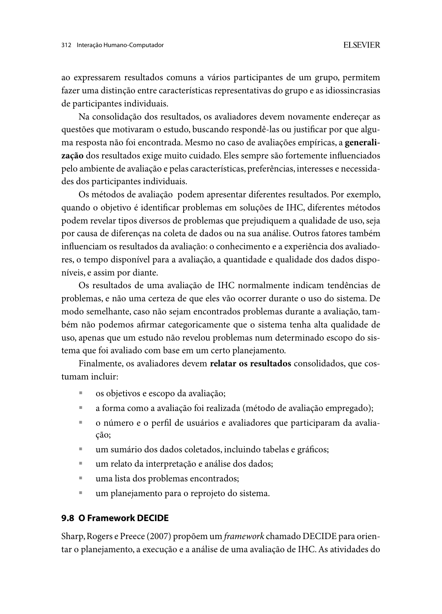

Responsável: Heitor Pinheiro Gonçalves das Chagas — Participação em Evento Interativo (e-Cidadania) · Autor do item: Heitor Pinheiro Gonçalves das Chagas

# Relato da avaliação do storyboard — Letícia Oliveira

<!--
  ESTRUTURA PARA PREENCHIMENTO COM DADOS REAIS.
  Todo campo marcado "A preencher" deve receber APENAS o que aconteceu na sessão
  (fala literal, anotação ou observação). Não inventar respostas.
  Apague este comentário quando o relato estiver completo.
-->

## Tabela de contribuição

A Tabela 1 registra as contribuições neste artefato.

| Integrante / ferramenta | Contribuição | Artefato / atividade |
| --- | --- | --- |
| [Heitor Pinheiro Gonçalves das Chagas](https://github.com/Heitorovski01) | Condução das sessões, registro das respostas, análise e encaminhamentos | [Conteúdo](#metodo-pessoas-e-registro) |
| Antigravity (IA generativa) | Apoio à estrutura do relato e à organização das tabelas | [Agradecimentos](#agradecimentos) |

Tabela 1 — Contribuições neste artefato.

Fonte: elaboração para o Grupo 06 (2026).

## Introdução

Este artefato relata a avaliação formativa do [storyboard de Letícia Oliveira](../../../entrega-4/individual/heitor/storyboard.md), conforme o [planejamento da avaliação](../../../entrega-4/individual/heitor/planejamento-avaliacao-storyboard.md) e o [planejamento do relato](../../../entrega-4/individual/heitor/planejamento-relato-storyboard.md) da Etapa 4. O storyboard narra uma cidadã que acompanha uma audiência pública da CRA sobre o PL 1215/2025 e precisa enviar uma pergunta técnica ao relator pelo módulo Eventos Interativos do e-Cidadania.

**Versão avaliada:** A preencher (ex.: storyboard manual 1.1, quadros QD01–QD06).

## Objetivos e escopo

- **SB-O1 — Compreensão da jornada:** a participante entende a motivação, a ordem das ações e a urgência do envio?
- **SB-O2 — Verossimilhança da barreira:** o receio de que a pergunta se perca na caixa única (QD03) corresponde à experiência real?
- **SB-O3 — Proposta de reprojeto e ação coletiva:** a seleção de "Pergunta a Orador" e do destinatário (QD04) e a orientação ao grupo (QD05) fazem sentido?

A avaliação discute a narrativa e a proposta conceitual. Ela não mede desempenho em um sistema real.

## Método, pessoas e registro

O método foi a **leitura guiada do storyboard com entrevista semiestruturada** (BARBOSA; SILVA, 2010, p. 145–149, 301).

| Campo | Registro |
| --- | --- |
| Avaliador | [Heitor Pinheiro Gonçalves das Chagas](https://github.com/Heitorovski01) |
| Observador | A preencher (ou "não houve") |
| Participantes | A preencher (códigos P1…, perfil resumido, relação com a persona) |
| Data, horário e duração | A preencher (por sessão) |
| Local / modalidade | A preencher |
| Material apresentado | A preencher (impresso, tela, versão) |
| TCLE e autorização de gravação | A preencher (assinado? gravação autorizada? áudio ou vídeo?) |
| Teste piloto | A preencher (data e participante). Os dados do piloto não entram neste relato |
| Desvios do plano | A preencher (ex.: mudança de horário, número de participantes, ordem das perguntas) |

Tabela 2 — Protocolo e metadados das sessões.

Fonte: registros das sessões (2026).

## Perguntas e respostas por quadro

As perguntas seguem o roteiro da Etapa 4 (P01, P06–P09 e SB-Q1–SB-Q5). Respostas literais vão entre aspas. Paráfrases são indicadas como tal.

| ID | Quadro | Pergunta | Resposta P1 | Resposta P2 | Resposta P3 | Localizador |
| :---: | :---: | --- | --- | --- | --- | :---: |
| P01 | — | Você costuma acompanhar audiências públicas ou enviar perguntas a parlamentares e palestrantes? | A preencher | | | |
| P06 | QD01 | A situação de urgência e mobilização durante uma audiência ao vivo é coerente com sua rotina? (Concordo totalmente / Parcialmente / Discordo) | A preencher | | | |
| SB-Q2 | QD02 | A navegação em "Eventos Interativos" e o filtro para achar a audiência estão claros? | A preencher | | | |
| P07 | QD03 | Você já sentiu receio de que sua pergunta técnica fosse ignorada por falta de direcionamento à mesa? | A preencher | | | |
| P08 | QD04 | Escolher "Pergunta a Orador" e o relator em uma lista tornaria o envio mais confiável? | A preencher | | | |
| P09 | QD05 | Você já precisou avisar colegas sobre a forma correta de enviar manifestações em eventos públicos? (Sim/Não + exemplo) | A preencher | | | |
| SB-Q1 | QD06 | O desfecho da história é verossímil? O objetivo de Letícia foi atingido? | A preencher | | | |

Tabela 3 — Perguntas e respostas por quadro.

Fonte: transcrição/anotações das sessões (2026).

## Análise por quadro

| Quadro | Confirmado | Contestado | Sugerido pela participante | Interpretação da equipe |
| :---: | --- | --- | --- | --- |
| QD01 | A preencher | | | |
| QD02 | | | | |
| QD03 | | | | |
| QD04 | | | | |
| QD05 | | | | |
| QD06 | | | | |

Tabela 4 — Síntese por quadro, separando dado e interpretação.

Fonte: análise do autor sobre os registros (2026).

## Problemas e encaminhamentos para o protótipo de papel

| ID | Quadro / pergunta | Problema ou achado | Prioridade | Decisão para o protótipo de papel | Hipótese |
| :---: | :---: | --- | :---: | --- | :---: |
| SB-R01 | A preencher | | Alta / Média / Baixa | Ex.: manter, ajustar ou descartar a tela PP-S0x | RP01–RP04 |

Tabela 5 — Achados, prioridades e destino no reprojeto.

Fonte: análise do autor (2026).

As decisões desta tabela devem ser levadas à Tabela 8 do [planejamento da avaliação do protótipo de papel](planejamento-avaliacao-prototipo-papel.md#rastreabilidade-relatos-hipoteses-e-telas).

## Limitações

A preencher. Considere: número de participantes, recrutamento por conveniência, participante que já conhecia o projeto, leitura de imagem sem interação real e influência do avaliador.

## Gravação

A preencher. Indique o link do vídeo não listado, ou registre que a gravação não foi autorizada e que o relato se baseia em anotações.

## Agradecimentos

O Antigravity (IA generativa) apoiou a estrutura do relato e a organização das tabelas. As respostas registradas vêm exclusivamente das sessões conduzidas por Heitor Pinheiro Gonçalves das Chagas, que responde pelo conteúdo.

## Histórico de versão

| Versão | Data | Descrição | Autor(es) | Revisor(es) |
| :---: | :---: | --- | --- | --- |
| `0.1` | 24/10/2026 | Estrutura do relato vinculada ao roteiro da Etapa 4 | [Heitor Pinheiro Gonçalves das Chagas](https://github.com/Heitorovski01) | A solicitar |

## Referências

[1] BARBOSA, Simone Diniz Junqueira; SILVA, Bruno Santana da. *Interação humano-computador*. Rio de Janeiro: Elsevier, 2010. p. 145–149, 294, 301, 311–313.

[2] SALES, André Barros de. *Plano de Ensino FIHC 022026 — Turma 01*, v1. Brasília: FCTE/UnB, 2026.

[3] GRUPO 06. [Storyboard de Letícia Oliveira](../../../entrega-4/individual/heitor/storyboard.md) e [planejamento da avaliação](../../../entrega-4/individual/heitor/planejamento-avaliacao-storyboard.md). 2026.

## Apêndice A — Trecho do livro

??? note "Figura 1 — Consolidação e relato (Barbosa e Silva, 2010, p. 312)"
    
    
Figura 1 — Estrutura e alcance do relato.

    
Fonte: Barbosa e Silva (2010, p. 312).

