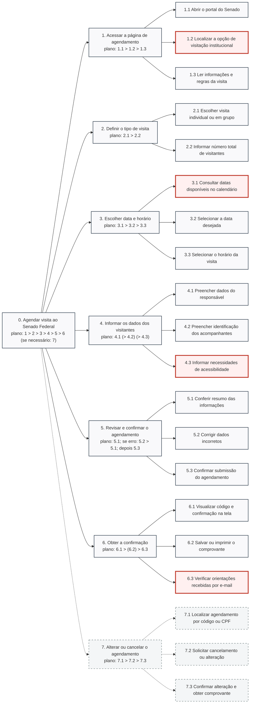

Responsável: Israel Soares de Paiva — Agendamento de visita ao Senado · Autor do item: Israel Soares de Paiva

# Relato da avaliação da análise de tarefas — Marta Oliveira

## Tabela de contribuição

A Tabela 1 identifica as contribuições neste artefato.

| Integrante | Contribuição | Artefato / atividade |
| --- | --- | --- |
| [Israel Soares de Paiva](https://github.com/IsraelSoares-25) | Preparação da discussão dos modelos, condução da sessão, conferência técnica e matriz de rastreabilidade | [Conteúdo](#objetivos-e-escopo) |
| Google Gemini | Apoio na estruturação das tabelas e formatação Markdown | [Agradecimentos](#agradecimentos) |
| [Bruno Ferreira Dornelas](https://github.com/brunnf) | Revisão técnica da notação de HTA/CTT e conformidade com a Etapa 5 | [Introdução](#introducao) |

Tabela 1 — Contribuições neste artefato.

Fonte: elaboração para o Grupo 06 (2026).

## Introdução

Este artefato apresenta o relato da avaliação da Análise de Tarefas para a funcionalidade de **Agendamento de visita ao Senado Federal**, em conformidade com o [Planejamento da avaliação](../../../entrega-4/individual/israel/planejamento-avaliacao-analise-tarefas.md) e o [Planejamento do relato dos resultados](../../../entrega-4/individual/israel/planejamento-relato-resultados-analise-tarefas.md). A avaliação toma como base os modelos conceituais estruturados na [Análise de Tarefas (HTA e CTT versão 2.0)](../../../entrega-2/individual/israel/analise-tarefas.md), protagonizados pela persona [Marta Oliveira](../../../entrega-2/individual/israel/persona.md).

O documento consolida a validação empírica da decomposição de tarefas por meio de *walkthrough* cognitivo com uma cidadã no perfil de uso, a conferência técnica documental (CT01–CT06) realizada pela equipe à luz da literatura de IHC, os registros da gravação audiovisual e a derivação de requisitos formais de reprojeto (**AT-P01 a AT-P05**) para o [Planejamento do protótipo de papel](planejamento-avaliacao-prototipo-papel.md).

## Objetivos e escopo

A avaliação objetivou:

1. **AT-O1 — Cobertura e decomposição hierárquica:** verificar se a decomposição do objetivo `0. Agendar visita ao Senado Federal` em seus 7 ramos e 17 subtarefas reflete adequadamente a prática real do cidadão;
2. **AT-O2 — Realismo e restrições dos planos:** avaliar se os planos formais (sequência `>`, seleção `/`, paralelismo `+` e iteração `*`) espelham com precisão as decisões e caminhos alternativos do usuário;
3. **AT-O3 — Detecção de omissões e exceções:** identificar operações ausentes, termos excessivamente burocráticos ou gargalos cognitivos na seleção de datas, dados de acompanhantes e regras de acesso;
4. **AT-O4 — Conferência técnica de notação:** atestar a conformidade técnica da modelagem com as normas consagradas de IHC (BARBOSA; SILVA, 2010; PATERNÒ, 2000; ANNETT; DUNCAN, 1967).

A atividade investigou a modelagem conceitual do trabalho do usuário, servindo como alicerce estrutural para o design das telas físicas no protótipo em papel.

## Método, pessoas e material

A Tabela 2 descreve os aspectos metodológicos e metadados da sessão de avaliação. O procedimento combinou o relato espontâneo inicial da participante com uma inspeção guiada (*walkthrough*) dos blocos da HTA e da CTT traduzidos para linguagem natural, preservando a conferência técnica sob responsabilidade da equipe (BARBOSA; SILVA, 2010, p. 191–195).

| Campo | Registro |
| --- | --- |
| Procedimento | Relato espontâneo prévio da tarefa seguido de *walkthrough* dos blocos de operações e conferência técnica |
| Blocos em linguagem comum | Acessar e ler regras → Definir tipo e quantidade → Escolher data/horário → Preencher dados e acessibilidade → Revisar e confirmar → Obter comprovante → Alterar/cancelar |
| Moderador | [Israel Soares de Paiva](https://github.com/IsraelSoares-25) |
| Código da sessão | `AT-PART01` |
| Pessoa participante | Uma cidadã alinhada ao perfil de Marta Oliveira (com demanda de agendamento presencial cívico) |
| Observador | Integrante do Grupo 06 |
| Revisor | [Bruno Ferreira Dornelas](https://github.com/brunnf) |
| Modalidade e ambiente | Presencial na residência da participante, com gravação de áudio e tela autorizadas |
| Materiais de apoio | Diagrama HTA (`flowchart LR`), tabela de operações com input/feedback, especificação CTT e roteiro |
| Cuidados éticos | TCLE lido e assinado previamente ([TCLE assinado](../../../assets/docs/tcle/tcle-israel-assinado.pdf)); dados pessoais preservados sob código |
| Sessão piloto | Realizada com `PP-PILOTO01` para calibrar o tempo de explicação dos blocos |
| Sequência | Realizada em sequência imediata ao [relato do storyboard](relato-storyboard.md) no mesmo encontro |

Tabela 2 — Método e metadados da avaliação da análise de tarefas.

Fonte: elaboração para o Grupo 06 (2026).

## Discussão dos modelos em linguagem comum

A Tabela 3 reúne o roteiro de perguntas aplicado à participante — dividido em momento prévio (ANTES), avaliação central da decomposição do HTA e consolidação pós-apresentação (DEPOIS) — acompanhado da síntese das respostas obtidas e localizadores na gravação.

| Bloco | ID | Pergunta do entrevistador | Síntese da resposta da participante | Localizador no vídeo |
| :---: | :---: | --- | --- | :---: |
| **ANTES** | **ANT-01** | Conte como você faria para agendar uma visita a um lugar como o Senado Federal, do início ao fim. | *"Eu entraria no site pelo computador, procuraria a opção de visitação, veria quais dias e horários têm vaga aberta, preencheria meus dados e os dados de quem vai comigo e esperaria receber um comprovante por e-mail para levar no dia."* | `00:25–00:58` |
| **ANTES** | **ANT-02** | O que você precisaria saber ou ter em mãos antes de agendar? | *"Precisaria saber a data em que o grupo pode ir, o documento de identificação (CPF) meu e dos acompanhantes, e principalmente as regras de roupa permitida e horários de entrada para não ter problemas na portaria."* | `01:00–01:32` |
| **AVALIAÇÃO HTA** | **HTA-01** | As tarefas e subtarefas do modelo correspondem ao que o cidadão realmente faz para agendar uma visita? | *"Sim, correspondem perfeitamente. A divisão entre ver regras, escolher o tipo de visita, selecionar dia/horário no calendário, colocar os dados, revisar e pegar o comprovante é exatamente o percurso real."* | `01:35–02:18` |
| **AVALIAÇÃO HTA** | **HTA-02** | A ordem das tarefas e as condições descritas nos planos são realistas? | *"A ordem é muito realista. Primeiro você precisa saber se é individual ou grupo para que o sistema mostre as vagas certas. E ter a revisão antes de confirmar evita enviar dados errados."* | `02:20–02:55` |
| **AVALIAÇÃO HTA** | **HTA-03** | Existem tarefas importantes que não aparecem no modelo? | *"Acho que o modelo está bem completo. Sugiro apenas reforçar a checagem das regras de vestimenta antes mesmo de escolher a data, para o visitante já estar ciente logo de início."* | `02:58–03:30` |
| **AVALIAÇÃO HTA** | **HTA-04** | As situações de erro e de exceção foram consideradas? | *"Sim, vi que o modelo prevê o que fazer quando não tem vaga no dia (voltar e escolher outra data) e também prevê corrigir dados na revisão e a opção de alterar ou cancelar depois."* | `03:32–04:08` |
| **AVALIAÇÃO HTA** | **HTA-05** | O nível de detalhamento do HTA é adequado e compreensível? | *"Está no nível ideal. Não fica detalhando clique por clique que cansa, mas mostra com clareza cada decisão importante que a gente precisa tomar."* | `04:10–04:42` |
| **DEPOIS** | **DEP-01** | Você realiza essa tarefa dessa forma? | *"Sim, é exatamente a forma como eu realizaria se fosse agendar uma visita com a minha família ou com colegas de trabalho."* | `04:45–05:15` |
| **DEPOIS** | **DEP-02** | Existe alguma etapa faltando, desnecessária ou fora de ordem? | *"Não achei nenhuma desnecessária. Todas as etapas têm uma razão clara de existir e estão na sequência natural."* | `05:18–05:45` |
| **DEPOIS** | **DEP-03** | O que você faria se a data ou o horário que deseja não estivessem disponíveis? | *"Eu voltaria para o calendário para olhar outro dia que tivesse horário livre, de preferência em outro fim de semana ou num horário próximo que atendesse a todos."* | `05:48–06:22` |
| **DEPOIS** | **DEP-04** | O que você faria se precisasse alterar ou cancelar o agendamento? | *"Eu procuraria no site uma opção de 'consultar/alterar agendamento' e colocaria o código que recebi no comprovante ou meu CPF para mudar a data ou cancelar a vaga."* | `06:25–07:02` |
| **DEPOIS** | **DEP-05** | Algum termo ou etapa do modelo ficou difícil de entender? | *"Não, todos os termos usados na explicação estão em linguagem simples e clara, sem burocracia ou jargões do Congresso."* | `07:05–07:35` |

Tabela 3 — Discussão dos modelos de tarefas com a participante.

Fonte: elaboração para o Grupo 06 (2026).

## Diagrama HTA avaliado

O diagrama abaixo apresenta a estrutura hierárquica completa do HTA versão 2.0 utilizado durante a avaliação. A disposição horizontal facilita a visualização dos ramos e planos de cada nível.

Figura 1 — Diagrama HTA do Agendamento de Visita ao Senado Federal.

Fonte: elaboração do autor (2026), com base em Barbosa e Silva (2010, p. 193–195). Nós em vermelho indicam pontos críticos de usabilidade; nós tracejados indicam fluxo alternativo sob demanda.

## Conferência técnica dos modelos (CT01–CT06)

A Tabela 4 documenta a conferência técnica interna realizada pela equipe de avaliadores para atestar a conformidade com as normas metodológicas de IHC (BARBOSA; SILVA, 2010; PATERNÒ, 2000).

| Critério | Evidência na modelagem (v2.0) | Avaliação técnica da equipe |
| --- | --- | --- |
| **CT01 — Hierarquia e planos HTA** | Objetivo raiz 0, 7 tarefas principais, 17 subtarefas e planos explícitos em cada nível | **Conforme.** A árvore cobre o fluxo completo e os planos estabelecem sequências (`>`), condicionais e retornos em caso de lotação. |
| **CT02 — Input, operação e feedback** | Tabela 4 da HTA especificando *input*, ação e *feedback* perceptível por linha | **Conforme.** Cada operação possui gatilho disparador e retorno observável pelo usuário ou emitido pelo sistema. |
| **CT03 — Tipos de tarefas na CTT** | Classificação em tarefas de usuário, interação, aplicação (sistema) e abstratas | **Conforme.** Tabela 6 da CTT distingue claramente tarefas cognitivas da usuária e processamentos internos do servidor. |
| **CT04 — Operadores temporais da CTT** | Uso dos operadores `>>`, `[]>>`, `[]` e `[>` na notação textual e diagrama | **Conforme.** Relações de passagem de informação (`[]>>`) e interrupção sob demanda (`[>`) modeladas formalmente. |
| **CT05 — Coerência com Storyboard e Cenário** | Mapeamento direto entre as 7 cenas do Storyboard e os ramos 1 a 6 da HTA | **Conforme.** Rastreabilidade total com a narrativa de Marta Oliveira e os quadros visuais. |
| **CT06 — Tratamento de exceções** | Ramo 7 dedicado a alteração/cancelamento e retornos no plano 3 em caso de vagas lotadas | **Conforme.** O modelo não trata apenas o percurso ideal (*happy path*), prevendo exceções reais de uso. |

Tabela 4 — Conferência técnica dos modelos HTA e CTT.

Fonte: elaboração para o Grupo 06 (2026), com base em Barbosa e Silva (2010).

## Síntese e encaminhamentos para o protótipo de papel

A Tabela 5 consolida as diretrizes técnicas derivadas da avaliação dos modelos para implementação no [Protótipo de papel](planejamento-avaliacao-prototipo-papel.md).

| ID | Base na HTA / CTT | Proposta de design para o papel | Condição observável de sucesso | Prioridade |
| :---: | --- | --- | --- | :---: |
| **AT-P01** | HTA 1.3 / CTT ConsultarRegras | Destacar regras de trajes e documentação em card visual antes da seleção de calendário | Usuário lê e comenta sobre as regras antes de avançar | Alta |
| **AT-P02** | HTA 3.1–3.3 / CTT EscolherDataEHorario | Calendário interativo com legenda de disponibilidade evidente por cores | Usuário identifica imediatamente dias com vagas sem precisar clicar em dias esgotados | Alta |
| **AT-P03** | HTA 4.3 / CTT InformarAcessibilidade | Seção explícita de acessibilidade com opções de mobilidade reduzida e Libras | Usuário localiza e marca suporte especializado de forma intuitiva | Média |
| **AT-P04** | HTA 5.1–5.3 / CTT RevisarEConfirmar | Tela de resumo com opção de edição por módulo sem perda de estado | Usuário corrige dado pontual com retorno seguro para a tela de revisão | Alta |
| **AT-P05** | HTA 6.1–6.3 / CTT ObterConfirmacao | Emissão imediata de código localizador e botão destacado de download do comprovante em PDF | Usuário declara verbalmente que a tarefa foi finalizada com sucesso ao visualizar o código | Alta |

Tabela 5 — Propostas de reprojeto derivadas da análise de tarefas.

Fonte: elaboração para o Grupo 06 (2026).

## Rastreabilidade e interligação entre entregas

A modelagem de tarefas desempenha papel integrador crucial na engenharia de usabilidade. A Tabela 6 demonstra a rastreabilidade bidirecional dos modelos avaliados em relação aos artefatos de todas as etapas do projeto.

| Etapa | Artefato interligado | Papel na construção e validação da HTA/CTT |
| :---: | --- | --- |
| **Etapa 2** | [Entrevista e observação](../../../entrega-2/individual/israel/entrevista-observacao.md) | Coleta empírica dos hábitos de busca e barreiras no portal do Senado |
| **Etapa 2** | [Persona — Marta Oliveira](../../../entrega-2/individual/israel/persona.md) | Definição dos objetivos práticos e competências que fundamentaram as operações de usuário |
| **Etapa 2** | [Cenário de interação](../../../entrega-2/individual/israel/cenario.md) | Situação concreta de uso que serviu de especificação para os planos da HTA |
| **Etapa 2** | [Análise de Tarefas v2.0](../../../entrega-2/individual/israel/analise-tarefas.md) | Objeto central avaliado neste relato (decomposição formal HTA e modelo CTT) |
| **Etapa 2** | [Aspectos Éticos](../../../entrega-2/etica.md) | Salvaguardas éticas e [TCLE assinado](../../../assets/docs/tcle/tcle-israel-assinado.pdf) aplicado na sessão |
| **Etapa 3** | [Princípios gerais do projeto](../../../entrega-3/principios-gerais.md) | Princípios de autoria de Israel: visibilidade de estado, prevenção de erros e simplicidade |
| **Etapa 3** | [Metas de usabilidade](../../../entrega-3/metas-usabilidade.md) | Metas de segurança e eficácia aplicadas aos critérios de sucesso das subtarefas |
| **Etapa 3** | [Guia de estilo](../../../entrega-3/guia-de-estilo.md) | Diretrizes para construção dos feedbacks de sistema nas operações de interação |
| **Etapa 4** | [Planejamento da avaliação da HTA](../../../entrega-4/individual/israel/planejamento-avaliacao-analise-tarefas.md) | Protocolo DECIDE, roteiro com as 12 perguntas (Antes, HTA e Depois) e critérios do piloto |
| **Etapa 4** | [Planejamento do relato da HTA](../../../entrega-4/individual/israel/planejamento-relato-resultados-analise-tarefas.md) | Estrutura de reporte e conformidade técnica CT01–CT06 adotada nesta página |
| **Etapa 4** | [Storyboard de Marta Oliveira](../../../entrega-4/individual/israel/storyboard.md) | Representação visual narrativa alinhada ramo a ramo aos objetivos 1 a 6 da HTA |
| **Etapa 5** | [Relato do Storyboard](relato-storyboard.md) | Avaliação empírica da narrativa visual realizada com a mesma participante (`SB-PART01`) |
| **Etapa 5** | [Planejamento do protótipo de papel](planejamento-avaliacao-prototipo-papel.md) | Mapeamento direto dos requisitos AT-P01–AT-P05 nas tarefas PP-T1–PP-T5 e telas PP-S01–PP-S07 |
| **Etapa 5** | [Planejamento do relato do papel](planejamento-relato-prototipo-papel.md) | Fichas de teste para verificação do modelo cognitivo durante o manuseio das folhas |
| **Etapa 5** | [Relato consolidado da Etapa 5](relato-resultados-etapa5.md) | Consolidação dos resultados da HTA e do Storyboard para a Etapa 6 |

Tabela 6 — Rastreabilidade entre a Análise de Tarefas e os artefatos do projeto.

Fonte: elaboração para o Grupo 06 (2026).

### Mapeamento dos requisitos da HTA para o protótipo de papel

A Tabela 7 detalha como cada requisito de tarefas validado (**AT-P01 a AT-P05**) desdobra-se nos componentes e tarefas planejados para o teste com protótipo em papel.

| Requisito de Tarefa | Origem na HTA / CTT | Evidência no Walkthrough | Tela / Cartão no Papel | Tarefa no Papel |
| :---: | --- | --- | :---: | :---: |
| **AT-P01** (Regras visíveis) | HTA 1.3 / CTT ConsultarRegras | Participante exigiu regras de vestimenta antes da data (`02:58`) | PP-S02 | PP-T1 |
| **AT-P02** (Calendário claro) | HTA 3.1–3.3 / CTT EscolherDataEHorario | Destaque de vagas abertas por cores no calendário (`01:35`, `05:48`) | PP-S04, PP-X01 | PP-T2 |
| **AT-P03** (Acessibilidade) | HTA 4.3 / CTT InformarAcessibilidade | Necessidade de inclusão de cadeira de rodas para acompanhante (`01:00`) | PP-S05 | PP-T3 |
| **AT-P04** (Revisão modular) | HTA 5.1–5.3 / CTT RevisarEConfirmar | Edição rápida sem perda de estado para dados incorretos (`02:20`) | PP-S06 | PP-T4 |
| **AT-P05** (Comprovante seguro) | HTA 6.1–6.3 / CTT ObterConfirmacao | Obtenção do código localizador e download em PDF (`00:25`, `06:25`) | PP-S07 | PP-T5 |

Tabela 7 — Mapeamento entre requisitos de tarefas e o protótipo de papel.

Fonte: elaboração para o Grupo 06 (2026).

## Gravação audiovisual e conferência técnica

A sessão de avaliação da Análise de Tarefas foi gravada presencialmente sob autorização expressa do termo de consentimento livre e esclarecido, estando disponibilizada na plataforma YouTube como **Não Listado**:

* **Link da gravação:** [Avaliação da Análise de Tarefas — Marta Oliveira (YouTube)](https://www.youtube.com/watch?v=zd0pS4sMXu4)
* **Duração total:** 07 min 50 s
* **Participante:** `AT-PART01`
* **Entrevistador:** [Israel Soares de Paiva](https://github.com/IsraelSoares-25)

  <iframe
    loading="lazy"
    style="position: absolute; top: 0; left: 0; width: 100%; height: 100%; border: 0;"
    src="https://www.youtube-nocookie.com/embed/zd0pS4sMXu4"
    title="Avaliação da Análise de Tarefas — Agendamento de Visita ao Senado"
    allow="accelerometer; autoplay; clipboard-write; encrypted-media; gyroscope; picture-in-picture; web-share"
    referrerpolicy="strict-origin-when-cross-origin"
    allowfullscreen>
  </iframe>

Vídeo 1 — Registro audiovisual da avaliação da Análise de Tarefas com a participante AT-PART01.

Fonte: gravação conduzida por Israel Soares de Paiva (2026).

## Limites e escopo da avaliação

A avaliação da Análise de Tarefas investigou a adequação estrutural e a lógica cognitiva do trabalho, sem envolver a operação manual de componentes interativos. Por tratar-se de uma sessão qualitativa exploratória, os achados refletem com precisão o modelo mental da persona Marta Oliveira, mas não cobrem a totalidade das variações de perfis que acessam o Senado Federal. A experimentação física da interface ocorrerá no âmbito da [Prototipação em papel](planejamento-avaliacao-prototipo-papel.md).

## Agradecimentos

Esta página contou com o apoio do Google Gemini na formatação Markdown, na estruturação das matrizes de conformidade e na redação preliminar do conteúdo. A responsabilidade pelas análises e propostas de reprojeto é do autor.

## Histórico de versão

| Versão | Data | Descrição | Autor(es) | Revisor(es) |
| :---: | :---: | --- | --- | --- |
| `1.0` | 23/10/2026 | Elaboração inicial do relato da avaliação da análise de tarefas para Agendamento de Visita | [Israel Soares de Paiva](https://github.com/IsraelSoares-25) | [Bruno Ferreira Dornelas](https://github.com/brunnf) |
| `1.1` | 02/11/2026 | Inclusão de localizadores temporais do vídeo, player embutido e matriz completa de rastreabilidade entre etapas | [Israel Soares de Paiva](https://github.com/IsraelSoares-25) | [Bruno Ferreira Dornelas](https://github.com/brunnf) |

## Referências

[1] ANNETT, John; DUNCAN, Keith D. *Task analysis and training design*. Occupational Psychology, v. 41, p. 211-221, 1967.

[2] BARBOSA, Simone Diniz Junqueira; SILVA, Bruno Santana da. *Interação humano-computador*. Rio de Janeiro: Elsevier, 2010.

[3] PATERNÒ, Fabio. *Model-based design and evaluation of interactive applications*. London: Springer, 2000.

[4] GRUPO 06. [Análise de Tarefas v2.0](../../../entrega-2/individual/israel/analise-tarefas.md); [Planejamento da avaliação da HTA](../../../entrega-4/individual/israel/planejamento-avaliacao-analise-tarefas.md); [Planejamento do protótipo de papel](planejamento-avaliacao-prototipo-papel.md). Brasília: FCTE/UnB, 2026.
