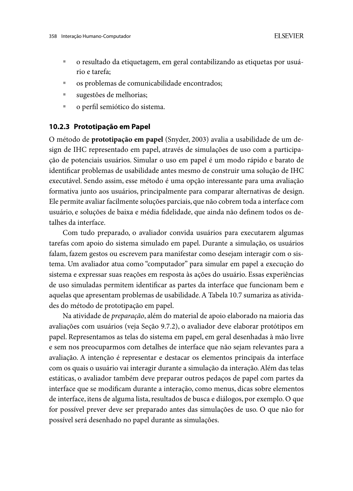
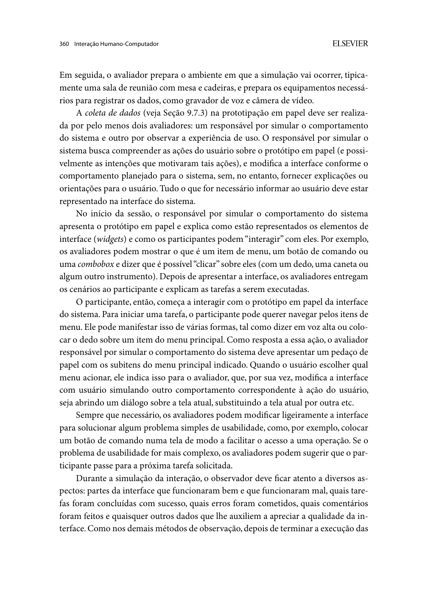

Responsável: Luís Henrique Arruda Luna — Agendamento em plenárias

# Planejamento da avaliação do protótipo de papel

!!! info "Atualização de 03/11/2026"

    A sessão ocorreu em 03/11/2026 e seus resultados estão no [relato do protótipo de papel](../../../entrega-6/individual/luis/relato-prototipo-papel.md). O texto abaixo preserva o planejamento feito na Etapa 5.

## Tabela de contribuição

| Integrante | Contribuição | Artefato / atividade |
| --- | --- | --- |
| [Luís Henrique Arruda Luna](https://github.com/Donnk61) | Definição do recorte e das condições práticas a confirmar | [Objetivos](#d-determinar-os-objetivos) |
| [Luís Henrique Arruda Luna](https://github.com/Donnk61) | Tarefas, participantes, agenda e rastreabilidade revistos após a inspeção da Etapa 8 | [Tarefas](#tarefas-da-sessao) · [Agenda](#agenda) · [Rastreabilidade](#rastreabilidade) |
| Codex (OpenAI) | Apoio à estruturação do plano DECIDE e dos instrumentos | [Agradecimentos](#agradecimentos) |
| Claude (Anthropic) | Apoio à redação das correções da versão 0.4 | [Agradecimentos](#agradecimentos) |

Tabela 1 — Contribuições neste planejamento.

Fonte: elaboração para o Grupo 06 (2026).

## Introdução

Este plano prepara uma avaliação formativa de uma proposta de agendamento para participação em plenárias do Senado, funcionalidade que ainda não existe no portal segundo o escopo informado para este trabalho. A interface será tratada como proposta, sem pressupor regras institucionais ainda não confirmadas. A atividade pertence à Etapa 5; a sessão e o relato de resultados ficam para a Etapa 6.

O recorte parte de [Marina Alves](../../../entrega-2/individual/luis/persona.md), que teve dificuldade para encontrar reuniões no portal, mas compreendeu a página da reunião depois de localizá-la. Isso sustenta investigar descoberta e compreensão; não permite concluir que Marina ou outros usuários necessitem reservar vaga.

## Item de conteúdo da disciplina

**Autor do item:** Luís Henrique Arruda Luna.

A avaliação seguirá o DECIDE: determinar objetivos, explorar perguntas, escolher métodos, identificar questões práticas, decidir questões éticas e avaliar/analisar/apresentar os dados (BARBOSA; SILVA, 2010, p. 312–313).

Na prototipação em papel, as telas são desenhadas à mão e a pessoa executa tarefas sobre elas: fala, aponta ou escreve o que faria, e um avaliador faz o papel de “computador”, trocando folhas e peças móveis em resposta. Outro avaliador observa e anota. É um modo rápido e barato de achar problemas antes de construir a interface, adequado a uma avaliação formativa de uma proposta ainda incompleta, como esta (BARBOSA; SILVA, 2010, p. 358–360). As Figuras 1 e 2, no [Apêndice A](#apendice-a), trazem os trechos usados.

## D — Determinar os objetivos

- **PL-O1 — Encontrabilidade:** verificar se a pessoa encontra plenárias e entende quais permitem inscrição.
- **PL-O2 — Vagas e estado:** investigar se compreende disponibilidade, limite, indisponibilidade e o resultado de sua solicitação.
- **PL-O3 — Confiança e recuperação:** identificar dúvidas sobre dados solicitados, confirmação, repetição de envio e próximos passos.

## E — Explorar perguntas

A Tabela 2 traz as perguntas que a avaliação deve responder.

| ID | Pergunta | Evidência a observar |
| --- | --- | --- |
| PL-Q1 | A pessoa encontra uma plenária adequada sem receber um link direto? | Caminho, filtros, retornos e tempo observado |
| PL-Q2 | Entende quantas vagas estão disponíveis e o que ocorre quando acabam? | Interpretação espontânea dos estados e escolhas |
| PL-Q3 | Consegue solicitar uma vaga e reconhecer se a solicitação foi concluída? | Campos usados, erros, confirmação e explicação final |
| PL-Q4 | Entende se há vaga garantida, espera ou apenas pedido recebido? | Interpretação das mensagens; regra ainda precisa ser definida |
| PL-Q5 | Que informação ou controle gera dúvida, hesitação ou receio? | Comentários, pedidos de ajuda e pontos de abandono |

Tabela 2 — Perguntas da avaliação e evidências a observar.

Fonte: elaboração do autor (2026).

## Especificação textual das telas e cartões

A Tabela 3 descreve as telas e a Tabela 4, os cartões móveis. As descrições são o roteiro para desenhar as folhas do protótipo. O conteúdo da plenária, datas, vagas, locais e código são **fictícios**. Não desenhar logotipos ou textos que façam parecer que o serviço já existe no portal.

| ID | Tela/cartão | Conteúdo que deve aparecer | Ações / observações para desenho |
| --- | --- | --- | --- |
| PP-S01 | Lista de plenárias | Título “Plenárias”; campo “Buscar por tema”; cartão “Educação científica — 12/11, 14h — 6 de 30 vagas — inscrições até 10/11”; cartão “Orçamento público — 18/11, 10h — sem vagas” | Botões “Ver detalhes”; incluir “Participação” como caminho de navegação. |
| PP-S02 | Detalhes com vagas | “Plenária sobre educação científica”; “12 de novembro, às 14h”; local fictício “Auditório de demonstração”; “6 de 30 vagas disponíveis”; “Inscrições até 10 de novembro”; aviso “A vaga só será confirmada após o envio e a validação” | Botões “Solicitar vaga” e “Voltar às plenárias”. |
| PP-S03 | Formulário | Título “Solicitar uma vaga”; campos “Nome completo” e “E-mail”; orientação para usar dados fictícios; caixa “Revisei os dados acima” | Botões “Continuar” e “Cancelar”. Não pedir CPF, senha ou documento. |
| PP-S04 | Revisão da solicitação | Nome e e-mail parcialmente mascarado; plenária, data e horário; aviso “Sua vaga ainda não está confirmada”; aviso de que a disponibilidade será validada ao enviar | Botões “Confirmar solicitação” e “Voltar para corrigir”. |
| PP-S05 | Confirmação | “Inscrição confirmada”; plenária, data e horário; “Código: PL-000123” | Botão “Voltar às plenárias”. Só mostrar se o operador simular validação positiva. |
| PP-S06 | Sem vagas antes do formulário | “Esta plenária está sem vagas disponíveis”; “Nenhuma inscrição foi criada” | Botão “Ver outras plenárias”. Usar para a opção que já aparece esgotada na lista. |
| PP-S07 | Última vaga ocupada durante o envio | “Não foi possível confirmar a inscrição”; “As vagas se esgotaram antes da confirmação. Nenhuma inscrição foi criada.” | Botão “Ver outras plenárias”. Exibir depois de confirmar, no cenário de concorrência. |

Tabela 3 — Telas do protótipo de papel.

Fonte: elaboração do autor (2026).

Cartões móveis para o operador trocar durante a sessão:

| Cartão | Texto/estado | Quando usar |
| --- | --- | --- |
| PP-C01 | “6 de 30 vagas disponíveis” | Estado inicial da plenária de educação científica. |
| PP-C02 | “1 de 30 vagas disponíveis” | Início do cenário especial da última vaga. |
| PP-C03 | “Sem vagas disponíveis” | Plenária esgotada desde a consulta inicial. |
| PP-C04 | “Inscrições encerradas em 10 de novembro” | Variante de prazo encerrado, somente se mantida no teste. |
| PP-C05 | “Vagas esgotadas antes da confirmação” | Trocar para este cartão após o envio no cenário da última vaga; encaminhar para PP-S07. |
| PP-C06 | Dados de teste: “Marina Alves”, “marina@example.com” | Entregar à pessoa para preencher PP-S03; endereço fictício, não enviar. |
| PP-C07 | “Código PL-000123” | Anexar a PP-S05 após validação positiva. |

Tabela 4 — Cartões móveis do protótipo de papel.

Fonte: elaboração do autor (2026).

**Transições do protótipo:** `PP-S01 → PP-S02 → PP-S03 → PP-S04 → PP-S05` no caminho de sucesso; `PP-S01 → PP-S06` se a plenária já estiver sem vagas; `PP-S04 → PP-S07` se a última vaga for ocupada antes da validação. O operador não deve confirmar a vaga ao abrir detalhes nem ao começar o formulário. O cenário PP-S07 é uma execução separada, iniciada com PP-C02.

## C — Escolher os métodos

Teste moderado de tarefas com protótipo de papel, observação e verbalização do raciocínio. Após cada tarefa, perguntas abertas investigarão o entendimento sem sugerir a resposta. A equipe deve distinguir fala, ação observada, interpretação e recomendação.

## I — Identificar questões práticas

**Perfil e recrutamento:** pessoa adulta que usa serviços públicos digitais, sem exigir conhecimento prévio do Portal do Senado. Recrutamento por conveniência, na rede de contatos da equipe. Integrantes do grupo não participam da sessão principal. A adequação de Marina como participante continua não confirmada.

**Quantidade e justificativa:** **uma pessoa** na sessão principal e **uma** no piloto. A avaliação é formativa e exploratória: o objetivo é achar problemas evidentes nas folhas antes da alta fidelidade, não medir desempenho. Uma sessão não permite generalizar; o relato tratará cada achado como ocorrência única e hipótese a confirmar.

**Modalidade e recursos:** remota e síncrona pelo Google Meet, com uma câmera voltada para as folhas; se a pessoa preferir, presencial na FCTE/UnB, com o mesmo material. Recursos: folhas A4, canetas, tesoura, celular ou webcam como câmera de mesa, computador com o Google Meet e a ficha de registro do [planejamento do relato](planejamento-relato-prototipo-papel.md#ficha-de-registro-por-tarefa).

**Custo:** R$ 0,00 de custo financeiro adicional. O material é do próprio autor.

### Tarefas da sessão { #tarefas-da-sessao }

A Tabela 5 separa o que é **entregue à pessoa** (enunciado e dados da ficha) do que **fica com a equipe** (estado inicial e critério de conclusão). Os dados são fictícios e vêm dos cartões do protótipo.

| Tarefa | Enunciado entregue à pessoa | Estado inicial (equipe) | Dados fictícios | Critério de conclusão (equipe) | Pergunta |
| --- | --- | --- | --- | --- | --- |
| PL-T1 | “Você quer assistir a uma plenária sobre educação científica no Senado. Encontre essa plenária e descubra quando e onde ela acontece e se ainda há vagas.” | PP-S01 com o cartão PP-C01 (6 de 30 vagas) | Nenhum | Chega a PP-S02 e diz data, horário, local e quantidade de vagas sem ajuda | PL-Q1, PL-Q2 |
| PL-T2 | “Peça uma vaga nessa plenária usando os dados desta ficha.” | PP-S02 com PP-C01 | Cartão PP-C06: “Marina Alves”, “marina@example.com” | Preenche PP-S03, marca “Revisei os dados acima”, confere PP-S04 e aciona “Confirmar solicitação” | PL-Q3 |
| PL-T3 | “Explique o que aconteceu com o seu pedido.” | PP-S05 com PP-C07, após validação positiva simulada | Código “PL-000123” | Diz que a inscrição foi confirmada, aponta o código e diferencia esse estado do aviso de PP-S04 (“ainda não está confirmada”) | PL-Q3, PL-Q4 |
| PL-T4 | “Agora você quer participar da plenária sobre orçamento público. Tente participar.” | PP-S01 com o cartão PP-C03 na plenária de orçamento | Nenhum | Reconhece que não há vaga, diz que nenhuma inscrição foi criada (PP-S06) e volta à lista | PL-Q2, PL-Q5 |
| PL-T5 | “Peça uma vaga na plenária de educação científica.” (execução separada) | PP-S02 com PP-C02 (1 de 30 vagas); após “Confirmar solicitação”, o operador troca para PP-C05 e mostra PP-S07 | Cartão PP-C06 | Explica que a vaga não foi obtida, que nenhuma inscrição foi criada e indica o que faria em seguida | PL-Q2, PL-Q4, PL-Q5 |

Tabela 5 — Tarefas, estados iniciais, dados e critérios de conclusão.

Fonte: elaboração do autor (2026), a partir da especificação das telas e cartões.

**Classificação:** cada tarefa é registrada como concluída sem ajuda, concluída com ajuda ou não concluída. **Reinícios:** se a pessoa pedir para recomeçar ou ficar parada por mais de dois minutos sem avançar, o operador volta ao estado inicial da tarefa e o registrador anota o reinício e o motivo. PL-T4 e PL-T5 sempre começam do próprio estado inicial, e não do ponto em que a tarefa anterior terminou.

Os estados e dados são fictícios. Não apresentar lista de espera, cancelamento, prioridade ou garantia de vaga como regra real antes de confirmação institucional.

**Equipe:** moderador, operador do protótipo e observador/registrador, com papéis separados sempre que possível. O operador troca folhas conforme transições predefinidas e não improvisa regras. O piloto deve verificar clareza das tarefas, transições, duração e ficha de registro; dados do piloto ficam fora dos resultados principais.

### Agenda { #agenda }

A Tabela 6 é uma **agenda proposta**. Ela foi registrada na versão 0.4 (26/11/2026), após a inspeção da Etapa 8, porque a versão 0.3 só dizia que as datas seriam definidas. A coluna “Execução” traz o que de fato ocorreu, conforme o [relato do protótipo de papel](../../../entrega-6/individual/luis/relato-prototipo-papel.md#execucao-da-sessao).

| Atividade | Data e horário propostos | Duração | Local | Responsável | Execução |
| --- | --- | --- | --- | --- | --- |
| Desenho das folhas PP-S01–PP-S07 e dos cartões PP-C01–PP-C07 | 31/10 a 01/11/2026 | 3 h | Casa do autor | Luís Henrique Arruda Luna | Folhas T0–T3 e peças feitas antes da sessão; PP-S07 e quatro cartões não foram construídos |
| Piloto com uma pessoa que não participa da sessão principal | 02/11/2026, 20h | 20 min | Google Meet | Luís (moderador e operador) | Não realizado |
| Ajuste das folhas a partir do piloto | 02/11/2026, após o piloto | 1 h | Casa do autor | Luís | Não se aplicou, sem piloto |
| Sessão principal | 03/11/2026, a partir das 20h | 20 min reservados | Google Meet | Luís (moderador e operador); integrante do grupo na chamada como observador | Realizada em 03/11/2026, das 20h55 às 20h59, com PART-PP01 |
| Análise e redação do relato | 03/11/2026, após a sessão | 2 h | — | Luís; revisão de Caio Breno de Souza Bezerra | Relato publicado em 03/11/2026 |

Tabela 6 — Agenda proposta e execução da avaliação do protótipo de papel.

Fonte: elaboração do autor (2026); execução conforme o relato da Etapa 6.

**Condição de confirmação:** a sessão só é confirmada quando a pessoa aceita a data e o consentimento é obtido, e o piloto precisa ocorrer antes dela. Se o piloto exigir mudança nas folhas, a sessão é remarcada sem passar da entrega da Etapa 6 (03/11/2026). Os dados do piloto ficam fora dos resultados.

## D — Decidir questões éticas

Obter consentimento antes da sessão e autorização específica para gravação. Usar dados fictícios, não coletar documentos ou informações pessoais desnecessárias e permitir interrupção ou desistência. Guardar TCLE e gravações fora da área pública; publicar apenas evidências anonimizadas autorizadas. A ausência de serviço real deve ser explicada à pessoa participante.

## E — Avaliar, analisar e apresentar os dados

Registrar tarefa, estado inicial, sequência de ações, conclusão, hesitações, erros, pedidos de ajuda, falhas de simulação e falas relevantes com localizadores. Analisar por pergunta de avaliação e gravidade, sem generalizar além da amostra. Separar problemas observados de hipóteses e recomendações. O formato de apresentação será o relato individual da Etapa 6.

## Decisões antes do piloto

A versão 0.3 listava seis decisões pendentes. Para o protótipo, a versão 0.4 adota as regras abaixo, que continuam sendo **propostas** e não regras institucionais:

- **Vaga ocupada:** a vaga só é considerada ocupada na validação feita após “Confirmar solicitação” (PP-S04 → PP-S05 ou PP-S07);
- **Última vaga disputada:** se ela acabar antes da validação, a pessoa vê PP-S07 e nenhuma inscrição é criada;
- **Lista de espera e cancelamento:** ficam fora desta versão do protótipo;
- **Dados mínimos:** nome e e-mail, sem autenticação; a confirmação aparece na tela, com o código;
- **Participante, data e modalidade:** definidos em [Identificar questões práticas](#i-identificar-questoes-praticas) e na [agenda](#agenda);
- **Rastreamento das tarefas:** feito na [matriz de rastreabilidade](#rastreabilidade).

## Rastreabilidade { #rastreabilidade }

A Tabela 7 liga os encaminhamentos dos relatos do [storyboard](relato-storyboard.md#encaminhamentos-para-o-prototipo-de-papel) e da [análise de tarefas](relato-analise-tarefas.md#encaminhamentos-para-o-prototipo-de-papel) às decisões do protótipo, às telas, às tarefas e às perguntas desta avaliação.

| Achado (relato da Etapa 5) | Decisão no protótipo | Tela / cartão | Tarefa | Pergunta |
| --- | --- | --- | --- | --- |
| SB-E01, AT-E01: saber se há vaga antes de preencher dados | Mostrar data, local, vagas e prazo na lista e nos detalhes, antes do formulário | PP-S01, PP-S02, PP-C01–PP-C03 | PL-T1 | PL-Q1, PL-Q2 |
| SB-E02, AT-E05: sem vaga, o percurso não pode ficar sem saída | Aviso imediato de falta de vagas, com “Ver outras plenárias” | PP-S06, PP-C03 | PL-T4 | PL-Q2, PL-Q5 |
| AT-E02: revisar os dados antes do envio | Tela de revisão com “Voltar para corrigir” | PP-S04 | PL-T2 | PL-Q3 |
| SB-E04: “vaga confirmada” só no estado confirmado | PP-S04 avisa que a vaga ainda não está confirmada; PP-S05 confirma e mostra o código | PP-S04, PP-S05, PP-C07 | PL-T2, PL-T3 | PL-Q3, PL-Q4 |
| SB-E03, AT-E03: última vaga ocupada durante o envio | Revalidar no envio e dizer que nenhuma inscrição foi criada | PP-S07, PP-C02, PP-C05 | PL-T5 | PL-Q2, PL-Q4 |
| AT-E04: retorno explícito de sucesso ou indisponibilidade | Mensagens finais distintas para confirmação e para falta de vaga | PP-S05, PP-S06, PP-S07 | PL-T3, PL-T4, PL-T5 | PL-Q4, PL-Q5 |

Tabela 7 — Rastreabilidade entre os relatos da Etapa 5, as decisões, as telas, as tarefas e as perguntas.

Fonte: elaboração do autor (2026), a partir das Tabelas 4 dos dois relatos da Etapa 5.

## Histórico de versão

| Versão | Data | Descrição | Autor(es) | Revisor(es) |
| --- | --- | --- | --- | --- |
| 0.1 | 24/10/2026 | Plano preliminar para funcionalidade proposta, com perguntas, tarefas e decisões em aberto | Luís Henrique Arruda Luna | [Caio Breno de Souza Bezerra](https://github.com/CaioBezerra-Dev) |
| 0.2 | 24/10/2026 | Especifica telas, cartões e transições do protótipo de papel | Luís Henrique Arruda Luna | [Caio Breno de Souza Bezerra](https://github.com/CaioBezerra-Dev) |
| 0.3 | 03/11/2026 | Aponta para o relato da sessão realizada, preservando o plano | Luís Henrique Arruda Luna | [Caio Breno de Souza Bezerra](https://github.com/CaioBezerra-Dev) |
| 0.4 | 26/11/2026 | Corrige os achados da inspeção V2 da Etapa 5 (E5-09, E5-11, E5-13, E5-14, E5-20): recortes do método, tarefas com dados e critérios, participantes, custo, agenda e matriz de rastreabilidade | Luís Henrique Arruda Luna | [Caio Breno de Souza Bezerra](https://github.com/CaioBezerra-Dev) |
| 0.5 | 26/11/2026 | Registra a revisão de Caio Breno de Souza Bezerra e Bruno Ferreira Dornelas e remove o aviso de revisão pendente (achado D02 da inspeção V2) | Luís Henrique Arruda Luna | [Caio Breno de Souza Bezerra](https://github.com/CaioBezerra-Dev) e [Bruno Ferreira Dornelas](https://github.com/brunnf) |

## Referências

[1] BARBOSA, Simone Diniz Junqueira; SILVA, Bruno Santana da. *Interação humano-computador*. Rio de Janeiro: Elsevier, 2010. p. 307–313, 358–362.

[2] GRUPO 06. [Persona Marina Alves](../../../entrega-2/individual/luis/persona.md), [cenário](../../../entrega-2/individual/luis/cenario.md) e [análise de tarefas](../../../entrega-2/individual/luis/analise-tarefas.md). 2026.

## Apêndice A — Fundamentação { #apendice-a }

As Figuras 1 e 2 trazem os trechos de Barbosa e Silva usados no item de conteúdo.

??? note "Figura 1 — Prototipação em papel"

    { loading=lazy }
    
Figura 1 — Definição e preparação da prototipação em papel.

    
Fonte: Barbosa e Silva (2010, p. 358).

??? note "Figura 2 — Operação do sistema e observação"

    { loading=lazy }
    
Figura 2 — Papéis e coleta de dados na avaliação em papel.

    
Fonte: Barbosa e Silva (2010, p. 360).

## Agradecimentos

O Codex (OpenAI) apoiou a organização e a redação inicial do plano. O Claude (Anthropic) apoiou a redação das correções da versão 0.4. Luís Henrique Arruda Luna responde pelo recorte e pela validação do conteúdo antes da entrega.

## Revisão

Revisores: [Caio Breno de Souza Bezerra](https://github.com/CaioBezerra-Dev) e [Bruno Ferreira Dornelas](https://github.com/brunnf). Revisão registrada em 26/11/2026, na versão 0.5.
