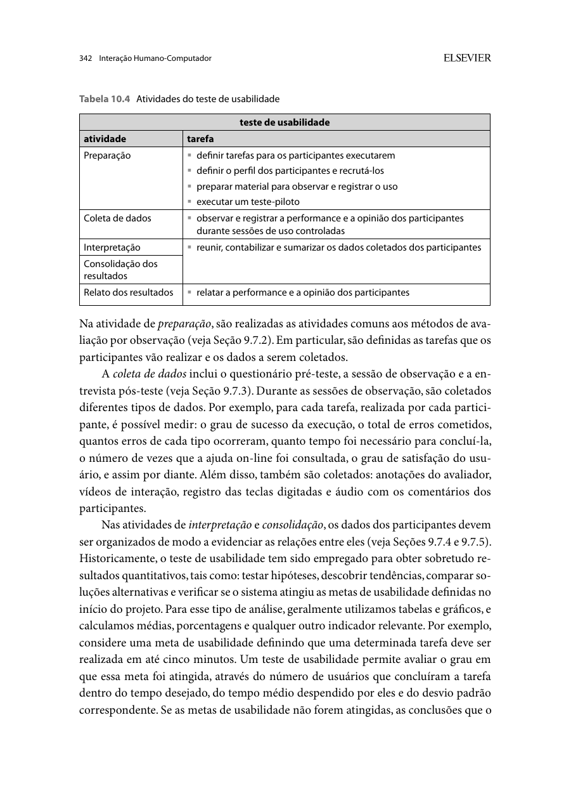
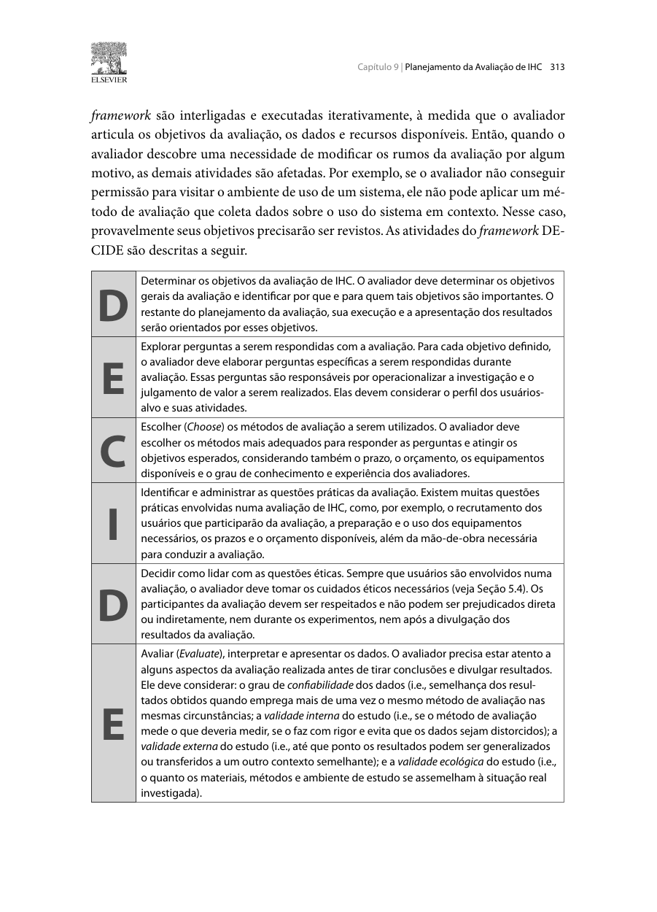
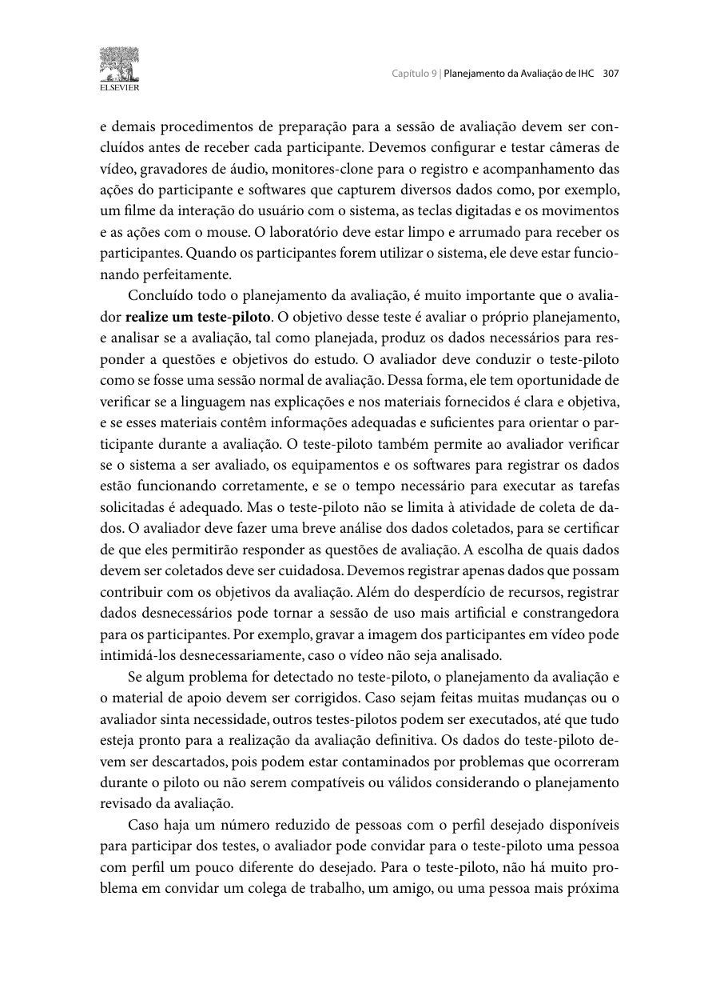

Responsável: Bruno Ferreira Dornelas — Complementos de ideias legislativas · Autor do item: Bruno Ferreira Dornelas

# Planejamento da avaliação do protótipo de alta fidelidade

## Tabela de contribuição

A Tabela 1 registra as contribuições neste artefato.

| Integrante / ferramenta | Contribuição | Artefato / atividade |
| --- | --- | --- |
| [Bruno Ferreira Dornelas](https://github.com/brunnf) | Definição do DECIDE, tarefas, métricas, piloto e agenda da alta fidelidade | [Introdução](#introducao) |
| Codex (OpenAI) | Apoio à revisão do procedimento e dos instrumentos conforme a aplicação realizada | [Agradecimentos](#agradecimentos) |
| Antigravity (Google DeepMind) | Apoio à consulta bibliográfica, rastreabilidade com o relato do papel e redação | [Agradecimentos](#agradecimentos) |

Tabela 1 — Contribuições no planejamento da avaliação de alta fidelidade.

Fonte: elaboração do projeto (2026).

## Introdução

Este documento organiza a avaliação do protótipo de alta fidelidade de **sugestão e acompanhamento de complementos de ideias legislativas**, em continuidade às decisões sobre autoria, comparação de textos, espera e contadores do [relato do protótipo de papel](relato-prototipo-papel.md#problemas-corrigidos-e-pendentes). A versão 1.6, de 15/11/2026, atualiza diretamente o procedimento com base na aplicação realizada em 11/11. O cronograma planejado permanece preservado; as diferenças entre previsão e execução constam no [relato da Etapa 7](../../../entrega-7/individual/bruno/relato-alta-fidelidade.md#diferencas-entre-planejamento-e-execucao).

Os resultados são apresentados separadamente no relato da Etapa 7. Este documento define o método, as perguntas e os instrumentos correspondentes à rodada, sem transformar dados não coletados em medições.

## Item de conteúdo da disciplina

**Autor do item:** Bruno Ferreira Dornelas.

O **DECIDE** estrutura o planejamento (BARBOSA; SILVA, 2010, p. 312–313 [1]). Os objetivos e perguntas vêm da seção 9.2 e Tabela 9.1 (p. 290–293). O teste formativo adota Krug: rodada pequena para encontrar e corrigir problemas [4], facilitador, observadores e roteiro [5–7]. Local, equipe, tarefas legislativas, indicadores e agenda são escolhas do projeto. Barbosa e Silva fundamentam a preparação e o piloto; nesta rodada não houve teste-piloto, condição registrada como limitação.

## D — Determinar os objetivos

Dos aspectos apresentados por Barbosa e Silva (2010, p. 290–293 [1]), foram selecionados dois:

- **Avaliar ideias e alternativas de design:** examinar autoria, comparação de textos, espera e contadores, relacionando a experiência atual aos problemas do papel. A comparação é histórica e formativa, sem teste A/B ou atribuição causal de superioridade.
- **Identificar problemas de interação e interface:** localizar dificuldades na busca, redação, revisão, decisão sobre ajustes e acompanhamento, descrevendo impacto e possibilidades de melhoria.

O público-alvo do recorte são cidadãos adultos interessados em participação legislativa digital, com referência na persona [Letícia Oliveira](../../../entrega-2/individual/heitor/persona.md). A coleta compreende três pessoas no mesmo recorte; são estudantes de engenharia de 20 a 21 anos, com muita familiaridade tecnológica e alguma familiaridade legislativa. Conheciam o site e o envio de ideias do Senado, mas não o protótipo. Outros serviços, adoção longitudinal e comparação cronometrada com o portal oficial ficam fora do escopo (p. 304 [1]).

## E — Explorar as perguntas

A Tabela 2 reúne as perguntas analíticas para a rodada. A apresentação antecipada do fluxo exige distinguir ações realizadas após orientação de descobertas espontâneas.

| Foco | Pergunta de avaliação | Objetivo e origem | Evidências para responder |
| --- | --- | --- | --- |
| Busca e participação | Como a pessoa localiza a ideia e acessa a opção de complementar após a apresentação do cenário? | Problemas de interação; acesso aos detalhes da ideia no papel. | Navegação, escolha de participação e dúvidas; registrar se houve pesquisa ou rolagem. |
| Envio e espera | Como preenche, revisa e confirma o envio, e o que demonstra compreender sobre espera e notificação? | Design e interação; estados de espera do papel. | Formulário, prévia, correções, envio e falas sobre o que acontece depois. Ausência de fala não comprova compreensão. |
| Comparação e decisão | Como utiliza os textos apresentados para concordar ou discordar, e como interpreta a continuidade? | Design e interação; comparação e discordância. | Escolhas, justificativas e eventual reenvio; separar exploração de botões de decisão fundamentada. |
| Autoria e apoios | Reconhece a contribuição própria e distingue os apoios da ideia dos apoios de cada complemento? | Design e interação; autoria e contadores do papel. | Identificação da contribuição, uso dos controles e explicação das contagens. |
| Encaminhamento e anexo | Localiza o anexo e distingue publicação, encaminhamento para análise e aprovação de lei? | Design e interação; acompanhamento do papel. | Acesso ao documento, interpretação do estado e intervenções do moderador. |
| Dificuldades e opinião geral | Quais dificuldades e avaliações gerais são expressas sobre o uso do protótipo? | Problemas de interação; entrevista final. | Comentários e nota geral de um a cinco, com indicação da fonte e de eventual ambiguidade. |
| Decisões de design | Que evidências sustentam as soluções propostas após o papel e que dificuldades permanecem? | Avaliação das ideias de design. | Relação problema anterior, mudança, evidência atual e limite da conclusão. |

Tabela 2 — Perguntas de avaliação da alta fidelidade.

Fonte: adaptação das perguntas de Barbosa e Silva (2010, Tabela 9.1, p. 293 [1]) ao recorte e à aplicação realizada.

As perguntas orientam a análise da equipe. Não constituem um questionário integralmente aplicado durante a navegação nem autorizam inferir respostas que não foram registradas.

## C — Escolher os métodos

O procedimento é um **teste de usabilidade presencial, moderado, qualitativo e formativo**, com pensamento em voz alta, navegação no protótipo e entrevista final. Krug [4–7] fundamenta a rodada pequena e a observação da interação; os detalhes da aplicação são decisões do projeto.

### Fundamentação das decisões e papéis

- **Participantes:** três pessoas em sessões individuais. A rodada pequena permite identificar dificuldades, sem garantir saturação ou porcentagem de problemas encontrados [4, p. 146].
- **Moderador:** Apresentei o cenário, conduzi a sessão e a entrevista e esclareci dúvidas.
- **Observador:** Caio Breno de Souza Bezerra acompanhou a coleta. A observação segue a referência de Krug [6]; Caio fez anotações que levaram aos mesmos problemas identificados na análise dos vídeos, conforme registrado em 15/11/2026. As anotações originais não estão anexadas.
- **Registro:** um vídeo da tela e um do ambiente para cada participante. As duas perspectivas representam a mesma sessão. A análise relaciona ações, comentários e intervenções, sem inferir emoções pela aparência.
- **Consolidação:** análise documental dos três testes, com dificuldades, prioridades propostas e limites. Não atribuir essa análise a uma reunião da equipe sem registro de realização.

### Verificação das decisões de design

Confrontar as decisões do papel com os estados e comportamentos da alta fidelidade. A avaliação de ideias pode ser não comparativa (Barbosa e Silva, p. 291 [1]); a coleta atual é a evidência principal, e o histórico explica as mudanças. Não solicitar preferência entre versões não apresentadas nem atribuir diferenças exclusivamente ao reprojeto.

## I — Identificar e administrar questões práticas

### Ambiente e modalidade

A aplicação ocorreu presencialmente em **11/11/2026, por volta das 9h, no contêiner da EJS, UnB Gama**. O participante utilizou o notebook com o protótipo; Moderei as sessões e Caio observou. Todos utilizaram a mesma versão HTML no Microsoft Edge, sem alterações entre sessões. O horário da manhã atendia à disponibilidade dos participantes e da equipe; Caio assumiu a observação por ter disponibilidade. Horários individuais não foram registrados no relato. Esses dados efetivos não substituem as propostas preservadas no cronograma.

### Perfil e quantidade de participantes

- **Amostra:** Participante 1, Participante 2 e Participante 3, em sessões individuais, sem subgrupos.
- **Perfil e familiaridade:** estudantes de engenharia, de 20 a 21 anos; muita familiaridade com tecnologia e alguma familiaridade com participação legislativa. Conheciam o site e o envio de uma ideia do Senado, mas não o protótipo. Na minha percepção, a novidade da funcionalidade proposta provocou estranhamento inicial.
- **Piloto:** não realizado por esquecimento. A ausência limita a verificação prévia do procedimento, da captura e das perguntas.
- **Abrangência:** os três percorrem busca, envio, decisão e acompanhamento. O Participante 3 explora também discordância e reenvio.
- **Preparação e recursos:** dados fictícios, protótipo navegável e gravações de tela e ambiente. A mesma versão HTML foi usada nas três sessões, sem alterações. Commit, data de congelamento e custos efetivos não foram registrados.

### Tarefas, dados de teste e critérios de conclusão

O fluxo foi apresentado em conjunto na abertura. A Tabela 3 organiza as quatro partes da atividade para análise, sem apresentar seus enunciados como falas literais ou tarefas entregues uma por vez. O cenário envolve contribuir para o atendimento noturno de bibliotecas comunitárias.

| Tarefa | Contexto e dados utilizados | Aspectos observáveis e limites |
| --- | --- | --- |
| Busca da ideia | Localizar a proposta de incentivo às bibliotecas comunitárias e acessar a participação. | Registrar navegação, abertura dos detalhes e escolha de complementar. A explicação prévia impede avaliar descoberta espontânea. |
| Envio do complemento | Acessar a conta fictícia, preencher título e texto, revisar e confirmar o envio. | Observar correções, confirmação e entendimento da espera. O Participante 3 utilizou texto sem sentido para experimentar; avanço operacional não demonstra elaboração pertinente. |
| Decisão sobre o ajuste | Receber resposta simulada, comparar os textos e escolher concordar ou discordar. | Registrar decisão e justificativa quando disponível. Discordância, revisão e reenvio constituem uma sequência adicional dentro da mesma sessão. |
| Acompanhamento da contribuição | Consultar publicação e apoios, simular encaminhamento e acessar o anexo. | Registrar autoria, contadores, acesso ao anexo e significado atribuído ao estado. Alcançar uma tela não comprova a compreensão dos conceitos apresentados. |

Tabela 3 — Tarefas e aspectos de análise da aplicação.

Fonte: organização da rodada de complementos de ideias legislativas (2026).

### Roteiro da sessão e teste-piloto

O [roteiro presencial](roteiro-teste-presencial.md) é referência da preparação original. A sequência efetivamente aplicada reuniu:

1. **Abertura:** apresentação do protótipo, do cenário e do fluxo; orientação para pensar em voz alta e explicação das simulações.
2. **Interação:** navegação pelas quatro partes da atividade, com registro de dúvidas, correções, escolhas e intervenções.
3. **Entrevista final:** perguntas sobre dificuldades, clareza e avaliação geral do uso. A nota geral não equivale a uma nota para cada tarefa.
4. **Encerramento:** esclarecimento de dúvidas e agradecimento.

Os vídeos de tela têm 6min40s, 6min10s e 7min38s. Essas durações incluem instruções e entrevista e não comprovam o tempo ativo nem a duração integral de cada encontro. Não houve piloto nem confirmação dos intervalos entre sessões.

As respostas de terceiros e o avanço do tempo são simulados. Registrar a orientação técnica separadamente da compreensão da pessoa. No terceiro teste, a discordância foi seguida de revisão e reenvio; não foi confirmado o uso de um cenário independente de publicação. A explicação do moderador sobre o fim do complemento deve ser confrontada com a regra do protótipo.

A consolidação considera as intervenções como parte do contexto. A convergência entre os problemas das anotações de Caio e a análise documental foi confirmada, assim como as propostas de correção. Não se atribui data ou duração a uma reunião formal sem registro.

### Cronograma e agenda proposta até a Etapa 7

A Tabela 4 define a agenda prevista para construção, piloto, coleta e redação do relato da Etapa 7 (entrega em **15/11/2026**).

| Atividade | Data e horário propostos | Responsável |
| --- | --- | --- |
| Implementar o protótipo de alta fidelidade `AF-1.0` incorporando `PP-A01` a `PP-A04` | `05/11` a `07/11/2026`, `19h–21h` | Bruno Ferreira Dornelas |
| Confirmar participante do piloto (`PP-AF01`), três participantes principais (`AF-P01–AF-P03`) e observadores | Piloto: antes do ensaio de `09/11`; principais: até `10/11/2026`, `18h` | Bruno e Luís Henrique |
| Realizar o teste-piloto preferencialmente presencial (`PP-AF01`) | `09/11/2026`, `19h–19h50` | Bruno, observador e `PP-AF01` |
| Ajustar o protótipo (`AF-1.1`, se necessário) e congelar versão para o teste | `10/11/2026`, `19h–20h` | Bruno Ferreira Dornelas |
| Conduzir três sessões individuais (`AF-P01`, `AF-P02`, `AF-P03`) | `11/11/2026`, `18h–18h50`, `19h–19h50` e `20h–20h50` | Bruno, observadores e um participante por sessão |
| Discutir problemas prioritários e ações de correção | `11/11/2026`, `21h–21h30` | Bruno e observadores |
| Transcrever gravação, analisar métricas e redigir o relato da avaliação de alta fidelidade | `12/11` e `13/11/2026`, `19h–21h` | Bruno e observadores |
| Revisão cruzada do relato e gravação da apresentação da Etapa 7 | `14/11/2026`, `14h–18h` (entrega em `15/11`) | Luís Henrique (revisão) e Bruno |

Tabela 4 — Agenda proposta para a avaliação de alta fidelidade (Etapa 7).

Fonte: planejamento do projeto (2026).

## D — Decidir como lidar com questões éticas

O [protocolo ético do Grupo 06](../../../entrega-2/etica.md) e Barbosa e Silva (2010, p. 138–142, 313 [1]) orientam participação voluntária, limites de uso e proteção dos registros.

- **Consentimento:** participação e gravação autorizadas pelos três participantes, conforme registrado em 15/11/2026. A divulgação pública dos vídeos também foi autorizada pelos três participantes, conforme registrado em 15/11/2026.
- **Identificação:** utilizar Participante 1, Participante 2 e Participante 3 nos documentos, sem nomes ou códigos. A câmera do ambiente mostra rostos; a identificação descritiva no texto não torna os vídeos anônimos. A divulgação dos vídeos de tela e ambiente foi autorizada pelos três participantes, conforme registrado em 15/11/2026.
- **Guarda e descarte:** termos e dados pessoais ficam fora do repositório público, restritos aos avaliadores. Mantém-se a orientação de excluir arquivos brutos em até 30 dias após o encerramento do semestre. A execução dessa política não foi verificada nesta análise.

## E — Avaliar, interpretar e apresentar os dados

A Tabela 5 define o tratamento dos dados disponíveis. A análise é qualitativa e distingue execução observada, opinião e evidência insuficiente.

| Aspecto | Tratamento nesta rodada | Limite |
| --- | --- | --- |
| Execução e cobertura | Relatar por participante quais ações e estados foram observados, indicando ajuda e simulações. | Chegada à publicação não equivale à compreensão integral. A descoberta sem orientação não foi avaliada. |
| Erros e compreensão | Descrever episódios de correção, dúvidas sobre autoria, contadores, discordância e encaminhamento. | Não há contagem completa de cliques equivocados; não tratar exploração deliberada como erro nem silêncio como compreensão. |
| Duração e localizadores | Informar duração dos vídeos e intervalos aproximados das tarefas. | Tempo ativo com desconto de pausas e intervenções não aferido; não calcular eficiência a partir da duração total. |
| Avaliação numérica geral | Registrar a nota global de um a cinco, por participante, com fonte e justificativa disponível. | Não distribuir a nota geral entre tarefas. Participante 1: 4; Participante 2: 5; Participante 3: 4,5. As três notas foram registradas na consolidação em 13/11/2026. |
| Outros indicadores | Aprendizado repetido, recuperação de falha induzida, recordação após sete dias e comparação cronometrada não integram a rodada. | Não apresentar resultados para esses aspectos. |

Tabela 5 — Dados e critérios de interpretação da rodada.

Fonte: adaptação dos instrumentos do projeto às evidências disponíveis (2026).

Relacionar cada conclusão às gravações ou aos registros complementares da coleta. As legendas automáticas são apoio à localização e à paráfrase, sem equivalência a transcrição literal revisada. Os critérios completos da versão anterior permanecem identificados no relato quando usados para explicar limites da coleta.

Propor prioridade **alta** para bloqueio ou interpretação incorreta de intenção, autoria, apoios ou aprovação legislativa; **média** para hesitação, retrabalho ou dúvida de continuidade; **baixa** para ajuste visual complementar. Informar o denominador de pessoas expostas a cada situação. Recomendações não implementadas e correções sem reteste devem permanecer explicitamente identificadas.

O [planejamento do relato](planejamento-relato-alta-fidelidade.md) organiza a apresentação dos dados. O relato relaciona os registros audiovisuais à confirmação dos achados e propostas por mim, sem tratar anotações não anexadas como documentos examinados.

## Agradecimentos

Utilizei o Antigravity (Google DeepMind) e o Codex (OpenAI) como apoio à organização, à redação e à revisão dos instrumentos. Assumo a responsabilidade acadêmica pelo conteúdo.

## Histórico de versão

| Versão | Data | Descrição | Autor(es) | Revisor(es) |
| :---: | :---: | --- | --- | --- |
| `1.0` | 03/11/2026 | Elaboração do planejamento da avaliação do protótipo de alta fidelidade a partir dos achados `PP-A01`–`PP-A04` do relato em papel | [Bruno Ferreira Dornelas](https://github.com/brunnf) | [Luís Henrique Arruda Luna](https://github.com/Donnk61) |
| `1.1` | 09/11/2026 | Três participantes com Krug; protocolo preferencialmente presencial; dois objetivos selecionados de Barbosa e Silva; sete perguntas e agenda revisadas | [Bruno Ferreira Dornelas](https://github.com/brunnf) | [Luís Henrique Arruda Luna](https://github.com/Donnk61) |
| `1.2` | 13/11/2026 | Revisão direta conforme a aplicação: três sessões presenciais, Bruno e Caio, ausência de piloto, fluxo apresentado em conjunto e avaliação geral; cronograma original preservado | [Bruno Ferreira Dornelas](https://github.com/brunnf) | [Luís Henrique Arruda Luna](https://github.com/Donnk61) |
| `1.3` | 13/11/2026 | Confirmação da nota geral 4,5 do Participante 3 e alinhamento da consolidação, preservando o cronograma original | [Bruno Ferreira Dornelas](https://github.com/brunnf) | [Luís Henrique Arruda Luna](https://github.com/Donnk61) |
| `1.4` | 15/11/2026 | Atualização dos dados da aplicação confirmados em 15/11, sem alteração do cronograma original | [Bruno Ferreira Dornelas](https://github.com/brunnf) | [Luís Henrique Arruda Luna](https://github.com/Donnk61) |
| `1.5` | 15/11/2026 | Confirmação da autorização de divulgação dos vídeos dos três participantes | [Bruno Ferreira Dornelas](https://github.com/brunnf) | [Luís Henrique Arruda Luna](https://github.com/Donnk61) |
| `1.6` | 15/11/2026 | Ajuste da voz narrativa e remoção de comentários de acompanhamento editorial | [Bruno Ferreira Dornelas](https://github.com/brunnf) | [Luís Henrique Arruda Luna](https://github.com/Donnk61) |

Tabela 6 — Histórico de versão.

Fonte: elaboração do projeto (2026).

## Referências

[1] BARBOSA, Simone Diniz Junqueira; SILVA, Bruno Santana da. **Interação humano-computador**. Rio de Janeiro: Elsevier, 2010. Aspectos éticos, p. 138–142; Objetivos e perguntas, p. 290–293; planejamento, piloto e DECIDE, p. 304–313; Teste de usabilidade, p. 341–343.

[2] SALES, André Barros de. **Plano de Ensino FIHC 022026 — Turma 01**, v1. Brasília: FCTE/UnB, 2026. Cronograma das Etapas 6 e 7, p. 5 do PDF.

[3] GRUPO 06. [Relato da avaliação do protótipo de papel — Complementos de ideias legislativas](relato-prototipo-papel.md) e [Metas de usabilidade da Etapa 3](../../../entrega-3/metas-usabilidade.md). 2026.

[4] KRUG, Steve. **Don’t Make Me Think! A Common Sense Approach to Web Usability**. 1. ed. 2000. cap. 9, p. 146. Trecho disponibilizado pelo autor: [quantidade por rodada](https://sensible.com/downloads/DMMTchapter09_for_personal_use_only.pdf). Acesso em: 9 nov. 2026. A paginação refere-se à primeira edição em inglês.

[5] KRUG, Steve. **Usability test script — Web sites**. Reproduzido de *Rocket Surgery Made Easy*, 2010. p. 1–6 do roteiro. [Roteiro oficial](https://sensible.com/downloads/test-script-web.pdf). Acesso em: 9 nov. 2026.

[6] KRUG, Steve. **Instructions for Usability Test Observers**. Reproduzido de *Rocket Surgery Made Easy*, 2010. p. 1–2 do documento. [Instruções oficiais](https://sensible.com/downloads/instructions-for-observers.pdf). Acesso em: 9 nov. 2026.

[7] KRUG, Steve. **Rocket Surgery Made Easy: The Do-It-Yourself Guide to Finding and Fixing Usability Problems**. New Riders, 2010. Abertura, p. 6–8. [Trecho oficial](https://sensible.com/downloads/rsme-samplechapter.pdf). Acesso em: 9 nov. 2026.

## Apêndice A — Fundamentação

As Figuras 1 a 3 reproduzem os trechos de Barbosa e Silva (2010 [1]) que fundamentam a preparação do teste de usabilidade, as atividades do DECIDE e o teste-piloto.

??? note "Figura 1 — Preparação e coleta de dados no teste de usabilidade"

    { loading=lazy }
    
Figura 1 — Preparação e coleta no teste de usabilidade.

    
Fonte: Barbosa e Silva (2010, p. 342 [1]).

??? note "Figura 2 — Síntese das seis atividades do framework DECIDE"

    { loading=lazy }
    
Figura 2 — Atividades do framework DECIDE.

    
Fonte: Barbosa e Silva (2010, p. 313 [1]).

??? note "Figura 3 — Objetivo e condução do teste-piloto antes da coleta principal"

    { loading=lazy }
    
Figura 3 — Teste-piloto do procedimento de avaliação.

    
Fonte: Barbosa e Silva (2010, p. 307 [1]).

