Responsável: Bruno Ferreira Dornelas — Complementos de ideias legislativas · Autor do item: Bruno Ferreira Dornelas

# Relato da avaliação do protótipo de papel

## Tabela de contribuição

A Tabela 1 registra as contribuições neste artefato.

| Integrante / ferramenta | Contribuição | Artefato / atividade |
| --- | --- | --- |
| [Bruno Ferreira Dornelas](https://github.com/brunnf) | Desenho manual da moldura e dos recortes, condução do piloto e da sessão de validação, análise e redação | [Método e execução](#metodo-e-execucao) |
| [Luís Henrique Arruda Luna](https://github.com/Donnk61) | Observação da sessão remota, análise conjunta das evidências e revisão do relato | [Método e execução](#metodo-e-execucao) |
| [Caio Breno de Souza Bezerra](https://github.com/CaioBezerra-Dev) | Observação da sessão remota e apoio à consolidação dos achados | [Método e execução](#metodo-e-execucao) |
| [Israel Soares de Paiva](https://github.com/IsraelSoaresPaiva) | Observação da sessão remota | [Método e execução](#metodo-e-execucao) |
| Antigravity (Google DeepMind) | Extração da transcrição das gravações, organização das tabelas de evidências e apoio à redação | [Agradecimentos](#agradecimentos) |

Tabela 1 — Contribuições no relato do protótipo de papel.

Fonte: elaboração do projeto (2026).

## Introdução

Este relato apresenta os resultados da avaliação do protótipo em papel para **sugerir e acompanhar complementos de ideias legislativas**, conduzida em **03/11/2026** conforme o [planejamento da avaliação](../../../entrega-5/individual/bruno/planejamento-avaliacao-prototipo-papel.md) e o [planejamento do relato](../../../entrega-5/individual/bruno/planejamento-relato-prototipo-papel.md) elaborados na Etapa 5. O recorte dá continuidade ao [storyboard](../../../entrega-4/individual/bruno/storyboard.md), à [análise de tarefas HTA/CTT](../../../entrega-4/individual/bruno/analise-tarefas.md) e às decisões consolidadas após os relatos do [storyboard](../../../entrega-5/individual/bruno/relato-storyboard.md) e [das tarefas](../../../entrega-5/individual/bruno/relato-analise-tarefas.md).

Na sessão principal (`06min30s`), a pessoa participante (`PP-P01`) percorreu sem dificuldade a pesquisa, a seleção da ideia legislativa antes da participação, o apoio inicial com autenticação simulada, o envio do complemento, a concordância com o ajuste do autor e a reconsulta à ideia publicada. Ao final, identificou-se uma dúvida de compreensão na tela de publicação (`PP-S04`): a ausência de identificação explícita de autoria da própria proponente junto ao botão de apoiar o complemento levou `PP-P01` a questionar se aquele controle destinava-se a apoiar o complemento de outra pessoa ou o seu próprio.

## Objetivos e escopo

- **PP-O1:** identificar dificuldades para localizar, preparar, revisar e enviar uma contribuição complementar preservando sua intenção.
- **PP-O2:** identificar problemas de compreensão das versões, responsabilidades, apoios separados e estados do acompanhamento até o encaminhamento à comissão.
- **Escopo avaliado:** pesquisa de ideias existentes, seleção da ideia para leitura de detalhes, autenticação simulada, preenchimento e envio de complemento, concordância diante do retorno do autor, consulta ao complemento publicado e visualização do estado encaminhado à Comissão de Direitos Humanos e Legislação Participativa (CDH), utilizando moldura fixa e recortes móveis em papel (`v1.0`).
- **Limites do escopo:** o ramo de discordância (`PP-X02`) e a repetição de consulta sem atualização durante as esperas (`PP-X01a` e `PP-X01b`) não foram percorridos na sessão; o estudo descreve um caso exploratório e não mede eficiência temporal, adoção cotidiana ou operação real do portal do Senado.

## Item de conteúdo da disciplina

**Autor do item:** Bruno Ferreira Dornelas.

Na prototipação em papel, uma pessoa interage com representações desenhadas à mão indicando controles e dados, enquanto um avaliador opera as transições como “computador” e outros observam e anotam dificuldades (BARBOSA; SILVA, 2010, p. 358–362 [1]; capítulo enviado [2], p. 318–319). O relato deve documentar objetivos, participantes, tarefas executadas, problemas corrigidos durante os ciclos com indicação de recorrência e problemas pendentes priorizados por gravidade e frequência. As Figuras 1 e 2 reproduzem a fundamentação utilizada nos planejamentos.

??? note "Figura 1 — Operação, interpretação e consolidação na prototipação em papel"

    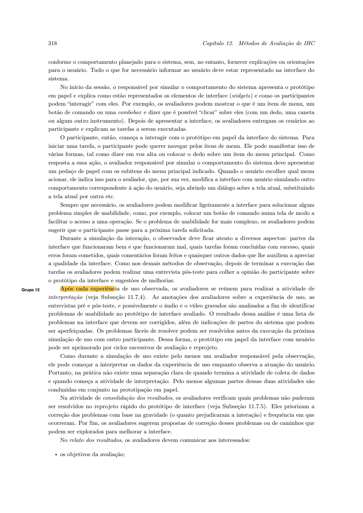{ loading=lazy }
    
Figura 1 — Operação e interpretação conjunta na prototipação em papel.

    
Fonte: capítulo Métodos de avaliação de IHC enviado ao projeto [2], p. 318 (correspondente a Barbosa e Silva, 2010, p. 360–361 [1]).

??? note "Figura 2 — Conteúdo do relato: problemas corrigidos, recorrência e pendências"

    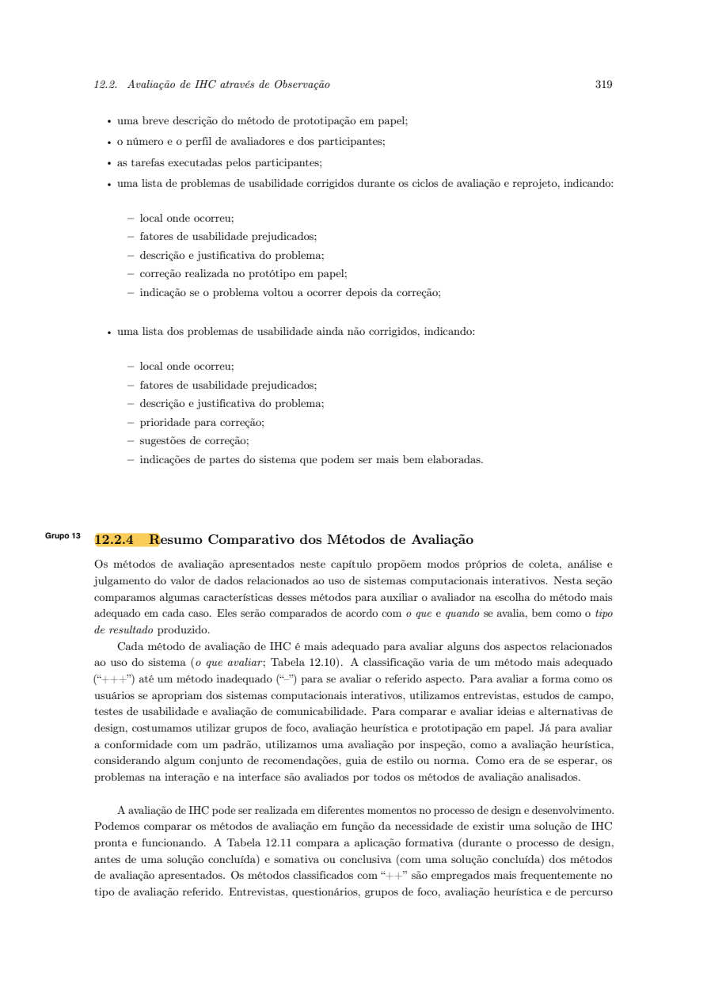{ loading=lazy }
    
Figura 2 — Relato de problemas corrigidos e pendentes no protótipo de papel.

    
Fonte: capítulo Métodos de avaliação de IHC enviado ao projeto [2], p. 319 (correspondente a Barbosa e Silva, 2010, p. 361–362 [1]).

## Método, material e execução

### Participantes e papéis na coleta

A Tabela 2 sintetiza a equipe e as condições efetivas da coleta realizada em **03/11/2026**, pelo Google Meet.

| Papel / condição | Registro efetivo na execução |
| --- | --- |
| Operador do papel e moderador | Bruno Ferreira Dornelas |
| Observadores na sessão remota | Luís Henrique Arruda Luna, Caio Breno de Souza Bezerra e Israel Soares de Paiva |
| Revisor do relato | Luís Henrique Arruda Luna |
| Participante principal (`PP-P01`) | Estudante, usuário de computador e celular; sem participação nas entrevistas da Etapa 5 |
| Teste-piloto / ensaio operacional | Gravado por Bruno em `03/11/2026` (`03min38s`), antes da sessão com `PP-P01` |
| Modalidade e versão avaliada | Google Meet com câmera voltada para a mesa; material modular em papel `v1.0` |

Tabela 2 — Equipe, participante e condições da sessão.

Fonte: registros da coleta de 03/11/2026.

**Caracterização:** Na caracterização inicial respondida antes do início das tarefas, `PP-P01` (estudante) relatou utilizar computador e celular e já ter considerado sugerir uma mudança legislativa no portal, desistindo ao encontrar várias ideias parecidas com a sua — nenhuma idêntica — sem possibilidade de propor um ajuste ou somar embasamento com seus conhecimentos a uma proposta existente, o que o desestimulou de criar uma nova ideia do zero sujeita à meta de 20 mil apoios. Ao pesquisar novamente o assunto no portal algum tempo depois, percebeu que apenas uma daquelas propostas semelhantes havia alcançado os 20 mil apoios, aparentando não ter avançado posteriormente, e apontou a ausência de avisos por e-mail sobre as ideias apoiadas como principal obstáculo para retornar e acompanhar resultados.

**Questões éticas:** O consentimento para gravação foi confirmado no início da sessão ([00:18–00:24](https://www.youtube.com/watch?v=NXZXAFz9dvE&t=18s)), enquadrando apenas as folhas sobre a mesa, sem exposição facial. Embora o prenome do participante tenha sido pronunciado na saudação inicial da gravação, este relato utiliza exclusivamente o código **`PP-P01`**, mantendo dados de identificação fora do texto público e preservando o compromisso de exclusão dos arquivos brutos em até 30 dias após o encerramento da disciplina.

### Material construído (`v1.0`) — Moldura fixa e recortes móveis

Seguindo a orientação de Barbosa e Silva (2010, p. 358 [1]) para preparação de estrutura estática combinada a pedaços de papel móveis, o protótipo `v1.0` foi construído com **1 folha-base fixa (`PP-B01`)** representando o cabeçalho do Portal e-Cidadania e **10 recortes móveis** sobrepostos na área central conforme as ações de `PP-P01`. A Tabela 3 documenta as 11 peças fotografadas antes da sessão, e a Figura 3 reúne os registros visuais preservados no repositório.

| Código / Peça | Função no fluxo e vínculo com o planejamento | Arquivo fotográfico |
| --- | --- | --- |
| `PP-B01` (Moldura fixa) | Cabeçalho `e-Cidadania`, menu (`Sobre`, `Ideia Legislativa`, `Evento Interativo`, `Consulta Pública`, `Oficina Legislativa`) e quadro central para encaixe dos recortes | [20261103_215327.jpg](../../../assets/img/entrega-6/bruno/20261103_215327.jpg) |
| `PP-S01-busca` | Recorte inicial da barra de pesquisa em branco (`Encontre as ideias que você procura: [___] [BUSCAR]`) | [20261103_215348.jpg](../../../assets/img/entrega-6/bruno/20261103_215348.jpg) |
| `PP-S01a` | Lista de resultados para `"Bibliotecas comunitárias"`, exibindo `"Incentivo às bibliotecas comunitárias"` (`60%`, `12.343 apoios confirmados`, `meta 20.000`, `Apoios abertos até 5 de janeiro de 2027`) e uma segunda ideia encerrada (`9.110 apoios`), sem botões diretos de apoio ou complemento na listagem | [20261103_215359.jpg](../../../assets/img/entrega-6/bruno/20261103_215359.jpg) |
| `PP-S01b` | Página da ideia selecionada (`Incentivo às bibliotecas comunitárias`), com barra de `60%`, botão `[APOIAR ESTA IDEIA]`, aviso `"Ainda não há complementos para essa ideia"`, botão `[SUGERIR COMPLEMENTO A ESTA IDEIA]` e `"Linha do tempo"` | [20261103_215411.jpg](../../../assets/img/entrega-6/bruno/20261103_215411.jpg) |
| `PP-X-login` | Cartão modal de autenticação simulada (`Para participar, acesse com sua conta gov.br` — `[Entrar com gov.br]`) | [20261103_215424.jpg](../../../assets/img/entrega-6/bruno/20261103_215424.jpg) |
| `PP-S02` | Formulário de sugestão de complemento com link `<- Voltar para a ideia selecionada`, explicação da ordem (`Fluxo: 1. autor analisa -> 2. sua decisão -> 3. moderação`), campos `1. Título / ponto principal do complemento` e `2. Texto e justificativa da contribuição`, e botões `[Editar]` e `[Confirmar envio ao autor]` | [20261103_215436.jpg](../../../assets/img/entrega-6/bruno/20261103_215436.jpg) |
| `PP-X01a` | Tira de estado de espera após o envio: `"AGUARDANDO ANALISE DO AUTOR — Próximo passo depende do autor antes de ir a moderação"` | [20261103_215500.jpg](../../../assets/img/entrega-6/bruno/20261103_215500.jpg) |
| `PP-S03` | Tela de retorno do autor (`Compare as duas versões:`), com quadros lado a lado (`Seu texto enviado / Autor:` e `Ajuste proposto pelo autor / Autor da ideia:`) e botões `[Concordar com o ajuste e enviar para moderação]` e `[Não concordar com o ajuste]` | [20261103_215530.jpg](../../../assets/img/entrega-6/bruno/20261103_215530.jpg) |
| `PP-X01b` | Tira de estado pós-concordância: `"AGUARDANDO MODERAÇÃO DO PORTAL — Você concordou com o ajuste. Aguardando liberação da moderação"` | [20261103_215542.jpg](../../../assets/img/entrega-6/bruno/20261103_215542.jpg) |
| `PP-S04` | Página da ideia com o complemento publicado (`1. Incentivar atendimento noturno conforme demanda`, `[40 apoios]`, botão `[Apoiar este complemento]` e observação sobre ausência de garantia de implementação automática) | [20261103_215554.jpg](../../../assets/img/entrega-6/bruno/20261103_215554.jpg) |
| `PP-S05` | Estado atualizado após a meta: `"STATUS: Encaminhada para análise na Comissão (CDH)"`, aviso de que o envio encerra a coleta de apoios mas não garante aprovação automática, `"1. Ideia legislativa principal (Autor: Carlos Mendes)"` e `"2. Anexos consultivos: Anexo consultivo 1: Atendimento noturno"` | [20261103_215602.jpg](../../../assets/img/entrega-6/bruno/20261103_215602.jpg) |

Tabela 3 — Inventário das folhas e recortes construídos na versão v1.0.

Fonte: acervo fotográfico da preparação do protótipo (03/11/2026).

??? note "Figura 3 — Fotografias da moldura fixa e dos recortes móveis utilizados (`v1.0`)"

    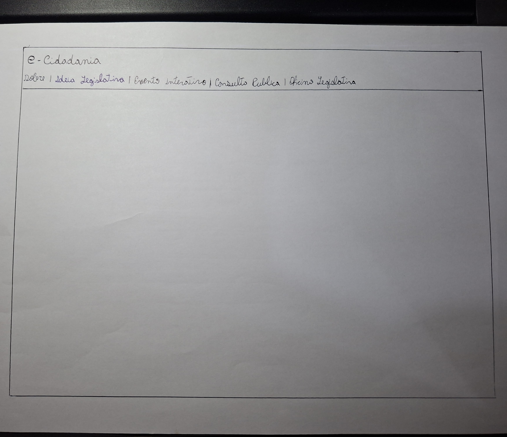{ loading=lazy }
    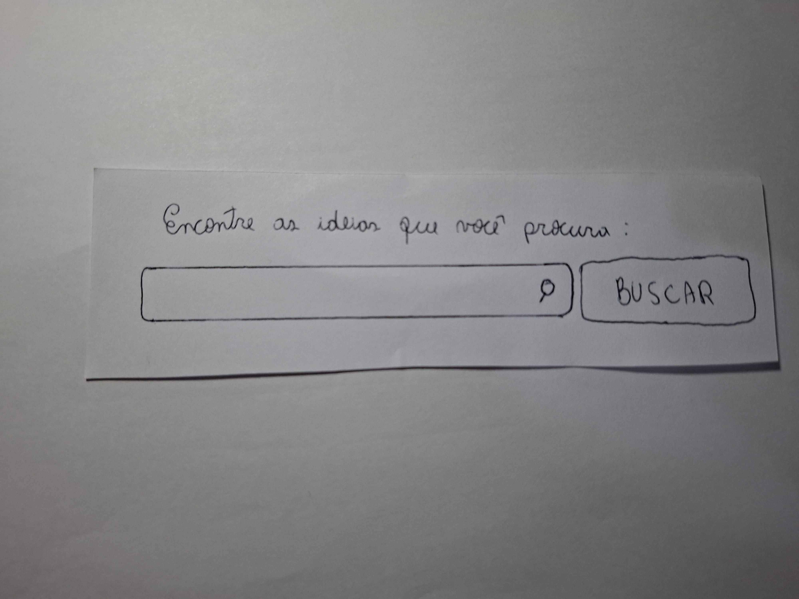{ loading=lazy }
    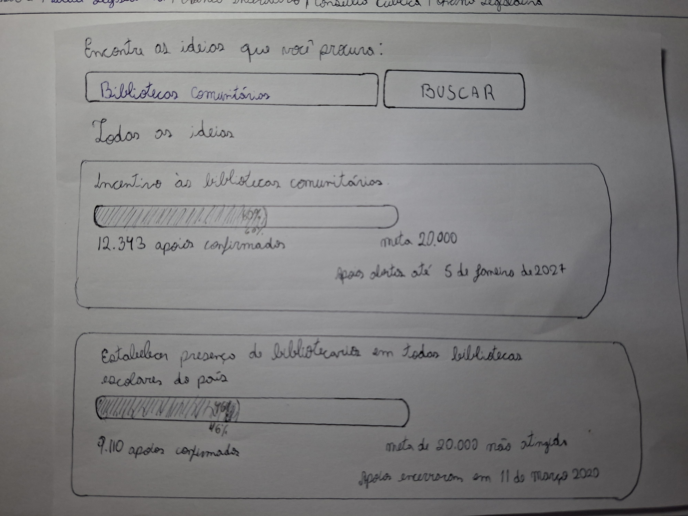{ loading=lazy }
    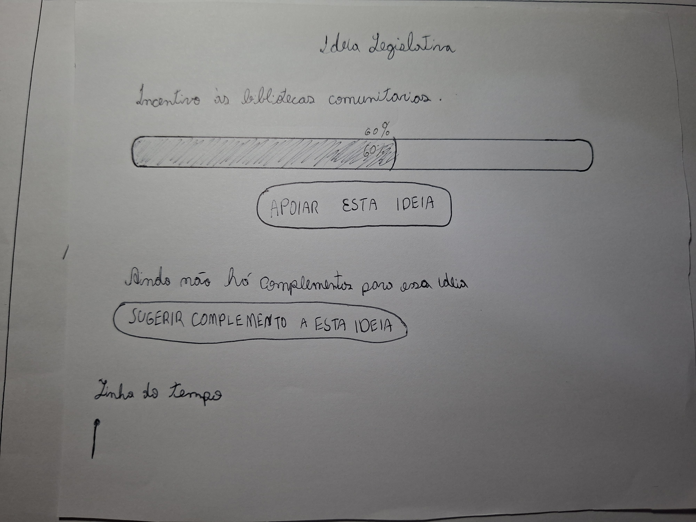{ loading=lazy }
    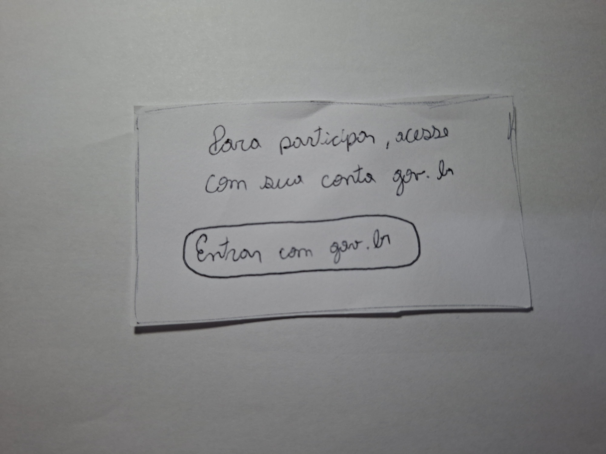{ loading=lazy }
    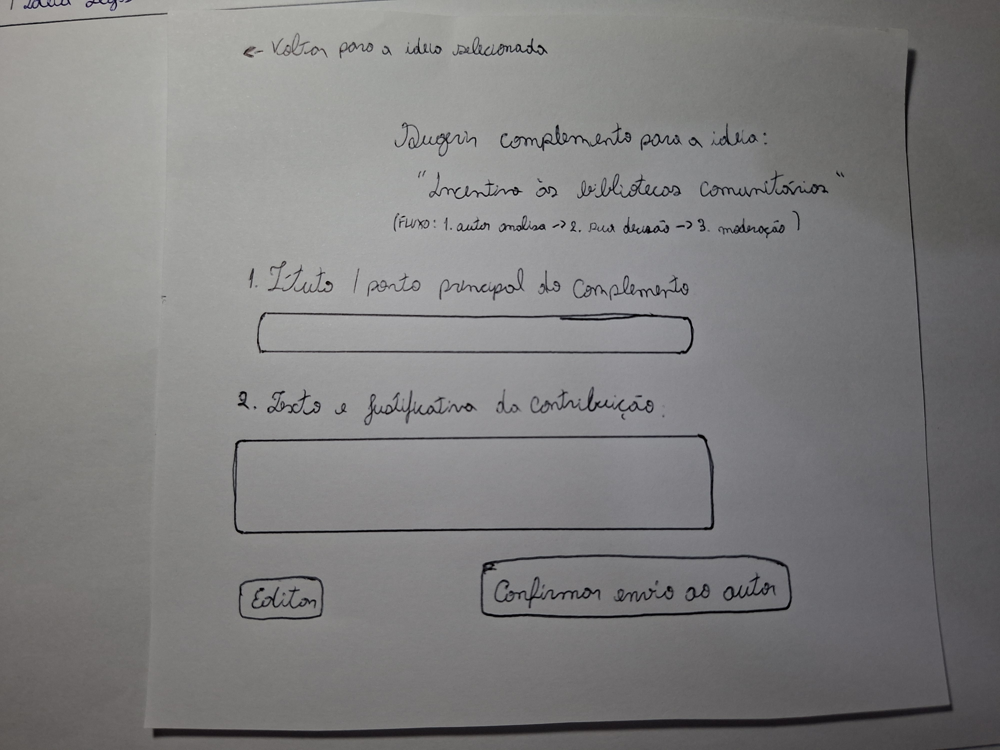{ loading=lazy }
    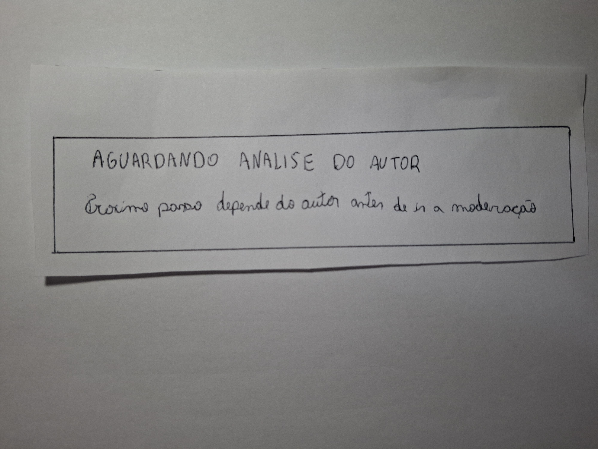{ loading=lazy }
    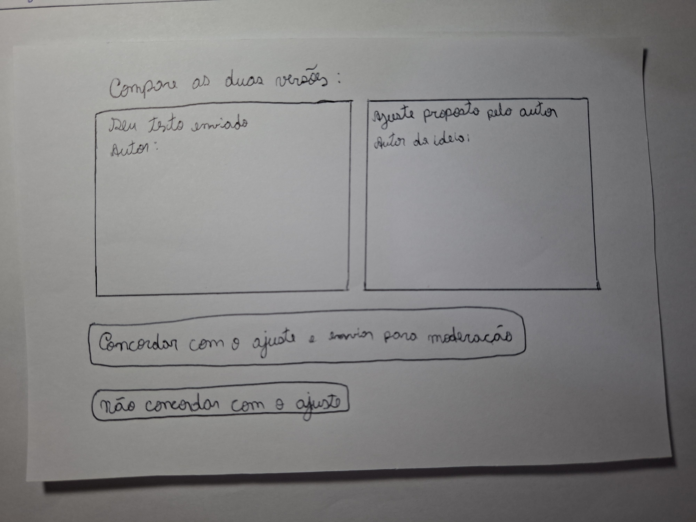{ loading=lazy }
    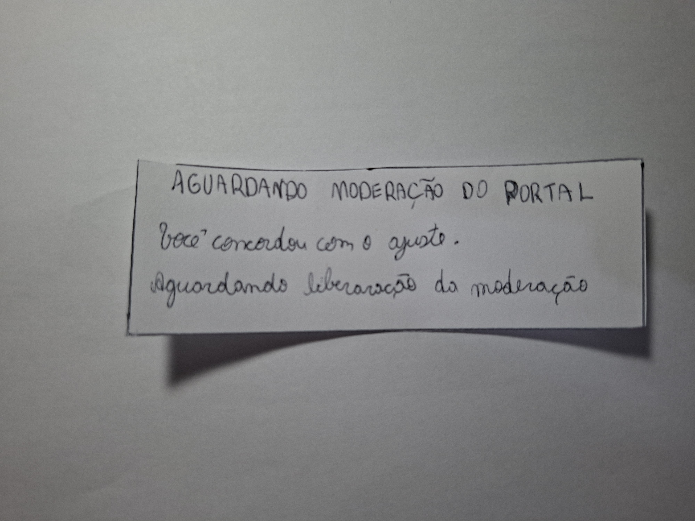{ loading=lazy }
    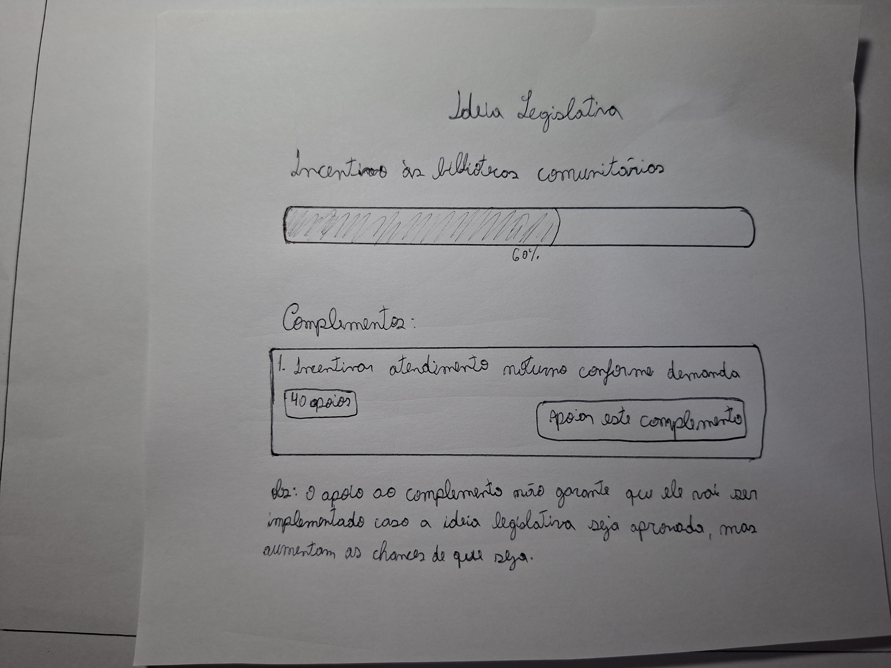{ loading=lazy }
    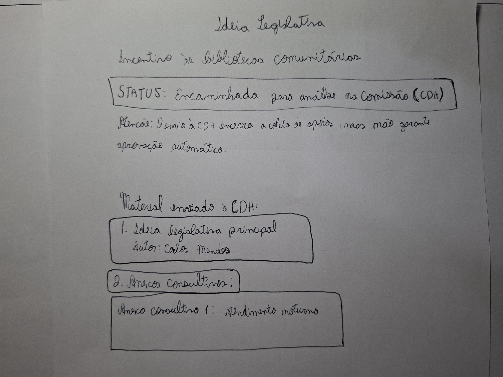{ loading=lazy }
    
Figura 3 — Peças desenhadas à mão para a versão v1.0 do protótipo de papel.

    
Fonte: elaboração de Bruno Ferreira Dornelas (03/11/2026).

### Teste-piloto / ensaio operacional prévio

Antes da sessão com `PP-P01`, Bruno realizou e gravou um ensaio operacional do protótipo em **03/11/2026** (`03min38s`, Vídeo 1) para inspecionar o enquadramento da câmera sobre a moldura fixa, a legibilidade da caligrafia em vídeo e a ordem de sobreposição das 11 peças (`PP-S01-busca` a `PP-S05`). Como desvio em relação ao planejamento — que previa um participante externo e o segundo avaliador já no piloto —, o ensaio foi executado individualmente pelo operador percorrendo em voz alta todas as transições das quatro tarefas ([00:11–03:32](https://www.youtube.com/watch?v=2hNhL3mdKMs&t=11s)). Os dados desse ensaio não integram a análise de resultados de `PP-P01`.

??? note "Vídeo 1 — Teste-piloto / ensaio operacional do protótipo de papel — 03/11/2026"

    

      <iframe
        loading="lazy"
        style="position: absolute; top: 0; left: 0; width: 100%; height: 100%; border: 0;"
        src="https://www.youtube-nocookie.com/embed/2hNhL3mdKMs"
        title="Teste piloto protótipo de papel — 03/11/2026"
        allow="accelerometer; autoplay; clipboard-write; encrypted-media; gyroscope; picture-in-picture; web-share"
        referrerpolicy="strict-origin-when-cross-origin"
        allowfullscreen>
      </iframe>
    

    
Vídeo 1 — Verificação prévia das folhas e transições do protótipo de papel (03min38s).

    
Fonte: gravação de Bruno Ferreira Dornelas (03/11/2026).

[Abrir gravação do teste-piloto no YouTube](https://www.youtube.com/watch?v=2hNhL3mdKMs).

## Tarefas executadas e sumário de evidências

A gravação da sessão principal com `PP-P01` possui **06min30s** (Vídeo 2). A Tabela 4 registra o resultado de cada tarefa segundo os critérios definidos no [planejamento do relato](../../../entrega-5/individual/bruno/planejamento-relato-prototipo-papel.md#registro-das-tarefas-efetivamente-executadas), e a Tabela 5 detalha as evidências (`PP-EV01` a `PP-EV09`) com localizadores exatos no vídeo.

??? note "Vídeo 2 — Sessão de validação do protótipo de papel com PP-P01 — 03/11/2026"

    

      <iframe
        loading="lazy"
        style="position: absolute; top: 0; left: 0; width: 100%; height: 100%; border: 0;"
        src="https://www.youtube-nocookie.com/embed/NXZXAFz9dvE"
        title="Validação do protótipo de papel com PP-P01 — 03/11/2026"
        allow="accelerometer; autoplay; clipboard-write; encrypted-media; gyroscope; picture-in-picture; web-share"
        referrerpolicy="strict-origin-when-cross-origin"
        allowfullscreen>
      </iframe>
    

    
Vídeo 2 — Validação do protótipo de papel com PP-P01 (06min30s).

    
Fonte: gravação da sessão remota no Google Meet (03/11/2026), disponibilizada com autorização.

[Abrir gravação da validação no YouTube](https://www.youtube.com/watch?v=NXZXAFz9dvE).

| Tarefa | Estado / material efetivo | Resultado | Evidências, ajuda e desvios observados |
| --- | --- | --- | --- |
| **PP-T1** — Localizar ideia e decidir como participar | `PP-B01` + `PP-S01-busca` → `PP-S01a` → `PP-S01b` → `PP-X-login` → `PP-S01b` | **Concluída sem ajuda** | `PP-EV02`, `PP-EV03`. Pesquisou na barra de busca (`01:08`), selecionou primeiro a ideia na lista de resultados (`01:31`), decidiu apoiar a ideia original antes (`01:55`), autenticou-se no cartão `gov.br` (`02:10`) e acionou `[Sugerir complemento a esta ideia]` (`02:21`). |
| **PP-T2** — Redigir, revisar e enviar | `PP-S02` → `PP-X01a` | **Concluída parcialmente (desvio de condução na espera)** | `PP-EV04`, `PP-EV05`. Indicou preenchimento de título e texto e confirmou o envio sem ajuda (`02:36–02:44`). Ao exibir `PP-X01a` (`02:55`), o operador antecipou tratar-se de uma tela de transição na qual não havia ação a realizar, suprimindo a etapa de nova consulta sem atualização. |
| **PP-T3** — Examinar ajuste e decidir | `PP-S03` → `PP-X01b` | **Concluída sem ajuda (no ramo de concordância)** | `PP-EV06`. Diante da comparação em `PP-S03`, escolheu concordar com o ajuste e enviar para a moderação (`03:13–03:17`), visualizando `PP-X01b`. Não foi solicitada justificativa sobre a diferença textual antes da transição; o ramo `PP-X02` não foi percorrido (**não avaliado**). |
| **PP-T4** — Conferir publicação e encaminhamento | `PP-S01a` → `PP-S04` → `PP-S05` | **Concluída com ajuda / explicação do moderador e dúvida de autoria** | `PP-EV07`, `PP-EV08`, `PP-EV09`. Reabriu a ideia (`04:10`) e clicou em `[Apoiar este complemento]` em `PP-S04` (`04:25`), revelando ao final (`06:01–06:12`) dúvida sobre se aquele botão referia-se ao complemento de outra pessoa ou ao seu próprio. Em `PP-S05` (`04:31–04:53`), o moderador anunciou o alcance dos `20.000 apoios` antes de colher interpretação espontânea. |

Tabela 4 — Registro das tarefas executadas na sessão principal.

Fonte: análise da gravação de 03/11/2026.

| ID | Tarefa / tela | Questão DECIDE | Localizador no vídeo | Ação, retorno e fala verificável ou paráfrase | Intervenção / ajuda do avaliador |
| --- | --- | --- | --- | --- | --- |
| **PP-EV01** | Abertura e consentimento | Ética | [00:01–00:24](https://www.youtube.com/watch?v=NXZXAFz9dvE&t=1s) | Bruno apresenta o objetivo de validar o protótipo em papel e solicita autorização para gravar; `PP-P01` concorda (**“Sim, sim”**, `00:23`). | Pergunta direta de consentimento antes da instrução. |
| **PP-EV02** | `PP-T1` / `PP-S01-busca` → `PP-S01a` | `PP-Q1` | [00:41–01:22](https://www.youtube.com/watch?v=NXZXAFz9dvE&t=41s) | Após ouvir a proposta da tarefa, `PP-P01` inicia pela barra de pesquisa: **“Primeiro eu vou tentar escrever alguma coisa ali na barra de busca, né, para buscar realmente”** (`01:08–01:13`). | Na instrução inicial (`00:41–00:55`), o moderador já menciona procurar ideia sobre bibliotecas comunitárias e sugerir um complemento. |
| **PP-EV03** | `PP-T1` / `PP-S01a` → `PP-S01b` → `PP-X-login` | `PP-Q1` | [01:31–02:23](https://www.youtube.com/watch?v=NXZXAFz9dvE&t=91s) | `PP-P01` seleciona a primeira ideia nos resultados (**“Eu posso clicar nessa primeira ideia?”**, `01:31`), opta primeiro por apoiar a ideia original (`01:55`), clica em entrar com `gov.br` (`02:10`) e em seguida aciona **“sugerir um complemento para essa ideia”** (`02:21–02:23`). | Sem ajuda para localizar controles; em `02:15` o operador confirma verbalmente que o participante já está logado. |
| **PP-EV04** | `PP-T2` / `PP-S02` | `PP-Q2` | [02:36–02:44](https://www.youtube.com/watch?v=NXZXAFz9dvE&t=156s) | No formulário de complemento, `PP-P01` indica o preenchimento de título e texto/justificativa e aciona **“confirmar o envio”** (`02:36–02:44`). | Sem ajuda. |
| **PP-EV05** | `PP-T2` / `PP-X01a` | `PP-Q2`, `PP-Q4` | [02:55–03:00](https://www.youtube.com/watch?v=NXZXAFz9dvE&t=175s) | Diante da tira `PP-X01a` (*Aguardando análise do autor*), `PP-P01` apenas concorda com a passagem (`03:00`). | **Explicação antecipada do operador (`02:55–02:58`):** informa que é uma tela de transição em que não há muito o que fazer, impedindo observar reação espontânea ou nova consulta sem atualização. |
| **PP-EV06** | `PP-T3` / `PP-S03` → `PP-X01b` | `PP-Q3`, `PP-Q4` | [03:13–03:36](https://www.youtube.com/watch?v=NXZXAFz9dvE&t=193s) | Ao examinar `PP-S03`, `PP-P01` decide: **“Vou concordar com esse ajuste e enviar para a moderação”** (`03:13–03:17`), recebendo em seguida a tira `PP-X01b` (*Aguardando moderação do portal*). | Escolha do controle sem ajuda; não foi perguntado o motivo da concordância nem o efeito do ajuste sobre a intenção inicial. |
| **PP-EV07** | `PP-T4` / `PP-S01a` → `PP-S04` | `PP-Q5`, `PP-Q6` | [03:39–04:25](https://www.youtube.com/watch?v=NXZXAFz9dvE&t=219s) | Após orientação para verificar como ficou o complemento na página da ideia, `PP-P01` clica na mesma ideia que havia complementado (`04:10–04:14`) e, ao visualizar `PP-S04`, declara: **“Beleza, eu vou apoiar esse complemento”** (`04:25`). | Em `03:39–04:05`, o moderador contextualiza o retorno à busca para consultar se o complemento foi aprovado. |
| **PP-EV08** | `PP-T4` / `PP-S05` | `PP-Q6` | [04:31–04:53](https://www.youtube.com/watch?v=NXZXAFz9dvE&t=271s) | O operador apresenta `PP-S05` e `PP-P01` confirma a visualização (`04:53`). | **Explicação prévia do moderador (`04:31–04:46`):** anuncia que o cenário mostra o resultado após passar um tempo e atingir mais de 20.000 apoios, sem solicitar leitura espontânea do anexo consultivo ou do aviso da CDH. |
| **PP-EV09** | Entrevista pós-teste (`PP-S04` e fluxo geral) | `PP-Q1–PP-Q5` | [05:05–06:20](https://www.youtube.com/watch?v=NXZXAFz9dvE&t=305s) | `PP-P01` afirma que o fluxo estava intuitivo e bem explicado (`05:19–05:57`), mas relata uma dúvida específica sobre `PP-S04`: **“Só tive dúvida no final, estava em que aparecer lá a opção de apoiar o complemento. Era justamente para esse complemento aí de outra pessoa?”** (`06:01–06:12`). | Perguntas abertas pós-teste (`05:05`, `05:45`); em `06:15–06:17`, o moderador esclarece que se tratava do próprio complemento enviado pelo participante. |

Tabela 5 — Evidências localizáveis da sessão com PP-P01.

Fonte: transcrição e análise da gravação de 03/11/2026.

## Análise e respostas às perguntas de avaliação (DECIDE)

A Tabela 6 responde às questões `PP-Q1` a `PP-Q6` do [planejamento da avaliação](../../../entrega-5/individual/bruno/planejamento-avaliacao-prototipo-papel.md#e-explorar-as-perguntas) com base exclusiva nas evidências observadas.

| Questão de avaliação | Resposta analítica | Evidências | Limites e encaminhamento |
| --- | --- | --- | --- |
| **PP-Q1** — A pessoa encontra uma ideia pertinente e distingue complementar de criar outra ideia? (`PP-O1`) | `PP-P01` localizou a barra de pesquisa, identificou a proposta `"Incentivo às bibliotecas comunitárias"` na listagem `PP-S01a`, abriu primeiro a página da ideia (`PP-S01b`), realizou o apoio inicial à proposta principal e em seguida acionou `[Sugerir complemento a esta ideia]`. Na caracterização prévia, também relatou já ter desistido de participar no portal justamente por não existir meio de ajustar ou complementar propostas semelhantes já abertas. | Caracterização inicial; `PP-EV02`, `PP-EV03` | Como a instrução verbal inicial (`00:41–00:55`) já mencionou sugerir um complemento, a preferência espontânea entre criar nova ideia e complementar uma existente deve ser verificada na alta fidelidade sem antecipar o nome do controle no enunciado. |
| **PP-Q2** — Consegue redigir, revisar e enviar a contribuição, reconhecendo a confirmação? (`PP-O1`) | Em `PP-S02`, `PP-P01` compreendeu imediatamente os campos de título e justificativa e acionou `[Confirmar envio ao autor]` sem hesitação (`02:36–02:44`), visualizando em seguida a tira de confirmação `PP-X01a`. | `PP-EV04`, `PP-EV05`, `PP-EV09` | Os textos fictícios não chegaram a ser manuscritos no papel durante a sessão e a revisão com o botão `[Editar]` não foi exercitada; no protótipo de alta fidelidade, exigir preenchimento/seleção efetiva e conferência antes do envio (`AF-T2`). |
| **PP-Q3** — Compara versões e decide sobre o ajuste preservando sua intenção? (`PP-O1`/`PP-O2`) | Ao receber `PP-S03`, `PP-P01` identificou as opções de decisão e escolheu `[Concordar com o ajuste e enviar para moderação]` (`03:13–03:17`). Contudo, como os quadros de comparação em `PP-S03` continham apenas os cabeçalhos (`Seu texto enviado` vs. `Ajuste proposto pelo autor`) sem a redação literal preenchida dentro das caixas ([20261103_215530.jpg](../../../assets/img/entrega-6/bruno/20261103_215530.jpg)), não há evidência de que o participante tenha avaliado o efeito semântico da restrição proposta pelo autor sobre sua intenção inicial. | `PP-EV06`; foto de `PP-S03` | Preencher integralmente os dois textos comparados na interface de alta fidelidade e incluir pergunta pós-tarefa imediata sobre a diferença percebida e o caminho de discordância (`PP-X02`). |
| **PP-Q4** — Distingue ações próprias, retorno do autor e moderação, reconhecendo quem pode agir durante as esperas? (`PP-O2`) | Na entrevista pós-teste (`05:45–05:57`), `PP-P01` declarou ter compreendido a sequência entre apoiar a ideia, sugerir o complemento e aguardar aprovação, apoiado pelos rótulos explícitos em `PP-S02`, `PP-X01a` e `PP-X01b`. Todavia, a intervenção do operador em `02:55–02:58` classificando `PP-X01a` como tela de transição sem ação possível impediu verificar se o participante reconheceria autonomamente de quem dependia o próximo passo durante uma consulta sem atualização. | `PP-EV05`, `PP-EV06`, `PP-EV09` | Evitar intervenções explicativas nas telas de espera durante a avaliação de alta fidelidade e incluir aviso claro de notificação por e-mail sobre mudanças de etapa. |
| **PP-Q5** — Distingue ideia original, complemento e respectivos apoios? (`PP-O2`) | `PP-P01` distinguiu o ato de apoiar a ideia principal (`01:55` em `PP-S01b`) do ato de sugerir e visualizar o complemento (`02:21` e `04:25`). Entretanto, ao encontrar o botão `[Apoiar este complemento]` habilitado ao lado de `[40 apoios]` em `PP-S04` sem indicação de que aquele item era de sua própria autoria, acionou o botão (`04:25`) e questionou no pós-teste se estava diante do complemento de outra pessoa (`06:01–06:12`). | `PP-EV03`, `PP-EV07`, `PP-EV09`; foto de `PP-S04` | Identificar explicitamente a autoria no card do complemento publicado (`Autora: Letícia Oliveira — Seu complemento`) e diferenciar o estado do botão para a própria autora em relação a complementos de terceiros. |
| **PP-Q6** — Distingue publicação e encaminhamento, reconhece o término do acompanhamento proposto e interpreta o envio para análise sem confundi-lo com aprovação legislativa? (`PP-O2`) | As folhas `PP-S04` e `PP-S05` separaram visualmente o estado publicado em coleta de apoios (`60%`) do estado `"Encaminhada para análise na Comissão (CDH)"` com `"Anexo consultivo 1: Atendimento noturno"` e o aviso de que o envio encerra a coleta de apoios sem garantir aprovação automática. Contudo, como o moderador apresentou `PP-S05` já explicando o resultado após os 20.000 apoios (`04:31–04:46`), os dados são insuficientes para comprovar a interpretação espontânea de `PP-P01` sobre essa distinção sem ajuda. | `PP-EV07`, `PP-EV08`; fotos de `PP-S04` e `PP-S05` | Na avaliação de alta fidelidade (`AF-T4`), solicitar que a pessoa explique o significado de `PP-S04` e de `PP-S05` antes de qualquer síntese verbal do moderador. |

Tabela 6 — Matriz de análise do DECIDE para o protótipo de papel.

Fonte: interpretação conjunta dos registros da sessão de 03/11/2026.

### Rastreabilidade em relação às decisões da Etapa 5

A Tabela 7 confronta as quatro decisões de design originadas nos relatos das entrevistas de 24/10/2026 ([Tabela 6 do planejamento](../../../entrega-5/individual/bruno/planejamento-avaliacao-prototipo-papel.md#decisoes-a-partir-das-entrevistas)) com o que foi efetivamente construído nas folhas e observado na sessão de 03/11/2026.

| Origem na Etapa 5 | Decisão implementada no papel (`v1.0`) | Evidência observada em 03/11/2026 | Encaminhamento para a alta fidelidade |
| --- | --- | --- | --- |
| **A01** — Decisão da proponente pouco explícita sobre o ajuste do autor | `PP-S03` incluiu dois quadros lado a lado e os botões `[Concordar com o ajuste e enviar para moderação]` e `[Não concordar com o ajuste]`. | `PP-EV06`: `PP-P01` selecionou espontaneamente concordar (`03:13`), mas as caixas de texto estavam sem a redação detalhada preenchida e o ramo `PP-X02` não foi testado. | Exibir os dois textos completos com grifo na alteração proposta e criar tela/modal funcional para o ramo `PP-X02` (não concordar). |
| **AT-A01** e **A02** — Publicação tomada como término; apoios separados e desfecho não verificados | `PP-S04` apresentou o complemento publicado com `[40 apoios]` e observação sobre não garantir implementação; `PP-S05` apresentou o status `"Encaminhada para análise na Comissão (CDH)"`, aviso de não aprovação automática e `"Anexo consultivo 1: Atendimento noturno"`. | `PP-EV07–09`: `PP-P01` teve dúvida sobre a autoria do complemento em `PP-S04` (`06:01–06:12`), e `PP-S05` foi precedida de explicação do moderador (`04:31–04:46`). | Rotular claramente a autoria no card do complemento, exibir contadores absolutos em ambos os textos (`12.343 / 20.000` vs. `40 apoios`) e colher leitura espontânea de `PP-S05`. |
| **A03** e **AT-A03** — Ordem ambígua entre avaliação do autor e moderação no `QD04` | `PP-S02` explicitou `"Fluxo: 1. autor analisa -> 2. sua decisão -> 3. moderação"`, reforçado pelas tiras `PP-X01a` e `PP-X01b`. | `PP-EV05`, `PP-EV06`, `PP-EV09`: ordem consistente em todo o material construído; `PP-P01` declarou clareza no fluxo (`05:45–05:57`). | Manter a barra de etapas numerada (`1. Autor -> 2. Sua decisão -> 3. Moderação -> 4. Publicado`) em todas as telas do fluxo de alta fidelidade. |
| **AT-A02** — Lacunas de contexto inicial, responsabilidades nas esperas e exceções | Caracterização inicial aplicada com 4 perguntas abertas; tiras `PP-X01a` e `PP-X01b` desenhadas com indicação do responsável pela etapa. | Caracterização inicial trouxe evidência concreta sobre desistência diante da meta de 20.000 apoios e falta de avisos por e-mail; na sessão, `PP-X01a` foi abreviada pelo operador (`02:55`). | Incorporar aviso de notificação por e-mail nas telas de espera e observar a consulta de acompanhamento sem antecipar que se trata de tela estática. |

Tabela 7 — Rastreabilidade entre achados da Etapa 5, protótipo de papel e alta fidelidade.

Fonte: elaboração do projeto (2026).

## Problemas corrigidos e problemas pendentes

Seguindo Barbosa e Silva (2010, p. 361–362 [1]), os problemas identificados foram divididos entre **problemas corrigidos no protótipo em papel** (Tabela 8) e **problemas pendentes / decisões de reprojeto para o protótipo de alta fidelidade** (Tabela 9).

### Problemas corrigidos no protótipo de papel

| ID e local | Fator de usabilidade afetado | Descrição e justificativa do problema | Correção realizada no protótipo em papel (`v1.0`) | Estado de recorrência após a correção |
| --- | --- | --- | --- | --- |
| **PP-C01** — `PP-S01a` e `PP-S01b` (Pesquisa e seleção da ideia) | Condução da interação e prevenção de erro (compreensão prévia do objeto da contribuição) | No esboço inicial da tela de busca (`PP-S01`), os botões de apoiar e sugerir complemento ficavam diretamente no card resumido da lista de resultados, permitindo enviar um complemento sem sequer clicar na ideia legislativa para ler seu conteúdo e verificar complementos existentes (operação `1.2` da HTA). | A etapa inicial foi dividida nos recortes `PP-S01a` (lista de resultados da busca apenas com os cards das ideias encontradas, [20261103_215359.jpg](../../../assets/img/entrega-6/bruno/20261103_215359.jpg)) e `PP-S01b` (detalhes da ideia selecionada com barra de progresso, aviso de complementos e botões `[APOIAR ESTA IDEIA]` e `[SUGERIR COMPLEMENTO A ESTA IDEIA]`, [20261103_215411.jpg](../../../assets/img/entrega-6/bruno/20261103_215411.jpg)), sobrepostos à moldura fixa `PP-B01`. | **Reavaliado, não observado nessa condição:** em `PP-EV03` ([01:31–01:35](https://www.youtube.com/watch?v=NXZXAFz9dvE&t=91s)), `PP-P01` selecionou espontaneamente a primeira ideia na lista para abrir `PP-S01b` antes de apoiar (`01:55`) e sugerir complemento (`02:21`). |
| **PP-C02** — `PP-S02`, `PP-X01a` e `PP-X01b` (Ordem entre autor e moderação) | Compreensão do estado do sistema e das responsabilidades (`A03` e `AT-A03`) | Na conferência documental da Etapa 5, o `QD04` do storyboard deixava ambíguo se a moderação ocorria antes ou depois da análise do autor da ideia e da decisão da proponente sobre o ajuste. | Foi incluída em `PP-S02` ([20261103_215436.jpg](../../../assets/img/entrega-6/bruno/20261103_215436.jpg)) a legenda explícita `"Fluxo: 1. autor analisa -> 2. sua decisão -> 3. moderação"`, acompanhada das tiras distintas `PP-X01a` (`AGUARDANDO ANALISE DO AUTOR — Próximo passo depende do autor antes de ir a moderação`, [20261103_215500.jpg](../../../assets/img/entrega-6/bruno/20261103_215500.jpg)) e `PP-X01b` (`AGUARDANDO MODERAÇÃO DO PORTAL`, [20261103_215542.jpg](../../../assets/img/entrega-6/bruno/20261103_215542.jpg)). | **Reavaliado parcialmente:** a inconsistência documental foi eliminada nas folhas e `PP-P01` relatou clareza sobre a sequência (`05:45–05:57`), mas a compreensão autônoma durante a espera permanece dependente de teste sem intervenção do moderador (`PP-A03`). |

Tabela 8 — Problemas corrigidos no protótipo em papel e verificação de recorrência.

Fonte: registros de construção (`v1.0`), teste-piloto e sessão principal de 03/11/2026.

### Problemas pendentes e encaminhamento para o protótipo de alta fidelidade

| ID e local | Fator afetado e natureza | Descrição, justificativa e evidência (gravidade e frequência) | Prioridade | Sugestão de correção e destino na alta fidelidade |
| --- | --- | --- | --- | --- |
| **PP-A01** — `PP-S04` ([20261103_215554.jpg](../../../assets/img/entrega-6/bruno/20261103_215554.jpg), card de complemento publicado) | Compreensão do significado dos elementos e identificação de autoria (Problema de interface) | O card do complemento publicado em `PP-S04` exibe `"1. Incentivar atendimento noturno conforme demanda"`, `[40 apoios]` e o botão ativo `[Apoiar este complemento]`, sem informar o nome da autora (`Letícia Oliveira`) nem indicar que se trata da contribuição enviada pela própria usuária logada. Como consequência, `PP-P01` acionou `[Apoiar este complemento]` em `04:25` (`PP-EV07`) e, ao final (`06:01–06:12`, `PP-EV09`), perguntou se aquele botão servia para apoiar o complemento de outra pessoa. Ocorrência: `1/1` oportunidade observada. | **Alta** | Exibir no card do complemento publicado a identificação explícita da proponente (`Autora: Letícia Oliveira`) acompanhada do selo **`Seu complemento publicado`**, diferenciando o controle exibido para a própria autora (ex.: indicar `"Seu apoio já está contabilizado"` ou separar visualmente um segundo complemento de terceiro caso se deseje testar apoio a complementos de outros cidadãos em `AF-T4`). Responsável: Bruno; implementar no protótipo de alta fidelidade antes da Etapa 7. |
| **PP-A02** — `PP-S03` ([20261103_215530.jpg](../../../assets/img/entrega-6/bruno/20261103_215530.jpg)) e ausência do cartão `PP-X02` | Completude da representação e controle do usuário sobre a preservação da intenção (Limitação do material em papel) | Na folha `PP-S03`, os dois quadros comparativos apresentaram apenas os títulos `"Seu texto enviado / Autor:"` e `"Ajuste proposto pelo autor / Autor da ideia:"`, sem os textos completos escritos dentro das caixas para leitura comparativa, e o cartão móvel do ramo de discordância (`PP-X02`) não chegou a ser confeccionado. Em `PP-EV06` (`03:13–03:17`), `PP-P01` clicou diretamente em concordar sem que pudesse contrastar a redação literal na folha. Ocorrência: `1/1` oportunidade na sessão. | **Alta** | Preencher integralmente no protótipo de alta fidelidade os dois blocos comparativos (`Texto original enviado por Letícia Oliveira` vs. `Ajuste sugerido por Carlos Mendes: "...conforme a demanda da comunidade e as condições de cada biblioteca"`), destacar visualmente o trecho alterado e implementar o estado interativo correspondente ao botão `[Não concordar com o ajuste]` (`PP-X02`, decisão em aberto com registro de motivo). Responsável: Bruno. |
| **PP-A03** — `PP-X01a`, `PP-X01b` e acompanhamento pós-envio | Previsibilidade do acompanhamento assíncrono e condução do teste (Interface e procedimento) | Na caracterização inicial, `PP-P01` apontou a ausência de notificações por e-mail como principal dificuldade para retornar ao portal e consultar o desfecho de uma proposta. Além disso, as tiras `PP-X01a` ([20261103_215500.jpg](../../../assets/img/entrega-6/bruno/20261103_215500.jpg)) e `PP-X01b` ([20261103_215542.jpg](../../../assets/img/entrega-6/bruno/20261103_215542.jpg)) não exibiam aviso de envio de e-mail nem controle de nova consulta, levando o operador a abreviar a tela em `02:55–02:58` (`PP-EV05`). | **Média** | Acrescentar nas telas de espera (`PP-X01a` e `PP-X01b`) da alta fidelidade um indicador de **notificação ativa por e-mail** (`"Você receberá um aviso no seu e-mail cadastrado assim que o autor / a moderação responder"`), um botão de `[Consultar status novamente]` e a regra de protocolo para que o moderador aguarde a leitura espontânea da pessoa sem anunciar que é apenas uma tela de transição. Responsável: Bruno. |
| **PP-A04** — `PP-S04` e `PP-S05` ([20261103_215554.jpg](../../../assets/img/entrega-6/bruno/20261103_215554.jpg) e [20261103_215602.jpg](../../../assets/img/entrega-6/bruno/20261103_215602.jpg)) | Clareza comparativa dos contadores e verificação espontânea do encaminhamento (Interface e condução) | Em `PP-S04`, a ideia principal mostrava apenas `60%` na barra, sem repetir o número absoluto de apoios (`12.343 / 20.000`) ao lado dos `[40 apoios]` do complemento; em `PP-S05`, o Anexo Consultivo 1 não repetia os `40 apoios` preservados nem o texto acordado, e o moderador explicou verbalmente que a ideia havia atingido `20.000 apoios` (`04:31–04:46`, `PP-EV08`) antes da leitura de `PP-P01`. | **Média** | Exibir sempre lado a lado os contadores absolutos e independentes da ideia original (`12.343 / 20.000 apoios` em `PP-S04` e `20.000 / 20.000 apoios` em `PP-S05`) e do complemento (`40 apoios próprios, que não somam na meta da ideia principal`), mantendo os `40 apoios` e o texto final visíveis dentro do card do `Anexo Consultivo #1` em `PP-S05`. Responsável: Bruno. |

Tabela 9 — Problemas pendentes e decisões de reprojeto para a alta fidelidade.

Fonte: análise conjunta das evidências da sessão e das fotografias das folhas (03/11/2026).

## Síntese, limites das conclusões e continuidade

A avaliação em papel confirmou a viabilidade do fluxo principal de pesquisa, seleção prévia da ideia legislativa (`PP-S01a` → `PP-S01b`), envio de complemento (`PP-S02`), decisão sobre ajuste do autor (`PP-S03`) e acompanhamento da publicação e do encaminhamento (`PP-S04` → `PP-S05`), além de revelar um problema concreto de comunicabilidade e autoria na tela de publicação (`PP-A01`, evidenciado em `04:25` e `06:01–06:12`).

**Limites das conclusões:** Os resultados referem-se a um único participante (`PP-P01`) em sessão remota mediada por vídeo, na qual o ensaio prévio foi realizado individualmente pelo operador e houve intervenções verbais antecipando o sentido das telas `PP-X01a` (`02:55`) e `PP-S05` (`04:31`). Portanto, a ausência de bloqueios operacionais não comprova ausência de outros problemas de usabilidade nem permite generalizar desempenho para toda a população de usuários do e-Cidadania.

**Continuidade na Etapa 6 e Etapa 7:** As quatro correções pendentes (`PP-A01` a `PP-A04`) orientam diretamente a construção do protótipo de alta fidelidade e serão verificadas nas tarefas `AF-T1` a `AF-T4` definidas no [planejamento da avaliação do protótipo de alta fidelidade](planejamento-avaliacao-alta-fidelidade.md) e estruturadas no [planejamento do relato de alta fidelidade](planejamento-relato-alta-fidelidade.md).

## Agradecimentos

A biblioteca `youtube-transcript-api` foi utilizada para extrair a transcrição com minutagem das gravações, e o assistente Antigravity (Google DeepMind) apoiou a organização das tabelas de evidências, a conferência das fotografias das folhas e a redação deste documento. O desenho manual das folhas, a condução do teste-piloto e da sessão com `PP-P01` e a responsabilidade acadêmica pelo conteúdo são de Bruno Ferreira Dornelas, com observação de Luís Henrique Arruda Luna, Caio Breno de Souza Bezerra e Israel Soares de Paiva.

## Histórico de versão

| Versão | Data | Descrição | Autor(es) | Revisor(es) |
| :---: | :---: | --- | --- | --- |
| `1.0` | 03/11/2026 | Relato completo da avaliação do protótipo de papel com vídeos do piloto e da sessão principal, fotografias das 11 peças e matriz de problemas corrigidos e pendentes | [Bruno Ferreira Dornelas](https://github.com/brunnf) | [Luís Henrique Arruda Luna](https://github.com/Donnk61) |

Tabela 10 — Histórico de versão.

Fonte: elaboração do projeto (2026).

## Referências

[1] BARBOSA, Simone Diniz Junqueira; SILVA, Bruno Santana da. **Interação humano-computador**. Rio de Janeiro: Elsevier, 2010. Seção 10.2.3 (Prototipação em Papel), p. 358–362; Planejamento e relato da avaliação, p. 307–313.

[2] **Métodos de avaliação de IHC**. Capítulo 12 do material enviado à disciplina, arquivo *Cap Metodos de avaliacao de IHC.pdf*. Seção 12.2.3, prototipação em papel, p. 315–319.

[3] **Planejamento da avaliação de IHC**. Capítulo 11 do material enviado à disciplina, arquivo *Cap. Planejamento ihc-ux.pdf*. Tabela 11.1 e DECIDE, p. 264–266, 275–280.

[4] GRUPO 06. **Complementos de ideias legislativas**: [Planejamento da avaliação do protótipo de papel](../../../entrega-5/individual/bruno/planejamento-avaliacao-prototipo-papel.md), [Planejamento do relato do protótipo de papel](../../../entrega-5/individual/bruno/planejamento-relato-prototipo-papel.md), [Relato do storyboard](../../../entrega-5/individual/bruno/relato-storyboard.md) e [Relato da análise de tarefas](../../../entrega-5/individual/bruno/relato-analise-tarefas.md). 2026.

[5] DORNELAS, Bruno Ferreira. [Teste piloto protótipo de papel](https://www.youtube.com/watch?v=2hNhL3mdKMs). 3 nov. 2026. Vídeo, 3min38s.

[6] DORNELAS, Bruno Ferreira. [Bruno — protótipo de papel (Validação com PP-P01)](https://www.youtube.com/watch?v=NXZXAFz9dvE). 3 nov. 2026. Vídeo, 6min30s.

