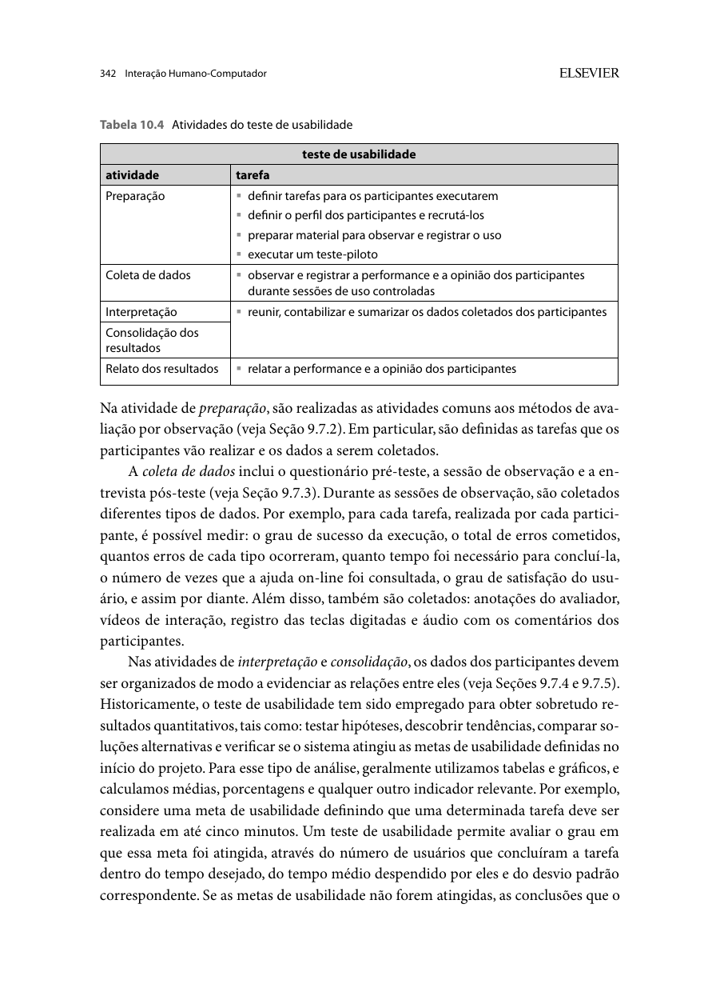
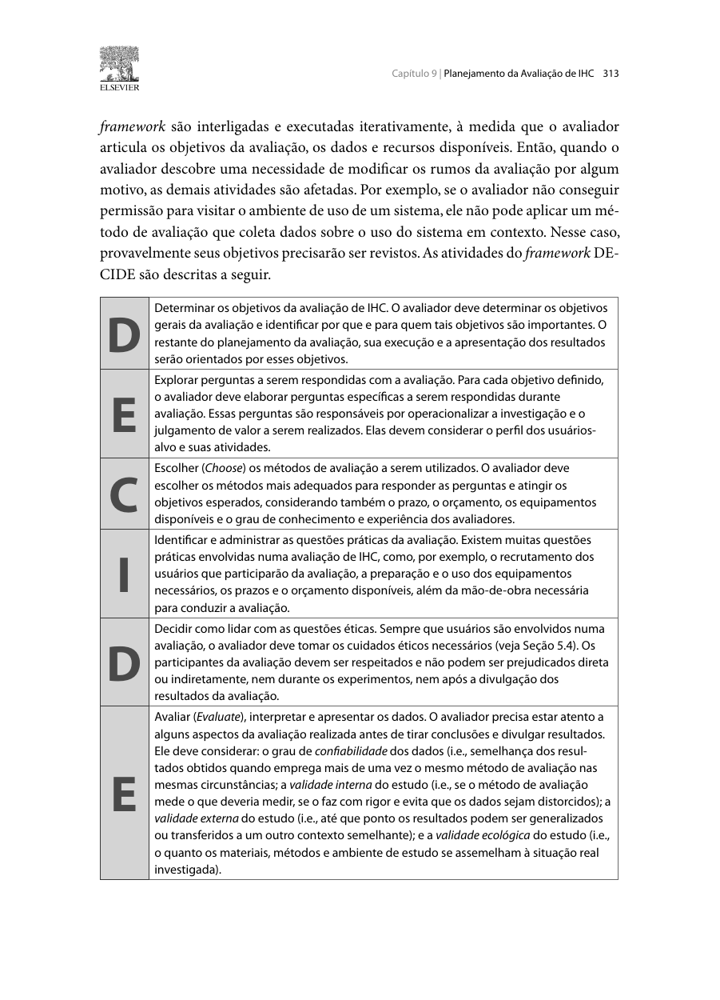
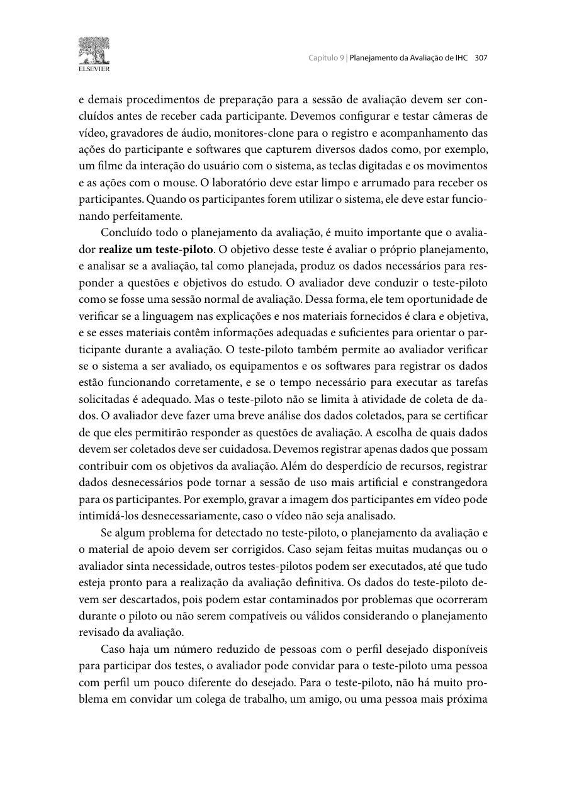

Responsável: Caio Breno de Souza Bezerra · Autor do item: Caio Breno de Souza Bezerra

# Planejamento da avaliação de alta fidelidade

## Tabela de contribuição

A Tabela 1 registra a contribuição neste artefato.

| Integrante | Contribuição | Artefato / atividade |
| --- | --- | --- |
| [Caio Breno de Souza Bezerra](https://github.com/CaioBezerra-Dev) | Definição do DECIDE, tarefas, critérios, piloto e instrumentos | [Conteúdo](#introducao) |
| Codex (OpenAI) | Apoio à consulta bibliográfica, redação, telas e organização | [Agradecimentos](#agradecimentos) |
| Grok (xAI) | Alinhamento do procedimento à sessão de 11/11 e à versão AF-1.2 | [Agradecimentos](#agradecimentos) |

Tabela 1 — Contribuição neste artefato.

Fonte: elaboração para o Grupo 06 (2026).

## Introdução

Este plano avalia o [protótipo navegável AF-1.2](../../../prototipos/caio/alta-fidelidade/index.html) de envio e acompanhamento de ideia legislativa. Retoma os pontos PAP-R01–PAP-R04 do [relato do papel](relato-prototipo-papel.md#analise-do-reprojeto). O relato desta avaliação está na **Etapa 7, entregue em 15/11/2026**; este documento e seu [planejamento de relato](planejamento-relato-alta-fidelidade.md) compõem a Etapa 6.

A versão `1.0` registra o procedimento da sessão de **11/11/2026**, que é o que a Etapa 7 relata.

[Abrir protótipo AF-1.2](../../../prototipos/caio/alta-fidelidade/index.html){ .md-button .md-button--primary }

## Fundamentação

**Autor do item:** Caio Breno de Souza Bezerra.

Barbosa e Silva (2010, seção 10.2.1, p. 341–343) descrevem o teste de usabilidade como observação de pessoas executando tarefas, com registro de desempenho e opinião. Aqui ele será **moderado e formativo**, pois buscamos problemas e causas para melhorar o design. O DECIDE (p. 312–313) organiza as seis decisões abaixo. As Figuras 1–3 apresentam os trechos utilizados.

## D — Determinar os objetivos

Verificar se o reprojeto permite concluir o envio corretamente e compreender seu resultado, com foco em: **AF-O1**, descoberta e continuidade; **AF-O2**, prevenção e correção antes do compromisso; **AF-O3**, recebimento e estados compreensíveis; **AF-O4**, acompanhamento e interpretação das atualizações. Público: pessoas adultas interessadas em propor uma mudança, próximas ao [perfil Proponente](../../../entrega-2/individual/caio/perfil-2/perfil-usuario.md).

## E — Explorar as perguntas

A Tabela 2 relaciona perguntas, tarefas e dados.

| Pergunta | Tarefa / origem | Dados para responder |
| --- | --- | --- |
| AF-Q1 — A pessoa encontra o envio e chega ao formulário após o acesso? | AF-T1 / RP01, PP-Q1 | Caminho, conclusão, desvios e ajuda |
| AF-Q2 — Consegue conferir e confirmar corretamente o texto? | AF-T2 / PAP-R01 | Leitura da revisão, confirmação da conferência e texto efetivado |
| AF-Q3 — Distingue recebimento, publicação e aprovação de lei? | AF-T3 / PAP-R02 e PAP-R04 | Explicação, referência DEMO-001 e próximo passo |
| AF-Q4 — Encontra a mesma ideia e compreende a atualização? | AF-T4 / PAP-R03 e PAP-R04 | Acesso ao registro, estado e interpretação do próximo passo |
| AF-Q5 — Que dificuldades e opiniões ajudam a melhorar as telas? | Todas | Ações, erros, falas, nota global ao final e sugestões localizadas |

Tabela 2 — Perguntas e evidências da alta fidelidade.

Fonte: elaboração para o Grupo 06 (2026).

## C — Escolher os métodos

**Teste de usabilidade moderado presencial.** AF-P01 e AF-P02 usam o protótipo no notebook, com mouse, e alternam a vez. Caio lê o cenário e não move o cursor durante o percurso. A pessoa diz o que espera e o que está pensando, sem indicação de qual controle acionar. A sessão termina com entrevista breve e uma nota global de 1 a 5. Cada pessoa fica registrada pela captura da tela e pela câmera da sala. O operador manual é necessário no papel; na alta fidelidade, as respostas são executadas pelo próprio protótipo.

Não executar envio no serviço oficial. O acesso de demonstração não pede credenciais. As telas funcionam em navegador, com estado apenas na memória da página; recarregar reinicia os dados. A avaliação limita-se ao comportamento implementado, não a integração, moderação ou segurança de produção.

## I — Questões práticas

### Pessoas, local e recursos

A sessão principal tem **duas pessoas adultas, AF-P01 e AF-P02**, que alternam o uso. O piloto ocorre antes e não entra nos resultados. O convite é voluntário, por contato acadêmico ou comunitário, sem seleção por opinião política. As pessoas aparecem no relato só pelos códigos.

Equipe: Caio modera; Bruno observa. A gravação reúne a captura da tela do notebook e a câmera da sala. Local: mesma sala, presencial, **11/11/2026, às 9h**. Recursos: notebook Dell, mouse, navegador e protótipo AF-1.2. Orçamento adicional **R$ 0**.

### Tarefas e critérios

A Tabela 3 relaciona enunciados, condições iniciais e critérios de conclusão. Fechar os controles da avaliação antes de entregar a tela à pessoa.

| ID / enunciado lido à pessoa | Estado inicial e dados | Critério observável |
| --- | --- | --- |
| AF-T1 — “Você quer propor uma melhoria nos serviços. Mostre por onde começaria até chegar ao espaço de escrever sua ideia.” | Página de ideia legislativa da AF-1.2, sessão reiniciada | Localiza “Enviar ideia legislativa”, usa o acesso de demonstração e chega ao formulário sem orientação de percurso |
| AF-T2 — “Confira o texto da ideia e prossiga com o envio quando considerar adequado.” | Rascunho preenchido depois do acesso, com o título e a descrição de exemplo | Abre a revisão, marca a conferência e confirma uma vez. A caixa desmarcada impede o envio |
| AF-T3 — “Você acabou de confirmar. Explique o que aconteceu e o que faria agora.” | Recebimento no mesmo percurso, logo após a confirmação | Reconhece recebimento, identificação, data e o próximo passo |
| AF-T4 — “Consulte o estado da mesma ideia e explique o que aconteceu e o próximo passo.” | “Minhas ideias”, com a ideia recém-enviada | Localiza o mesmo registro, lê o estado “Recebida” e o aviso de que a avaliação vem antes da publicação |

Tabela 3 — Tarefas do teste e critérios de conclusão.

Fonte: elaboração para o Grupo 06 (2026).

O rascunho usa o título “Orientações claras nos serviços” e a descrição “Explicar documentos e etapas em linguagem simples.” Ele entra no formulário depois do acesso de demonstração. As quatro tarefas ocorrem em sequência. Os objetivos são apresentados no início; durante o percurso, a pessoa controla a tela e verbaliza o raciocínio. Em “Minhas ideias”, a mesma tela mostra o estado recebido e explica que a publicação só vem depois da avaliação do conteúdo.

### Condução e piloto

A sessão observada é curta: apresentação do cenário, percurso das quatro tarefas em sequência e entrevista final. A pessoa pode parar antes. Durante o percurso, ouvir os pensamentos em voz alta e evitar perguntas a cada tela. Ao final, uma nota global de 1 (muito insatisfeito) a 5 (muito satisfeito), com justificativa. Essa nota não se reparte por tarefa. Não há cronômetro ativo; o minuto do vídeo localiza a evidência, sem virar tempo de desempenho.

O piloto é um ensaio do procedimento, feito antes da coleta; seus resultados não compõem a sessão principal (BARBOSA; SILVA, 2010, p. 307–308).

### Agenda proposta

A Tabela 4 usa horário de Brasília e registra o que foi executado.

| Atividade | Data / horário | Responsável / produto |
| --- | --- | --- |
| Fixar o comportamento da AF-1.2 | 09/11/2026 | Caio; rascunho depois do acesso |
| Ajuste visual da AF-1.2 | 10/11/2026 | Caio; identidade do e-Cidadania |
| Piloto | antes da sessão principal | Caio; fora dos resultados |
| Sessão de AF-P01 e AF-P02 | 11/11/2026, 9h, presencial | Caio modera; Bruno observa; tela e câmera da sala |
| Análise e relato | 11/11/2026 | Caio; [relato da Etapa 7](../../../entrega-7/individual/caio/relato-alta-fidelidade.md) |
| Entrega / inspeção / apresentação da Etapa 7 | 15/11 / 16/11 / 17/11 | Marcos do plano de ensino |

Tabela 4 — Agenda executada da avaliação e do relato.

Fonte: elaboração para o Grupo 06 (2026).

## D — Decidir questões éticas

Usar o [procedimento ético do grupo](../../../entrega-2/etica.md), conforme Barbosa e Silva (2010, p. 138–142, 313). Autorizar participação, voz, imagem, captura da tela, câmera da sala e disponibilização do vídeo para a disciplina. Explicar o alcance de um link não listado. Garantir recusa de perguntas, pausa e retirada sem prejuízo. Não coletar preferência política, documento, senha ou proposta real.

Caio mantém termos, contato e arquivos brutos fora do repositório. Publicar somente registros autorizados e desidentificados. Proposta de retenção: excluir brutos e chave de identificação até 30 dias após o fim da disciplina, com data e contato efetivos definidos no consentimento. Se houver dados pessoais na tela, pausar, ocultar e retirar o trecho antes da disponibilização.

## E — Avaliar, interpretar e apresentar os dados

Registrar por tarefa: versão, condição inicial, ações, erros, ajuda, conclusão, falas e minuto do vídeo. A nota de satisfação é global, ao final da sessão. Os minutos localizam a evidência. Fala durante o uso e ausência de cronômetro por tarefa limitam a comparação de tempos.

A Tabela 5 delimita as [metas da Etapa 3](../../../entrega-3/metas-usabilidade.md) cobertas.

| Meta | Medida e interpretação nesta avaliação |
| --- | --- |
| M0 — eficácia | Conclusão correta sem ajuda por tarefa; apresentar contagem e denominador, sem extrapolar a amostra |
| M2 — prevenção | Contar tentativas e resultados críticos: envio com contato no texto ou ideia duplicada; desejado zero efetivações críticas |
| M3 — recuperação | Não avaliada neste protocolo: não há tarefa específica de recuperação de incidente |
| M6 — satisfação | Nota global de 1 a 5 ao final da sessão, com justificativa. A nota não se reparte por tarefa; ausência não é zero |
| M1, M4 e M5 | Não avaliadas: não há duas tentativas equivalentes, retorno após sete dias ou comparação controlada com o sistema oficial |

Tabela 5 — Indicadores e limites do protocolo.

Fonte: elaboração para o Grupo 06 (2026).

Manter critérios fixos antes da sessão principal. Interpretar cada problema com ação, fala e tela; avaliar gravidade e frequência observadas. Usar alta, média ou baixa segundo as consequências definidas no [relato do papel](relato-prototipo-papel.md#problemas-corrigidos-e-pendentes). Não alterar a interface durante uma execução: registrar, encerrar a tarefa e só então versionar eventual correção. O novo ciclo precisa de reteste identificado; “corrigido” não significa “validado”. O [planejamento do relato](planejamento-relato-alta-fidelidade.md) define a consolidação e as fichas.

## Agradecimentos

Codex (OpenAI) apoiou a consulta das fontes e a preparação deste material. Grok (xAI) apoiou o alinhamento do procedimento à sessão de 11/11 e à versão AF-1.2. Caio Breno de Souza Bezerra responde pelo conteúdo. Revisor: [Bruno Ferreira Dornelas](https://github.com/brunnf).

## Histórico de versão

A Tabela 6 registra a versão deste artefato.

| Versão | Data | Descrição | Autor(es) | Revisor(es) |
| :---: | :---: | --- | --- | --- |
| `0.1` | 03/11/2026 | Elaboração do planejamento da avaliação de alta fidelidade | [Caio Breno de Souza Bezerra](https://github.com/CaioBezerra-Dev) | [Bruno Ferreira Dornelas](https://github.com/brunnf) |
| `1.0` | 15/11/2026 | Alinha método, tarefas, agenda e indicadores à sessão presencial de 11/11 e à AF-1.2 | [Caio Breno de Souza Bezerra](https://github.com/CaioBezerra-Dev) | [Bruno Ferreira Dornelas](https://github.com/brunnf) |

Tabela 6 — Histórico de versão.

Fonte: elaboração para o Grupo 06 (2026).

## Referências

[1] BARBOSA, Simone Diniz Junqueira; SILVA, Bruno Santana da. *Interação humano-computador*. Rio de Janeiro: Elsevier, 2010. p. 138–142, 307–313, 341–343.

[2] SALES, André Barros de. *Plano de Ensino FIHC 022026 — Turma 01*, v1. FCTE/UnB, 2026. Cronograma, p. 5 do PDF.

[3] GRUPO 06. [Metas de usabilidade](../../../entrega-3/metas-usabilidade.md) e [relato do papel](relato-prototipo-papel.md). 2026.

## Apêndice A — Fundamentação

As Figuras 1–3 fundamentam método, planejamento e piloto.

??? note "Figura 1 — Preparação e coleta no teste de usabilidade"

    { loading=lazy }
    
Figura 1 — Preparação e coleta no teste de usabilidade.

    
Fonte: Barbosa e Silva (2010, p. 342).

??? note "Figura 2 — Atividades do DECIDE"

    { loading=lazy }
    
Figura 2 — Atividades do DECIDE.

    
Fonte: Barbosa e Silva (2010, p. 313).

??? note "Figura 3 — Teste-piloto do procedimento"

    { loading=lazy }
    
Figura 3 — Teste-piloto do procedimento.

    
Fonte: Barbosa e Silva (2010, p. 307).

