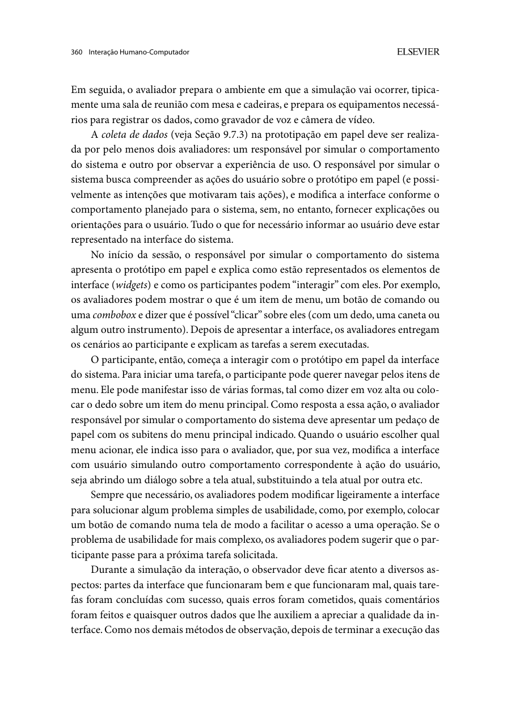
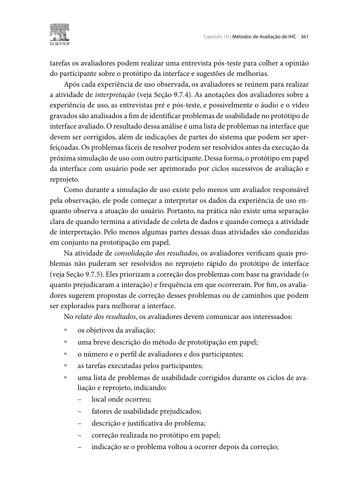
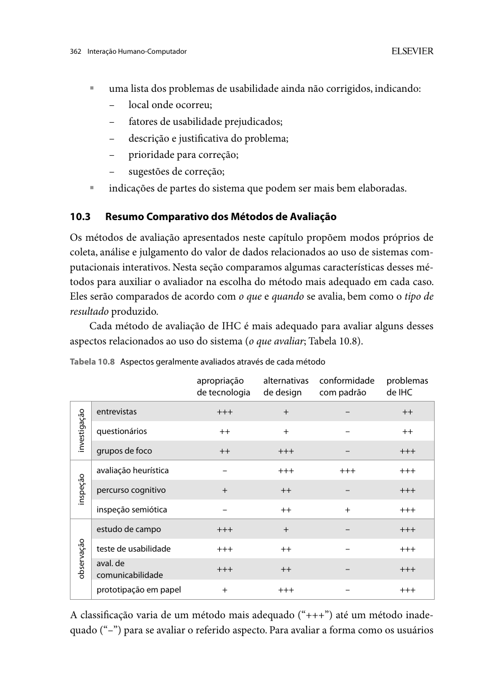

Responsável: Caio Breno de Souza Bezerra · Autor do item: Caio Breno de Souza Bezerra

# Relato da avaliação do protótipo de papel

## Tabela de contribuição

A Tabela 1 registra a contribuição neste artefato.

| Integrante | Contribuição | Artefato / atividade |
| --- | --- | --- |
| [Caio Breno de Souza Bezerra](https://github.com/CaioBezerra-Dev) | Preparação do relato, fichas e decisões de reprojeto | [Conteúdo](#introducao) |
| Codex (OpenAI) | Apoio à consulta bibliográfica, redação, telas e organização | [Agradecimentos](#agradecimentos) |
| Grok (xAI) | Conferência das falas com a gravação e preenchimento dos localizadores | [Agradecimentos](#agradecimentos) |

Tabela 1 — Contribuição neste artefato.

Fonte: elaboração para o Grupo 06 (2026).

## Introdução

Este relato acompanha a avaliação de **enviar e acompanhar uma ideia legislativa**, conforme o [plano da Etapa 5](../../../entrega-5/individual/caio/planejamento-avaliacao-prototipo-papel.md) e o [planejamento do relato](../../../entrega-5/individual/caio/planejamento-relato-prototipo-papel.md). O recorte abrange acesso ao serviço, conferência do texto, recebimento e acompanhamento da ideia.

A sessão com PAP-P01 foi gravada em 03/11/2026, no Google Meet, das 21h28 às 21h33. O arquivo dura 5 min 8 s. O [vídeo](#registro-e-video) está nesta página, na categoria não listado. As falas abaixo foram redigidas para leitura e localizadas nesse arquivo.

[Fotografias das telas e cartões](../../../assets/docs/entrega-6/caio/TELAS_E_CARTOES_PAPEL.pdf){ .md-button }
[Reprojeto de alta fidelidade](../../../prototipos/caio/alta-fidelidade/index.html){ .md-button }

## Método e objetivos

**Autor do item:** Caio Breno de Souza Bezerra.

Na prototipação em papel, a pessoa indica o que faria e o operador apresenta a resposta correspondente nas folhas. Outros avaliadores observam a execução e registram dificuldades. Os comentários finais complementam as ações observadas. Barbosa e Silva (2010, p. 358–362) orientam registrar também correções, recorrência e problemas pendentes; as Figuras 1–3 apresentam a fundamentação.

**Material: PP-2.0.** O protótipo contém três bases reutilizáveis e onze cartões móveis, representando sete estados da interface. As alterações de texto, botões e situação são feitas por sobreposição de componentes, conforme a preparação de elementos móveis descrita por Barbosa e Silva (2010, p. 358–360).

O objetivo é verificar descoberta do serviço, revisão do texto, compreensão do recebimento e acompanhamento da atualização. O e-Cidadania já pertence ao Senado: o reprojeto propõe continuidade visual e de navegação, sem tratar o serviço como uma instituição separada.

## Equipe e procedimento

A Tabela 2 identifica os papéis confirmados para a gravação.

| Papel | Responsável / condição |
| --- | --- |
| Avaliador, moderador e operador das folhas | Caio Breno de Souza Bezerra |
| Observadores | Bruno Ferreira Dornelas e Israel Soares de Paiva |
| Câmera das folhas | Caio Breno de Souza Bezerra, no próprio enquadramento do Meet |
| Gravação e presença de Luís | Luís Henrique Arruda Luna está na sala. O arquivo publicado é esta gravação |
| Participante principal | PAP-P01. Nome e contato ficam fora do site. A gravação não informa experiência anterior com o serviço |
| Piloto | PP-PAP01 não aparece neste arquivo. Os resultados abaixo são só da sessão com PAP-P01 |
| Modalidade e material | Google Meet, 03/11/2026, 21h28–21h33, 5 min 8 s. A câmera de Caio mostra as bases e os cartões; PP-2.0 |

Tabela 2 — Papéis e condições da avaliação.

Fonte: gravação com PAP-P01, 03/11/2026.

No Meet, PAP-P01 diz onde clicaria e o que entendeu. Caio abre a sessão, avisa que não vai indicar o caminho (0:28) e troca as folhas na própria câmera. Bruno, Israel e Luís estão na sala. Israel permanece com a câmera desligada. A análise abaixo usa o que se ouve no vídeo. Por volta de 1:08, PAP-P01 autoriza a participação e a gravação para a disciplina. O termo fica fora do repositório.

### Organização do material

As identificações S01–S06 e X02 indicam os estados lógicos do percurso. A montagem utiliza:

- **B01 — entrada e orientações:** E01 altera a orientação e E02 altera o botão de acesso; E03 indica o acesso realizado.
- **B02 — formulário e revisão:** título e descrição permanecem na base. F01 acrescenta o aviso; F02 e F03 substituem os controles da revisão.
- **B03 — recebimento e acompanhamento:** a identificação e a data permanecem. R01 e R02 alteram título e navegação. Na atualização para publicada, somente R03 (estado) e R04 (próximo passo) são substituídos.
- **K04 — atualização temporal:** informa a passagem de tempo antes da mudança de estado.

## Tarefas e evidências

A Tabela 3 relaciona tarefas, materiais e critérios. Os registros de vídeo e notas relacionam as escolhas e explicações da pessoa às tarefas.

| Tarefa / pergunta | Ação e telas | Critério de conclusão | Evidência / resultado |
| --- | --- | --- | --- |
| PP-T1 / PP-Q1 | Encontrar o serviço e chegar ao formulário; S01 → S02 → S03 | Localizar o envio e retomar o percurso após o acesso | Sem ajuda, 1:12–1:54. Localiza “Enviar ideia legislativa”, lê a avaliação antes da publicação e chega ao formulário |
| PP-T2 / PP-Q2 | Conferir o texto e revisar; S03 → S04 → S05 | Conferir o texto, reconhecer a condição após envio e confirmar uma vez | Sem ajuda, 1:54–2:38. Confere título e descrição, lê que não poderá editar depois e confirma uma vez |
| PP-T3 / PP-Q3 | Interpretar o recebimento; S05 | Reconhecer a referência e o próximo passo; distinguir recebida de publicada e de lei aprovada | Sem ajuda, 2:45–3:11. Reconhece o recebimento, a referência, a data e diz que ainda não é lei |
| PP-T4 / PP-Q4 | Acompanhar a mesma ideia; S06 → K04 → X02 | Localizar o estado e explicar publicação para apoios, distinguindo de lei aprovada | Sem ajuda, 3:11–4:09. Vê “Recebida”, depois “Publicada para receber apoios”, e segue no mesmo lugar |
| Todas / PP-Q5 | Verbalizar entendimento e sintetizar a experiência | Associar os comentários às telas e ações | 4:16–4:56. Caminho tranquilo e confirmação clara; no fecho usa a palavra “aprovação” |

Tabela 3 — Tarefas e critérios da avaliação.

Fonte: elaboração para o Grupo 06 (2026).

Dados de exemplo: título **“Orientações claras nos serviços”**; descrição **“Explicar documentos e etapas em linguagem simples.”** O texto permite verificar a conferência do conteúdo antes da confirmação de envio. Todos os identificadores e estados das folhas pertencem ao protótipo.

As quatro tarefas foram classificadas como **sem ajuda**. Troca de folha, áudio e câmera não interromperam o percurso. As tarefas ocorreram em sequência, sem reinício. O tempo de troca de papel não entra como medida de eficiência.

## Análise das telas e decisões de projeto

A análise documental das telas foi consolidada em 03/11/2026. A Tabela 4 apresenta a conclusão sobre cada decisão de interface, vinculada aos resultados anteriores. As ações e a compreensão de PAP-P01 estão no [vídeo da sessão](#registro-e-video).

| ID / origem | Local e fator de uso | Análise da interface | Decisão incorporada |
| --- | --- | --- | --- |
| PAP-R01 / RP03, AT-P01 | S03–S04; prevenção de erro | A revisão apresenta o texto completo, oferece retorno à edição e informa que o texto enviado não poderá ser alterado. O aviso de dados pessoais fica antes do compromisso final. | Avisos e controles integrados em PP-2.0. AF-1.1 acrescenta alerta para exemplos de contato e confirmação de conferência. Prioridade **alta**. |
| PAP-R02 / RP02, AT-P02 | S05; compreensão do resultado | A confirmação reúne título, DEMO-001, data, estado e próximo passo. O texto distingue recebimento, publicação e aprovação de uma lei. | Confirmação explicativa integrada em PP-2.0 e AF-1.1. Prioridade **alta**. |
| PAP-R03 / AT-P02 e AT-P04 | S05–S06; continuidade | O recebimento oferece acesso à mesma ideia, com identificação e estado preservados. O acompanhamento evita depender de um aviso por e-mail. | Acesso direto ao acompanhamento integrado em PP-2.0 e AF-1.1. Prioridade **alta**. |
| PAP-R04 / RP04 | S06–X02; clareza dos estados | O acompanhamento apresenta as etapas e a atualização informa publicação para apoios, com próximo passo e distinção de lei aprovada. A passagem de tempo é anunciada antes da atualização. | Estados e explicações integrados em PP-2.0 e AF-1.1. Prioridade **média**. |

Tabela 4 — Análise das telas e decisões incorporadas ao reprojeto.

Fonte: análise documental do material PP-2.0 e do protótipo AF-1.1, com base em RP01–RP04 e AT-P01–AT-P04 (2026).

O protótipo de alta fidelidade mantém as mesmas decisões de navegação e acrescenta validação dos campos e transições executáveis. Alterações posteriores devem indicar o componente modificado e a versão correspondente. Na sessão, PAP-P01 percorreu as quatro decisões sem ajuda. No comentário final, ao falar do acompanhamento, usou a palavra “aprovação”; durante PP-T4, acompanhou o aviso de que a publicação não é lei aprovada.

## Conferência e encaminhamento

A Tabela 5 registra a conferência das soluções e o que PAP-P01 fez na gravação.

| Aspecto | Evidência na proposta | O que a sessão mostra |
| --- | --- | --- |
| Entrada e continuidade | S01–S03: serviço identificado e retorno ao formulário após o acesso | 1:17–1:54. Procura onde participar, clica em “Enviar ideia legislativa”, lê que a ideia passa por avaliação antes da publicação e chega ao formulário pelo acesso |
| Conferência antes do envio | S04: texto completo, aviso e confirmação explícita | 1:54–2:38. Lê título e descrição, diz que não há dado pessoal, abre “Revisar ideia”, reconhece que não poderá editar depois e confirma uma vez |
| Compreensão do resultado | S05: título, referência, data, estado e próximo passo | 2:45–3:11. “Minha ideia foi recebida.” Cita título, referência e data, separa o recebimento de uma lei e segue para “Acompanhar esta ideia” |
| Acompanhamento | S06 e X02: mesma ideia, etapas e significado de publicação | 3:11–4:09. Encontra a mesma referência em “Recebida”. Depois da atualização, lê “Publicada para receber apoios” e diz que outras pessoas podem apoiar, sem tratar isso como lei aprovada |

Tabela 5 — Conferência da proposta e registro da sessão com PAP-P01.

Fonte: material PP-2.0 e gravação de 03/11/2026.

Nenhuma das quatro tarefas ficou sem conclusão nem pediu ajuda de percurso. O texto de exemplo não traz telefone: PAP-P01 lê o aviso e diz que a descrição não tem dado pessoal. A folha de retorno incerto, prevista no plano da Etapa 5, não entra nesta gravação. Entre “Recebida” e a publicação há uma pausa compatível com o cartão K04 (cerca de 3:35–3:51). M3 fica fora dos indicadores, porque não houve tarefa de recuperação de incidente.

No fecho (4:23–4:56), PAP-P01 diz que deu para seguir o caminho sem dificuldade, que a confirmação do envio ficou clara e que encontrou onde acompanhar. Na mesma fala, descreve o andamento como “essa aprovação”. A tarefa já tinha separado publicação e lei. O uso dessa palavra fica pendente, prioridade baixa, sem correção de folha e sem novo teste neste arquivo.

## Registro e vídeo

O Vídeo 1 é a sessão inteira, da apresentação ao encerramento. Categoria no YouTube: **não listado**. Link: [https://youtu.be/MYhU_5oUe8M](https://youtu.be/MYhU_5oUe8M). Duração: 5 min 8 s.

??? note "Vídeo 1 — Avaliação do protótipo de papel com PAP-P01"

    

      <iframe
        loading="lazy"
        style="position: absolute; top: 0; left: 0; width: 100%; height: 100%; border: 0;"
        src="https://www.youtube-nocookie.com/embed/MYhU_5oUe8M"
        title="Avaliação do protótipo de papel com PAP-P01"
        allow="accelerometer; autoplay; clipboard-write; encrypted-media; gyroscope; picture-in-picture; web-share"
        referrerpolicy="strict-origin-when-cross-origin"
        allowfullscreen>
      </iframe>
    

    
Vídeo 1 — Avaliação do protótipo de papel com PAP-P01.

    
Fonte: gravação conduzida por Caio Breno de Souza Bezerra, 03/11/2026, 21h28–21h33. Categoria no YouTube: não listado.

A Tabela 6 concentra o fechamento da sessão.

| Campo | Registro da sessão |
| --- | --- |
| Data, início, fim e duração efetivos | 03/11/2026, 21h28–21h33, 5 min 8 s. Horário lido no relógio da gravação |
| Perfil de PAP-P01 e exposição anterior | A gravação não informa idade, experiência com o serviço nem contato anterior com o material. Nome e contato ficam fora do site |
| Piloto: data, pessoa distinta e ajustes do procedimento | PP-PAP01 não aparece neste arquivo |
| Autorização para participar, gravar e disponibilizar | Autorização verbal por volta de 1:08. Termo fora do repositório |
| Versão do material | PP-2.0 |
| Link do vídeo e localizadores de PP-T1–PP-T4 | [Vídeo 1](https://youtu.be/MYhU_5oUe8M). T1 1:12; T2 1:54; T3 2:45; T4 3:11; fecho 4:16 |

Tabela 6 — Identificação e fechamento da sessão.

Fonte: gravação com PAP-P01, 03/11/2026.

## Síntese e continuidade

A análise das telas conclui que a proposta cobre os quatro objetivos do recorte: entrada no serviço, revisão antes do envio, confirmação identificável e acompanhamento do estado. Na gravação, PAP-P01 cumpriu esses quatro percursos sem ajuda. As melhorias das etapas anteriores estão representadas na versão em papel; a alta fidelidade mantém o percurso e acrescenta validação e transições executáveis. A alta fidelidade também oferece uma página de orientações acessível pelo formulário e pelo acompanhamento.

O relato separa a presença de uma solução na interface do que esta pessoa fez com ela. A pendência de linguagem no fecho segue para reteste em AF-T4 do [planejamento de alta fidelidade](planejamento-avaliacao-alta-fidelidade.md). Com um participante, a avaliação descreve este caso e suas condições; não estima a experiência de toda a população.

O estudo não mede recuperação de incidente, recordação após sete dias, comparação de eficiência com o portal oficial nem moderação real. A opinião final é qualitativa; só contabilizar M6 se a escala numérica for aplicada. A continuidade no Meet depende de áudio e legibilidade. Identificador, autenticação e mudança de estado são representações da interface proposta.

## Agradecimentos

Codex (OpenAI) apoiou a consulta das fontes e a preparação deste material. Grok (xAI) apoiou a conferência das falas com a gravação e os localizadores. Caio Breno de Souza Bezerra responde pelo conteúdo e pela sessão. Revisor: [Bruno Ferreira Dornelas](https://github.com/brunnf).

## Histórico de versão

A Tabela 7 registra a versão deste artefato.

| Versão | Data | Descrição | Autor(es) | Revisor(es) |
| :---: | :---: | --- | --- | --- |
| `0.1` | 03/11/2026 | Elaboração do relato e documentação do protótipo de papel | [Caio Breno de Souza Bezerra](https://github.com/CaioBezerra-Dev) | [Bruno Ferreira Dornelas](https://github.com/brunnf) |
| `0.2` | 03/11/2026 | Incorpora a gravação com PAP-P01, a duração e os localizadores de PP-T1–PP-T4 | [Caio Breno de Souza Bezerra](https://github.com/CaioBezerra-Dev) | [Bruno Ferreira Dornelas](https://github.com/brunnf) |
| `0.3` | 03/11/2026 | Substitui o gabarito impresso pelas fotografias do papel usado na sessão | [Caio Breno de Souza Bezerra](https://github.com/CaioBezerra-Dev) | [Bruno Ferreira Dornelas](https://github.com/brunnf) |

Tabela 7 — Histórico de versão.

Fonte: elaboração para o Grupo 06 (2026).

## Referências

[1] BARBOSA, Simone Diniz Junqueira; SILVA, Bruno Santana da. *Interação humano-computador*. Rio de Janeiro: Elsevier, 2010. p. 358–362.

[2] SALES, André Barros de. *Plano de Ensino FIHC 022026 — Turma 01*, v1. FCTE/UnB, 2026. Cronograma, p. 5 do PDF.

[3] SENADO FEDERAL. [Como funciona a Ideia Legislativa](https://www12.senado.leg.br/ecidadania/comofuncionaideia). Acesso em: 3 nov. 2026.

[4] GRUPO 06. [Planejamento do papel](../../../entrega-5/individual/caio/planejamento-avaliacao-prototipo-papel.md) e [relatos anteriores](../../../entrega-5/individual/caio/index.md). 2026.

## Apêndice A — Fundamentação

As Figuras 1–3 fundamentam os papéis e a estrutura de relato.

??? note "Figura 1 — Operação da interface e observação do uso"

    { loading=lazy }
    
Figura 1 — Operação da interface e observação do uso.

    
Fonte: Barbosa e Silva (2010, p. 360).

??? note "Figura 2 — Problemas corrigidos e recorrência"

    { loading=lazy }
    
Figura 2 — Problemas corrigidos e recorrência.

    
Fonte: Barbosa e Silva (2010, p. 361).

??? note "Figura 3 — Problemas pendentes e sugestões"

    { loading=lazy }
    
Figura 3 — Problemas pendentes e sugestões.

    
Fonte: Barbosa e Silva (2010, p. 362).

