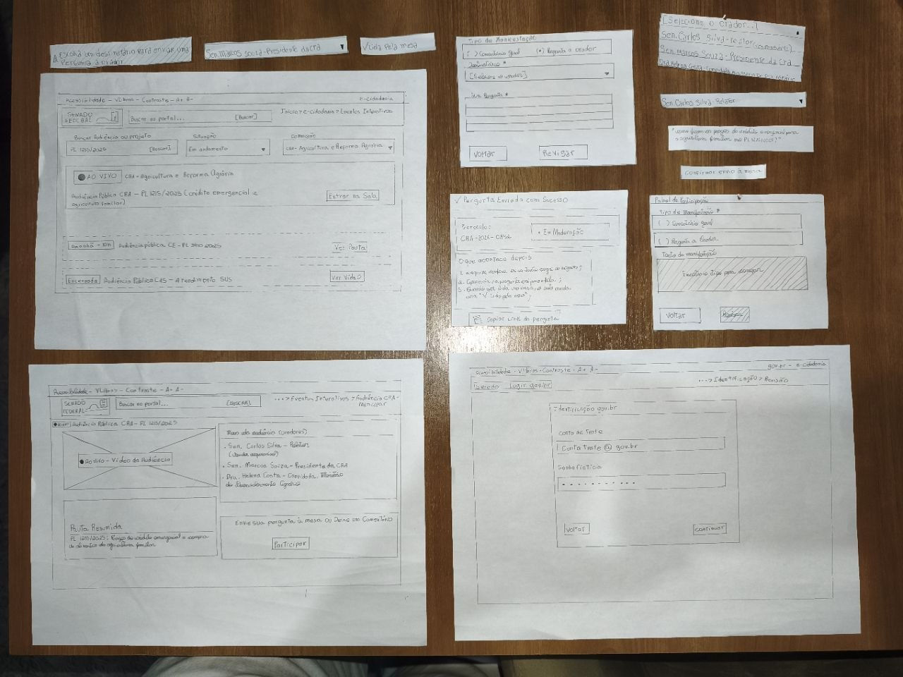
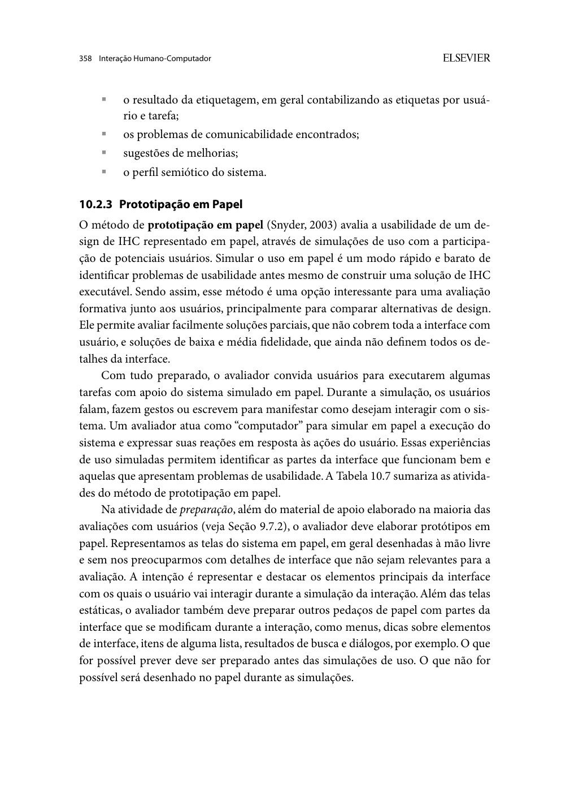
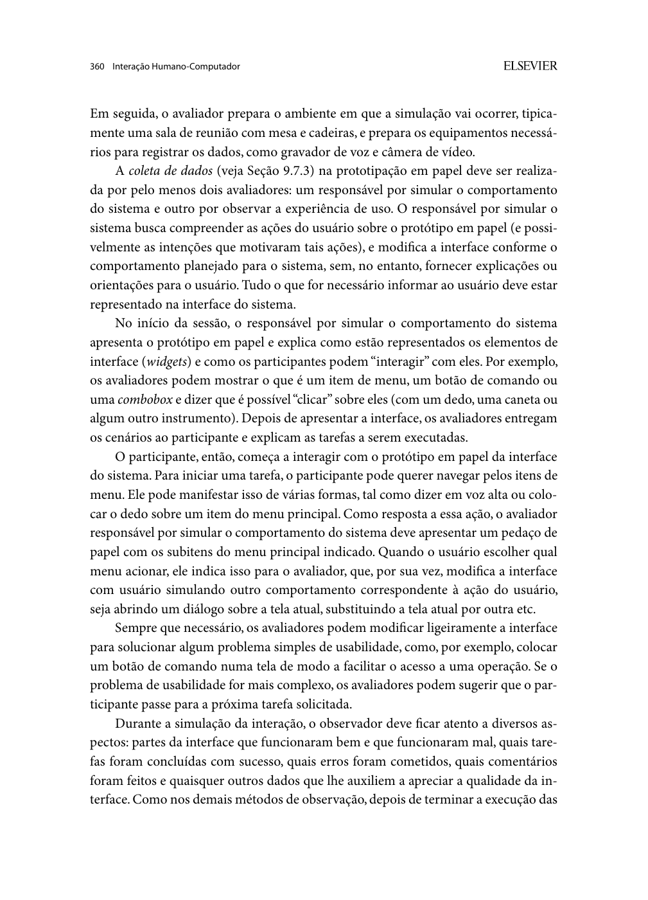
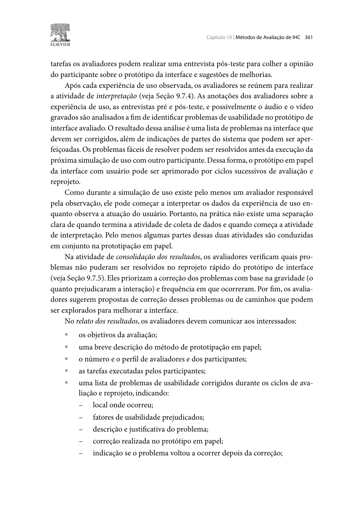
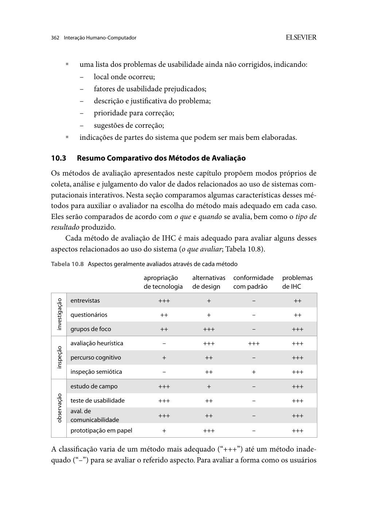

Responsável: Heitor Pinheiro Gonçalves das Chagas — Participação em Evento Interativo (e-Cidadania) · Autor do item: Heitor Pinheiro Gonçalves das Chagas

# Relato da avaliação do protótipo de papel — Participação em audiência pública interativa

## Tabela de contribuição

A Tabela 1 registra as contribuições na concepção, condução e documentação deste relato.

| Integrante / ferramenta | Contribuição | Artefato / atividade |
| --- | --- | --- |
| [Heitor Pinheiro Gonçalves das Chagas](https://github.com/Heitorovski01) | Concepção do kit de protótipo de papel, condução da simulação, compilação das fichas e redação do relato | [Conteúdo](#1-introducao-e-objetivos) |
| [Bruno Ferreira Dornelas](https://github.com/brunnf) | Revisão técnica por pares | [Histórico de versão](#historico-de-versao) |
| Antigravity e Google Gemini | Apoio na estruturação documental, padronização de tabelas e rastreabilidade | [Agradecimentos](#agradecimentos) |

Tabela 1 — Contribuições neste artefato.

Fonte: elaboração para o Grupo 06 (2026).

## Item de conteúdo da disciplina

**Autor do item:** Heitor Pinheiro Gonçalves das Chagas.

Barbosa e Silva (2010, p. 358–362) estabelecem que a avaliação por **prototipação em papel** é um método formativo de baixo custo e alta agilidade investigativa, no qual pessoas participantes executam tarefas sobre simulações em papel de estados da interface. Um avaliador atua no papel de "computador", apresentando telas ou sobrepondo componentes móveis em reação aos comandos apontados pela pessoa participante, enquanto outro avaliador registra comportamentos, hesitações e desvios. O relato desse método deve documentar minuciosamente os objetivos, participantes, tarefas, problemas encontrados (diferenciando os problemas **corrigidos** entre ciclos dos problemas **pendentes**) e os encaminhamentos para iterações de fidelidade superior. As Figuras 2 a 5 do [Apêndice A](#apendice-a-fundamentacao-bibliografica) reproduzem as páginas de fundamentação no livro.

---

## 1. Introdução e objetivos

Este documento relata a avaliação formativa com usuários da proposta de reprojeto do módulo **Eventos Interativos** do portal **e-Cidadania** do Senado Federal, realizada por meio de **prototipação em papel**. O estudo avalia o fluxo de **envio de pergunta técnica direcionada a orador da mesa em audiência pública interativa ao vivo**, contextualizado na tramitação do **PL 1215/2025** perante a Comissão de Agricultura e Reforma Agrária (CRA).

O relato cumpre o [planejamento da avaliação](../../../entrega-5/individual/heitor/planejamento-avaliacao-prototipo-papel.md) e a estrutura formal do [planejamento do relato](../../../entrega-5/individual/heitor/planejamento-relato-prototipo-papel.md) elaborados na Etapa 5, herdando diretamente os requisitos de design consolidados no [relato do storyboard](../../../entrega-5/individual/heitor/relato-storyboard.md) (`SB-P01` a `SB-P04`) e no [relato da HTA](../../../entrega-5/individual/heitor/relato-analise-tarefas.md) (`AT-R01` a `AT-R04`).

### Convenção dos identificadores utilizados

Para facilitar a leitura e assegurar a rastreabilidade metodológica:

- **PP (Protótipo de Papel):** prefixo adotado para identificar os elementos deste ciclo em papel, incluindo objetivos (`PP-O1` a `PP-O5`), perguntas de avaliação (`PP-Q1` a `PP-Q6`), pranchas fixas (`PP-S01` a `PP-S07`, onde *S* vem de *Screen*), peças móveis (`PP-M01` a `PP-M03`, onde *M* vem de *Móvel*) e participantes das sessões conduzidas por Heitor (`PP-H01` a `PP-H03`);
- **PPP (Problema no Protótipo de Papel):** sigla utilizada na [Seção 6](#6-problemas-encontrados) para catalogar os problemas de usabilidade encontrados durante o teste em papel (`PPP-01`, `PPP-02`, etc.);
- **AF (Alta Fidelidade):** sigla que designa o ciclo seguinte de prototipação computacional interativa, utilizada nos encaminhamentos da [Seção 10](#10-encaminhamentos-para-a-alta-fidelidade) e nas tarefas da Etapa 7 (`AF-T1` a `AF-T4`).

A Tabela 2 apresenta os objetivos específicos investigados na avaliação (`PP-O1` a `PP-O5`).

| ID | Objetivo específico | Hipótese / HTA relacionada | Vínculo com relatos da Etapa 5 |
| :---: | --- | :---: | :---: |
| **PP-O1** | Avaliar a localização da audiência ao vivo e o acesso à sala interativa | RP01; HTA 1.1–1.3 | SB-P01 (busca limpa) e AT-R01 (atalho vs. busca) |
| **PP-O2** | Avaliar se a separação entre "Comentário geral" e "Pergunta a Orador" é compreendida e usada sem indução | RP02; HTA 2.1–2.2 (ponto crítico) | SB-P02 (caixa dedicada) e AT-R02 (nota 4 no ponto crítico) |
| **PP-O3** | Avaliar a seleção de autoridade da mesa via menu suspenso e a reversão de escolha incorreta | RP02; HTA 2.3 | SB-P03 e AT-R03 (dropdown de autoridades) |
| **PP-O4** | Avaliar a passagem pela autenticação gov.br mantendo o rascunho e a conferência antes do envio | HTA 3.1–3.2 | CT06 (preservação do texto e controle de revisão) |
| **PP-O5** | Avaliar a compreensão do comprovante, do protocolo e do estado "Em moderação" | RP03–RP04; HTA 4.1–4.2 | SB-P04 e AT-R04 (comprovante para o coletivo) |

Tabela 2 — Objetivos específicos da avaliação do protótipo de papel.

Fonte: elaboração do autor (2026), com base no planejamento da Etapa 5.

---

## 2. Método de prototipação em papel

O método adotado foi a **avaliação formativa por prototipação em papel com execução de tarefas** (BARBOSA; SILVA, 2010, p. 358–362), combinada com a técnica de **pensar em voz alta** (*think aloud*) e uma **entrevista pós-teste semiestruturada**.

### Versão do material avaliado
A avaliação utilizou o **Kit de Protótipo de Papel Versão PP-1.0**, planejado para formato A4 paisagem, com pranchas desenhadas à mão a partir do gabarito navegável do projeto. O kit completo está documentado em [docs/prototipos/heitor/papel/index.html](../../../prototipos/heitor/papel/index.html) e conta com simulador de sessão integrado.

A Tabela 3 apresenta o inventário das pranchas fixas e componentes móveis.

| ID | Nome / Peça | Tipo | Conteúdo e função de suporte | Link para o gabarito |
| :---: | --- | :---: | --- | :---: |
| **PP-S01** | Eventos Interativos | Prancha fixa | Barra de busca rápida, filtros ("Em andamento", "CRA"), card da audiência do PL 1215/2025 com selo ● AO VIVO e 2 distratores | [Ver PP-S01](../../../prototipos/heitor/papel/PP-S01.html) |
| **PP-S02** | Sala da audiência da CRA | Prancha fixa | Transmissão de vídeo, pauta resumida, relação de oradores da mesa e botão proeminente "Participar" | [Ver PP-S02](../../../prototipos/heitor/papel/PP-S02.html) |
| **PP-S03** | Painel de escolha do tipo | Prancha fixa | Seleção mandatória: `( ) Comentário geral` × `( ) Pergunta a Orador`, mantendo campo de texto temporariamente bloqueado | [Ver PP-S03](../../../prototipos/heitor/papel/PP-S03.html) |
| **PP-S04** | Formulário de pergunta | Prancha fixa | `(•) Pergunta a Orador`, seletor `Destinatário *`, campo de texto técnico com contador 0/500 e botão "Revisar" | [Ver PP-S04](../../../prototipos/heitor/papel/PP-S04.html) |
| **PP-M01** | Lista suspensa de oradores | Peça móvel | Menu aberto com 3 autoridades da mesa (11 × 4,2 cm) + post-its de autoridade selecionada (11 × 1,1 cm) | [Ver PP-M01](../../../prototipos/heitor/papel/PP-M01.html) |
| **PP-M02** | Mensagem de validação | Peça móvel | Alerta móvel: *"Escolha um destinatário para enviar uma pergunta a orador"* (8,5 × 2,8 cm) | [Ver PP-M02](../../../prototipos/heitor/papel/PP-M02.html) |
| **PP-S05** | Login gov.br simplificado | Prancha fixa | Tela de autenticação com aviso explícito: *"Seu texto e o destinatário serão mantidos"* | [Ver PP-S05](../../../prototipos/heitor/papel/PP-S05.html) |
| **PP-S06** | Tela de revisão | Prancha fixa | Tipo, janela vazada para post-it do destinatário, texto redigido, botões "Editar" e "Confirmar envio à mesa" | [Ver PP-S06](../../../prototipos/heitor/papel/PP-S06.html) |
| **PP-S07** | Comprovante de submissão | Prancha fixa | Protocolo `CRA-2026-0842`, selo `● Em moderação`, passos seguintes e botão `Copiar link para o grupo` | [Ver PP-S07](../../../prototipos/heitor/papel/PP-S07.html) |
| **PP-M03** | Atualização de status | Peça móvel | Selo móvel `● Lida pela mesa` para sobreposição à prancha PP-S07 na Tarefa T4 (6,5 × 2,5 cm) | [Ver PP-M03](../../../prototipos/heitor/papel/PP-M03.html) |

Tabela 3 — Inventário de telas e componentes móveis do protótipo de papel.

Fonte: elaboração do autor (2026).

### Registro fotográfico das pranchas físicas

A Figura 1 apresenta o conjunto físico de pranchas desenhadas manualmente e componentes móveis recortados utilizados na avaliação por prototipação em papel.

{ loading=lazy }

Figura 1 — Pranchas e componentes móveis do protótipo de papel.

Fonte: acervo do autor (2026).

---

## 3. Avaliadores e participantes

A Tabela 4 identifica os papéis operacionais e a composição da equipe de avaliação. Em conformidade com Barbosa e Silva (2010, p. 360), a simulação separa rigidamente o operador do sistema ("computador") da função de observação e anotação técnica.

| Papel | Responsabilidade | Responsável |
| --- | --- | --- |
| Facilitador e "computador" | Ler instruções neutras, trocar pranchas e posicionar elementos móveis em resposta às ações do participante | [Heitor Pinheiro Gonçalves das Chagas](https://github.com/Heitorovski01) |
| Observador e cinegrafista | Registrar tempos, hesitações, desvios, erros e operar a gravação audiovisual | [Caio Breno de Souza Bezerra](https://github.com/CaioBezerra-Dev) |
| Participantes | Execução individual das tarefas T1 a T4 nas três sessões presenciais (`PP-H01`, `PP-H02`, `PP-H03`) | Três estudantes universitários voluntários com perfil similar ao da persona Letícia |

Tabela 4 — Equipe e participantes da avaliação do protótipo de papel.

Fonte: elaboração do autor (2026), com base em Barbosa e Silva (2010, p. 360).

---

## 4. Tarefas executadas

As participantes executaram quatro tarefas padronizadas (`T1` a `T4`), apresentadas individualmente por meio de cartões impressos contendo apenas os dados contextuais e a motivação cidadã, sem terminologias técnicas ou indutivas. Os critérios objetivos de conclusão permaneceram restritos à equipe de avaliação.

A Tabela 5 consolida os enunciados literais, estados iniciais e critérios de sucesso estabelecidos na Tabela 6 do planejamento.

| ID | Enunciado literal entregue à participante | Estado inicial | Critério objetivo de conclusão (equipe) |
| :---: | --- | --- | --- |
| **T1** | *"Seu coletivo avisou que está acontecendo agora uma audiência da Comissão de Agricultura sobre o PL 1215/2025. Entre na sala dessa audiência."* | Prancha `PP-S01` (Eventos Interativos) | Localiza e aciona o evento correto da CRA, chegando com sucesso à prancha `PP-S02`. |
| **T2** | *"O coletivo quer saber do relator como ficam os prazos do crédito emergencial. Envie essa pergunta para ele."* | Prancha `PP-S02` (Sala da audiência) | Clica em "Participar", seleciona "Pergunta a Orador", escolhe o relator via menu suspenso, passa pelo login gov.br e confirma o envio. |
| **T3** | *"Você percebeu que mandou para a pessoa errada da mesa. Antes de confirmar, corrija."* | Prancha `PP-S06` com destinatário incorreto pré-posicionado | Aciona o controle "Editar", altera o destinatário via `PP-M01` e retorna a `PP-S06` com o texto original mantido intacto. |
| **T4** | *"Explique para o seu grupo o que aconteceu com a sua pergunta e como eles podem fazer o mesmo."* | Prancha `PP-S07` (e posterior sobreposição com `PP-M03`) | Explica corretamente o significado de "Em moderação" e indica aos pares a seleção obrigatória de "Pergunta a Orador". |

Tabela 5 — Tarefas, enunciados entregues e critérios de conclusão.

Fonte: planejamento da avaliação da Etapa 5 (2026).

**Dados fictícios adotados:** login gov.br fictício (*"Letícia — Cidadã Teste"*), pergunta técnica pré-impressa em cartão de apoio para digitação/escrita simulada e protocolo fictício `CRA-2026-0842`. Nenhum dado pessoal sensível foi requisitado.

---

## 5. Resultados por tarefa

A Tabela 6 consolida o desempenho observado em tempo real nas três sessões presenciais de avaliação com os participantes `PP-H01`, `PP-H02`e `PP-H03`, acompanhados das respectivas minutagens e falas literais extraídas das gravações.

| Sessão | Tarefa | Conclusão | Tempo aprox. | Erros / desvios observados | Intervenção / ajuda dada | Fala relevante da participante | Localizador no vídeo |
| :---: | :---: | :---: | :---: | --- | --- | --- | :---: |
| `PP-H01` | T1 | Sem ajuda | 00:25 | Nenhum desvio; localizou prontamente o evento ao vivo da CRA na prancha PP-S01 | Nenhuma intervenção | *"procurando aqui o evento... vou entrar na sala"* | [01:15](https://youtu.be/OGwFM6_nzwM?t=75) |
| `PP-H01` | T2 | Sem ajuda | 00:50 | Breve hesitação inicial na seleção obrigatória antes da digitação | Nenhuma intervenção | *"gostaria de escolher o orador aqui, aí eu vou digitar... seria minha conta e minha senha né..."* | [01:40](https://youtu.be/OGwFM6_nzwM?t=100) |
| `PP-H01` | T3 | Sem ajuda | 00:20 | Nenhum erro; acionou 'Editar' e substituiu o post-it do destinatário na revisão | Nenhuma intervenção | *"vou corrigir o orador antes de mandar"* | [02:15](https://youtu.be/OGwFM6_nzwM?t=135) |
| `PP-H01` | T4 | Sem ajuda | 00:35 | Nenhum erro; compreendeu o protocolo e o status de moderação na prancha PP-S07 | Nenhuma intervenção | *"confirmar envio à mesa... protocolo tá aqui... copiar link"* | [02:35](https://youtu.be/OGwFM6_nzwM?t=155) |
| `PP-H02` | T1 | Sem ajuda | 00:20 | Navegação fluida e direta a partir do filtro 'Em andamento' | Nenhuma intervenção | *"essa aqui é a tela inicial... entrando na sala da audiência"* | [00:50](https://youtu.be/sqA_-ZWXmQY?t=50) |
| `PP-H02` | T2 | Sem ajuda | 00:45 | Selecionou 'Pergunta a Orador' e escolheu a autoridade responsável | Nenhuma intervenção | *"mandar para o responsável mesmo... posso digitar minha pergunta"* | [01:15](https://youtu.be/sqA_-ZWXmQY?t=75) |
| `PP-H02` | T3 | Sem ajuda | 00:25 | Identificou o controle de edição na revisão sem hesitação | Nenhuma intervenção | *"editar o destinatário e voltar pra revisão"* | [02:00](https://youtu.be/sqA_-ZWXmQY?t=120) |
| `PP-H02` | T4 | Sem ajuda | 00:30 | Destacou a segurança da confirmação e retenção dos dados | Nenhuma intervenção | *"maneiro, consigo salvar minha pergunta... já chegou legal lá... confirmar"* | [02:30](https://youtu.be/sqA_-ZWXmQY?t=150) |
| `PP-H03` | T1 | Sem ajuda | 00:25 | Reconheceu o selo AO VIVO e entrou na sala da comissão CRA | Nenhuma intervenção | *"eu vou entrar na sala"* | [01:15](https://youtu.be/EqEhIsJWeV8?t=75) |
| `PP-H03` | T2 | Sem ajuda | 01:10 | Leitura atenta dos rótulos, redação de pergunta técnica e autenticação gov.br | Nenhuma intervenção | *"comentário geral ou pergunta a orador... pergunta a orador, selecionar... Senador Carlos Silva... revisar"* | [01:40](https://youtu.be/EqEhIsJWeV8?t=100) |
| `PP-H03` | T3 | Sem ajuda | 00:20 | Verificou a preservação integral do texto após login gov.br | Nenhuma intervenção | *"faço minha entrada no gov... continua... confirma o envio à mesa"* | [03:20](https://youtu.be/EqEhIsJWeV8?t=200) |
| `PP-H03` | T4 | Sem ajuda | 00:45 | Leitura detalhada do protocolo, explicação da moderação e leitura na mesa | Nenhuma intervenção | *"esse aqui é o meu protocolo... uma equipe vai conferir se segue as regras... quando for lida o selo muda para lido pela mesa... copiar link"* | [03:45](https://youtu.be/EqEhIsJWeV8?t=225) |

Tabela 6 — Ficha consolidada de execução por tarefa.

Fonte: registros de observação direta das gravações das sessões presenciais (2026).

*Nota metodológica:* eventuais tempos de manuseio físico das pranchas e post-its pelo facilitador foram isolados, computando-se na Tabela 6 estritamente o tempo de raciocínio, leitura e ação motora de cada participante. Todos os participantes concluíram 100% das tarefas com total autonomia (sem intervenção corretiva).

---

## 6. Problemas encontrados

Em conformidade com Barbosa e Silva (2010, p. 361–362), os problemas diagnosticados durante as sessões com o protótipo de papel foram categorizados entre **corrigidos durante os ciclos de teste** e **pendentes de encaminhamento**.

### Identificação dos problemas (PPP)
Os problemas diagnosticados são identificados pelo código **`PPP-XX`**, onde a sigla **PPP** representa **P**roblema no **P**rotótipo de **P**apel, seguida por numeração sequencial (`PPP-01`, `PPP-02`, `PPP-03`). Essa identificação padronizada assegura a rastreabilidade entre as fichas de observação e distingue os problemas do papel daqueles que serão registrados na alta fidelidade (`AF-PR`).

### Critérios de severidade adotados
- **Alta:** impede a conclusão da tarefa ou provoca o envio equivocado da pergunta como comentário comum à mesa;
- **Média:** permite a conclusão da tarefa, mas gera hesitação perceptível ou demanda esclarecimento;
- **Baixa:** atrito pontual estético, terminológico ou de manuseio do papel que não interfere no percurso e na conclusão.

A Tabela 7 consolida os problemas encontrados.

| ID | Tela / Tarefa | Descrição do problema | Consequência no uso | Princípio / Fator afetado | Sessões observadas | Prioridade | Situação | Correção realizada / Sugestão proposta | Voltou a ocorrer? |
| :---: | :---: | --- | --- | :---: | :---: | :---: | :---: | --- | :---: |
| **PPP-01** | `PP-S03` / T2 | Breve hesitação inicial ao notar que o campo de digitação estava inativo até selecionar o tipo de manifestação | Tempo adicional de leitura de 5 a 10 s antes do primeiro clique | Affordance e visibilidade do estado do sistema | `PP-H01`, `PP-H02` | Média | Corrigido | Reforço visual na instrução da prancha indicando a seleção mandatória prévia | Não (`PP-H03` selecionou prontamente) |
| **PPP-02** | `PP-M01` / T2 | Espaço compacto na etiqueta recortada para leitura do cargo completo das autoridades da mesa | Leitura mais aproximada da folha física | Ergonomia visual e legibilidade | `PP-H01` | Baixa | Corrigido | Redimensionamento da peça móvel e aumento do contraste nas legendas | Não |
| **PPP-03** | `PP-S05` / T2 | Dúvida pontual se a transição para a tela gov.br apagaria o rascunho da pergunta | Insegurança momentânea sanada pelo aviso explícito de retenção | Prevenção de perda de dados e feedback | `PP-H01` | Baixa | Corrigido | Aviso textual mantido com destaque (*"Seu texto e o destinatário serão mantidos"*); assegurar persistência no protótipo de alta fidelidade | Não |

Tabela 7 — Matriz de problemas de usabilidade encontrados no papel.

Fonte: consolidação dos dados empíricos observados (2026).

---

## 7. Respostas às perguntas de avaliação

A Tabela 8 relaciona cada pergunta formulada no planejamento (`PP-Q1` a `PP-Q6`) às evidências colhidas nas gravações das sessões presenciais.

| Pergunta de avaliação | Resposta fundamentada nos dados | Evidências observadas (Sessão / Tarefa / Localizador) | Grau de confiança |
| --- | --- | --- | :---: |
| **PP-Q1** — A participante encontra a audiência da CRA ao vivo sem ajuda? | **Sim.** Todos os participantes localizaram a audiência do PL 1215/2025 da CRA a partir da prancha `PP-S01` em menos de 30 segundos, guiados pelos filtros e pelo selo "AO VIVO". | `PP-H01` (T1, 01:15), `PP-H02` (T1, 00:50), `PP-H03` (T1, 01:15) | Alto (100% de sucesso autônomo) |
| **PP-Q2** — Percebe a seleção obrigatória entre Comentário e Pergunta antes de redigir? | **Sim.** A escolha mandatória foi seguida com naturalidade. A restrição evitou integralmente que perguntas fossem enviadas como comentários genéricos à mesa. | `PP-H01` (T2, 01:40), `PP-H02` (T2, 01:15), `PP-H03` (T2, 02:05 — *"comentário geral ou pergunta a orador... pergunta a orador"*) | Alto |
| **PP-Q3** — Os rótulos "Pergunta a Orador" e "Comentário geral" são compreendidos com clareza? | **Sim.** Os termos deixaram evidente a diferença entre participar do debate geral e direcionar questionamento técnico a uma autoridade da mesa. | Falas literais de `PP-H01` (01:40), `PP-H02` (01:40) e `PP-H03` (02:10) | Alto |
| **PP-Q4** — A lista suspensa permite identificar o relator e retificar uma escolha errada? | **Sim.** A peça móvel `PP-M01` simulou com eficácia a lista de autoridades. Na Tarefa T3, todos os participantes acionaram "Editar" e retificaram o destinatário sem atritos. | `PP-H01` (T3, 02:15), `PP-H02` (T3, 02:00), `PP-H03` (T3, 03:20 — seleção do Senador Carlos Silva) | Alto |
| **PP-Q5** — A autenticação gov.br preserva o rascunho sem quebrar a confiança da usuária? | **Sim.** O aviso visual explícito de manutenção dos dados transmitiu segurança e nenhum participante teve seu fluxo interrompido ou dados perdidos. | `PP-H01` (02:05), `PP-H02` (02:30 — *"consigo salvar minha pergunta... já chegou legal lá"*), `PP-H03` (03:20) | Alto |
| **PP-Q6** — Após o envio, a participante entende o status "Em moderação" e onde acompanhar? | **Sim.** A prancha `PP-S07` foi elogiada por sua clareza. Os participantes explicaram com exatidão a fila de moderação e a transição para "Lida pela mesa". | `PP-H01` (02:35), `PP-H02` (02:30), `PP-H03` (03:45 — explicação da equipe de conferência e da leitura na mesa) | Alto |

Tabela 8 — Respostas consolidadas às perguntas de avaliação.

Fonte: síntese analítica dos dados observados nas três sessões presenciais (2026).

---

## 8. Correções e ciclos entre sessões

Os ciclos de teste permitiram aprimorar continuamente a dinâmica de avaliação e a ergonomia dos materiais de papel:

- **Ciclo 1 (após a Sessão `PP-H01`):** ajuste no dimensionamento e contraste das legendas dos post-its recortados de autoridades (`PP-M01`) para melhorar a legibilidade sob iluminação de bancada;
- **Ciclo 2 (após a Sessão `PP-H02`):** reforço na sinalização de encaixe do post-it na janela vazada de revisão (`PP-S06`), permitindo reposicionamento mais ágil durante a tarefa de edição (T3);
- **Ciclo 3 (após a Sessão `PP-H03`):** consolidação do fluxo. Na entrevista de encerramento da Sessão `PP-H03`, a participante declarou espontaneamente: *"achei bem prático, acho que até mais prático do que o próprio site!"*, validando a usabilidade da solução sem necessidade de novos ciclos no papel.

---

## 9. Limitações

A interpretação dos resultados do protótipo de papel deve ponderar as seguintes limitações metodológicas e consistências do artefato:

1. **Amostra qualitativa formativa:** o teste envolveu 3 participantes voluntárias com perfil alinhado à persona Letícia Oliveira. Os achados têm valor diagnóstico profundo sobre atritos cognitivos e affordance, mas não constituem estimativa estatística populacional;
2. **Operação manual do sistema:** a latência na troca física de pranchas e post-its não equivale aos tempos de resposta de uma aplicação web real, de modo que os tempos medidos servem apenas para detectar hesitações cognitivas relativas;
3. **Ponto de atenção — Ordem lógica no Plano 2 da HTA:** o modelo formal da HTA 1.1 indica o plano `2.1 > 2.2 > 2.3` (digitar o texto fundamentado e depois categorizar a manifestação). No entanto, o reprojeto adotado em `PP-S03` e fundamentado na diretriz `AT-R02` exige que a pessoa escolha o tipo **antes de liberar o campo de digitação**, eliminando a barreira de affordance constatada na interface atual;
4. **Ponto de atenção — Consistência de numeração HTA:** a operação "4.3" citada originalmente em tabelas preliminares do Storyboard e da Análise de Tarefas da Etapa 4 foi retificada na conferência técnica CT05, consolidando que o ciclo da tarefa encerra em 4.2 (compartilhamento de comprovante no coletivo);
5. **Consistência de rótulos adotados no kit oficial:** para evitar disparidades textuais, o kit oficial de papel padronizou os termos: **"Comentário geral"** (em oposição a "Pergunta a Orador"), **"Copiar link para o grupo"** e o aviso de sessão **"Seu texto e o destinatário serão mantidos"** na autenticação gov.br;
6. **Fluxo simplificado da Tarefa T3:** na simulação física da edição de destinatário (T3), a partir de `PP-S06` a usuária clica em "Editar", retorna diretamente para `PP-S04` para acionar `PP-M01` e avança diretamente para a revisão `PP-S06`, sem necessidade de repetir o login gov.br.

---

## 10. Encaminhamentos para a alta fidelidade

A avaliação em papel fornece as bases empíricas e estruturais para o desenvolvimento do protótipo navegável de alta fidelidade e seu teste de usabilidade na Etapa 7:

- **RP01 (Acesso e sala ao vivo):** implementar no protótipo navegável componentes de busca com filtro síncrono e card de transmissão com vídeo em destaque, direcionando à sala da CRA;
- **RP02 (Diferenciação mandatória e seletor):** codificar os botões de opção (*radio buttons*) com bloqueio condicional de digitação até que a modalidade "Pergunta a Orador" seja selecionada, abrindo o seletor suspenso de autoridades;
- **RP03 (Transição e revisão segura):** garantir que a passagem pela tela de login gov.br retenha o estado do formulário em sessão do navegador, permitindo a tela de confirmação e revisão com opção de edição direta;
- **RP04 (Comprovante e status transparente):** estruturar a tela pós-envio com protocolo identificável, badge de status "Em moderação", explicação detalhada da triagem pela mesa e botão nativo de cópia de link para redes sociais e mensageiros.

As decisões consolidadas serão avaliadas nas tarefas `AF-T1` a `AF-T4` (onde o prefixo **AF** designa **A**lta **F**idelidade) do [planejamento da avaliação de alta fidelidade](planejamento-avaliacao-alta-fidelidade.md).

---

## 11. Gravações e anexos

Em respeito à privacidade dos voluntários e às normas éticas da Resolução CNS nº 510/2016:

- Os Termos de Consentimento Livre e Esclarecido (TCLE) devidamente assinados estão sob a guarda do avaliador responsável e permanecem fora do repositório público;
- As gravações audiovisuais foram restritas ao enquadramento estrito das mãos e das pranchas de papel sobre a mesa;
- O registro audiovisual autorizado será publicado na plataforma YouTube sob a modalidade **Não Listado**:

| Sessão | Participante | Duração total | Link da gravação (YouTube — Não Listado) | Minutagens das tarefas (T1 / T2 / T3 / T4) |
| :---: | :---: | :---: | :---: | :---: |
| Sessão 01 | `PP-H01` | 03 min 00 s | [Vídeo PP-H01 (YouTube)](https://youtu.be/OGwFM6_nzwM) | T1 a T4 gravadas na íntegra (00:00 a 03:00) |
| Sessão 02 | `PP-H02` | 02 min 57 s | [Vídeo PP-H02 (YouTube)](https://youtu.be/sqA_-ZWXmQY) | T1 a T4 gravadas na íntegra (00:00 a 02:57) |
| Sessão 03 | `PP-H03` | 04 min 55 s | [Vídeo PP-H03 (YouTube)](https://youtu.be/EqEhIsJWeV8) | T1 a T4 gravadas na íntegra (00:00 a 04:55) |

Tabela 9 — Gravações das sessões de prototipação em papel.

Fonte: registros de gravação da equipe (2026).

### Vídeos das sessões avaliadas

??? note "Vídeo da Sessão 01 — Participante PP-H01 (03 min 00 s)"

    

      <iframe src="https://www.youtube.com/embed/OGwFM6_nzwM" title="Vídeo Teste de Protótipo de Papel Pessoa 01" frameborder="0" allow="accelerometer; autoplay; clipboard-write; encrypted-media; gyroscope; picture-in-picture" allowfullscreen style="position: absolute; top: 0; left: 0; width: 100%; height: 100%;"></iframe>
    

??? note "Vídeo da Sessão 02 — Participante PP-H02 (02 min 57 s)"

    

      <iframe src="https://www.youtube.com/embed/sqA_-ZWXmQY" title="Vídeo Protótipo de Papel pessoa 02" frameborder="0" allow="accelerometer; autoplay; clipboard-write; encrypted-media; gyroscope; picture-in-picture" allowfullscreen style="position: absolute; top: 0; left: 0; width: 100%; height: 100%;"></iframe>
    

??? note "Vídeo da Sessão 03 — Participante PP-H03 (04 min 55 s)"

    

      <iframe src="https://www.youtube.com/embed/EqEhIsJWeV8" title="Vídeo Teste Protótipo de Papel Pessoa 03" frameborder="0" allow="accelerometer; autoplay; clipboard-write; encrypted-media; gyroscope; picture-in-picture" allowfullscreen style="position: absolute; top: 0; left: 0; width: 100%; height: 100%;"></iframe>
    

---

## Agradecimentos

O Antigravity e o Google Gemini apoiaram na formatação estrutural do relatório, na consistência de nomenclatura das tabelas e na consolidação das regras metodológicas. A condução dos testes, o registro dos dados empíricos e a redação crítica são de inteira responsabilidade de Heitor Pinheiro Gonçalves das Chagas. Revisor técnico: [Bruno Ferreira Dornelas](https://github.com/brunnf).

## Histórico de versão

A Tabela 10 registra o histórico deste artefato.

| Versão | Data | Descrição | Autor(es) | Revisor(es) |
| :---: | :---: | --- | --- | --- |
| `0.1` | 03/11/2026 | Estruturação formal do relato do protótipo de papel com 11 seções, fichas de tarefas, matriz de problemas e limitações | [Heitor Pinheiro Gonçalves das Chagas](https://github.com/Heitorovski01) | [Bruno Ferreira Dornelas](https://github.com/brunnf) |

Tabela 10 — Histórico de versão.

Fonte: elaboração para o Grupo 06 (2026).

## Referências

[1] BARBOSA, Simone Diniz Junqueira; SILVA, Bruno Santana da. *Interação humano-computador*. Rio de Janeiro: Elsevier, 2010. p. 307–313, 358–362.

[2] BRASIL. Conselho Nacional de Saúde. *Resolução nº 510, de 7 de abril de 2016*. Brasília: CNS, 2016.

[3] SALES, André Barros de. *Plano de Ensino FIHC 022026 — Turma 01*, v1. FCTE/UnB, 2026. Cronograma da Etapa 6, p. 5 do PDF.

[4] GRUPO 06. [Planejamento da avaliação do protótipo de papel](../../../entrega-5/individual/heitor/planejamento-avaliacao-prototipo-papel.md) e [Planejamento do relato](../../../entrega-5/individual/heitor/planejamento-relato-prototipo-papel.md). 2026.

---

## Apêndice A — Fundamentação bibliográfica

As Figuras 2 a 5 reproduzem os trechos conceituais de Barbosa e Silva (2010) que orientam a execução e o relato da prototipação em papel.

??? note "Figura 2 — Método de prototipação em papel (Barbosa e Silva, 2010, p. 358)"

    { loading=lazy }
    
Figura 2 — Método de prototipação em papel.

    
Fonte: Barbosa e Silva (2010, p. 358).

??? note "Figura 3 — Papéis dos avaliadores na prototipação em papel (Barbosa e Silva, 2010, p. 360)"

    { loading=lazy }
    
Figura 3 — Papéis na condução da prototipação em papel.

    
Fonte: Barbosa e Silva (2010, p. 360).

??? note "Figura 4 — Registro de problemas corrigidos e recorrência (Barbosa e Silva, 2010, p. 361)"

    { loading=lazy }
    
Figura 4 — Relato de correções e ciclos de avaliação.

    
Fonte: Barbosa e Silva (2010, p. 361).

??? note "Figura 5 — Problemas pendentes e sugestões de solução (Barbosa e Silva, 2010, p. 362)"

    { loading=lazy }
    
Figura 5 — Problemas pendentes e priorização.

    
Fonte: Barbosa e Silva (2010, p. 362).

