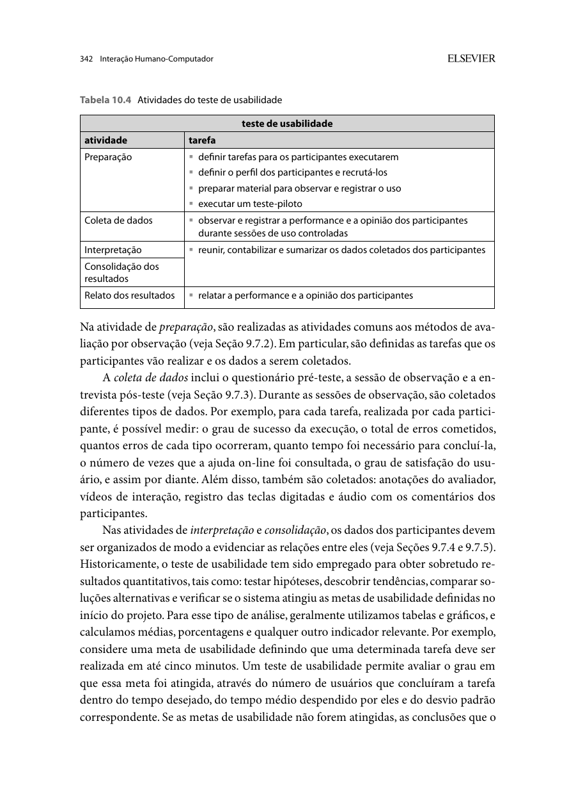
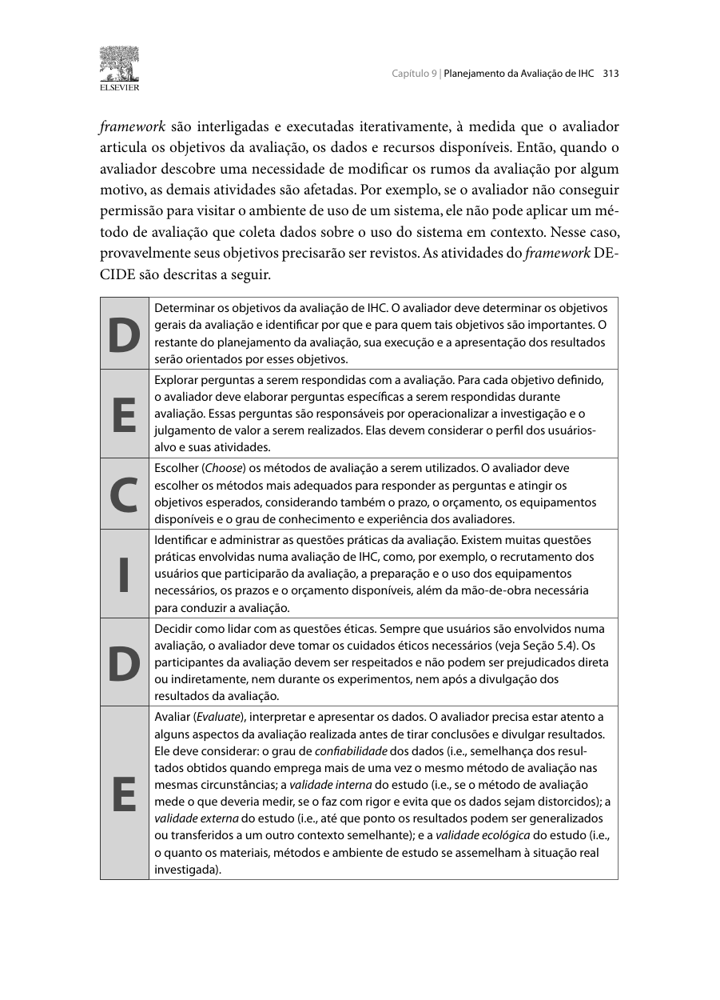
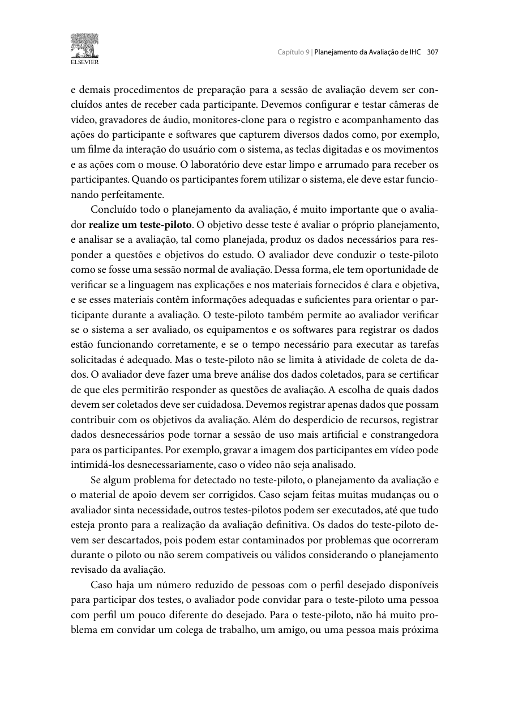

Responsável: Israel Soares de Paiva — Agendamento de visita ao Senado · Autor do item: Israel Soares de Paiva

# Planejamento da avaliação de alta fidelidade — Agendamento de visita ao Senado

## Tabela de contribuição

A Tabela 1 registra as contribuições neste artefato.

| Integrante | Contribuição | Artefato / atividade |
| --- | --- | --- |
| [Israel Soares de Paiva](https://github.com/IsraelSoares-25) | Definição do DECIDE, tarefas, critérios, piloto e instrumentos | [Conteúdo](#introducao) |
| Claude (Anthropic) | Apoio à estruturação, redação e formatação Markdown | [Agradecimentos](#agradecimentos) |
| [Bruno Ferreira Dornelas](https://github.com/brunnf) | Revisão técnica de consistência e alinhamento com o relato do papel | [Introdução](#introducao) |

Tabela 1 — Contribuições neste artefato.

Fonte: elaboração para o Grupo 06 (2026).

## Introdução

Este plano avalia o protótipo navegável AF-1.0 do agendamento de visita ao Senado Federal. Retoma os pontos PAP-R01–PAP-R06 do [relato do papel](relato-prototipo-papel.md#analise-do-reprojeto). O relato desta avaliação será entregue na **Etapa 7, em 15/11/2026**; este documento e seu [planejamento de relato](planejamento-relato-alta-fidelidade.md) compõem a Etapa 6.

## Fundamentação

**Autor do item:** Israel Soares de Paiva.

Barbosa e Silva (2010, seção 10.2.1, p. 341–343) descrevem o teste de usabilidade como observação de pessoas executando tarefas, com registro de desempenho e opinião. Aqui ele será **moderado e formativo**, pois buscamos problemas e causas para melhorar o design. O DECIDE (p. 312–313) organiza as seis decisões abaixo. As Figuras 1–3 apresentam os trechos utilizados.

## D — Determinar os objetivos

Verificar se o reprojeto permite concluir o agendamento corretamente e confiar no resultado, com foco em: **AF-O1**, encontrabilidade e regras; **AF-O2**, escolha de data e horário com leitura clara de vagas; **AF-O3**, preenchimento e acessibilidade; **AF-O4**, revisão e correção antes do compromisso; **AF-O5**, confirmação e comprovante. Público: pessoas adultas que organizam visita ao Senado, próximas à [persona Marta Oliveira](../../../entrega-2/individual/israel/persona.md).

## E — Explorar as perguntas

A Tabela 2 relaciona perguntas, tarefas e dados.

| Pergunta | Tarefa / origem | Dados para responder |
| --- | --- | --- |
| AF-Q1 — A pessoa encontra o agendamento na home e lê as regras antes de avançar? | AF-T1 / PAP-R01, PAP-R02 | Caminho, uso de busca ou card, leitura das regras e ajuda |
| AF-Q2 — Escolhe data e horário com vagas interpretando a legenda do calendário? | AF-T2 / PAP-R03 | Interpretação da legenda, reação a data lotada e horário escolhido |
| AF-Q3 — Preenche os dados e localiza o apoio de acessibilidade? | AF-T3 / PAP-R04 | Preenchimento, localização da seção, erros de validação |
| AF-Q4 — Percebe o dado errado na revisão e o corrige sem perder o restante? | AF-T4 / PAP-R05 | Ação diante do erro, uso de "Editar", dados preservados |
| AF-Q5 — A confirmação transmite segurança sobre o que levar e fazer no dia? | AF-T5 / PAP-R06 | Código anotado, caminho até o comprovante, explicação das orientações |
| AF-Q6 — Que dificuldades e opiniões ajudam a melhorar as telas? | Todas | Ações, erros, falas, satisfação M6 e sugestões localizadas |

Tabela 2 — Perguntas e evidências da alta fidelidade.

Fonte: elaboração para o Grupo 06 (2026).

## C — Escolher os métodos

**Teste de usabilidade moderado remoto**, com compartilhamento da tela da pessoa participante no Google Meet. Ela controla o protótipo; Israel lê os enunciados e não move o cursor por ela. Solicitar que diga o que espera e o que está pensando, sem ensinar o percurso. Concluir com entrevista breve. O operador manual era necessário no papel; na alta fidelidade, as respostas são executadas pelo próprio protótipo.

Não executar reserva no serviço oficial. O protótipo usa dados fictícios, não pede credenciais e mantém o estado apenas na memória da página; recarregar reinicia os dados. A avaliação limita-se ao comportamento implementado, não a integração, regras reais de vagas ou segurança de produção.

## I — Questões práticas

### Pessoas, local e recursos

Prevê-se **uma pessoa adulta principal (AF-P01) e outra distinta para o piloto (AF-PILOTO01)**, por disponibilidade do recorte individual. É uma avaliação exploratória, sem representatividade estatística. Convidar voluntariamente por contato acadêmico ou comunitário, sem seleção por opinião política. Registrar familiaridade digital, experiência com agendamentos públicos, dispositivo, necessidades de leitura e exposição ao papel. Se for a mesma pessoa do papel (PAP-VIS01), registrar a experiência anterior e o possível efeito de aprendizado.

Equipe proposta: Israel modera; Caio e Bruno observam; Luís organiza a gravação. Confirmar disponibilidade antes do piloto. Local: Google Meet, com sala silenciosa em cada ponta; URL da sala e contatos ficam privados. Recursos próprios: computador ou celular, navegador, internet, áudio, compartilhamento de tela, fichas e protótipo AF-1.0. Orçamento adicional previsto **R$ 0**. Se a conexão impedir observar as ações, interromper e reagendar, registrando o ocorrido.

### Tarefas e critérios

A Tabela 3 relaciona enunciados, condições iniciais e critérios de conclusão. Fechar os controles da avaliação antes de entregar a tela à pessoa.

| ID / enunciado lido à pessoa | Estado inicial e dados | Critério observável |
| --- | --- | --- |
| AF-T1 — "Você combinou com familiares de visitar o Senado Federal. Encontre onde se agenda a visita e veja se há regras para o dia." | Reiniciar sessão; página inicial | Localiza o agendamento e comenta vestimenta e documentos antes de iniciar, sem orientação do moderador |
| AF-T2 — "Agende para 3 pessoas da sua família, num dia e horário da manhã que tenha vagas." | Controle "Preparar AF-T2": regras já lidas; calendário com dias com vagas, lotado e indisponível | Define 3 pessoas, interpreta a legenda e escolhe dia e horário matutino com vagas |
| AF-T3 — "Preencha os dados do responsável com a ficha fornecida e indique que um acompanhante usa cadeira de rodas." | Controle "Preparar AF-T3": data e horário escolhidos; ficha com dados fictícios | Preenche campos obrigatórios e marca o apoio de mobilidade |
| AF-T4 — "Confira os dados. Você percebeu que digitou o telefone errado: corrija e finalize." | Controle "Preparar AF-T4": revisão com telefone de um dígito a menos | Identifica o erro, usa "Editar", retorna à revisão com os demais dados preservados e confirma uma vez |
| AF-T5 — "Veja o resultado, anote o código e descubra como levará o comprovante no dia." | Controle "Preparar AF-T5": confirmação com código fictício | Reconhece o código, localiza o PDF e o aviso de e-mail e explica o que levar |

Tabela 3 — Tarefas do teste e critérios de conclusão.

Fonte: elaboração para o Grupo 06 (2026).

Os dados fictícios seguem a ficha usada no papel. As tarefas podem ocorrer em sequência. Os objetivos são apresentados no início; durante a execução, o participante controla a tela e verbaliza seu raciocínio. O painel da equipe permite acessar os estados da interface; seu uso deve ser registrado quando alterar o estado inicial de uma tarefa.

### Condução e piloto

Reservar **40–50 minutos**: apresentação, autorização e perfil (8), tarefa neutra de apontar e compartilhar tela (3), cinco tarefas (24), entrevista e fechamento (8), pausas (até 7). A pessoa pode parar antes. Apresentar o cenário e os objetivos numa introdução única. Durante o percurso, ouvir os pensamentos em voz alta e evitar perguntas a cada tela. Ao final, retomar brevemente as tarefas para coletar a opinião e, se aplicada, a escala M6: "Quão satisfeito(a) você ficou com a experiência de realizar esta tarefa?", de 1 (muito insatisfeito) a 5 (muito satisfeito), com justificativa.

O piloto verifica link, câmera/tela, áudio, tamanho do texto, reinícios, enunciados, validação de campos, preservação dos dados na edição e preenchimento das fichas. É um ensaio do procedimento, com outra pessoa, realizado antes da coleta; seus resultados não compõem a sessão principal (BARBOSA; SILVA, 2010, p. 307–308). Registrar ajustes e fixar versão antes do teste principal.

### Agenda proposta

A Tabela 4 usa horário de Brasília; convites ainda precisam ser confirmados.

| Atividade | Data / horário propostos | Responsável / produto |
| --- | --- | --- |
| Consolidar observações do papel e conferir AF-1.0 | 04–05/11, 19h–20h | Israel; ajustes rastreáveis |
| Confirmar pessoas, acesso e autorizações | 06/11, 18h30–19h | Israel e Luís; recursos e sala |
| Piloto AF-PILOTO01 | 07/11, 19h–19h50 | Equipe; ficha de ajustes separada |
| Ajustar e fixar versão | 08/11, 19h–20h | Israel e Bruno; versão do teste |
| Sessão AF-P01 | 10/11, 19h–19h50 | Israel, Caio, Bruno e Luís; registros |
| Analisar dados e preparar relato | 11–12/11, 19h–20h30 | Israel e observadores |
| Revisar e gravar apresentação | 13–14/11, 19h–20h | Israel e Bruno |
| Entrega / inspeção / apresentação da Etapa 7 | 15/11 / 16/11 / 17/11 | Marcos do plano de ensino |

Tabela 4 — Agenda proposta da avaliação e do relato.

Fonte: elaboração para o Grupo 06 (2026).

## D — Decidir questões éticas

Usar o [procedimento ético do grupo](../../../entrega-2/etica.md), conforme Barbosa e Silva (2010, p. 138–142, 313). Autorizar separadamente participação, voz/imagem, compartilhamento de tela e disponibilização do vídeo para a disciplina. Explicar o alcance de um link não listado. Garantir recusa de perguntas, pausa e retirada sem prejuízo. Não coletar preferência política, documento real, senha ou dados pessoais verdadeiros: o preenchimento usa apenas a ficha fictícia.

Israel mantém termos, contato e arquivos brutos fora do repositório. Publicar somente registros autorizados e desidentificados. Proposta de retenção: excluir brutos e chave de identificação até 30 dias após o fim da disciplina, com data e contato efetivos definidos no consentimento. Se houver dados pessoais na tela, pausar, ocultar e retirar o trecho antes da disponibilização.

## E — Avaliar, interpretar e apresentar os dados

Registrar por tarefa: versão, condição inicial, ações, erros, ajuda, conclusão, falas, satisfação e minuto do vídeo. Iniciar tempo ao terminar o enunciado e disponibilizar a tela; encerrar na conclusão ou desistência. Separar pausas e falhas técnicas. Fala durante o uso e condições remotas limitam a comparação de tempos.

A Tabela 5 delimita as [metas da Etapa 3](../../../entrega-3/metas-usabilidade.md) cobertas.

| Meta | Medida e interpretação nesta avaliação |
| --- | --- |
| M0 — eficácia | Conclusão correta sem ajuda por tarefa; apresentar contagem e denominador, sem extrapolar a amostra |
| M2 — prevenção | Contar tentativas e resultados críticos: confirmação com telefone errado ou avanço com campo obrigatório vazio; desejado zero efetivações críticas |
| M3 — recuperação | Avaliada em AF-T4: se a pessoa corrige o telefone e conclui, com ou sem ajuda, e quantas ações foram necessárias |
| M6 — satisfação | Registrar resposta de 1 a 5 e justificativa por tarefa; ausência não é zero |
| M1, M4 e M5 | Não avaliadas: não há duas tentativas equivalentes, retorno após sete dias ou comparação controlada com o portal oficial |

Tabela 5 — Indicadores e limites do protocolo.

Fonte: elaboração para o Grupo 06 (2026).

Manter critérios fixos antes da sessão principal. Interpretar cada problema com ação, fala e tela; avaliar gravidade e frequência observadas. Usar alta, média ou baixa segundo as consequências definidas no [relato do papel](relato-prototipo-papel.md#problemas-corrigidos-e-pendentes). Não alterar a interface durante uma execução: registrar, encerrar a tarefa e só então versionar eventual correção. O novo ciclo precisa de reteste identificado; "corrigido" não significa "validado". O [planejamento do relato](planejamento-relato-alta-fidelidade.md) define a consolidação e as fichas.

## Agradecimentos

Claude (Anthropic) apoiou a estruturação e a formatação deste material. Israel Soares de Paiva responde pelo conteúdo. Revisor: [Bruno Ferreira Dornelas](https://github.com/brunnf).

## Histórico de versão

A Tabela 6 registra a versão deste artefato.

| Versão | Data | Descrição | Autor(es) | Revisor(es) |
| :---: | :---: | --- | --- | --- |
| `0.1` | 03/11/2026 | Elaboração do planejamento da avaliação de alta fidelidade do Agendamento de Visita | [Israel Soares de Paiva](https://github.com/IsraelSoares-25) | [Bruno Ferreira Dornelas](https://github.com/brunnf) |

Tabela 6 — Histórico de versão.

Fonte: elaboração para o Grupo 06 (2026).

## Referências

[1] BARBOSA, Simone Diniz Junqueira; SILVA, Bruno Santana da. *Interação humano-computador*. Rio de Janeiro: Elsevier, 2010. p. 138–142, 307–313, 341–343.

[2] SALES, André Barros de. *Plano de Ensino FIHC 022026 — Turma 01*, v1. FCTE/UnB, 2026. Cronograma, p. 5 do PDF.

[3] GRUPO 06. [Metas de usabilidade](../../../entrega-3/metas-usabilidade.md) e [relato do papel](relato-prototipo-papel.md). 2026.

## Apêndice A — Fundamentação

As Figuras 1–3 fundamentam método, planejamento e piloto.

??? note "Figura 1 — Preparação e coleta no teste de usabilidade"

    { loading=lazy }
    
Figura 1 — Preparação e coleta no teste de usabilidade.

    
Fonte: Barbosa e Silva (2010, p. 342).

??? note "Figura 2 — Atividades do DECIDE"

    { loading=lazy }
    
Figura 2 — Atividades do DECIDE.

    
Fonte: Barbosa e Silva (2010, p. 313).

??? note "Figura 3 — Teste-piloto do procedimento"

    { loading=lazy }
    
Figura 3 — Teste-piloto do procedimento.

    
Fonte: Barbosa e Silva (2010, p. 307).
