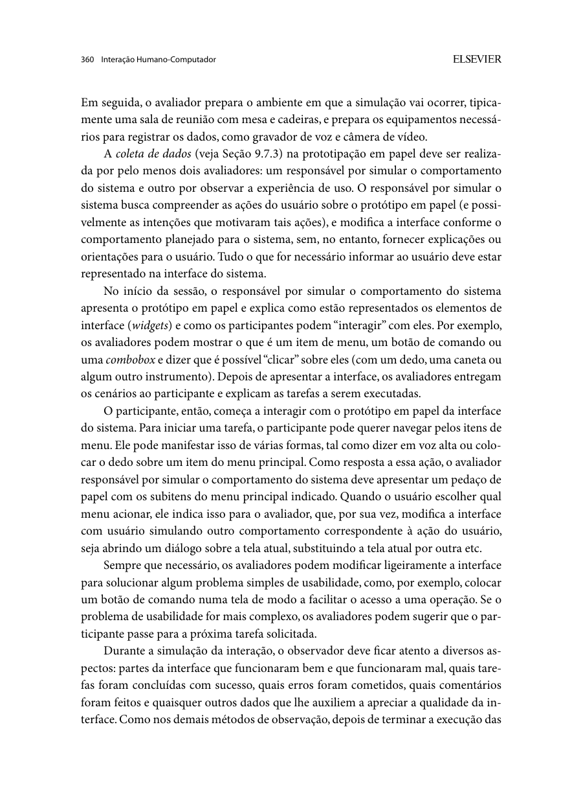
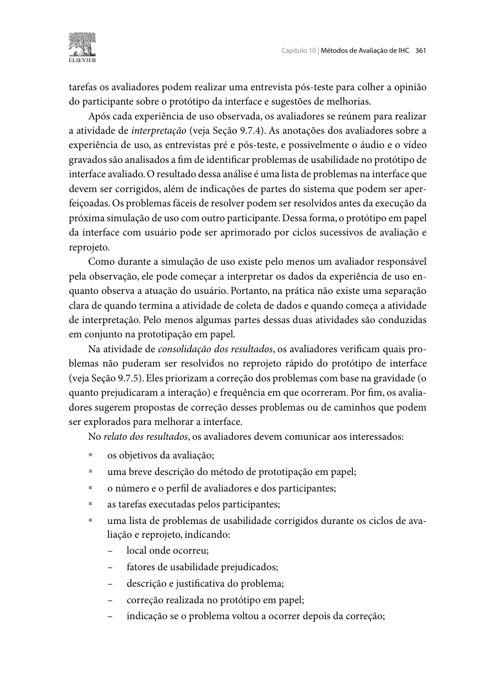
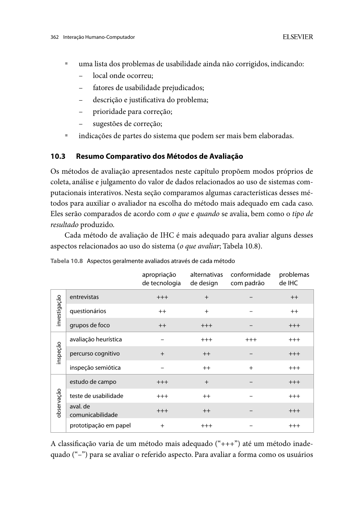

Responsável: Israel Soares de Paiva — Agendamento de visita ao Senado · Autor do item: Israel Soares de Paiva

# Relato da avaliação do protótipo de papel — Agendamento de visita ao Senado

## Tabela de contribuição

A Tabela 1 registra as contribuições neste artefato.

| Integrante | Contribuição | Artefato / atividade |
| --- | --- | --- |
| [Israel Soares de Paiva](https://github.com/IsraelSoares-25) | Preparação do relato, fichas, condução da sessão e decisões de reprojeto | [Conteúdo](#introducao) |
| Claude (Anthropic) | Apoio à estruturação, redação e formatação Markdown | [Agradecimentos](#agradecimentos) |
| [Bruno Ferreira Dornelas](https://github.com/brunnf) | Revisão técnica de consistência e alinhamento com o planejamento | [Introdução](#introducao) |

Tabela 1 — Contribuições neste artefato.

Fonte: elaboração para o Grupo 06 (2026).

## Introdução

Este relato acompanha a avaliação de **agendar uma visita ao Senado Federal**, conforme o [planejamento da Etapa 5](../../../entrega-5/individual/israel/planejamento-avaliacao-prototipo-papel.md) e o [planejamento do relato](../../../entrega-5/individual/israel/planejamento-relato-prototipo-papel.md). O recorte abrange localização do serviço, leitura das regras, escolha de data e horário, preenchimento de dados com acessibilidade, revisão com correção de erro e obtenção do comprovante.

A persona de referência é [Marta Oliveira](../../../entrega-2/individual/israel/persona.md). Os encaminhamentos RP01–RP05 e AT-P01–AT-P05 vêm do [relato consolidado da Etapa 5](../../../entrega-5/individual/israel/relato-resultados-etapa5.md), dos relatos do [storyboard](../../../entrega-5/individual/israel/relato-storyboard.md) e da [análise de tarefas](../../../entrega-5/individual/israel/relato-analise-tarefas.md). A sessão com o participante PAP-VIS01 foi realizada em 03/11/2026 e seus resultados constam na seção [Resultados da sessão](#resultados-da-sessao).

## Método e objetivos

**Autor do item:** Israel Soares de Paiva.

Na prototipação em papel, a pessoa indica o que faria e o operador apresenta a resposta correspondente nas folhas. Outros avaliadores observam a execução e registram dificuldades. Os comentários finais complementam as ações observadas. Barbosa e Silva (2010, p. 358–362) orientam registrar também correções, recorrência e problemas pendentes; as Figuras 1–3 apresentam a fundamentação.

**Material: PP-1.0.** O protótipo contém sete folhas-base (S01–S07) e dez cartões móveis (X01, X02 e M01–M08). Mudanças de estado, mensagens de erro e horários são feitas por sobreposição de cartões, conforme a preparação de elementos móveis descrita por Barbosa e Silva (2010, p. 358–360).

O objetivo é verificar: localização do serviço na página inicial; compreensão das regras antes do preenchimento; leitura da disponibilidade no calendário; preenchimento e registro de acessibilidade; correção de erro na revisão; e segurança transmitida pela confirmação. O reprojeto propõe melhorias sobre o portal do Senado, sem tratá-lo como sistema real: nenhuma reserva é enviada.

## Equipe e procedimento

A Tabela 2 identifica os papéis previstos para a gravação.

| Papel | Responsável / condição |
| --- | --- |
| Avaliador, moderador e operador das folhas | Israel Soares de Paiva |
| Observadores | Caio Breno de Souza Bezerra e Bruno Ferreira Dornelas (a confirmar) |
| Câmera, enquadramento e gravação no Meet | Luís Henrique Arruda Luna (a confirmar) |
| Participante principal | PAP-VIS01; perfil e experiência com o serviço a registrar na sessão |
| Piloto | PP-PILOTO01, pessoa distinta da principal; registrar separadamente |
| Modalidade e material | Google Meet, câmera superior mostrando folhas e cartões; PP-1.0 |

Tabela 2 — Papéis e condições da avaliação.

Fonte: elaboração para o Grupo 06 (2026).

No Meet, a pessoa aponta ou informa o controle escolhido e verbaliza seu entendimento (*think-aloud*). Israel apresenta os enunciados e troca folhas e cartões conforme as ações. Os observadores registram percurso, ajudas, comentários e dificuldades; a pessoa responsável pela câmera cuida do enquadramento e da gravação. A análise relaciona esses registros às perguntas PP-Q1–PP-Q6.

### Organização do material

A Tabela 3 apresenta o inventário final. Ela amplia a Tabela 4 do planejamento, que listava apenas X01 e X02; os cartões M01–M08 foram acrescentados na preparação.

| ID | Folha / cartão | Uso na sessão | Relação com a HTA |
| --- | --- | --- | --- |
| S01 | Página inicial reprojetada com card "Agendar Visita" | Início de PP-T1 | HTA 1.1–1.2 |
| S02 | Programa de Visitação com regras e ícones | Leitura das regras (PP-T1) | HTA 1.3 |
| S03 | Modalidade e quantidade de pessoas | Início de PP-T2 | HTA 2.1–2.2 |
| S04 | Calendário com legenda de vagas | Escolha de data e horário (PP-T2) | HTA 3.1–3.3 |
| S05 | Formulário de visitantes e acessibilidade | PP-T3 | HTA 4.1–4.3 |
| S06 | Revisão de dados com botões "Editar" | PP-T4 | HTA 5.1–5.3 |
| S07 | Confirmação, código localizador e comprovante | PP-T5 | HTA 6.1–6.3 |
| X01 | Alerta de data lotada | Ao tocar em dia vermelho (S04) | Exceção HTA 3.1 |
| X02 | Alerta de campo obrigatório | Ao avançar sem nome (S05) | Validação HTA 4.1 |
| M01 | Sugestões de busca | Ao digitar "visita" (S01) | HTA 1.2 |
| M02–M04 | Cartões de horário (09h, 10h, 11h esgotado) | Após escolher um dia com vagas | HTA 3.3 |
| M05 | Marcador de dia selecionado | Sobre o dia escolhido | HTA 3.2 |
| M06 / M07 | Telefone com erro / telefone corrigido | Provocar e resolver o erro de PP-T4 | HTA 5.2 |
| M08 | "Enviando agendamento…" | Transição S06 → S07 | HTA 5.3 |

Tabela 3 — Inventário de folhas e cartões do protótipo PP-1.0.

Fonte: elaboração para o Grupo 06 (2026).

## Tarefas e evidências

A Tabela 4 relaciona tarefas, materiais e critérios. Os registros de vídeo e notas relacionam as escolhas e explicações da pessoa às tarefas.

| Tarefa / pergunta | Ação e telas | Critério de conclusão | Evidência / resultado |
| --- | --- | --- | --- |
| PP-T1 / PP-Q1, PP-Q2 | Encontrar o agendamento e ler as regras; S01 → S02 | Localizar a entrada e comentar vestimenta e documentos antes de iniciar | Vídeo: caminho, uso de busca ou card, leitura das regras |
| PP-T2 / PP-Q3 | Definir 3 pessoas e escolher data e horário; S03 → S04 | Interpretar a legenda e escolher dia e horário matutino com vagas | Vídeo: leitura da legenda, reação a X01, horário escolhido |
| PP-T3 / PP-Q4 | Preencher responsável e indicar acessibilidade; S05 | Preencher dados fictícios e marcar apoio de mobilidade | Vídeo: preenchimento, localização da seção, reação a X02 |
| PP-T4 / PP-Q5 | Perceber telefone errado, editar e confirmar; S06 | Identificar M06, usar "Editar", voltar à revisão com dados preservados e confirmar | Vídeo: ação diante do erro, retorno e confirmação |
| PP-T5 / PP-Q6 | Interpretar a confirmação; S07 | Reconhecer o código localizador e explicar como levará o comprovante | Vídeo: anotação do código, escolha entre PDF e e-mail |

Tabela 4 — Tarefas e critérios da avaliação.

Fonte: elaboração para o Grupo 06 (2026).

Dados de exemplo: ficha com nome, CPF, e-mail e telefone **fictícios** do responsável e de dois acompanhantes, e data-alvo de teste com vagas matutinas. Todos os identificadores, datas e estados das folhas pertencem ao protótipo.

Classificar cada execução como **sem ajuda, com ajuda, não concluída ou não executada**, com justificativa. Troca errada de folha, áudio cortado e falha de câmera são ocorrências de condução. As tarefas podem ocorrer em sequência; qualquer reinício deve ser anotado. Tempo de troca de papel não comprova eficiência do sistema.

## Análise das telas e decisões de projeto

A análise documental das telas foi consolidada em 03/11/2026. A Tabela 5 apresenta a conclusão sobre cada decisão de interface, vinculada aos resultados das etapas anteriores. A comprovação das ações e da compreensão da pessoa está associada ao vídeo da sessão e à seção [Resultados da sessão](#resultados-da-sessao).

| ID / origem | Local e fator de uso | Análise da interface | Decisão incorporada |
| --- | --- | --- | --- |
| PAP-R01 / RP01 | S01; encontrabilidade | O card "Visite o Senado / Agendar Visita" fica em destaque na home, com sugestões de busca (M01) como segunda via de acesso. | Card em destaque e busca com sugestões em PP-1.0. Prioridade **alta**. |
| PAP-R02 / RP03, AT-P01 | S02; prevenção de constrangimento | As regras de trajes, documento e chegada aparecem com ícones antes do botão "Iniciar Agendamento", e não apenas no formulário. | Tela intermediária de regras em PP-1.0. Prioridade **alta**. |
| PAP-R03 / RP02, AT-P02 | S04; visibilidade do sistema | O calendário usa verde, vermelho e cinza com símbolos (✓ e ✖) e horários com número de vagas, sem depender só de cor. | Legenda dupla e cartões de horário em PP-1.0. Prioridade **alta**. |
| PAP-R04 / AT-P03 | S05; acessibilidade | A seção de acessibilidade (mobilidade reduzida, Libras, outro) fica visível no formulário, e o campo obrigatório tem aviso específico (X02). | Seção explícita e validação em PP-1.0. Prioridade **média**. |
| PAP-R05 / RP04, AT-P04 | S06; prevenção e recuperação de erro | A revisão resume visita, responsável e acessibilidade, com "Editar" por bloco e retorno sem perda de dados. | Resumo editável por bloco em PP-1.0. Prioridade **alta**. |
| PAP-R06 / RP05, AT-P05 | S07; segurança percebida | A confirmação reúne código localizador, data, botão "Baixar Comprovante (PDF)", aviso de e-mail e orientações do dia. | Confirmação completa em PP-1.0. Prioridade **alta**. |

Tabela 5 — Análise das telas e decisões incorporadas ao reprojeto.

Fonte: análise documental do material PP-1.0, com base em RP01–RP05 e AT-P01–AT-P05 (2026).

A sugestão de cancelar ou remarcar (Q6 do storyboard; ramo 7 da HTA) aparece em S07 como link "Alterar / cancelar agendamento", mas não é tarefa deste protocolo.

## Conferência e encaminhamento

A Tabela 6 registra a conferência das soluções presentes na proposta antes da sessão. Os resultados de uso constam na seção seguinte.

| Aspecto | Evidência na proposta | Encaminhamento para a avaliação |
| --- | --- | --- |
| Entrada e regras | S01–S02: card em destaque e regras antes do início | Observar o percurso escolhido sem indicar controles |
| Calendário | S04: legenda por cor e símbolo, vagas por horário, X01 | Registrar a interpretação da legenda e a reação ao dia lotado |
| Formulário e acessibilidade | S05: campos e seção de acessibilidade, X02 | Registrar a localização da seção e eventuais bloqueios |
| Revisão e correção | S06: M06 → "Editar" → M07 | Observar a ação diante do erro provocado |
| Confirmação | S07: código, PDF, e-mail e orientações | Registrar a explicação espontânea do que fará no dia |

Tabela 6 — Conferência da proposta consolidada.

Fonte: análise documental das telas PP-1.0 (2026).

## Resultados da sessão

Em 03/11/2026, PAP-VIS01 executou o percurso no protótipo PP-1.0, pelo Google Meet. Segundo a síntese do moderador, a pessoa **compreendeu todo o fluxo**, **não teve dúvida sobre o tratamento de erro** e **concluiu a tarefa**. A única dúvida registrada foi sobre a tela final: não ficou claro se a ação disponível levava de volta ao menu inicial ou de volta à edição dos passos anteriores.

A Tabela 7 relaciona esses registros às perguntas de avaliação. Os localizadores de vídeo e a classificação de ajuda por tarefa (sem ajuda, com ajuda, não concluída) serão acrescentados na conferência das gravações.

| Pergunta | Resultado observado | Localizador no vídeo |
| --- | --- | --- |
| PP-Q1 — localização do serviço | Fluxo compreendido, sem dificuldade registrada na síntese | A anexar |
| PP-Q2 — regras antes do preenchimento | Fluxo compreendido, sem dificuldade registrada na síntese | A anexar |
| PP-Q3 — calendário e vagas | Fluxo compreendido, sem dificuldade registrada na síntese | A anexar |
| PP-Q4 — dados e acessibilidade | Fluxo compreendido, sem dificuldade registrada na síntese | A anexar |
| PP-Q5 — revisão e correção de erro | Sem dúvida sobre o tratamento de erro | A anexar |
| PP-Q6 — confirmação e comprovante | Tarefa concluída; **dúvida sobre o destino da tela final** (menu inicial ou edição dos passos anteriores) | A anexar |

Tabela 7 — Resultados da sessão por pergunta de avaliação.

Fonte: síntese do moderador após a sessão com PAP-VIS01 (2026).

### Problema identificado e decisão de reprojeto

A Tabela 8 consolida o problema observado, conforme Barbosa e Silva (2010, p. 361–362).

| ID / tarefa / tela | Evidência | Descrição / fator / consequência | Hipótese de causa | Prioridade / frequência | Correção proposta | Reteste |
| --- | --- | --- | --- | --- | --- | --- |
| PAP-PR01 / PP-T5 / S07 | Dúvida verbalizada pelo participante; localizador no vídeo a anexar | A pessoa não soube se a ação da tela final voltava ao menu inicial ou à edição dos passos anteriores. Fator: clareza dos rótulos e do que acontece em seguida. Não impediu a conclusão, mas ocorre no fechamento do fluxo e pode levar a reabrir um agendamento já confirmado. | O destino das ações da tela final não está explícito (hipótese a confirmar no vídeo) | **Média** (proposta); 1 ocorrência em 1 execução de PP-T5, versão PP-1.0 | Em S07, separar dois controles com rótulos de destino: "Voltar ao início do portal" (principal) e "Alterar / cancelar agendamento" (secundário, com a explicação "use o código localizador"). Evitar setas ou botões "Voltar" sem destino. | Não retestado; observar em AF-T5 |

Tabela 8 — Problema, causa interpretada e correção proposta.

Fonte: elaboração para o Grupo 06 (2026), com base na sessão com PAP-VIS01.

A prioridade segue a consequência para a conclusão correta: o problema não impediu a tarefa, mas afeta a segurança percebida ao fim do fluxo. Uma correção sem nova execução permanece como **não retestada**. Esta decisão alimenta o critério de AF-T5 no [planejamento de alta fidelidade](planejamento-avaliacao-alta-fidelidade.md).

## Registro e vídeo

**Vídeo da avaliação:** [Link não listado](https://youtu.be/iHwOIBnKUUU?si=_2O3e4XUBa5qO3bi). Publicar somente a versão autorizada; o link não listado permite acesso a quem o possui.

A Tabela 9 concentra os campos de fechamento, evitando repetir pendências pelo relato.

| Campo | Registro da sessão |
| --- | --- |
| Data, início, fim e duração efetivos | 03/11/2026; horários e duração a registrar |
| Perfil de PAP-VIS01 e exposição anterior ao material | A registrar sem identificação pessoal |
| Piloto: data, pessoa distinta e ajustes do procedimento | A registrar, separado dos resultados principais |
| Autorização para participar, gravar e disponibilizar | Conferir antes de disponibilizar; termo fora do repositório |
| Versão do material | PP-1.0 |
| Link do vídeo | Anexado; localizadores de PP-T1–PP-T5 a acrescentar |

Tabela 9 — Identificação e fechamento da sessão.

Fonte: elaboração para o Grupo 06 (2026).

## Síntese e continuidade

Na sessão com PAP-VIS01, o percurso foi compreendido de ponta a ponta, o tratamento de erro não gerou dúvida e a tarefa foi concluída. A proposta cobriu os cinco objetivos do recorte: localização do serviço, compreensão das regras, leitura do calendário, correção de erro antes do envio e confirmação com comprovante. O único ponto de melhoria registrado foi o destino das ações na tela final (PAP-PR01).

O relato diferencia a presença de uma solução na interface de sua eficácia durante o uso. Os encaminhamentos seguem para AF-T1–AF-T5 do [planejamento de alta fidelidade](planejamento-avaliacao-alta-fidelidade.md), com atenção ao destino dos botões da tela final. Com um participante, a avaliação descreve este caso e suas condições; não estima a experiência de toda a população.

O estudo não mede recordação após dias, comparação de eficiência com o portal oficial, alteração ou cancelamento de reserva, nem integração real. A opinião final é qualitativa. A continuidade no Meet depende de áudio e legibilidade da câmera. Código localizador, vagas e estados são representações da interface proposta.

## Agradecimentos

Claude (Anthropic) apoiou a estruturação e a formatação deste material. Israel Soares de Paiva responde pelo conteúdo. Revisor: [Bruno Ferreira Dornelas](https://github.com/brunnf).

## Histórico de versão

A Tabela 10 registra as versões deste artefato.

| Versão | Data | Descrição | Autor(es) | Revisor(es) |
| :---: | :---: | --- | --- | --- |
| `0.1` | 03/11/2026 | Elaboração do relato e documentação do protótipo de papel do Agendamento de Visita | [Israel Soares de Paiva](https://github.com/IsraelSoares-25) | [Bruno Ferreira Dornelas](https://github.com/brunnf) |
| `0.2` | 03/11/2026 | Inclusão do vídeo, dos resultados da sessão e do problema PAP-PR01 | [Israel Soares de Paiva](https://github.com/IsraelSoares-25) | [Bruno Ferreira Dornelas](https://github.com/brunnf) |

Tabela 10 — Histórico de versão.

Fonte: elaboração para o Grupo 06 (2026).

## Referências

[1] BARBOSA, Simone Diniz Junqueira; SILVA, Bruno Santana da. *Interação humano-computador*. Rio de Janeiro: Elsevier, 2010. p. 358–362.

[2] SALES, André Barros de. *Plano de Ensino FIHC 022026 — Turma 01*, v1. FCTE/UnB, 2026. Cronograma, p. 5 do PDF.

[3] NIELSEN, Jakob. *Paper Prototyping: Getting User Data Before You Code*. Nielsen Norman Group, 2003. Disponível em: <https://www.nngroup.com/articles/paper-prototyping/>.

[4] GRUPO 06. [Planejamento do papel](../../../entrega-5/individual/israel/planejamento-avaliacao-prototipo-papel.md) e [relatos anteriores](../../../entrega-5/individual/israel/index.md). 2026.

## Apêndice A — Fundamentação

As Figuras 1–3 fundamentam os papéis e a estrutura de relato.

??? note "Figura 1 — Operação da interface e observação do uso"

    { loading=lazy }
    
Figura 1 — Operação da interface e observação do uso.

    
Fonte: Barbosa e Silva (2010, p. 360).

??? note "Figura 2 — Problemas corrigidos e recorrência"

    { loading=lazy }
    
Figura 2 — Problemas corrigidos e recorrência.

    
Fonte: Barbosa e Silva (2010, p. 361).

??? note "Figura 3 — Problemas pendentes e sugestões"

    { loading=lazy }
    
Figura 3 — Problemas pendentes e sugestões.

    
Fonte: Barbosa e Silva (2010, p. 362).
