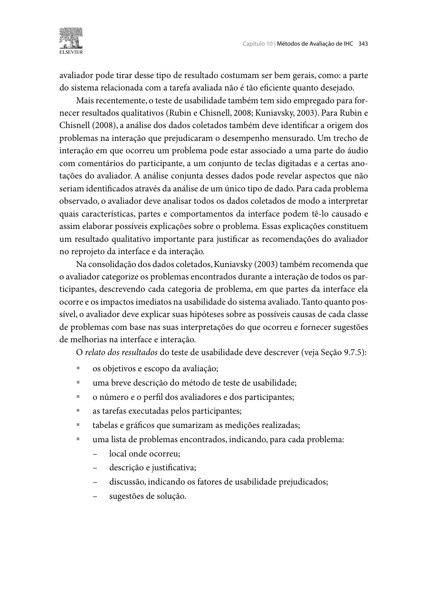

Responsável: Luís Henrique Arruda Luna — Relato da alta fidelidade · Autor do item: Luís Henrique Arruda Luna

# Planejamento do relato da avaliação de alta fidelidade

## Tabela de contribuição

A Tabela 1 registra a contribuição neste artefato.

| Integrante | Contribuição | Artefato / atividade |
| --- | --- | --- |
| [Luís Henrique Arruda Luna](https://github.com/Donnk61) | Definição dos registros e responsabilidade pelo conteúdo | [Conteúdo](#introducao) |
| Claude Code (Anthropic) | Apoio à estruturação das fichas e à redação | [Agradecimentos](#agradecimentos) |

Tabela 1 — Contribuição neste artefato.

Fonte: elaboração para o Grupo 06 (2026).

## Introdução

O relato da Etapa 7, com entrega em 15/11/2026, responderá às perguntas AF-Q1 a AF-Q6 do [planejamento da avaliação](planejamento-avaliacao-alta-fidelidade.md), usando as tarefas AF-T1 a AF-T5. Este documento fixa a estrutura e os campos antes da coleta. A sessão ainda não ocorreu, e nada aqui é resultado.

## Estrutura do relato

**Autor do item:** Luís Henrique Arruda Luna.

Barbosa e Silva (2010, p. 343) orientam relatar objetivos, método, pessoas, tarefas, medições e problemas, com local, justificativa, fatores de uso e sugestões. A Figura 1, no [Apêndice A](#apendice-a-fundamentacao), traz o trecho. A Tabela 2 aplica essa orientação ao relato.

| Seção | Conteúdo | Evidência de apoio |
| --- | --- | --- |
| Objetivos e escopo | AF-O1 a AF-O4, perguntas e limites da funcionalidade | Plano final |
| Protótipo avaliado | Versão, commit, link e situação de AF-R01 a AF-R09 | Protótipo e conferência da equipe |
| Método e execução | Modalidade, papéis, data, horários, duração e desvios | Ficha da sessão |
| Pessoas | Quantidade, perfil, recrutamento e exposição anterior | Caracterização sem identificação |
| Tarefas e medições | Enunciado, ações, conclusão, ajuda, erro, tempo e M6 | Fichas por tarefa e vídeo |
| Problemas | Local, descrição, evidência, causa, fator, consequência, prioridade e sugestão | Matriz de problemas |
| Correções | Versão, responsável, reteste e recorrência | Comparação de versões |
| Respostas e limites | Resposta a cada pergunta, lacunas e limites | Tabela de consolidação |

Tabela 2 — Estrutura prevista para o relato.

Fonte: elaboração para o Grupo 06 (2026).

## Ficha da sessão

A Tabela 3 será preenchida na execução. Contatos, termos e dados identificadores não serão publicados.

| Campo | Registro |
| --- | --- |
| Código da pessoa participante | AF-P01 |
| Data, início, fim e duração | |
| Versão, commit, dispositivo e navegador | |
| Moderador, observadores e responsável pela gravação | |
| Perfil, familiaridade digital e uso do portal | |
| Participação no papel e contato anterior com o material | |
| TCLE e autorizações de gravação, tela e disponibilização | |
| Link autorizado, falhas técnicas e desvios do plano | |

Tabela 3 — Identificação da sessão principal.

Fonte: elaboração para o Grupo 06 (2026).

## Ficha por tarefa

A Tabela 4 terá uma linha por pessoa, tarefa e versão.

| Pessoa / tarefa | Estado inicial e ações | Conclusão e ajuda | Erros e correção | Tempo e pausas | Interpretação declarada | M6 e justificativa | Localizador |
| --- | --- | --- | --- | --- | --- | --- | --- |
| AF-P01 / AF-T1 | | | | | | | |
| AF-P01 / AF-T2 | | | | | | | |
| AF-P01 / AF-T3 | | | | | | | |
| AF-P01 / AF-T4 | | | | | | | |
| AF-P01 / AF-T5 | | | | | | | |

Tabela 4 — Registro de desempenho e opinião por tarefa.

Fonte: elaboração para o Grupo 06 (2026).

Conclusão usa quatro valores: **sem ajuda, com ajuda, não concluída ou não executada**. Qualquer intervenção que mude o percurso conta como ajuda e fica registrada. Em AF-T2, registrar também se o erro preparado foi percebido, em qual tela e se foi corrigido. Em AF-T5, registrar a explicação sobre a inscrição não criada e a outra opção escolhida. Lacunas ficam em branco; tempos não serão estimados.

## Matriz de problemas

A Tabela 5 consolida cada problema, com o mesmo critério de severidade do [relato do papel](relato-prototipo-papel.md#problemas).

| ID, tarefa e tela | Evidência e localizador | Descrição, fator e consequência | Causa proposta | Frequência | Prioridade e justificativa | Sugestão ou correção | Versão, reteste e recorrência |
| --- | --- | --- | --- | --- | --- | --- | --- |
| AF-PR01 | | | | | | | |

Tabela 5 — Problemas, propostas e controle de correções.

Fonte: elaboração para o Grupo 06 (2026).

**Regras de interpretação:**

- Separar ação observada, fala e inferência da equipe.
- Informar a frequência com denominador, como “uma ocorrência em uma execução de AF-T5 na versão AF-1.0”.
- Comparar as notas de moderador e observador e registrar divergências antes de decidir.
- Registrar erros de condução ou do protótipo à parte dos problemas de interface.
- Manter como “não retestada” toda correção sem nova execução.

## Retomada dos problemas do papel

A Tabela 6 mostra o que aconteceu com cada problema do papel. Aparecer no protótipo não significa que o problema foi resolvido: isso depende do comportamento observado.

| Problema do papel | Requisito | Situação na AF | Tarefa | Recorrência |
| --- | --- | --- | --- | --- |
| P01 — estado após confirmar | AF-R01 | | AF-T3 | |
| P02 — datas divergentes | AF-R02 | | AF-T1 e AF-T2 | |
| P03 — confirmação sem dados | AF-R03 | | AF-T3 | |
| P04 — textos de estado | AF-R04 | | AF-T3 a AF-T5 | |
| P05 — saídas da revisão | AF-R05 | | AF-T2 | |

Tabela 6 — Acompanhamento dos problemas do papel.

Fonte: Tabela 6 do relato do papel.

Na comparação entre papel e alta fidelidade, considerar as diferenças de material, tarefas, pessoa, ajuda e aprendizado. Uma mudança de desempenho não será atribuída sozinha ao novo design.

## Consolidação das respostas

A Tabela 7 será o resumo do estudo.

| Pergunta | Dados usados | Resposta e limite |
| --- | --- | --- |
| AF-Q1 — encontrabilidade | AF-T1 | |
| AF-Q2 — vagas e indisponibilidade | AF-T1, AF-T4 e AF-T5 | |
| AF-Q3 — prevenção | AF-T2 | |
| AF-Q4 — estado da solicitação | AF-T3 e AF-T5 | |
| AF-Q5 — próximo passo | AF-T3 a AF-T5 | |
| AF-Q6 — dúvidas e opiniões | Todas | |

Tabela 7 — Respostas às perguntas de avaliação.

Fonte: elaboração para o Grupo 06 (2026).

M0, M2 e M3 serão apresentadas por tarefa, com contagem e denominador. M6 será apresentada como nota individual com justificativa. M1, M4 e M5 ficam como **não avaliadas**. Regras institucionais de vagas não serão tratadas como validadas, e nenhuma meta será declarada alcançada para o público.

## Piloto, agenda e publicação

O piloto PP-AF01 terá registro próprio de dificuldades e ajustes, fora das tabelas acima. O relato seguirá a [agenda do plano](planejamento-avaliacao-alta-fidelidade.md#agenda-e-recursos) e registrará os horários efetivos.

Luís redige o relato, o observador confere as notas e [Caio Breno de Souza Bezerra](https://github.com/CaioBezerra-Dev) é o revisor designado. Antes de 15/11, conferir tabelas, localizadores, versão, anonimização, acesso ao vídeo e histórico. A apresentação da etapa é uma gravação separada do vídeo da avaliação.

## Agradecimentos

Claude Code (Anthropic) apoiou a estruturação das fichas e a redação. Luís Henrique Arruda Luna responde pelo conteúdo.

## Histórico de versão

A Tabela 8 registra a versão deste artefato.

| Versão | Data | Descrição | Autor(es) | Revisor(es) |
| :---: | :---: | --- | --- | --- |
| `0.1` | 03/11/2026 | Elabora o planejamento do relato de alta fidelidade | [Luís Henrique Arruda Luna](https://github.com/Donnk61) | [Caio Breno de Souza Bezerra](https://github.com/CaioBezerra-Dev) |

Tabela 8 — Histórico de versão.

Fonte: elaboração para o Grupo 06 (2026).

## Referências

[1] BARBOSA, Simone Diniz Junqueira; SILVA, Bruno Santana da. *Interação humano-computador*. Rio de Janeiro: Elsevier, 2010. p. 342–343.

[2] SALES, André Barros de. *Plano de Ensino FIHC 022026 — Turma 01*, v1. FCTE/UnB, 2026. Cronograma, p. 5 do PDF.

[3] GRUPO 06. [Planejamento da avaliação de alta fidelidade](planejamento-avaliacao-alta-fidelidade.md) e [relato do protótipo de papel](relato-prototipo-papel.md). 2026.

## Apêndice A — Fundamentação { #apendice-a-fundamentacao }

A Figura 1 apresenta os componentes do relato de teste de usabilidade.

??? note "Figura 1 — Conteúdo do relato do teste de usabilidade"

    { loading=lazy }
    
Figura 1 — Conteúdo do relato do teste de usabilidade.

    
Fonte: Barbosa e Silva (2010, p. 343).

