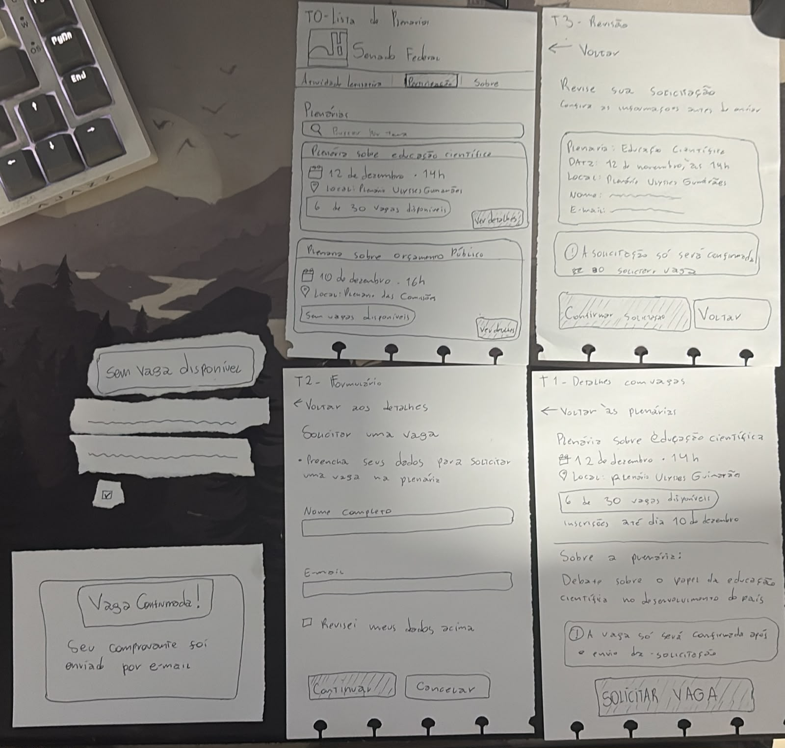
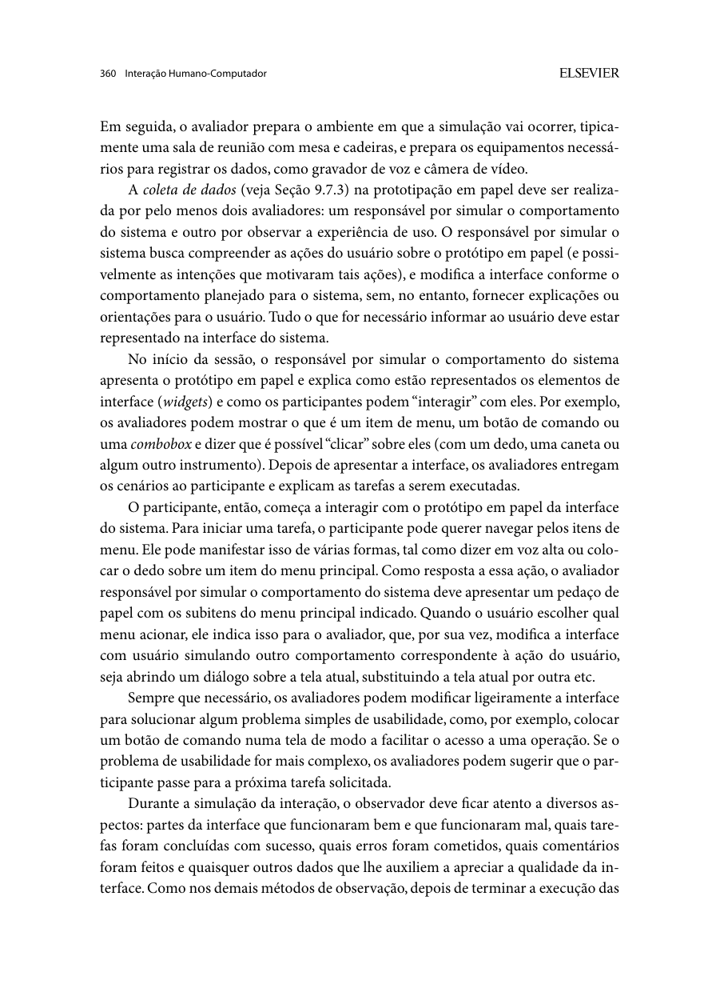
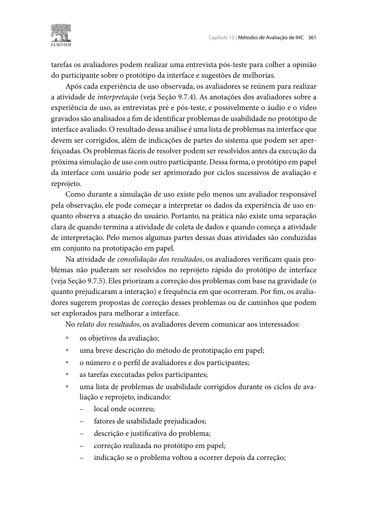
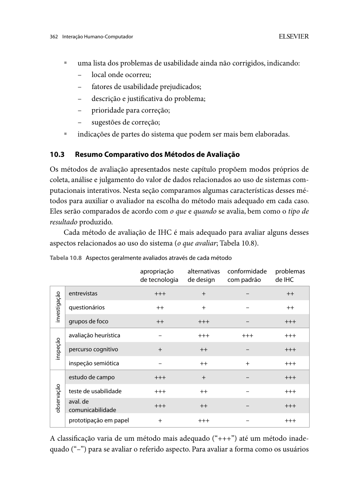

<span class="owner">Responsável: Luís Henrique Arruda Luna — Relato do protótipo de papel · Autor do item: Luís Henrique Arruda Luna</span>

# Relato da avaliação do protótipo de papel — Inscrição em plenárias

## Tabela de contribuição

A Tabela 1 registra a contribuição neste artefato.

| Integrante | Contribuição | Artefato / atividade |
| --- | --- | --- |
| [Luís Henrique Arruda Luna](https://github.com/Donnk61) | Desenho das folhas, moderação da sessão, operação do protótipo e responsabilidade pelo conteúdo | [Método](#metodo-e-versao-avaliada), [execução](#execucao-da-sessao) |
| Claude Code (Anthropic) | Conferência da legenda automática e dos quadros do vídeo, comparação das folhas com o plano e redação do relato | [Agradecimentos](#agradecimentos) |

<p class="caption">Tabela 1 — Contribuição neste artefato.</p>
<p class="source">Fonte: elaboração para o Grupo 06 (2026).</p>

## Introdução

Este relato registra a avaliação do protótipo de papel da proposta de **solicitar uma vaga para participar de uma plenária**, funcionalidade que não existe no Portal do Senado. Segue o [plano da avaliação](../../../entrega-5/individual/luis/planejamento-avaliacao-prototipo-papel.md) e o [planejamento do relato](../../../entrega-5/individual/luis/planejamento-relato-prototipo-papel.md) da Etapa 5 e usa os achados das entrevistas sobre o [storyboard](../../../entrega-5/individual/luis/relato-storyboard.md) e a [análise de tarefas](../../../entrega-5/individual/luis/relato-analise-tarefas.md).

Resultado principal: a pessoa participante percorreu o caminho de sucesso e disse que o fluxo estava completo. A sessão testou só esse caminho. O estado sem vagas, a perda da última vaga e a interpretação da confirmação não foram avaliados.

## Método e versão avaliada { #metodo-e-versao-avaliada }

**Autor do item:** Luís Henrique Arruda Luna.

Na prototipação em papel, a pessoa indica o que faria e o operador responde trocando as folhas, enquanto outros avaliadores observam (BARBOSA; SILVA, 2010, p. 358–360). O relato registra problemas corrigidos, recorrência e pendências (p. 361–362). As Figuras 2 a 4, no [Apêndice A](#apendice-a-fundamentacao), trazem esses trechos.

A Figura 1 mostra o material usado, chamado aqui de **PP-1.0**. As folhas foram desenhadas à mão e os dados são fictícios.

{ loading=lazy }

<p class="caption">Figura 1 — Protótipo de papel PP-1.0: folhas T0 a T3, peças móveis e aviso de confirmação.</p>
<p class="source">Fonte: fotografia de Luís Henrique Arruda Luna (2026).</p>

A Tabela 2 descreve cada peça e sua relação com a especificação da Etapa 5.

| Peça | Conteúdo | Especificação | Usada na sessão? |
| --- | --- | --- | --- |
| T0 — Lista de plenárias | Cabeçalho, abas, “Buscar por tema” e dois cartões: educação científica (6 de 30 vagas) e orçamento público (sem vagas) | PP-S01 | Sim |
| T1 — Detalhes com vagas | Data, local, vagas, prazo, descrição, aviso e “Solicitar vaga” | PP-S02 | Sim |
| T2 — Formulário | Nome completo, e-mail, “Revisei meus dados acima”, “Continuar” e “Cancelar” | PP-S03 | Sim |
| T3 — Revisão | Plenária, data, local, nome, e-mail, aviso, “Confirmar solicitação” e “Voltar” | PP-S04 | Sim |
| Aviso “Vaga confirmada!” | “Seu comprovante foi enviado por e-mail” | PP-S05, alterada | Sim, 3:21–3:24 |
| Duas tiras com linhas onduladas e marca de seleção | Representam os dados digitados e a caixa marcada | PP-C06, alterada | Sim, por volta de 2:50 |
| Recorte “Sem vaga disponível” | Aviso de indisponibilidade | PP-S06, reduzida | Não |

<p class="caption">Tabela 2 — Peças do protótipo PP-1.0.</p>
<p class="source">Fonte: Figura 1 e vídeo da sessão.</p>

### Diferenças em relação ao plano

- **Não foram construídos:** a tela da última vaga ocupada durante o envio (PP-S07) e os cartões PP-C02, PP-C04, PP-C05 e PP-C07. Sem PP-C07, não há código de inscrição.
- **Confirmação:** o código “PL-000123” foi trocado por um comprovante enviado por e-mail, e a confirmação virou um aviso sobreposto.
- **Identidade e local:** o plano pedia para não desenhar logotipos e usar um auditório fictício. As folhas trazem a marca “Senado Federal” e os nomes “Plenário Ulysses Guimarães” e “Plenário das Comissões”.
- **Datas:** o plano usava novembro; T0 e T1 usam dezembro, e T3 usa novembro (ver [P02](#problemas)).

## Execução da sessão { #execucao-da-sessao }

A Tabela 3 reúne os dados da sessão.

| Campo | Registro |
| --- | --- |
| Data e horário | 03/11/2026, das 20h55 às 20h59, pelo relógio do Google Meet |
| Duração do vídeo | 4 min 55 s |
| Modalidade | Remota, com uma câmera voltada para as folhas |
| Moderador e operador | Luís Henrique Arruda Luna, acumulando os dois papéis |
| Presentes na sala | Caio Breno de Souza Bezerra, Bruno Ferreira Dornelas e Israel Soares de Paiva, entre outras contas. A gravação não mostra anotações de observação |
| Participante | **PART-PP01**, uma pessoa. A gravação não informa idade, experiência com o portal ou recrutamento |
| Consentimento | Autorização verbal para participar e gravar como vídeo não listado (0:58–1:15). A gravação não mostra termo assinado |
| Piloto | Não aparece neste vídeo; os resultados são só de PART-PP01 |
| Material | PP-1.0 |

<p class="caption">Tabela 3 — Identificação da sessão.</p>
<p class="source">Fonte: gravação da sessão, 03/11/2026.</p>

### Tarefas e resultados

O enunciado dado foi marcar a participação em uma plenária do Senado Federal (1:18–1:34), a partir de T0. A Tabela 4 compara o que foi executado com as tarefas previstas.

| Tarefa do plano | Percurso e localizador | Resultado |
| --- | --- | --- |
| 1. Encontrar uma plenária e consultar suas condições | T0 → T1. Escolhe “Ver detalhes” na plenária de educação científica (1:48) e segue para “Solicitar vaga” (2:07) | **Parcial.** Escolheu sem ajuda, mas partiu da lista, sem buscar o serviço no portal. Não comentou data, local nem condições |
| 2. Verificar disponibilidade e solicitar uma vaga | T1 → T2 → T3. Pergunta sobre a tela seguinte (2:26), preenche, marca a revisão (2:39–2:53) e confirma (3:14) | **Concluída.** O moderador só disse que podia seguir o formulário (2:32). Não comentou o número de vagas |
| 3. Interpretar a confirmação | Aviso “Vaga confirmada!” (3:21–3:24), T1 (3:26) e T0 (3:38) | **Parcial.** Depois do aviso tentou buscar outra plenária (3:44–3:51). Só concordou que a marcação estava resolvida quando o moderador perguntou (3:55–4:05) |
| 4. Tentar uma plenária sem vagas | Não iniciada | **Não executada.** O recorte “Sem vaga disponível” não foi usado |

<p class="caption">Tabela 4 — Tarefas planejadas e resultados.</p>
<p class="source">Fonte: gravação da sessão, com localizadores no formato minuto:segundo.</p>

### Evidências

A Tabela 5 separa o que foi dito ou feito da interpretação. As falas vêm da legenda automática, com ajustes de leitura, e a autoria foi conferida pelo destaque de quem fala no Meet.

| Tempo | Registro | Interpretação |
| --- | --- | --- |
| 1:48 | Ação e fala: “Vou clicar em ver detalhes aí nessa primeira.” | Abriu a primeira plenária, a que tinha vagas. Não dá para saber se o número de vagas pesou na escolha |
| 2:26 | Fala: “Vai ter uma tela também para continuar, caso eu tenha colocado aí o nome, e-mail.” | Antecipou a sequência do formulário |
| 2:39–2:53 | Fala: “Vou marcar a opção de ‘revisei meus dados’ e vou continuar agora.” | A caixa foi entendida como passo para avançar |
| 3:14 | Fala: “Confirmar a solicitação.” | Confirmou logo que a revisão apareceu, sem comentar os dados |
| 3:30 | Fala: “Vou voltar então. Voltar às plenárias.” | Encontrou a saída em T1, depois da troca feita pelo operador |
| 3:44 | Fala: “Acho que eu vou tentar buscar por alguma outra.” | Continuou explorando depois do aviso. A sessão não perguntou se queria consultar ou fazer outra solicitação |
| 4:28–4:31 | Opinião: “Esse fluxo aí acho que tava bem completo.” | Avaliação geral positiva |
| 4:32 | Opinião: “Gostei do popup que teve no finalzinho também.” | O aviso foi notado e bem recebido |
| 4:43 | Opinião: “Não consegui pensar em nada que tava faltando.” | Não apontou lacuna, mas viu só o caminho de sucesso |

<p class="caption">Tabela 5 — Registros da sessão e interpretações.</p>
<p class="source">Fonte: legenda automática e quadros do vídeo da sessão.</p>

### Desvios do procedimento

- **Papéis acumulados:** a mesma pessoa conduziu a sessão e trocou as folhas, ao contrário do que o plano previa quando possível.
- **Espera na troca:** a passagem de T2 para T3 exigiu uma pausa (“Calma aí que eu vou pegar outro papel”, 2:59). Ela é da simulação, não da interface.
- **Troca sem comando:** o aviso saiu e T1 voltou (3:26) antes de a pessoa dizer o que faria.
- **Fala a esclarecer:** em 3:34 o moderador diz que “não existe essa tela”. A gravação não deixa claro a qual folha se refere.
- **Intervenção no encerramento:** o moderador sugeriu que a atividade estava resolvida (3:55–4:05), o que reduz o peso da concordância que veio em seguida.
- **Tarefas e dados:** as tarefas 3 e 4 não foram apresentadas como planejado, e os dados foram representados pelas tiras, sem o cartão de teste.

## Problemas { #problemas }

**Severidade:** *alta* impede a conclusão ou pode levar a confirmar algo errado sem perceber; *média* permite concluir, mas deixa dúvida sobre o resultado; *baixa* é um atrito pontual. A Tabela 6 mostra se cada problema veio da sessão ou da inspeção do material.

| ID | Local e evidência | Fator | Consequência | Frequência | Severidade | Estado | Recomendação | Reteste |
| --- | --- | --- | --- | --- | --- | --- | --- | --- |
| P01 | Aviso e T1. O aviso não tem botão; depois dele, T1 volta com “6 de 30” e “Solicitar vaga” (3:26–3:34) | Visibilidade do estado | Nada mostra que a solicitação ficou registrada, e a pessoa poderia repetir o pedido | 1/1, sessão | Média: concluiu, mas o estado não persiste | Pendente | Incluir “Voltar às plenárias” no aviso e mostrar em T0 e T1 que a vaga já foi solicitada | Não retestado |
| P02 | T0 e T1 indicam 12 de dezembro; T3 indica 12 de novembro. A pessoa confirmou sem comentar (3:14) | Consistência e prevenção de erro | Risco de confirmar outra data. O vídeo não permite afirmar se a data foi lida | 1/1, sessão e Figura 1 | Alta: a revisão é a última barreira antes do envio | Pendente | Corrigir a folha e usar uma única fonte para os dados da plenária | Não retestado |
| P03 | Aviso “Vaga confirmada!”: mostra só o envio do comprovante, sem plenária, data ou código | Feedback | A pessoa fica sem referência própria na tela. Na entrevista do storyboard, o código ajudou a reconhecer a confirmação | Inspeção | Média: o resultado depende do e-mail | Pendente | Mostrar plenária, data, horário, local e identificador | Não retestado |
| P04 | T1 diz que a vaga será confirmada após o envio; T3 diz que a solicitação será confirmada “ao solicitar vaga”; o aviso diz “Vaga confirmada!” | Linguagem e clareza | Pedido e vaga garantida se confundem, ponto já levantado no storyboard | Inspeção | Média: afeta a confiança no resultado | Pendente | Definir a regra e usar um único texto para cada estado | Não retestado |
| P05 | T3 tem “Voltar” no topo e outro ao lado de “Confirmar solicitação” | Clareza da ação | Não fica claro se volta para corrigir ou sai do fluxo | Inspeção | Baixa: a pessoa não usou | Pendente | Manter uma saída e nomeá-la “Voltar para corrigir” | Não retestado |

<p class="caption">Tabela 6 — Problemas encontrados no papel.</p>
<p class="source">Fonte: gravação da sessão e inspeção do material da Figura 1.</p>

**Problemas corrigidos:** nenhum. Houve uma sessão e as folhas não foram alteradas, portanto não há recorrência a relatar.

## Respostas às perguntas de avaliação

A Tabela 7 responde às perguntas do plano até onde a sessão permite.

| Pergunta | Resposta | Grau de evidência |
| --- | --- | --- |
| PL-Q1 — Encontra uma plenária sem link direto? | Na lista, sim. A chegada à lista pelo portal não foi testada | Parcial |
| PL-Q2 — Entende as vagas e o que ocorre quando acabam? | Não respondida. Não houve comentário sobre vagas nem tarefa sem vagas | Sem evidência |
| PL-Q3 — Solicita a vaga e reconhece a conclusão? | Solicitou sem ajuda de percurso e gostou do aviso. O reconhecimento veio depois de pergunta do moderador | Parcial |
| PL-Q4 — Entende se é vaga garantida, espera ou pedido recebido? | Não respondida. Essa interpretação não foi perguntada | Sem evidência |
| PL-Q5 — O que gera dúvida ou receio? | Não houve dúvida declarada. A única pergunta foi sobre a tela seguinte (2:26) | Limitada ao caminho de sucesso |

<p class="caption">Tabela 7 — Respostas às perguntas de avaliação.</p>
<p class="source">Fonte: Tabelas 4 e 5.</p>

## Rastreabilidade e encaminhamentos

A Tabela 8 liga os achados anteriores ao papel e indica o destino de cada decisão na próxima versão.

| Origem | Decisão | Situação no papel | Destino na alta fidelidade |
| --- | --- | --- | --- |
| Storyboard e AT-Q6: saber da disponibilidade antes dos dados | Mostrar vagas em T0 e T1 | Presente; compreensão não medida | Manter e perguntar o que a pessoa entende |
| AT-Q4: conferir dados e plenária | Revisão em T3 | Presente; P02 e P05 | Corrigir a data e a saída; testar se a pessoa percebe um dado incorreto |
| Storyboard: reservar “vaga confirmada” ao estado confirmado | Aviso final | Presente; P03 e P04 | Definir estados e incluir plenária, data e identificador |
| AT-Q6: plenária sem vagas e saída clara | Selo em T0 e recorte “Sem vaga disponível” | Preparado, não testado | Construir a tela e tornar a tarefa obrigatória |
| AT-Q7 e storyboard: última vaga no envio | Revalidar e explicar o resultado | Não construído | Construir PP-S07 e testar em execução separada |
| Sessão: estado após confirmar | Mostrar a vaga já solicitada | Ausente; P01 | Incluir saída no aviso e estado em T0 e T1 |

<p class="caption">Tabela 8 — Rastreabilidade entre evidências, decisões e próxima versão.</p>
<p class="source">Fonte: relatos da Etapa 5 e resultados desta sessão.</p>

Antes da alta fidelidade, seguem pendentes as regras de momento de ocupação da vaga, confirmação, lista de espera, cancelamento e dados mínimos. O plano de alta fidelidade também deve separar moderador e operador, e fazer perguntas neutras sobre o resultado.

## Limitações

A sessão teve uma pessoa e cobre um caminho, portanto descreve este caso e não confirma que a proposta funciona para o público do portal. A opinião “bem completo” refere-se ao que foi mostrado. A câmera remota e a resolução do vídeo limitam a leitura das folhas, e as falas vêm de legenda automática. Não houve medida de tempo por tarefa, porque a troca de folhas interfere na duração.

## Registro e vídeo

O Vídeo 1 mostra a sessão completa. Categoria no YouTube: **não listado**. Link: [https://youtu.be/qLjQdD0aoNk](https://youtu.be/qLjQdD0aoNk).

??? note "Vídeo 1 — Avaliação do protótipo de papel com PART-PP01"

    <div style="position: relative; width: 100%; padding-bottom: 56.25%; margin: 1rem 0; height: 0; overflow: hidden;">
      <iframe loading="lazy" style="position:absolute; inset:0; width:100%; height:100%; border:0;" src="https://www.youtube-nocookie.com/embed/qLjQdD0aoNk" title="Avaliação do protótipo de papel com PART-PP01" allow="accelerometer; autoplay; clipboard-write; encrypted-media; gyroscope; picture-in-picture; web-share" referrerpolicy="strict-origin-when-cross-origin" allowfullscreen></iframe>
    </div>

    <p class="caption">Vídeo 1 — Avaliação do protótipo de papel com PART-PP01.</p>
    <p class="source">Fonte: gravação da sessão, 03/11/2026. Categoria no YouTube: não listado.</p>

## Agradecimentos

Claude Code (Anthropic) apoiou a conferência da legenda automática e dos quadros do vídeo, a comparação com o plano e a redação. Luís Henrique Arruda Luna responde pela sessão e pela validação do conteúdo.

## Histórico de versão

A Tabela 9 registra a versão deste artefato.

| Versão | Data | Descrição | Autor(es) | Revisor(es) |
| :---: | :---: | --- | --- | --- |
| `0.1` | 03/11/2026 | Registra a sessão, o protótipo PP-1.0, os problemas e os encaminhamentos | [Luís Henrique Arruda Luna](https://github.com/Donnk61) | [Caio Breno de Souza Bezerra](https://github.com/CaioBezerra-Dev) (designado; pendente) |

<p class="caption">Tabela 9 — Histórico de versão.</p>
<p class="source">Fonte: elaboração para o Grupo 06 (2026).</p>

## Referências

[1] BARBOSA, Simone Diniz Junqueira; SILVA, Bruno Santana da. *Interação humano-computador*. Rio de Janeiro: Elsevier, 2010. p. 358–362.

[2] SALES, André Barros de. *Plano de Ensino FIHC 022026 — Turma 01*, v1. FCTE/UnB, 2026. Cronograma, p. 5 do PDF.

[3] GRUPO 06. [Plano da avaliação do papel](../../../entrega-5/individual/luis/planejamento-avaliacao-prototipo-papel.md), [planejamento do relato](../../../entrega-5/individual/luis/planejamento-relato-prototipo-papel.md), [relato do storyboard](../../../entrega-5/individual/luis/relato-storyboard.md) e [relato da análise de tarefas](../../../entrega-5/individual/luis/relato-analise-tarefas.md). 2026.

## Apêndice A — Fundamentação { #apendice-a-fundamentacao }

As Figuras 2 a 4 trazem os trechos do livro usados no método.

??? note "Figura 2 — Operação da interface e observação do uso"

    { loading=lazy }
    <p class="caption">Figura 2 — Operação da interface e observação do uso.</p>
    <p class="source">Fonte: Barbosa e Silva (2010, p. 360).</p>

??? note "Figura 3 — Problemas corrigidos e recorrência"

    { loading=lazy }
    <p class="caption">Figura 3 — Problemas corrigidos e recorrência.</p>
    <p class="source">Fonte: Barbosa e Silva (2010, p. 361).</p>

??? note "Figura 4 — Problemas pendentes e sugestões"

    { loading=lazy }
    <p class="caption">Figura 4 — Problemas pendentes e sugestões.</p>
    <p class="source">Fonte: Barbosa e Silva (2010, p. 362).</p>

## Apêndice B — Transcrição automática

Legenda automática do YouTube, sem revisão humana. Pode conter erros de reconhecimento e não identifica quem fala. Em caso de divergência, vale o [Vídeo 1](#registro-e-video).

??? note "Transcrição com localizadores"

    ```text
    0:01  Então, eu sou o Luís Henrique, eu sou do
    0:03  grupo seis do grupo terá mando no
    0:04  computador e hoje a gente vai avaliar
    0:05  aqui essa proposta de marcar uma
    0:09  plenária
    0:11  eh dentro do portal da do Senado
    0:14  Federal. Essas folhas aqui que tá
    0:17  aparecendo aqui na tela, né, entre
    0:19  outras por aqui está do meu lado, elas
    0:22  vão representar as telas de fato como um
    0:24  protótipo. E você pode me dizer aonde
    0:27  clicar aqui que eu vou estar trocando o
    0:31  papel conforme a tua escolha, certo? Eu
    0:33  não vou indicar o caminho. Eu só peço
    0:36  que enquanto você tiver
    0:38  eh eh dizendo, eu quero que você diga em
    0:41  voz alta o que que você tá procurando e
    0:43  o que que entendeu e o que que espera
    0:45  que que aconteça ao clicar em cada botão
    0:49  aqui do meu protótipo.
    0:51  Beleza? Os dados eles são totalmente
    0:53  fictícios, então você pode ficar
    0:56  tranquilo contar isso.
    0:58  Eh, você pode fazer uma pausa, encerrar
    1:00  quando você quiser.
    1:02  E eu peço que você responda se você
    1:05  concorda em participar e autoriza essa
    1:08  gravação para a disciplina como vídeo
    1:10  não listado. Você concorda?
    1:15  — Sim. Sim.
    1:16  Beleza?
    1:18  Então, eh,
    1:21  como eu comentei, a ideia é você fazer
    1:25  eh marcar a sua participação numa
    1:28  plenária do Senado Federal.
    1:31  Pode me dizer o que que você faria. Essa
    1:34  é a primeira tela.
    1:36  — Beleza.
    1:38  Eh,
    1:42  vou posso falar então qual que é um
    1:44  desses botões aí, né? Isso.
    1:48  — Vou clicar em ver detalhes aí nessa
    1:50  primeira
    1:53  essa plenária sobre educação científica.
    2:02  Beleza,
    2:07  vou clicar em solicitar vagin.
    2:21  Hum.
    2:26  Ele vai vai ter uma tela também para se
    2:27  continuar. Caso eu tenha colocado aí o
    2:30  nome, e-mail,
    2:32  — pode seguir a o formulário, né? Que que
    2:35  você queira fazer,
    2:37  tá? Belezou
    2:39  preencher com os meus dados, colocar o
    2:42  nome completo,
    2:44  vou colocar em seguida, e-mail,
    2:48  vou marcar a opção de revisei meus dados
    2:53  e vou continuar agora.
    2:59  Calma aí que eu vou pegar outro papel.
    3:14  Beleza. Confirmar a solicitação.
    3:30  Beleza. Vou voltar então. Voltar as
    3:33  plenárias.
    3:34  — É, não existe essa tela. Ah, não existe
    3:37  essa daqui, na verdade.
    3:38  — Eh, aí tem mais algumas opções aí.
    3:43  — Eh,
    3:44  acho que eu vou tentar buscar por alguma
    3:46  outra.
    3:51  Tem essa a barra de pesquisa ali.
    3:55  — Bom, eh, na teoria
    3:58  conseguiu já resolver
    4:01  a atividade que precisava.
    4:03  — Ah, sim, sim.
    4:05  a marcação da plenária.
    4:06  — Examente. Beleza, tranquilo. Então, vou
    4:10  navegar, fazer, você pode fazer um
    4:11  encerramento
    4:13  eh sobre essa sua, essa sua busca, né?
    4:18  Se conseguiu achar assim dificuldade, se
    4:20  tava claro e se encontrou o que
    4:22  precisava.
    4:24  Eu
    4:26  acho que
    4:28  eh esse fluxo aí acho que tava bem
    4:31  completo.
    4:32  Gostei do do popup que teve no
    4:35  finalzinho também.
    4:38  E eu acho que
    4:41  eu acho que tá bem completo, na verdade.
    4:43  Não consegui pensar em nada que que tava
    4:45  faltando em si.
    4:49  Obrigado pela participação e a gente se
    4:52  encerra aqui a avaliação.
    ```
