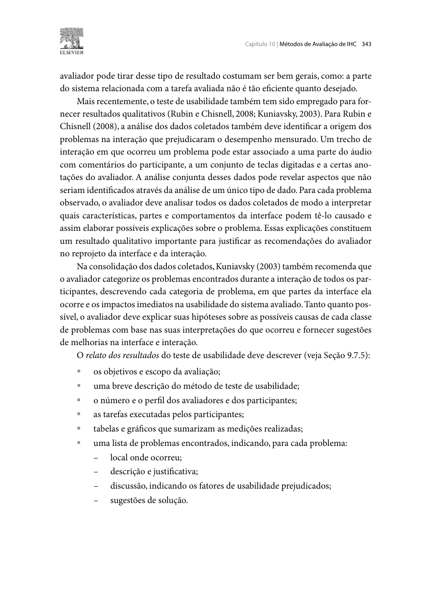

Responsável: Caio Breno de Souza Bezerra · Autor do item: Caio Breno de Souza Bezerra

# Relato da avaliação de alta fidelidade

## Tabela de contribuição

A Tabela 1 identifica as contribuições neste artefato.

| Integrante | Contribuição | Artefato / atividade |
| --- | --- | --- |
| [Caio Breno de Souza Bezerra](https://github.com/CaioBezerra-Dev) | Consolidação das sessões, resultados e decisões de reprojeto | [Conteúdo](#introducao) |
| Codex (OpenAI) | Apoio à consulta do plano e do livro, análise audiovisual e organização documental | [Agradecimentos](#agradecimentos) |

Tabela 1 — Contribuições neste artefato.

Fonte: elaboração para o Grupo 06 (2026).

## Introdução

Este relato apresenta os resultados do teste do **protótipo AF-1.2 de envio e acompanhamento de ideia legislativa**, em continuidade ao [planejamento da avaliação](../../../entrega-6/individual/caio/planejamento-avaliacao-alta-fidelidade.md) e ao [planejamento do relato](../../../entrega-6/individual/caio/planejamento-relato-alta-fidelidade.md). As evidências são duas sessões, cada uma registrada pela tela e pela câmera da sala.

[Vídeos e localizadores](evidencias.md){ .md-button .md-button--primary }
[Protótipo avaliado](../../../prototipos/caio/alta-fidelidade/index.html){ .md-button }

## Objetivos e método

**Autor do item:** Caio Breno de Souza Bezerra.

Verificar descoberta e continuidade (AF-O1), conferência antes do envio (AF-O2), reconhecimento do recebimento (AF-O3) e acompanhamento da mesma ideia (AF-O4). O recorte é a [persona Camila](../../../entrega-2/individual/caio/perfil-2/persona.md), com as decisões RP01–RP04 da [Etapa 5](../../../entrega-5/individual/caio/relato-storyboard.md#analise-e-encaminhamentos) e PAP-R01–PAP-R04 da [Etapa 6](../../../entrega-6/individual/caio/relato-prototipo-papel.md#analise-do-reprojeto).

Foi realizado um **teste de usabilidade moderado presencial**, com verbalização durante o uso e entrevista breve ao final. As pessoas controlam o mouse e percorrem o protótipo; Caio apresenta o cenário e observa. O rascunho já contém **“Orientações claras nos serviços”** e **“Explicar documentos e etapas em linguagem simples.”** O rascunho de exemplo já está no formulário, para a pessoa conferir o texto e enviar.

Barbosa e Silva [1, p. 341–343] orientam relacionar objetivos, método, pessoas, tarefas, desempenho, opinião e problemas. As tabelas deste relato seguem essa estrutura. A análise combina fala, tela e câmera da sala; sugestões e hipóteses são identificadas separadamente do comportamento observado.

## Pessoas, material e condições

A Tabela 2 identifica as sessões. As duas pessoas participaram da avaliação principal e alternaram o uso do protótipo. Os códigos distinguem pessoas, sem indicar ordem cronológica ou identidade civil. Cada pessoa tem dois arquivos de registro; são **duas pessoas, não quatro avaliações**.

| Campo | Registro |
| --- | --- |
| Moderador / avaliador | Caio Breno de Souza Bezerra |
| Observação | Bruno Ferreira Dornelas, nas duas sessões |
| Gravação | Captura da tela do notebook e câmera da sala, uma de cada pessoa |
| Participantes | AF-P01 e AF-P02, duas pessoas adultas. Os códigos substituem o nome |
| Modalidade / recursos | Presencial, na mesma sala; notebook Dell, mouse, navegador, captura da tela e câmera externa |
| Material | [Protótipo AF-1.2](../../../prototipos/caio/alta-fidelidade/index.html), identificado na faixa superior |
| Data | **11/11/2026, às 9h**. As duas pessoas alternaram o uso |
| Duração das cópias | AF-P01: tela 3 min 24 s; sala 3 min 32 s. AF-P02: tela 3 min 52 s; sala 3 min 53 s |
| Consentimento | Participação e gravação autorizadas para a disciplina. Termos e contatos ficam fora do site |
| Piloto | Feito antes da sessão principal. Os resultados abaixo são de AF-P01 e AF-P02 |

Tabela 2 — Pessoas, material e condições efetivas.

Fonte: quatro arquivos audiovisuais e confirmação de Caio sobre data, horário, equipe e separação do piloto, em 11/11/2026.

Os [vídeos de consulta](evidencias.md) mantêm as ações das sessões e retiram das capturas de tela a preparação anterior à apresentação e a conversa posterior ao encerramento. Os tempos abaixo usam **as cópias de tela incorporadas nessa página**. A câmera da sala é complementar, com início próprio; não somar as durações dos ângulos.

A sessão segue o [planejamento](../../../entrega-6/individual/caio/planejamento-avaliacao-alta-fidelidade.md): presencial, AF-P01 e AF-P02, protótipo AF-1.2, rascunho depois do acesso e nota global ao final. As quatro tarefas ocorreram em sequência.

## Tarefas, desempenho e opinião

A Tabela 3 preserva AF-T1–AF-T4. “Sem ajuda de percurso” significa que não foi identificada indicação de qual controle acionar durante aquele percurso; não elimina o efeito do cenário apresentado. Os intervalos são **localizadores de evidência**, não tempos ativos de desempenho.

| Pessoa / tarefa | Ações e evidência na captura de tela | Resultado / ajuda / limite |
| --- | --- | --- |
| AF-P01 / AF-T1 | **1:16–1:42.** Localiza “Enviar ideia legislativa”, lê orientações e continua pelo acesso de demonstração até o rascunho | Concluída sem ajuda de percurso identificada |
| AF-P01 / AF-T2 | **1:42–2:08.** Confere o exemplo, abre a revisão, tenta confirmar e percebe a caixa obrigatória; marca e conclui | Concluída sem ajuda de percurso identificada, com uma tentativa de confirmação antes de marcar a conferência; recuperação pela própria pessoa |
| AF-P01 / AF-T3 | **2:08–2:20.** Lê recebimento, identificação, data e estado, e segue para acompanhar | Reconhecimento do recebimento concluído |
| AF-P01 / AF-T4 | **2:20–2:43.** Encontra a mesma ideia, lê que foi recebida e que será avaliada antes da publicação; consulta o texto | Consulta da mesma ideia concluída, sem ajuda de percurso |
| AF-P02 / AF-T1 | **1:17–1:48.** Encontra envio, reconhece o acesso e chega ao rascunho | Concluída sem ajuda de percurso identificada |
| AF-P02 / AF-T2 | **1:48–2:21.** Lê o exemplo, abre a revisão, marca a conferência e confirma | Concluída sem ajuda de percurso |
| AF-P02 / AF-T3 | **2:21–2:35.** Reconhece recebimento, identificação e data; associa o próximo passo à avaliação do conteúdo | Reconhecimento do recebimento concluído |
| AF-P02 / AF-T4 | **2:35–2:51.** Abre “Minhas ideias”, vê a mesma ideia recebida e identifica que pode reler o texto | Consulta da mesma ideia concluída, sem ajuda de percurso |

Tabela 3 — Registros por pessoa e tarefa na AF-1.2.

Fonte: capturas de tela das sessões, com localizadores nas cópias de consulta.

A tentativa de AF-P01 antes de marcar a caixa não efetiva o envio. A pessoa percebe a exigência, marca a conferência e conclui.

A Tabela 4 resume as opiniões como **paráfrases**, sem tratá-las como falas literais.

| Pessoa / localizador | Opinião e satisfação | Leitura |
| --- | --- | --- |
| AF-P01, **3:02–3:19** | Considera simples inserir a ideia, revisar e enviar; atribui **5 de 5** e diz que o design funciona | Nota global positiva do percurso |
| AF-P02, **3:01–3:31** | Atribui **5 de 5**, destaca a interface intuitiva e o indicador de etapas para saber onde está, o que já fez e o que falta | O indicador de etapas orientou o fluxo |
| AF-P02, **3:31–3:47** | Não relata dificuldade para encontrar ou compreender os passos; considera escrever a ideia a principal exigência | O percurso de revisar e enviar ficou claro |

Tabela 4 — Opinião final e satisfação global.

Fonte: entrevista breve nas duas gravações de tela; falas redigidas para leitura.

## Indicadores e perguntas da avaliação

A Tabela 5 responde às perguntas do plano.

| Pergunta / indicador | Resultado apoiado nos registros | Leitura |
| --- | --- | --- |
| AF-Q1 / M0: descoberta e continuidade | **2 de 2** pessoas chegam ao formulário sem ajuda de percurso | A entrada é a página de ideia legislativa, como no procedimento |
| AF-Q2 / M0: revisão e envio | **2 de 2** concluem a revisão e o envio; AF-P01 recupera a caixa desmarcada | As duas leem o exemplo, abrem a revisão e confirmam |
| AF-Q3: compreensão do recebimento | **2 de 2** reconhecem o recebimento e o próximo passo de avaliação do conteúdo | AF-P01 verbaliza a avaliação anterior à publicação |
| AF-Q4: acompanhamento | **2 de 2** abrem a mesma ideia e leem o estado “Recebida” e o próximo passo | A tela explica que a publicação vem depois da avaliação e não é a aprovação de uma lei |
| AF-Q5 / satisfação global | AF-P01: **5/5**; AF-P02: **5/5** | Nota global ao final, como no procedimento |
| M2: prevenção | A tentativa de AF-P01 sem a caixa de conferência foi impedida | A pessoa percebe o aviso e conclui o envio |

Tabela 5 — Perguntas e resultados.

Fonte: plano da Etapa 6 e análise dos registros da AF-1.2.

## Problemas e decisões de reprojeto

A Tabela 6 registra o episódio observado na revisão. Prioridade **média** indica um atrito que a própria pessoa recuperou. A frequência é a contagem dos casos observados.

| ID / local | Evidência e consequência | Hipótese / fator de uso | Decisão, responsável e situação |
| --- | --- | --- | --- |
| AF-PR01 / revisão; AF-T2 | AF-P01, **2:03–2:08**, percebe a caixa depois de tentar confirmar; **1 de 2** pessoas mostra essa sequência. O envio só segue depois da conferência | A exigência fica mais clara no momento da confirmação. A pessoa recupera sozinha | **Média.** Destacar “Marque a conferência antes de confirmar” junto da caixa e manter a validação. A avaliação permanece na AF-1.2 |

Tabela 6 — Episódio observado, lacunas e decisões.

Fonte: interpretação dos registros com base em Barbosa e Silva (2010, p. 342–343).

As duas notas altas convivem com o episódio da caixa: o caminho funciona, e a conferência pode aparecer com mais destaque. Mantêm-se o indicador de etapas, a revisão, a confirmação identificável e o acesso à mesma ideia. A versão avaliada é a AF-1.2.

### Relação com as etapas anteriores

A Tabela 7 confronta as decisões do papel com os resultados da alta fidelidade.

| Decisão anterior | Evidência na alta fidelidade | Encaminhamento |
| --- | --- | --- |
| PAP-R01 / RP03: revisar antes do compromisso | Duas pessoas abrem revisão e confirmam. AF-P01 percebe a caixa depois da primeira tentativa | Manter a revisão e avaliar o destaque da conferência, AF-PR01 |
| PAP-R02 / RP02: recebimento identificável | Duas pessoas reconhecem o recebimento e sua identificação | Manter a confirmação identificável |
| PAP-R03 / AT-P02: continuar na mesma ideia | Duas pessoas chegam a “Minhas ideias” e releem o texto | Manter o acesso direto e a identificação |
| PAP-R04 / RP04: estados | As duas leem “Recebida” e o próximo passo: avaliação do conteúdo antes da publicação | Manter a explicação dos estados na mesma tela |

Tabela 7 — Continuidade entre papel e alta fidelidade.

Fonte: relato da Etapa 6 e sessões da AF-1.2.

## Conclusões e próximos passos

As duas pessoas entraram, revisaram, enviaram e consultaram a mesma ideia sem ajuda de percurso. As duas deram nota 5, e AF-P02 destacou o indicador de etapas. Na revisão, AF-P01 viu a caixa de conferência na hora de confirmar, marcou e concluiu. O encaminhamento é dar mais destaque a essa caixa, mantendo o fluxo que as duas percorreram na AF-1.2.

## Fundamentação consultada

A Figura 1 apresenta a fonte da estrutura do relato e da análise conjunta de desempenho e opinião.

??? note "Figura 1 — Componentes do relato de teste de usabilidade"

    { loading=lazy }
    
Figura 1 — Estrutura do relato de teste de usabilidade.

    
Fonte: Barbosa e Silva (2010, p. 343).

## Agradecimentos

Codex (OpenAI) apoiou a consulta bibliográfica, a análise das gravações e a organização deste material. A transcrição automática local com Faster-Whisper serviu de apoio à localização das falas; os resultados são apresentados como paráfrases associadas ao vídeo. Caio Breno de Souza Bezerra responde pelo conteúdo. Revisor: [Bruno Ferreira Dornelas](https://github.com/brunnf).

## Histórico de versão

| Versão | Data | Descrição | Autor(es) | Revisor(es) |
| :---: | :---: | --- | --- | --- |
| `1.0` | 11/11/2026 | Consolidação das sessões, resultados e decisões de reprojeto | [Caio Breno de Souza Bezerra](https://github.com/CaioBezerra-Dev) | [Bruno Ferreira Dornelas](https://github.com/brunnf) |
| `1.1` | 15/11/2026 | Alinha a versão AF-1.2 e o procedimento à sessão executada | [Caio Breno de Souza Bezerra](https://github.com/CaioBezerra-Dev) | [Bruno Ferreira Dornelas](https://github.com/brunnf) |
| `1.2` | 15/11/2026 | Redige os resultados pelo percurso observado nas duas sessões | [Caio Breno de Souza Bezerra](https://github.com/CaioBezerra-Dev) | [Bruno Ferreira Dornelas](https://github.com/brunnf) |

## Referências

[1] BARBOSA, Simone Diniz Junqueira; SILVA, Bruno Santana da. *Interação humano-computador*. Rio de Janeiro: Elsevier, 2010. Seção 10.2.1, p. 341–343; planejamento da avaliação, p. 307–313.

[2] SALES, André Barros de. *Plano de Ensino FIHC 022026 — Turma 01*, v1. FCTE/UnB, 2026. Cronograma da Etapa 7, p. 5 do PDF.

[3] GRUPO 06. [Relato do papel](../../../entrega-6/individual/caio/relato-prototipo-papel.md), [planejamento da avaliação](../../../entrega-6/individual/caio/planejamento-avaliacao-alta-fidelidade.md) e [planejamento do relato](../../../entrega-6/individual/caio/planejamento-relato-alta-fidelidade.md). 2026.

[4] GRUPO 06. [Registros audiovisuais das duas sessões de alta fidelidade](evidencias.md). Arquivos fornecidos e analisados em 11/11/2026.
