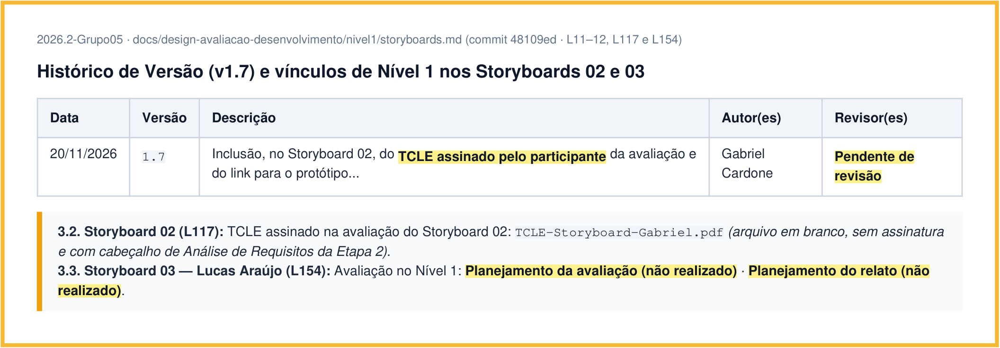
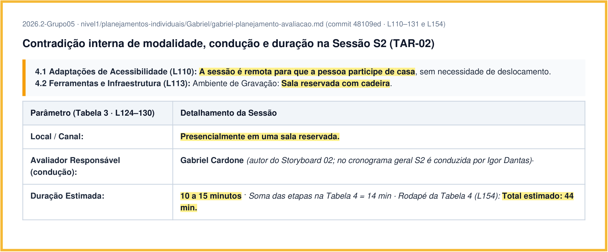

Responsável pelo registro: Bruno Ferreira Dornelas · Grupo 06

# Etapa 4 · Grupo 05 (−1)

## Tabela de contribuição

| Integrante / ferramenta | Contribuição | Artefato / atividade |
| --- | --- | --- |
| [Bruno Ferreira Dornelas](https://github.com/brunnf) | Registro no site das 40 respostas da inspeção externa dos storyboards, das análises de tarefas e dos planejamentos do SEMOB-DF | [Critérios e respostas](#etapa-4) |
| [Bruno Ferreira Dornelas](https://github.com/brunnf) | Levantamento do inventário das versões consultadas no commit de referência, preparação dos recortes de evidência e definição dos encaminhamentos | [Artefatos consultados](#artefatos-consultados) · [Recortes das evidências](#recortes-das-evidencias) · [Acompanhamento](#acompanhamento) |
| Google Gemini e Antigravity | Apoio à conferência de linhas no repositório do Grupo 05, à geração dos recortes das evidências e à edição da ficha | [Agradecimentos](../index.md#agradecimentos) |

Tabela 1 — Contribuição neste artefato.

Fonte: elaboração para o Grupo 06 (2026).

[Lista V2 da Etapa 4](../lista-etapa-4.md) · [Resultados e gráficos](../resultados/etapa-4.md) · [Inspeções do grupo](index.md) · [Gravação da inspeção](../inspecao.md#video-grupo-05)

## Recorte consultado

**Projeto:** SEMOB-DF. **Consulta ao GitHub Pages:** 21/11/2026, 21h15 (Brasília). **Repositório de referência:** [`48109ed`](https://github.com/Interacao-Humano-Computador/2026.2-Grupo05/tree/48109ede138038cc9e9e9d8a6723b0ad8696c734).

Cada linha leva ao critério da V2, à página publicada do Grupo 05 e às linhas exatas do documento preservadas no commit de referência. Na arquitetura do Nível 1 do SEMOB-DF, os storyboards estão reunidos em `storyboards.md` (com oito narrativas cobrindo os sete integrantes, incluindo a substituição do `Storyboard 04` pelo `Storyboard 08`), acompanhados de três artefatos transversais (`planejamento-e-protocolo-do-teste-piloto.md`, `cronograma-e-logistica-das-sessoes.md` e `questoes-praticas-e-eticas.md`), de um plano geral da Análise de Tarefas e de onze planejamentos funcionais individuais (seis de avaliação e cinco de relato). Os resultados sintetizam os artefatos publicados no inventário e apontam explicitamente as lacunas de cobertura por funcionalidade. [Como foram atribuídas as respostas](../index.md#metodo-de-inspecao).

## Critérios e respostas { #etapa-4 }

**17 Sim · 22 Incompleto · 1 Não** · 40 itens verificados

| Critério | Resposta | Constatação | Evidência |
| --- | :---: | --- | --- |
| [D01](../lista-etapa-4.md#d01) | Sim | Todos os 17 documentos do Nível 1 (página consolidada de storyboards, protocolo do piloto, agenda logística e os 14 arquivos em `planejamentos-individuais/`) apresentam tabela padronizada com data, versão e descrição das alterações, como `storyboards.md` até a v1.7 e a logística até a v1.3. | [Storyboards da Equipe](https://interacao-humano-computador.github.io/2026.2-Grupo05/design-avaliacao-desenvolvimento/nivel1/storyboards/#historico-de-versao-e-contribuicao) ([L1–12](https://github.com/Interacao-Humano-Computador/2026.2-Grupo05/blob/48109ede138038cc9e9e9d8a6723b0ad8696c734/docs/design-avaliacao-desenvolvimento/nivel1/storyboards.md#L1-L12)) [Cronograma e logística](https://interacao-humano-computador.github.io/2026.2-Grupo05/design-avaliacao-desenvolvimento/nivel1/cronograma-e-logistica-das-sessoes/#historico-de-versao-e-contribuicao) ([L1–8](https://github.com/Interacao-Humano-Computador/2026.2-Grupo05/blob/48109ede138038cc9e9e9d8a6723b0ad8696c734/docs/design-avaliacao-desenvolvimento/nivel1/cronograma-e-logistica-das-sessoes.md#L1-L8)) |
| [D02](../lista-etapa-4.md#d02) | Incompleto | As versões iniciais identificam autores e revisores distintos, mas a versão vigente `1.7` de `storyboards.md` e as versões vigentes `1.1` dos dois planejamentos individuais de Gabriel Cardone mantêm o campo de revisão como “Pendente de revisão” (assim como a v1.3 da `TAR-02`). | [Storyboards da Equipe](https://interacao-humano-computador.github.io/2026.2-Grupo05/design-avaliacao-desenvolvimento/nivel1/storyboards/#historico-de-versao-e-contribuicao) ([L12–12](https://github.com/Interacao-Humano-Computador/2026.2-Grupo05/blob/48109ede138038cc9e9e9d8a6723b0ad8696c734/docs/design-avaliacao-desenvolvimento/nivel1/storyboards.md#L12)) [Gabriel · Plano da avaliação](https://interacao-humano-computador.github.io/2026.2-Grupo05/design-avaliacao-desenvolvimento/nivel1/planejamentos-individuais/Gabriel/gabriel-planejamento-avaliacao/#historico-de-versao-e-contribuicao) ([L5–6](https://github.com/Interacao-Humano-Computador/2026.2-Grupo05/blob/48109ede138038cc9e9e9d8a6723b0ad8696c734/docs/design-avaliacao-desenvolvimento/nivel1/planejamentos-individuais/Gabriel/gabriel-planejamento-avaliacao.md#L5-L6)) [Gabriel · Plano do relato](https://interacao-humano-computador.github.io/2026.2-Grupo05/design-avaliacao-desenvolvimento/nivel1/planejamentos-individuais/Gabriel/gabriel-planejamento-relato-resultados-avaliacao/#historico-de-versao-e-contribuicao) ([L5–6](https://github.com/Interacao-Humano-Computador/2026.2-Grupo05/blob/48109ede138038cc9e9e9d8a6723b0ad8696c734/docs/design-avaliacao-desenvolvimento/nivel1/planejamentos-individuais/Gabriel/gabriel-planejamento-relato-resultados-avaliacao.md#L5-L6)) |
| [D03](../lista-etapa-4.md#d03) | Incompleto | Todos os artefatos encerram com seção de referências bibliográficas. Entretanto, `cronograma-e-logistica-das-sessoes.md`, `questoes-praticas-e-eticas.md`, `rodrigo-planejamento-avaliacao.md` e `rodrigo-planejamento-relato-resultados-avaliacao.md` citam Barbosa e Silva (2010) no corpo listando apenas a edição de 2021 e o Plano de Ensino nas referências finais. | [Cronograma e logística](https://interacao-humano-computador.github.io/2026.2-Grupo05/design-avaliacao-desenvolvimento/nivel1/cronograma-e-logistica-das-sessoes/#21-a-entrevista-semiestruturada) ([L35–35](https://github.com/Interacao-Humano-Computador/2026.2-Grupo05/blob/48109ede138038cc9e9e9d8a6723b0ad8696c734/docs/design-avaliacao-desenvolvimento/nivel1/cronograma-e-logistica-das-sessoes.md#L35)) · ([L289–292](https://github.com/Interacao-Humano-Computador/2026.2-Grupo05/blob/48109ede138038cc9e9e9d8a6723b0ad8696c734/docs/design-avaliacao-desenvolvimento/nivel1/cronograma-e-logistica-das-sessoes.md#L289-L292)) [Rodrigo · Plano da avaliação](https://interacao-humano-computador.github.io/2026.2-Grupo05/design-avaliacao-desenvolvimento/nivel1/planejamentos-individuais/Rodrigo/rodrigo-planejamento-avaliacao/#6-e-avaliar-interpretar-e-apresentar-os-dados) ([L179–179](https://github.com/Interacao-Humano-Computador/2026.2-Grupo05/blob/48109ede138038cc9e9e9d8a6723b0ad8696c734/docs/design-avaliacao-desenvolvimento/nivel1/planejamentos-individuais/Rodrigo/rodrigo-planejamento-avaliacao.md#L179)) · ([L230–233](https://github.com/Interacao-Humano-Computador/2026.2-Grupo05/blob/48109ede138038cc9e9e9d8a6723b0ad8696c734/docs/design-avaliacao-desenvolvimento/nivel1/planejamentos-individuais/Rodrigo/rodrigo-planejamento-avaliacao.md#L230-L233)) |
| [D04](../lista-etapa-4.md#d04) | Incompleto | Os dois planos de Carlos chamam nominalmente imagens e tabelas no texto. Porém, em `storyboards.md` as Figuras 1 a 8 e Tabelas 2 a 8 entram sem chamada textual prévia; no plano de avaliação de Arthur as tabelas de papéis e de critérios de interpretação não têm número, legenda nem fonte; e nos planos de Gabriel, Igor, Rodrigo e Tomás as figuras de referência finais não são chamadas nas seções teóricas. | [Storyboards da Equipe](https://interacao-humano-computador.github.io/2026.2-Grupo05/design-avaliacao-desenvolvimento/nivel1/storyboards/#31-storyboard-01-alerta-inteligente-de-saida-de-casa) ([L81–104](https://github.com/Interacao-Humano-Computador/2026.2-Grupo05/blob/48109ede138038cc9e9e9d8a6723b0ad8696c734/docs/design-avaliacao-desenvolvimento/nivel1/storyboards.md#L81-L104)) [Arthur · Plano da avaliação](https://interacao-humano-computador.github.io/2026.2-Grupo05/design-avaliacao-desenvolvimento/nivel1/planejamentos-individuais/Arthur/arthur-planejamento-avaliacao/#62-papeis) ([L156–163](https://github.com/Interacao-Humano-Computador/2026.2-Grupo05/blob/48109ede138038cc9e9e9d8a6723b0ad8696c734/docs/design-avaliacao-desenvolvimento/nivel1/planejamentos-individuais/Arthur/arthur-planejamento-avaliacao.md#L156-L163)) · ([L244–253](https://github.com/Interacao-Humano-Computador/2026.2-Grupo05/blob/48109ede138038cc9e9e9d8a6723b0ad8696c734/docs/design-avaliacao-desenvolvimento/nivel1/planejamentos-individuais/Arthur/arthur-planejamento-avaliacao.md#L244-L253)) |
| [D05](../lista-etapa-4.md#d05) | Sim | Todos os 17 documentos da Etapa 4 abrem contextualizando finalidade, tarefa e persona associadas no ecossistema da SEMOB-DF antes de expor quadros, matrizes ou roteiros. | [Storyboards da Equipe](https://interacao-humano-computador.github.io/2026.2-Grupo05/design-avaliacao-desenvolvimento/nivel1/storyboards/#1-introducao-e-metodologia) ([L17–36](https://github.com/Interacao-Humano-Computador/2026.2-Grupo05/blob/48109ede138038cc9e9e9d8a6723b0ad8696c734/docs/design-avaliacao-desenvolvimento/nivel1/storyboards.md#L17-L36)) [Arthur · Plano da avaliação](https://interacao-humano-computador.github.io/2026.2-Grupo05/design-avaliacao-desenvolvimento/nivel1/planejamentos-individuais/Arthur/arthur-planejamento-avaliacao/#1-introducao) ([L11–30](https://github.com/Interacao-Humano-Computador/2026.2-Grupo05/blob/48109ede138038cc9e9e9d8a6723b0ad8696c734/docs/design-avaliacao-desenvolvimento/nivel1/planejamentos-individuais/Arthur/arthur-planejamento-avaliacao.md#L11-L30)) |
| [D06](../lista-etapa-4.md#d06) | Incompleto | A Tabela 13 de `cronograma.md` registra atividades executadas na Entrega 4 (`07/10` a `13/10`), mas dá como executada a “Gravação e Apresentação” em `12/10 a 13/10` (contradizendo `apresentacoes/index.md` e `contribuicoes/index.md`, onde consta “Não realizada”), não traz links por entrega na tabela e não reflete as elaborações/reformulações ocorridas entre `20/10` e `27/10`. | [Cronograma executado](https://interacao-humano-computador.github.io/2026.2-Grupo05/planejamento/cronograma/#62-cronograma-executado) ([L158–176](https://github.com/Interacao-Humano-Computador/2026.2-Grupo05/blob/48109ede138038cc9e9e9d8a6723b0ad8696c734/docs/planejamento/cronograma.md#L158-L176)) [Contribuições · Etapa 4](https://interacao-humano-computador.github.io/2026.2-Grupo05/contribuicoes/#34-etapa-4-planejamento-da-avaliacao-do-storyboard-e-da-analise-de-tarefas) ([L128–139](https://github.com/Interacao-Humano-Computador/2026.2-Grupo05/blob/48109ede138038cc9e9e9d8a6723b0ad8696c734/docs/contribuicoes/index.md#L128-L139)) |
| [D07](../lista-etapa-4.md#d07) | Incompleto | A Ata 7 (`20/10/2026`, `21h00 às 21h40`) documenta com todos os campos formais a reunião de execução e calibração do teste-piloto da Etapa 4. Contudo, não há ata da reunião de planejamento/fechamento da Entrega 4 até `13/10` nem atas de autoinspeção ou inspeção externa da Entrega 4. | [Ata 7 · Teste Piloto](https://interacao-humano-computador.github.io/2026.2-Grupo05/atas/ata7/#ata-de-reuniao-7-teste-piloto-e-calibracao-interacao-humano-computador-grupo-05) ([L9–30](https://github.com/Interacao-Humano-Computador/2026.2-Grupo05/blob/48109ede138038cc9e9e9d8a6723b0ad8696c734/docs/atas/ata7.md#L9-L30)) [Índice de inspeções](https://interacao-humano-computador.github.io/2026.2-Grupo05/inspecoes/#5-inspecao-da-entrega-4-planejamento-da-avaliacao) ([L102–111](https://github.com/Interacao-Humano-Computador/2026.2-Grupo05/blob/48109ede138038cc9e9e9d8a6723b0ad8696c734/docs/inspecoes/index.md#L102-L111)) |
| [D08](../lista-etapa-4.md#d08) | Incompleto | A equipe publicou na Ata 7 e no protocolo do piloto as gravações em vídeo da reunião de simulação e calibração de `20/10/2026`, mas em `inspecoes/index.md` as gravações de autoinspeção do Grupo 05 e de inspeção do Grupo −1 na Entrega 4 permanecem marcadas como “Não realizada”. | [Ata 7 · Gravações](https://interacao-humano-computador.github.io/2026.2-Grupo05/atas/ata7/#4-link-da-gravacao) ([L78–93](https://github.com/Interacao-Humano-Computador/2026.2-Grupo05/blob/48109ede138038cc9e9e9d8a6723b0ad8696c734/docs/atas/ata7.md#L78-L93)) [Índice de inspeções](https://interacao-humano-computador.github.io/2026.2-Grupo05/inspecoes/#5-inspecao-da-entrega-4-planejamento-da-avaliacao) ([L102–111](https://github.com/Interacao-Humano-Computador/2026.2-Grupo05/blob/48109ede138038cc9e9e9d8a6723b0ad8696c734/docs/inspecoes/index.md#L102-L111)) |
| [D09](../lista-etapa-4.md#d09) | Não | Tanto o quadro geral quanto a seção `3.4` de `apresentacoes/index.md` e a Tabela 5 de `contribuicoes/index.md` declaram expressamente “Apresentação não realizada” para a Entrega 4, sem link nem vídeo incorporado no YouTube. | [Apresentações · Entrega 4](https://interacao-humano-computador.github.io/2026.2-Grupo05/apresentacoes/#34-apresentacao-da-entrega-4-planejamento-da-avaliacao) ([L31–31](https://github.com/Interacao-Humano-Computador/2026.2-Grupo05/blob/48109ede138038cc9e9e9d8a6723b0ad8696c734/docs/apresentacoes/index.md#L31)) · ([L77–80](https://github.com/Interacao-Humano-Computador/2026.2-Grupo05/blob/48109ede138038cc9e9e9d8a6723b0ad8696c734/docs/apresentacoes/index.md#L77-L80)) |
| [D10](../lista-etapa-4.md#d10) | Incompleto | Os documentos adotam no topo a tabela “Histórico de Versão e Contribuição” sem hiperligações para as seções internas das atividades descritas; além disso, na página coletiva `storyboards.md`, Rodrigo Barbosa (`Storyboard 06`) e Arthur Mariani (`Storyboard 07`) possuem seções autorais sem linha correspondente na tabela inicial. | [Storyboards da Equipe](https://interacao-humano-computador.github.io/2026.2-Grupo05/design-avaliacao-desenvolvimento/nivel1/storyboards/#historico-de-versao-e-contribuicao) ([L1–12](https://github.com/Interacao-Humano-Computador/2026.2-Grupo05/blob/48109ede138038cc9e9e9d8a6723b0ad8696c734/docs/design-avaliacao-desenvolvimento/nivel1/storyboards.md#L1-L12)) · ([L293–295](https://github.com/Interacao-Humano-Computador/2026.2-Grupo05/blob/48109ede138038cc9e9e9d8a6723b0ad8696c734/docs/design-avaliacao-desenvolvimento/nivel1/storyboards.md#L293-L295)) · ([L343–345](https://github.com/Interacao-Humano-Computador/2026.2-Grupo05/blob/48109ede138038cc9e9e9d8a6723b0ad8696c734/docs/design-avaliacao-desenvolvimento/nivel1/storyboards.md#L343-L345)) |
| [D11](../lista-etapa-4.md#d11) | Incompleto | O uso de IA (Google Gemini e Claude) é informado na última coluna do histórico inicial em vez de seção própria de agradecimentos, e na Ata 7 da Etapa 4 o registro traz apenas o nome “Google Gemini” sem descrever em que parte do artefato houve apoio. | [Storyboards da Equipe](https://interacao-humano-computador.github.io/2026.2-Grupo05/design-avaliacao-desenvolvimento/nivel1/storyboards/#historico-de-versao-e-contribuicao) ([L3–12](https://github.com/Interacao-Humano-Computador/2026.2-Grupo05/blob/48109ede138038cc9e9e9d8a6723b0ad8696c734/docs/design-avaliacao-desenvolvimento/nivel1/storyboards.md#L3-L12)) [Ata 7 · Teste Piloto](https://interacao-humano-computador.github.io/2026.2-Grupo05/atas/ata7/#historico-de-versao-e-contribuicao) ([L3–5](https://github.com/Interacao-Humano-Computador/2026.2-Grupo05/blob/48109ede138038cc9e9e9d8a6723b0ad8696c734/docs/atas/ata7.md#L3-L5)) |
| [E4-01](../lista-etapa-4.md#e4-01) | Sim | Os sete integrantes ativos do Grupo 05 publicaram seus storyboards individuais completos e acessíveis em `storyboards.md` (`Storyboards 01 a 07`), acrescidos do `Storyboard 08` de Carlos Costa com nota explicativa sobre a substituição do fluxo do motorista para a avaliação da Etapa 5. | [Storyboards · Matriz de Vínculos](https://interacao-humano-computador.github.io/2026.2-Grupo05/design-avaliacao-desenvolvimento/nivel1/storyboards/#2-matriz-de-vinculos-storyboards-tarefas-e-personas) ([L47–62](https://github.com/Interacao-Humano-Computador/2026.2-Grupo05/blob/48109ede138038cc9e9e9d8a6723b0ad8696c734/docs/design-avaliacao-desenvolvimento/nivel1/storyboards.md#L47-L62)) |
| [E4-02](../lista-etapa-4.md#e4-02) | Incompleto | A Tabela 1 vincula cada storyboard a uma macrotarefa (`TAR-01` a `TAR-09`), e os `Storyboards 03, 05, 06 e 08` relacionam os quadros a objetivos ou subtarefas específicas da HTA. Porém, os `Storyboards 01` (Igor), `02` (Gabriel), `04` (Carlos) e `07` (Arthur) apontam apenas o documento geral da tarefa, sem rastrear quais subobjetivos ou operações correspondem a cada quadro desenhado. | [Storyboards · SB08 (Tabela 9)](https://interacao-humano-computador.github.io/2026.2-Grupo05/design-avaliacao-desenvolvimento/nivel1/storyboards/#descricao-narrativa-dos-quadros-do-storyboard-08) ([L404–418](https://github.com/Interacao-Humano-Computador/2026.2-Grupo05/blob/48109ede138038cc9e9e9d8a6723b0ad8696c734/docs/design-avaliacao-desenvolvimento/nivel1/storyboards.md#L404-L418)) [Storyboards · SB01 e SB07](https://interacao-humano-computador.github.io/2026.2-Grupo05/design-avaliacao-desenvolvimento/nivel1/storyboards/#31-storyboard-01-alerta-inteligente-de-saida-de-casa) ([L88–104](https://github.com/Interacao-Humano-Computador/2026.2-Grupo05/blob/48109ede138038cc9e9e9d8a6723b0ad8696c734/docs/design-avaliacao-desenvolvimento/nivel1/storyboards.md#L88-L104)) · ([L362–378](https://github.com/Interacao-Humano-Computador/2026.2-Grupo05/blob/48109ede138038cc9e9e9d8a6723b0ad8696c734/docs/design-avaliacao-desenvolvimento/nivel1/storyboards.md#L362-L378)) |
| [E4-03](../lista-etapa-4.md#e4-03) | Sim | Todas as oito ilustrações inspecionadas (`Storyboard-1` a `Storyboard-8`) representam visualmente as histórias em quadros estáticos desenhados à mão em papel ou mesa digitalizadora, com traço legível e foco comunicativo. | [Storyboards · SB01 e SB02](https://interacao-humano-computador.github.io/2026.2-Grupo05/design-avaliacao-desenvolvimento/nivel1/storyboards/#31-storyboard-01-alerta-inteligente-de-saida-de-casa) ([L81–86](https://github.com/Interacao-Humano-Computador/2026.2-Grupo05/blob/48109ede138038cc9e9e9d8a6723b0ad8696c734/docs/design-avaliacao-desenvolvimento/nivel1/storyboards.md#L81-L86)) · ([L120–126](https://github.com/Interacao-Humano-Computador/2026.2-Grupo05/blob/48109ede138038cc9e9e9d8a6723b0ad8696c734/docs/design-avaliacao-desenvolvimento/nivel1/storyboards.md#L120-L126)) [Storyboards · SB05](https://interacao-humano-computador.github.io/2026.2-Grupo05/design-avaliacao-desenvolvimento/nivel1/storyboards/#35-storyboard-05-pedido-de-aumento-do-limite-diario-do-vale-transporte) ([L256–262](https://github.com/Interacao-Humano-Computador/2026.2-Grupo05/blob/48109ede138038cc9e9e9d8a6723b0ad8696c734/docs/design-avaliacao-desenvolvimento/nivel1/storyboards.md#L256-L262)) |
| [E4-04](../lista-etapa-4.md#e4-04) | Sim | A abertura metodológica e as Figuras 9 e 10 de `storyboards.md` explicitam a função do storyboard para comunicar propostas de melhoria às partes interessadas e avaliar formativamente ideias conceituais antes da construção de telas detalhadas. | [Storyboards · Metodologia](https://interacao-humano-computador.github.io/2026.2-Grupo05/design-avaliacao-desenvolvimento/nivel1/storyboards/#1-introducao-e-metodologia) ([L19–36](https://github.com/Interacao-Humano-Computador/2026.2-Grupo05/blob/48109ede138038cc9e9e9d8a6723b0ad8696c734/docs/design-avaliacao-desenvolvimento/nivel1/storyboards.md#L19-L36)) · ([L440–462](https://github.com/Interacao-Humano-Computador/2026.2-Grupo05/blob/48109ede138038cc9e9e9d8a6723b0ad8696c734/docs/design-avaliacao-desenvolvimento/nivel1/storyboards.md#L440-L462)) |
| [E4-05](../lista-etapa-4.md#e4-05) | Incompleto | Os `Storyboards 03, 04, 05, 06 e 08` trazem roteiro textual estruturado quadro a quadro. Contudo, os `Storyboards 01` (Igor), `02` (Gabriel) e `07` (Arthur) omitem roteiro escrito na página, e nos planos de Rodrigo (`TAR-08`) o roteiro prevê uma “segunda história” do fluxo proposto inexistente em `Storyboard 06` (que desenha apenas os seis quadros de desistência no fluxo atual). | [Storyboards · SB01, SB02 e SB07](https://interacao-humano-computador.github.io/2026.2-Grupo05/design-avaliacao-desenvolvimento/nivel1/storyboards/#31-storyboard-01-alerta-inteligente-de-saida-de-casa) ([L81–104](https://github.com/Interacao-Humano-Computador/2026.2-Grupo05/blob/48109ede138038cc9e9e9d8a6723b0ad8696c734/docs/design-avaliacao-desenvolvimento/nivel1/storyboards.md#L81-L104)) · ([L120–144](https://github.com/Interacao-Humano-Computador/2026.2-Grupo05/blob/48109ede138038cc9e9e9d8a6723b0ad8696c734/docs/design-avaliacao-desenvolvimento/nivel1/storyboards.md#L120-L144)) · ([L354–378](https://github.com/Interacao-Humano-Computador/2026.2-Grupo05/blob/48109ede138038cc9e9e9d8a6723b0ad8696c734/docs/design-avaliacao-desenvolvimento/nivel1/storyboards.md#L354-L378)) [Rodrigo · Plano da avaliação](https://interacao-humano-computador.github.io/2026.2-Grupo05/design-avaliacao-desenvolvimento/nivel1/planejamentos-individuais/Rodrigo/rodrigo-planejamento-avaliacao/#21-tabela-de-perguntas-avaliacao-do-storyboard-06) ([L70–70](https://github.com/Interacao-Humano-Computador/2026.2-Grupo05/blob/48109ede138038cc9e9e9d8a6723b0ad8696c734/docs/design-avaliacao-desenvolvimento/nivel1/planejamentos-individuais/Rodrigo/rodrigo-planejamento-avaliacao.md#L70)) · ([L103–103](https://github.com/Interacao-Humano-Computador/2026.2-Grupo05/blob/48109ede138038cc9e9e9d8a6723b0ad8696c734/docs/design-avaliacao-desenvolvimento/nivel1/planejamentos-individuais/Rodrigo/rodrigo-planejamento-avaliacao.md#L103)) |
| [E4-06](../lista-etapa-4.md#e4-06) | Sim | As oito sequências visuais e respectivas tabelas de verificação identificam ambiente físico (quarto às 6h30, parada sob chuva, garagem às 5h, catraca do BRT, hospital/casa), persona protagonista e alternância de planos abertos de contexto com closes na tela do celular. | [Storyboards · SB03 e SB05](https://interacao-humano-computador.github.io/2026.2-Grupo05/design-avaliacao-desenvolvimento/nivel1/storyboards/#33-storyboard-03-planejamento-de-rota-por-origem-e-destino-com-monitoramento-em-tempo-real) ([L169–189](https://github.com/Interacao-Humano-Computador/2026.2-Grupo05/blob/48109ede138038cc9e9e9d8a6723b0ad8696c734/docs/design-avaliacao-desenvolvimento/nivel1/storyboards.md#L169-L189)) · ([L266–286](https://github.com/Interacao-Humano-Computador/2026.2-Grupo05/blob/48109ede138038cc9e9e9d8a6723b0ad8696c734/docs/design-avaliacao-desenvolvimento/nivel1/storyboards.md#L266-L286)) |
| [E4-07](../lista-etapa-4.md#e4-07) | Sim | Todos os storyboards encadeiam gatilho motivador, etapas progressivas de consulta ou solicitação no dispositivo móvel e desfecho observável (conclusão da viagem/protocolo em `SB01–SB05, SB07, SB08` e ponto exato de abandono no diagnóstico atual de `SB06`). | [Storyboards · SB05 e SB06](https://interacao-humano-computador.github.io/2026.2-Grupo05/design-avaliacao-desenvolvimento/nivel1/storyboards/#35-storyboard-05-pedido-de-aumento-do-limite-diario-do-vale-transporte) ([L264–272](https://github.com/Interacao-Humano-Computador/2026.2-Grupo05/blob/48109ede138038cc9e9e9d8a6723b0ad8696c734/docs/design-avaliacao-desenvolvimento/nivel1/storyboards.md#L264-L272)) · ([L304–322](https://github.com/Interacao-Humano-Computador/2026.2-Grupo05/blob/48109ede138038cc9e9e9d8a6723b0ad8696c734/docs/design-avaliacao-desenvolvimento/nivel1/storyboards.md#L304-L322)) |
| [E4-08](../lista-etapa-4.md#e4-08) | Sim | Cada storyboard materializa um cenário e uma persona validados na Etapa 2 (`Cenários 1 a 6, 9 e 11`), acrescentando falas, indicadores de estado (`8 de 8 passagens`, `Atualizado há 5 min`) e pontos de decisão para simulação mental pelos interessados. | [Storyboards · Matriz e SB08](https://interacao-humano-computador.github.io/2026.2-Grupo05/design-avaliacao-desenvolvimento/nivel1/storyboards/#2-matriz-de-vinculos-storyboards-tarefas-e-personas) ([L47–57](https://github.com/Interacao-Humano-Computador/2026.2-Grupo05/blob/48109ede138038cc9e9e9d8a6723b0ad8696c734/docs/design-avaliacao-desenvolvimento/nivel1/storyboards.md#L47-L57)) · ([L408–415](https://github.com/Interacao-Humano-Computador/2026.2-Grupo05/blob/48109ede138038cc9e9e9d8a6723b0ad8696c734/docs/design-avaliacao-desenvolvimento/nivel1/storyboards.md#L408-L415)) |
| [E4-09](../lista-etapa-4.md#e4-09) | Sim | As oito pranchas preservam baixa fidelidade exploratória com *stick figures* e telas esquemáticas rápidas (~9 a 15 minutos declarados), sem capturas de interface pronta nem confusão com protótipo navegável. | [Storyboards · SB05 e SB06](https://interacao-humano-computador.github.io/2026.2-Grupo05/design-avaliacao-desenvolvimento/nivel1/storyboards/#35-storyboard-05-pedido-de-aumento-do-limite-diario-do-vale-transporte) ([L254–254](https://github.com/Interacao-Humano-Computador/2026.2-Grupo05/blob/48109ede138038cc9e9e9d8a6723b0ad8696c734/docs/design-avaliacao-desenvolvimento/nivel1/storyboards.md#L254)) · ([L302–304](https://github.com/Interacao-Humano-Computador/2026.2-Grupo05/blob/48109ede138038cc9e9e9d8a6723b0ad8696c734/docs/design-avaliacao-desenvolvimento/nivel1/storyboards.md#L302-L304)) |
| [E4-10](../lista-etapa-4.md#e4-10) | Incompleto | Os `Storyboards 04 e 08` trazem numeração explícita (`1–5`) e legendas curtas nos próprios quadros. Porém, na inspeção visual de `Storyboard-7-Arthur.png` (`SB07`), nenhum dos oito quadros possui numeração nem legenda narrativa (os quadros 1, 2 e 8 não trazem texto descritivo e a página tampouco inclui roteiro escrito), e os desenhos `SB01, SB02, SB03, SB05 e SB06` não numeram os quadros na imagem. | [Storyboards · SB07](https://interacao-humano-computador.github.io/2026.2-Grupo05/design-avaliacao-desenvolvimento/nivel1/storyboards/#37-storyboard-07-regularizacao-de-credito-de-vale-transporte) ([L354–378](https://github.com/Interacao-Humano-Computador/2026.2-Grupo05/blob/48109ede138038cc9e9e9d8a6723b0ad8696c734/docs/design-avaliacao-desenvolvimento/nivel1/storyboards.md#L354-L378)) [Imagem · Storyboard 07](https://github.com/Interacao-Humano-Computador/2026.2-Grupo05/blob/48109ede138038cc9e9e9d8a6723b0ad8696c734/docs/assets/storyboards/Storyboard-7-Arthur.png) |
| [E4-11](../lista-etapa-4.md#e4-11) | Sim | Os sete planejamentos da avaliação publicados no inventário (Arthur, Carlos em `TAR-06` e no plano geral da Análise de Tarefas, Gabriel, Igor, Rodrigo e Tomás) articulam explicitamente as seis etapas do framework DECIDE (`D, E, C, I, D, E`). | [Carlos · Plano geral (Tarefas)](https://interacao-humano-computador.github.io/2026.2-Grupo05/design-avaliacao-desenvolvimento/nivel1/planejamentos-individuais/Carlos/planejamento-avaliacao-analise-tarefas/#2-fundamentacao-teorica-o-framework-decide) ([L22–37](https://github.com/Interacao-Humano-Computador/2026.2-Grupo05/blob/48109ede138038cc9e9e9d8a6723b0ad8696c734/docs/design-avaliacao-desenvolvimento/nivel1/planejamentos-individuais/Carlos/planejamento-avaliacao-analise-tarefas.md#L22-L37)) [Arthur · Plano da avaliação](https://interacao-humano-computador.github.io/2026.2-Grupo05/design-avaliacao-desenvolvimento/nivel1/planejamentos-individuais/Arthur/arthur-planejamento-avaliacao/#1-introducao) ([L17–17](https://github.com/Interacao-Humano-Computador/2026.2-Grupo05/blob/48109ede138038cc9e9e9d8a6723b0ad8696c734/docs/design-avaliacao-desenvolvimento/nivel1/planejamentos-individuais/Arthur/arthur-planejamento-avaliacao.md#L17)) |
| [E4-12](../lista-etapa-4.md#e4-12) | Sim | Todos os sete planejamentos da avaliação publicados descrevem objetivos gerais e específicos para o Storyboard e para a Análise de Tarefas voltados a ideias de design, apropriação tecnológica e problemas na interação conceitual. | [Carlos · Plano da avaliação (TAR-06)](https://interacao-humano-computador.github.io/2026.2-Grupo05/design-avaliacao-desenvolvimento/nivel1/planejamentos-individuais/Carlos/carlos-planejamento-avaliacao/#1-d-determinar-os-objetivos-da-avaliacao) ([L58–73](https://github.com/Interacao-Humano-Computador/2026.2-Grupo05/blob/48109ede138038cc9e9e9d8a6723b0ad8696c734/docs/design-avaliacao-desenvolvimento/nivel1/planejamentos-individuais/Carlos/carlos-planejamento-avaliacao.md#L58-L73)) [Tomás · Plano da avaliação](https://interacao-humano-computador.github.io/2026.2-Grupo05/design-avaliacao-desenvolvimento/nivel1/planejamentos-individuais/Tomas/tomas-planejamento-avaliacao/#1-d-determinar-os-objetivos-da-avaliacao) ([L33–46](https://github.com/Interacao-Humano-Computador/2026.2-Grupo05/blob/48109ede138038cc9e9e9d8a6723b0ad8696c734/docs/design-avaliacao-desenvolvimento/nivel1/planejamentos-individuais/Tomas/tomas-planejamento-avaliacao.md#L33-L46)) |
| [E4-13](../lista-etapa-4.md#e4-13) | Incompleto | Arthur e os dois planos de Carlos trazem explicação do método, referência, autoria e recorte do livro sobre métodos de investigação (`p. 256` e `p. 264`). Nos planos de Gabriel, Igor, Rodrigo e Tomás, porém, as quatro figuras finais mostram apenas visão geral do DECIDE, objetivos, storyboards e amostra (`pp. 248, 251, 258, 264`), sem foto do trecho que explica o método de entrevista/investigação. | [Arthur · Plano da avaliação](https://interacao-humano-computador.github.io/2026.2-Grupo05/design-avaliacao-desenvolvimento/nivel1/planejamentos-individuais/Arthur/arthur-planejamento-avaliacao/#92-metodo-de-investigacao) ([L270–275](https://github.com/Interacao-Humano-Computador/2026.2-Grupo05/blob/48109ede138038cc9e9e9d8a6723b0ad8696c734/docs/design-avaliacao-desenvolvimento/nivel1/planejamentos-individuais/Arthur/arthur-planejamento-avaliacao.md#L270-L275)) [Gabriel · Plano da avaliação](https://interacao-humano-computador.github.io/2026.2-Grupo05/design-avaliacao-desenvolvimento/nivel1/planejamentos-individuais/Gabriel/gabriel-planejamento-avaliacao/#7-fotos-de-referencia) ([L183–225](https://github.com/Interacao-Humano-Computador/2026.2-Grupo05/blob/48109ede138038cc9e9e9d8a6723b0ad8696c734/docs/design-avaliacao-desenvolvimento/nivel1/planejamentos-individuais/Gabriel/gabriel-planejamento-avaliacao.md#L183-L225)) [Tomás · Plano da avaliação](https://interacao-humano-computador.github.io/2026.2-Grupo05/design-avaliacao-desenvolvimento/nivel1/planejamentos-individuais/Tomas/tomas-planejamento-avaliacao/#7-fotos-de-referencia) ([L157–199](https://github.com/Interacao-Humano-Computador/2026.2-Grupo05/blob/48109ede138038cc9e9e9d8a6723b0ad8696c734/docs/design-avaliacao-desenvolvimento/nivel1/planejamentos-individuais/Tomas/tomas-planejamento-avaliacao.md#L157-L199)) |
| [E4-14](../lista-etapa-4.md#e4-14) | Incompleto | Há cobertura detalhada em `questoes-praticas-e-eticas.md`, mas com contradições entre os documentos: o guia prático prevê “3 a 5 participantes por perfil”, o plano geral de tarefas prevê “1 a 2 por tarefa (5 a 8)” e os planos individuais adotam 1 participante (sem justificativa da amostra em Gabriel, Igor e Rodrigo); além disso, o plano de Gabriel declara sessão remota em casa na seção `4.1` e presencial em sala reservada nas seções `4.2/4.3`, divergindo também na condução e na duração (`10–15 min`, soma `14 min` e rodapé `44 min`). | [Lucas · Questões práticas e éticas](https://interacao-humano-computador.github.io/2026.2-Grupo05/design-avaliacao-desenvolvimento/nivel1/planejamentos-individuais/Lucas/questoes-praticas-e-eticas/#22-quantidade-de-participantes-e-justificativa-teorica) ([L61–67](https://github.com/Interacao-Humano-Computador/2026.2-Grupo05/blob/48109ede138038cc9e9e9d8a6723b0ad8696c734/docs/design-avaliacao-desenvolvimento/nivel1/planejamentos-individuais/Lucas/questoes-praticas-e-eticas.md#L61-L67)) [Gabriel · Plano da avaliação](https://interacao-humano-computador.github.io/2026.2-Grupo05/design-avaliacao-desenvolvimento/nivel1/planejamentos-individuais/Gabriel/gabriel-planejamento-avaliacao/#4-i-identificar-e-administrar-as-questoes-praticas) ([L108–131](https://github.com/Interacao-Humano-Computador/2026.2-Grupo05/blob/48109ede138038cc9e9e9d8a6723b0ad8696c734/docs/design-avaliacao-desenvolvimento/nivel1/planejamentos-individuais/Gabriel/gabriel-planejamento-avaliacao.md#L108-L131)) · ([L154–154](https://github.com/Interacao-Humano-Computador/2026.2-Grupo05/blob/48109ede138038cc9e9e9d8a6723b0ad8696c734/docs/design-avaliacao-desenvolvimento/nivel1/planejamentos-individuais/Gabriel/gabriel-planejamento-avaliacao.md#L154)) |
| [E4-15](../lista-etapa-4.md#e4-15) | Sim | O documento de questões éticas e os sete planos publicados asseguram respeito, não maleficência, avaliação estrita sobre os artefatos e proteção de dados sensíveis (saúde em `TAR-02`, dados trabalhistas/cartão em `TAR-07/TAR-09` e terceiros em `TAR-08`) durante e após a divulgação. | [Lucas · Questões práticas e éticas](https://interacao-humano-computador.github.io/2026.2-Grupo05/design-avaliacao-desenvolvimento/nivel1/planejamentos-individuais/Lucas/questoes-praticas-e-eticas/#5-fundamentacao-teorica-aspectos-eticos-em-pesquisas-com-usuarios) ([L127–149](https://github.com/Interacao-Humano-Computador/2026.2-Grupo05/blob/48109ede138038cc9e9e9d8a6723b0ad8696c734/docs/design-avaliacao-desenvolvimento/nivel1/planejamentos-individuais/Lucas/questoes-praticas-e-eticas.md#L127-L149)) [Tomás · Plano da avaliação](https://interacao-humano-computador.github.io/2026.2-Grupo05/design-avaliacao-desenvolvimento/nivel1/planejamentos-individuais/Tomas/tomas-planejamento-avaliacao/#5-d-decidir-como-lidar-com-as-questoes-eticas) ([L135–144](https://github.com/Interacao-Humano-Computador/2026.2-Grupo05/blob/48109ede138038cc9e9e9d8a6723b0ad8696c734/docs/design-avaliacao-desenvolvimento/nivel1/planejamentos-individuais/Tomas/tomas-planejamento-avaliacao.md#L135-L144)) |
| [E4-16](../lista-etapa-4.md#e4-16) | Incompleto | A Tabela 2 de `cronograma-e-logistica-das-sessoes.md` agenda `S1–S7` (embora `S4` tenha o horário substituído por “28/10, realizada”), mas os planos individuais divergem das datas e locais: Igor agenda `12/10 às 16:30` (vs. `19/10, 19:30`), Arthur deixa `18/10 a 19/10` sem horário (vs. `22/10, 20:00`), Gabriel alterna Teams e sala presencial em `20/10 às 14:00` (vs. `19/10, 20:45`) e a Tabela 2 do plano geral de tarefas não informa datas nem horários. | [Cronograma e logística](https://interacao-humano-computador.github.io/2026.2-Grupo05/design-avaliacao-desenvolvimento/nivel1/cronograma-e-logistica-das-sessoes/#4-cronograma-das-sessoes-de-avaliacao) ([L82–91](https://github.com/Interacao-Humano-Computador/2026.2-Grupo05/blob/48109ede138038cc9e9e9d8a6723b0ad8696c734/docs/design-avaliacao-desenvolvimento/nivel1/cronograma-e-logistica-das-sessoes.md#L82-L91)) [Igor · Plano da avaliação](https://interacao-humano-computador.github.io/2026.2-Grupo05/design-avaliacao-desenvolvimento/nivel1/planejamentos-individuais/Igor/igor-planejamento-avaliacao/#43-cronograma-e-execucao-individual) ([L115–123](https://github.com/Interacao-Humano-Computador/2026.2-Grupo05/blob/48109ede138038cc9e9e9d8a6723b0ad8696c734/docs/design-avaliacao-desenvolvimento/nivel1/planejamentos-individuais/Igor/igor-planejamento-avaliacao.md#L115-L123)) [Carlos · Plano geral (Tarefas)](https://interacao-humano-computador.github.io/2026.2-Grupo05/design-avaliacao-desenvolvimento/nivel1/planejamentos-individuais/Carlos/planejamento-avaliacao-analise-tarefas/#343-prazos-e-cronograma-das-avaliacoes) ([L126–134](https://github.com/Interacao-Humano-Computador/2026.2-Grupo05/blob/48109ede138038cc9e9e9d8a6723b0ad8696c734/docs/design-avaliacao-desenvolvimento/nivel1/planejamentos-individuais/Carlos/planejamento-avaliacao-analise-tarefas.md#L126-L134)) |
| [E4-17](../lista-etapa-4.md#e4-17) | Incompleto | O protocolo coletivo (`planejamento-e-protocolo-do-teste-piloto.md`) traz definição, referência, foto da p. 260, autoria e agendamento para `17/10`. Contudo, quatro planos individuais (Gabriel, Igor, Rodrigo e Tomás) omitem completamente o teste-piloto, o plano de Igor agenda a avaliação oficial em `12/10` (cinco dias antes do piloto previsto) e a execução real registrada na Ata 7 (`20/10, 21h00`) ocorreu após as janelas planejadas de `S1`, `S2` (`19/10`) e `S3` (`20/10, 19:30`). | [Protocolo do Teste Piloto](https://interacao-humano-computador.github.io/2026.2-Grupo05/design-avaliacao-desenvolvimento/nivel1/planejamento-e-protocolo-do-teste-piloto/#21-conceito-do-teste-piloto-em-ihc) ([L34–39](https://github.com/Interacao-Humano-Computador/2026.2-Grupo05/blob/48109ede138038cc9e9e9d8a6723b0ad8696c734/docs/design-avaliacao-desenvolvimento/nivel1/planejamento-e-protocolo-do-teste-piloto.md#L34-L39)) · ([L99–99](https://github.com/Interacao-Humano-Computador/2026.2-Grupo05/blob/48109ede138038cc9e9e9d8a6723b0ad8696c734/docs/design-avaliacao-desenvolvimento/nivel1/planejamento-e-protocolo-do-teste-piloto.md#L99)) [Igor · Plano da avaliação](https://interacao-humano-computador.github.io/2026.2-Grupo05/design-avaliacao-desenvolvimento/nivel1/planejamentos-individuais/Igor/igor-planejamento-avaliacao/#43-cronograma-e-execucao-individual) ([L117–117](https://github.com/Interacao-Humano-Computador/2026.2-Grupo05/blob/48109ede138038cc9e9e9d8a6723b0ad8696c734/docs/design-avaliacao-desenvolvimento/nivel1/planejamentos-individuais/Igor/igor-planejamento-avaliacao.md#L117)) [Ata 7 · Teste Piloto](https://interacao-humano-computador.github.io/2026.2-Grupo05/atas/ata7/#ata-de-reuniao-7-teste-piloto-e-calibracao-interacao-humano-computador-grupo-05) ([L11–12](https://github.com/Interacao-Humano-Computador/2026.2-Grupo05/blob/48109ede138038cc9e9e9d8a6723b0ad8696c734/docs/atas/ata7.md#L11-L12)) |
| [E4-18](../lista-etapa-4.md#e4-18) | Incompleto | O protocolo central do piloto, a Ata 7 e os planos de Arthur e Carlos declaram expressamente que os dados do piloto não integram os resultados finais. Porém, nenhum dos oito documentos individuais de Gabriel, Igor, Rodrigo e Tomás menciona a exclusão dos registros do piloto (e a Tabela 4 do protocolo central permanece sem preenchimento). | [Protocolo do Teste Piloto](https://interacao-humano-computador.github.io/2026.2-Grupo05/design-avaliacao-desenvolvimento/nivel1/planejamento-e-protocolo-do-teste-piloto/#6-declaracao-de-conformidade-com-o-item-12-do-checklist) ([L190–193](https://github.com/Interacao-Humano-Computador/2026.2-Grupo05/blob/48109ede138038cc9e9e9d8a6723b0ad8696c734/docs/design-avaliacao-desenvolvimento/nivel1/planejamento-e-protocolo-do-teste-piloto.md#L190-L193)) [Arthur · Plano da avaliação](https://interacao-humano-computador.github.io/2026.2-Grupo05/design-avaliacao-desenvolvimento/nivel1/planejamentos-individuais/Arthur/arthur-planejamento-avaliacao/#65-teste-piloto-e-cronograma) ([L197–200](https://github.com/Interacao-Humano-Computador/2026.2-Grupo05/blob/48109ede138038cc9e9e9d8a6723b0ad8696c734/docs/design-avaliacao-desenvolvimento/nivel1/planejamentos-individuais/Arthur/arthur-planejamento-avaliacao.md#L197-L200)) [Rodrigo · Plano da avaliação](https://interacao-humano-computador.github.io/2026.2-Grupo05/design-avaliacao-desenvolvimento/nivel1/planejamentos-individuais/Rodrigo/rodrigo-planejamento-avaliacao/#43-cronograma-e-execucao-individual) ([L124–158](https://github.com/Interacao-Humano-Computador/2026.2-Grupo05/blob/48109ede138038cc9e9e9d8a6723b0ad8696c734/docs/design-avaliacao-desenvolvimento/nivel1/planejamentos-individuais/Rodrigo/rodrigo-planejamento-avaliacao.md#L124-L158)) |
| [E4-19](../lista-etapa-4.md#e4-19) | Incompleto | Os seis planos funcionais publicados caracterizam a avaliação formativa e justificam tarefas e perfis (incluindo a readequação documentada de `TAR-04/05` para `TAR-06` em Carlos). Contudo, a funcionalidade de Lucas Araújo (`Storyboard 03` / `TAR-03`) ficou sem planejamento de avaliação na Etapa 4 (“não realizado”), e o plano de Rodrigo delimita perguntas sobre um segundo storyboard proposto inexistente na página de storyboards. | [Storyboards · SB03](https://interacao-humano-computador.github.io/2026.2-Grupo05/design-avaliacao-desenvolvimento/nivel1/storyboards/#33-storyboard-03-planejamento-de-rota-por-origem-e-destino-com-monitoramento-em-tempo-real) ([L154–154](https://github.com/Interacao-Humano-Computador/2026.2-Grupo05/blob/48109ede138038cc9e9e9d8a6723b0ad8696c734/docs/design-avaliacao-desenvolvimento/nivel1/storyboards.md#L154)) [Lucas · Planejamento de tarefas](https://interacao-humano-computador.github.io/2026.2-Grupo05/design-avaliacao-desenvolvimento/nivel1/planejamentos-individuais/Lucas/planejamento-individual-lucas/#1-contexto-e-objetivos-individuais-na-etapa-4) ([L24–24](https://github.com/Interacao-Humano-Computador/2026.2-Grupo05/blob/48109ede138038cc9e9e9d8a6723b0ad8696c734/docs/design-avaliacao-desenvolvimento/nivel1/planejamentos-individuais/Lucas/planejamento-individual-lucas.md#L24)) [Carlos · Alteração de escopo](https://interacao-humano-computador.github.io/2026.2-Grupo05/design-avaliacao-desenvolvimento/nivel1/planejamentos-individuais/Carlos/carlos-planejamento-avaliacao/#alteracao-de-escopo) ([L30–55](https://github.com/Interacao-Humano-Computador/2026.2-Grupo05/blob/48109ede138038cc9e9e9d8a6723b0ad8696c734/docs/design-avaliacao-desenvolvimento/nivel1/planejamentos-individuais/Carlos/carlos-planejamento-avaliacao.md#L30-L55)) |
| [E4-20](../lista-etapa-4.md#e4-20) | Incompleto | Os planos formulam perguntas adequadas a artefatos conceituais (`QS/Q` e `QT`, sem cobrar métricas de interface pronta), mas nas tabelas da seção `E` apresentam diretamente os enunciados falados ao entrevistado sem separar as questões analíticas do avaliador nem vincular formalmente cada item aos códigos dos objetivos específicos da seção `D` (além da ausência de questões para `TAR-03`). | [Arthur · Plano da avaliação](https://interacao-humano-computador.github.io/2026.2-Grupo05/design-avaliacao-desenvolvimento/nivel1/planejamentos-individuais/Arthur/arthur-planejamento-avaliacao/#4-e-explorar-as-perguntas-a-serem-respondidas) ([L78–126](https://github.com/Interacao-Humano-Computador/2026.2-Grupo05/blob/48109ede138038cc9e9e9d8a6723b0ad8696c734/docs/design-avaliacao-desenvolvimento/nivel1/planejamentos-individuais/Arthur/arthur-planejamento-avaliacao.md#L78-L126)) [Igor · Plano da avaliação](https://interacao-humano-computador.github.io/2026.2-Grupo05/design-avaliacao-desenvolvimento/nivel1/planejamentos-individuais/Igor/igor-planejamento-avaliacao/#2-e-explorar-as-perguntas-a-serem-respondidas) ([L46–83](https://github.com/Interacao-Humano-Computador/2026.2-Grupo05/blob/48109ede138038cc9e9e9d8a6723b0ad8696c734/docs/design-avaliacao-desenvolvimento/nivel1/planejamentos-individuais/Igor/igor-planejamento-avaliacao.md#L46-L83)) |
| [E4-21](../lista-etapa-4.md#e4-21) | Sim | Todos os sete planejamentos da avaliação publicados classificam o método no grupo de investigação (entrevista semiestruturada apoiada nos artefatos visuais, complementada por walkthrough/inspeção no plano geral de tarefas) e justificam sua adequação ao estágio conceitual não interativo, ao prazo e ao custo zero. | [Arthur · Plano da avaliação](https://interacao-humano-computador.github.io/2026.2-Grupo05/design-avaliacao-desenvolvimento/nivel1/planejamentos-individuais/Arthur/arthur-planejamento-avaliacao/#5-c-escolher-os-metodos-de-avaliacao) ([L130–135](https://github.com/Interacao-Humano-Computador/2026.2-Grupo05/blob/48109ede138038cc9e9e9d8a6723b0ad8696c734/docs/design-avaliacao-desenvolvimento/nivel1/planejamentos-individuais/Arthur/arthur-planejamento-avaliacao.md#L130-L135)) [Carlos · Plano geral (Tarefas)](https://interacao-humano-computador.github.io/2026.2-Grupo05/design-avaliacao-desenvolvimento/nivel1/planejamentos-individuais/Carlos/planejamento-avaliacao-analise-tarefas/#33-c-escolher-os-metodos-de-avaliacao) ([L85–100](https://github.com/Interacao-Humano-Computador/2026.2-Grupo05/blob/48109ede138038cc9e9e9d8a6723b0ad8696c734/docs/design-avaliacao-desenvolvimento/nivel1/planejamentos-individuais/Carlos/planejamento-avaliacao-analise-tarefas.md#L85-L100)) |
| [E4-22](../lista-etapa-4.md#e4-22) | Sim | Os planos identificam os modelos HTA, CTT e GOMS avaliados (`TAR-01, 02, 06, 07, 08 e 09`), preveem validar objetivos, sequência, passos faltantes e exceções com os participantes e orientam explicar a notação em linguagem simples sem exigir conhecimento técnico prévio. | [Carlos · Plano da avaliação (TAR-06)](https://interacao-humano-computador.github.io/2026.2-Grupo05/design-avaliacao-desenvolvimento/nivel1/planejamentos-individuais/Carlos/carlos-planejamento-avaliacao/#3-c-choose-escolher-os-metodos-de-avaliacao) ([L123–125](https://github.com/Interacao-Humano-Computador/2026.2-Grupo05/blob/48109ede138038cc9e9e9d8a6723b0ad8696c734/docs/design-avaliacao-desenvolvimento/nivel1/planejamentos-individuais/Carlos/carlos-planejamento-avaliacao.md#L123-L125)) [Rodrigo · Plano da avaliação](https://interacao-humano-computador.github.io/2026.2-Grupo05/design-avaliacao-desenvolvimento/nivel1/planejamentos-individuais/Rodrigo/rodrigo-planejamento-avaliacao/#3-c-choose-escolher-os-metodos-de-avaliacao) ([L104–104](https://github.com/Interacao-Humano-Computador/2026.2-Grupo05/blob/48109ede138038cc9e9e9d8a6723b0ad8696c734/docs/design-avaliacao-desenvolvimento/nivel1/planejamentos-individuais/Rodrigo/rodrigo-planejamento-avaliacao.md#L104)) |
| [E4-23](../lista-etapa-4.md#e4-23) | Incompleto | O protocolo do piloto, a logística e os planos de Arthur, Carlos e Gabriel detalham materiais padronizados, etapas da sessão e postura neutra. Porém, os planos individuais de Igor e Tomás não trazem roteiro sequencial das etapas da sessão (e Igor não registra diretrizes de não indução), enquanto a Tabela 4 de Rodrigo pula aquecimento/perfil e prevê aplicar apenas `QT01 e QT02` das seis perguntas da Tabela 2. | [Protocolo do Teste Piloto](https://interacao-humano-computador.github.io/2026.2-Grupo05/design-avaliacao-desenvolvimento/nivel1/planejamento-e-protocolo-do-teste-piloto/#4-protocolo-e-roteiro-passo-a-passo-do-teste-piloto) ([L117–132](https://github.com/Interacao-Humano-Computador/2026.2-Grupo05/blob/48109ede138038cc9e9e9d8a6723b0ad8696c734/docs/design-avaliacao-desenvolvimento/nivel1/planejamento-e-protocolo-do-teste-piloto.md#L117-L132)) [Igor · Plano da avaliação](https://interacao-humano-computador.github.io/2026.2-Grupo05/design-avaliacao-desenvolvimento/nivel1/planejamentos-individuais/Igor/igor-planejamento-avaliacao/#4-i-identificar-e-administrar-as-questoes-praticas) ([L104–127](https://github.com/Interacao-Humano-Computador/2026.2-Grupo05/blob/48109ede138038cc9e9e9d8a6723b0ad8696c734/docs/design-avaliacao-desenvolvimento/nivel1/planejamentos-individuais/Igor/igor-planejamento-avaliacao.md#L104-L127)) [Rodrigo · Plano da avaliação](https://interacao-humano-computador.github.io/2026.2-Grupo05/design-avaliacao-desenvolvimento/nivel1/planejamentos-individuais/Rodrigo/rodrigo-planejamento-avaliacao/#43-cronograma-e-execucao-individual) ([L147–154](https://github.com/Interacao-Humano-Computador/2026.2-Grupo05/blob/48109ede138038cc9e9e9d8a6723b0ad8696c734/docs/design-avaliacao-desenvolvimento/nivel1/planejamentos-individuais/Rodrigo/rodrigo-planejamento-avaliacao.md#L147-L154)) |
| [E4-24](../lista-etapa-4.md#e4-24) | Incompleto | A Seção 7 de `questoes-praticas-e-eticas.md` traz minuta completa de TCLE adaptada à Etapa 4 com autorização separada de gravação. Porém, todos os demais planos e o piloto apontam para `TCLE_Pesquisa_Transporte.pdf`, que é o formulário da Etapa 2 (*Análise de Requisitos e Perfil*) sem duração nem opção separada para gravação; além disso, `TCLE-Storyboard-Gabriel.pdf`, anunciado na v1.7 de `storyboards.md` como “TCLE assinado pelo participante”, é uma cópia em branco sem assinatura. | [Lucas · Minuta de TCLE](https://interacao-humano-computador.github.io/2026.2-Grupo05/design-avaliacao-desenvolvimento/nivel1/planejamentos-individuais/Lucas/questoes-praticas-e-eticas/#7-minuta-oficial-do-termo-de-consentimento-livre-e-esclarecido-tcle) ([L170–238](https://github.com/Interacao-Humano-Computador/2026.2-Grupo05/blob/48109ede138038cc9e9e9d8a6723b0ad8696c734/docs/design-avaliacao-desenvolvimento/nivel1/planejamentos-individuais/Lucas/questoes-praticas-e-eticas.md#L170-L238)) [Storyboards · TCLE de SB02](https://interacao-humano-computador.github.io/2026.2-Grupo05/design-avaliacao-desenvolvimento/nivel1/storyboards/#32-storyboard-02-pre-agendamento-no-programa-df-acessivel) ([L12–12](https://github.com/Interacao-Humano-Computador/2026.2-Grupo05/blob/48109ede138038cc9e9e9d8a6723b0ad8696c734/docs/design-avaliacao-desenvolvimento/nivel1/storyboards.md#L12)) · ([L117–117](https://github.com/Interacao-Humano-Computador/2026.2-Grupo05/blob/48109ede138038cc9e9e9d8a6723b0ad8696c734/docs/design-avaliacao-desenvolvimento/nivel1/storyboards.md#L117)) [PDF · TCLE Pesquisa Transporte](https://github.com/Interacao-Humano-Computador/2026.2-Grupo05/blob/48109ede138038cc9e9e9d8a6723b0ad8696c734/docs/assets/PDFs/TCLE_Pesquisa_Transporte.pdf) |
| [E4-25](../lista-etapa-4.md#e4-25) | Sim | Os cinco planejamentos de relato publicados (Arthur, Gabriel, Igor, Rodrigo e Tomás) e a seção `3.6.3` do plano geral de Análise de Tarefas definem todas as seções estruturais previstas para o relatório final (objetivos, método, número e perfil de participantes/avaliadores, síntese por quadro/tarefa, problemas e reprojeto). | [Arthur · Plano do relato](https://interacao-humano-computador.github.io/2026.2-Grupo05/design-avaliacao-desenvolvimento/nivel1/planejamentos-individuais/Arthur/planejamento-relato-analise-tarefas/#4-estrutura-planejada-do-relato-final) ([L81–102](https://github.com/Interacao-Humano-Computador/2026.2-Grupo05/blob/48109ede138038cc9e9e9d8a6723b0ad8696c734/docs/design-avaliacao-desenvolvimento/nivel1/planejamentos-individuais/Arthur/planejamento-relato-analise-tarefas.md#L81-L102)) [Rodrigo · Plano do relato](https://interacao-humano-computador.github.io/2026.2-Grupo05/design-avaliacao-desenvolvimento/nivel1/planejamentos-individuais/Rodrigo/rodrigo-planejamento-relato-resultados-avaliacao/#2-estrutura-padronizada-do-relatorio-final) ([L46–61](https://github.com/Interacao-Humano-Computador/2026.2-Grupo05/blob/48109ede138038cc9e9e9d8a6723b0ad8696c734/docs/design-avaliacao-desenvolvimento/nivel1/planejamentos-individuais/Rodrigo/rodrigo-planejamento-relato-resultados-avaliacao.md#L46-L61)) |
| [E4-26](../lista-etapa-4.md#e4-26) | Sim | Os cinco planos de relato publicados e o roteiro de tarefas detalham o que o avaliador/observador anota durante cada sessão (tempos, hesitações, dúvidas e falas) e disponibilizam tabelas-modelo para listar os problemas e priorizar correções. | [Tomás · Plano do relato](https://interacao-humano-computador.github.io/2026.2-Grupo05/design-avaliacao-desenvolvimento/nivel1/planejamentos-individuais/Tomas/tomas-planejamento-relato-resultados-avaliacao/#3-metodologia-de-analise-e-criterios-de-severidade) ([L56–66](https://github.com/Interacao-Humano-Computador/2026.2-Grupo05/blob/48109ede138038cc9e9e9d8a6723b0ad8696c734/docs/design-avaliacao-desenvolvimento/nivel1/planejamentos-individuais/Tomas/tomas-planejamento-relato-resultados-avaliacao.md#L56-L66)) · ([L127–142](https://github.com/Interacao-Humano-Computador/2026.2-Grupo05/blob/48109ede138038cc9e9e9d8a6723b0ad8696c734/docs/design-avaliacao-desenvolvimento/nivel1/planejamentos-individuais/Tomas/tomas-planejamento-relato-resultados-avaliacao.md#L127-L142)) [Carlos · Plano geral (Tarefas)](https://interacao-humano-computador.github.io/2026.2-Grupo05/design-avaliacao-desenvolvimento/nivel1/planejamentos-individuais/Carlos/planejamento-avaliacao-analise-tarefas/#4-alinhamento-com-o-teste-piloto-e-roteiro-do-avaliador) ([L202–207](https://github.com/Interacao-Humano-Computador/2026.2-Grupo05/blob/48109ede138038cc9e9e9d8a6723b0ad8696c734/docs/design-avaliacao-desenvolvimento/nivel1/planejamentos-individuais/Carlos/planejamento-avaliacao-analise-tarefas.md#L202-L207)) |
| [E4-27](../lista-etapa-4.md#e4-27) | Incompleto | Arthur e Rodrigo preveem tratamento explícito para questões inconclusivas e Tomás inclui coluna de minuto da gravação na Tabela 4. Porém, Gabriel e Igor restringem a avaliação ao par binário `Conforme / Ajustar` sem prever questões inconclusivas nem coluna de minutagem/localizador, o plano de relato de Igor menciona dados quantitativos e múltiplos usuários (contra 1 participante no plano de avaliação) e faltam planos de relato para Carlos (`TAR-06`) e Lucas (`TAR-03`). | [Arthur · Plano do relato](https://interacao-humano-computador.github.io/2026.2-Grupo05/design-avaliacao-desenvolvimento/nivel1/planejamentos-individuais/Arthur/planejamento-relato-analise-tarefas/#8-interpretacao-e-rastreabilidade) ([L205–212](https://github.com/Interacao-Humano-Computador/2026.2-Grupo05/blob/48109ede138038cc9e9e9d8a6723b0ad8696c734/docs/design-avaliacao-desenvolvimento/nivel1/planejamentos-individuais/Arthur/planejamento-relato-analise-tarefas.md#L205-L212)) · ([L236–245](https://github.com/Interacao-Humano-Computador/2026.2-Grupo05/blob/48109ede138038cc9e9e9d8a6723b0ad8696c734/docs/design-avaliacao-desenvolvimento/nivel1/planejamentos-individuais/Arthur/planejamento-relato-analise-tarefas.md#L236-L245)) [Igor · Plano do relato](https://interacao-humano-computador.github.io/2026.2-Grupo05/design-avaliacao-desenvolvimento/nivel1/planejamentos-individuais/Igor/igor-planejamento-relato-resultados-avaliacao/#43-modelo-de-tabela-registro-e-priorizacao-de-problemas-identificados) ([L11–11](https://github.com/Interacao-Humano-Computador/2026.2-Grupo05/blob/48109ede138038cc9e9e9d8a6723b0ad8696c734/docs/design-avaliacao-desenvolvimento/nivel1/planejamentos-individuais/Igor/igor-planejamento-relato-resultados-avaliacao.md#L11)) · ([L125–129](https://github.com/Interacao-Humano-Computador/2026.2-Grupo05/blob/48109ede138038cc9e9e9d8a6723b0ad8696c734/docs/design-avaliacao-desenvolvimento/nivel1/planejamentos-individuais/Igor/igor-planejamento-relato-resultados-avaliacao.md#L125-L129)) [Storyboards · SB03 e SB08](https://interacao-humano-computador.github.io/2026.2-Grupo05/design-avaliacao-desenvolvimento/nivel1/storyboards/#33-storyboard-03-planejamento-de-rota-por-origem-e-destino-com-monitoramento-em-tempo-real) ([L154–154](https://github.com/Interacao-Humano-Computador/2026.2-Grupo05/blob/48109ede138038cc9e9e9d8a6723b0ad8696c734/docs/design-avaliacao-desenvolvimento/nivel1/storyboards.md#L154)) · ([L388–388](https://github.com/Interacao-Humano-Computador/2026.2-Grupo05/blob/48109ede138038cc9e9e9d8a6723b0ad8696c734/docs/design-avaliacao-desenvolvimento/nivel1/storyboards.md#L388)) |
| [E4-28](../lista-etapa-4.md#e4-28) | Sim | Todos os cinco planos de relato publicados definem escalas objetivas de prioridade/severidade contextualizadas aos artefatos conceituais e dedicam seção própria de planejamento de reprojeto voltada ao ciclo de prototipação em papel da Etapa 5. | [Arthur · Plano do relato](https://interacao-humano-computador.github.io/2026.2-Grupo05/design-avaliacao-desenvolvimento/nivel1/planejamentos-individuais/Arthur/planejamento-relato-analise-tarefas/#91-criterios-de-prioridade) ([L268–296](https://github.com/Interacao-Humano-Computador/2026.2-Grupo05/blob/48109ede138038cc9e9e9d8a6723b0ad8696c734/docs/design-avaliacao-desenvolvimento/nivel1/planejamentos-individuais/Arthur/planejamento-relato-analise-tarefas.md#L268-L296)) [Tomás · Plano do relato](https://interacao-humano-computador.github.io/2026.2-Grupo05/design-avaliacao-desenvolvimento/nivel1/planejamentos-individuais/Tomas/tomas-planejamento-relato-resultados-avaliacao/#3-metodologia-de-analise-e-criterios-de-severidade) ([L67–83](https://github.com/Interacao-Humano-Computador/2026.2-Grupo05/blob/48109ede138038cc9e9e9d8a6723b0ad8696c734/docs/design-avaliacao-desenvolvimento/nivel1/planejamentos-individuais/Tomas/tomas-planejamento-relato-resultados-avaliacao.md#L67-L83)) · ([L146–154](https://github.com/Interacao-Humano-Computador/2026.2-Grupo05/blob/48109ede138038cc9e9e9d8a6723b0ad8696c734/docs/design-avaliacao-desenvolvimento/nivel1/planejamentos-individuais/Tomas/tomas-planejamento-relato-resultados-avaliacao.md#L146-L154)) |
| [E4-29](../lista-etapa-4.md#e4-29) | Incompleto | Arthur, Rodrigo e Gabriel preveem registrar limitações de amostra unitária, artefato não interativo e validades. Entretanto, os planejamentos de relato de Igor e Tomás não incluem seção nem diretriz sobre limites metodológicos e de generalização (além da ausência de planos de relato para `TAR-03` e `TAR-06`). | [Arthur · Plano do relato](https://interacao-humano-computador.github.io/2026.2-Grupo05/design-avaliacao-desenvolvimento/nivel1/planejamentos-individuais/Arthur/planejamento-relato-analise-tarefas/#11-limitacoes-do-relato) ([L299–311](https://github.com/Interacao-Humano-Computador/2026.2-Grupo05/blob/48109ede138038cc9e9e9d8a6723b0ad8696c734/docs/design-avaliacao-desenvolvimento/nivel1/planejamentos-individuais/Arthur/planejamento-relato-analise-tarefas.md#L299-L311)) [Igor · Plano do relato](https://interacao-humano-computador.github.io/2026.2-Grupo05/design-avaliacao-desenvolvimento/nivel1/planejamentos-individuais/Igor/igor-planejamento-relato-resultados-avaliacao/#2-estrutura-padronizada-do-relatorio-final) ([L41–59](https://github.com/Interacao-Humano-Computador/2026.2-Grupo05/blob/48109ede138038cc9e9e9d8a6723b0ad8696c734/docs/design-avaliacao-desenvolvimento/nivel1/planejamentos-individuais/Igor/igor-planejamento-relato-resultados-avaliacao.md#L41-L59)) [Tomás · Plano do relato](https://interacao-humano-computador.github.io/2026.2-Grupo05/design-avaliacao-desenvolvimento/nivel1/planejamentos-individuais/Tomas/tomas-planejamento-relato-resultados-avaliacao/#2-estrutura-padronizada-do-relatorio-final) ([L41–66](https://github.com/Interacao-Humano-Computador/2026.2-Grupo05/blob/48109ede138038cc9e9e9d8a6723b0ad8696c734/docs/design-avaliacao-desenvolvimento/nivel1/planejamentos-individuais/Tomas/tomas-planejamento-relato-resultados-avaliacao.md#L41-L66)) |

[Conferir as respostas da inspeção V1](../conferencia-anterior.md#grupo-05-etapa-4).

## Acompanhamento

A tabela abaixo indica os achados prioritários da Etapa 4 do Grupo 05 para acompanhamento em revisões subsequentes. Use o mesmo ID ao registrar uma correção e vincule o novo commit e a data de conferência.

| Achado | Ajuste a registrar | Evidência para encerrar |
| --- | --- | --- |
| [D09](#etapa-4-d09) · [D08](#etapa-4-d08) · [D06](#etapa-4-d06) Regularizar registros audiovisuais e cronograma executado | Publicar o vídeo da apresentação da Entrega 4 (ou retificar a linha correspondente na Tabela 13 de `cronograma.md`) e consolidar as atas/gravações pendentes de inspeção da etapa. | Verificar coerência entre `apresentacoes/index.md`, `inspecoes/index.md`, `contribuicoes/index.md` e `planejamento/cronograma.md`. |
| [D02](#etapa-4-d02) · [E4-24](#etapa-4-e4-24) Concluir revisões pendentes e substituir PDFs de TCLE da Etapa 2 | Designar revisor distinto na v1.7 de `storyboards.md` e nas v1.1 de Gabriel, vincular aos planos a minuta de TCLE específica da Etapa 4 e substituir `TCLE-Storyboard-Gabriel.pdf` (em branco) por registro anonimizado de consentimento. | Conferir revisores preenchidos nos históricos vigentes e abrir os PDFs vinculados para confirmar escopo de Storyboard/Tarefas. |
| [E4-14](#etapa-4-e4-14) · [E4-16](#etapa-4-e4-16) · [E4-17](#etapa-4-e4-17) Alinhar amostra, modalidade, datas e precedência do piloto | Unificar entre os documentos transversais e individuais o tamanho amostral (`1` participante vs. `3–5`), corrigir a contradição remoto/presencial e `14 min` vs. `44 min` no plano de Gabriel e ajustar datas anteriores ao piloto (`12/10` em Igor). | Confrontar a Tabela 2 de `cronograma-e-logistica-das-sessoes.md` com cada seção `4.3` individual e com a data da Ata 7. |
| [E4-19](#etapa-4-e4-19) · [E4-27](#etapa-4-e4-27) · [E4-05](#etapa-4-e4-05) Completar planos ausentes e roteiros dos storyboards | Elaborar o plano de avaliação e de relato da `TAR-03` (Lucas) e o plano de relato da `TAR-06` (Carlos), incluir roteiro escrito nos `Storyboards 01, 02 e 07` (com numeração em `SB07`) e alinhar o escopo de `SB06` aos planos de Rodrigo. | Confirmar ausência de marcações “não realizado” no Nível 1 e correspondência 1:1 entre os quadros desenhados e os roteiros de entrevista. |

## Recortes das evidências

<figure class="etapa8-evidencia" markdown="1">

{ loading=lazy }

<figcaption markdown="1">[D02](#etapa-4-d02) · [E4-19](#etapa-4-e4-19) · [E4-24](#etapa-4-e4-24) · [E4-27](#etapa-4-e4-27) · A entrada vigente `1.7` de `storyboards.md` permanece “Pendente de revisão”, vincula um PDF de TCLE da Etapa 2 sem assinatura no `Storyboard 02` e declara como “não realizado” o planejamento da avaliação e do relato do `Storyboard 03`. [Storyboards da Equipe](https://interacao-humano-computador.github.io/2026.2-Grupo05/design-avaliacao-desenvolvimento/nivel1/storyboards/#historico-de-versao-e-contribuicao) ([L11–12](https://github.com/Interacao-Humano-Computador/2026.2-Grupo05/blob/48109ede138038cc9e9e9d8a6723b0ad8696c734/docs/design-avaliacao-desenvolvimento/nivel1/storyboards.md#L11-L12)) · ([L117](https://github.com/Interacao-Humano-Computador/2026.2-Grupo05/blob/48109ede138038cc9e9e9d8a6723b0ad8696c734/docs/design-avaliacao-desenvolvimento/nivel1/storyboards.md#L117)) · ([L154](https://github.com/Interacao-Humano-Computador/2026.2-Grupo05/blob/48109ede138038cc9e9e9d8a6723b0ad8696c734/docs/design-avaliacao-desenvolvimento/nivel1/storyboards.md#L154)).</figcaption>
</figure>

<figure class="etapa8-evidencia" markdown="1">

{ loading=lazy }

<figcaption markdown="1">[E4-14](#etapa-4-e4-14) · [E4-16](#etapa-4-e4-16) · Na Seção 4 do plano da `TAR-02`, o item `4.1` prevê sessão remota em casa enquanto `4.2` e a Tabela 3 preveem sala presencial reservada, com duração estimada de `10 a 15 minutos` na Tabela 3 contra `44 min` no rodapé da Tabela 4. [Gabriel · Plano da avaliação](https://interacao-humano-computador.github.io/2026.2-Grupo05/design-avaliacao-desenvolvimento/nivel1/planejamentos-individuais/Gabriel/gabriel-planejamento-avaliacao/#4-i-identificar-e-administrar-as-questoes-praticas) ([L110–131](https://github.com/Interacao-Humano-Computador/2026.2-Grupo05/blob/48109ede138038cc9e9e9d8a6723b0ad8696c734/docs/design-avaliacao-desenvolvimento/nivel1/planejamentos-individuais/Gabriel/gabriel-planejamento-avaliacao.md#L110-L131)) · ([L154](https://github.com/Interacao-Humano-Computador/2026.2-Grupo05/blob/48109ede138038cc9e9e9d8a6723b0ad8696c734/docs/design-avaliacao-desenvolvimento/nivel1/planejamentos-individuais/Gabriel/gabriel-planejamento-avaliacao.md#L154)).</figcaption>
</figure>

## Artefatos consultados

| Integrante / fluxo | Storyboard | Análise de tarefas | Plano da avaliação (Nível 1) | Plano do relato (Nível 1) | Artefato transversal (Etapa 4) |
| --- | --- | --- | --- | --- | --- |
| Arthur / Crédito do Vale-Transporte (`TAR-07`) | [SB07](https://interacao-humano-computador.github.io/2026.2-Grupo05/design-avaliacao-desenvolvimento/nivel1/storyboards/#37-storyboard-07-regularizacao-de-credito-de-vale-transporte) · [v1.7](https://github.com/Interacao-Humano-Computador/2026.2-Grupo05/blob/48109ede138038cc9e9e9d8a6723b0ad8696c734/docs/design-avaliacao-desenvolvimento/nivel1/storyboards.md#L343) | [TAR-07](https://interacao-humano-computador.github.io/2026.2-Grupo05/analise-de-requisitos/analise-de-tarefas/tar-07-credito-vale-transporte/) · [v1.0](https://github.com/Interacao-Humano-Computador/2026.2-Grupo05/blob/48109ede138038cc9e9e9d8a6723b0ad8696c734/docs/analise-de-requisitos/analise-de-tarefas/tar-07-credito-vale-transporte.md#L5) | [Página](https://interacao-humano-computador.github.io/2026.2-Grupo05/design-avaliacao-desenvolvimento/nivel1/planejamentos-individuais/Arthur/arthur-planejamento-avaliacao/) · [v1.0](https://github.com/Interacao-Humano-Computador/2026.2-Grupo05/blob/48109ede138038cc9e9e9d8a6723b0ad8696c734/docs/design-avaliacao-desenvolvimento/nivel1/planejamentos-individuais/Arthur/arthur-planejamento-avaliacao.md#L5) | [Página](https://interacao-humano-computador.github.io/2026.2-Grupo05/design-avaliacao-desenvolvimento/nivel1/planejamentos-individuais/Arthur/planejamento-relato-analise-tarefas/) · [v1.0](https://github.com/Interacao-Humano-Computador/2026.2-Grupo05/blob/48109ede138038cc9e9e9d8a6723b0ad8696c734/docs/design-avaliacao-desenvolvimento/nivel1/planejamentos-individuais/Arthur/planejamento-relato-analise-tarefas.md#L5) | — |
| Carlos / Escala (`TAR-04/05`) e DF no Ponto (`TAR-06`) | [SB04](https://interacao-humano-computador.github.io/2026.2-Grupo05/design-avaliacao-desenvolvimento/nivel1/storyboards/#34-storyboard-04-consulta-de-escala-e-alertas-operacionais) · [SB08](https://interacao-humano-computador.github.io/2026.2-Grupo05/design-avaliacao-desenvolvimento/nivel1/storyboards/#38-storyboard-08-consulta-do-onibus-em-tempo-real-no-df-no-ponto) · [v1.7](https://github.com/Interacao-Humano-Computador/2026.2-Grupo05/blob/48109ede138038cc9e9e9d8a6723b0ad8696c734/docs/design-avaliacao-desenvolvimento/nivel1/storyboards.md#L11) | [TAR-04/05](https://interacao-humano-computador.github.io/2026.2-Grupo05/analise-de-requisitos/analise-de-tarefas/analise-hta-ctt-motorista/) · [TAR-06](https://interacao-humano-computador.github.io/2026.2-Grupo05/analise-de-requisitos/analise-de-tarefas/tar-06-df-no-ponto/) · [v1.4](https://github.com/Interacao-Humano-Computador/2026.2-Grupo05/blob/48109ede138038cc9e9e9d8a6723b0ad8696c734/docs/analise-de-requisitos/analise-de-tarefas/tar-06-df-no-ponto.md#L9) | [Página](https://interacao-humano-computador.github.io/2026.2-Grupo05/design-avaliacao-desenvolvimento/nivel1/planejamentos-individuais/Carlos/carlos-planejamento-avaliacao/) · [v1.0](https://github.com/Interacao-Humano-Computador/2026.2-Grupo05/blob/48109ede138038cc9e9e9d8a6723b0ad8696c734/docs/design-avaliacao-desenvolvimento/nivel1/planejamentos-individuais/Carlos/carlos-planejamento-avaliacao.md#L5) | Não realizado ([nota](https://github.com/Interacao-Humano-Computador/2026.2-Grupo05/blob/48109ede138038cc9e9e9d8a6723b0ad8696c734/docs/design-avaliacao-desenvolvimento/nivel1/storyboards.md#L388)) | [Plano geral de Tarefas](https://interacao-humano-computador.github.io/2026.2-Grupo05/design-avaliacao-desenvolvimento/nivel1/planejamentos-individuais/Carlos/planejamento-avaliacao-analise-tarefas/) · [v1.1](https://github.com/Interacao-Humano-Computador/2026.2-Grupo05/blob/48109ede138038cc9e9e9d8a6723b0ad8696c734/docs/design-avaliacao-desenvolvimento/nivel1/planejamentos-individuais/Carlos/planejamento-avaliacao-analise-tarefas.md#L6) |
| Gabriel / Pré-agendamento DF Acessível (`TAR-02`) | [SB02](https://interacao-humano-computador.github.io/2026.2-Grupo05/design-avaliacao-desenvolvimento/nivel1/storyboards/#32-storyboard-02-pre-agendamento-no-programa-df-acessivel) · [v1.7](https://github.com/Interacao-Humano-Computador/2026.2-Grupo05/blob/48109ede138038cc9e9e9d8a6723b0ad8696c734/docs/design-avaliacao-desenvolvimento/nivel1/storyboards.md#L12) | [TAR-02](https://interacao-humano-computador.github.io/2026.2-Grupo05/analise-de-requisitos/analise-de-tarefas/tar-02-df-acessivel/) · [v1.3](https://github.com/Interacao-Humano-Computador/2026.2-Grupo05/blob/48109ede138038cc9e9e9d8a6723b0ad8696c734/docs/analise-de-requisitos/analise-de-tarefas/tar-02-df-acessivel.md#L8) | [Página](https://interacao-humano-computador.github.io/2026.2-Grupo05/design-avaliacao-desenvolvimento/nivel1/planejamentos-individuais/Gabriel/gabriel-planejamento-avaliacao/) · [v1.1](https://github.com/Interacao-Humano-Computador/2026.2-Grupo05/blob/48109ede138038cc9e9e9d8a6723b0ad8696c734/docs/design-avaliacao-desenvolvimento/nivel1/planejamentos-individuais/Gabriel/gabriel-planejamento-avaliacao.md#L6) | [Página](https://interacao-humano-computador.github.io/2026.2-Grupo05/design-avaliacao-desenvolvimento/nivel1/planejamentos-individuais/Gabriel/gabriel-planejamento-relato-resultados-avaliacao/) · [v1.1](https://github.com/Interacao-Humano-Computador/2026.2-Grupo05/blob/48109ede138038cc9e9e9d8a6723b0ad8696c734/docs/design-avaliacao-desenvolvimento/nivel1/planejamentos-individuais/Gabriel/gabriel-planejamento-relato-resultados-avaliacao.md#L6) | — |
| Igor / Alerta inteligente de saída (`TAR-01`) | [SB01](https://interacao-humano-computador.github.io/2026.2-Grupo05/design-avaliacao-desenvolvimento/nivel1/storyboards/#31-storyboard-01-alerta-inteligente-de-saida-de-casa) · [v1.7](https://github.com/Interacao-Humano-Computador/2026.2-Grupo05/blob/48109ede138038cc9e9e9d8a6723b0ad8696c734/docs/design-avaliacao-desenvolvimento/nivel1/storyboards.md#L5) | [TAR-01](https://interacao-humano-computador.github.io/2026.2-Grupo05/analise-de-requisitos/analise-de-tarefas/tar-01-alerta-saida/) · [v1.1](https://github.com/Interacao-Humano-Computador/2026.2-Grupo05/blob/48109ede138038cc9e9e9d8a6723b0ad8696c734/docs/analise-de-requisitos/analise-de-tarefas/tar-01-alerta-saida.md#L6) | [Página](https://interacao-humano-computador.github.io/2026.2-Grupo05/design-avaliacao-desenvolvimento/nivel1/planejamentos-individuais/Igor/igor-planejamento-avaliacao/) · [v1.0](https://github.com/Interacao-Humano-Computador/2026.2-Grupo05/blob/48109ede138038cc9e9e9d8a6723b0ad8696c734/docs/design-avaliacao-desenvolvimento/nivel1/planejamentos-individuais/Igor/igor-planejamento-avaliacao.md#L5) | [Página](https://interacao-humano-computador.github.io/2026.2-Grupo05/design-avaliacao-desenvolvimento/nivel1/planejamentos-individuais/Igor/igor-planejamento-relato-resultados-avaliacao/) · [v1.0](https://github.com/Interacao-Humano-Computador/2026.2-Grupo05/blob/48109ede138038cc9e9e9d8a6723b0ad8696c734/docs/design-avaliacao-desenvolvimento/nivel1/planejamentos-individuais/Igor/igor-planejamento-relato-resultados-avaliacao.md#L5) | [Protocolo do Piloto](https://interacao-humano-computador.github.io/2026.2-Grupo05/design-avaliacao-desenvolvimento/nivel1/planejamento-e-protocolo-do-teste-piloto/) · [v1.2](https://github.com/Interacao-Humano-Computador/2026.2-Grupo05/blob/48109ede138038cc9e9e9d8a6723b0ad8696c734/docs/design-avaliacao-desenvolvimento/nivel1/planejamento-e-protocolo-do-teste-piloto.md#L7) |
| Lucas / Planejamento de rota (`TAR-03`) | [SB03](https://interacao-humano-computador.github.io/2026.2-Grupo05/design-avaliacao-desenvolvimento/nivel1/storyboards/#33-storyboard-03-planejamento-de-rota-por-origem-e-destino-com-monitoramento-em-tempo-real) · [v1.7](https://github.com/Interacao-Humano-Computador/2026.2-Grupo05/blob/48109ede138038cc9e9e9d8a6723b0ad8696c734/docs/design-avaliacao-desenvolvimento/nivel1/storyboards.md#L8) | [TAR-03](https://interacao-humano-computador.github.io/2026.2-Grupo05/analise-de-requisitos/analise-de-tarefas/tar-03-planejamento-rota/) · [v1.1](https://github.com/Interacao-Humano-Computador/2026.2-Grupo05/blob/48109ede138038cc9e9e9d8a6723b0ad8696c734/docs/analise-de-requisitos/analise-de-tarefas/tar-03-planejamento-rota.md#L6) | Não realizado ([nota](https://github.com/Interacao-Humano-Computador/2026.2-Grupo05/blob/48109ede138038cc9e9e9d8a6723b0ad8696c734/docs/design-avaliacao-desenvolvimento/nivel1/storyboards.md#L154)) | Não realizado ([nota](https://github.com/Interacao-Humano-Computador/2026.2-Grupo05/blob/48109ede138038cc9e9e9d8a6723b0ad8696c734/docs/design-avaliacao-desenvolvimento/nivel1/storyboards.md#L154)) | [Questões Práticas e Éticas](https://interacao-humano-computador.github.io/2026.2-Grupo05/design-avaliacao-desenvolvimento/nivel1/planejamentos-individuais/Lucas/questoes-praticas-e-eticas/) · [v1.0](https://github.com/Interacao-Humano-Computador/2026.2-Grupo05/blob/48109ede138038cc9e9e9d8a6723b0ad8696c734/docs/design-avaliacao-desenvolvimento/nivel1/planejamentos-individuais/Lucas/questoes-praticas-e-eticas.md#L5) [Atribuições de Lucas](https://interacao-humano-computador.github.io/2026.2-Grupo05/design-avaliacao-desenvolvimento/nivel1/planejamentos-individuais/Lucas/planejamento-individual-lucas/) · [v1.2](https://github.com/Interacao-Humano-Computador/2026.2-Grupo05/blob/48109ede138038cc9e9e9d8a6723b0ad8696c734/docs/design-avaliacao-desenvolvimento/nivel1/planejamentos-individuais/Lucas/planejamento-individual-lucas.md#L6) |
| Rodrigo / Reclamação sobre ônibus (`TAR-08`) | [SB06](https://interacao-humano-computador.github.io/2026.2-Grupo05/design-avaliacao-desenvolvimento/nivel1/storyboards/#36-storyboard-06-reclamacao-sobre-onibus-a-partir-do-site-da-semob) · [v1.7](https://github.com/Interacao-Humano-Computador/2026.2-Grupo05/blob/48109ede138038cc9e9e9d8a6723b0ad8696c734/docs/design-avaliacao-desenvolvimento/nivel1/storyboards.md#L293) | [TAR-08](https://interacao-humano-computador.github.io/2026.2-Grupo05/analise-de-requisitos/analise-de-tarefas/tar-08-reclamacao-onibus/) · [v1.0](https://github.com/Interacao-Humano-Computador/2026.2-Grupo05/blob/48109ede138038cc9e9e9d8a6723b0ad8696c734/docs/analise-de-requisitos/analise-de-tarefas/tar-08-reclamacao-onibus.md#L5) | [Página](https://interacao-humano-computador.github.io/2026.2-Grupo05/design-avaliacao-desenvolvimento/nivel1/planejamentos-individuais/Rodrigo/rodrigo-planejamento-avaliacao/) · [v1.0](https://github.com/Interacao-Humano-Computador/2026.2-Grupo05/blob/48109ede138038cc9e9e9d8a6723b0ad8696c734/docs/design-avaliacao-desenvolvimento/nivel1/planejamentos-individuais/Rodrigo/rodrigo-planejamento-avaliacao.md#L5) | [Página](https://interacao-humano-computador.github.io/2026.2-Grupo05/design-avaliacao-desenvolvimento/nivel1/planejamentos-individuais/Rodrigo/rodrigo-planejamento-relato-resultados-avaliacao/) · [v1.0](https://github.com/Interacao-Humano-Computador/2026.2-Grupo05/blob/48109ede138038cc9e9e9d8a6723b0ad8696c734/docs/design-avaliacao-desenvolvimento/nivel1/planejamentos-individuais/Rodrigo/rodrigo-planejamento-relato-resultados-avaliacao.md#L5) | — |
| Tomás / Limite diário do Vale-Transporte (`TAR-09`) | [SB05](https://interacao-humano-computador.github.io/2026.2-Grupo05/design-avaliacao-desenvolvimento/nivel1/storyboards/#35-storyboard-05-pedido-de-aumento-do-limite-diario-do-vale-transporte) · [v1.7](https://github.com/Interacao-Humano-Computador/2026.2-Grupo05/blob/48109ede138038cc9e9e9d8a6723b0ad8696c734/docs/design-avaliacao-desenvolvimento/nivel1/storyboards.md#L10) | [TAR-09](https://interacao-humano-computador.github.io/2026.2-Grupo05/analise-de-requisitos/analise-de-tarefas/tar-09-limite-vale-transporte/) · [v1.0](https://github.com/Interacao-Humano-Computador/2026.2-Grupo05/blob/48109ede138038cc9e9e9d8a6723b0ad8696c734/docs/analise-de-requisitos/analise-de-tarefas/tar-09-limite-vale-transporte.md#L5) | [Página](https://interacao-humano-computador.github.io/2026.2-Grupo05/design-avaliacao-desenvolvimento/nivel1/planejamentos-individuais/Tomas/tomas-planejamento-avaliacao/) · [v1.1](https://github.com/Interacao-Humano-Computador/2026.2-Grupo05/blob/48109ede138038cc9e9e9d8a6723b0ad8696c734/docs/design-avaliacao-desenvolvimento/nivel1/planejamentos-individuais/Tomas/tomas-planejamento-avaliacao.md#L6) | [Página](https://interacao-humano-computador.github.io/2026.2-Grupo05/design-avaliacao-desenvolvimento/nivel1/planejamentos-individuais/Tomas/tomas-planejamento-relato-resultados-avaliacao/) · [v1.1](https://github.com/Interacao-Humano-Computador/2026.2-Grupo05/blob/48109ede138038cc9e9e9d8a6723b0ad8696c734/docs/design-avaliacao-desenvolvimento/nivel1/planejamentos-individuais/Tomas/tomas-planejamento-relato-resultados-avaliacao.md#L6) | [Cronograma e logística](https://interacao-humano-computador.github.io/2026.2-Grupo05/design-avaliacao-desenvolvimento/nivel1/cronograma-e-logistica-das-sessoes/) · [v1.3](https://github.com/Interacao-Humano-Computador/2026.2-Grupo05/blob/48109ede138038cc9e9e9d8a6723b0ad8696c734/docs/design-avaliacao-desenvolvimento/nivel1/cronograma-e-logistica-das-sessoes.md#L8) |

## Histórico de versão

| Versão | Data | Descrição | Autor(es) | Revisor designado |
| :---: | :---: | --- | --- | --- |
| `1.0` | 21/11/2026 | Registro da inspeção externa da Etapa 4 no Grupo 05 | [Bruno Ferreira Dornelas](https://github.com/brunnf) | [Caio Breno de Souza Bezerra](https://github.com/CaioBezerra-Dev) |
| `1.1` | 22/11/2026 | Vincula a gravação da sessão de inspeção da Etapa 4. | [Luís Henrique Arruda Luna](https://github.com/Donnk61) | [Caio Breno de Souza Bezerra](https://github.com/CaioBezerra-Dev) |

## Referências

1. SALES, André Barros de. *Plano de Ensino FIHC 022026 — Turma 01*. v1. Brasília: FCTE/UnB, 2026.

2. BARBOSA, Simone Diniz Junqueira; SILVA, Bruno Santana da. *Interação humano-computador*. Rio de Janeiro: Elsevier, 2010.

3. VIANNA, Maurício et al. *Design Thinking: inovação em negócios*. Rio de Janeiro: MJV Press, 2012.

4. PREECE, Jennifer; ROGERS, Yvonne; SHARP, Helen. *Design de interação: além da interação homem-computador*. Porto Alegre: Bookman, 2005.

5. FAGAN, Michael E. *Design and code inspections to reduce errors in program development*. IBM Systems Journal, v. 15, n. 3, p. 182–211, 1976. [DOI 10.1147/sj.153.0182](https://doi.org/10.1147/sj.153.0182).
