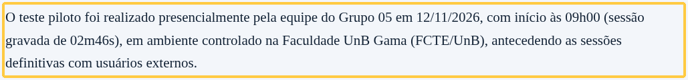

Responsável pelo registro: Caio Breno de Souza Bezerra · Grupo 06

# Etapa 7 · Grupo 05 (−1)

## Tabela de contribuição

| Integrante | Contribuição | Artefato / atividade |
| --- | --- | --- |
| [Caio Breno de Souza Bezerra](https://github.com/CaioBezerra-Dev) | Registro no site das 26 respostas da inspeção dos relatos de alta fidelidade do SEMOB-DF | [Critérios e respostas](#etapa-7) |
| [Caio Breno de Souza Bezerra](https://github.com/CaioBezerra-Dev) | Inclusão dos recortes com os horários do piloto e da sessão principal, vinculados à resposta e ao acompanhamento | [Recortes das evidências](#recortes-das-evidencias) · [Acompanhamento](#acompanhamento) |
| Codex (OpenAI) | Apoio à preparação dos recortes e à organização da ficha | [Agradecimentos](../index.md#agradecimentos) |

Tabela 1 — Contribuição neste artefato.

Fonte: elaboração para o Grupo 06 (2026).

[Lista V2 da Etapa 7](../lista-etapa-7.md) · [Resultados e gráficos](../resultados/etapa-7.md) · [Inspeções do grupo](index.md) · [Vídeo e roteiro](../inspecao.md#video-e-roteiro)

## Recorte consultado

**Projeto:** SEMOB-DF. **Consulta ao GitHub Pages:** 19/11/2026, 12h56 (Brasília). **Repositório de referência:** [`cad2b42`](https://github.com/Interacao-Humano-Computador/2026.2-Grupo05/tree/cad2b42de633a5f997fb6a87942bd1cd4da33aa2).

Cada linha leva ao critério da V2, à página do grupo e às linhas do documento preservadas no commit. Os resultados sintetizam os artefatos do inventário. [Como foram atribuídas as respostas](../index.md#metodo-de-inspecao).

## Critérios e respostas { #etapa-7 }

**10 Sim · 13 Incompleto · 3 Não** · 26 itens verificados

| Critério | Resposta | Constatação | Evidência |
| --- | :---: | --- | --- |
| [D01](../lista-etapa-7.md#d01) | Sim | Os sete relatos têm versão, data e descrição. Carlos e Lucas distinguem a abertura do relato da versão com resultados. | [Carlos · Relato da alta fidelidade](https://interacao-humano-computador.github.io/2026.2-Grupo05/design-avaliacao-desenvolvimento/nivel3/relatos-individuais/carlos/relato-resultados-prot-alta-fidel/#historico-de-versao) ([L3–9](https://github.com/Interacao-Humano-Computador/2026.2-Grupo05/blob/cad2b42de633a5f997fb6a87942bd1cd4da33aa2/docs/design-avaliacao-desenvolvimento/nivel3/relatos-individuais/carlos/relato-resultados-prot-alta-fidel.md#L3-L9)) [Lucas · Relato da alta fidelidade](https://interacao-humano-computador.github.io/2026.2-Grupo05/design-avaliacao-desenvolvimento/nivel3/relatos-individuais/lucas/relato-resultados-prot-alta-fidel/#historico-de-versao) ([L1–7](https://github.com/Interacao-Humano-Computador/2026.2-Grupo05/blob/cad2b42de633a5f997fb6a87942bd1cd4da33aa2/docs/design-avaliacao-desenvolvimento/nivel3/relatos-individuais/lucas/relato-resultados-prot-alta-fidel.md#L1-L7)) |
| [D02](../lista-etapa-7.md#d02) | Incompleto | Carlos identifica o revisor da v1.0. Em Arthur, o quadro da versão corrente não tem campo de revisão. Em Gabriel, o campo contém travessão. | [Carlos · Relato da alta fidelidade](https://interacao-humano-computador.github.io/2026.2-Grupo05/design-avaliacao-desenvolvimento/nivel3/relatos-individuais/carlos/relato-resultados-prot-alta-fidel/#historico-de-versao) ([L3–9](https://github.com/Interacao-Humano-Computador/2026.2-Grupo05/blob/cad2b42de633a5f997fb6a87942bd1cd4da33aa2/docs/design-avaliacao-desenvolvimento/nivel3/relatos-individuais/carlos/relato-resultados-prot-alta-fidel.md#L3-L9)) [Arthur · Relato da alta fidelidade](https://interacao-humano-computador.github.io/2026.2-Grupo05/design-avaliacao-desenvolvimento/nivel3/relatos-individuais/arthur/relato-resultados-prot-alta-fidel/#historico-de-versao) ([L3–7](https://github.com/Interacao-Humano-Computador/2026.2-Grupo05/blob/cad2b42de633a5f997fb6a87942bd1cd4da33aa2/docs/design-avaliacao-desenvolvimento/nivel3/relatos-individuais/arthur/relato-resultados-prot-alta-fidel.md#L3-L7)) [Gabriel · Relato da alta fidelidade](https://interacao-humano-computador.github.io/2026.2-Grupo05/design-avaliacao-desenvolvimento/nivel3/relatos-individuais/gabriel/relato-resultados-prot-alta-fidel/#historico-de-versao) ([L3–8](https://github.com/Interacao-Humano-Computador/2026.2-Grupo05/blob/cad2b42de633a5f997fb6a87942bd1cd4da33aa2/docs/design-avaliacao-desenvolvimento/nivel3/relatos-individuais/gabriel/relato-resultados-prot-alta-fidel.md#L3-L8)) |
| [D03](../lista-etapa-7.md#d03) | Sim | Os sete relatos incluem bibliografia, com referências ao planejamento e à avaliação. | [Arthur · Relato da alta fidelidade](https://interacao-humano-computador.github.io/2026.2-Grupo05/design-avaliacao-desenvolvimento/nivel3/relatos-individuais/arthur/relato-resultados-prot-alta-fidel/#9-referencias-bibliograficas) ([L117–120](https://github.com/Interacao-Humano-Computador/2026.2-Grupo05/blob/cad2b42de633a5f997fb6a87942bd1cd4da33aa2/docs/design-avaliacao-desenvolvimento/nivel3/relatos-individuais/arthur/relato-resultados-prot-alta-fidel.md#L117-L120)) [Tomás · Relato da alta fidelidade](https://interacao-humano-computador.github.io/2026.2-Grupo05/design-avaliacao-desenvolvimento/nivel3/relatos-individuais/tomas/relato-resultados-prot-alta-fidel/#14-referencias-bibliograficas) ([L320–329](https://github.com/Interacao-Humano-Computador/2026.2-Grupo05/blob/cad2b42de633a5f997fb6a87942bd1cd4da33aa2/docs/design-avaliacao-desenvolvimento/nivel3/relatos-individuais/tomas/relato-resultados-prot-alta-fidel.md#L320-L329)) |
| [D04](../lista-etapa-7.md#d04) | Incompleto | Há quadros numerados e com fonte nos relatos de Carlos e Lucas. A tabela de interpretação de Arthur não traz número, legenda e origem junto dos dados. | [Carlos · Relato da alta fidelidade](https://interacao-humano-computador.github.io/2026.2-Grupo05/design-avaliacao-desenvolvimento/nivel3/relatos-individuais/carlos/relato-resultados-prot-alta-fidel/#5-desempenho-por-tarefa) ([L176–195](https://github.com/Interacao-Humano-Computador/2026.2-Grupo05/blob/cad2b42de633a5f997fb6a87942bd1cd4da33aa2/docs/design-avaliacao-desenvolvimento/nivel3/relatos-individuais/carlos/relato-resultados-prot-alta-fidel.md#L176-L195)) [Arthur · Relato da alta fidelidade](https://interacao-humano-computador.github.io/2026.2-Grupo05/design-avaliacao-desenvolvimento/nivel3/relatos-individuais/arthur/relato-resultados-prot-alta-fidel/#4-interpretacao-das-perguntas-de-avaliacao) ([L51–61](https://github.com/Interacao-Humano-Computador/2026.2-Grupo05/blob/cad2b42de633a5f997fb6a87942bd1cd4da33aa2/docs/design-avaliacao-desenvolvimento/nivel3/relatos-individuais/arthur/relato-resultados-prot-alta-fidel.md#L51-L61)) |
| [D05](../lista-etapa-7.md#d05) | Sim | Os sete relatos apresentam o problema, a funcionalidade e os objetivos. Igor delimita a TAR-01 e Gabriel as etapas do pré-agendamento. | [Igor · Relato da alta fidelidade](https://interacao-humano-computador.github.io/2026.2-Grupo05/design-avaliacao-desenvolvimento/nivel3/relatos-individuais/igor/relato-resultados-prot-alta-fidel/#2-introducao-e-objetivos-da-avaliacao) ([L26–47](https://github.com/Interacao-Humano-Computador/2026.2-Grupo05/blob/cad2b42de633a5f997fb6a87942bd1cd4da33aa2/docs/design-avaliacao-desenvolvimento/nivel3/relatos-individuais/igor/relato-resultados-prot-alta-fidel.md#L26-L47)) [Gabriel · Relato da alta fidelidade](https://interacao-humano-computador.github.io/2026.2-Grupo05/design-avaliacao-desenvolvimento/nivel3/relatos-individuais/gabriel/relato-resultados-prot-alta-fidel/#1-introducao-e-objetivos-da-avaliacao) ([L15–38](https://github.com/Interacao-Humano-Computador/2026.2-Grupo05/blob/cad2b42de633a5f997fb6a87942bd1cd4da33aa2/docs/design-avaliacao-desenvolvimento/nivel3/relatos-individuais/gabriel/relato-resultados-prot-alta-fidel.md#L15-L38)) |
| [D06](../lista-etapa-7.md#d06) | Não | A Entrega 7 tem cronograma planejado na página oficial. A seção não inclui quadro executado, apesar de haver execução datada em relatos e atas. | [Cronograma](https://interacao-humano-computador.github.io/2026.2-Grupo05/planejamento/cronograma/#9-entrega-7-relato-da-avaliacao-do-prototipo-de-alta-fidelidade) ([L216–233](https://github.com/Interacao-Humano-Computador/2026.2-Grupo05/blob/cad2b42de633a5f997fb6a87942bd1cd4da33aa2/docs/planejamento/cronograma.md#L216-L233)) [Carlos · Relato da alta fidelidade](https://interacao-humano-computador.github.io/2026.2-Grupo05/design-avaliacao-desenvolvimento/nivel3/relatos-individuais/carlos/relato-resultados-prot-alta-fidel/#42-sessoes) ([L154–166](https://github.com/Interacao-Humano-Computador/2026.2-Grupo05/blob/cad2b42de633a5f997fb6a87942bd1cd4da33aa2/docs/design-avaliacao-desenvolvimento/nivel3/relatos-individuais/carlos/relato-resultados-prot-alta-fidel.md#L154-L166)) |
| [D07](../lista-etapa-7.md#d07) | Incompleto | A Ata 12 registra o piloto, participantes e decisões. O cabeçalho informa o início e a duração da gravação, sem registrar o fim da reunião. | [Ata 12](https://interacao-humano-computador.github.io/2026.2-Grupo05/atas/ata12/#ata-de-reuniao-12-teste-piloto-do-prototipo-de-alta-fidelidade-interacao-humano-computador-grupo-05) ([L1–9](https://github.com/Interacao-Humano-Computador/2026.2-Grupo05/blob/cad2b42de633a5f997fb6a87942bd1cd4da33aa2/docs/atas/ata12.md#L1-L9)) [Ata 12](https://interacao-humano-computador.github.io/2026.2-Grupo05/atas/ata12/#1-participantes-presentes) ([L19–29](https://github.com/Interacao-Humano-Computador/2026.2-Grupo05/blob/cad2b42de633a5f997fb6a87942bd1cd4da33aa2/docs/atas/ata12.md#L19-L29)) [Ata 12](https://interacao-humano-computador.github.io/2026.2-Grupo05/atas/ata12/#3-decisoes-e-calibracao) ([L56–62](https://github.com/Interacao-Humano-Computador/2026.2-Grupo05/blob/cad2b42de633a5f997fb6a87942bd1cd4da33aa2/docs/atas/ata12.md#L56-L62)) |
| [D08](../lista-etapa-7.md#d08) | Não | O índice deixa pendentes os vídeos de autoinspeção e de inspeção externa da Entrega 7. A Ata 12 vincula a execução do piloto ao vídeo correspondente. | [Índice de inspeções](https://interacao-humano-computador.github.io/2026.2-Grupo05/inspecoes/#8-inspecao-da-entrega-7-resultados-do-prototipo-de-alta-fidelidade) ([L166–176](https://github.com/Interacao-Humano-Computador/2026.2-Grupo05/blob/cad2b42de633a5f997fb6a87942bd1cd4da33aa2/docs/inspecoes/index.md#L166-L176)) [Ata 12](https://interacao-humano-computador.github.io/2026.2-Grupo05/atas/ata12/#4-link-da-gravacao) ([L64–73](https://github.com/Interacao-Humano-Computador/2026.2-Grupo05/blob/cad2b42de633a5f997fb6a87942bd1cd4da33aa2/docs/atas/ata12.md#L64-L73)) |
| [D09](../lista-etapa-7.md#d09) | Não | A seção de apresentações mantém o link da Entrega 7 pendente. | [Apresentações](https://interacao-humano-computador.github.io/2026.2-Grupo05/apresentacoes/#37-apresentacao-da-entrega-7-relato-dos-resultados-do-prototipo-de-alta-fidelidade) ([L97–102](https://github.com/Interacao-Humano-Computador/2026.2-Grupo05/blob/cad2b42de633a5f997fb6a87942bd1cd4da33aa2/docs/apresentacoes/index.md#L97-L102)) |
| [D10](../lista-etapa-7.md#d10) | Incompleto | Os históricos identificam autoria e descrevem contribuições. Os registros iniciais de Arthur e Carlos não oferecem hiperligação da atividade junto à contribuição. | [Arthur · Relato da alta fidelidade](https://interacao-humano-computador.github.io/2026.2-Grupo05/design-avaliacao-desenvolvimento/nivel3/relatos-individuais/arthur/relato-resultados-prot-alta-fidel/#historico-de-versao) ([L3–7](https://github.com/Interacao-Humano-Computador/2026.2-Grupo05/blob/cad2b42de633a5f997fb6a87942bd1cd4da33aa2/docs/design-avaliacao-desenvolvimento/nivel3/relatos-individuais/arthur/relato-resultados-prot-alta-fidel.md#L3-L7)) [Carlos · Relato da alta fidelidade](https://interacao-humano-computador.github.io/2026.2-Grupo05/design-avaliacao-desenvolvimento/nivel3/relatos-individuais/carlos/relato-resultados-prot-alta-fidel/#historico-de-versao) ([L3–8](https://github.com/Interacao-Humano-Computador/2026.2-Grupo05/blob/cad2b42de633a5f997fb6a87942bd1cd4da33aa2/docs/design-avaliacao-desenvolvimento/nivel3/relatos-individuais/carlos/relato-resultados-prot-alta-fidel.md#L3-L8)) |
| [D11](../lista-etapa-7.md#d11) | Sim | As declarações identificam ferramenta e uso. Arthur informa Google Gemini no histórico, e Carlos identifica Antigravity no histórico e na declaração. | [Arthur · Relato da alta fidelidade](https://interacao-humano-computador.github.io/2026.2-Grupo05/design-avaliacao-desenvolvimento/nivel3/relatos-individuais/arthur/relato-resultados-prot-alta-fidel/#historico-de-versao) ([L3–7](https://github.com/Interacao-Humano-Computador/2026.2-Grupo05/blob/cad2b42de633a5f997fb6a87942bd1cd4da33aa2/docs/design-avaliacao-desenvolvimento/nivel3/relatos-individuais/arthur/relato-resultados-prot-alta-fidel.md#L3-L7)) [Carlos · Relato da alta fidelidade](https://interacao-humano-computador.github.io/2026.2-Grupo05/design-avaliacao-desenvolvimento/nivel3/relatos-individuais/carlos/relato-resultados-prot-alta-fidel/#13-declaracao-sobre-o-uso-de-ia-generativa) ([L374–378](https://github.com/Interacao-Humano-Computador/2026.2-Grupo05/blob/cad2b42de633a5f997fb6a87942bd1cd4da33aa2/docs/design-avaliacao-desenvolvimento/nivel3/relatos-individuais/carlos/relato-resultados-prot-alta-fidel.md#L374-L378)) [Gabriel · Relato da alta fidelidade](https://interacao-humano-computador.github.io/2026.2-Grupo05/design-avaliacao-desenvolvimento/nivel3/relatos-individuais/gabriel/relato-resultados-prot-alta-fidel/#10-declaracao-sobre-o-uso-de-ia-generativa) ([L244–248](https://github.com/Interacao-Humano-Computador/2026.2-Grupo05/blob/cad2b42de633a5f997fb6a87942bd1cd4da33aa2/docs/design-avaliacao-desenvolvimento/nivel3/relatos-individuais/gabriel/relato-resultados-prot-alta-fidel.md#L244-L248)) |
| [E7-01](../lista-etapa-7.md#e7-01) | Sim | Os sete relatos abrem pelo menu de Nível 3 e contêm resultados executados. Há relatos para as sete funcionalidades cadastradas no inventário abaixo. | [Arthur · Relato da alta fidelidade](https://interacao-humano-computador.github.io/2026.2-Grupo05/design-avaliacao-desenvolvimento/nivel3/relatos-individuais/arthur/relato-resultados-prot-alta-fidel/#2-metodo-e-participantes) ([L17–49](https://github.com/Interacao-Humano-Computador/2026.2-Grupo05/blob/cad2b42de633a5f997fb6a87942bd1cd4da33aa2/docs/design-avaliacao-desenvolvimento/nivel3/relatos-individuais/arthur/relato-resultados-prot-alta-fidel.md#L17-L49)) [Tomás · Relato da alta fidelidade](https://interacao-humano-computador.github.io/2026.2-Grupo05/design-avaliacao-desenvolvimento/nivel3/relatos-individuais/tomas/relato-resultados-prot-alta-fidel/#3-participantes-e-avaliadores) ([L101–167](https://github.com/Interacao-Humano-Computador/2026.2-Grupo05/blob/cad2b42de633a5f997fb6a87942bd1cd4da33aa2/docs/design-avaliacao-desenvolvimento/nivel3/relatos-individuais/tomas/relato-resultados-prot-alta-fidel.md#L101-L167)) |
| [E7-02](../lista-etapa-7.md#e7-02) | Sim | Os relatos delimitam o fluxo e os objetivos, como a consulta de ônibus em Carlos e o pedido de aumento de limite em Tomás. | [Carlos · Relato da alta fidelidade](https://interacao-humano-computador.github.io/2026.2-Grupo05/design-avaliacao-desenvolvimento/nivel3/relatos-individuais/carlos/relato-resultados-prot-alta-fidel/#1-objetivos-e-escopo) ([L18–30](https://github.com/Interacao-Humano-Computador/2026.2-Grupo05/blob/cad2b42de633a5f997fb6a87942bd1cd4da33aa2/docs/design-avaliacao-desenvolvimento/nivel3/relatos-individuais/carlos/relato-resultados-prot-alta-fidel.md#L18-L30)) [Tomás · Relato da alta fidelidade](https://interacao-humano-computador.github.io/2026.2-Grupo05/design-avaliacao-desenvolvimento/nivel3/relatos-individuais/tomas/relato-resultados-prot-alta-fidel/#1-introducao-objetivos-e-escopo) ([L17–31](https://github.com/Interacao-Humano-Computador/2026.2-Grupo05/blob/cad2b42de633a5f997fb6a87942bd1cd4da33aa2/docs/design-avaliacao-desenvolvimento/nivel3/relatos-individuais/tomas/relato-resultados-prot-alta-fidel.md#L17-L31)) |
| [E7-03](../lista-etapa-7.md#e7-03) | Sim | Os sete relatos descrevem a condução efetiva. Carlos distingue o planejado da sessão que ocorreu no celular. Gabriel especifica como observou e mediu os tempos. | [Carlos · Relato da alta fidelidade](https://interacao-humano-computador.github.io/2026.2-Grupo05/design-avaliacao-desenvolvimento/nivel3/relatos-individuais/carlos/relato-resultados-prot-alta-fidel/#2-metodo) ([L89–117](https://github.com/Interacao-Humano-Computador/2026.2-Grupo05/blob/cad2b42de633a5f997fb6a87942bd1cd4da33aa2/docs/design-avaliacao-desenvolvimento/nivel3/relatos-individuais/carlos/relato-resultados-prot-alta-fidel.md#L89-L117)) [Gabriel · Relato da alta fidelidade](https://interacao-humano-computador.github.io/2026.2-Grupo05/design-avaliacao-desenvolvimento/nivel3/relatos-individuais/gabriel/relato-resultados-prot-alta-fidel/#2-metodologia-empregada) ([L39–54](https://github.com/Interacao-Humano-Computador/2026.2-Grupo05/blob/cad2b42de633a5f997fb6a87942bd1cd4da33aa2/docs/design-avaliacao-desenvolvimento/nivel3/relatos-individuais/gabriel/relato-resultados-prot-alta-fidel.md#L39-L54)) |
| [E7-04](../lista-etapa-7.md#e7-04) | Sim | Os relatos caracterizam a amostra e os papéis. Arthur informa três usuários de transporte e explica que acumulou a condução e a observação. | [Arthur · Relato da alta fidelidade](https://interacao-humano-computador.github.io/2026.2-Grupo05/design-avaliacao-desenvolvimento/nivel3/relatos-individuais/arthur/relato-resultados-prot-alta-fidel/#2-metodo-e-participantes) ([L17–29](https://github.com/Interacao-Humano-Computador/2026.2-Grupo05/blob/cad2b42de633a5f997fb6a87942bd1cd4da33aa2/docs/design-avaliacao-desenvolvimento/nivel3/relatos-individuais/arthur/relato-resultados-prot-alta-fidel.md#L17-L29)) [Tomás · Relato da alta fidelidade](https://interacao-humano-computador.github.io/2026.2-Grupo05/design-avaliacao-desenvolvimento/nivel3/relatos-individuais/tomas/relato-resultados-prot-alta-fidel/#3-participantes-e-avaliadores) ([L101–122](https://github.com/Interacao-Humano-Computador/2026.2-Grupo05/blob/cad2b42de633a5f997fb6a87942bd1cd4da33aa2/docs/design-avaliacao-desenvolvimento/nivel3/relatos-individuais/tomas/relato-resultados-prot-alta-fidel.md#L101-L122)) [Lucas · Relato da alta fidelidade](https://interacao-humano-computador.github.io/2026.2-Grupo05/design-avaliacao-desenvolvimento/nivel3/relatos-individuais/lucas/relato-resultados-prot-alta-fidel/#3-numero-e-perfil-dos-avaliadores-e-dos-participantes) ([L117–149](https://github.com/Interacao-Humano-Computador/2026.2-Grupo05/blob/cad2b42de633a5f997fb6a87942bd1cd4da33aa2/docs/design-avaliacao-desenvolvimento/nivel3/relatos-individuais/lucas/relato-resultados-prot-alta-fidel.md#L117-L149)) |
| [E7-05](../lista-etapa-7.md#e7-05) | Sim | Os resultados são registrados por pessoa e tarefa, em matrizes ou fichas. Rodrigo distingue o desempenho e as dificuldades de P3. | [Rodrigo · Relato da alta fidelidade](https://interacao-humano-computador.github.io/2026.2-Grupo05/design-avaliacao-desenvolvimento/nivel3/relatos-individuais/rodrigo/relato-resultados-prot-alta-fidel/#5-sumario-dos-dados-coletados) ([L160–178](https://github.com/Interacao-Humano-Computador/2026.2-Grupo05/blob/cad2b42de633a5f997fb6a87942bd1cd4da33aa2/docs/design-avaliacao-desenvolvimento/nivel3/relatos-individuais/rodrigo/relato-resultados-prot-alta-fidel.md#L160-L178)) [Arthur · Relato da alta fidelidade](https://interacao-humano-computador.github.io/2026.2-Grupo05/design-avaliacao-desenvolvimento/nivel3/relatos-individuais/arthur/relato-resultados-prot-alta-fidel/#3-dados-coletados-e-execucao-das-tarefas) ([L39–49](https://github.com/Interacao-Humano-Computador/2026.2-Grupo05/blob/cad2b42de633a5f997fb6a87942bd1cd4da33aa2/docs/design-avaliacao-desenvolvimento/nivel3/relatos-individuais/arthur/relato-resultados-prot-alta-fidel.md#L39-L49)) [Tomás · Relato da alta fidelidade](https://interacao-humano-computador.github.io/2026.2-Grupo05/design-avaliacao-desenvolvimento/nivel3/relatos-individuais/tomas/relato-resultados-prot-alta-fidel/#4-desempenho-por-tarefa) ([L132–167](https://github.com/Interacao-Humano-Computador/2026.2-Grupo05/blob/cad2b42de633a5f997fb6a87942bd1cd4da33aa2/docs/design-avaliacao-desenvolvimento/nivel3/relatos-individuais/tomas/relato-resultados-prot-alta-fidel.md#L132-L167)) |
| [E7-06](../lista-etapa-7.md#e7-06) | Incompleto | Gabriel liga seus tempos e opiniões aos três registros. Arthur tem três links e uma tabela individual, mas não localiza os trechos da ação no contêiner ou as respostas pós-teste. | [Gabriel · Relato da alta fidelidade](https://interacao-humano-computador.github.io/2026.2-Grupo05/design-avaliacao-desenvolvimento/nivel3/relatos-individuais/gabriel/relato-resultados-prot-alta-fidel/#31-gravacoes-das-sessoes) ([L62–90](https://github.com/Interacao-Humano-Computador/2026.2-Grupo05/blob/cad2b42de633a5f997fb6a87942bd1cd4da33aa2/docs/design-avaliacao-desenvolvimento/nivel3/relatos-individuais/gabriel/relato-resultados-prot-alta-fidel.md#L62-L90)) [Gabriel · Relato da alta fidelidade](https://interacao-humano-computador.github.io/2026.2-Grupo05/design-avaliacao-desenvolvimento/nivel3/relatos-individuais/gabriel/relato-resultados-prot-alta-fidel/#41-desempenho-por-participante-e-tarefa) ([L94–134](https://github.com/Interacao-Humano-Computador/2026.2-Grupo05/blob/cad2b42de633a5f997fb6a87942bd1cd4da33aa2/docs/design-avaliacao-desenvolvimento/nivel3/relatos-individuais/gabriel/relato-resultados-prot-alta-fidel.md#L94-L134)) [Arthur · Relato da alta fidelidade](https://interacao-humano-computador.github.io/2026.2-Grupo05/design-avaliacao-desenvolvimento/nivel3/relatos-individuais/arthur/relato-resultados-prot-alta-fidel/#21-links-das-tres-entrevistas) ([L31–49](https://github.com/Interacao-Humano-Computador/2026.2-Grupo05/blob/cad2b42de633a5f997fb6a87942bd1cd4da33aa2/docs/design-avaliacao-desenvolvimento/nivel3/relatos-individuais/arthur/relato-resultados-prot-alta-fidel.md#L31-L49)) |
| [E7-07](../lista-etapa-7.md#e7-07) | Incompleto | Rodrigo informa base de três pessoas e exibe 67% para dois sucessos. O resumo de Arthur registra êxito, mas não indica se tempos e erros previstos no plano foram coletados ou deixados de fora. | [Rodrigo · Relato da alta fidelidade](https://interacao-humano-computador.github.io/2026.2-Grupo05/design-avaliacao-desenvolvimento/nivel3/relatos-individuais/rodrigo/relato-resultados-prot-alta-fidel/#5-sumario-dos-dados-coletados) ([L160–179](https://github.com/Interacao-Humano-Computador/2026.2-Grupo05/blob/cad2b42de633a5f997fb6a87942bd1cd4da33aa2/docs/design-avaliacao-desenvolvimento/nivel3/relatos-individuais/rodrigo/relato-resultados-prot-alta-fidel.md#L160-L179)) [Arthur · Relato da alta fidelidade](https://interacao-humano-computador.github.io/2026.2-Grupo05/design-avaliacao-desenvolvimento/nivel3/relatos-individuais/arthur/relato-resultados-prot-alta-fidel/#3-dados-coletados-e-execucao-das-tarefas) ([L39–49](https://github.com/Interacao-Humano-Computador/2026.2-Grupo05/blob/cad2b42de633a5f997fb6a87942bd1cd4da33aa2/docs/design-avaliacao-desenvolvimento/nivel3/relatos-individuais/arthur/relato-resultados-prot-alta-fidel.md#L39-L49)) [Arthur · Plano da avaliação](https://interacao-humano-computador.github.io/2026.2-Grupo05/design-avaliacao-desenvolvimento/nivel3/planejamentos-individuais/Arthur/arthur-planejamento-avaliacao-prototipo-alta-fidelidade/#52-medidas-e-registros) ([L76–78](https://github.com/Interacao-Humano-Computador/2026.2-Grupo05/blob/cad2b42de633a5f997fb6a87942bd1cd4da33aa2/docs/design-avaliacao-desenvolvimento/nivel3/planejamentos-individuais/Arthur/arthur-planejamento-avaliacao-prototipo-alta-fidelidade.md#L76-L78)) |
| [E7-08](../lista-etapa-7.md#e7-08) | Sim | As matrizes e os registros de problemas identificam local, efeito e proposta. Arthur registra o contêiner de horários e separa tentativa observada de hipótese visual. | [Arthur · Relato da alta fidelidade](https://interacao-humano-computador.github.io/2026.2-Grupo05/design-avaliacao-desenvolvimento/nivel3/relatos-individuais/arthur/relato-resultados-prot-alta-fidel/#5-problema-observado-e-ponto-positivo) ([L62–69](https://github.com/Interacao-Humano-Computador/2026.2-Grupo05/blob/cad2b42de633a5f997fb6a87942bd1cd4da33aa2/docs/design-avaliacao-desenvolvimento/nivel3/relatos-individuais/arthur/relato-resultados-prot-alta-fidel.md#L62-L69)) [Gabriel · Relato da alta fidelidade](https://interacao-humano-computador.github.io/2026.2-Grupo05/design-avaliacao-desenvolvimento/nivel3/relatos-individuais/gabriel/relato-resultados-prot-alta-fidel/#6-tabela-de-problemas-de-ihc) ([L180–196](https://github.com/Interacao-Humano-Computador/2026.2-Grupo05/blob/cad2b42de633a5f997fb6a87942bd1cd4da33aa2/docs/design-avaliacao-desenvolvimento/nivel3/relatos-individuais/gabriel/relato-resultados-prot-alta-fidel.md#L180-L196)) [Lucas · Relato da alta fidelidade](https://interacao-humano-computador.github.io/2026.2-Grupo05/design-avaliacao-desenvolvimento/nivel3/relatos-individuais/lucas/relato-resultados-prot-alta-fidel/#6-problemas-de-usabilidade-identificados-escala-de-nielsen) ([L208–225](https://github.com/Interacao-Humano-Computador/2026.2-Grupo05/blob/cad2b42de633a5f997fb6a87942bd1cd4da33aa2/docs/design-avaliacao-desenvolvimento/nivel3/relatos-individuais/lucas/relato-resultados-prot-alta-fidel.md#L208-L225)) |
| [E7-09](../lista-etapa-7.md#e7-09) | Incompleto | Carlos e Tomás comparam o papel com a tela digital e registram pendências. Arthur apresenta a nova ação como proposta, mas não retoma as decisões do relato do papel para indicar quais chegaram ao teste digital. | [Carlos · Relato da alta fidelidade](https://interacao-humano-computador.github.io/2026.2-Grupo05/design-avaliacao-desenvolvimento/nivel3/relatos-individuais/carlos/relato-resultados-prot-alta-fidel/#8-comparacao-com-o-prototipo-de-papel) ([L260–278](https://github.com/Interacao-Humano-Computador/2026.2-Grupo05/blob/cad2b42de633a5f997fb6a87942bd1cd4da33aa2/docs/design-avaliacao-desenvolvimento/nivel3/relatos-individuais/carlos/relato-resultados-prot-alta-fidel.md#L260-L278)) [Tomás · Relato da alta fidelidade](https://interacao-humano-computador.github.io/2026.2-Grupo05/design-avaliacao-desenvolvimento/nivel3/relatos-individuais/tomas/relato-resultados-prot-alta-fidel/#8-comparacao-com-o-prototipo-de-papel) ([L220–241](https://github.com/Interacao-Humano-Computador/2026.2-Grupo05/blob/cad2b42de633a5f997fb6a87942bd1cd4da33aa2/docs/design-avaliacao-desenvolvimento/nivel3/relatos-individuais/tomas/relato-resultados-prot-alta-fidel.md#L220-L241)) [Arthur · Relato da alta fidelidade](https://interacao-humano-computador.github.io/2026.2-Grupo05/design-avaliacao-desenvolvimento/nivel3/relatos-individuais/arthur/relato-resultados-prot-alta-fidel/#6-plano-de-reprojeto) ([L71–81](https://github.com/Interacao-Humano-Computador/2026.2-Grupo05/blob/cad2b42de633a5f997fb6a87942bd1cd4da33aa2/docs/design-avaliacao-desenvolvimento/nivel3/relatos-individuais/arthur/relato-resultados-prot-alta-fidel.md#L71-L81)) [Arthur · Papel](https://interacao-humano-computador.github.io/2026.2-Grupo05/design-avaliacao-desenvolvimento/nivel2/relatos-individuais/arthur/relato-resultados-prototipo-papel/#12-plano-de-reprojeto) ([L191–199](https://github.com/Interacao-Humano-Computador/2026.2-Grupo05/blob/cad2b42de633a5f997fb6a87942bd1cd4da33aa2/docs/design-avaliacao-desenvolvimento/nivel2/relatos-individuais/arthur/relato-resultados-prototipo-papel.md#L191-L199)) |
| [E7-10](../lista-etapa-7.md#e7-10) | Incompleto | Arthur, Carlos, Lucas e Tomás separam resultados do piloto. Em Carlos, a mesma data aparece com a sessão principal às 08h50 e piloto integrado às 09h00, o que precisa de confirmação para comprovar a sequência. Em Igor, a descrição da avaliação não registra o piloto. | [Carlos · Relato da alta fidelidade](https://interacao-humano-computador.github.io/2026.2-Grupo05/design-avaliacao-desenvolvimento/nivel3/relatos-individuais/carlos/relato-resultados-prot-alta-fidel/#41-teste-piloto) ([L144–166](https://github.com/Interacao-Humano-Computador/2026.2-Grupo05/blob/cad2b42de633a5f997fb6a87942bd1cd4da33aa2/docs/design-avaliacao-desenvolvimento/nivel3/relatos-individuais/carlos/relato-resultados-prot-alta-fidel.md#L144-L166)) [Arthur · Relato da alta fidelidade](https://interacao-humano-computador.github.io/2026.2-Grupo05/design-avaliacao-desenvolvimento/nivel3/relatos-individuais/arthur/relato-resultados-prot-alta-fidel/#2-metodo-e-participantes) ([L23–29](https://github.com/Interacao-Humano-Computador/2026.2-Grupo05/blob/cad2b42de633a5f997fb6a87942bd1cd4da33aa2/docs/design-avaliacao-desenvolvimento/nivel3/relatos-individuais/arthur/relato-resultados-prot-alta-fidel.md#L23-L29)) [Igor · Relato da alta fidelidade](https://interacao-humano-computador.github.io/2026.2-Grupo05/design-avaliacao-desenvolvimento/nivel3/relatos-individuais/igor/relato-resultados-prot-alta-fidel/#4-metodologia-e-caracterizacao-dos-participantes) ([L95–115](https://github.com/Interacao-Humano-Computador/2026.2-Grupo05/blob/cad2b42de633a5f997fb6a87942bd1cd4da33aa2/docs/design-avaliacao-desenvolvimento/nivel3/relatos-individuais/igor/relato-resultados-prot-alta-fidel.md#L95-L115)) |
| [E7-11](../lista-etapa-7.md#e7-11) | Incompleto | Carlos registra participação, gravação e divulgação acadêmica. O relato de Arthur documenta sessões com códigos e links, sem explicitar o alcance do consentimento. | [Carlos · Relato da alta fidelidade](https://interacao-humano-computador.github.io/2026.2-Grupo05/design-avaliacao-desenvolvimento/nivel3/relatos-individuais/carlos/relato-resultados-prot-alta-fidel/#3-participantes-e-avaliadores) ([L119–137](https://github.com/Interacao-Humano-Computador/2026.2-Grupo05/blob/cad2b42de633a5f997fb6a87942bd1cd4da33aa2/docs/design-avaliacao-desenvolvimento/nivel3/relatos-individuais/carlos/relato-resultados-prot-alta-fidel.md#L119-L137)) [Arthur · Relato da alta fidelidade](https://interacao-humano-computador.github.io/2026.2-Grupo05/design-avaliacao-desenvolvimento/nivel3/relatos-individuais/arthur/relato-resultados-prot-alta-fidel/#2-metodo-e-participantes) ([L17–37](https://github.com/Interacao-Humano-Computador/2026.2-Grupo05/blob/cad2b42de633a5f997fb6a87942bd1cd4da33aa2/docs/design-avaliacao-desenvolvimento/nivel3/relatos-individuais/arthur/relato-resultados-prot-alta-fidel.md#L17-L37)) |
| [E7-12](../lista-etapa-7.md#e7-12) | Incompleto | Carlos identifica b4fd211 e Tomás identifica a09b751. Arthur e Igor ligam a implantação e o Figma sem indicar uma revisão. Os relatos de Gabriel e Rodrigo descrevem o Figma e as telas sem acesso direto ao protótipo avaliado. | [Carlos · Relato da alta fidelidade](https://interacao-humano-computador.github.io/2026.2-Grupo05/design-avaliacao-desenvolvimento/nivel3/relatos-individuais/carlos/relato-resultados-prot-alta-fidel/#11-prototipo-avaliado) ([L31–45](https://github.com/Interacao-Humano-Computador/2026.2-Grupo05/blob/cad2b42de633a5f997fb6a87942bd1cd4da33aa2/docs/design-avaliacao-desenvolvimento/nivel3/relatos-individuais/carlos/relato-resultados-prot-alta-fidel.md#L31-L45)) [Tomás · Relato da alta fidelidade](https://interacao-humano-computador.github.io/2026.2-Grupo05/design-avaliacao-desenvolvimento/nivel3/relatos-individuais/tomas/relato-resultados-prot-alta-fidel/#11-prototipo-avaliado) ([L32–44](https://github.com/Interacao-Humano-Computador/2026.2-Grupo05/blob/cad2b42de633a5f997fb6a87942bd1cd4da33aa2/docs/design-avaliacao-desenvolvimento/nivel3/relatos-individuais/tomas/relato-resultados-prot-alta-fidel.md#L32-L44)) [Arthur · Relato da alta fidelidade](https://interacao-humano-computador.github.io/2026.2-Grupo05/design-avaliacao-desenvolvimento/nivel3/relatos-individuais/arthur/relato-resultados-prot-alta-fidel/#2-metodo-e-participantes) ([L23–29](https://github.com/Interacao-Humano-Computador/2026.2-Grupo05/blob/cad2b42de633a5f997fb6a87942bd1cd4da33aa2/docs/design-avaliacao-desenvolvimento/nivel3/relatos-individuais/arthur/relato-resultados-prot-alta-fidel.md#L23-L29)) [Igor · Relato da alta fidelidade](https://interacao-humano-computador.github.io/2026.2-Grupo05/design-avaliacao-desenvolvimento/nivel3/relatos-individuais/igor/relato-resultados-prot-alta-fidel/#1-o-prototipo-avaliado) ([L17–24](https://github.com/Interacao-Humano-Computador/2026.2-Grupo05/blob/cad2b42de633a5f997fb6a87942bd1cd4da33aa2/docs/design-avaliacao-desenvolvimento/nivel3/relatos-individuais/igor/relato-resultados-prot-alta-fidel.md#L17-L24)) [Gabriel · Relato da alta fidelidade](https://interacao-humano-computador.github.io/2026.2-Grupo05/design-avaliacao-desenvolvimento/nivel3/relatos-individuais/gabriel/relato-resultados-prot-alta-fidel/#11-escopo-do-prototipo-avaliado) ([L17–27](https://github.com/Interacao-Humano-Computador/2026.2-Grupo05/blob/cad2b42de633a5f997fb6a87942bd1cd4da33aa2/docs/design-avaliacao-desenvolvimento/nivel3/relatos-individuais/gabriel/relato-resultados-prot-alta-fidel.md#L17-L27)) [Rodrigo · Relato da alta fidelidade](https://interacao-humano-computador.github.io/2026.2-Grupo05/design-avaliacao-desenvolvimento/nivel3/relatos-individuais/rodrigo/relato-resultados-prot-alta-fidel/#1-o-prototipo-avaliado) ([L17–32](https://github.com/Interacao-Humano-Computador/2026.2-Grupo05/blob/cad2b42de633a5f997fb6a87942bd1cd4da33aa2/docs/design-avaliacao-desenvolvimento/nivel3/relatos-individuais/rodrigo/relato-resultados-prot-alta-fidel.md#L17-L32)) |
| [E7-13](../lista-etapa-7.md#e7-13) | Incompleto | Tomás delimita amostra, estados não provocados e estimativas de tempo. A conclusão de Igor informa viabilidade e próximos passos, sem seção equivalente de limites da amostra e do procedimento. | [Tomás · Relato da alta fidelidade](https://interacao-humano-computador.github.io/2026.2-Grupo05/design-avaliacao-desenvolvimento/nivel3/relatos-individuais/tomas/relato-resultados-prot-alta-fidel/#9-limitacoes-dos-resultados) ([L243–253](https://github.com/Interacao-Humano-Computador/2026.2-Grupo05/blob/cad2b42de633a5f997fb6a87942bd1cd4da33aa2/docs/design-avaliacao-desenvolvimento/nivel3/relatos-individuais/tomas/relato-resultados-prot-alta-fidel.md#L243-L253)) [Igor · Relato da alta fidelidade](https://interacao-humano-computador.github.io/2026.2-Grupo05/design-avaliacao-desenvolvimento/nivel3/relatos-individuais/igor/relato-resultados-prot-alta-fidel/#9-conclusao) ([L209–215](https://github.com/Interacao-Humano-Computador/2026.2-Grupo05/blob/cad2b42de633a5f997fb6a87942bd1cd4da33aa2/docs/design-avaliacao-desenvolvimento/nivel3/relatos-individuais/igor/relato-resultados-prot-alta-fidel.md#L209-L215)) |
| [E7-14](../lista-etapa-7.md#e7-14) | Incompleto | Lucas e Carlos indicam gravações não listadas associadas a cada sessão. Arthur publica três links individualizados sem declaração de visibilidade no trecho. | [Lucas · Relato da alta fidelidade](https://interacao-humano-computador.github.io/2026.2-Grupo05/design-avaliacao-desenvolvimento/nivel3/relatos-individuais/lucas/relato-resultados-prot-alta-fidel/#9-gravacoes-das-sessoes-de-avaliacao) ([L282–310](https://github.com/Interacao-Humano-Computador/2026.2-Grupo05/blob/cad2b42de633a5f997fb6a87942bd1cd4da33aa2/docs/design-avaliacao-desenvolvimento/nivel3/relatos-individuais/lucas/relato-resultados-prot-alta-fidel.md#L282-L310)) [Carlos · Relato da alta fidelidade](https://interacao-humano-computador.github.io/2026.2-Grupo05/design-avaliacao-desenvolvimento/nivel3/relatos-individuais/carlos/relato-resultados-prot-alta-fidel/#11-videos) ([L332–342](https://github.com/Interacao-Humano-Computador/2026.2-Grupo05/blob/cad2b42de633a5f997fb6a87942bd1cd4da33aa2/docs/design-avaliacao-desenvolvimento/nivel3/relatos-individuais/carlos/relato-resultados-prot-alta-fidel.md#L332-L342)) [Arthur · Relato da alta fidelidade](https://interacao-humano-computador.github.io/2026.2-Grupo05/design-avaliacao-desenvolvimento/nivel3/relatos-individuais/arthur/relato-resultados-prot-alta-fidel/#21-links-das-tres-entrevistas) ([L31–37](https://github.com/Interacao-Humano-Computador/2026.2-Grupo05/blob/cad2b42de633a5f997fb6a87942bd1cd4da33aa2/docs/design-avaliacao-desenvolvimento/nivel3/relatos-individuais/arthur/relato-resultados-prot-alta-fidel.md#L31-L37)) |
| [E7-15](../lista-etapa-7.md#e7-15) | Incompleto | Tomás cruza mudanças, perguntas e efeito analítico. Em Arthur, o relato menciona acúmulo de papéis e lista respostas, mas não confronta os registros pretendidos com os que efetivamente foram obtidos. | [Tomás · Relato da alta fidelidade](https://interacao-humano-computador.github.io/2026.2-Grupo05/design-avaliacao-desenvolvimento/nivel3/relatos-individuais/tomas/relato-resultados-prot-alta-fidel/#21-mudancas-em-relacao-ao-planejamento) ([L81–99](https://github.com/Interacao-Humano-Computador/2026.2-Grupo05/blob/cad2b42de633a5f997fb6a87942bd1cd4da33aa2/docs/design-avaliacao-desenvolvimento/nivel3/relatos-individuais/tomas/relato-resultados-prot-alta-fidel.md#L81-L99)) [Tomás · Relato da alta fidelidade](https://interacao-humano-computador.github.io/2026.2-Grupo05/design-avaliacao-desenvolvimento/nivel3/relatos-individuais/tomas/relato-resultados-prot-alta-fidel/#6-respostas-as-perguntas-da-avaliacao) ([L178–202](https://github.com/Interacao-Humano-Computador/2026.2-Grupo05/blob/cad2b42de633a5f997fb6a87942bd1cd4da33aa2/docs/design-avaliacao-desenvolvimento/nivel3/relatos-individuais/tomas/relato-resultados-prot-alta-fidel.md#L178-L202)) [Arthur · Relato da alta fidelidade](https://interacao-humano-computador.github.io/2026.2-Grupo05/design-avaliacao-desenvolvimento/nivel3/relatos-individuais/arthur/relato-resultados-prot-alta-fidel/#2-metodo-e-participantes) ([L23–29](https://github.com/Interacao-Humano-Computador/2026.2-Grupo05/blob/cad2b42de633a5f997fb6a87942bd1cd4da33aa2/docs/design-avaliacao-desenvolvimento/nivel3/relatos-individuais/arthur/relato-resultados-prot-alta-fidel.md#L23-L29)) [Arthur · Relato da alta fidelidade](https://interacao-humano-computador.github.io/2026.2-Grupo05/design-avaliacao-desenvolvimento/nivel3/relatos-individuais/arthur/relato-resultados-prot-alta-fidel/#4-interpretacao-das-perguntas-de-avaliacao) ([L51–61](https://github.com/Interacao-Humano-Computador/2026.2-Grupo05/blob/cad2b42de633a5f997fb6a87942bd1cd4da33aa2/docs/design-avaliacao-desenvolvimento/nivel3/relatos-individuais/arthur/relato-resultados-prot-alta-fidel.md#L51-L61)) |

## Acompanhamento

A tabela abaixo indica os achados que merecem voltar à pauta na próxima revisão. Use o mesmo ID ao publicar uma correção. Registre o novo commit, a data e o resultado da reinspeção ao encerrar o item.

| Achado | Ajuste a registrar | Evidência para encerrar |
| --- | --- | --- |
| [E7-10](#etapa-7-e7-10) Confirmar a ordem do piloto | Conferir a hora de início do piloto e da sessão principal de Carlos e esclarecer quais fluxos o ensaio integrado cobriu. | Comparar ATA 12 e relato publicado, e verificar a exclusão dos dados do piloto. |
| [E7-12](#etapa-7-e7-12) Identificar versões testadas | Indicar versão ou revisão do protótipo para todos os relatos, com acesso ao recorte avaliado. | Abrir o endereço documentado e confrontar a revisão com o relato da sessão. |

## Recortes das evidências

<figure class="etapa8-evidencia" markdown="1">

{ loading=lazy }

<figcaption markdown="1">[E7-10](#etapa-7-e7-10) · O relato de Carlos registra início do piloto às 09h00. [Carlos · Relato da alta fidelidade](https://interacao-humano-computador.github.io/2026.2-Grupo05/design-avaliacao-desenvolvimento/nivel3/relatos-individuais/carlos/relato-resultados-prot-alta-fidel/#41-teste-piloto) ([L144–152](https://github.com/Interacao-Humano-Computador/2026.2-Grupo05/blob/cad2b42de633a5f997fb6a87942bd1cd4da33aa2/docs/design-avaliacao-desenvolvimento/nivel3/relatos-individuais/carlos/relato-resultados-prot-alta-fidel.md#L144-L152)).</figcaption>
</figure>

<figure class="etapa8-evidencia" markdown="1">

{ loading=lazy }

<figcaption markdown="1">[E7-10](#etapa-7-e7-10) · Na mesma página, a tabela informa a sessão principal às 08h50 do mesmo dia. [Carlos · Relato da alta fidelidade](https://interacao-humano-computador.github.io/2026.2-Grupo05/design-avaliacao-desenvolvimento/nivel3/relatos-individuais/carlos/relato-resultados-prot-alta-fidel/#42-sessoes) ([L154–166](https://github.com/Interacao-Humano-Computador/2026.2-Grupo05/blob/cad2b42de633a5f997fb6a87942bd1cd4da33aa2/docs/design-avaliacao-desenvolvimento/nivel3/relatos-individuais/carlos/relato-resultados-prot-alta-fidel.md#L154-L166)).</figcaption>
</figure>

## Artefatos consultados

| Integrante / fluxo | Relato da alta fidelidade |
| --- | --- |
| Arthur / Crédito do Vale-Transporte | [Página](https://interacao-humano-computador.github.io/2026.2-Grupo05/design-avaliacao-desenvolvimento/nivel3/relatos-individuais/arthur/relato-resultados-prot-alta-fidel/) · [v1.0](https://github.com/Interacao-Humano-Computador/2026.2-Grupo05/blob/cad2b42de633a5f997fb6a87942bd1cd4da33aa2/docs/design-avaliacao-desenvolvimento/nivel3/relatos-individuais/arthur/relato-resultados-prot-alta-fidel.md#L7) |
| Carlos / DF no Ponto | [Página](https://interacao-humano-computador.github.io/2026.2-Grupo05/design-avaliacao-desenvolvimento/nivel3/relatos-individuais/carlos/relato-resultados-prot-alta-fidel/) · [v1.0](https://github.com/Interacao-Humano-Computador/2026.2-Grupo05/blob/cad2b42de633a5f997fb6a87942bd1cd4da33aa2/docs/design-avaliacao-desenvolvimento/nivel3/relatos-individuais/carlos/relato-resultados-prot-alta-fidel.md#L8) |
| Gabriel / Pré-agendamento DF Acessível | [Página](https://interacao-humano-computador.github.io/2026.2-Grupo05/design-avaliacao-desenvolvimento/nivel3/relatos-individuais/gabriel/relato-resultados-prot-alta-fidel/) · [v1.0](https://github.com/Interacao-Humano-Computador/2026.2-Grupo05/blob/cad2b42de633a5f997fb6a87942bd1cd4da33aa2/docs/design-avaliacao-desenvolvimento/nivel3/relatos-individuais/gabriel/relato-resultados-prot-alta-fidel.md#L7) |
| Igor / Alerta de saída | [Página](https://interacao-humano-computador.github.io/2026.2-Grupo05/design-avaliacao-desenvolvimento/nivel3/relatos-individuais/igor/relato-resultados-prot-alta-fidel/) · [v1.0](https://github.com/Interacao-Humano-Computador/2026.2-Grupo05/blob/cad2b42de633a5f997fb6a87942bd1cd4da33aa2/docs/design-avaliacao-desenvolvimento/nivel3/relatos-individuais/igor/relato-resultados-prot-alta-fidel.md#L5) |
| Lucas / Planejamento de rota | [Página](https://interacao-humano-computador.github.io/2026.2-Grupo05/design-avaliacao-desenvolvimento/nivel3/relatos-individuais/lucas/relato-resultados-prot-alta-fidel/) · [v1.0](https://github.com/Interacao-Humano-Computador/2026.2-Grupo05/blob/cad2b42de633a5f997fb6a87942bd1cd4da33aa2/docs/design-avaliacao-desenvolvimento/nivel3/relatos-individuais/lucas/relato-resultados-prot-alta-fidel.md#L6) |
| Rodrigo / Reclamação de ônibus | [Página](https://interacao-humano-computador.github.io/2026.2-Grupo05/design-avaliacao-desenvolvimento/nivel3/relatos-individuais/rodrigo/relato-resultados-prot-alta-fidel/) · [v1.0](https://github.com/Interacao-Humano-Computador/2026.2-Grupo05/blob/cad2b42de633a5f997fb6a87942bd1cd4da33aa2/docs/design-avaliacao-desenvolvimento/nivel3/relatos-individuais/rodrigo/relato-resultados-prot-alta-fidel.md#L5) |
| Tomás / Limite do Vale-Transporte | [Página](https://interacao-humano-computador.github.io/2026.2-Grupo05/design-avaliacao-desenvolvimento/nivel3/relatos-individuais/tomas/relato-resultados-prot-alta-fidel/) · [v1.0](https://github.com/Interacao-Humano-Computador/2026.2-Grupo05/blob/cad2b42de633a5f997fb6a87942bd1cd4da33aa2/docs/design-avaliacao-desenvolvimento/nivel3/relatos-individuais/tomas/relato-resultados-prot-alta-fidel.md#L7) |

## Histórico de versão

| Versão | Data | Descrição | Autor(es) | Revisor designado |
| :---: | :---: | --- | --- | --- |
| `1.0` | 19/11/2026 | Registro das respostas e evidências da inspeção da Etapa 7 no Grupo 05. | [Caio Breno de Souza Bezerra](https://github.com/CaioBezerra-Dev) | [Heitor Pinheiro Gonçalves das Chagas](https://github.com/Heitorovski01) |

## Referências

1. SALES, André Barros de. *Plano de Ensino FIHC 022026 — Turma 01*. v1. Brasília: FCTE/UnB, 2026.

2. BARBOSA, Simone Diniz Junqueira; SILVA, Bruno Santana da. *Interação humano-computador*. Rio de Janeiro: Elsevier, 2010.

3. FAGAN, Michael E. *Design and code inspections to reduce errors in program development*. IBM Systems Journal, v. 15, n. 3, p. 182–211, 1976. [DOI 10.1147/sj.153.0182](https://doi.org/10.1147/sj.153.0182).
