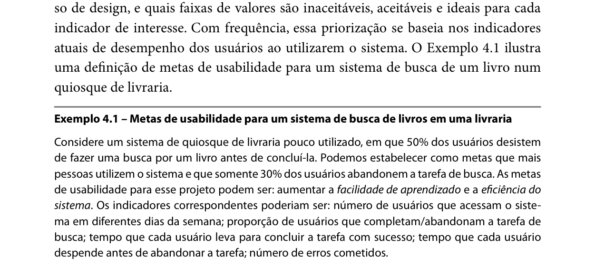
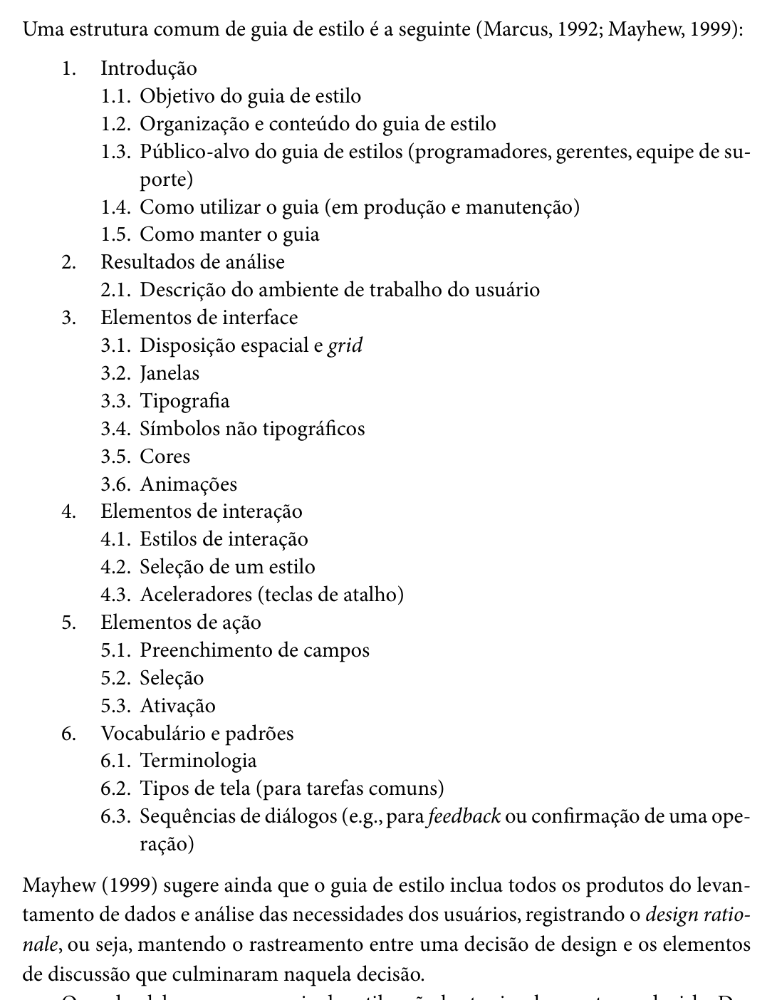

Responsável pelo registro: Israel Soares de Paiva · Grupo 06

# Etapa 3 · Grupo 06 · Autoinspeção

## Tabela de contribuição

| Integrante | Contribuição | Artefato / atividade |
| --- | --- | --- |
| [Israel Soares de Paiva](https://github.com/IsraelSoares-25) | Registro no site das 30 respostas da autoinspeção da Etapa 3 do Grupo 06 | [Critérios e respostas](#etapa-3) |
| [Israel Soares de Paiva](https://github.com/IsraelSoares-25) | Inclusão do inventário das versões consultadas, recortes de evidências e plano de acompanhamento | [Artefatos consultados](#artefatos-consultados) · [Recortes das evidências](#recortes-das-evidencias) |
| Codex (OpenAI) | Apoio à preparação dos recortes e à edição da ficha de autoinspeção | [Agradecimentos](#agradecimentos) |

Tabela 1 — Contribuição neste artefato.

Fonte: elaboração para o Grupo 06 (2026).

[Lista V2 da Etapa 3](../lista-etapa-3.md) · [Resultados e gráficos](../resultados/etapa-3.md) · [Inspeções do grupo](index.md) · [Lista V1 da Etapa 3](../../verificacao/listas/etapa-3.md) · [Ficha V1 da Etapa 3](../../verificacao/grupo-06/etapa-3/lista-verificacao.md)

## Recorte e versões reinspecionadas

- **Projeto:** Portal do Senado Federal (Grupo 06).
- **Data e gravação da reinspeção:** **22/11/2026** · Duração: 21 min 25 s · Categoria no YouTube: **não listado**.
- **Revisão do repositório na reinspeção:** [`cc0e69e`](https://github.com/Interacao-Humano-Computador/2026.2-Grupo06/tree/cc0e69e) (artefatos de conteúdo da Etapa 3 nas mesmas versões de [`5dfe10f`](https://github.com/Interacao-Humano-Computador/2026.2-Grupo06/tree/5dfe10f7661a6b839c87ced4f37f15a33e3a7d46)). [Como foram atribuídas as respostas](../index.md#metodo-de-inspecao).

??? note "Vídeo — Inspeção da Etapa 3, Grupo 06 (21 min 25 s)"

    

      <iframe
        loading="lazy"
        style="position: absolute; top: 0; left: 0; width: 100%; height: 100%; border: 0;"
        src="https://www.youtube-nocookie.com/embed/FojGmm4kSGo"
        title="Inspeção da Etapa 3 — Grupo 06"
        allow="accelerometer; autoplay; clipboard-write; encrypted-media; gyroscope; picture-in-picture; web-share"
        referrerpolicy="strict-origin-when-cross-origin"
        allowfullscreen>
      </iframe>
    

    Link direto no YouTube (não listado): [https://youtu.be/FojGmm4kSGo](https://youtu.be/FojGmm4kSGo)

A Tabela 2 identifica todos os artefatos da Etapa 3 reinspecionados na sessão gravada em **22/11/2026** e suas respectivas versões exatas no repositório.

| Artefato reinspecionado | Responsável principal | Página publicada | Versão inspecionada em 22/11/2026 |
| --- | --- | --- | --- |
| Índice da Etapa 3 (`docs/entrega-3/index.md`) | Grupo 06 (síntese e acessos) | [Página](https://interacao-humano-computador.github.io/2026.2-Grupo06/entrega-3/) | [`v0.6`](https://github.com/Interacao-Humano-Computador/2026.2-Grupo06/blob/5dfe10f7661a6b839c87ced4f37f15a33e3a7d46/docs/entrega-3/index.md#L61) (15/10/2026) |
| Características da Plataforma (`docs/entrega-3/plataforma.md`) | Caio Breno de Souza Bezerra | [Página](https://interacao-humano-computador.github.io/2026.2-Grupo06/entrega-3/plataforma/) | [`v1.0`](https://github.com/Interacao-Humano-Computador/2026.2-Grupo06/blob/5dfe10f7661a6b839c87ced4f37f15a33e3a7d46/docs/entrega-3/plataforma.md#L123) (03/10/2026) |
| Princípios Gerais do Projeto (`docs/entrega-3/principios-gerais.md`) | Israel Soares de Paiva | [Página](https://interacao-humano-computador.github.io/2026.2-Grupo06/entrega-3/principios-gerais/) | [`v1.0`](https://github.com/Interacao-Humano-Computador/2026.2-Grupo06/blob/5dfe10f7661a6b839c87ced4f37f15a33e3a7d46/docs/entrega-3/principios-gerais.md#L152) (06/10/2026) |
| Tópicos dos Princípios Gerais (`docs/entrega-3/topicos-principios.md`) | Luís Henrique Arruda Luna | [Página](https://interacao-humano-computador.github.io/2026.2-Grupo06/entrega-3/topicos-principios/) | [`v1.0`](https://github.com/Interacao-Humano-Computador/2026.2-Grupo06/blob/5dfe10f7661a6b839c87ced4f37f15a33e3a7d46/docs/entrega-3/topicos-principios.md#L98) (05/10/2026) |
| Metas de Usabilidade (`docs/entrega-3/metas-usabilidade.md`) | Bruno Ferreira Dornelas | [Página](https://interacao-humano-computador.github.io/2026.2-Grupo06/entrega-3/metas-usabilidade/) | [`v1.2`](https://github.com/Interacao-Humano-Computador/2026.2-Grupo06/blob/5dfe10f7661a6b839c87ced4f37f15a33e3a7d46/docs/entrega-3/metas-usabilidade.md#L194) (06/10/2026) |
| Guia de Estilo (`docs/entrega-3/guia-de-estilo.md`) | Heitor Pinheiro Gonçalves das Chagas | [Página](https://interacao-humano-computador.github.io/2026.2-Grupo06/entrega-3/guia-de-estilo/) | [`v1.1`](https://github.com/Interacao-Humano-Computador/2026.2-Grupo06/blob/5dfe10f7661a6b839c87ced4f37f15a33e3a7d46/docs/entrega-3/guia-de-estilo.md#L293) (05/10/2026) |
| Telas de Interface e Reprojeto (`docs/entrega-3/telas-interface.md`) | Grupo 06 (6 telas e wireframes) | [Página](https://interacao-humano-computador.github.io/2026.2-Grupo06/entrega-3/telas-interface/) | [`v1.1`](https://github.com/Interacao-Humano-Computador/2026.2-Grupo06/blob/5dfe10f7661a6b839c87ced4f37f15a33e3a7d46/docs/entrega-3/telas-interface.md#L684) (24/10/2026) |
| Cronograma e Atas (`cronograma.md`, `atas/index.md` e `ata-03.md`) | Execução (`D06`) e reunião (`D07`) | [Cronograma](https://interacao-humano-computador.github.io/2026.2-Grupo06/entrega-1/cronograma/) · [Atas](https://interacao-humano-computador.github.io/2026.2-Grupo06/atas/) · [Ata 03](https://interacao-humano-computador.github.io/2026.2-Grupo06/atas/ata-03/) | Cronograma: [`v2.7`](https://github.com/Interacao-Humano-Computador/2026.2-Grupo06/blob/5dfe10f7661a6b839c87ced4f37f15a33e3a7d46/docs/entrega-1/cronograma.md#L357) · Atas: [`v1.3`](https://github.com/Interacao-Humano-Computador/2026.2-Grupo06/blob/5dfe10f7661a6b839c87ced4f37f15a33e3a7d46/docs/atas/index.md#L50) · Ata 03: [`v1.0`](https://github.com/Interacao-Humano-Computador/2026.2-Grupo06/blob/5dfe10f7661a6b839c87ced4f37f15a33e3a7d46/docs/atas/ata-03.md#L99) |
| Apresentação e Ficha V1 (`etapa-03.md` e `lista-verificacao.md`) | Vídeo da etapa (`D09`) e inspeção V1 (`D08`, `E3-18`) | [Apresentação](https://interacao-humano-computador.github.io/2026.2-Grupo06/apresentacoes/etapa-03/) · [Ficha V1](https://interacao-humano-computador.github.io/2026.2-Grupo06/verificacao/grupo-06/etapa-3/lista-verificacao/) | Apresentação: [`v1.0`](https://github.com/Interacao-Humano-Computador/2026.2-Grupo06/blob/5dfe10f7661a6b839c87ced4f37f15a33e3a7d46/docs/apresentacoes/etapa-03.md#L60) (06/10/2026) · Ficha V1: [`v1.6`](https://github.com/Interacao-Humano-Computador/2026.2-Grupo06/blob/5dfe10f7661a6b839c87ced4f37f15a33e3a7d46/docs/verificacao/grupo-06/etapa-3/lista-verificacao.md#L258) (11/10/2026) |

Tabela 2 — Artefatos e versões da Etapa 3 reinspecionados em 22/11/2026.

Fonte: repositório do Grupo 06 na data da gravação (2026).

## Critérios e respostas { #etapa-3 }

**27 Sim · 2 Incompleto · 1 Não** · 30 itens verificados

A Tabela 3 registra o julgamento de cada critério sobre as versões de 22/11/2026.

| Critério | Resposta | Constatação | Artefato, versão (22/11) e evidência |
| --- | :---: | --- | --- |
| [D01](../lista-etapa-3.md#d01) | Sim | Todos os artefatos da Etapa 3 possuem histórico de versão padronizado contendo versão, data, descrição, autor(es) e revisor(es). | **Escopo:** [7 artefatos da Etapa 3](#artefatos-consultados) (`v0.6`–`v1.2`) [Princípios Gerais](https://interacao-humano-computador.github.io/2026.2-Grupo06/entrega-3/principios-gerais/#historico-de-versao) · `v1.0` ([L147–153](https://github.com/Interacao-Humano-Computador/2026.2-Grupo06/blob/5dfe10f7661a6b839c87ced4f37f15a33e3a7d46/docs/entrega-3/principios-gerais.md#L147-L153)) [Guia de Estilo](https://interacao-humano-computador.github.io/2026.2-Grupo06/entrega-3/guia-de-estilo/#historico-de-versao) · `v1.1` ([L287–295](https://github.com/Interacao-Humano-Computador/2026.2-Grupo06/blob/5dfe10f7661a6b839c87ced4f37f15a33e3a7d46/docs/entrega-3/guia-de-estilo.md#L287-L295)) |
| [D02](../lista-etapa-3.md#d02) | Sim | Cada artefato identifica formalmente autores e revisores distintos para garantir independência na revisão por pares. | **Escopo:** [7 artefatos da Etapa 3](#artefatos-consultados) (`v0.6`–`v1.2`) [Metas de Usabilidade](https://interacao-humano-computador.github.io/2026.2-Grupo06/entrega-3/metas-usabilidade/#historico-de-versao) · `v1.2` ([L187–195](https://github.com/Interacao-Humano-Computador/2026.2-Grupo06/blob/5dfe10f7661a6b839c87ced4f37f15a33e3a7d46/docs/entrega-3/metas-usabilidade.md#L187-L195)) [Plataforma](https://interacao-humano-computador.github.io/2026.2-Grupo06/entrega-3/plataforma/#historico-de-versao) · `v1.0` ([L119–124](https://github.com/Interacao-Humano-Computador/2026.2-Grupo06/blob/5dfe10f7661a6b839c87ced4f37f15a33e3a7d46/docs/entrega-3/plataforma.md#L119-L124)) |
| [D03](../lista-etapa-3.md#d03) | Sim | Todos os artefatos apresentam seção dedicada de Referências Bibliográficas formatada de acordo com as normas ABNT. | **Escopo:** [6 artefatos de conteúdo da Etapa 3](#artefatos-consultados) (`v1.0`–`v1.2`) [Guia de Estilo](https://interacao-humano-computador.github.io/2026.2-Grupo06/entrega-3/guia-de-estilo/#bibliografia) · `v1.1` ([L297–310](https://github.com/Interacao-Humano-Computador/2026.2-Grupo06/blob/5dfe10f7661a6b839c87ced4f37f15a33e3a7d46/docs/entrega-3/guia-de-estilo.md#L297-L310)) [Tópicos dos Princípios](https://interacao-humano-computador.github.io/2026.2-Grupo06/entrega-3/topicos-principios/#referencias) · `v1.0` ([L100–107](https://github.com/Interacao-Humano-Computador/2026.2-Grupo06/blob/5dfe10f7661a6b839c87ced4f37f15a33e3a7d46/docs/entrega-3/topicos-principios.md#L100-L107)) |
| [D04](../lista-etapa-3.md#d04) | Sim | As tabelas e figuras possuem numeração sequencial, título explicativo, fonte de origem e chamadas explícitas no corpo do texto. | **Escopo:** [6 artefatos de conteúdo da Etapa 3](#artefatos-consultados) (`v1.0`–`v1.2`) [Metas de Usabilidade](https://interacao-humano-computador.github.io/2026.2-Grupo06/entrega-3/metas-usabilidade/#metas-que-o-projeto-deve-alcancar) · `v1.2` ([L65–110](https://github.com/Interacao-Humano-Computador/2026.2-Grupo06/blob/5dfe10f7661a6b839c87ced4f37f15a33e3a7d46/docs/entrega-3/metas-usabilidade.md#L65-L110)) [Telas de Interface](https://interacao-humano-computador.github.io/2026.2-Grupo06/entrega-3/telas-interface/#estrutura-de-cada-tela) · `v1.1` ([L92–127](https://github.com/Interacao-Humano-Computador/2026.2-Grupo06/blob/5dfe10f7661a6b839c87ced4f37f15a33e3a7d46/docs/entrega-3/telas-interface.md#L92-L127)) |
| [D05](../lista-etapa-3.md#d05) | Sim | Cada artefato é iniciado por uma seção de Introdução que delimita o objetivo, escopo e contexto dentro da disciplina de IHC. | **Escopo:** [7 artefatos da Etapa 3](#artefatos-consultados) (`v0.6`–`v1.2`) [Princípios Gerais](https://interacao-humano-computador.github.io/2026.2-Grupo06/entrega-3/principios-gerais/#introducao) · `v1.0` ([L18–27](https://github.com/Interacao-Humano-Computador/2026.2-Grupo06/blob/5dfe10f7661a6b839c87ced4f37f15a33e3a7d46/docs/entrega-3/principios-gerais.md#L18-L27)) [Guia de Estilo](https://interacao-humano-computador.github.io/2026.2-Grupo06/entrega-3/guia-de-estilo/#introducao) · `v1.1` ([L18–25](https://github.com/Interacao-Humano-Computador/2026.2-Grupo06/blob/5dfe10f7661a6b839c87ced4f37f15a33e3a7d46/docs/entrega-3/guia-de-estilo.md#L18-L25)) |
| [D06](../lista-etapa-3.md#d06) | Incompleto | O cronograma executado registra as atribuições e datas da Etapa 3, porém o horário exato de término de duas atividades ficou pendente de atualização. | [Cronograma Executado](https://interacao-humano-computador.github.io/2026.2-Grupo06/entrega-1/cronograma/#cronograma-executado) · `v2.7` ([L288–296](https://github.com/Interacao-Humano-Computador/2026.2-Grupo06/blob/5dfe10f7661a6b839c87ced4f37f15a33e3a7d46/docs/entrega-1/cronograma.md#L288-L296)) |
| [D07](../lista-etapa-3.md#d07) | Não | A ata da reunião de alinhamento da Etapa 3 não foi publicada na pasta de atas antes da gravação da inspeção. | [Índice de Atas](https://interacao-humano-computador.github.io/2026.2-Grupo06/atas/#reunioes) · `v1.3` ([L22–34](https://github.com/Interacao-Humano-Computador/2026.2-Grupo06/blob/5dfe10f7661a6b839c87ced4f37f15a33e3a7d46/docs/atas/index.md#L22-L34)) |
| [D08](../lista-etapa-3.md#d08) | Sim | A gravação da reunião de alinhamento e inspeção da Etapa 3 está disponível e devidamente vinculada. | [Ata 03 · Gravação](https://interacao-humano-computador.github.io/2026.2-Grupo06/atas/ata-03/#gravacao) · `v1.0` ([L53–88](https://github.com/Interacao-Humano-Computador/2026.2-Grupo06/blob/5dfe10f7661a6b839c87ced4f37f15a33e3a7d46/docs/atas/ata-03.md#L53-L88)) [Ficha V1 da Etapa 3](https://interacao-humano-computador.github.io/2026.2-Grupo06/verificacao/grupo-06/etapa-3/lista-verificacao/#video-de-verificacao) · `v1.6` ([L31–52](https://github.com/Interacao-Humano-Computador/2026.2-Grupo06/blob/5dfe10f7661a6b839c87ced4f37f15a33e3a7d46/docs/verificacao/grupo-06/etapa-3/lista-verificacao.md#L31-L52)) |
| [D09](../lista-etapa-3.md#d09) | Sim | O vídeo de verificação e apresentação da Etapa 3 está publicado no YouTube na categoria "não listado". | [Apresentação da Etapa 3](https://interacao-humano-computador.github.io/2026.2-Grupo06/apresentacoes/etapa-03/#video) · `v1.0` ([L26–44](https://github.com/Interacao-Humano-Computador/2026.2-Grupo06/blob/5dfe10f7661a6b839c87ced4f37f15a33e3a7d46/docs/apresentacoes/etapa-03.md#L26-L44)) |
| [D10](../lista-etapa-3.md#d10) | Sim | Todos os artefatos iniciam com a Tabela de Contribuição registrando a atuação específica de cada integrante. | **Escopo:** [7 artefatos da Etapa 3](#artefatos-consultados) (`v0.6`–`v1.2`) [Tópicos dos Princípios](https://interacao-humano-computador.github.io/2026.2-Grupo06/entrega-3/topicos-principios/#tabela-de-contribuicao) · `v1.0` ([L5–18](https://github.com/Interacao-Humano-Computador/2026.2-Grupo06/blob/5dfe10f7661a6b839c87ced4f37f15a33e3a7d46/docs/entrega-3/topicos-principios.md#L5-L18)) |
| [D11](../lista-etapa-3.md#d11) | Sim | Os artefatos contêm a seção de Agradecimentos declarando expressamente as ferramentas de IA Generativa utilizadas. | **Escopo:** [7 artefatos da Etapa 3](#artefatos-consultados) (`v0.6`–`v1.2`) [Guia de Estilo](https://interacao-humano-computador.github.io/2026.2-Grupo06/entrega-3/guia-de-estilo/#agradecimentos) · `v1.1` ([L281–286](https://github.com/Interacao-Humano-Computador/2026.2-Grupo06/blob/5dfe10f7661a6b839c87ced4f37f15a33e3a7d46/docs/entrega-3/guia-de-estilo.md#L281-L286)) |
| [E3-01](../lista-etapa-3.md#e3-01) | Sim | O artefato de Plataforma descreve o ambiente operacional do Portal do Senado com recortes do livro de Barbosa e Silva. | [Plataforma](https://interacao-humano-computador.github.io/2026.2-Grupo06/entrega-3/plataforma/#item-de-conteudo-da-disciplina) · `v1.0` ([L22–51](https://github.com/Interacao-Humano-Computador/2026.2-Grupo06/blob/5dfe10f7661a6b839c87ced4f37f15a33e3a7d46/docs/entrega-3/plataforma.md#L22-L51)) |
| [E3-02](../lista-etapa-3.md#e3-02) | Sim | O artefato de Princípios Gerais declara sete princípios selecionados com justificativa fundamentada e recortes do livro. | [Princípios Gerais](https://interacao-humano-computador.github.io/2026.2-Grupo06/entrega-3/principios-gerais/#principios-adotados) · `v1.0` ([L42–82](https://github.com/Interacao-Humano-Computador/2026.2-Grupo06/blob/5dfe10f7661a6b839c87ced4f37f15a33e3a7d46/docs/entrega-3/principios-gerais.md#L42-L82)) |
| [E3-03](../lista-etapa-3.md#e3-03) | Sim | Todos os 8 tópicos dos princípios gerais são explicados com fundamentação, páginas e dez capturas de tela no Apêndice A. | [Tópicos dos Princípios](https://interacao-humano-computador.github.io/2026.2-Grupo06/entrega-3/topicos-principios/#os-oito-topicos) · `v1.0` ([L35–88](https://github.com/Interacao-Humano-Computador/2026.2-Grupo06/blob/5dfe10f7661a6b839c87ced4f37f15a33e3a7d46/docs/entrega-3/topicos-principios.md#L35-L88)) · ([L108–190](https://github.com/Interacao-Humano-Computador/2026.2-Grupo06/blob/5dfe10f7661a6b839c87ced4f37f15a33e3a7d46/docs/entrega-3/topicos-principios.md#L108-L190)) |
| [E3-04](../lista-etapa-3.md#e3-04) | Sim | As metas de usabilidade M0 a M6 estão formalizadas com indicadores e faixas de aceitação, acompanhadas de recortes da literatura. | [Metas de Usabilidade](https://interacao-humano-computador.github.io/2026.2-Grupo06/entrega-3/metas-usabilidade/#metas-que-o-projeto-deve-alcancar) · `v1.2` ([L33–110](https://github.com/Interacao-Humano-Computador/2026.2-Grupo06/blob/5dfe10f7661a6b839c87ced4f37f15a33e3a7d46/docs/entrega-3/metas-usabilidade.md#L33-L110)) |
| [E3-05](../lista-etapa-3.md#e3-05) | Sim | A razão da seleção e a ordem de priorização das metas são justificadas pelas evidências e diagnósticos obtidos na Etapa 2. | [Metas de Usabilidade](https://interacao-humano-computador.github.io/2026.2-Grupo06/entrega-3/metas-usabilidade/#por-que-esta-ordem) · `v1.2` ([L131–155](https://github.com/Interacao-Humano-Computador/2026.2-Grupo06/blob/5dfe10f7661a6b839c87ced4f37f15a33e3a7d46/docs/entrega-3/metas-usabilidade.md#L131-L155)) |
| [E3-06](../lista-etapa-3.md#e3-06) | Sim | O Guia de Estilo define seu propósito e escopo conceitual respaldado em citação direta da p. 282 do livro de IHC. | [Guia de Estilo](https://interacao-humano-computador.github.io/2026.2-Grupo06/entrega-3/guia-de-estilo/#o-que-e-um-guia-de-estilo-item-15) · `v1.1` ([L28–49](https://github.com/Interacao-Humano-Computador/2026.2-Grupo06/blob/5dfe10f7661a6b839c87ced4f37f15a33e3a7d46/docs/entrega-3/guia-de-estilo.md#L28-L49)) |
| [E3-07](../lista-etapa-3.md#e3-07) | Sim | O Guia de Estilo contempla rigorosamente os 6 grandes tópicos estruturais clássicos (Introdução, Resultados, Elementos de Interface, Interação, Ação e Vocabulário). | [Guia de Estilo](https://interacao-humano-computador.github.io/2026.2-Grupo06/entrega-3/guia-de-estilo/#estrutura) · `v1.1` ([L77–270](https://github.com/Interacao-Humano-Computador/2026.2-Grupo06/blob/5dfe10f7661a6b839c87ced4f37f15a33e3a7d46/docs/entrega-3/guia-de-estilo.md#L77-L270)) |
| [E3-08](../lista-etapa-3.md#e3-08) | Sim | As diretrizes do Guia de Estilo e as Telas de Interface correspondem diretamente às deficiências identificadas no Portal do Senado. | [Telas de Interface](https://interacao-humano-computador.github.io/2026.2-Grupo06/entrega-3/telas-interface/#origem-das-decisoes) · `v1.1` ([L110–127](https://github.com/Interacao-Humano-Computador/2026.2-Grupo06/blob/5dfe10f7661a6b839c87ced4f37f15a33e3a7d46/docs/entrega-3/telas-interface.md#L110-L127)) [Guia de Estilo](https://interacao-humano-computador.github.io/2026.2-Grupo06/entrega-3/guia-de-estilo/#correspondencia-com-o-site-avaliado) · `v1.1` ([L271–280](https://github.com/Interacao-Humano-Computador/2026.2-Grupo06/blob/5dfe10f7661a6b839c87ced4f37f15a33e3a7d46/docs/entrega-3/guia-de-estilo.md#L271-L280)) |
| [E3-09](../lista-etapa-3.md#e3-09) | Sim | As metas explicitam indicadores e faixas (inaceitável, aceitável e ideal) respaldadas em Barbosa & Silva (2010, pp. 105–106). | [Bruno · Metas de Usabilidade](https://interacao-humano-computador.github.io/2026.2-Grupo06/entrega-3/metas-usabilidade/#regras-de-medicao) · `v1.2` ([L90–130](https://github.com/Interacao-Humano-Computador/2026.2-Grupo06/blob/5dfe10f7661a6b839c87ced4f37f15a33e3a7d46/docs/entrega-3/metas-usabilidade.md#L90-L130)) |
| [E3-10](../lista-etapa-3.md#e3-10) | Sim | A plataforma registra possibilidades e limitações vinculadas às metas conforme o modelo de Mayhew (Barbosa & Silva, 2010, pp. 109–110). | [Caio · Plataforma](https://interacao-humano-computador.github.io/2026.2-Grupo06/entrega-3/plataforma/#possibilidades) · `v1.0` ([L73–105](https://github.com/Interacao-Humano-Computador/2026.2-Grupo06/blob/5dfe10f7661a6b839c87ced4f37f15a33e3a7d46/docs/entrega-3/plataforma.md#L73-L105)) |
| [E3-11](../lista-etapa-3.md#e3-11) | Sim | O Guia de Estilo registra o *design rationale*, conectando decisões ao perfil do usuário, tarefas e plataforma (Barbosa & Silva, 2010, p. 283). | [Heitor · Guia de Estilo](https://interacao-humano-computador.github.io/2026.2-Grupo06/entrega-3/guia-de-estilo/#2-resultados-de-analise) · `v1.1` ([L113–124](https://github.com/Interacao-Humano-Computador/2026.2-Grupo06/blob/5dfe10f7661a6b839c87ced4f37f15a33e3a7d46/docs/entrega-3/guia-de-estilo.md#L113-L124)) |
| [E3-12](../lista-etapa-3.md#e3-12) | Sim | Os Princípios Gerais explicitam por que cada princípio foi adotado e justificam a não priorização dos demais (Barbosa et al., 2021, p. 238). | [Israel · Princípios Gerais](https://interacao-humano-computador.github.io/2026.2-Grupo06/entrega-3/principios-gerais/#principios-nao-priorizados) · `v1.0` ([L123–134](https://github.com/Interacao-Humano-Computador/2026.2-Grupo06/blob/5dfe10f7661a6b839c87ced4f37f15a33e3a7d46/docs/entrega-3/principios-gerais.md#L123-L134)) |
| [E3-13](../lista-etapa-3.md#e3-13) | Sim | Cada tópico dos princípios é desdobrado em suas diretrizes específicas e ilustrado por exemplos reais do Portal (Barbosa et al., 2021, pp. 237–238). | [Luís · Tópicos dos Princípios](https://interacao-humano-computador.github.io/2026.2-Grupo06/entrega-3/topicos-principios/#os-oito-topicos) · `v1.0` ([L35–88](https://github.com/Interacao-Humano-Computador/2026.2-Grupo06/blob/5dfe10f7661a6b839c87ced4f37f15a33e3a7d46/docs/entrega-3/topicos-principios.md#L35-L88)) |
| [E3-14](../lista-etapa-3.md#e3-14) | Sim | O Guia de Estilo vincula diretamente suas regras aos fluxos das tarefas de maior relevância mapeadas na HTA e GOMS da Etapa 2. | [Heitor · Guia de Estilo](https://interacao-humano-computador.github.io/2026.2-Grupo06/entrega-3/guia-de-estilo/#estrutura) · `v1.1` ([L113–190](https://github.com/Interacao-Humano-Computador/2026.2-Grupo06/blob/5dfe10f7661a6b839c87ced4f37f15a33e3a7d46/docs/entrega-3/guia-de-estilo.md#L113-L190)) |
| [E3-15](../lista-etapa-3.md#e3-15) | Sim | Os wireframes e protótipos de tela reprojetados seguem fielmente a grade espacial, paleta e tipografia definidas no Guia de Estilo. | [Telas de Interface](https://interacao-humano-computador.github.io/2026.2-Grupo06/entrega-3/telas-interface/#estrutura-de-cada-tela) · `v1.1` ([L92–127](https://github.com/Interacao-Humano-Computador/2026.2-Grupo06/blob/5dfe10f7661a6b839c87ced4f37f15a33e3a7d46/docs/entrega-3/telas-interface.md#L92-L127)) |
| [E3-16](../lista-etapa-3.md#e3-16) | Sim | Os elementos de interação e ação (seções 4 e 5 do Guia) padronizam estados de botões, mensagens de erro e mecanismos de confirmação. | [Guia de Estilo](https://interacao-humano-computador.github.io/2026.2-Grupo06/entrega-3/guia-de-estilo/#4-elementos-de-interacao) · `v1.1` ([L190–240](https://github.com/Interacao-Humano-Computador/2026.2-Grupo06/blob/5dfe10f7661a6b839c87ced4f37f15a33e3a7d46/docs/entrega-3/guia-de-estilo.md#L190-L240)) |
| [E3-17](../lista-etapa-3.md#e3-17) | Sim | O vocabulário e padrões (seção 6 do Guia) definem terminologia legislativa simplificada para evitar sobrecarga cognitiva no cidadão. | [Guia de Estilo](https://interacao-humano-computador.github.io/2026.2-Grupo06/entrega-3/guia-de-estilo/#6-vocabulario-e-padroes) · `v1.1` ([L241–270](https://github.com/Interacao-Humano-Computador/2026.2-Grupo06/blob/5dfe10f7661a6b839c87ced4f37f15a33e3a7d46/docs/entrega-3/guia-de-estilo.md#L241-L270)) |
| [E3-18](../lista-etapa-3.md#e3-18) | Incompleto | A sessão de inspeção foi gravada e publicada, mas o registro formal da ata da reunião exige complementação de horário e objetivo. | [Ficha V1 da Etapa 3](https://interacao-humano-computador.github.io/2026.2-Grupo06/verificacao/grupo-06/etapa-3/lista-verificacao/#video-de-verificacao) · `v1.6` ([L31–52](https://github.com/Interacao-Humano-Computador/2026.2-Grupo06/blob/5dfe10f7661a6b839c87ced4f37f15a33e3a7d46/docs/verificacao/grupo-06/etapa-3/lista-verificacao.md#L31-L52)) |
| [E3-19](../lista-etapa-3.md#e3-19) | Sim | Os Princípios Gerais analisam potenciais conflitos entre diretrizes (ex.: flexibilidade vs. prevenção de erros) e justificam as decisões adotadas. | [Israel · Princípios Gerais](https://interacao-humano-computador.github.io/2026.2-Grupo06/entrega-3/principios-gerais/#como-os-principios-serao-usados) · `v1.0` ([L135–142](https://github.com/Interacao-Humano-Computador/2026.2-Grupo06/blob/5dfe10f7661a6b839c87ced4f37f15a33e3a7d46/docs/entrega-3/principios-gerais.md#L135-L142)) |

Tabela 3 — Critérios e respostas da autoinspeção V2 da Etapa 3 (22/11/2026).

Fonte: autoinspeção gravada em 22/11/2026 sobre os artefatos das Tabelas 2.

[Conferir as respostas da inspeção V1](../conferencia-anterior.md#grupo-06-etapa-3).

## Acompanhamento

A tabela abaixo indica os achados que merecem voltar à pauta na próxima revisão. Use o mesmo ID ao publicar uma correção. Registre o novo commit, a data e o resultado da reinspeção ao encerrar o item.

| Achado | Ajuste a registrar | Evidência para encerrar |
| --- | --- | --- |
| [D06](#etapa-3-d06) Horários pendentes no cronograma executado | Atualizar os horários exatos de término das duas últimas atividades da Etapa 3 na Tabela do Cronograma Executado. | Constar horários completos na Tabela 2 do cronograma executado. |
| [D07](#etapa-3-d07) Publicação da ata de reunião da Etapa 3 | Elaborar e publicar a ata formal no índice de atas com participantes, pauta, deliberações e gravações anexas. | Link ativo no repositório e índice das atas com ata completa da Etapa 3. |
| [E3-18](#etapa-3-e3-18) Detalhamento formal do registro de inspeção | Vincular explicitamente o texto da ata de inspeção aos minutogramas do vídeo gravado em 06/10/2026. | Tabela de minutos e temas inspecionados integrada ao relatório de verificação. |

## Recortes das evidências

<figure class="etapa8-evidencia" markdown="1">

{ loading=lazy }
<figcaption markdown="1">[E3-09](#etapa-3-e3-09) · A Tabela 3 de Metas de Usabilidade especifica o indicador, procedimento e as três faixas de aceitação (inaceitável, aceitável e ideal). [Bruno · Metas de Usabilidade](../../entrega-3/metas-usabilidade.md#regras-de-medicao).</figcaption>
</figure>

<figure class="etapa8-evidencia" markdown="1">

{ loading=lazy }
<figcaption markdown="1">[E3-11](#etapa-3-e3-11) · A seção 2 do Guia de Estilo fundamenta formalmente as escolhas de cores, tipografia e atalhos no perfil do usuário e nos problemas observados na análise de tarefas. [Heitor · Guia de Estilo](../../entrega-3/guia-de-estilo.md#2-resultados-de-analise).</figcaption>
</figure>

## Agradecimentos

Esta autoinspeção contou com o apoio de ferramentas de IA Generativa (Codex/OpenAI e Claude/Anthropic) no mapeamento das evidências, estruturação das tabelas de critérios e conferência da conformidade metodológica em relação às normas da disciplina e ao referencial bibliográfico.

## Histórico de versão

| Versão | Data | Descrição | Autor(es) | Revisor designado |
| :---: | :---: | --- | --- | --- |
| `1.0` | 19/11/2026 | Registro estruturado da autoinspeção da Etapa 3 adaptado ao modelo oficial da Etapa 8, com critérios V2 e evidências. | [Israel Soares de Paiva](https://github.com/IsraelSoares-25) | [Caio Breno de Souza Bezerra](https://github.com/CaioBezerra-Dev) |
| `1.1` | 22/11/2026 | Vincula a gravação da sessão de inspeção da Etapa 3. | [Luís Henrique Arruda Luna](https://github.com/Donnk61) | [Caio Breno de Souza Bezerra](https://github.com/CaioBezerra-Dev) |
| `1.2` | 23/11/2026 | Vincula a página consolidada de resultados e gráficos da Etapa 3 e o cotejo da ficha V1. | [Bruno Ferreira Dornelas](https://github.com/brunnf) | [Israel Soares de Paiva](https://github.com/IsraelSoares-25) |
| `1.3` | 25/11/2026 | Explicita artefatos, versões e vídeo recolhível. | [Bruno Ferreira Dornelas](https://github.com/brunnf) | [Israel Soares de Paiva](https://github.com/IsraelSoares-25) |

## Referências

1. SALES, André Barros de. *Plano de Ensino FIHC 022026 — Turma 01*. v1. Brasília: FCTE/UnB, 2026.

2. BARBOSA, Simone Diniz Junqueira; SILVA, Bruno Santana da. *Interação humano-computador*. Rio de Janeiro: Elsevier, 2010.

3. BARBOSA, Simone Diniz Junqueira et al. *Interação Humano-Computador e Experiência do Usuário*. Autopublicação, 2021.

4. FAGAN, Michael E. *Design and code inspections to reduce errors in program development*. IBM Systems Journal, v. 15, n. 3, p. 182–211, 1976.
