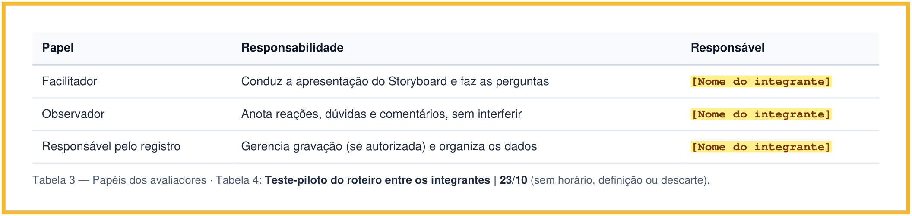
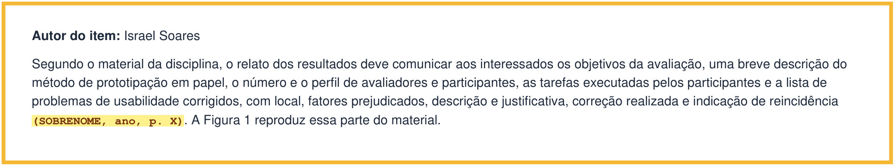

Responsável pelo registro: Bruno Ferreira Dornelas · Grupo 06

# Etapa 4 · Grupo 06 · Autoinspeção

## Tabela de contribuição

| Integrante / ferramenta | Contribuição | Artefato / atividade |
| --- | --- | --- |
| [Bruno Ferreira Dornelas](https://github.com/brunnf) | Registro no site das 40 respostas da autoinspeção dos storyboards, das análises de tarefas e dos planejamentos da avaliação e dos relatos do Grupo 06 | [Critérios e respostas](#etapa-4) |
| [Bruno Ferreira Dornelas](https://github.com/brunnf) | Levantamento do inventário das versões consultadas no commit de referência, seleção dos recortes de evidência e definição dos encaminhamentos de acompanhamento | [Artefatos consultados](#artefatos-consultados) · [Recortes das evidências](#recortes-das-evidencias) · [Acompanhamento](#acompanhamento) |
| Google Gemini e Antigravity | Apoio à conferência de linhas no commit de referência, à geração dos recortes das evidências e à edição da ficha | [Agradecimentos](../index.md#agradecimentos) |

Tabela 1 — Contribuição neste artefato.

Fonte: elaboração para o Grupo 06 (2026).

[Lista V2 da Etapa 4](../lista-etapa-4.md) · [Resultados e gráficos](../resultados/etapa-4.md) · [Inspeções do grupo](index.md) · [Vídeo e roteiro](../inspecao.md#video-e-roteiro)

## Recorte consultado

**Projeto:** Portal do Senado Federal. **Consulta ao GitHub Pages:** 21/11/2026, 20h45 (Brasília). **Repositório de referência:** [`5dfe10f`](https://github.com/Interacao-Humano-Computador/2026.2-Grupo06/tree/5dfe10f7661a6b839c87ced4f37f15a33e3a7d46).

Cada linha leva ao critério da V2, à página publicada do grupo e às linhas exatas do documento preservadas no commit de referência. No inventário da Etapa 4, os cinco integrantes publicaram storyboards acessíveis, enquanto os planejamentos dedicados de avaliação e de relato somam 16 artefatos distribuídos entre Bruno, Caio, Heitor e Israel (o recorte de Luís reúne o storyboard em `individual/luis.md` e remete a modelagem e os relatos à Etapa 5). Os resultados sintetizam os artefatos publicados no inventário e apontam explicitamente as lacunas de cobertura por integrante. [Como foram atribuídas as respostas](../index.md#metodo-de-inspecao).

## Critérios e respostas { #etapa-4 }

**19 Sim · 20 Incompleto · 1 Não** · 40 itens verificados

| Critério | Resposta | Constatação | Evidência |
| --- | :---: | --- | --- |
| [D01](../lista-etapa-4.md#d01) | Sim | Todos os storyboards, páginas individuais e planejamentos publicados na Etapa 4 apresentam histórico padronizado com versão, data e descrição das alterações, como o plano de Bruno até a v2.0 e a página de materiais de Luís até a v0.2. | [Bruno · Plano da avaliação](https://interacao-humano-computador.github.io/2026.2-Grupo06/entrega-4/individual/bruno/planejamento-avaliacao-storyboard/#historico-de-versao) ([L133–145](https://github.com/Interacao-Humano-Computador/2026.2-Grupo06/blob/5dfe10f7661a6b839c87ced4f37f15a33e3a7d46/docs/entrega-4/individual/bruno/planejamento-avaliacao-storyboard.md#L133-L145)) [Luís · Materiais do recorte](https://interacao-humano-computador.github.io/2026.2-Grupo06/entrega-4/individual/luis/#historico-de-versao) ([L46–51](https://github.com/Interacao-Humano-Computador/2026.2-Grupo06/blob/5dfe10f7661a6b839c87ced4f37f15a33e3a7d46/docs/entrega-4/individual/luis.md#L46-L51)) |
| [D02](../lista-etapa-4.md#d02) | Sim | As entradas vigentes de todos os artefatos da Etapa 4 identificam nominalmente autores e revisores distintos em revisão cruzada (Bruno, Caio, Heitor e Israel). | [Caio · Storyboard](https://interacao-humano-computador.github.io/2026.2-Grupo06/entrega-4/caio/storyboard/#historico-de-versao) ([L85–90](https://github.com/Interacao-Humano-Computador/2026.2-Grupo06/blob/5dfe10f7661a6b839c87ced4f37f15a33e3a7d46/docs/entrega-4/caio/storyboard.md#L85-L90)) [Israel · Plano da avaliação (HTA)](https://interacao-humano-computador.github.io/2026.2-Grupo06/entrega-4/individual/israel/planejamento-avaliacao-analise-tarefas/#historico-de-versao) ([L311–317](https://github.com/Interacao-Humano-Computador/2026.2-Grupo06/blob/5dfe10f7661a6b839c87ced4f37f15a33e3a7d46/docs/entrega-4/individual/israel/planejamento-avaliacao-analise-tarefas.md#L311-L317)) |
| [D03](../lista-etapa-4.md#d03) | Incompleto | Todos os documentos trazem seção final de referências, mas o plano de relato do storyboard de Israel mantém dois marcadores literais `(SOBRENOME, ano, p. X)` no texto e o plano de avaliação da HTA cita Barbosa e Silva (2010) na Figura 1 listando apenas Annett e Duncan (1967) nas referências. | [Israel · Plano do relato (Storyboard)](https://interacao-humano-computador.github.io/2026.2-Grupo06/entrega-4/individual/israel/planejamento-relato-resultados-storyboard/#item-de-conteudo-da-disciplina) ([L25–33](https://github.com/Interacao-Humano-Computador/2026.2-Grupo06/blob/5dfe10f7661a6b839c87ced4f37f15a33e3a7d46/docs/entrega-4/individual/israel/planejamento-relato-resultados-storyboard.md#L25-L33)) [Israel · Plano da avaliação (HTA)](https://interacao-humano-computador.github.io/2026.2-Grupo06/entrega-4/individual/israel/planejamento-avaliacao-analise-tarefas/#referencias) ([L247–249](https://github.com/Interacao-Humano-Computador/2026.2-Grupo06/blob/5dfe10f7661a6b839c87ced4f37f15a33e3a7d46/docs/entrega-4/individual/israel/planejamento-avaliacao-analise-tarefas.md#L247-L249)) · ([L319–321](https://github.com/Interacao-Humano-Computador/2026.2-Grupo06/blob/5dfe10f7661a6b839c87ced4f37f15a33e3a7d46/docs/entrega-4/individual/israel/planejamento-avaliacao-analise-tarefas.md#L319-L321)) |
| [D04](../lista-etapa-4.md#d04) | Incompleto | Bruno, Caio e Heitor numeram, legendam e chamam figuras e tabelas no texto. No storyboard de Israel a fotografia aparece sem chamada textual, número, legenda ou fonte (com colchete externo quebrado), seu plano de relato exibe tags `</figure>` órfãs e as duas tabelas de `luis.md` não trazem legenda nem fonte. | [Israel · Storyboard](https://interacao-humano-computador.github.io/2026.2-Grupo06/entrega-4/individual/israel/storyboard/#storyboard-desenho) ([L41–44](https://github.com/Interacao-Humano-Computador/2026.2-Grupo06/blob/5dfe10f7661a6b839c87ced4f37f15a33e3a7d46/docs/entrega-4/individual/israel/storyboard.md#L41-L44)) [Israel · Plano do relato (Storyboard)](https://interacao-humano-computador.github.io/2026.2-Grupo06/entrega-4/individual/israel/planejamento-relato-resultados-storyboard/#item-de-conteudo-da-disciplina) ([L27–38](https://github.com/Interacao-Humano-Computador/2026.2-Grupo06/blob/5dfe10f7661a6b839c87ced4f37f15a33e3a7d46/docs/entrega-4/individual/israel/planejamento-relato-resultados-storyboard.md#L27-L38)) [Luís · Materiais do recorte](https://interacao-humano-computador.github.io/2026.2-Grupo06/entrega-4/individual/luis/#base-do-recorte) ([L20–37](https://github.com/Interacao-Humano-Computador/2026.2-Grupo06/blob/5dfe10f7661a6b839c87ced4f37f15a33e3a7d46/docs/entrega-4/individual/luis.md#L20-L37)) |
| [D05](../lista-etapa-4.md#d05) | Sim | Todos os artefatos abrem contextualizando finalidade, funcionalidade abordada e articulação com as demais etapas antes de apresentar quadros ou tabelas técnicas. | [Índice da Etapa 4](https://interacao-humano-computador.github.io/2026.2-Grupo06/entrega-4/#introducao) ([L20–27](https://github.com/Interacao-Humano-Computador/2026.2-Grupo06/blob/5dfe10f7661a6b839c87ced4f37f15a33e3a7d46/docs/entrega-4/index.md#L20-L27)) [Heitor · Storyboard](https://interacao-humano-computador.github.io/2026.2-Grupo06/entrega-4/individual/heitor/storyboard/#introducao) ([L18–23](https://github.com/Interacao-Humano-Computador/2026.2-Grupo06/blob/5dfe10f7661a6b839c87ced4f37f15a33e3a7d46/docs/entrega-4/individual/heitor/storyboard.md#L18-L23)) |
| [D06](../lista-etapa-4.md#d06) | Incompleto | A Tabela 11 do cronograma executado registra na Etapa 4 apenas as atividades individuais de Bruno Ferreira (13/10 e 23–25/10), sem linhas equivalentes de execução real para Caio, Heitor, Israel e Luís no quadro central. | [Cronograma executado](https://interacao-humano-computador.github.io/2026.2-Grupo06/entrega-1/cronograma/#cronograma-executado) ([L297–308](https://github.com/Interacao-Humano-Computador/2026.2-Grupo06/blob/5dfe10f7661a6b839c87ced4f37f15a33e3a7d46/docs/entrega-1/cronograma.md#L297-L308)) |
| [D07](../lista-etapa-4.md#d07) | Não | O índice de atas encerra na Ata 03 (03/10/2026, Etapa 3). A ficha de autoverificação registra data, início e duração do vídeo de 13/10, mas não há ata formal da Etapa 4 com pauta, horário de término e atividades deliberadas. | [Índice de atas](https://interacao-humano-computador.github.io/2026.2-Grupo06/atas/#reunioes) ([L22–33](https://github.com/Interacao-Humano-Computador/2026.2-Grupo06/blob/5dfe10f7661a6b839c87ced4f37f15a33e3a7d46/docs/atas/index.md#L22-L33)) [Autoverificação em 13/10](https://interacao-humano-computador.github.io/2026.2-Grupo06/verificacao/grupo-06/etapa-4/lista-verificacao/#video-de-verificacao) ([L35–43](https://github.com/Interacao-Humano-Computador/2026.2-Grupo06/blob/5dfe10f7661a6b839c87ced4f37f15a33e3a7d46/docs/verificacao/grupo-06/etapa-4/lista-verificacao.md#L35-L43)) |
| [D08](../lista-etapa-4.md#d08) | Sim | As gravações das reuniões de autoverificação do Grupo 06 (13/10/2026) e de inspeção externa do Grupo 05 (14/10/2026) estão publicadas e incorporadas nas respectivas fichas da Etapa 4. | [Autoverificação em 13/10](https://interacao-humano-computador.github.io/2026.2-Grupo06/verificacao/grupo-06/etapa-4/lista-verificacao/#video-de-verificacao) ([L35–56](https://github.com/Interacao-Humano-Computador/2026.2-Grupo06/blob/5dfe10f7661a6b839c87ced4f37f15a33e3a7d46/docs/verificacao/grupo-06/etapa-4/lista-verificacao.md#L35-L56)) [Inspeção do Grupo 05 em 14/10](https://interacao-humano-computador.github.io/2026.2-Grupo06/verificacao/grupo-05/etapa-4/lista-verificacao/#video-de-verificacao) ([L23–41](https://github.com/Interacao-Humano-Computador/2026.2-Grupo06/blob/5dfe10f7661a6b839c87ced4f37f15a33e3a7d46/docs/verificacao/grupo-05/etapa-4/lista-verificacao.md#L23-L41)) |
| [D09](../lista-etapa-4.md#d09) | Sim | A página de apresentação da Etapa 4 disponibiliza link funcional e incorporação do vídeo coletivo gravado em 13/10/2026 com indicação explícita da categoria “não listado” no YouTube. | [Apresentação da Etapa 4](https://interacao-humano-computador.github.io/2026.2-Grupo06/apresentacoes/etapa-04/#video) ([L27–46](https://github.com/Interacao-Humano-Computador/2026.2-Grupo06/blob/5dfe10f7661a6b839c87ced4f37f15a33e3a7d46/docs/apresentacoes/etapa-04.md#L27-L46)) |
| [D10](../lista-etapa-4.md#d10) | Incompleto | As subpáginas de Bruno, Caio, Heitor e Israel abrem com tabela de contribuição e hiperligações, mas `individual/luis.md` (que hospeda o storyboard manual de Luís) e os hubs `heitor.md` e `israel.md` não possuem tabela de contribuição inicial, e a Tabela 1 de `entrega-4/index.md` omite Israel e Luís. | [Luís · Materiais do recorte](https://interacao-humano-computador.github.io/2026.2-Grupo06/entrega-4/individual/luis/) ([L1–10](https://github.com/Interacao-Humano-Computador/2026.2-Grupo06/blob/5dfe10f7661a6b839c87ced4f37f15a33e3a7d46/docs/entrega-4/individual/luis.md#L1-L10)) [Índice da Etapa 4](https://interacao-humano-computador.github.io/2026.2-Grupo06/entrega-4/#tabela-de-contribuicao) ([L9–16](https://github.com/Interacao-Humano-Computador/2026.2-Grupo06/blob/5dfe10f7661a6b839c87ced4f37f15a33e3a7d46/docs/entrega-4/index.md#L9-L16)) |
| [D11](../lista-etapa-4.md#d11) | Incompleto | Os storyboards e planejamentos de Bruno, Caio, Heitor e Israel nomeiam as ferramentas de IA (Codex, Grok, Gemini, Claude, Antigravity) e descrevem o uso. Contudo, `individual/luis.md` não possui seção de agradecimentos (citando Codex apenas na v0.1 do histórico), assim como `heitor.md` e `israel.md`. | [Heitor · Plano da avaliação (HTA)](https://interacao-humano-computador.github.io/2026.2-Grupo06/entrega-4/individual/heitor/planejamento-avaliacao-analise-tarefas/#agradecimentos) ([L367–373](https://github.com/Interacao-Humano-Computador/2026.2-Grupo06/blob/5dfe10f7661a6b839c87ced4f37f15a33e3a7d46/docs/entrega-4/individual/heitor/planejamento-avaliacao-analise-tarefas.md#L367-L373)) [Luís · Materiais do recorte](https://interacao-humano-computador.github.io/2026.2-Grupo06/entrega-4/individual/luis/#historico-de-versao) ([L46–55](https://github.com/Interacao-Humano-Computador/2026.2-Grupo06/blob/5dfe10f7661a6b839c87ced4f37f15a33e3a7d46/docs/entrega-4/individual/luis.md#L46-L55)) |
| [E4-01](../lista-etapa-4.md#e4-01) | Sim | Na revisão de referência, os cinco integrantes do Grupo 06 possuem storyboards publicados e acessíveis na Etapa 4 (Bruno, Caio, Heitor, Israel e Luís), sanando a pendência registrada na reunião de 13/10. | [Índice da Etapa 4](https://interacao-humano-computador.github.io/2026.2-Grupo06/entrega-4/#artefatos-individuais-da-etapa) ([L32–41](https://github.com/Interacao-Humano-Computador/2026.2-Grupo06/blob/5dfe10f7661a6b839c87ced4f37f15a33e3a7d46/docs/entrega-4/index.md#L32-L41)) [Israel · Storyboard](https://interacao-humano-computador.github.io/2026.2-Grupo06/entrega-4/individual/israel/storyboard/#storyboard-desenho) ([L41–44](https://github.com/Interacao-Humano-Computador/2026.2-Grupo06/blob/5dfe10f7661a6b839c87ced4f37f15a33e3a7d46/docs/entrega-4/individual/israel/storyboard.md#L41-L44)) [Luís · Storyboard manual](https://interacao-humano-computador.github.io/2026.2-Grupo06/entrega-4/individual/luis/#storyboard-manual) ([L7–19](https://github.com/Interacao-Humano-Computador/2026.2-Grupo06/blob/5dfe10f7661a6b839c87ced4f37f15a33e3a7d46/docs/entrega-4/individual/luis.md#L7-L19)) |
| [E4-02](../lista-etapa-4.md#e4-02) | Incompleto | Bruno, Caio e Heitor relacionam cada quadro às operações de suas análises de tarefas. Porém, Luís não apresenta mapeamento entre os oito quadros de plenárias e as operações da HTA/CTT, e a Tabela 3 de Israel descreve cenas (acessibilidade na Cena 4 e portaria presencial na Cena 7) divergentes dos quadros `QD01–QD07` desenhados na fotografia. | [Bruno · Storyboard](https://interacao-humano-computador.github.io/2026.2-Grupo06/entrega-4/individual/bruno/storyboard/#uso-na-avaliacao) ([L86–98](https://github.com/Interacao-Humano-Computador/2026.2-Grupo06/blob/5dfe10f7661a6b839c87ced4f37f15a33e3a7d46/docs/entrega-4/individual/bruno/storyboard.md#L86-L98)) [Israel · Storyboard](https://interacao-humano-computador.github.io/2026.2-Grupo06/entrega-4/individual/israel/storyboard/#transcricao-acessivel-e-rastreabilidade-formal-com-a-hta) ([L41–44](https://github.com/Interacao-Humano-Computador/2026.2-Grupo06/blob/5dfe10f7661a6b839c87ced4f37f15a33e3a7d46/docs/entrega-4/individual/israel/storyboard.md#L41-L44)) · ([L75–86](https://github.com/Interacao-Humano-Computador/2026.2-Grupo06/blob/5dfe10f7661a6b839c87ced4f37f15a33e3a7d46/docs/entrega-4/individual/israel/storyboard.md#L75-L86)) [Luís · Storyboard manual](https://interacao-humano-computador.github.io/2026.2-Grupo06/entrega-4/individual/luis/#storyboard-manual) ([L7–27](https://github.com/Interacao-Humano-Computador/2026.2-Grupo06/blob/5dfe10f7661a6b839c87ced4f37f15a33e3a7d46/docs/entrega-4/individual/luis.md#L7-L27)) |
| [E4-03](../lista-etapa-4.md#e4-03) | Sim | Os cinco storyboards representam visualmente suas narrativas por meio de quadros estáticos desenhados à mão e digitalizados com legibilidade adequada ao objetivo comunicativo. | [Bruno · Storyboard](https://interacao-humano-computador.github.io/2026.2-Grupo06/entrega-4/individual/bruno/storyboard/#storyboard-desenhado-a-mao) ([L40–48](https://github.com/Interacao-Humano-Computador/2026.2-Grupo06/blob/5dfe10f7661a6b839c87ced4f37f15a33e3a7d46/docs/entrega-4/individual/bruno/storyboard.md#L40-L48)) [Caio · Storyboard](https://interacao-humano-computador.github.io/2026.2-Grupo06/entrega-4/caio/storyboard/#quadros) ([L41–50](https://github.com/Interacao-Humano-Computador/2026.2-Grupo06/blob/5dfe10f7661a6b839c87ced4f37f15a33e3a7d46/docs/entrega-4/caio/storyboard.md#L41-L50)) [Heitor · Storyboard](https://interacao-humano-computador.github.io/2026.2-Grupo06/entrega-4/individual/heitor/storyboard/#storyboard-ilustrado-versao-manual) ([L40–49](https://github.com/Interacao-Humano-Computador/2026.2-Grupo06/blob/5dfe10f7661a6b839c87ced4f37f15a33e3a7d46/docs/entrega-4/individual/heitor/storyboard.md#L40-L49)) |
| [E4-04](../lista-etapa-4.md#e4-04) | Incompleto | Bruno, Caio, Heitor e Israel explicitam o propósito do storyboard para comunicar o conceito aos interessados e inspecionar pontos em aberto antes do protótipo de telas. Em `individual/luis.md`, o desenho é acompanhado apenas de síntese factual do enredo, sem explicitar a finalidade comunicativa e exploratória do artefato. | [Caio · Storyboard](https://interacao-humano-computador.github.io/2026.2-Grupo06/entrega-4/caio/storyboard/#fundamentacao) ([L69–76](https://github.com/Interacao-Humano-Computador/2026.2-Grupo06/blob/5dfe10f7661a6b839c87ced4f37f15a33e3a7d46/docs/entrega-4/caio/storyboard.md#L69-L76)) [Heitor · Storyboard](https://interacao-humano-computador.github.io/2026.2-Grupo06/entrega-4/individual/heitor/storyboard/#fundamentacao-teorica) ([L70–81](https://github.com/Interacao-Humano-Computador/2026.2-Grupo06/blob/5dfe10f7661a6b839c87ced4f37f15a33e3a7d46/docs/entrega-4/individual/heitor/storyboard.md#L70-L81)) [Luís · Storyboard manual](https://interacao-humano-computador.github.io/2026.2-Grupo06/entrega-4/individual/luis/#storyboard-manual) ([L7–19](https://github.com/Interacao-Humano-Computador/2026.2-Grupo06/blob/5dfe10f7661a6b839c87ced4f37f15a33e3a7d46/docs/entrega-4/individual/luis.md#L7-L19)) |
| [E4-05](../lista-etapa-4.md#e4-05) | Incompleto | Bruno, Caio e Heitor delimitam as hipóteses sob teste e apresentam roteiro escrito fiel aos quadros desenhados. Em Luís não há roteiro textual quadro a quadro na página da Etapa 4, e em Israel o roteiro escrito de sete cenas não coincide com o enredo desenhado em `QD01–QD07`. | [Bruno · Storyboard](https://interacao-humano-computador.github.io/2026.2-Grupo06/entrega-4/individual/bruno/storyboard/#descricao-dos-quadros) ([L49–68](https://github.com/Interacao-Humano-Computador/2026.2-Grupo06/blob/5dfe10f7661a6b839c87ced4f37f15a33e3a7d46/docs/entrega-4/individual/bruno/storyboard.md#L49-L68)) [Israel · Storyboard](https://interacao-humano-computador.github.io/2026.2-Grupo06/entrega-4/individual/israel/storyboard/#sequencia-narrativa-do-storyboard) ([L46–70](https://github.com/Interacao-Humano-Computador/2026.2-Grupo06/blob/5dfe10f7661a6b839c87ced4f37f15a33e3a7d46/docs/entrega-4/individual/israel/storyboard.md#L46-L70)) [Luís · Storyboard manual](https://interacao-humano-computador.github.io/2026.2-Grupo06/entrega-4/individual/luis/#storyboard-manual) ([L7–19](https://github.com/Interacao-Humano-Computador/2026.2-Grupo06/blob/5dfe10f7661a6b839c87ced4f37f15a33e3a7d46/docs/entrega-4/individual/luis.md#L7-L19)) |
| [E4-06](../lista-etapa-4.md#e4-06) | Incompleto | Bruno, Caio e Heitor especificam ambiente, protagonista/atores externos e foco de cena em cada seção. Em Israel há divergência de cenário entre texto (escritório e recepção presencial do Senado) e desenho (casa no café da manhã e confirmação por e-mail), e Luís não detalha em texto ambiente, persona e enquadramento por quadro. | [Heitor · Storyboard](https://interacao-humano-computador.github.io/2026.2-Grupo06/entrega-4/individual/heitor/storyboard/#transcricao-acessivel-e-rastreabilidade-formal-com-a-hta) ([L54–68](https://github.com/Interacao-Humano-Computador/2026.2-Grupo06/blob/5dfe10f7661a6b839c87ced4f37f15a33e3a7d46/docs/entrega-4/individual/heitor/storyboard.md#L54-L68)) [Israel · Storyboard](https://interacao-humano-computador.github.io/2026.2-Grupo06/entrega-4/individual/israel/storyboard/#cena-1-motivacao-e-decisao-de-visita) ([L50–70](https://github.com/Interacao-Humano-Computador/2026.2-Grupo06/blob/5dfe10f7661a6b839c87ced4f37f15a33e3a7d46/docs/entrega-4/individual/israel/storyboard.md#L50-L70)) [Luís · Storyboard manual](https://interacao-humano-computador.github.io/2026.2-Grupo06/entrega-4/individual/luis/#storyboard-manual) ([L7–19](https://github.com/Interacao-Humano-Computador/2026.2-Grupo06/blob/5dfe10f7661a6b839c87ced4f37f15a33e3a7d46/docs/entrega-4/individual/luis.md#L7-L19)) |
| [E4-07](../lista-etapa-4.md#e4-07) | Sim | Os cinco storyboards apresentam séries encadeadas de cenas e telas esboçadas que acompanham a evolução da tarefa desde o gatilho inicial até o desfecho observável (incluindo o ramo alternativo de vagas esgotadas no Quadro 8 de Luís). | [Bruno · Storyboard](https://interacao-humano-computador.github.io/2026.2-Grupo06/entrega-4/individual/bruno/storyboard/#descricao-dos-quadros) ([L53–63](https://github.com/Interacao-Humano-Computador/2026.2-Grupo06/blob/5dfe10f7661a6b839c87ced4f37f15a33e3a7d46/docs/entrega-4/individual/bruno/storyboard.md#L53-L63)) [Caio · Storyboard](https://interacao-humano-computador.github.io/2026.2-Grupo06/entrega-4/caio/storyboard/#transcricao-acessivel-e-rastreabilidade) ([L55–63](https://github.com/Interacao-Humano-Computador/2026.2-Grupo06/blob/5dfe10f7661a6b839c87ced4f37f15a33e3a7d46/docs/entrega-4/caio/storyboard.md#L55-L63)) [Luís · Storyboard manual](https://interacao-humano-computador.github.io/2026.2-Grupo06/entrega-4/individual/luis/#storyboard-manual) ([L9–16](https://github.com/Interacao-Humano-Computador/2026.2-Grupo06/blob/5dfe10f7661a6b839c87ced4f37f15a33e3a7d46/docs/entrega-4/individual/luis.md#L9-L16)) |
| [E4-08](../lista-etapa-4.md#e4-08) | Sim | Todos os storyboards concretizam cenários e personas do projeto (Letícia, Camila, Marta e Marina), acrescentando falas, pontos de dúvida e retornos visuais suficientes para observação e simulação mental pelas partes interessadas. | [Heitor · Storyboard](https://interacao-humano-computador.github.io/2026.2-Grupo06/entrega-4/individual/heitor/storyboard/#recorte-do-reprojeto-e-hipoteses-de-melhoria) ([L20–38](https://github.com/Interacao-Humano-Computador/2026.2-Grupo06/blob/5dfe10f7661a6b839c87ced4f37f15a33e3a7d46/docs/entrega-4/individual/heitor/storyboard.md#L20-L38)) [Luís · Materiais do recorte](https://interacao-humano-computador.github.io/2026.2-Grupo06/entrega-4/individual/luis/#base-do-recorte) ([L9–26](https://github.com/Interacao-Humano-Computador/2026.2-Grupo06/blob/5dfe10f7661a6b839c87ced4f37f15a33e3a7d46/docs/entrega-4/individual/luis.md#L9-L26)) |
| [E4-09](../lista-etapa-4.md#e4-09) | Sim | Os cinco storyboards preservam caráter exploratório de baixa fidelidade com traços simples e figuras esquemáticas em papel; Caio e Heitor substituíram expressamente ilustrações vetoriais anteriores por esboços manuais voltados à exploração conceitual. | [Bruno · Storyboard](https://interacao-humano-computador.github.io/2026.2-Grupo06/entrega-4/individual/bruno/storyboard/#storyboard-desenhado-a-mao) ([L42–47](https://github.com/Interacao-Humano-Computador/2026.2-Grupo06/blob/5dfe10f7661a6b839c87ced4f37f15a33e3a7d46/docs/entrega-4/individual/bruno/storyboard.md#L42-L47)) [Heitor · Storyboard](https://interacao-humano-computador.github.io/2026.2-Grupo06/entrega-4/individual/heitor/storyboard/#storyboard-ilustrado-versao-manual) ([L42–53](https://github.com/Interacao-Humano-Computador/2026.2-Grupo06/blob/5dfe10f7661a6b839c87ced4f37f15a33e3a7d46/docs/entrega-4/individual/heitor/storyboard.md#L42-L53)) |
| [E4-10](../lista-etapa-4.md#e4-10) | Sim | Todos os conjuntos estabelecem sequência inequívoca de leitura acompanhada de legendas e balões curtos: numeração `1–8` nos desenhos de Bruno e Luís, códigos `QD01–QD07` em Israel e ordem de leitura explícita somada às tabelas `QD01–QD06` em Caio e Heitor. | [Caio · Storyboard](https://interacao-humano-computador.github.io/2026.2-Grupo06/entrega-4/caio/storyboard/#quadros) ([L43–65](https://github.com/Interacao-Humano-Computador/2026.2-Grupo06/blob/5dfe10f7661a6b839c87ced4f37f15a33e3a7d46/docs/entrega-4/caio/storyboard.md#L43-L65)) [Bruno · Storyboard](https://interacao-humano-computador.github.io/2026.2-Grupo06/entrega-4/individual/bruno/storyboard/#descricao-dos-quadros) ([L51–65](https://github.com/Interacao-Humano-Computador/2026.2-Grupo06/blob/5dfe10f7661a6b839c87ced4f37f15a33e3a7d46/docs/entrega-4/individual/bruno/storyboard.md#L51-L65)) |
| [E4-11](../lista-etapa-4.md#e4-11) | Sim | Os oito planejamentos da avaliação publicados no inventário da Etapa 4 (Bruno, Caio, Heitor e Israel, para Storyboard e Análise de Tarefas) estruturam explicitamente as seis atividades do framework DECIDE (`D, E, C, I, D, E`). | [Bruno · Plano da avaliação (Storyboard)](https://interacao-humano-computador.github.io/2026.2-Grupo06/entrega-4/individual/bruno/planejamento-avaliacao-storyboard/#d-determinar-os-objetivos) ([L31–127](https://github.com/Interacao-Humano-Computador/2026.2-Grupo06/blob/5dfe10f7661a6b839c87ced4f37f15a33e3a7d46/docs/entrega-4/individual/bruno/planejamento-avaliacao-storyboard.md#L31-L127)) [Israel · Plano da avaliação (Storyboard)](https://interacao-humano-computador.github.io/2026.2-Grupo06/entrega-4/individual/israel/planejamento-avaliacao-storyboard/#d-determinar-os-objetivos-da-avaliacao) ([L27–173](https://github.com/Interacao-Humano-Computador/2026.2-Grupo06/blob/5dfe10f7661a6b839c87ced4f37f15a33e3a7d46/docs/entrega-4/individual/israel/planejamento-avaliacao-storyboard.md#L27-L173)) |
| [E4-12](../lista-etapa-4.md#e4-12) | Sim | Todos os oito planos publicados descrevem objetivos gerais e específicos voltados à compreensão, adequação de ideias de design e identificação de problemas na fase conceitual. | [Caio · Plano da avaliação (Storyboard)](https://interacao-humano-computador.github.io/2026.2-Grupo06/entrega-4/caio/planejamento-avaliacao-storyboard/#d-determinar-os-objetivos) ([L54–63](https://github.com/Interacao-Humano-Computador/2026.2-Grupo06/blob/5dfe10f7661a6b839c87ced4f37f15a33e3a7d46/docs/entrega-4/caio/planejamento-avaliacao-storyboard.md#L54-L63)) [Heitor · Plano da avaliação (HTA)](https://interacao-humano-computador.github.io/2026.2-Grupo06/entrega-4/individual/heitor/planejamento-avaliacao-analise-tarefas/#d-determinar-os-objetivos) ([L46–59](https://github.com/Interacao-Humano-Computador/2026.2-Grupo06/blob/5dfe10f7661a6b839c87ced4f37f15a33e3a7d46/docs/entrega-4/individual/heitor/planejamento-avaliacao-analise-tarefas.md#L46-L59)) |
| [E4-13](../lista-etapa-4.md#e4-13) | Incompleto | Bruno, Caio e Heitor identificam o autor do item, citam Barbosa e Silva (2010) e incorporam recortes das páginas sobre entrevista e métodos de investigação. Os dois planos de avaliação de Israel descrevem o método sem citação específica na seção C e sem foto do texto da referência. | [Caio · Plano da avaliação (Storyboard)](https://interacao-humano-computador.github.io/2026.2-Grupo06/entrega-4/caio/planejamento-avaliacao-storyboard/#c-escolher-os-metodos) ([L81–86](https://github.com/Interacao-Humano-Computador/2026.2-Grupo06/blob/5dfe10f7661a6b839c87ced4f37f15a33e3a7d46/docs/entrega-4/caio/planejamento-avaliacao-storyboard.md#L81-L86)) · ([L272–287](https://github.com/Interacao-Humano-Computador/2026.2-Grupo06/blob/5dfe10f7661a6b839c87ced4f37f15a33e3a7d46/docs/entrega-4/caio/planejamento-avaliacao-storyboard.md#L272-L287)) [Israel · Plano da avaliação (HTA)](https://interacao-humano-computador.github.io/2026.2-Grupo06/entrega-4/individual/israel/planejamento-avaliacao-analise-tarefas/#c-escolher-os-metodos-de-avaliacao) ([L64–71](https://github.com/Interacao-Humano-Computador/2026.2-Grupo06/blob/5dfe10f7661a6b839c87ced4f37f15a33e3a7d46/docs/entrega-4/individual/israel/planejamento-avaliacao-analise-tarefas.md#L64-L71)) |
| [E4-14](../lista-etapa-4.md#e4-14) | Incompleto | Bruno, Caio e Heitor especificam recrutamento, justificativa da amostra, modalidade, equipamentos, prazos, custo zero e equipe. Nos dois planos de Israel faltam justificativa para “3 a 5 participantes”, canais de recrutamento e orçamento, além de modalidade entre colchetes e `[Nome do integrante]` nos papéis. | [Heitor · Plano da avaliação (HTA)](https://interacao-humano-computador.github.io/2026.2-Grupo06/entrega-4/individual/heitor/planejamento-avaliacao-analise-tarefas/#i-identificar-e-administrar-questoes-praticas) ([L95–115](https://github.com/Interacao-Humano-Computador/2026.2-Grupo06/blob/5dfe10f7661a6b839c87ced4f37f15a33e3a7d46/docs/entrega-4/individual/heitor/planejamento-avaliacao-analise-tarefas.md#L95-L115)) [Israel · Plano da avaliação (Storyboard)](https://interacao-humano-computador.github.io/2026.2-Grupo06/entrega-4/individual/israel/planejamento-avaliacao-storyboard/#i-identificar-e-administrar-as-questoes-praticas) ([L88–105](https://github.com/Interacao-Humano-Computador/2026.2-Grupo06/blob/5dfe10f7661a6b839c87ced4f37f15a33e3a7d46/docs/entrega-4/individual/israel/planejamento-avaliacao-storyboard.md#L88-L105)) |
| [E4-15](../lista-etapa-4.md#e4-15) | Sim | Os oito planos publicados e a diretriz ética do grupo asseguram voluntariedade, respeito ao participante, avaliação exclusiva sobre o artefato, anonimato por códigos e guarda restrita dos registros brutos durante e após a divulgação. | [Caio · Plano da avaliação (Storyboard)](https://interacao-humano-computador.github.io/2026.2-Grupo06/entrega-4/caio/planejamento-avaliacao-storyboard/#d-decidir-como-lidar-com-questoes-eticas) ([L210–222](https://github.com/Interacao-Humano-Computador/2026.2-Grupo06/blob/5dfe10f7661a6b839c87ced4f37f15a33e3a7d46/docs/entrega-4/caio/planejamento-avaliacao-storyboard.md#L210-L222)) [Israel · Plano da avaliação (Storyboard)](https://interacao-humano-computador.github.io/2026.2-Grupo06/entrega-4/individual/israel/planejamento-avaliacao-storyboard/#d-decidir-como-lidar-com-as-questoes-eticas) ([L137–147](https://github.com/Interacao-Humano-Computador/2026.2-Grupo06/blob/5dfe10f7661a6b839c87ced4f37f15a33e3a7d46/docs/entrega-4/individual/israel/planejamento-avaliacao-storyboard.md#L137-L147)) |
| [E4-16](../lista-etapa-4.md#e4-16) | Incompleto | Heitor e Caio fixam datas, horários e local das sessões de Storyboard e Análise de Tarefas. Bruno informa datas (`23–24/10`) declarando que horários de início e fim não foram registrados, e os dois planos de Israel listam apenas dias sem horário (divergindo de `israel.md`) e deixam o local em aberto entre colchetes. | [Heitor · Plano da avaliação (Storyboard)](https://interacao-humano-computador.github.io/2026.2-Grupo06/entrega-4/individual/heitor/planejamento-avaliacao-storyboard/#participantes-recrutamento-e-cronograma) ([L113–121](https://github.com/Interacao-Humano-Computador/2026.2-Grupo06/blob/5dfe10f7661a6b839c87ced4f37f15a33e3a7d46/docs/entrega-4/individual/heitor/planejamento-avaliacao-storyboard.md#L113-L121)) [Bruno · Conferência](https://interacao-humano-computador.github.io/2026.2-Grupo06/entrega-4/individual/bruno/conferencia-planejamentos/#agenda-e-preparacao) ([L50–61](https://github.com/Interacao-Humano-Computador/2026.2-Grupo06/blob/5dfe10f7661a6b839c87ced4f37f15a33e3a7d46/docs/entrega-4/individual/bruno/conferencia-planejamentos.md#L50-L61)) [Israel · Plano da avaliação (HTA)](https://interacao-humano-computador.github.io/2026.2-Grupo06/entrega-4/individual/israel/planejamento-avaliacao-analise-tarefas/#i-identificar-e-administrar-as-questoes-praticas) ([L80–103](https://github.com/Interacao-Humano-Computador/2026.2-Grupo06/blob/5dfe10f7661a6b839c87ced4f37f15a33e3a7d46/docs/entrega-4/individual/israel/planejamento-avaliacao-analise-tarefas.md#L80-L103)) |
| [E4-17](../lista-etapa-4.md#e4-17) | Incompleto | Caio e Heitor trazem definição do teste-piloto, data anterior à coleta oficial, referência, foto da p. 307 e autor. Bruno apresenta recorte do livro e data prévia (`23/10`), mas realizou ensaio individual sem segundo participante; Israel resume o piloto a uma linha de cronograma sem definição, referência ou foto. | [Caio · Plano da avaliação (Storyboard)](https://interacao-humano-computador.github.io/2026.2-Grupo06/entrega-4/caio/planejamento-avaliacao-storyboard/#teste-piloto) ([L171–178](https://github.com/Interacao-Humano-Computador/2026.2-Grupo06/blob/5dfe10f7661a6b839c87ced4f37f15a33e3a7d46/docs/entrega-4/caio/planejamento-avaliacao-storyboard.md#L171-L178)) · ([L288–298](https://github.com/Interacao-Humano-Computador/2026.2-Grupo06/blob/5dfe10f7661a6b839c87ced4f37f15a33e3a7d46/docs/entrega-4/caio/planejamento-avaliacao-storyboard.md#L288-L298)) [Bruno · Plano da avaliação (Storyboard)](https://interacao-humano-computador.github.io/2026.2-Grupo06/entrega-4/individual/bruno/planejamento-avaliacao-storyboard/#teste-piloto) ([L105–108](https://github.com/Interacao-Humano-Computador/2026.2-Grupo06/blob/5dfe10f7661a6b839c87ced4f37f15a33e3a7d46/docs/entrega-4/individual/bruno/planejamento-avaliacao-storyboard.md#L105-L108)) [Israel · Plano da avaliação (Storyboard)](https://interacao-humano-computador.github.io/2026.2-Grupo06/entrega-4/individual/israel/planejamento-avaliacao-storyboard/#i-identificar-e-administrar-as-questoes-praticas) ([L107–117](https://github.com/Interacao-Humano-Computador/2026.2-Grupo06/blob/5dfe10f7661a6b839c87ced4f37f15a33e3a7d46/docs/entrega-4/individual/israel/planejamento-avaliacao-storyboard.md#L107-L117)) |
| [E4-18](../lista-etapa-4.md#e4-18) | Incompleto | Bruno, Caio e Heitor declaram expressamente que os registros do piloto/ensaio não integram os resultados oficiais. Nenhum dos quatro planejamentos de Israel explicita a exclusão dos dados do teste-piloto, lacuna apontada na própria conferência do autor. | [Heitor · Plano da avaliação (HTA)](https://interacao-humano-computador.github.io/2026.2-Grupo06/entrega-4/individual/heitor/planejamento-avaliacao-analise-tarefas/#teste-piloto) ([L136–138](https://github.com/Interacao-Humano-Computador/2026.2-Grupo06/blob/5dfe10f7661a6b839c87ced4f37f15a33e3a7d46/docs/entrega-4/individual/heitor/planejamento-avaliacao-analise-tarefas.md#L136-L138)) [Israel · Conferência](https://interacao-humano-computador.github.io/2026.2-Grupo06/entrega-4/individual/israel/conferencia-planejamentos/#aplicacao-dos-criterios-aos-planejamentos) ([L50–50](https://github.com/Interacao-Humano-Computador/2026.2-Grupo06/blob/5dfe10f7661a6b839c87ced4f37f15a33e3a7d46/docs/entrega-4/individual/israel/conferencia-planejamentos.md#L50)) |
| [E4-19](../lista-etapa-4.md#e4-19) | Incompleto | Bruno, Caio e Heitor situam explicitamente a avaliação formativa e justificam os caminhos, operações e perfis incluídos e excluídos. O plano de HTA de Israel não caracteriza a avaliação formativa nem delimita o escopo da tarefa 7, e a funcionalidade de plenárias de Luís ficou sem planejamento de avaliação publicado na Etapa 4. | [Bruno · Plano da avaliação (HTA)](https://interacao-humano-computador.github.io/2026.2-Grupo06/entrega-4/individual/bruno/planejamento-avaliacao-analise-tarefas/#materiais-e-delimitacao-da-leitura) ([L19–24](https://github.com/Interacao-Humano-Computador/2026.2-Grupo06/blob/5dfe10f7661a6b839c87ced4f37f15a33e3a7d46/docs/entrega-4/individual/bruno/planejamento-avaliacao-analise-tarefas.md#L19-L24)) · ([L72–88](https://github.com/Interacao-Humano-Computador/2026.2-Grupo06/blob/5dfe10f7661a6b839c87ced4f37f15a33e3a7d46/docs/entrega-4/individual/bruno/planejamento-avaliacao-analise-tarefas.md#L72-L88)) [Luís · Materiais do recorte](https://interacao-humano-computador.github.io/2026.2-Grupo06/entrega-4/individual/luis/) ([L5–6](https://github.com/Interacao-Humano-Computador/2026.2-Grupo06/blob/5dfe10f7661a6b839c87ced4f37f15a33e3a7d46/docs/entrega-4/individual/luis.md#L5-L6)) |
| [E4-20](../lista-etapa-4.md#e4-20) | Incompleto | Bruno, Caio e Heitor vinculam questões específicas (`SB-Q`, `AT-Q`) aos objetivos declarados e distinguem as questões analíticas do avaliador das perguntas do roteiro. Nos dois planos de Israel há separação entre perguntas de avaliação e roteiro de entrevista, mas sem vínculo rastreável com os objetivos específicos nem com as evidências pretendidas. | [Bruno · Plano da avaliação (Storyboard)](https://interacao-humano-computador.github.io/2026.2-Grupo06/entrega-4/individual/bruno/planejamento-avaliacao-storyboard/#e-explorar-perguntas-a-serem-respondidas) ([L38–52](https://github.com/Interacao-Humano-Computador/2026.2-Grupo06/blob/5dfe10f7661a6b839c87ced4f37f15a33e3a7d46/docs/entrega-4/individual/bruno/planejamento-avaliacao-storyboard.md#L38-L52)) [Israel · Plano da avaliação (Storyboard)](https://interacao-humano-computador.github.io/2026.2-Grupo06/entrega-4/individual/israel/planejamento-avaliacao-storyboard/#e-explorar-as-perguntas-a-serem-respondidas) ([L37–50](https://github.com/Interacao-Humano-Computador/2026.2-Grupo06/blob/5dfe10f7661a6b839c87ced4f37f15a33e3a7d46/docs/entrega-4/individual/israel/planejamento-avaliacao-storyboard.md#L37-L50)) [Israel · Conferência](https://interacao-humano-computador.github.io/2026.2-Grupo06/entrega-4/individual/israel/conferencia-planejamentos/#aplicacao-dos-criterios-aos-planejamentos) ([L41–41](https://github.com/Interacao-Humano-Computador/2026.2-Grupo06/blob/5dfe10f7661a6b839c87ced4f37f15a33e3a7d46/docs/entrega-4/individual/israel/conferencia-planejamentos.md#L41)) |
| [E4-21](../lista-etapa-4.md#e4-21) | Incompleto | Bruno, Caio e Heitor enquadram o método no grupo de investigação com artefatos estáticos (e inspeção técnica `CT01–CT06` da notação) frente a prazo e custo zero. No plano do storyboard, Israel mistura investigação estática com ciclos iterativos de prototipação em papel e pensar em voz alta, e no plano da HTA não classifica os grupos de Barbosa e Silva nem restrições de prazo e orçamento. | [Heitor · Plano da avaliação (HTA)](https://interacao-humano-computador.github.io/2026.2-Grupo06/entrega-4/individual/heitor/planejamento-avaliacao-analise-tarefas/#c-escolher-os-metodos) ([L90–101](https://github.com/Interacao-Humano-Computador/2026.2-Grupo06/blob/5dfe10f7661a6b839c87ced4f37f15a33e3a7d46/docs/entrega-4/individual/heitor/planejamento-avaliacao-analise-tarefas.md#L90-L101)) [Israel · Plano da avaliação (Storyboard)](https://interacao-humano-computador.github.io/2026.2-Grupo06/entrega-4/individual/israel/planejamento-avaliacao-storyboard/#c-escolher-os-metodos-de-avaliacao) ([L80–87](https://github.com/Interacao-Humano-Computador/2026.2-Grupo06/blob/5dfe10f7661a6b839c87ced4f37f15a33e3a7d46/docs/entrega-4/individual/israel/planejamento-avaliacao-storyboard.md#L80-L87)) |
| [E4-22](../lista-etapa-4.md#e4-22) | Sim | Os quatro planos publicados de avaliação da Análise de Tarefas identificam os modelos HTA/CTT avaliados, preveem verificar completude, ordem e exceções junto aos participantes e orientam condução em linguagem acessível sem exigir domínio prévio da notação. | [Caio · Plano da avaliação (HTA)](https://interacao-humano-computador.github.io/2026.2-Grupo06/entrega-4/caio/planejamento-avaliacao-analise-tarefas/#c-escolher-os-metodos) ([L80–85](https://github.com/Interacao-Humano-Computador/2026.2-Grupo06/blob/5dfe10f7661a6b839c87ced4f37f15a33e3a7d46/docs/entrega-4/caio/planejamento-avaliacao-analise-tarefas.md#L80-L85)) · ([L159–160](https://github.com/Interacao-Humano-Computador/2026.2-Grupo06/blob/5dfe10f7661a6b839c87ced4f37f15a33e3a7d46/docs/entrega-4/caio/planejamento-avaliacao-analise-tarefas.md#L159-L160)) [Israel · Plano da avaliação (HTA)](https://interacao-humano-computador.github.io/2026.2-Grupo06/entrega-4/individual/israel/planejamento-avaliacao-analise-tarefas/#e-explorar-as-perguntas-a-serem-respondidas) ([L50–63](https://github.com/Interacao-Humano-Computador/2026.2-Grupo06/blob/5dfe10f7661a6b839c87ced4f37f15a33e3a7d46/docs/entrega-4/individual/israel/planejamento-avaliacao-analise-tarefas.md#L50-L63)) |
| [E4-23](../lista-etapa-4.md#e4-23) | Sim | Os oito planos listam materiais padronizados, organizam as etapas de recepção/acolhimento, aquecimento/contextualização, exploração principal e encerramento e estabelecem diretrizes de postura neutra sem indução de respostas. | [Caio · Plano da avaliação (Storyboard)](https://interacao-humano-computador.github.io/2026.2-Grupo06/entrega-4/caio/planejamento-avaliacao-storyboard/#roteiro-da-sessao) ([L91–92](https://github.com/Interacao-Humano-Computador/2026.2-Grupo06/blob/5dfe10f7661a6b839c87ced4f37f15a33e3a7d46/docs/entrega-4/caio/planejamento-avaliacao-storyboard.md#L91-L92)) · ([L152–169](https://github.com/Interacao-Humano-Computador/2026.2-Grupo06/blob/5dfe10f7661a6b839c87ced4f37f15a33e3a7d46/docs/entrega-4/caio/planejamento-avaliacao-storyboard.md#L152-L169)) [Heitor · Plano da avaliação (HTA)](https://interacao-humano-computador.github.io/2026.2-Grupo06/entrega-4/individual/heitor/planejamento-avaliacao-analise-tarefas/#papel-do-avaliador-durante-a-sessao) ([L139–146](https://github.com/Interacao-Humano-Computador/2026.2-Grupo06/blob/5dfe10f7661a6b839c87ced4f37f15a33e3a7d46/docs/entrega-4/individual/heitor/planejamento-avaliacao-analise-tarefas.md#L139-L146)) |
| [E4-24](../lista-etapa-4.md#e4-24) | Incompleto | Heitor disponibiliza minutas completas de TCLE específicas para Storyboard e HTA. Bruno e Caio descrevem as cláusulas em texto remetendo a `etica.md`, cujo PDF modelo permanece redigido para a entrevista e observação da Etapa 2; Israel declara a minuta específica como pendente e vincula em `israel.md` o termo da Etapa 2 sem previsão de vídeo. | [Heitor · Plano da avaliação (Storyboard)](https://interacao-humano-computador.github.io/2026.2-Grupo06/entrega-4/individual/heitor/planejamento-avaliacao-storyboard/#d-decidir-como-lidar-com-questoes-eticas) ([L152–178](https://github.com/Interacao-Humano-Computador/2026.2-Grupo06/blob/5dfe10f7661a6b839c87ced4f37f15a33e3a7d46/docs/entrega-4/individual/heitor/planejamento-avaliacao-storyboard.md#L152-L178)) [Aspectos éticos](https://interacao-humano-computador.github.io/2026.2-Grupo06/entrega-2/etica/#termo-de-consentimento-livre-e-esclarecido-tcle) ([L56–64](https://github.com/Interacao-Humano-Computador/2026.2-Grupo06/blob/5dfe10f7661a6b839c87ced4f37f15a33e3a7d46/docs/entrega-2/etica.md#L56-L64)) [Israel · Conferência](https://interacao-humano-computador.github.io/2026.2-Grupo06/entrega-4/individual/israel/conferencia-planejamentos/#aplicacao-dos-criterios-aos-planejamentos) ([L44–44](https://github.com/Interacao-Humano-Computador/2026.2-Grupo06/blob/5dfe10f7661a6b839c87ced4f37f15a33e3a7d46/docs/entrega-4/individual/israel/conferencia-planejamentos.md#L44)) |
| [E4-25](../lista-etapa-4.md#e4-25) | Sim | Os oito planejamentos do relato publicados por Bruno, Caio, Heitor e Israel definem integralmente as seções estruturais que receberão os dados na Etapa 5 (objetivos, método, perfil de avaliadores e participantes, quadros/tarefas percorridos, problemas e reprojeto), sem inventar dados empíricos prévios. | [Bruno · Plano do relato (Storyboard)](https://interacao-humano-computador.github.io/2026.2-Grupo06/entrega-4/individual/bruno/planejamento-relato-storyboard/#estrutura-prevista-do-relato) ([L33–48](https://github.com/Interacao-Humano-Computador/2026.2-Grupo06/blob/5dfe10f7661a6b839c87ced4f37f15a33e3a7d46/docs/entrega-4/individual/bruno/planejamento-relato-storyboard.md#L33-L48)) [Israel · Plano do relato (HTA)](https://interacao-humano-computador.github.io/2026.2-Grupo06/entrega-4/individual/israel/planejamento-relato-resultados-analise-tarefas/#objetivos-da-avaliacao) ([L21–133](https://github.com/Interacao-Humano-Computador/2026.2-Grupo06/blob/5dfe10f7661a6b839c87ced4f37f15a33e3a7d46/docs/entrega-4/individual/israel/planejamento-relato-resultados-analise-tarefas.md#L21-L133)) |
| [E4-26](../lista-etapa-4.md#e4-26) | Sim | Todos os planos de relato publicados especificam os campos de anotação e listagem dos problemas/divergências observados pelo avaliador e definem critérios de priorização das correções pendentes. | [Caio · Plano do relato (Storyboard)](https://interacao-humano-computador.github.io/2026.2-Grupo06/entrega-4/caio/planejamento-relato-storyboard/#ficha-de-achado) ([L116–157](https://github.com/Interacao-Humano-Computador/2026.2-Grupo06/blob/5dfe10f7661a6b839c87ced4f37f15a33e3a7d46/docs/entrega-4/caio/planejamento-relato-storyboard.md#L116-L157)) [Israel · Plano do relato (Storyboard)](https://interacao-humano-computador.github.io/2026.2-Grupo06/entrega-4/individual/israel/planejamento-relato-resultados-storyboard/#problemas-de-usabilidade-ainda-nao-corrigidos) ([L118–139](https://github.com/Interacao-Humano-Computador/2026.2-Grupo06/blob/5dfe10f7661a6b839c87ced4f37f15a33e3a7d46/docs/entrega-4/individual/israel/planejamento-relato-resultados-storyboard.md#L118-L139)) |
| [E4-27](../lista-etapa-4.md#e4-27) | Incompleto | Bruno e Caio estruturam fichas com localizador temporal/nota, matrizes por questão (`SB-Q`/`AT-Q`) e registro explícito de dados insuficientes. Nos planos de relato de Heitor falta campo de minutagem e regra para questões inconclusivas; nos de Israel faltam localizadores, matriz vinculada às perguntas do DECIDE e alinhamento de amostra/datas com `israel.md`. | [Caio · Plano do relato (Storyboard)](https://interacao-humano-computador.github.io/2026.2-Grupo06/entrega-4/caio/planejamento-relato-storyboard/#instrumentos-para-organizar-os-resultados) ([L78–115](https://github.com/Interacao-Humano-Computador/2026.2-Grupo06/blob/5dfe10f7661a6b839c87ced4f37f15a33e3a7d46/docs/entrega-4/caio/planejamento-relato-storyboard.md#L78-L115)) [Heitor · Plano do relato (HTA)](https://interacao-humano-computador.github.io/2026.2-Grupo06/entrega-4/individual/heitor/planejamento-relato-analise-tarefas/#organizacao-das-evidencias-e-dados-coletados) ([L41–66](https://github.com/Interacao-Humano-Computador/2026.2-Grupo06/blob/5dfe10f7661a6b839c87ced4f37f15a33e3a7d46/docs/entrega-4/individual/heitor/planejamento-relato-analise-tarefas.md#L41-L66)) [Israel · Plano do relato (Storyboard)](https://interacao-humano-computador.github.io/2026.2-Grupo06/entrega-4/individual/israel/planejamento-relato-resultados-storyboard/#consideracoes-finais) ([L72–82](https://github.com/Interacao-Humano-Computador/2026.2-Grupo06/blob/5dfe10f7661a6b839c87ced4f37f15a33e3a7d46/docs/entrega-4/individual/israel/planejamento-relato-resultados-storyboard.md#L72-L82)) · ([L156–161](https://github.com/Interacao-Humano-Computador/2026.2-Grupo06/blob/5dfe10f7661a6b839c87ced4f37f15a33e3a7d46/docs/entrega-4/individual/israel/planejamento-relato-resultados-storyboard.md#L156-L161)) |
| [E4-28](../lista-etapa-4.md#e4-28) | Sim | Os oito planos do relato definem critérios objetivos de gravidade/prioridade (impacto sobre compreensão/modelo em Bruno e Caio, severidade `0–4` de Nielsen em Heitor e impacto aliado aos fatores de usabilidade em Israel) e preveem seção/matriz de encaminhamento para o reprojeto na Etapa 5. | [Bruno · Plano do relato (HTA)](https://interacao-humano-computador.github.io/2026.2-Grupo06/entrega-4/individual/bruno/planejamento-relato-analise-tarefas/#prioridades-e-controle-das-revisoes) ([L104–116](https://github.com/Interacao-Humano-Computador/2026.2-Grupo06/blob/5dfe10f7661a6b839c87ced4f37f15a33e3a7d46/docs/entrega-4/individual/bruno/planejamento-relato-analise-tarefas.md#L104-L116)) [Heitor · Plano do relato (Storyboard)](https://interacao-humano-computador.github.io/2026.2-Grupo06/entrega-4/individual/heitor/planejamento-relato-storyboard/#estrutura-prevista-do-relato-do-storyboard) ([L66–68](https://github.com/Interacao-Humano-Computador/2026.2-Grupo06/blob/5dfe10f7661a6b839c87ced4f37f15a33e3a7d46/docs/entrega-4/individual/heitor/planejamento-relato-storyboard.md#L66-L68)) [Israel · Plano do relato (HTA)](https://interacao-humano-computador.github.io/2026.2-Grupo06/entrega-4/individual/israel/planejamento-relato-resultados-analise-tarefas/#partes-do-sistema-que-podem-ser-mais-bem-elaboradas) ([L85–132](https://github.com/Interacao-Humano-Computador/2026.2-Grupo06/blob/5dfe10f7661a6b839c87ced4f37f15a33e3a7d46/docs/entrega-4/individual/israel/planejamento-relato-resultados-analise-tarefas.md#L85-L132)) |
| [E4-29](../lista-etapa-4.md#e4-29) | Incompleto | Bruno, Caio e Heitor preveem discutir confiabilidade e validades interna, externa e ecológica (Barbosa e Silva, p. 312–313), ressalvando que ausência de críticas em artefato estático não comprova qualidade geral. Os dois planos de relato de Israel resumem as limitações a amostra reduzida e validade ecológica, sem tratar validade interna/efeito de intervenções nem os limites de representações estáticas, e Luís não possui plano de relato na Etapa 4. | [Bruno · Plano do relato (Storyboard)](https://interacao-humano-computador.github.io/2026.2-Grupo06/entrega-4/individual/bruno/planejamento-relato-storyboard/#apresentacao-e-limites-das-conclusoes) ([L117–122](https://github.com/Interacao-Humano-Computador/2026.2-Grupo06/blob/5dfe10f7661a6b839c87ced4f37f15a33e3a7d46/docs/entrega-4/individual/bruno/planejamento-relato-storyboard.md#L117-L122)) [Heitor · Plano do relato (HTA)](https://interacao-humano-computador.github.io/2026.2-Grupo06/entrega-4/individual/heitor/planejamento-relato-analise-tarefas/#avaliacao-da-qualidade-e-validades-da-avaliacao) ([L70–78](https://github.com/Interacao-Humano-Computador/2026.2-Grupo06/blob/5dfe10f7661a6b839c87ced4f37f15a33e3a7d46/docs/entrega-4/individual/heitor/planejamento-relato-analise-tarefas.md#L70-L78)) [Israel · Plano do relato (HTA)](https://interacao-humano-computador.github.io/2026.2-Grupo06/entrega-4/individual/israel/planejamento-relato-resultados-analise-tarefas/#consideracoes-finais) ([L134–140](https://github.com/Interacao-Humano-Computador/2026.2-Grupo06/blob/5dfe10f7661a6b839c87ced4f37f15a33e3a7d46/docs/entrega-4/individual/israel/planejamento-relato-resultados-analise-tarefas.md#L134-L140)) |

[Conferir as respostas da inspeção V1](../conferencia-anterior.md#grupo-06-etapa-4).

## Acompanhamento

A tabela abaixo indica os achados prioritários que merecem voltar à pauta na próxima revisão. Use o mesmo ID ao publicar uma correção. Registre o novo commit, a data e o resultado da reinspeção ao encerrar o item.

| Achado | Ajuste a registrar | Evidência para encerrar |
| --- | --- | --- |
| [E4-02](#etapa-4-e4-02) Alinhar quadros e tarefas | Incluir em `individual/luis.md` a tabela de correspondência entre os 8 quadros de plenárias e as operações da HTA/CTT, e alinhar a Tabela 3 de `israel/storyboard.md` aos quadros `QD01–QD07` efetivamente desenhados na fotografia (corrigindo legenda e fonte de `D04`). | Confrontar quadro a quadro as duas imagens publicadas com suas tabelas de transcrição e com os nós das análises de tarefas vinculadas. |
| [E4-14](#etapa-4-e4-14) · [E4-17](#etapa-4-e4-17) · [E4-18](#etapa-4-e4-18) Fechar logística e piloto nos planos de Israel | Substituir `[Nome do integrante]` e `[presencial... ou remoto...]`, justificar a amostra, declarar orçamento zero, incluir definição e recorte bibliográfico do teste-piloto (Barbosa e Silva, 2010, p. 307) e explicitar o descarte de seus dados. | Verificar nos dois planos de avaliação de Israel o preenchimento nominal dos papéis, o horário/local fechado coerente com `israel.md`, a imagem da fonte e a cláusula de exclusão do piloto. |
| [E4-19](#etapa-4-e4-19) Completar escopo documental de plenárias e HTA de visita | Documentar retroativamente o plano sintético de avaliação/relato do recorte de Luís (ou vincular formalmente o protocolo adotado) e explicitar no plano de HTA de Israel o caráter formativo e o recorte da tarefa 7. | Conferir acesso em `entrega-4/` ao protocolo completo dos cinco fluxos com delimitação explícita do que entra e do que fica fora da avaliação conceitual. |
| [D03](#etapa-4-d03) · [E4-24](#etapa-4-e4-24) Regularizar citações e minutas específicas de TCLE | Substituir os marcadores `(SOBRENOME, ano, p. X)` no plano de relato de Israel, completar Barbosa e Silva (2010) nas referências da HTA e disponibilizar minuta de TCLE parametrizada para as entrevistas de Storyboard/Tarefas da Etapa 4. | Inspecionar a renderização sem marcadores pendentes nem tags `</figure>` órfãs e conferir as quatro garantias éticas na minuta de TCLE vinculada aos planos. |

## Recortes das evidências

<figure class="etapa8-evidencia" markdown="1">

{ loading=lazy }

<figcaption markdown="1">[E4-14](#etapa-4-e4-14) · [E4-17](#etapa-4-e4-17) · [E4-18](#etapa-4-e4-18) · A Tabela 3 mantém `[Nome do integrante]` nos três papéis e o cronograma resume o piloto a uma linha sem horário, fundamentação visual ou cláusula de descarte. [Israel · Plano da avaliação (Storyboard)](https://interacao-humano-computador.github.io/2026.2-Grupo06/entrega-4/individual/israel/planejamento-avaliacao-storyboard/#i-identificar-e-administrar-as-questoes-praticas) ([L98–117](https://github.com/Interacao-Humano-Computador/2026.2-Grupo06/blob/5dfe10f7661a6b839c87ced4f37f15a33e3a7d46/docs/entrega-4/individual/israel/planejamento-avaliacao-storyboard.md#L98-L117)).</figcaption>
</figure>

<figure class="etapa8-evidencia" markdown="1">

{ loading=lazy }

<figcaption markdown="1">[D03](#etapa-4-d03) · O item de conteúdo do plano de relato do storyboard mantém o marcador literal `(SOBRENOME, ano, p. X)` no corpo do texto. [Israel · Plano do relato (Storyboard)](https://interacao-humano-computador.github.io/2026.2-Grupo06/entrega-4/individual/israel/planejamento-relato-resultados-storyboard/#item-de-conteudo-da-disciplina) ([L23–33](https://github.com/Interacao-Humano-Computador/2026.2-Grupo06/blob/5dfe10f7661a6b839c87ced4f37f15a33e3a7d46/docs/entrega-4/individual/israel/planejamento-relato-resultados-storyboard.md#L23-L33)).</figcaption>
</figure>

## Artefatos consultados

| Integrante / fluxo | Storyboard | Análise de tarefas | Plano da avaliação (Storyboard) | Plano do relato (Storyboard) | Plano da avaliação (Tarefas) | Plano do relato (Tarefas) |
| --- | --- | --- | --- | --- | --- | --- |
| Bruno / Complementos de ideias | [Página](https://interacao-humano-computador.github.io/2026.2-Grupo06/entrega-4/individual/bruno/storyboard/) · [v0.9](https://github.com/Interacao-Humano-Computador/2026.2-Grupo06/blob/5dfe10f7661a6b839c87ced4f37f15a33e3a7d46/docs/entrega-4/individual/bruno/storyboard.md#L117) | [Página](https://interacao-humano-computador.github.io/2026.2-Grupo06/entrega-4/individual/bruno/analise-tarefas/) · [v0.2](https://github.com/Interacao-Humano-Computador/2026.2-Grupo06/blob/5dfe10f7661a6b839c87ced4f37f15a33e3a7d46/docs/entrega-4/individual/bruno/analise-tarefas.md#L137) | [Página](https://interacao-humano-computador.github.io/2026.2-Grupo06/entrega-4/individual/bruno/planejamento-avaliacao-storyboard/) · [v2.0](https://github.com/Interacao-Humano-Computador/2026.2-Grupo06/blob/5dfe10f7661a6b839c87ced4f37f15a33e3a7d46/docs/entrega-4/individual/bruno/planejamento-avaliacao-storyboard.md#L145) | [Página](https://interacao-humano-computador.github.io/2026.2-Grupo06/entrega-4/individual/bruno/planejamento-relato-storyboard/) · [v2.0](https://github.com/Interacao-Humano-Computador/2026.2-Grupo06/blob/5dfe10f7661a6b839c87ced4f37f15a33e3a7d46/docs/entrega-4/individual/bruno/planejamento-relato-storyboard.md#L143) | [Página](https://interacao-humano-computador.github.io/2026.2-Grupo06/entrega-4/individual/bruno/planejamento-avaliacao-analise-tarefas/) · [v2.0](https://github.com/Interacao-Humano-Computador/2026.2-Grupo06/blob/5dfe10f7661a6b839c87ced4f37f15a33e3a7d46/docs/entrega-4/individual/bruno/planejamento-avaliacao-analise-tarefas.md#L160) | [Página](https://interacao-humano-computador.github.io/2026.2-Grupo06/entrega-4/individual/bruno/planejamento-relato-analise-tarefas/) · [v2.0](https://github.com/Interacao-Humano-Computador/2026.2-Grupo06/blob/5dfe10f7661a6b839c87ced4f37f15a33e3a7d46/docs/entrega-4/individual/bruno/planejamento-relato-analise-tarefas.md#L144) |
| Caio / Envio e acompanhamento de ideia | [Página](https://interacao-humano-computador.github.io/2026.2-Grupo06/entrega-4/caio/storyboard/) · [v1.1](https://github.com/Interacao-Humano-Computador/2026.2-Grupo06/blob/5dfe10f7661a6b839c87ced4f37f15a33e3a7d46/docs/entrega-4/caio/storyboard.md#L90) | [Etapa 2](https://interacao-humano-computador.github.io/2026.2-Grupo06/entrega-2/individual/caio/perfil-2/analise-tarefas/) · [v0.2](https://github.com/Interacao-Humano-Computador/2026.2-Grupo06/blob/5dfe10f7661a6b839c87ced4f37f15a33e3a7d46/docs/entrega-2/individual/caio/perfil-2/analise-tarefas.md#L133) | [Página](https://interacao-humano-computador.github.io/2026.2-Grupo06/entrega-4/caio/planejamento-avaliacao-storyboard/) · [v1.5](https://github.com/Interacao-Humano-Computador/2026.2-Grupo06/blob/5dfe10f7661a6b839c87ced4f37f15a33e3a7d46/docs/entrega-4/caio/planejamento-avaliacao-storyboard.md#L258) | [Página](https://interacao-humano-computador.github.io/2026.2-Grupo06/entrega-4/caio/planejamento-relato-storyboard/) · [v1.4](https://github.com/Interacao-Humano-Computador/2026.2-Grupo06/blob/5dfe10f7661a6b839c87ced4f37f15a33e3a7d46/docs/entrega-4/caio/planejamento-relato-storyboard.md#L225) | [Página](https://interacao-humano-computador.github.io/2026.2-Grupo06/entrega-4/caio/planejamento-avaliacao-analise-tarefas/) · [v1.4](https://github.com/Interacao-Humano-Computador/2026.2-Grupo06/blob/5dfe10f7661a6b839c87ced4f37f15a33e3a7d46/docs/entrega-4/caio/planejamento-avaliacao-analise-tarefas.md#L236) | [Página](https://interacao-humano-computador.github.io/2026.2-Grupo06/entrega-4/caio/planejamento-relato-analise-tarefas/) · [v1.4](https://github.com/Interacao-Humano-Computador/2026.2-Grupo06/blob/5dfe10f7661a6b839c87ced4f37f15a33e3a7d46/docs/entrega-4/caio/planejamento-relato-analise-tarefas.md#L162) |
| Heitor / Audiência pública interativa | [Página](https://interacao-humano-computador.github.io/2026.2-Grupo06/entrega-4/individual/heitor/storyboard/) · [v1.1](https://github.com/Interacao-Humano-Computador/2026.2-Grupo06/blob/5dfe10f7661a6b839c87ced4f37f15a33e3a7d46/docs/entrega-4/individual/heitor/storyboard.md#L95) | [Página](https://interacao-humano-computador.github.io/2026.2-Grupo06/entrega-4/individual/heitor/analise-tarefas/) · [v1.1](https://github.com/Interacao-Humano-Computador/2026.2-Grupo06/blob/5dfe10f7661a6b839c87ced4f37f15a33e3a7d46/docs/entrega-4/individual/heitor/analise-tarefas.md#L234) | [Página](https://interacao-humano-computador.github.io/2026.2-Grupo06/entrega-4/individual/heitor/planejamento-avaliacao-storyboard/) · [v2.0](https://github.com/Interacao-Humano-Computador/2026.2-Grupo06/blob/5dfe10f7661a6b839c87ced4f37f15a33e3a7d46/docs/entrega-4/individual/heitor/planejamento-avaliacao-storyboard.md#L384) | [Página](https://interacao-humano-computador.github.io/2026.2-Grupo06/entrega-4/individual/heitor/planejamento-relato-storyboard/) · [v2.0](https://github.com/Interacao-Humano-Computador/2026.2-Grupo06/blob/5dfe10f7661a6b839c87ced4f37f15a33e3a7d46/docs/entrega-4/individual/heitor/planejamento-relato-storyboard.md#L93) | [Página](https://interacao-humano-computador.github.io/2026.2-Grupo06/entrega-4/individual/heitor/planejamento-avaliacao-analise-tarefas/) · [v2.0](https://github.com/Interacao-Humano-Computador/2026.2-Grupo06/blob/5dfe10f7661a6b839c87ced4f37f15a33e3a7d46/docs/entrega-4/individual/heitor/planejamento-avaliacao-analise-tarefas.md#L380) | [Página](https://interacao-humano-computador.github.io/2026.2-Grupo06/entrega-4/individual/heitor/planejamento-relato-analise-tarefas/) · [v2.0](https://github.com/Interacao-Humano-Computador/2026.2-Grupo06/blob/5dfe10f7661a6b839c87ced4f37f15a33e3a7d46/docs/entrega-4/individual/heitor/planejamento-relato-analise-tarefas.md#L92) |
| Israel / Agendamento de visita | [Página](https://interacao-humano-computador.github.io/2026.2-Grupo06/entrega-4/individual/israel/storyboard/) · [v1.0](https://github.com/Interacao-Humano-Computador/2026.2-Grupo06/blob/5dfe10f7661a6b839c87ced4f37f15a33e3a7d46/docs/entrega-4/individual/israel/storyboard.md#L96) | [Etapa 2](https://interacao-humano-computador.github.io/2026.2-Grupo06/entrega-2/individual/israel/analise-tarefas/) · [v2.0](https://github.com/Interacao-Humano-Computador/2026.2-Grupo06/blob/5dfe10f7661a6b839c87ced4f37f15a33e3a7d46/docs/entrega-2/individual/israel/analise-tarefas.md#L381) | [Página](https://interacao-humano-computador.github.io/2026.2-Grupo06/entrega-4/individual/israel/planejamento-avaliacao-storyboard/) · [v1.2](https://github.com/Interacao-Humano-Computador/2026.2-Grupo06/blob/5dfe10f7661a6b839c87ced4f37f15a33e3a7d46/docs/entrega-4/individual/israel/planejamento-avaliacao-storyboard.md#L184) | [Página](https://interacao-humano-computador.github.io/2026.2-Grupo06/entrega-4/individual/israel/planejamento-relato-resultados-storyboard/) · [v1.2](https://github.com/Interacao-Humano-Computador/2026.2-Grupo06/blob/5dfe10f7661a6b839c87ced4f37f15a33e3a7d46/docs/entrega-4/individual/israel/planejamento-relato-resultados-storyboard.md#L174) | [Página](https://interacao-humano-computador.github.io/2026.2-Grupo06/entrega-4/individual/israel/planejamento-avaliacao-analise-tarefas/) · [v1.2](https://github.com/Interacao-Humano-Computador/2026.2-Grupo06/blob/5dfe10f7661a6b839c87ced4f37f15a33e3a7d46/docs/entrega-4/individual/israel/planejamento-avaliacao-analise-tarefas.md#L317) | [Página](https://interacao-humano-computador.github.io/2026.2-Grupo06/entrega-4/individual/israel/planejamento-relato-resultados-analise-tarefas/) · [v1.2](https://github.com/Interacao-Humano-Computador/2026.2-Grupo06/blob/5dfe10f7661a6b839c87ced4f37f15a33e3a7d46/docs/entrega-4/individual/israel/planejamento-relato-resultados-analise-tarefas.md#L152) |
| Luís / Vaga em plenária | [Página](https://interacao-humano-computador.github.io/2026.2-Grupo06/entrega-4/individual/luis/#storyboard-manual) · [v0.2](https://github.com/Interacao-Humano-Computador/2026.2-Grupo06/blob/5dfe10f7661a6b839c87ced4f37f15a33e3a7d46/docs/entrega-4/individual/luis.md#L51) | [Etapa 5](https://interacao-humano-computador.github.io/2026.2-Grupo06/entrega-5/individual/luis/modelagem-tarefas/) · [v0.2](https://github.com/Interacao-Humano-Computador/2026.2-Grupo06/blob/5dfe10f7661a6b839c87ced4f37f15a33e3a7d46/docs/entrega-5/individual/luis/modelagem-tarefas.md#L120) | Ausente na Etapa 4 ([nota](https://github.com/Interacao-Humano-Computador/2026.2-Grupo06/blob/5dfe10f7661a6b839c87ced4f37f15a33e3a7d46/docs/entrega-4/individual/luis.md#L5)) | Ausente na Etapa 4 ([nota](https://github.com/Interacao-Humano-Computador/2026.2-Grupo06/blob/5dfe10f7661a6b839c87ced4f37f15a33e3a7d46/docs/entrega-4/individual/luis.md#L5)) | Ausente na Etapa 4 ([nota](https://github.com/Interacao-Humano-Computador/2026.2-Grupo06/blob/5dfe10f7661a6b839c87ced4f37f15a33e3a7d46/docs/entrega-4/individual/luis.md#L5)) | Ausente na Etapa 4 ([nota](https://github.com/Interacao-Humano-Computador/2026.2-Grupo06/blob/5dfe10f7661a6b839c87ced4f37f15a33e3a7d46/docs/entrega-4/individual/luis.md#L5)) |

## Histórico de versão

| Versão | Data | Descrição | Autor(es) | Revisor designado |
| :---: | :---: | --- | --- | --- |
| `1.0` | 21/11/2026 | Registro das 40 respostas, constatações, recortes de evidência e inventário da autoinspeção da Etapa 4 no Grupo 06. | [Bruno Ferreira Dornelas](https://github.com/brunnf) | [Caio Breno de Souza Bezerra](https://github.com/CaioBezerra-Dev) |

## Referências

1. SALES, André Barros de. *Plano de Ensino FIHC 022026 — Turma 01*. v1. Brasília: FCTE/UnB, 2026.

2. BARBOSA, Simone Diniz Junqueira; SILVA, Bruno Santana da. *Interação humano-computador*. Rio de Janeiro: Elsevier, 2010.

3. VIANNA, Maurício et al. *Design Thinking: inovação em negócios*. Rio de Janeiro: MJV Press, 2012.

4. PREECE, Jennifer; ROGERS, Yvonne; SHARP, Helen. *Design de interação: além da interação homem-computador*. Porto Alegre: Bookman, 2005.

5. FAGAN, Michael E. *Design and code inspections to reduce errors in program development*. IBM Systems Journal, v. 15, n. 3, p. 182–211, 1976. [DOI 10.1147/sj.153.0182](https://doi.org/10.1147/sj.153.0182).
