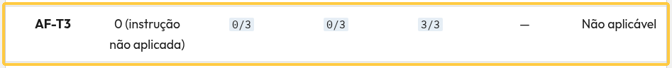

Responsável pelo registro: Caio Breno de Souza Bezerra · Grupo 06

# Etapa 7 · Grupo 06 · Autoinspeção

## Tabela de contribuição

| Integrante | Contribuição | Artefato / atividade |
| --- | --- | --- |
| [Caio Breno de Souza Bezerra](https://github.com/CaioBezerra-Dev) | Registro no site das 26 respostas da autoinspeção dos relatos de alta fidelidade do Grupo 06 | [Critérios e respostas](#etapa-7) |
| [Caio Breno de Souza Bezerra](https://github.com/CaioBezerra-Dev) | Inclusão dos recortes sobre os registros das sessões e a contagem da tarefa AF-T3, com links para os critérios | [Recortes das evidências](#recortes-das-evidencias) |
| Codex (OpenAI) | Apoio à organização da ficha e à preparação dos recortes das evidências | [Agradecimentos](../index.md#agradecimentos) |

Tabela 1 — Contribuição neste artefato.

Fonte: elaboração para o Grupo 06 (2026).

[Lista V2 da Etapa 7](../lista-etapa-7.md) · [Resultados e gráficos](../resultados/etapa-7.md) · [Inspeções do grupo](index.md) · [Gravação da inspeção](../inspecao.md#video-etapa-7)

## Recorte consultado

**Projeto:** Portal do Senado Federal. **Consulta ao GitHub Pages:** 19/11/2026, 12h56 (Brasília). **Repositório de referência:** [`5dfe10f`](https://github.com/Interacao-Humano-Computador/2026.2-Grupo06/tree/5dfe10f7661a6b839c87ced4f37f15a33e3a7d46).

Cada linha leva ao critério da V2, à página do grupo e às linhas do documento preservadas no commit. Os resultados sintetizam os artefatos do inventário. [Como foram atribuídas as respostas](../index.md#metodo-de-inspecao).

## Critérios e respostas { #etapa-7 }

**17 Sim · 8 Incompleto · 1 Não** · 26 itens verificados

| Critério | Resposta | Constatação | Evidência |
| --- | :---: | --- | --- |
| [D01](../lista-etapa-7.md#d01) | Sim | Os relatos e páginas de evidências mantêm históricos com versão, data e mudança, como a atualização para a AF-1.2 de Caio. | [Caio · Relato da alta fidelidade](https://interacao-humano-computador.github.io/2026.2-Grupo06/entrega-7/individual/caio/relato-alta-fidelidade/#historico-de-versao) ([L151–157](https://github.com/Interacao-Humano-Computador/2026.2-Grupo06/blob/5dfe10f7661a6b839c87ced4f37f15a33e3a7d46/docs/entrega-7/individual/caio/relato-alta-fidelidade.md#L151-L157)) [Bruno · Vídeos e evidências](https://interacao-humano-computador.github.io/2026.2-Grupo06/entrega-7/individual/bruno/evidencias/#historico-de-versao) ([L214–230](https://github.com/Interacao-Humano-Computador/2026.2-Grupo06/blob/5dfe10f7661a6b839c87ced4f37f15a33e3a7d46/docs/entrega-7/individual/bruno/evidencias.md#L214-L230)) |
| [D02](../lista-etapa-7.md#d02) | Sim | As versões correntes indicam autores e revisores distintos. O histórico de Bruno também registra explicitamente quando a revisão foi confirmada. | [Bruno · Relato da alta fidelidade](https://interacao-humano-computador.github.io/2026.2-Grupo06/entrega-7/individual/bruno/relato-alta-fidelidade/#historico-de-versao) ([L436–453](https://github.com/Interacao-Humano-Computador/2026.2-Grupo06/blob/5dfe10f7661a6b839c87ced4f37f15a33e3a7d46/docs/entrega-7/individual/bruno/relato-alta-fidelidade.md#L436-L453)) [Heitor · Relato da alta fidelidade](https://interacao-humano-computador.github.io/2026.2-Grupo06/entrega-7/individual/heitor/relato-alta-fidelidade/#historico-de-versao) ([L294–302](https://github.com/Interacao-Humano-Computador/2026.2-Grupo06/blob/5dfe10f7661a6b839c87ced4f37f15a33e3a7d46/docs/entrega-7/individual/heitor/relato-alta-fidelidade.md#L294-L302)) [Caio · Relato da alta fidelidade](https://interacao-humano-computador.github.io/2026.2-Grupo06/entrega-7/individual/caio/relato-alta-fidelidade/#historico-de-versao) ([L151–157](https://github.com/Interacao-Humano-Computador/2026.2-Grupo06/blob/5dfe10f7661a6b839c87ced4f37f15a33e3a7d46/docs/entrega-7/individual/caio/relato-alta-fidelidade.md#L151-L157)) |
| [D03](../lista-etapa-7.md#d03) | Sim | Os cinco relatos e os cadernos de evidências incluem referências. Caio identifica livro, plano e documentos de origem. | [Caio · Relato da alta fidelidade](https://interacao-humano-computador.github.io/2026.2-Grupo06/entrega-7/individual/caio/relato-alta-fidelidade/#referencias) ([L159–167](https://github.com/Interacao-Humano-Computador/2026.2-Grupo06/blob/5dfe10f7661a6b839c87ced4f37f15a33e3a7d46/docs/entrega-7/individual/caio/relato-alta-fidelidade.md#L159-L167)) [Luís · Vídeos e evidências](https://interacao-humano-computador.github.io/2026.2-Grupo06/entrega-7/individual/luis/evidencias/#historico-de-versao) ([L106–113](https://github.com/Interacao-Humano-Computador/2026.2-Grupo06/blob/5dfe10f7661a6b839c87ced4f37f15a33e3a7d46/docs/entrega-7/individual/luis/evidencias.md#L106-L113)) [Israel · Relato da alta fidelidade](https://interacao-humano-computador.github.io/2026.2-Grupo06/entrega-7/individual/israel/relato-alta-fidelidade/#referencias) ([L185–195](https://github.com/Interacao-Humano-Computador/2026.2-Grupo06/blob/5dfe10f7661a6b839c87ced4f37f15a33e3a7d46/docs/entrega-7/individual/israel/relato-alta-fidelidade.md#L185-L195)) |
| [D04](../lista-etapa-7.md#d04) | Sim | As tabelas de indicadores e as figuras de fundamentação têm chamadas, número, legenda e fonte. Caio liga a Tabela 5 às perguntas do plano e identifica a fonte da Figura 1. | [Caio · Relato da alta fidelidade](https://interacao-humano-computador.github.io/2026.2-Grupo06/entrega-7/individual/caio/relato-alta-fidelidade/#indicadores-e-perguntas-da-avaliacao) ([L89–103](https://github.com/Interacao-Humano-Computador/2026.2-Grupo06/blob/5dfe10f7661a6b839c87ced4f37f15a33e3a7d46/docs/entrega-7/individual/caio/relato-alta-fidelidade.md#L89-L103)) [Caio · Relato da alta fidelidade](https://interacao-humano-computador.github.io/2026.2-Grupo06/entrega-7/individual/caio/relato-alta-fidelidade/#fundamentacao-consultada) ([L136–144](https://github.com/Interacao-Humano-Computador/2026.2-Grupo06/blob/5dfe10f7661a6b839c87ced4f37f15a33e3a7d46/docs/entrega-7/individual/caio/relato-alta-fidelidade.md#L136-L144)) [Heitor · Relato da alta fidelidade](https://interacao-humano-computador.github.io/2026.2-Grupo06/entrega-7/individual/heitor/relato-alta-fidelidade/#item-de-conteudo-da-disciplina) ([L22–31](https://github.com/Interacao-Humano-Computador/2026.2-Grupo06/blob/5dfe10f7661a6b839c87ced4f37f15a33e3a7d46/docs/entrega-7/individual/heitor/relato-alta-fidelidade.md#L22-L31)) |
| [D05](../lista-etapa-7.md#d05) | Sim | Os dez documentos abrem com contexto e escopo. O relato de Heitor delimita a participação em audiência e a página de evidências informa o papel dos registros. | [Heitor · Relato da alta fidelidade](https://interacao-humano-computador.github.io/2026.2-Grupo06/entrega-7/individual/heitor/relato-alta-fidelidade/#item-de-conteudo-da-disciplina) ([L29–49](https://github.com/Interacao-Humano-Computador/2026.2-Grupo06/blob/5dfe10f7661a6b839c87ced4f37f15a33e3a7d46/docs/entrega-7/individual/heitor/relato-alta-fidelidade.md#L29-L49)) [Luís · Vídeos e evidências](https://interacao-humano-computador.github.io/2026.2-Grupo06/entrega-7/individual/luis/evidencias/#introducao) ([L18–29](https://github.com/Interacao-Humano-Computador/2026.2-Grupo06/blob/5dfe10f7661a6b839c87ced4f37f15a33e3a7d46/docs/entrega-7/individual/luis/evidencias.md#L18-L29)) |
| [D06](../lista-etapa-7.md#d06) | Incompleto | O cronograma executado registra as sessões e a consolidação de Bruno. As outras sessões aparecem dispersas nos relatos e há datas/horários a confirmar em Heitor. | [Cronograma](https://interacao-humano-computador.github.io/2026.2-Grupo06/entrega-1/cronograma/#cronograma-executado) ([L311–313](https://github.com/Interacao-Humano-Computador/2026.2-Grupo06/blob/5dfe10f7661a6b839c87ced4f37f15a33e3a7d46/docs/entrega-1/cronograma.md#L311-L313)) [Caio · Relato da alta fidelidade](https://interacao-humano-computador.github.io/2026.2-Grupo06/entrega-7/individual/caio/relato-alta-fidelidade/#pessoas-material-e-condicoes) ([L34–52](https://github.com/Interacao-Humano-Computador/2026.2-Grupo06/blob/5dfe10f7661a6b839c87ced4f37f15a33e3a7d46/docs/entrega-7/individual/caio/relato-alta-fidelidade.md#L34-L52)) [Heitor · Relato da alta fidelidade](https://interacao-humano-computador.github.io/2026.2-Grupo06/entrega-7/individual/heitor/relato-alta-fidelidade/#2-metodo-ambiente-papeis-e-desvios) ([L94–109](https://github.com/Interacao-Humano-Computador/2026.2-Grupo06/blob/5dfe10f7661a6b839c87ced4f37f15a33e3a7d46/docs/entrega-7/individual/heitor/relato-alta-fidelidade.md#L94-L109)) |
| [D07](../lista-etapa-7.md#d07) | Não | O índice de atas não tem ata da Etapa 7. Há ficha da reunião com data, duração e participantes, mas faltam os elementos de uma ata completa. | [Índice de atas](https://interacao-humano-computador.github.io/2026.2-Grupo06/atas/#reunioes) ([L25–42](https://github.com/Interacao-Humano-Computador/2026.2-Grupo06/blob/5dfe10f7661a6b839c87ced4f37f15a33e3a7d46/docs/atas/index.md#L25-L42)) [Autoinspeção em 15/11](https://interacao-humano-computador.github.io/2026.2-Grupo06/verificacao/grupo-06/etapa-7/lista-verificacao/#introducao) ([L25–37](https://github.com/Interacao-Humano-Computador/2026.2-Grupo06/blob/5dfe10f7661a6b839c87ced4f37f15a33e3a7d46/docs/verificacao/grupo-06/etapa-7/lista-verificacao.md#L25-L37)) |
| [D08](../lista-etapa-7.md#d08) | Sim | A autoinspeção e a verificação do Grupo 07 têm gravações ligadas a data, grupo e etapa. | [Autoinspeção em 15/11](https://interacao-humano-computador.github.io/2026.2-Grupo06/verificacao/grupo-06/etapa-7/lista-verificacao/#introducao) ([L25–35](https://github.com/Interacao-Humano-Computador/2026.2-Grupo06/blob/5dfe10f7661a6b839c87ced4f37f15a33e3a7d46/docs/verificacao/grupo-06/etapa-7/lista-verificacao.md#L25-L35)) [Inspeção do Grupo 07 em 16/11](https://interacao-humano-computador.github.io/2026.2-Grupo06/verificacao/grupo-07/etapa-7/lista-verificacao/#identificacao-da-inspecao) ([L25–41](https://github.com/Interacao-Humano-Computador/2026.2-Grupo06/blob/5dfe10f7661a6b839c87ced4f37f15a33e3a7d46/docs/verificacao/grupo-07/etapa-7/lista-verificacao.md#L25-L41)) |
| [D09](../lista-etapa-7.md#d09) | Sim | A página de apresentação contém as cinco gravações individuais com links e categoria não listada declarada, inclusive a de Heitor. | [Apresentações da Etapa 7](https://interacao-humano-computador.github.io/2026.2-Grupo06/apresentacoes/etapa-07/#bruno-ferreira-dornelas) ([L33–45](https://github.com/Interacao-Humano-Computador/2026.2-Grupo06/blob/5dfe10f7661a6b839c87ced4f37f15a33e3a7d46/docs/apresentacoes/etapa-07.md#L33-L45)) [Apresentações da Etapa 7](https://interacao-humano-computador.github.io/2026.2-Grupo06/apresentacoes/etapa-07/#caio-breno-de-souza-bezerra) ([L60–67](https://github.com/Interacao-Humano-Computador/2026.2-Grupo06/blob/5dfe10f7661a6b839c87ced4f37f15a33e3a7d46/docs/apresentacoes/etapa-07.md#L60-L67)) [Apresentações da Etapa 7](https://interacao-humano-computador.github.io/2026.2-Grupo06/apresentacoes/etapa-07/#heitor-pinheiro-goncalves-das-chagas) ([L84–96](https://github.com/Interacao-Humano-Computador/2026.2-Grupo06/blob/5dfe10f7661a6b839c87ced4f37f15a33e3a7d46/docs/apresentacoes/etapa-07.md#L84-L96)) [Apresentações da Etapa 7](https://interacao-humano-computador.github.io/2026.2-Grupo06/apresentacoes/etapa-07/#israel-soares-de-paiva) ([L131–160](https://github.com/Interacao-Humano-Computador/2026.2-Grupo06/blob/5dfe10f7661a6b839c87ced4f37f15a33e3a7d46/docs/apresentacoes/etapa-07.md#L131-L160)) |
| [D10](../lista-etapa-7.md#d10) | Sim | Os relatos e evidências trazem quadros no início com atividades ligadas a seções. | [Caio · Vídeos e evidências](https://interacao-humano-computador.github.io/2026.2-Grupo06/entrega-7/individual/caio/evidencias/#tabela-de-contribuicao) ([L5–15](https://github.com/Interacao-Humano-Computador/2026.2-Grupo06/blob/5dfe10f7661a6b839c87ced4f37f15a33e3a7d46/docs/entrega-7/individual/caio/evidencias.md#L5-L15)) [Heitor · Relato da alta fidelidade](https://interacao-humano-computador.github.io/2026.2-Grupo06/entrega-7/individual/heitor/relato-alta-fidelidade/#tabela-de-contribuicao) ([L5–16](https://github.com/Interacao-Humano-Computador/2026.2-Grupo06/blob/5dfe10f7661a6b839c87ced4f37f15a33e3a7d46/docs/entrega-7/individual/heitor/relato-alta-fidelidade.md#L5-L16)) [Luís · Relato da alta fidelidade](https://interacao-humano-computador.github.io/2026.2-Grupo06/entrega-7/individual/luis/relato-alta-fidelidade/#tabela-de-contribuicao) ([L5–17](https://github.com/Interacao-Humano-Computador/2026.2-Grupo06/blob/5dfe10f7661a6b839c87ced4f37f15a33e3a7d46/docs/entrega-7/individual/luis/relato-alta-fidelidade.md#L5-L17)) |
| [D11](../lista-etapa-7.md#d11) | Sim | Os artefatos que declaram o uso de uma ferramenta indicam nome e finalidade. Caio registra Codex e Faster-Whisper e Heitor descreve a contribuição de Antigravity e Gemini. | [Caio · Relato da alta fidelidade](https://interacao-humano-computador.github.io/2026.2-Grupo06/entrega-7/individual/caio/relato-alta-fidelidade/#agradecimentos) ([L147–149](https://github.com/Interacao-Humano-Computador/2026.2-Grupo06/blob/5dfe10f7661a6b839c87ced4f37f15a33e3a7d46/docs/entrega-7/individual/caio/relato-alta-fidelidade.md#L147-L149)) [Heitor · Relato da alta fidelidade](https://interacao-humano-computador.github.io/2026.2-Grupo06/entrega-7/individual/heitor/relato-alta-fidelidade/#agradecimentos) ([L290–292](https://github.com/Interacao-Humano-Computador/2026.2-Grupo06/blob/5dfe10f7661a6b839c87ced4f37f15a33e3a7d46/docs/entrega-7/individual/heitor/relato-alta-fidelidade.md#L290-L292)) [Luís · Relato da alta fidelidade](https://interacao-humano-computador.github.io/2026.2-Grupo06/entrega-7/individual/luis/relato-alta-fidelidade/#agradecimentos) ([L202–204](https://github.com/Interacao-Humano-Computador/2026.2-Grupo06/blob/5dfe10f7661a6b839c87ced4f37f15a33e3a7d46/docs/entrega-7/individual/luis/relato-alta-fidelidade.md#L202-L204)) |
| [E7-01](../lista-etapa-7.md#e7-01) | Sim | O índice oferece relatos e evidências dos cinco integrantes. Os cinco relatos contêm resultados de sessões, incluindo erros, dúvidas ou limitações quando observados. | [Índice da Etapa 7](https://interacao-humano-computador.github.io/2026.2-Grupo06/entrega-7/#introducao) ([L24–64](https://github.com/Interacao-Humano-Computador/2026.2-Grupo06/blob/5dfe10f7661a6b839c87ced4f37f15a33e3a7d46/docs/entrega-7/index.md#L24-L64)) [Luís · Relato da alta fidelidade](https://interacao-humano-computador.github.io/2026.2-Grupo06/entrega-7/individual/luis/relato-alta-fidelidade/#tarefas-desempenho-e-opiniao) ([L106–131](https://github.com/Interacao-Humano-Computador/2026.2-Grupo06/blob/5dfe10f7661a6b839c87ced4f37f15a33e3a7d46/docs/entrega-7/individual/luis/relato-alta-fidelidade.md#L106-L131)) |
| [E7-02](../lista-etapa-7.md#e7-02) | Sim | Os objetivos e o alcance estão definidos por funcionalidade. Caio liga AF-O1–AF-O4 às decisões anteriores e delimita o material observado. | [Caio · Relato da alta fidelidade](https://interacao-humano-computador.github.io/2026.2-Grupo06/entrega-7/individual/caio/relato-alta-fidelidade/#objetivos-e-metodo) ([L24–32](https://github.com/Interacao-Humano-Computador/2026.2-Grupo06/blob/5dfe10f7661a6b839c87ced4f37f15a33e3a7d46/docs/entrega-7/individual/caio/relato-alta-fidelidade.md#L24-L32)) [Bruno · Relato da alta fidelidade](https://interacao-humano-computador.github.io/2026.2-Grupo06/entrega-7/individual/bruno/relato-alta-fidelidade/#1-objetivos-e-escopo) ([L48–69](https://github.com/Interacao-Humano-Computador/2026.2-Grupo06/blob/5dfe10f7661a6b839c87ced4f37f15a33e3a7d46/docs/entrega-7/individual/bruno/relato-alta-fidelidade.md#L48-L69)) [Luís · Relato da alta fidelidade](https://interacao-humano-computador.github.io/2026.2-Grupo06/entrega-7/individual/luis/relato-alta-fidelidade/#objetivos-e-metodo) ([L26–34](https://github.com/Interacao-Humano-Computador/2026.2-Grupo06/blob/5dfe10f7661a6b839c87ced4f37f15a33e3a7d46/docs/entrega-7/individual/luis/relato-alta-fidelidade.md#L26-L34)) |
| [E7-03](../lista-etapa-7.md#e7-03) | Sim | Os relatos descrevem execução e modalidade. Heitor esclarece o controle direto no notebook e o papel de moderador/cinegrafista. Israel explica a condução remota e o registro da opinião. | [Heitor · Relato da alta fidelidade](https://interacao-humano-computador.github.io/2026.2-Grupo06/entrega-7/individual/heitor/relato-alta-fidelidade/#2-metodo-ambiente-papeis-e-desvios) ([L91–109](https://github.com/Interacao-Humano-Computador/2026.2-Grupo06/blob/5dfe10f7661a6b839c87ced4f37f15a33e3a7d46/docs/entrega-7/individual/heitor/relato-alta-fidelidade.md#L91-L109)) [Israel · Relato da alta fidelidade](https://interacao-humano-computador.github.io/2026.2-Grupo06/entrega-7/individual/israel/relato-alta-fidelidade/#objetivos-e-metodo) ([L42–62](https://github.com/Interacao-Humano-Computador/2026.2-Grupo06/blob/5dfe10f7661a6b839c87ced4f37f15a33e3a7d46/docs/entrega-7/individual/israel/relato-alta-fidelidade.md#L42-L62)) |
| [E7-04](../lista-etapa-7.md#e7-04) | Incompleto | Israel e Heitor publicam caracterização desidentificada. Caio registra dois adultos e os papéis da equipe, mas não caracteriza a experiência pertinente ao recorte. | [Israel · Relato da alta fidelidade](https://interacao-humano-computador.github.io/2026.2-Grupo06/entrega-7/individual/israel/relato-alta-fidelidade/#pessoas-material-e-condicoes) ([L64–75](https://github.com/Interacao-Humano-Computador/2026.2-Grupo06/blob/5dfe10f7661a6b839c87ced4f37f15a33e3a7d46/docs/entrega-7/individual/israel/relato-alta-fidelidade.md#L64-L75)) [Heitor · Relato da alta fidelidade](https://interacao-humano-computador.github.io/2026.2-Grupo06/entrega-7/individual/heitor/relato-alta-fidelidade/#desvios-em-relacao-ao-planejado) ([L125–141](https://github.com/Interacao-Humano-Computador/2026.2-Grupo06/blob/5dfe10f7661a6b839c87ced4f37f15a33e3a7d46/docs/entrega-7/individual/heitor/relato-alta-fidelidade.md#L125-L141)) [Caio · Relato da alta fidelidade](https://interacao-humano-computador.github.io/2026.2-Grupo06/entrega-7/individual/caio/relato-alta-fidelidade/#pessoas-material-e-condicoes) ([L34–52](https://github.com/Interacao-Humano-Computador/2026.2-Grupo06/blob/5dfe10f7661a6b839c87ced4f37f15a33e3a7d46/docs/entrega-7/individual/caio/relato-alta-fidelidade.md#L34-L52)) |
| [E7-05](../lista-etapa-7.md#e7-05) | Sim | Caio discrimina duas pessoas por quatro tarefas. Heitor informa que AF-T3 não foi executada, e Luís identifica os cenários que ficaram sem aplicação como planejado. | [Caio · Relato da alta fidelidade](https://interacao-humano-computador.github.io/2026.2-Grupo06/entrega-7/individual/caio/relato-alta-fidelidade/#tarefas-desempenho-e-opiniao) ([L58–75](https://github.com/Interacao-Humano-Computador/2026.2-Grupo06/blob/5dfe10f7661a6b839c87ced4f37f15a33e3a7d46/docs/entrega-7/individual/caio/relato-alta-fidelidade.md#L58-L75)) [Heitor · Relato da alta fidelidade](https://interacao-humano-computador.github.io/2026.2-Grupo06/entrega-7/individual/heitor/relato-alta-fidelidade/#4-desempenho-por-tarefa) ([L163–185](https://github.com/Interacao-Humano-Computador/2026.2-Grupo06/blob/5dfe10f7661a6b839c87ced4f37f15a33e3a7d46/docs/entrega-7/individual/heitor/relato-alta-fidelidade.md#L163-L185)) [Luís · Relato da alta fidelidade](https://interacao-humano-computador.github.io/2026.2-Grupo06/entrega-7/individual/luis/relato-alta-fidelidade/#tarefas-desempenho-e-opiniao) ([L106–131](https://github.com/Interacao-Humano-Computador/2026.2-Grupo06/blob/5dfe10f7661a6b839c87ced4f37f15a33e3a7d46/docs/entrega-7/individual/luis/relato-alta-fidelidade.md#L106-L131)) |
| [E7-06](../lista-etapa-7.md#e7-06) | Sim | Os relatos ligam desempenho e opinião aos vídeos. Em Caio, AF-P01/AF-T2 está entre 1:42 e 2:08, e a opinião entre 3:02 e 3:19 na captura de tela correspondente. | [Caio · Relato da alta fidelidade](https://interacao-humano-computador.github.io/2026.2-Grupo06/entrega-7/individual/caio/relato-alta-fidelidade/#tarefas-desempenho-e-opiniao) ([L63–86](https://github.com/Interacao-Humano-Computador/2026.2-Grupo06/blob/5dfe10f7661a6b839c87ced4f37f15a33e3a7d46/docs/entrega-7/individual/caio/relato-alta-fidelidade.md#L63-L86)) [Caio · Vídeos e evidências](https://interacao-humano-computador.github.io/2026.2-Grupo06/entrega-7/individual/caio/evidencias/#localizadores-por-tarefa) ([L125–139](https://github.com/Interacao-Humano-Computador/2026.2-Grupo06/blob/5dfe10f7661a6b839c87ced4f37f15a33e3a7d46/docs/entrega-7/individual/caio/evidencias.md#L125-L139)) [Heitor · Relato da alta fidelidade](https://interacao-humano-computador.github.io/2026.2-Grupo06/entrega-7/individual/heitor/relato-alta-fidelidade/#5-satisfacao-m6-e-falas-em-voz-alta) ([L201–225](https://github.com/Interacao-Humano-Computador/2026.2-Grupo06/blob/5dfe10f7661a6b839c87ced4f37f15a33e3a7d46/docs/entrega-7/individual/heitor/relato-alta-fidelidade.md#L201-L225)) [Luís · Vídeos e evidências](https://interacao-humano-computador.github.io/2026.2-Grupo06/entrega-7/individual/luis/evidencias/#pp-af01-piloto) ([L76–90](https://github.com/Interacao-Humano-Computador/2026.2-Grupo06/blob/5dfe10f7661a6b839c87ced4f37f15a33e3a7d46/docs/entrega-7/individual/luis/evidencias.md#L76-L90)) |
| [E7-07](../lista-etapa-7.md#e7-07) | Incompleto | Caio apresenta 2 de 2 e preserva a unidade de pessoa apesar das duas câmeras. Em Heitor, AF-T3 tem zero pessoas expostas, mas as colunas de conclusão exibem 0/3 sob o rótulo x/N. A nota M6 aparece corretamente como não coletada. | [Caio · Relato da alta fidelidade](https://interacao-humano-computador.github.io/2026.2-Grupo06/entrega-7/individual/caio/relato-alta-fidelidade/#pessoas-material-e-condicoes) ([L34–52](https://github.com/Interacao-Humano-Computador/2026.2-Grupo06/blob/5dfe10f7661a6b839c87ced4f37f15a33e3a7d46/docs/entrega-7/individual/caio/relato-alta-fidelidade.md#L34-L52)) [Caio · Relato da alta fidelidade](https://interacao-humano-computador.github.io/2026.2-Grupo06/entrega-7/individual/caio/relato-alta-fidelidade/#indicadores-e-perguntas-da-avaliacao) ([L89–103](https://github.com/Interacao-Humano-Computador/2026.2-Grupo06/blob/5dfe10f7661a6b839c87ced4f37f15a33e3a7d46/docs/entrega-7/individual/caio/relato-alta-fidelidade.md#L89-L103)) [Heitor · Relato da alta fidelidade](https://interacao-humano-computador.github.io/2026.2-Grupo06/entrega-7/individual/heitor/relato-alta-fidelidade/#4-desempenho-por-tarefa) ([L188–209](https://github.com/Interacao-Humano-Computador/2026.2-Grupo06/blob/5dfe10f7661a6b839c87ced4f37f15a33e3a7d46/docs/entrega-7/individual/heitor/relato-alta-fidelidade.md#L188-L209)) |
| [E7-08](../lista-etapa-7.md#e7-08) | Sim | As matrizes vinculam problemas a tela, observação e proposta. AF-PR01 de Caio registra uma tentativa antes de marcar a caixa, com frequência de 1 de 2 e proposta de destaque. | [Caio · Relato da alta fidelidade](https://interacao-humano-computador.github.io/2026.2-Grupo06/entrega-7/individual/caio/relato-alta-fidelidade/#problemas-e-decisoes-de-reprojeto) ([L105–116](https://github.com/Interacao-Humano-Computador/2026.2-Grupo06/blob/5dfe10f7661a6b839c87ced4f37f15a33e3a7d46/docs/entrega-7/individual/caio/relato-alta-fidelidade.md#L105-L116)) [Bruno · Relato da alta fidelidade](https://interacao-humano-computador.github.io/2026.2-Grupo06/entrega-7/individual/bruno/relato-alta-fidelidade/#5-problemas-e-decisoes-de-reprojeto) ([L352–367](https://github.com/Interacao-Humano-Computador/2026.2-Grupo06/blob/5dfe10f7661a6b839c87ced4f37f15a33e3a7d46/docs/entrega-7/individual/bruno/relato-alta-fidelidade.md#L352-L367)) [Heitor · Relato da alta fidelidade](https://interacao-humano-computador.github.io/2026.2-Grupo06/entrega-7/individual/heitor/relato-alta-fidelidade/#6-matriz-de-problemas-e-decisoes-de-reprojeto) ([L233–244](https://github.com/Interacao-Humano-Computador/2026.2-Grupo06/blob/5dfe10f7661a6b839c87ced4f37f15a33e3a7d46/docs/entrega-7/individual/heitor/relato-alta-fidelidade.md#L233-L244)) |
| [E7-09](../lista-etapa-7.md#e7-09) | Sim | Caio compara PAP-R01–PAP-R04 com a AF-1.2. Heitor declara que as correções posteriores seguem pendentes e sem reteste. Luís preserva os estados e os próximos passos. | [Caio · Relato da alta fidelidade](https://interacao-humano-computador.github.io/2026.2-Grupo06/entrega-7/individual/caio/relato-alta-fidelidade/#relacao-com-as-etapas-anteriores) ([L118–130](https://github.com/Interacao-Humano-Computador/2026.2-Grupo06/blob/5dfe10f7661a6b839c87ced4f37f15a33e3a7d46/docs/entrega-7/individual/caio/relato-alta-fidelidade.md#L118-L130)) [Heitor · Relato da alta fidelidade](https://interacao-humano-computador.github.io/2026.2-Grupo06/entrega-7/individual/heitor/relato-alta-fidelidade/#6-matriz-de-problemas-e-decisoes-de-reprojeto) ([L231–242](https://github.com/Interacao-Humano-Computador/2026.2-Grupo06/blob/5dfe10f7661a6b839c87ced4f37f15a33e3a7d46/docs/entrega-7/individual/heitor/relato-alta-fidelidade.md#L231-L242)) [Luís · Relato da alta fidelidade](https://interacao-humano-computador.github.io/2026.2-Grupo06/entrega-7/individual/luis/relato-alta-fidelidade/#problemas-e-decisoes-de-reprojeto) ([L151–181](https://github.com/Interacao-Humano-Computador/2026.2-Grupo06/blob/5dfe10f7661a6b839c87ced4f37f15a33e3a7d46/docs/entrega-7/individual/luis/relato-alta-fidelidade.md#L151-L181)) |
| [E7-10](../lista-etapa-7.md#e7-10) | Sim | Caio separa o piloto dos resultados das duas pessoas. Luís registra o piloto antes da sessão. Bruno registra a ausência do ensaio e o efeito na análise. | [Caio · Relato da alta fidelidade](https://interacao-humano-computador.github.io/2026.2-Grupo06/entrega-7/individual/caio/relato-alta-fidelidade/#pessoas-material-e-condicoes) ([L46–52](https://github.com/Interacao-Humano-Computador/2026.2-Grupo06/blob/5dfe10f7661a6b839c87ced4f37f15a33e3a7d46/docs/entrega-7/individual/caio/relato-alta-fidelidade.md#L46-L52)) [Luís · Relato da alta fidelidade](https://interacao-humano-computador.github.io/2026.2-Grupo06/entrega-7/individual/luis/relato-alta-fidelidade/#pessoas-material-e-condicoes) ([L74–94](https://github.com/Interacao-Humano-Computador/2026.2-Grupo06/blob/5dfe10f7661a6b839c87ced4f37f15a33e3a7d46/docs/entrega-7/individual/luis/relato-alta-fidelidade.md#L74-L94)) [Bruno · Relato da alta fidelidade](https://interacao-humano-computador.github.io/2026.2-Grupo06/entrega-7/individual/bruno/relato-alta-fidelidade/#teste-piloto) ([L87–117](https://github.com/Interacao-Humano-Computador/2026.2-Grupo06/blob/5dfe10f7661a6b839c87ced4f37f15a33e3a7d46/docs/entrega-7/individual/bruno/relato-alta-fidelidade.md#L87-L117)) |
| [E7-11](../lista-etapa-7.md#e7-11) | Incompleto | Bruno e Heitor declaram as três autorizações. Caio informa participação e gravação para a disciplina, sem explicitar o aceite de disponibilização no relato. Luís informa TCLE assinado sem detalhar o alcance da publicação. | [Bruno · Relato da alta fidelidade](https://interacao-humano-computador.github.io/2026.2-Grupo06/entrega-7/individual/bruno/relato-alta-fidelidade/#participante-1) ([L165–168](https://github.com/Interacao-Humano-Computador/2026.2-Grupo06/blob/5dfe10f7661a6b839c87ced4f37f15a33e3a7d46/docs/entrega-7/individual/bruno/relato-alta-fidelidade.md#L165-L168)) [Heitor · Vídeos e evidências](https://interacao-humano-computador.github.io/2026.2-Grupo06/entrega-7/individual/heitor/evidencias/#introducao) ([L23–38](https://github.com/Interacao-Humano-Computador/2026.2-Grupo06/blob/5dfe10f7661a6b839c87ced4f37f15a33e3a7d46/docs/entrega-7/individual/heitor/evidencias.md#L23-L38)) [Caio · Relato da alta fidelidade](https://interacao-humano-computador.github.io/2026.2-Grupo06/entrega-7/individual/caio/relato-alta-fidelidade/#pessoas-material-e-condicoes) ([L46–49](https://github.com/Interacao-Humano-Computador/2026.2-Grupo06/blob/5dfe10f7661a6b839c87ced4f37f15a33e3a7d46/docs/entrega-7/individual/caio/relato-alta-fidelidade.md#L46-L49)) [Luís · Relato da alta fidelidade](https://interacao-humano-computador.github.io/2026.2-Grupo06/entrega-7/individual/luis/relato-alta-fidelidade/#pessoas-material-e-condicoes) ([L84–89](https://github.com/Interacao-Humano-Computador/2026.2-Grupo06/blob/5dfe10f7661a6b839c87ced4f37f15a33e3a7d46/docs/entrega-7/individual/luis/relato-alta-fidelidade.md#L84-L89)) |
| [E7-12](../lista-etapa-7.md#e7-12) | Incompleto | Bruno aponta o commit a389cd0 e Caio identifica a AF-1.2. Heitor liga o protótipo navegável e informa que o commit da coleta não foi identificado. Figma de Luís identifica a AF-1.0 no relato, sem revisão congelada visível ali. | [Bruno · Relato da alta fidelidade](https://interacao-humano-computador.github.io/2026.2-Grupo06/entrega-7/individual/bruno/relato-alta-fidelidade/#material-avaliado) ([L55–69](https://github.com/Interacao-Humano-Computador/2026.2-Grupo06/blob/5dfe10f7661a6b839c87ced4f37f15a33e3a7d46/docs/entrega-7/individual/bruno/relato-alta-fidelidade.md#L55-L69)) [Caio · Relato da alta fidelidade](https://interacao-humano-computador.github.io/2026.2-Grupo06/entrega-7/individual/caio/relato-alta-fidelidade/#pessoas-material-e-condicoes) ([L34–52](https://github.com/Interacao-Humano-Computador/2026.2-Grupo06/blob/5dfe10f7661a6b839c87ced4f37f15a33e3a7d46/docs/entrega-7/individual/caio/relato-alta-fidelidade.md#L34-L52)) [Heitor · Relato da alta fidelidade](https://interacao-humano-computador.github.io/2026.2-Grupo06/entrega-7/individual/heitor/relato-alta-fidelidade/#objetivos-e-rastreabilidade) ([L65–83](https://github.com/Interacao-Humano-Computador/2026.2-Grupo06/blob/5dfe10f7661a6b839c87ced4f37f15a33e3a7d46/docs/entrega-7/individual/heitor/relato-alta-fidelidade.md#L65-L83)) [Luís · Relato da alta fidelidade](https://interacao-humano-computador.github.io/2026.2-Grupo06/entrega-7/individual/luis/relato-alta-fidelidade/#prototipo-de-alta-fidelidade) ([L36–52](https://github.com/Interacao-Humano-Computador/2026.2-Grupo06/blob/5dfe10f7661a6b839c87ced4f37f15a33e3a7d46/docs/entrega-7/individual/luis/relato-alta-fidelidade.md#L36-L52)) |
| [E7-13](../lista-etapa-7.md#e7-13) | Incompleto | Luís delimita amostra, material simulado e cenários ausentes. Caio circunscreve os achados ao percurso observado, mas a conclusão não explicita o efeito de duas pessoas, do rascunho preenchido e da natureza simulada do material. | [Luís · Relato da alta fidelidade](https://interacao-humano-computador.github.io/2026.2-Grupo06/entrega-7/individual/luis/relato-alta-fidelidade/#conclusoes-e-proximos-passos) ([L184–190](https://github.com/Interacao-Humano-Computador/2026.2-Grupo06/blob/5dfe10f7661a6b839c87ced4f37f15a33e3a7d46/docs/entrega-7/individual/luis/relato-alta-fidelidade.md#L184-L190)) [Caio · Relato da alta fidelidade](https://interacao-humano-computador.github.io/2026.2-Grupo06/entrega-7/individual/caio/relato-alta-fidelidade/#objetivos-e-metodo) ([L24–32](https://github.com/Interacao-Humano-Computador/2026.2-Grupo06/blob/5dfe10f7661a6b839c87ced4f37f15a33e3a7d46/docs/entrega-7/individual/caio/relato-alta-fidelidade.md#L24-L32)) [Caio · Relato da alta fidelidade](https://interacao-humano-computador.github.io/2026.2-Grupo06/entrega-7/individual/caio/relato-alta-fidelidade/#conclusoes-e-proximos-passos) ([L132–135](https://github.com/Interacao-Humano-Computador/2026.2-Grupo06/blob/5dfe10f7661a6b839c87ced4f37f15a33e3a7d46/docs/entrega-7/individual/caio/relato-alta-fidelidade.md#L132-L135)) |
| [E7-14](../lista-etapa-7.md#e7-14) | Incompleto | Os vídeos de Caio, Bruno e Heitor são indexados por sessão com categoria indicada. Israel e Luís disponibilizam os registros, mas os índices consultados não declaram a visibilidade de todos os links. | [Caio · Vídeos e evidências](https://interacao-humano-computador.github.io/2026.2-Grupo06/entrega-7/individual/caio/evidencias/#como-consultar) ([L23–39](https://github.com/Interacao-Humano-Computador/2026.2-Grupo06/blob/5dfe10f7661a6b839c87ced4f37f15a33e3a7d46/docs/entrega-7/individual/caio/evidencias.md#L23-L39)) [Israel · Vídeos e evidências](https://interacao-humano-computador.github.io/2026.2-Grupo06/entrega-7/individual/israel/evidencias/#introducao) ([L19–41](https://github.com/Interacao-Humano-Computador/2026.2-Grupo06/blob/5dfe10f7661a6b839c87ced4f37f15a33e3a7d46/docs/entrega-7/individual/israel/evidencias.md#L19-L41)) [Luís · Vídeos e evidências](https://interacao-humano-computador.github.io/2026.2-Grupo06/entrega-7/individual/luis/evidencias/#introducao) ([L23–37](https://github.com/Interacao-Humano-Computador/2026.2-Grupo06/blob/5dfe10f7661a6b839c87ced4f37f15a33e3a7d46/docs/entrega-7/individual/luis/evidencias.md#L23-L37)) |
| [E7-15](../lista-etapa-7.md#e7-15) | Incompleto | Heitor confronta plano e execução e explicita AF-T3 e M6. Em Israel, o relato registra duas sessões principais, porém a seção de diferenças não explicita a passagem da única sessão principal prevista para duas. | [Heitor · Relato da alta fidelidade](https://interacao-humano-computador.github.io/2026.2-Grupo06/entrega-7/individual/heitor/relato-alta-fidelidade/#desvios-em-relacao-ao-planejado) ([L112–123](https://github.com/Interacao-Humano-Computador/2026.2-Grupo06/blob/5dfe10f7661a6b839c87ced4f37f15a33e3a7d46/docs/entrega-7/individual/heitor/relato-alta-fidelidade.md#L112-L123)) [Israel · Relato da alta fidelidade](https://interacao-humano-computador.github.io/2026.2-Grupo06/entrega-7/individual/israel/relato-alta-fidelidade/#pessoas-material-e-condicoes) ([L55–79](https://github.com/Interacao-Humano-Computador/2026.2-Grupo06/blob/5dfe10f7661a6b839c87ced4f37f15a33e3a7d46/docs/entrega-7/individual/israel/relato-alta-fidelidade.md#L55-L79)) [Israel · Plano da avaliação](https://interacao-humano-computador.github.io/2026.2-Grupo06/entrega-6/individual/israel/planejamento-avaliacao-alta-fidelidade/#i-questoes-praticas) ([L55–60](https://github.com/Interacao-Humano-Computador/2026.2-Grupo06/blob/5dfe10f7661a6b839c87ced4f37f15a33e3a7d46/docs/entrega-6/individual/israel/planejamento-avaliacao-alta-fidelidade.md#L55-L60)) |

[Conferir as respostas da inspeção V1](../conferencia-anterior.md#grupo-06-etapa-7).

## Acompanhamento

A tabela abaixo indica os achados que merecem voltar à pauta na próxima revisão. Use o mesmo ID ao publicar uma correção. Registre o novo commit, a data e o resultado da reinspeção ao encerrar o item.

| Achado | Ajuste a registrar | Evidência para encerrar |
| --- | --- | --- |
| [E7-07](#etapa-7-e7-07) Ajustar o denominador de AF-T3 | Distinguir número de participantes na rodada de número de pessoas expostas à tarefa. Marcar resultado de conclusão da tarefa como não aferido quando ninguém recebeu a instrução. | Recalcular e conferir a leitura da Tabela 9 com a descrição da execução. |
| [E7-11](#etapa-7-e7-11) Explicitar o alcance da autorização | Registrar no relato se a autorização obtida inclui disponibilização e para qual público. Manter o documento assinado sob guarda privada. | Conferir o registro de consentimento indicado por participante e a finalidade de cada vídeo. |
| [E7-12](#etapa-7-e7-12) Fixar a versão do protótipo | Identificar a revisão usada na sessão quando houver trilha que permita recuperá-la. Registrar dúvida remanescente na ficha. | Comparar o protótipo identificado com a revisão e com o fluxo descrito no relato. |

## Recortes das evidências

<figure class="etapa8-evidencia" markdown="1">

{ loading=lazy }

<figcaption markdown="1">[E7-06](#etapa-7-e7-06) · AF-P01 e AF-T2 têm intervalo de 1:42 a 2:08 na captura de tela. [Caio · Relato da alta fidelidade](https://interacao-humano-computador.github.io/2026.2-Grupo06/entrega-7/individual/caio/relato-alta-fidelidade/#tarefas-desempenho-e-opiniao) ([L58–75](https://github.com/Interacao-Humano-Computador/2026.2-Grupo06/blob/5dfe10f7661a6b839c87ced4f37f15a33e3a7d46/docs/entrega-7/individual/caio/relato-alta-fidelidade.md#L58-L75)).</figcaption>
</figure>

<figure class="etapa8-evidencia" markdown="1">

{ loading=lazy }

<figcaption markdown="1">[E7-07](#etapa-7-e7-07) · A linha da AF-T3 registra zero exposições e usa 0/3 nas colunas de conclusão. [Heitor · Relato da alta fidelidade](https://interacao-humano-computador.github.io/2026.2-Grupo06/entrega-7/individual/heitor/relato-alta-fidelidade/#4-desempenho-por-tarefa) ([L188–198](https://github.com/Interacao-Humano-Computador/2026.2-Grupo06/blob/5dfe10f7661a6b839c87ced4f37f15a33e3a7d46/docs/entrega-7/individual/heitor/relato-alta-fidelidade.md#L188-L198)).</figcaption>
</figure>

## Artefatos consultados

| Integrante / fluxo | Relato da alta fidelidade | Vídeos e evidências |
| --- | --- | --- |
| Bruno / Complementos de ideias | [Página](https://interacao-humano-computador.github.io/2026.2-Grupo06/entrega-7/individual/bruno/relato-alta-fidelidade/) · [v0.16](https://github.com/Interacao-Humano-Computador/2026.2-Grupo06/blob/5dfe10f7661a6b839c87ced4f37f15a33e3a7d46/docs/entrega-7/individual/bruno/relato-alta-fidelidade.md#L453) | [Página](https://interacao-humano-computador.github.io/2026.2-Grupo06/entrega-7/individual/bruno/evidencias/) · [v0.12](https://github.com/Interacao-Humano-Computador/2026.2-Grupo06/blob/5dfe10f7661a6b839c87ced4f37f15a33e3a7d46/docs/entrega-7/individual/bruno/evidencias.md#L228) |
| Caio / Envio e acompanhamento de ideia | [Página](https://interacao-humano-computador.github.io/2026.2-Grupo06/entrega-7/individual/caio/relato-alta-fidelidade/) · [v1.2](https://github.com/Interacao-Humano-Computador/2026.2-Grupo06/blob/5dfe10f7661a6b839c87ced4f37f15a33e3a7d46/docs/entrega-7/individual/caio/relato-alta-fidelidade.md#L157) | [Página](https://interacao-humano-computador.github.io/2026.2-Grupo06/entrega-7/individual/caio/evidencias/) · [v1.3](https://github.com/Interacao-Humano-Computador/2026.2-Grupo06/blob/5dfe10f7661a6b839c87ced4f37f15a33e3a7d46/docs/entrega-7/individual/caio/evidencias.md#L154) |
| Heitor / Audiência pública interativa | [Página](https://interacao-humano-computador.github.io/2026.2-Grupo06/entrega-7/individual/heitor/relato-alta-fidelidade/) · [v1.1](https://github.com/Interacao-Humano-Computador/2026.2-Grupo06/blob/5dfe10f7661a6b839c87ced4f37f15a33e3a7d46/docs/entrega-7/individual/heitor/relato-alta-fidelidade.md#L301) | [Página](https://interacao-humano-computador.github.io/2026.2-Grupo06/entrega-7/individual/heitor/evidencias/) · [v1.1](https://github.com/Interacao-Humano-Computador/2026.2-Grupo06/blob/5dfe10f7661a6b839c87ced4f37f15a33e3a7d46/docs/entrega-7/individual/heitor/evidencias.md#L103) |
| Israel / Agendamento de visita | [Página](https://interacao-humano-computador.github.io/2026.2-Grupo06/entrega-7/individual/israel/relato-alta-fidelidade/) · [v1.1](https://github.com/Interacao-Humano-Computador/2026.2-Grupo06/blob/5dfe10f7661a6b839c87ced4f37f15a33e3a7d46/docs/entrega-7/individual/israel/relato-alta-fidelidade.md#L183) | [Página](https://interacao-humano-computador.github.io/2026.2-Grupo06/entrega-7/individual/israel/evidencias/) · [v1.1](https://github.com/Interacao-Humano-Computador/2026.2-Grupo06/blob/5dfe10f7661a6b839c87ced4f37f15a33e3a7d46/docs/entrega-7/individual/israel/evidencias.md#L97) |
| Luís / Vaga em plenária | [Página](https://interacao-humano-computador.github.io/2026.2-Grupo06/entrega-7/individual/luis/relato-alta-fidelidade/) · [v1.1](https://github.com/Interacao-Humano-Computador/2026.2-Grupo06/blob/5dfe10f7661a6b839c87ced4f37f15a33e3a7d46/docs/entrega-7/individual/luis/relato-alta-fidelidade.md#L211) | [Página](https://interacao-humano-computador.github.io/2026.2-Grupo06/entrega-7/individual/luis/evidencias/) · [v1.0](https://github.com/Interacao-Humano-Computador/2026.2-Grupo06/blob/5dfe10f7661a6b839c87ced4f37f15a33e3a7d46/docs/entrega-7/individual/luis/evidencias.md#L105) |

## Histórico de versão

| Versão | Data | Descrição | Autor(es) | Revisor designado |
| :---: | :---: | --- | --- | --- |
| `1.0` | 19/11/2026 | Registro das respostas e evidências da inspeção da Etapa 7 no Grupo 06. | [Caio Breno de Souza Bezerra](https://github.com/CaioBezerra-Dev) | [Luís Henrique Arruda Luna](https://github.com/Donnk61) |
| `1.1` | 22/11/2026 | Vincula a gravação da sessão de inspeção da Etapa 7. | [Luís Henrique Arruda Luna](https://github.com/Donnk61) | [Caio Breno de Souza Bezerra](https://github.com/CaioBezerra-Dev) |

## Referências

1. SALES, André Barros de. *Plano de Ensino FIHC 022026 — Turma 01*. v1. Brasília: FCTE/UnB, 2026.

2. BARBOSA, Simone Diniz Junqueira; SILVA, Bruno Santana da. *Interação humano-computador*. Rio de Janeiro: Elsevier, 2010.

3. FAGAN, Michael E. *Design and code inspections to reduce errors in program development*. IBM Systems Journal, v. 15, n. 3, p. 182–211, 1976. [DOI 10.1147/sj.153.0182](https://doi.org/10.1147/sj.153.0182).
