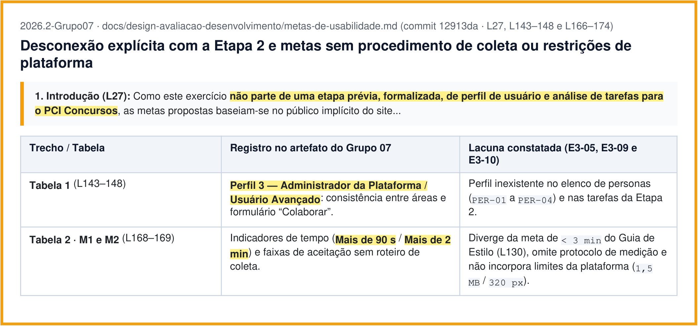
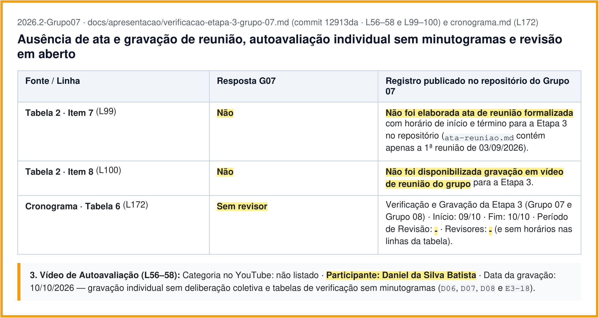

Responsável pelo registro: Bruno Ferreira Dornelas · Grupo 06

# Etapa 3 · Grupo 07 (+1)

## Tabela de contribuição

| Integrante / ferramenta | Contribuição | Artefato / atividade |
| --- | --- | --- |
| [Bruno Ferreira Dornelas](https://github.com/brunnf) | Inspeção completa dos artefatos da Etapa 3 do Grupo 07 (+1 · PCI Concursos) e registro das 30 respostas da Lista V2 | [Critérios e respostas](#etapa-3) |
| [Bruno Ferreira Dornelas](https://github.com/brunnf) | Levantamento do inventário na revisão `12913da`, preparação dos recortes de evidência e definição dos itens de retrabalho | [Artefatos consultados](#artefatos-consultados) · [Recortes das evidências](#recortes-das-evidencias) · [Acompanhamento](#acompanhamento) |
| Google Gemini e Antigravity (Google DeepMind) | Apoio à localização das linhas no commit de referência, à geração dos recortes e à formatação da ficha | [Agradecimentos](../index.md#agradecimentos) |

Tabela 1 — Contribuição neste artefato.

Fonte: elaboração para o Grupo 06 (2026).

[Lista V2 da Etapa 3](../lista-etapa-3.md) 
[Resultados e gráficos](../resultados/etapa-3.md) 
[Inspeções do grupo](index.md) 
[Ficha V1 da Etapa 3](../../verificacao/grupo-07/etapa-3/lista-verificacao.md)

## Recorte e versões reinspecionadas

- **Projeto:** PCI Concursos (Grupo 07 · +1).
- **Data e gravação da reinspeção:** **23/11/2026** · Categoria no YouTube: **não listado** (sessão conjunta das Etapas 1, 3, 5 e 7 do Grupo 07).
- **Revisão do repositório na reinspeção:** [`df60faf`](https://github.com/Interacao-Humano-Computador/2026.2-Grupo07/tree/df60faf) (artefatos de conteúdo da Etapa 3 nas mesmas versões e linhas de [`12913da`](https://github.com/Interacao-Humano-Computador/2026.2-Grupo07/tree/12913da5f0d83900ce91e500e26524987f0a9497)). [Como foram atribuídas as respostas](../index.md#metodo-de-inspecao).

??? note "Vídeo — Inspeção dos artefatos do Grupo 07: Etapas 1, 3, 5 e 7"

    

      <iframe
        loading="lazy"
        style="position: absolute; top: 0; left: 0; width: 100%; height: 100%; border: 0;"
        src="https://www.youtube-nocookie.com/embed/dd04ibyhJ_o"
        title="Inspeção dos artefatos do Grupo 07: Etapas 1, 3, 5 e 7"
        allow="accelerometer; autoplay; clipboard-write; encrypted-media; gyroscope; picture-in-picture; web-share"
        referrerpolicy="strict-origin-when-cross-origin"
        allowfullscreen>
      </iframe>
    

    Link direto no YouTube (não listado): [https://youtu.be/dd04ibyhJ_o](https://youtu.be/dd04ibyhJ_o)

A Tabela 2 relaciona os quatro artefatos principais da Etapa 3 do Grupo 07 e os registros transversais reinspecionados em **23/11/2026**, com suas respectivas versões exatas.

| Artefato reinspecionado | Integrante / escopo | Página publicada | Versão inspecionada em 23/11/2026 |
| --- | --- | --- | --- |
| Características da Plataforma (`caracteristicas-da-plataforma.md`) | Arthur Sismene Carvalho | [Página](https://interacao-humano-computador.github.io/2026.2-Grupo07/design-avaliacao-desenvolvimento/caracteristicas-da-plataforma/) | [`v1.0`](https://github.com/Interacao-Humano-Computador/2026.2-Grupo07/blob/12913da5f0d83900ce91e500e26524987f0a9497/docs/design-avaliacao-desenvolvimento/caracteristicas-da-plataforma.md#L284) (06/10/2026) |
| Princípios Gerais de Projeto (`principios-gerais-de-projeto.md`) | Daniel da Silva Batista | [Página](https://interacao-humano-computador.github.io/2026.2-Grupo07/analise-de-requisitos/principios-gerais-de-projeto/) | [`v1.0`](https://github.com/Interacao-Humano-Computador/2026.2-Grupo07/blob/12913da5f0d83900ce91e500e26524987f0a9497/docs/analise-de-requisitos/principios-gerais-de-projeto.md#L344) (06/10/2026) |
| Metas de Usabilidade (`metas-de-usabilidade.md`) | Pedro Rocha Ferreira Lima | [Página](https://interacao-humano-computador.github.io/2026.2-Grupo07/design-avaliacao-desenvolvimento/metas-de-usabilidade/) | [`v1.0`](https://github.com/Interacao-Humano-Computador/2026.2-Grupo07/blob/12913da5f0d83900ce91e500e26524987f0a9497/docs/design-avaliacao-desenvolvimento/metas-de-usabilidade.md#L228) (06/10/2026) |
| Guia de Estilo (`guia-de-estilo.md`) | Leonardo da Silva Lopes Júnior | [Página](https://interacao-humano-computador.github.io/2026.2-Grupo07/design-avaliacao-desenvolvimento/guia-de-estilo/) | [`v1.1`](https://github.com/Interacao-Humano-Computador/2026.2-Grupo07/blob/12913da5f0d83900ce91e500e26524987f0a9497/docs/design-avaliacao-desenvolvimento/guia-de-estilo.md#L430) (06/10/2026) |
| Cronograma Planejado e Executado (`cronograma.md`) | Execução da Etapa 3 (`D04`, `D06`) | [Página](https://interacao-humano-computador.github.io/2026.2-Grupo07/planejamento/cronograma/#3-etapa-3-principios-gerais-de-projeto-e-metas-de-usabilidade) | [`v2.1`](https://github.com/Interacao-Humano-Computador/2026.2-Grupo07/blob/12913da5f0d83900ce91e500e26524987f0a9497/docs/planejamento/cronograma.md#L424) (13/11/2026) |
| Ata de Reunião (`ata-reuniao.md`) | Verificação de atas da etapa (`D07`) | [Página](https://interacao-humano-computador.github.io/2026.2-Grupo07/planejamento/ata-reuniao/) | [`v1.2`](https://github.com/Interacao-Humano-Computador/2026.2-Grupo07/blob/12913da5f0d83900ce91e500e26524987f0a9497/docs/planejamento/ata-reuniao.md#L158) (09/10/2026) |
| Apresentação 3 (`apresentacao-3.md`) | Vídeo da apresentação da Etapa 3 (`D09`) | [Página](https://interacao-humano-computador.github.io/2026.2-Grupo07/apresentacao/apresentacao-3/) | [`v1.0`](https://github.com/Interacao-Humano-Computador/2026.2-Grupo07/blob/12913da5f0d83900ce91e500e26524987f0a9497/docs/apresentacao/apresentacao-3.md#L66) (06/10/2026) |
| Autoavaliação e Verificação G08 (`verificacao-etapa-3-*.md`) | Inspeções da Etapa 3 (`D08`, `E3-18`) | [Autoavaliação](https://interacao-humano-computador.github.io/2026.2-Grupo07/apresentacao/verificacao-etapa-3-grupo-07/) · [Grupo 08](https://interacao-humano-computador.github.io/2026.2-Grupo07/apresentacao/verificacao-etapa-3-grupo-08/) | G07: [`v1.0`](https://github.com/Interacao-Humano-Computador/2026.2-Grupo07/blob/12913da5f0d83900ce91e500e26524987f0a9497/docs/apresentacao/verificacao-etapa-3-grupo-07.md#L293) (09/10/2026) · G08: [`v1.0`](https://github.com/Interacao-Humano-Computador/2026.2-Grupo07/blob/12913da5f0d83900ce91e500e26524987f0a9497/docs/apresentacao/verificacao-etapa-3-grupo-08.md#L297) |

Tabela 2 — Artefatos e versões da Etapa 3 do Grupo 07 reinspecionados em 23/11/2026.

Fonte: repositório do Grupo 07 na data da reinspeção (2026).

## Critérios e respostas { #etapa-3 }

**14 Sim · 14 Incompleto · 2 Não** · 30 itens verificados

A Tabela 3 registra o julgamento de cada critério sobre as versões reinspecionadas em 23/11/2026.

| Critério | Resposta | Constatação | Artefato, versão (23/11) e evidência |
| --- | :---: | --- | --- |
| [D01](../lista-etapa-3.md#d01) | Sim | Os quatro artefatos principais da Etapa 3, a página de apresentação e o relatório de autoavaliação trazem histórico de versão padronizado com versão, data, descrição da alteração, autor e revisor. | **Escopo:** [4 artefatos principais, Apresentação e Verificação](#artefatos-consultados) (`v1.0`–`v1.1`) [Características da Plataforma](https://interacao-humano-computador.github.io/2026.2-Grupo07/design-avaliacao-desenvolvimento/caracteristicas-da-plataforma/#10-historico-de-versoes) · `v1.0` ([L278–288](https://github.com/Interacao-Humano-Computador/2026.2-Grupo07/blob/12913da5f0d83900ce91e500e26524987f0a9497/docs/design-avaliacao-desenvolvimento/caracteristicas-da-plataforma.md#L278-L288)) [Guia de Estilo](https://interacao-humano-computador.github.io/2026.2-Grupo07/design-avaliacao-desenvolvimento/guia-de-estilo/#5-historico-de-versoes) · `v1.1` ([L422–434](https://github.com/Interacao-Humano-Computador/2026.2-Grupo07/blob/12913da5f0d83900ce91e500e26524987f0a9497/docs/design-avaliacao-desenvolvimento/guia-de-estilo.md#L422-L434)) [Metas de Usabilidade](https://interacao-humano-computador.github.io/2026.2-Grupo07/design-avaliacao-desenvolvimento/metas-de-usabilidade/#8-historico-de-versoes) · `v1.0` ([L222–233](https://github.com/Interacao-Humano-Computador/2026.2-Grupo07/blob/12913da5f0d83900ce91e500e26524987f0a9497/docs/design-avaliacao-desenvolvimento/metas-de-usabilidade.md#L222-L233)) |
| [D02](../lista-etapa-3.md#d02) | Sim | Todas as versões correntes dos documentos da Etapa 3 registram revisores distintos dos autores (Arthur revisado por Pedro, Daniel por Pedro, Leonardo por Daniel e Pedro por Daniel). | **Escopo:** [4 artefatos principais e Apresentação 3](#artefatos-consultados) (`v1.0`–`v1.1`) [Princípios Gerais](https://interacao-humano-computador.github.io/2026.2-Grupo07/analise-de-requisitos/principios-gerais-de-projeto/#6-historico-de-versoes) · `v1.0` ([L342–345](https://github.com/Interacao-Humano-Computador/2026.2-Grupo07/blob/12913da5f0d83900ce91e500e26524987f0a9497/docs/analise-de-requisitos/principios-gerais-de-projeto.md#L342-L345)) [Guia de Estilo](https://interacao-humano-computador.github.io/2026.2-Grupo07/design-avaliacao-desenvolvimento/guia-de-estilo/#5-historico-de-versoes) · `v1.1` ([L426–431](https://github.com/Interacao-Humano-Computador/2026.2-Grupo07/blob/12913da5f0d83900ce91e500e26524987f0a9497/docs/design-avaliacao-desenvolvimento/guia-de-estilo.md#L426-L431)) [Apresentação 3](https://interacao-humano-computador.github.io/2026.2-Grupo07/apresentacao/apresentacao-3/#3-historico-de-versoes) · `v1.0` ([L64–67](https://github.com/Interacao-Humano-Computador/2026.2-Grupo07/blob/12913da5f0d83900ce91e500e26524987f0a9497/docs/apresentacao/apresentacao-3.md#L64-L67)) |
| [D03](../lista-etapa-3.md#d03) | Sim | Os quatro artefatos principais e o documento de autoavaliação trazem seção final de bibliografia com as obras de IHC utilizadas (Barbosa e Silva, 2010; Barbosa et al., 2021; Mayhew, 1999; Nielsen, 1994; Norman, 1988). | **Escopo:** [4 artefatos principais e Autoavaliação](#artefatos-consultados) (`v1.0`–`v1.1`) [Características da Plataforma](https://interacao-humano-computador.github.io/2026.2-Grupo07/design-avaliacao-desenvolvimento/caracteristicas-da-plataforma/#9-bibliografia) · `v1.0` ([L269–275](https://github.com/Interacao-Humano-Computador/2026.2-Grupo07/blob/12913da5f0d83900ce91e500e26524987f0a9497/docs/design-avaliacao-desenvolvimento/caracteristicas-da-plataforma.md#L269-L275)) [Princípios Gerais](https://interacao-humano-computador.github.io/2026.2-Grupo07/analise-de-requisitos/principios-gerais-de-projeto/#5-bibliografia) · `v1.0` ([L332–337](https://github.com/Interacao-Humano-Computador/2026.2-Grupo07/blob/12913da5f0d83900ce91e500e26524987f0a9497/docs/analise-de-requisitos/principios-gerais-de-projeto.md#L332-L337)) [Guia de Estilo](https://interacao-humano-computador.github.io/2026.2-Grupo07/design-avaliacao-desenvolvimento/guia-de-estilo/#4-bibliografia) · `v1.1` ([L406–419](https://github.com/Interacao-Humano-Computador/2026.2-Grupo07/blob/12913da5f0d83900ce91e500e26524987f0a9497/docs/design-avaliacao-desenvolvimento/guia-de-estilo.md#L406-L419)) |
| [D04](../lista-etapa-3.md#d04) | Incompleto | Nos quatro documentos de conteúdo, figuras e tabelas têm legenda, fonte e chamada no texto; porém, na autoavaliação da Etapa 3 a `Figura 2` e a `Tabela 6` entram sem chamada textual prévia, e `cronograma.md` duplica a numeração `Tabela 14`. | **Escopo:** [4 artefatos, Autoavaliação e Cronograma](#artefatos-consultados) (`v1.0`–`v2.1`) [Autoavaliação da Etapa 3](https://interacao-humano-computador.github.io/2026.2-Grupo07/apresentacao/verificacao-etapa-3-grupo-07/#72-item-19-prevencao-contra-padroes-obscuros-dark-patterns) · `v1.0` ([L194–223](https://github.com/Interacao-Humano-Computador/2026.2-Grupo07/blob/12913da5f0d83900ce91e500e26524987f0a9497/docs/apresentacao/verificacao-etapa-3-grupo-07.md#L194-L223)) [Cronograma](https://interacao-humano-computador.github.io/2026.2-Grupo07/planejamento/cronograma/#8-etapa-8-verificacao-dos-artefatos) · `v2.1` ([L340–366](https://github.com/Interacao-Humano-Computador/2026.2-Grupo07/blob/12913da5f0d83900ce91e500e26524987f0a9497/docs/planejamento/cronograma.md#L340-L366)) |
| [D05](../lista-etapa-3.md#d05) | Sim | Todos os artefatos da Etapa 3 abrem com seção introdutória que explicita o objetivo do documento, seu escopo na fase de Análise de Requisitos e sua articulação no ciclo de Mayhew. | **Escopo:** [4 artefatos principais da Etapa 3](#artefatos-consultados) (`v1.0`–`v1.1`) [Características da Plataforma](https://interacao-humano-computador.github.io/2026.2-Grupo07/design-avaliacao-desenvolvimento/caracteristicas-da-plataforma/#1-introducao) · `v1.0` ([L18–23](https://github.com/Interacao-Humano-Computador/2026.2-Grupo07/blob/12913da5f0d83900ce91e500e26524987f0a9497/docs/design-avaliacao-desenvolvimento/caracteristicas-da-plataforma.md#L18-L23)) [Guia de Estilo](https://interacao-humano-computador.github.io/2026.2-Grupo07/design-avaliacao-desenvolvimento/guia-de-estilo/#introducao) · `v1.1` ([L18–23](https://github.com/Interacao-Humano-Computador/2026.2-Grupo07/blob/12913da5f0d83900ce91e500e26524987f0a9497/docs/design-avaliacao-desenvolvimento/guia-de-estilo.md#L18-L23)) [Metas de Usabilidade](https://interacao-humano-computador.github.io/2026.2-Grupo07/design-avaliacao-desenvolvimento/metas-de-usabilidade/#1-introducao) · `v1.0` ([L19–28](https://github.com/Interacao-Humano-Computador/2026.2-Grupo07/blob/12913da5f0d83900ce91e500e26524987f0a9497/docs/design-avaliacao-desenvolvimento/metas-de-usabilidade.md#L19-L28)) |
| [D06](../lista-etapa-3.md#d06) | Incompleto | A `Tabela 6` do cronograma executado registra datas de início/fim e responsáveis dos quatro artefatos e da apresentação, mas omite horários de execução, deixa período de revisão e revisores em branco (`-`) na verificação e não registra a reunião/ata nem a correção pós-apresentação previstas na `Tabela 5`. | [Cronograma · Etapa 3](https://interacao-humano-computador.github.io/2026.2-Grupo07/planejamento/cronograma/#32-cronograma-executado) · `v2.1` ([L141–176](https://github.com/Interacao-Humano-Computador/2026.2-Grupo07/blob/12913da5f0d83900ce91e500e26524987f0a9497/docs/planejamento/cronograma.md#L141-L176)) |
| [D07](../lista-etapa-3.md#d07) | Não | A página de atas contém exclusivamente a ata da 1ª reunião (`03/09/2026`, Etapa 1); não há ata publicada para a Etapa 3, ausência reconhecida pelo próprio Grupo 07 no `Item 7` de sua autoavaliação. | [Ata de Reunião](https://interacao-humano-computador.github.io/2026.2-Grupo07/planejamento/ata-reuniao/#1-identificacao) · `v1.2` ([L18–39](https://github.com/Interacao-Humano-Computador/2026.2-Grupo07/blob/12913da5f0d83900ce91e500e26524987f0a9497/docs/planejamento/ata-reuniao.md#L18-L39)) [Autoavaliação da Etapa 3](https://interacao-humano-computador.github.io/2026.2-Grupo07/apresentacao/verificacao-etapa-3-grupo-07/#5-itens-de-desenvolvimento-do-projeto) · `v1.0` ([L99](https://github.com/Interacao-Humano-Computador/2026.2-Grupo07/blob/12913da5f0d83900ce91e500e26524987f0a9497/docs/apresentacao/verificacao-etapa-3-grupo-07.md#L99)) |
| [D08](../lista-etapa-3.md#d08) | Incompleto | Não há gravação de reunião coletiva de alinhamento da Etapa 3 (`Item 8 = Não` na autoavaliação do grupo); as páginas de verificação trazem vídeos gravados individualmente por Daniel da Silva Batista em 10/10/2026, sem comprovar presença e discussão dos demais integrantes. | [Autoavaliação da Etapa 3](https://interacao-humano-computador.github.io/2026.2-Grupo07/apresentacao/verificacao-etapa-3-grupo-07/#3-video-de-autoavaliacao-etapa-3) · `v1.0` ([L42–59](https://github.com/Interacao-Humano-Computador/2026.2-Grupo07/blob/12913da5f0d83900ce91e500e26524987f0a9497/docs/apresentacao/verificacao-etapa-3-grupo-07.md#L42-L59)) [Autoavaliação · Item 8](https://interacao-humano-computador.github.io/2026.2-Grupo07/apresentacao/verificacao-etapa-3-grupo-07/#5-itens-de-desenvolvimento-do-projeto) · `v1.0` ([L100](https://github.com/Interacao-Humano-Computador/2026.2-Grupo07/blob/12913da5f0d83900ce91e500e26524987f0a9497/docs/apresentacao/verificacao-etapa-3-grupo-07.md#L100)) |
| [D09](../lista-etapa-3.md#d09) | Incompleto | A página `apresentacao-3.md` incorpora o vídeo da apresentação no YouTube (`youtu.be/h2q-Xv41NfE`) e distribui os quatro apresentadores na `Tabela 1`, mas não declara na página a categoria `"não listado"`. | [Apresentação 3](https://interacao-humano-computador.github.io/2026.2-Grupo07/apresentacao/apresentacao-3/#1-video-de-apresentacao-etapa-3) · `v1.0` ([L19–58](https://github.com/Interacao-Humano-Computador/2026.2-Grupo07/blob/12913da5f0d83900ce91e500e26524987f0a9497/docs/apresentacao/apresentacao-3.md#L19-L58)) |
| [D10](../lista-etapa-3.md#d10) | Incompleto | Todos os documentos iniciam com `Tabela de Contribuição`, porém nenhum dos artefatos da Etapa 3 traz hiperligações diretas para as seções produzidas por integrante, e `caracteristicas-da-plataforma.md` omite Leonardo da Silva Lopes Júnior. | **Escopo:** [4 artefatos principais da Etapa 3](#artefatos-consultados) (`v1.0`–`v1.1`) [Características da Plataforma](https://interacao-humano-computador.github.io/2026.2-Grupo07/design-avaliacao-desenvolvimento/caracteristicas-da-plataforma/) · `v1.0` ([L5–11](https://github.com/Interacao-Humano-Computador/2026.2-Grupo07/blob/12913da5f0d83900ce91e500e26524987f0a9497/docs/design-avaliacao-desenvolvimento/caracteristicas-da-plataforma.md#L5-L11)) [Guia de Estilo](https://interacao-humano-computador.github.io/2026.2-Grupo07/design-avaliacao-desenvolvimento/guia-de-estilo/) · `v1.1` ([L5–11](https://github.com/Interacao-Humano-Computador/2026.2-Grupo07/blob/12913da5f0d83900ce91e500e26524987f0a9497/docs/design-avaliacao-desenvolvimento/guia-de-estilo.md#L5-L11)) |
| [D11](../lista-etapa-3.md#d11) | Incompleto | Os quatro artefatos de conteúdo nomeiam `Claude` ou `Gemini` apenas em linha da `Tabela de Contribuição` inicial, sem seção final de `Agradecimentos` detalhando o apoio, e `apresentacao-3.md` não apresenta declaração de IA. | **Escopo:** [4 artefatos principais e Apresentação 3](#artefatos-consultados) (`v1.0`–`v1.1`) [Princípios Gerais](https://interacao-humano-computador.github.io/2026.2-Grupo07/analise-de-requisitos/principios-gerais-de-projeto/) · `v1.0` ([L11](https://github.com/Interacao-Humano-Computador/2026.2-Grupo07/blob/12913da5f0d83900ce91e500e26524987f0a9497/docs/analise-de-requisitos/principios-gerais-de-projeto.md#L11)) [Metas de Usabilidade](https://interacao-humano-computador.github.io/2026.2-Grupo07/design-avaliacao-desenvolvimento/metas-de-usabilidade/) · `v1.0` ([L11](https://github.com/Interacao-Humano-Computador/2026.2-Grupo07/blob/12913da5f0d83900ce91e500e26524987f0a9497/docs/design-avaliacao-desenvolvimento/metas-de-usabilidade.md#L11)) [Apresentação 3](https://interacao-humano-computador.github.io/2026.2-Grupo07/apresentacao/apresentacao-3/) · `v1.0` ([L1–70](https://github.com/Interacao-Humano-Computador/2026.2-Grupo07/blob/12913da5f0d83900ce91e500e26524987f0a9497/docs/apresentacao/apresentacao-3.md#L1-L70)) |
| [E3-01](../lista-etapa-3.md#e3-01) | Sim | `caracteristicas-da-plataforma.md` detalha o ambiente web do PCI Concursos, motores homologados, pontos de quebra (`320 px` a `1440 px`) e restrições de rede/anúncios, apoiado em Barbosa et al. (2021, pp. 147, 281) com recortes nas `Figuras 1 e 2`. | [Características da Plataforma](https://interacao-humano-computador.github.io/2026.2-Grupo07/design-avaliacao-desenvolvimento/caracteristicas-da-plataforma/#2-fundamentacao-teorica) · `v1.0` ([L27–66](https://github.com/Interacao-Humano-Computador/2026.2-Grupo07/blob/12913da5f0d83900ce91e500e26524987f0a9497/docs/design-avaliacao-desenvolvimento/caracteristicas-da-plataforma.md#L27-L66)) [Limitações Técnicas](https://interacao-humano-computador.github.io/2026.2-Grupo07/design-avaliacao-desenvolvimento/caracteristicas-da-plataforma/#6-limitacoes-tecnicas) · `v1.0` ([L166–213](https://github.com/Interacao-Humano-Computador/2026.2-Grupo07/blob/12913da5f0d83900ce91e500e26524987f0a9497/docs/design-avaliacao-desenvolvimento/caracteristicas-da-plataforma.md#L166-L213)) |
| [E3-02](../lista-etapa-3.md#e3-02) | Sim | `principios-gerais-de-projeto.md` declara formalmente os princípios de projeto adotados, fundamentando-os em Norman (1988), Tognazzini (2003) e Barbosa e Silva (2010, pp. 264–265) com recorte na `Figura 1`. | [Princípios Gerais](https://interacao-humano-computador.github.io/2026.2-Grupo07/analise-de-requisitos/principios-gerais-de-projeto/#1-introducao) · `v1.0` ([L19–59](https://github.com/Interacao-Humano-Computador/2026.2-Grupo07/blob/12913da5f0d83900ce91e500e26524987f0a9497/docs/analise-de-requisitos/principios-gerais-de-projeto.md#L19-L59)) |
| [E3-03](../lista-etapa-3.md#e3-03) | Sim | As subseções `3.1` a `3.8` de `principios-gerais-de-projeto.md` contemplam integralmente os oito eixos clássicos da literatura com definições teóricas e recortes das páginas 265 a 273 de Barbosa e Silva (2010) nas `Figuras 2 a 10`. | [Análise dos 8 Princípios](https://interacao-humano-computador.github.io/2026.2-Grupo07/analise-de-requisitos/principios-gerais-de-projeto/#3-analise-dos-8-principios-gerais-no-pci-concursos) · `v1.0` ([L63–304](https://github.com/Interacao-Humano-Computador/2026.2-Grupo07/blob/12913da5f0d83900ce91e500e26524987f0a9497/docs/analise-de-requisitos/principios-gerais-de-projeto.md#L63-L304)) |
| [E3-04](../lista-etapa-3.md#e3-04) | Sim | `metas-de-usabilidade.md` formaliza seis metas (`M1` a `M6`) com base na ISO 9241-11, em Nielsen (1994), em Mayhew (1999) e em Barbosa et al. (2021, pp. 41–43, 126–129), acompanhadas de quatro recortes do livro (`Figuras 1 a 4`). | [Fundamentação das Metas](https://interacao-humano-computador.github.io/2026.2-Grupo07/design-avaliacao-desenvolvimento/metas-de-usabilidade/#2-fundamentacao-teorica) · `v1.0` ([L31–105](https://github.com/Interacao-Humano-Computador/2026.2-Grupo07/blob/12913da5f0d83900ce91e500e26524987f0a9497/docs/design-avaliacao-desenvolvimento/metas-de-usabilidade.md#L31-L105)) [Metas Propostas](https://interacao-humano-computador.github.io/2026.2-Grupo07/design-avaliacao-desenvolvimento/metas-de-usabilidade/#5-metas-de-usabilidade-propostas) · `v1.0` ([L158–179](https://github.com/Interacao-Humano-Computador/2026.2-Grupo07/blob/12913da5f0d83900ce91e500e26524987f0a9497/docs/design-avaliacao-desenvolvimento/metas-de-usabilidade.md#L158-L179)) |
| [E3-05](../lista-etapa-3.md#e3-05) | Incompleto | A seção `6` ordena `M3 → M1/M2 → M4 → M5 → M6`, mas a introdução (`L27`) declara que o artefato *"não parte de uma etapa prévia, formalizada, de perfil de usuário e análise de tarefas"*, usando perfis genéricos na `Tabela 1` — inclusive um `Perfil 3 — Administrador da Plataforma` inexistente na Etapa 2 — e divergindo das cinco metas do Guia de Estilo. | [Metas · Introdução](https://interacao-humano-computador.github.io/2026.2-Grupo07/design-avaliacao-desenvolvimento/metas-de-usabilidade/#1-introducao) · `v1.0` ([L27](https://github.com/Interacao-Humano-Computador/2026.2-Grupo07/blob/12913da5f0d83900ce91e500e26524987f0a9497/docs/design-avaliacao-desenvolvimento/metas-de-usabilidade.md#L27)) [Situação Observada · Tabela 1](https://interacao-humano-computador.github.io/2026.2-Grupo07/design-avaliacao-desenvolvimento/metas-de-usabilidade/#4-situacao-atual-observada-no-site) · `v1.0` ([L143–148](https://github.com/Interacao-Humano-Computador/2026.2-Grupo07/blob/12913da5f0d83900ce91e500e26524987f0a9497/docs/design-avaliacao-desenvolvimento/metas-de-usabilidade.md#L143-L148)) [Guia de Estilo · Seção 2.3](https://interacao-humano-computador.github.io/2026.2-Grupo07/design-avaliacao-desenvolvimento/guia-de-estilo/#23-metas-de-usabilidade-do-projeto) · `v1.1` ([L127–134](https://github.com/Interacao-Humano-Computador/2026.2-Grupo07/blob/12913da5f0d83900ce91e500e26524987f0a9497/docs/design-avaliacao-desenvolvimento/guia-de-estilo.md#L127-L134)) |
| [E3-06](../lista-etapa-3.md#e3-06) | Sim | A seção `1.1` de `guia-de-estilo.md` define o papel normativo do guia e delimita o escopo de produto específico para o PCI Concursos com citação de Barbosa e Silva (2010, p. 282) e recorte na `Figura 1`. | [O que é um Guia de Estilo](https://interacao-humano-computador.github.io/2026.2-Grupo07/design-avaliacao-desenvolvimento/guia-de-estilo/#11-o-que-e-um-guia-de-estilo) · `v1.1` ([L28–48](https://github.com/Interacao-Humano-Computador/2026.2-Grupo07/blob/12913da5f0d83900ce91e500e26524987f0a9497/docs/design-avaliacao-desenvolvimento/guia-de-estilo.md#L28-L48)) |
| [E3-07](../lista-etapa-3.md#e3-07) | Sim | `guia-de-estilo.md` fundamenta a estrutura clássica de Marcus (1992) e Mayhew (1999) com a `Figura 2` (p. 283) e desenvolve integralmente as seis seções normativas (`1. Introdução` com `1.1–1.5`, `2. Resultados de Análise`, `3. Elementos de Interface`, `4. Elementos de Interação`, `5. Elementos de Ação` e `6. Vocabulário e Padrões`). | [Estrutura Canônica](https://interacao-humano-computador.github.io/2026.2-Grupo07/design-avaliacao-desenvolvimento/guia-de-estilo/#12-estrutura-canonica-do-guia-de-estilo) · `v1.1` ([L51–72](https://github.com/Interacao-Humano-Computador/2026.2-Grupo07/blob/12913da5f0d83900ce91e500e26524987f0a9497/docs/design-avaliacao-desenvolvimento/guia-de-estilo.md#L51-L72)) [Estrutura Normativa](https://interacao-humano-computador.github.io/2026.2-Grupo07/design-avaliacao-desenvolvimento/guia-de-estilo/#2-estrutura-normativa-do-guia-de-estilo) · `v1.1` ([L75–377](https://github.com/Interacao-Humano-Computador/2026.2-Grupo07/blob/12913da5f0d83900ce91e500e26524987f0a9497/docs/design-avaliacao-desenvolvimento/guia-de-estilo.md#L75-L377)) |
| [E3-08](../lista-etapa-3.md#e3-08) | Incompleto | A `Tabela 6` de `guia-de-estilo.md` relaciona sete gargalos empíricos do PCI Concursos às diretrizes propostas, porém a Etapa 3 não inclui capturas da interface original do portal nem propostas visuais de telas reprojetadas (apenas esquema textual ASCII na `Figura 3`). | [Correspondência com o Site](https://interacao-humano-computador.github.io/2026.2-Grupo07/design-avaliacao-desenvolvimento/guia-de-estilo/#3-correspondencia-com-o-site-avaliado) · `v1.1` ([L380–402](https://github.com/Interacao-Humano-Computador/2026.2-Grupo07/blob/12913da5f0d83900ce91e500e26524987f0a9497/docs/design-avaliacao-desenvolvimento/guia-de-estilo.md#L380-L402)) [Esquema Antitrapaça · Figura 3](https://interacao-humano-computador.github.io/2026.2-Grupo07/design-avaliacao-desenvolvimento/guia-de-estilo/#54-o-padrao-antitrapaca-de-download-oficial-diretriz-critica-de-seguranca) · `v1.1` ([L291–318](https://github.com/Interacao-Humano-Computador/2026.2-Grupo07/blob/12913da5f0d83900ce91e500e26524987f0a9497/docs/design-avaliacao-desenvolvimento/guia-de-estilo.md#L291-L318)) |
| [E3-09](../lista-etapa-3.md#e3-09) | Incompleto | A `Tabela 2` de `metas-de-usabilidade.md` define indicadores e as faixas inaceitável, aceitável e ideal para `M1`–`M6`, mas não especifica o procedimento de coleta e medição de cada métrica e estabelece limites de busca (`90 s` e `2 min`) divergentes da meta `< 3 min` do Guia de Estilo. | [Metas Propostas · Tabela 2](https://interacao-humano-computador.github.io/2026.2-Grupo07/design-avaliacao-desenvolvimento/metas-de-usabilidade/#5-metas-de-usabilidade-propostas) · `v1.0` ([L164–179](https://github.com/Interacao-Humano-Computador/2026.2-Grupo07/blob/12913da5f0d83900ce91e500e26524987f0a9497/docs/design-avaliacao-desenvolvimento/metas-de-usabilidade.md#L164-L179)) [Guia de Estilo · Seção 2.3](https://interacao-humano-computador.github.io/2026.2-Grupo07/design-avaliacao-desenvolvimento/guia-de-estilo/#23-metas-de-usabilidade-do-projeto) · `v1.1` ([L130](https://github.com/Interacao-Humano-Computador/2026.2-Grupo07/blob/12913da5f0d83900ce91e500e26524987f0a9497/docs/design-avaliacao-desenvolvimento/guia-de-estilo.md#L130)) |
| [E3-10](../lista-etapa-3.md#e3-10) | Incompleto | `caracteristicas-da-plataforma.md` separa possibilidades e limitações técnicas (orçamento de `1,5 MB`, largura mínima `320 px`, resiliência sem JS externo e leitor nativo de PDF), mas `metas-de-usabilidade.md` não incorpora nem referencia essas restrições na formulação de `M1`–`M6`. | [Limitações da Plataforma](https://interacao-humano-computador.github.io/2026.2-Grupo07/design-avaliacao-desenvolvimento/caracteristicas-da-plataforma/#6-limitacoes-tecnicas) · `v1.0` ([L166–213](https://github.com/Interacao-Humano-Computador/2026.2-Grupo07/blob/12913da5f0d83900ce91e500e26524987f0a9497/docs/design-avaliacao-desenvolvimento/caracteristicas-da-plataforma.md#L166-L213)) [Metas Propostas](https://interacao-humano-computador.github.io/2026.2-Grupo07/design-avaliacao-desenvolvimento/metas-de-usabilidade/#5-metas-de-usabilidade-propostas) · `v1.0` ([L158–210](https://github.com/Interacao-Humano-Computador/2026.2-Grupo07/blob/12913da5f0d83900ce91e500e26524987f0a9497/docs/design-avaliacao-desenvolvimento/metas-de-usabilidade.md#L158-L210)) |
| [E3-11](../lista-etapa-3.md#e3-11) | Sim | O Guia de Estilo explicita o *design rationale* nas seções `2.1–2.2`, `4.2`, `5.4–5.6` e na `Tabela 6`, rastreando contraste WCAG, grid modular, alvos de `44–48 px`, zona antitrapaça e busca semântica às personas `PER-01`–`PER-04`, às tarefas `TAR-02`–`TAR-08` e ao contexto móvel. | [Resultados de Análise](https://interacao-humano-computador.github.io/2026.2-Grupo07/design-avaliacao-desenvolvimento/guia-de-estilo/#2-resultados-de-analise) · `v1.1` ([L113–126](https://github.com/Interacao-Humano-Computador/2026.2-Grupo07/blob/12913da5f0d83900ce91e500e26524987f0a9497/docs/design-avaliacao-desenvolvimento/guia-de-estilo.md#L113-L126)) [Correspondência · Tabela 6](https://interacao-humano-computador.github.io/2026.2-Grupo07/design-avaliacao-desenvolvimento/guia-de-estilo/#3-correspondencia-com-o-site-avaliado) · `v1.1` ([L388–402](https://github.com/Interacao-Humano-Computador/2026.2-Grupo07/blob/12913da5f0d83900ce91e500e26524987f0a9497/docs/design-avaliacao-desenvolvimento/guia-de-estilo.md#L388-L402)) |
| [E3-12](../lista-etapa-3.md#e3-12) | Incompleto | `principios-gerais-de-projeto.md` contextualiza os oito tópicos de Barbosa e Silva no PCI Concursos, porém adota todos indistintamente sem critério de seleção/priorização e sem justificar diretrizes ou princípios não priorizados. | [Metodologia de Avaliação](https://interacao-humano-computador.github.io/2026.2-Grupo07/analise-de-requisitos/principios-gerais-de-projeto/#2-metodologia-de-avaliacao) · `v1.0` ([L40–59](https://github.com/Interacao-Humano-Computador/2026.2-Grupo07/blob/12913da5f0d83900ce91e500e26524987f0a9497/docs/analise-de-requisitos/principios-gerais-de-projeto.md#L40-L59)) [Matriz de Síntese · Tabela 1](https://interacao-humano-computador.github.io/2026.2-Grupo07/analise-de-requisitos/principios-gerais-de-projeto/#4-sintese-dos-principios-gerais-e-diretrizes-para-o-pci-concursos) · `v1.0` ([L307–328](https://github.com/Interacao-Humano-Computador/2026.2-Grupo07/blob/12913da5f0d83900ce91e500e26524987f0a9497/docs/analise-de-requisitos/principios-gerais-de-projeto.md#L307-L328)) |
| [E3-13](../lista-etapa-3.md#e3-13) | Sim | Cada um dos oito tópicos (`3.1` a `3.8`) detalha a fundamentação com página do livro e documenta violações empíricas concretas no PCI Concursos (banners verdes falsos de `"DOWNLOAD"`, retificações ocultas no rodapé e cadastro `.con` sem validação). | [Correspondência e Simplicidade](https://interacao-humano-computador.github.io/2026.2-Grupo07/analise-de-requisitos/principios-gerais-de-projeto/#31-correspondencia-com-as-expectativas-dos-usuarios) · `v1.0` ([L65–119](https://github.com/Interacao-Humano-Computador/2026.2-Grupo07/blob/12913da5f0d83900ce91e500e26524987f0a9497/docs/analise-de-requisitos/principios-gerais-de-projeto.md#L65-L119)) [Consistência e Projeto para Erros](https://interacao-humano-computador.github.io/2026.2-Grupo07/analise-de-requisitos/principios-gerais-de-projeto/#34-consistencia-e-padronizacao-promocao-da-eficiencia-do-usuario) · `v1.0` ([L179–187](https://github.com/Interacao-Humano-Computador/2026.2-Grupo07/blob/12913da5f0d83900ce91e500e26524987f0a9497/docs/analise-de-requisitos/principios-gerais-de-projeto.md#L179-L187)) |
| [E3-14](../lista-etapa-3.md#e3-14) | Sim | As regras de navegação, chips regionais, busca preditiva, download seguro e calendário pessoal do Guia de Estilo vinculam-se nominalmente aos fluxos modelados em HTA e CTT na Etapa 2 (`TAR-02` a `TAR-08`). | [Elementos de Interação](https://interacao-humano-computador.github.io/2026.2-Grupo07/design-avaliacao-desenvolvimento/guia-de-estilo/#4-elementos-de-interacao) · `v1.1` ([L231–240](https://github.com/Interacao-Humano-Computador/2026.2-Grupo07/blob/12913da5f0d83900ce91e500e26524987f0a9497/docs/design-avaliacao-desenvolvimento/guia-de-estilo.md#L231-L240)) [Elementos de Ação · TAR-02 a TAR-08](https://interacao-humano-computador.github.io/2026.2-Grupo07/design-avaliacao-desenvolvimento/guia-de-estilo/#54-o-padrao-antitrapaca-de-download-oficial-diretriz-critica-de-seguranca) · `v1.1` ([L286–339](https://github.com/Interacao-Humano-Computador/2026.2-Grupo07/blob/12913da5f0d83900ce91e500e26524987f0a9497/docs/design-avaliacao-desenvolvimento/guia-de-estilo.md#L286-L339)) |
| [E3-15](../lista-etapa-3.md#e3-15) | Incompleto | O Guia de Estilo descreve textualmente quatro tipos de tela (`Seção 6.2`) e inclui um diagrama ASCII da caixa de download (`Figura 3`), mas a Etapa 3 do Grupo 07 não apresenta wireframes nem layouts de baixa/média fidelidade aplicando o grid de 12/8/4 colunas, a tipografia e a paleta. | [Tipos de Tela](https://interacao-humano-computador.github.io/2026.2-Grupo07/design-avaliacao-desenvolvimento/guia-de-estilo/#62-tipos-de-tela-para-tarefas-comuns) · `v1.1` ([L367–372](https://github.com/Interacao-Humano-Computador/2026.2-Grupo07/blob/12913da5f0d83900ce91e500e26524987f0a9497/docs/design-avaliacao-desenvolvimento/guia-de-estilo.md#L367-L372)) [Grid e Tipografia](https://interacao-humano-computador.github.io/2026.2-Grupo07/design-avaliacao-desenvolvimento/guia-de-estilo/#31-disposicao-espacial-e-grid) · `v1.1` ([L139–182](https://github.com/Interacao-Humano-Computador/2026.2-Grupo07/blob/12913da5f0d83900ce91e500e26524987f0a9497/docs/design-avaliacao-desenvolvimento/guia-de-estilo.md#L139-L182)) |
| [E3-16](../lista-etapa-3.md#e3-16) | Incompleto | As seções `3.2`, `4.3`, `5.1`, `5.3` e `6.3` especificam anel de foco (`3px`), fechamento de modais, erro `onBlur` em `#CF222E`, *skeleton screens* e `hover` na `Tabela 4`, mas omitem os estados `ativo` e `inativo/desabilitado` dos controles e o diálogo de confirmação prévia para botões destrutivos. | [Ativação e Botões · Tabela 4](https://interacao-humano-computador.github.io/2026.2-Grupo07/design-avaliacao-desenvolvimento/guia-de-estilo/#53-ativacao-e-hierarquia-de-botoes) · `v1.1` ([L266–283](https://github.com/Interacao-Humano-Computador/2026.2-Grupo07/blob/12913da5f0d83900ce91e500e26524987f0a9497/docs/design-avaliacao-desenvolvimento/guia-de-estilo.md#L266-L283)) [Sequências de Diálogos](https://interacao-humano-computador.github.io/2026.2-Grupo07/design-avaliacao-desenvolvimento/guia-de-estilo/#63-sequencias-de-dialogos-e-feedback) · `v1.1` ([L373–377](https://github.com/Interacao-Humano-Computador/2026.2-Grupo07/blob/12913da5f0d83900ce91e500e26524987f0a9497/docs/design-avaliacao-desenvolvimento/guia-de-estilo.md#L373-L377)) |
| [E3-17](../lista-etapa-3.md#e3-17) | Sim | A `Tabela 5` (`Vocabulário Controlado de Termos do PCI Concursos`) e a seção `5.5` padronizam rótulos claros ao candidato e eliminam a ambiguidade entre *"Estágio para Estudantes"* e *"Estágio Probatório"*. | [Terminologia Controlada · Tabela 5](https://interacao-humano-computador.github.io/2026.2-Grupo07/design-avaliacao-desenvolvimento/guia-de-estilo/#61-terminologia-controlada-do-dominio) · `v1.1` ([L344–365](https://github.com/Interacao-Humano-Computador/2026.2-Grupo07/blob/12913da5f0d83900ce91e500e26524987f0a9497/docs/design-avaliacao-desenvolvimento/guia-de-estilo.md#L344-L365)) |
| [E3-18](../lista-etapa-3.md#e3-18) | Incompleto | `verificacao-etapa-3-grupo-07.md` incorpora o vídeo de autoavaliação (`youtu.be/Yc_5IUtRXjM`), mas registra apenas um participante (`Daniel da Silva Batista`), omite minutogramas em todas as tabelas e diverge entre o texto (`22 itens`) e a `Tabela 1` (`21 itens`, sem o critério de IA). | [Vídeo e Síntese da Autoavaliação](https://interacao-humano-computador.github.io/2026.2-Grupo07/apresentacao/verificacao-etapa-3-grupo-07/#3-video-de-autoavaliacao-etapa-3) · `v1.0` ([L23–79](https://github.com/Interacao-Humano-Computador/2026.2-Grupo07/blob/12913da5f0d83900ce91e500e26524987f0a9497/docs/apresentacao/verificacao-etapa-3-grupo-07.md#L23-L79)) |
| [E3-19](../lista-etapa-3.md#e3-19) | Não | `principios-gerais-de-projeto.md` analisa individualmente os oito princípios e suas violações no PCI Concursos, sem discutir nem documentar *trade-offs* entre princípios potencialmente conflitantes. | [Princípios Gerais · Síntese](https://interacao-humano-computador.github.io/2026.2-Grupo07/analise-de-requisitos/principios-gerais-de-projeto/#4-sintese-dos-principios-gerais-e-diretrizes-para-o-pci-concursos) · `v1.0` ([L307–328](https://github.com/Interacao-Humano-Computador/2026.2-Grupo07/blob/12913da5f0d83900ce91e500e26524987f0a9497/docs/analise-de-requisitos/principios-gerais-de-projeto.md#L307-L328)) |

Tabela 3 — Critérios e respostas da inspeção V2 da Etapa 3 no Grupo 07 (+1) (23/11/2026).

Fonte: inspeção gravada em 23/11/2026 sobre os artefatos da Tabela 2.

[Conferir as respostas da inspeção V1](../conferencia-anterior.md#grupo-07-etapa-3).

## Acompanhamento

A tabela abaixo indica os achados prioritários que merecem voltar à pauta numa revisão futura dos artefatos da Etapa 3 do Grupo 07. Use o mesmo ID ao publicar uma correção e registre o novo commit, a data e o resultado da reinspeção ao encerrar o item.

| Achado | Ajuste a registrar | Evidência para encerrar |
| --- | --- | --- |
| [D07](#etapa-3-d07) e [E3-18](#etapa-3-e3-18) Publicar ata da Etapa 3 e minutogramas da verificação | Registrar ata formal da reunião da Etapa 3 em `ata-reuniao.md` e incluir minutogramas por item e o 11º item de desenvolvimento (IA) em `verificacao-etapa-3-grupo-07.md`. | Ata publicada com data, horários, participantes e deliberações, mais tabela de verificação com `22 itens` e minutos do vídeo. |
| [E3-05](#etapa-3-e3-05), [E3-09](#etapa-3-e3-09) e [E3-10](#etapa-3-e3-10) Alinhar Metas de Usabilidade à Etapa 2, à Plataforma e ao Guia de Estilo | Substituir os perfis genéricos (`Perfil 3 — Administrador`) pelas personas `PER-01`–`PER-04` e tarefas `TAR-01`–`TAR-08`, unificar os tempos com o Guia de Estilo, explicitar o protocolo de medição e vincular as restrições de `caracteristicas-da-plataforma.md` (`1,5 MB`, `320 px`) às metas `M1`–`M6`. | Seções `1`, `4`, `5` e `6` de `metas-de-usabilidade.md` rastreadas às personas, à plataforma e a um roteiro objetivo de coleta. |
| [E3-08](#etapa-3-e3-08) e [E3-15](#etapa-3-e3-15) Incluir capturas do portal e wireframes aderentes ao Guia de Estilo | Adicionar capturas das telas originais do PCI Concursos e wireframes de baixa/média fidelidade aplicando o grid de 12/8/4 colunas, a escala tipográfica *Inter* e a paleta auditada WCAG. | Capturas identificadas com fonte e wireframes publicados no Guia de Estilo ou em página vinculada de telas. |
| [E3-12](#etapa-3-e3-12) e [E3-19](#etapa-3-e3-19) Documentar seleção de diretrizes e *trade-offs* nos Princípios Gerais | Explicitar quais diretrizes foram priorizadas ou descartadas para o escopo do projeto e incluir seção analisando tensões entre princípios conflitantes (ex.: simplicidade vs. flexibilidade de filtros; prevenção de erros vs. rapidez de cadastro). | Seção dedicada de priorização e matriz de *trade-offs* publicada em `principios-gerais-de-projeto.md`. |

## Recortes das evidências

<figure class="etapa8-evidencia" markdown="1">

{ loading=lazy }
<figcaption markdown="1">[E3-05](#etapa-3-e3-05) · [E3-09](#etapa-3-e3-09) · [E3-10](#etapa-3-e3-10) · A introdução de `metas-de-usabilidade.md` (`L27`) declara não partir de perfil de usuário e análise de tarefas prévios, a `Tabela 1` introduz um `Perfil 3 — Administrador da Plataforma` ausente na Etapa 2 e a `Tabela 2` define faixas sem protocolo de coleta nem vínculo com as restrições técnicas da plataforma. [Metas de Usabilidade · Grupo 07](https://interacao-humano-computador.github.io/2026.2-Grupo07/design-avaliacao-desenvolvimento/metas-de-usabilidade/#1-introducao).</figcaption>
</figure>

<figure class="etapa8-evidencia" markdown="1">

{ loading=lazy }
<figcaption markdown="1">[D06](#etapa-3-d06) · [D07](#etapa-3-d07) · [D08](#etapa-3-d08) · [E3-18](#etapa-3-e3-18) · A autoavaliação da Etapa 3 do Grupo 07 confirma a inexistência de ata (`Item 7 = Não`) e de gravação de reunião (`Item 8 = Não`), registra sessão individual sem minutogramas e mantém a revisão em aberto (`-`) na `Tabela 6` de `cronograma.md`. [Autoavaliação da Etapa 3 · Grupo 07](https://interacao-humano-computador.github.io/2026.2-Grupo07/apresentacao/verificacao-etapa-3-grupo-07/#5-itens-de-desenvolvimento-do-projeto).</figcaption>
</figure>

## Histórico de versão

| Versão | Data | Descrição | Autor(es) | Revisor designado |
| :---: | :---: | --- | --- | --- |
| `1.0` | 23/11/2026 | Registro das 30 respostas e evidências da reinspeção V2 da Etapa 3 no Grupo 07. | [Bruno Ferreira Dornelas](https://github.com/brunnf) | [Israel Soares de Paiva](https://github.com/IsraelSoares-25) |
| `1.1` | 25/11/2026 | Explicita artefatos, versões e vídeo recolhível. | [Bruno Ferreira Dornelas](https://github.com/brunnf) | [Israel Soares de Paiva](https://github.com/IsraelSoares-25) |

## Referências

1. SALES, André Barros de. *Plano de Ensino FIHC 022026 — Turma 01*. v1. Brasília: FCTE/UnB, 2026.

2. BARBOSA, Simone Diniz Junqueira; SILVA, Bruno Santana da. *Interação humano-computador*. Rio de Janeiro: Elsevier, 2010.

3. BARBOSA, Simone Diniz Junqueira et al. *Interação Humano-Computador e Experiência do Usuário*. Autopublicação, 2021.

4. MAYHEW, Deborah J. *The usability engineering lifecycle: a practitioner's handbook for user interface design*. San Francisco: Morgan Kaufmann, 1999.

5. FAGAN, Michael E. *Design and code inspections to reduce errors in program development*. IBM Systems Journal, v. 15, n. 3, p. 182–211, 1976. [DOI 10.1147/sj.153.0182](https://doi.org/10.1147/sj.153.0182).
