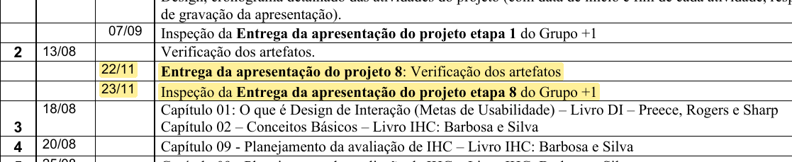

Responsáveis: Bruno Ferreira Dornelas e Caio Breno de Souza Bezerra · Grupo 06

# Etapa 8 · Verificação dos artefatos

## Tabela de contribuição

| Integrante | Contribuição | Artefato / atividade |
| --- | --- | --- |
| [Bruno Ferreira Dornelas](https://github.com/brunnf) | Elaboração da Lista V2 da Etapa 4 (40 critérios por conteúdo e autoria), reinspeção dos Grupos 06 e 05 (−1), gráficos da Etapa 4 e conferência das fichas V1 da Etapa 4 | [Lista da Etapa 4](lista-etapa-4.md) · [Resultados da Etapa 4](resultados/etapa-4.md) · [Conferência V1](conferencia-anterior.md#grupo-06-etapa-4) |
| [Caio Breno de Souza Bezerra](https://github.com/CaioBezerra-Dev) | Documentação do escopo das Etapas 6 e 7 e das versões de referência dos três grupos | [Escopo e versões](#escopo-e-versoes) |
| [Caio Breno de Souza Bezerra](https://github.com/CaioBezerra-Dev) | Organização dos vínculos entre as listas V1 e V2, as fichas por grupo e os resultados por etapa | [Listas](#listas-de-verificacao) · [Resultados](inspecao.md#respostas-por-grupo) |
| [Caio Breno de Souza Bezerra](https://github.com/CaioBezerra-Dev) | Documentação da adaptação do processo de Fagan para registrar as constatações e acompanhar os ajustes | [Método de inspeção](#metodo-de-inspecao) |
| Codex (OpenAI), Google Gemini e Antigravity | Apoio à consulta das fontes, à edição dos textos e à organização das tabelas, imagens e gráficos | [Agradecimentos](#agradecimentos) |

Tabela 1 — Contribuição neste artefato.

Fonte: elaboração para o Grupo 06 (2026).

A reinspeção abrange a autoinspeção do Grupo 06 nas **Etapas 4, 6 e 7**. Seguindo a regra de paridade da disciplina, a inspeção externa cobre os artefatos do **Grupo 05 (−1) nas Etapas 4 e 6** e os do **Grupo 07 (+1) na Etapa 7**. As seis fichas registram **186 respostas**, com critério, constatação, página e versão consultadas.

- [**Lista V2 da Etapa 4**](lista-etapa-4.md) 
  Storyboards, análise de tarefas e planejamentos da avaliação (DECIDE) e do relato.
- [**Lista V2 da Etapa 6**](lista-etapa-6.md) 
  Relato do papel, planejamento da avaliação de alta fidelidade e planejamento do relato.
- [**Lista V2 da Etapa 7**](lista-etapa-7.md) 
  Relato do teste de alta fidelidade, evidências e reprojeto.
- [**Inspeções e gráficos**](inspecao.md) 
  Respostas por grupo, resultados por etapa e roteiro da gravação.
- [**Conferência das respostas V1**](conferencia-anterior.md) 
  Cotejo item a item das seis fichas históricas.

## Listas de verificação

As listas usam os critérios de desenvolvimento do plano de ensino e fundamentam os critérios de conteúdo em Barbosa e Silva (2010), Vianna et al. (2012) e Preece, Rogers e Sharp (2005), adaptados aos artefatos de cada etapa. A V2 é a versão oficial para a Etapa 8. Cada critério explicita a evidência esperada e a regra de julgamento. As perguntas aceitam planos compartilhados com cobertura demonstrável e registros equivalentes quando a evidência pode ser localizada.

| Etapa | Artefatos | Lista V1 | Lista V2 oficial |
| --- | --- | --- | --- |
| 4 | Storyboards, análise de tarefas e planejamentos da avaliação e dos relatos | [V1 da Etapa 4](../verificacao/listas/etapa-4.md) | [40 critérios](lista-etapa-4.md) |
| 6 | Relato do papel e dois planos para a alta fidelidade | [V1 da Etapa 6](../verificacao/listas/etapa-6.md) | [27 critérios](lista-etapa-6.md) |
| 7 | Relatos da alta fidelidade e seus registros | [V1 da Etapa 7](../verificacao/listas/etapa-7.md) | [26 critérios](lista-etapa-7.md) |

A entrega da Etapa 8 está prevista para **22/11** e a apresentação para **24/11/2026**. Para **23/11**, o plano de ensino registra a inspeção da entrega da Etapa 8 do Grupo +1 (pp. 4–5).

{ loading=lazy }

Fonte: Sales (2026), p. 4 do PDF. Grifos nas datas de entrega e inspeção.

## Método de inspeção

A verificação adapta o processo de **Fagan (1976, especialmente Tabela 3 e pp. 190–193)** a documentos de IHC publicados em wiki. A preparação define escopo, versões e critérios. Durante a inspeção, o leitor percorre o artefato, o moderador mantém o foco nas constatações e o registro localiza a evidência. Fagan distingue a identificação dos problemas, o retrabalho e a conferência de cada solução. A classificação distingue a falta de uma informação de uma inconsistência entre registros, adaptação das categorias de Fagan para documentos. A equipe retomará os itens pendentes quando houver nova versão. [Artigo original](https://doi.org/10.1147/sj.153.0182).

| Operação | Aplicação nesta entrega |
| --- | --- |
| Visão geral | Identificar o objetivo da etapa, o grupo, os artefatos e as versões do inventário. |
| Preparação | Consultar plano de ensino, livro e fichas anteriores. Fixar as perguntas V2 e o que comprova cada uma. |
| Inspeção | Conferir o material publicado e registrar por ID a resposta, a evidência e o impacto da lacuna. Consolidar a frequência por bloco. |
| Retrabalho | Encaminhar ao responsável do artefato as pendências identificadas na ficha do grupo. |
| Acompanhamento | Reabrir o mesmo critério na nova versão, registrar data, evidência e resultado. Manter o estado pendente até a verificação. |

Para classificar uma linha, **Sim** exige cobertura em todo o recorte aplicável, **Incompleto** indica evidência parcial ou contraditória, e **Não** indica requisito aplicável sem evidência essencial nos locais consultados. Em itens por integrante, um caso pendente impede Sim no agregado. A ficha indica qual artefato fundamenta a constatação. Nos itens de registro, a declaração pública informa consentimento e visibilidade. O conteúdo de termos assinados e as configurações privadas dos vídeos ficam fora do recorte.

## Escopo e versões

A reinspeção externa segue a distribuição das fichas V1, com o Grupo −1 nas etapas pares e o Grupo +1 nas etapas ímpares. [Ficha V1 da Etapa 4 · Grupo 05](../verificacao/grupo-05/etapa-4/lista-verificacao.md) · [Ficha V1 da Etapa 6 · Grupo 05](../verificacao/grupo-05/etapa-6/lista-verificacao.md) · [Ficha V1 da Etapa 7 · Grupo 07](../verificacao/grupo-07/etapa-7/lista-verificacao.md).

O inventário foi levantado pelos menus e links de cada site. As fichas ligam as páginas renderizadas ao código-fonte na revisão de referência e indicam a versão de cada artefato quando ela está publicada. Identificar a versão testada exige cruzar o endereço do protótipo com a revisão indicada no relato. Autorização e versão são avaliadas pelos registros disponíveis.

| Grupo inspecionado | Projeto | Revisão de referência | Ficha |
| --- | --- | --- | --- |
| Grupo 06 (autoinspeção) | [Portal do Senado Federal](https://interacao-humano-computador.github.io/2026.2-Grupo06/) | [`5dfe10f`](https://github.com/Interacao-Humano-Computador/2026.2-Grupo06/tree/5dfe10f7661a6b839c87ced4f37f15a33e3a7d46) | [Etapa 4](grupo-06/etapa-4.md) · [Etapa 6](grupo-06/etapa-6.md) · [Etapa 7](grupo-06/etapa-7.md) |
| Grupo 07 (+1) | [PCI Concursos](https://interacao-humano-computador.github.io/2026.2-Grupo07/) | [`12913da`](https://github.com/Interacao-Humano-Computador/2026.2-Grupo07/tree/12913da5f0d83900ce91e500e26524987f0a9497) | [Etapa 7](grupo-07/etapa-7.md) |
| Grupo 05 (−1) | [SEMOB-DF](https://interacao-humano-computador.github.io/2026.2-Grupo05/) | [`48109ed`](https://github.com/Interacao-Humano-Computador/2026.2-Grupo05/tree/48109ede138038cc9e9e9d8a6723b0ad8696c734) (Etapa 4) · [`cad2b42`](https://github.com/Interacao-Humano-Computador/2026.2-Grupo05/tree/cad2b42de633a5f997fb6a87942bd1cd4da33aa2) (Etapa 6) | [Etapa 4](grupo-05/etapa-4.md) · [Etapa 6](grupo-05/etapa-6.md) |

## Agradecimentos

Codex (OpenAI), Google Gemini e Antigravity apoiaram a consulta às fontes, a redação dos critérios, a localização de trechos e a preparação de recortes, tabelas e gráficos. Bruno Ferreira Dornelas responde pela Lista V2 e pelas reinspeções da Etapa 4; Caio Breno de Souza Bezerra responde pelas Listas V2 e pelas reinspeções das Etapas 6 e 7.

## Histórico de versão

| Versão | Data | Descrição | Autor(es) | Revisor designado |
| :---: | :---: | --- | --- | --- |
| `1.0` | 19/11/2026 | Abertura da Etapa 8 e integração das listas V2, fichas e gráficos. | [Caio Breno de Souza Bezerra](https://github.com/CaioBezerra-Dev) | [Bruno Ferreira Dornelas](https://github.com/brunnf) |
| `1.1` | 19/11/2026 | Organiza listas, resultados e fichas por etapa e publica o vínculo entre V1 e V2. | [Caio Breno de Souza Bezerra](https://github.com/CaioBezerra-Dev) | [Bruno Ferreira Dornelas](https://github.com/brunnf) |
| `1.2` | 19/11/2026 | Detalha as contribuições por página e registra os revisores designados. | [Caio Breno de Souza Bezerra](https://github.com/CaioBezerra-Dev) | [Bruno Ferreira Dornelas](https://github.com/brunnf) |
| `1.3` | 21/11/2026 | Integração da Lista V2, das reinspeções dos Grupos 06 e 05 (−1), dos gráficos e da conferência V1 da Etapa 4. | [Bruno Ferreira Dornelas](https://github.com/brunnf) | [Caio Breno de Souza Bezerra](https://github.com/CaioBezerra-Dev) |

## Referências

1. SALES, André Barros de. *Plano de Ensino FIHC 022026 — Turma 01*. v1. Brasília: FCTE/UnB, 2026.

2. BARBOSA, Simone Diniz Junqueira; SILVA, Bruno Santana da. *Interação humano-computador*. Rio de Janeiro: Elsevier, 2010.

3. VIANNA, Maurício et al. *Design Thinking: inovação em negócios*. Rio de Janeiro: MJV Press, 2012.

4. PREECE, Jennifer; ROGERS, Yvonne; SHARP, Helen. *Design de interação: além da interação homem-computador*. Porto Alegre: Bookman, 2005.

5. FAGAN, Michael E. *Design and code inspections to reduce errors in program development*. IBM Systems Journal, v. 15, n. 3, p. 182–211, 1976. [DOI 10.1147/sj.153.0182](https://doi.org/10.1147/sj.153.0182).
