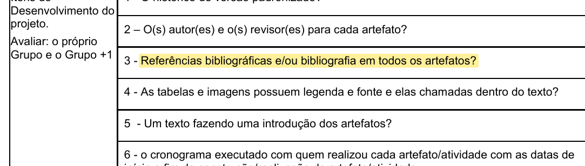
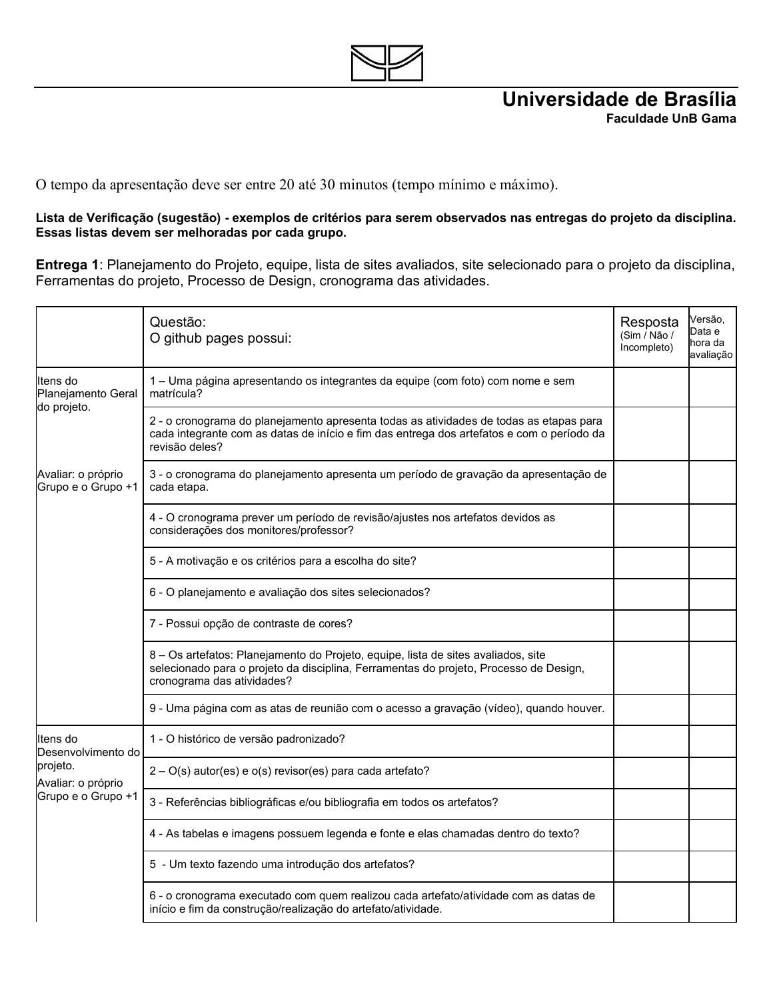
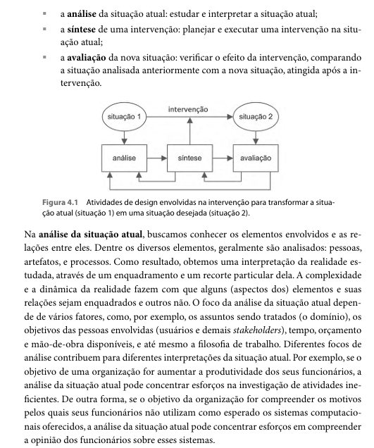
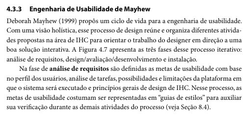
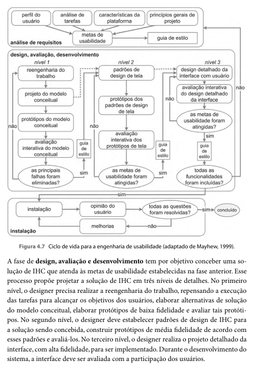
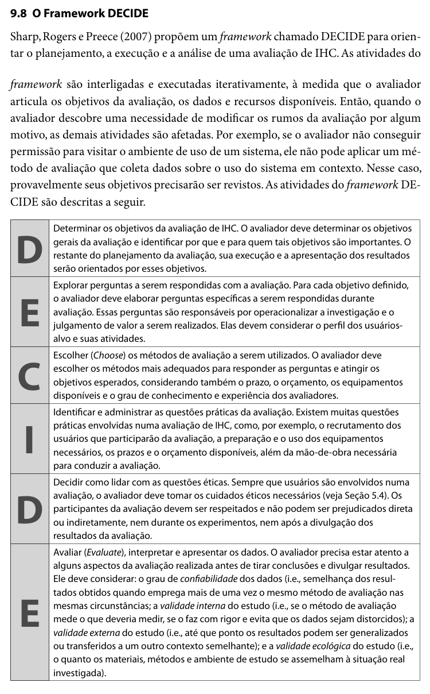
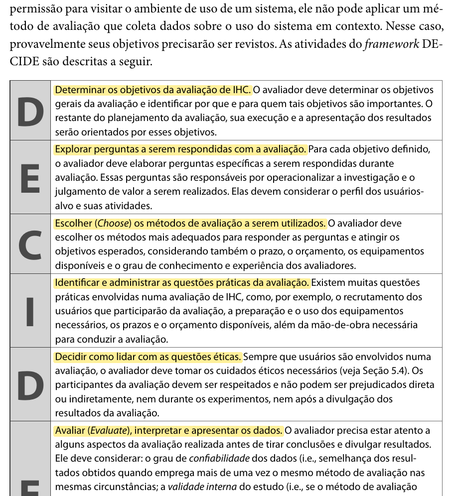
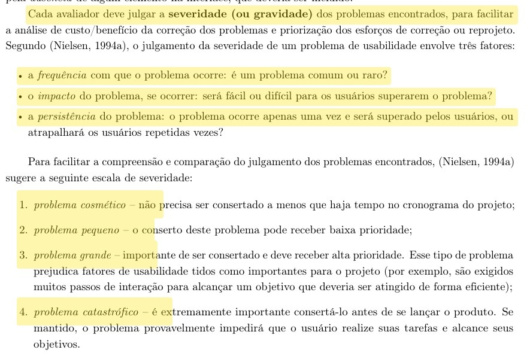
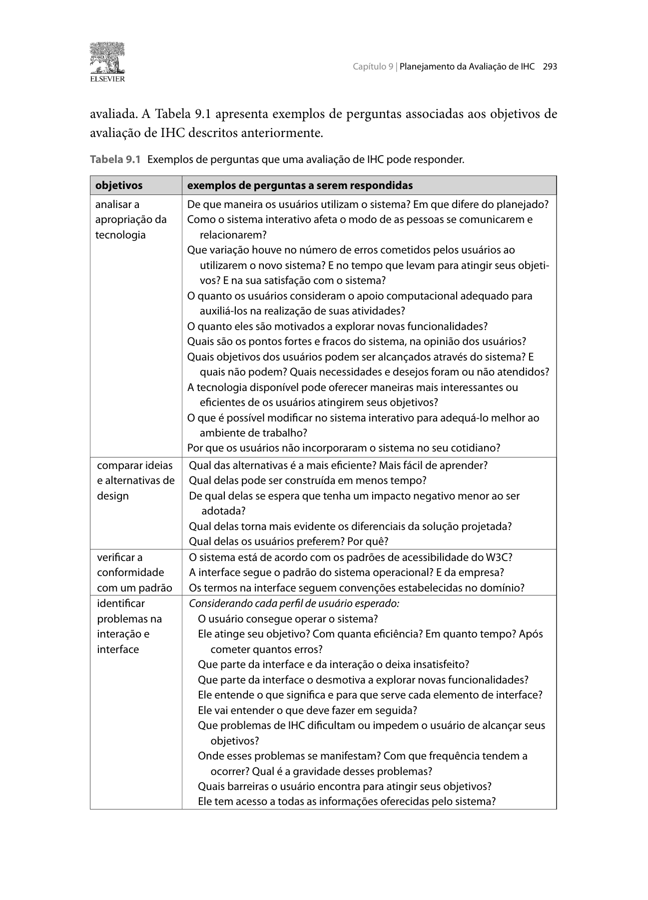

Responsável: Heitor Pinheiro Gonçalves das Chagas · Grupo 06

# Lista de verificação da Etapa 1 · V2

## Tabela de contribuição

| Integrante | Contribuição | Artefato / atividade |
| --- | --- | --- |
| [Heitor Pinheiro Gonçalves das Chagas](https://github.com/Heitorovski01) | Revisão dos 11 critérios de desenvolvimento do projeto com base no plano de ensino e indicação da evidência esperada | [Desenvolvimento do projeto](#desenvolvimento-do-projeto) |
| [Heitor Pinheiro Gonçalves das Chagas](https://github.com/Heitorovski01) | Formulação e revisão dos 13 critérios de planejamento geral e conteúdo da disciplina para a Etapa 1, com recortes das fontes | [Conteúdo da disciplina](#conteudo-da-disciplina) |
| [Heitor Pinheiro Gonçalves das Chagas](https://github.com/Heitorovski01) | Definição das regras de julgamento e registro das correspondências entre a lista V1 e a lista V2 | [Como aplicar](#como-aplicar) · [Conferência da lista](#conferencia-da-lista) |
| [Caio Breno de Souza Bezerra](https://github.com/CaioBezerra-Dev) | Autoria original dos critérios de DECIDE e severidade de Nielsen na V1 e estrutura base V2 | [E1-11](#e1-11) · [E1-12](#e1-12) |
| [Luís Henrique Arruda Luna](https://github.com/Donnk61) | Autoria original do critério de classificação dos métodos de avaliação na V1 | [E1-13](#e1-13) |
| Antigravity e Google Gemini | Apoio à consulta das referências, à padronização dos enunciados e à organização da rastreabilidade V1–V2 | [Agradecimentos](#agradecimentos) |

Tabela 1 — Contribuição neste artefato.

Fonte: elaboração para o Grupo 06 (2026).

[Etapa 8](index.md) · [Visão geral das inspeções](inspecao.md) · [Lista V1 da Etapa 1](../verificacao/listas/etapa-1.md) · [Ficha V1 da Etapa 1 · Grupo 06](../verificacao/grupo-06/etapa-1/lista-verificacao.md) · [Ficha V1 da Etapa 1 · Grupo 07](../verificacao/grupo-07/etapa-1/lista-verificacao.md)

## Como aplicar

Use a mesma redação na autoinspeção do Grupo 06 e na inspeção externa do Grupo 07 (+1). A resposta resume a cobertura dos artefatos daquela etapa. Cada item traz a evidência esperada, o vínculo com a V1 e um recorte da fonte de referência.

- **Sim** quando a evidência atende à pergunta em todo o recorte aplicável.
- **Incompleto** quando existe evidência parcial, contraditória ou sem cobertura de todos os artefatos do recorte.
- **Não** quando o requisito é aplicável e a evidência essencial está ausente nos locais consultados ou contraria a afirmação.

Na ficha, registre grupo, etapa, ID, versão, data, fonte e trecho que sustenta o julgamento. Para uma lacuna, indique onde procurou. Se algum item estiver fora de escopo, documente o motivo antes de calcular as contagens. [Método e escopo](index.md#metodo-de-inspecao).

## Desenvolvimento do projeto

??? question "D01 · O histórico identifica a versão, a data e a mudança de cada artefato?"

    **Autor do item:** [Heitor Pinheiro Gonçalves das Chagas](https://github.com/Heitorovski01).

    **O que conferir.** Abra o histórico em cada documento principal da Etapa 1 (equipe, cronograma, heatmap, sites avaliados, site escolhido, processo de design e ferramentas). Confira se as entradas permitem distinguir a versão corrente e o que mudou.

    **Rastreabilidade na V1.** [D01](../verificacao/listas/etapa-1.md#d01) · mantido com campos explícitos.

    { loading=lazy }

    
Fonte: Sales (2026), p. 8 do PDF. O grifo indica o trecho usado no critério.

??? question "D02 · A versão consultada identifica quem escreveu e quem revisou o artefato?"

    **Autor do item:** [Heitor Pinheiro Gonçalves das Chagas](https://github.com/Heitorovski01).

    **O que conferir.** Leia a entrada da versão corrente. O revisor deve ser distinto do autor e a entrada deve registrar revisão ou atribuí-la àquela versão. Campo vazio, autor repetido ou revisão a definir indicam lacuna.

    **Rastreabilidade na V1.** [D02](../verificacao/listas/etapa-1.md#d02) · refinado para a versão examinada.

    { loading=lazy }

    
Fonte: Sales (2026), p. 8 do PDF. O grifo indica o trecho usado no critério.

??? question "D03 · Os artefatos principais apresentam referências bibliográficas?"

    **Autor do item:** [Heitor Pinheiro Gonçalves das Chagas](https://github.com/Heitorovski01).

    **O que conferir.** Confira referências que fundamentam o processo de design, a escolha de ferramentas, os métodos de avaliação e o plano de ensino nos documentos da Etapa 1.

    **Rastreabilidade na V1.** [D03](../verificacao/listas/etapa-1.md#d03) · delimita os documentos principais.

    { loading=lazy }

    
Fonte: Sales (2026), p. 8 do PDF. O grifo indica o trecho usado no critério.

??? question "D04 · Figuras e tabelas têm identificação, fonte e chamada no texto?"

    **Autor do item:** [Heitor Pinheiro Gonçalves das Chagas](https://github.com/Heitorovski01).

    **O que conferir.** Confira as figuras e tabelas de conteúdo (cronograma, heatmap, comparativo de processos e capturas dos sites candidatos). Procure numeração e legenda, origem e uma chamada que aponte para o elemento. Registre quais elementos têm lacunas.

    **Rastreabilidade na V1.** [D04](../verificacao/listas/etapa-1.md#d04) · mantido com escopo de conteúdo.

    { loading=lazy }

    
Fonte: Sales (2026), p. 8 do PDF. O grifo indica o trecho usado no critério.

??? question "D05 · Os artefatos apresentam objetivo e escopo antes de detalhar o conteúdo?"

    **Autor do item:** [Heitor Pinheiro Gonçalves das Chagas](https://github.com/Heitorovski01).

    **O que conferir.** Localize o trecho de abertura que informa a finalidade do documento e o seu papel no planejamento da Etapa 1. Um título de seção diferente de ‘Introdução’ é aceito.

    **Rastreabilidade na V1.** [D05](../verificacao/listas/etapa-1.md#d05) · aceita aberturas equivalentes.

    { loading=lazy }

    
Fonte: Sales (2026), p. 8 do PDF. O grifo indica o trecho usado no critério.

??? question "D06 · O cronograma executado identifica responsáveis e datas reais para os artefatos e atividades da etapa?"

    **Autor do item:** [Heitor Pinheiro Gonçalves das Chagas](https://github.com/Heitorovski01).

    **O que conferir.** Abra as entradas de execução da Etapa 1 e procure datas reais de início e fim, ação e pessoas responsáveis. Uma tabela apenas planejada não substitui o registro executado.

    **Rastreabilidade na V1.** [D06](../verificacao/listas/etapa-1.md#d06) · explicita o que conta como execução.

    { loading=lazy }

    
Fonte: Sales (2026), p. 8 do PDF. O grifo indica o trecho usado no critério.

??? question "D07 · A etapa tem ata de reunião com data, início e fim, participantes, pauta e decisões?"

    **Autor do item:** [Heitor Pinheiro Gonçalves das Chagas](https://github.com/Heitorovski01).

    **O que conferir.** Procure as atas da Etapa 1 e compare os campos publicados (data, horário de início e término, integrantes presentes, objetivo/pauta e deliberações).

    **Rastreabilidade na V1.** [E1-P09](../verificacao/listas/etapa-1.md#e1-p09) + [D07](../verificacao/listas/etapa-1.md#d07) · consolidados com campos explícitos da ata.

    { loading=lazy }

    
Fonte: Sales (2026), p. 9 do PDF. O grifo indica o trecho usado no critério.

??? question "D08 · As gravações das reuniões e da verificação da etapa estão localizáveis no site?"

    **Autor do item:** [Heitor Pinheiro Gonçalves das Chagas](https://github.com/Heitorovski01).

    **O que conferir.** Confira a associação entre a reunião da Etapa 1 (ou reunião de verificação), a ata/ficha correspondente e o endereço da gravação no YouTube.

    **Rastreabilidade na V1.** [E1-P09](../verificacao/listas/etapa-1.md#e1-p09) + [D08](../verificacao/listas/etapa-1.md#d08) · delimita acesso à gravação da reunião e da inspeção.

    { loading=lazy }

    
Fonte: Sales (2026), p. 9 do PDF. O grifo indica o trecho usado no critério.

??? question "D09 · A apresentação da etapa tem vídeo publicado como não listado e identificado no site?"

    **Autor do item:** [Heitor Pinheiro Gonçalves das Chagas](https://github.com/Heitorovski01).

    **O que conferir.** Confira o vídeo coletivo de apresentação da Etapa 1, os participantes declarados e a indicação da categoria não listada na página.

    **Rastreabilidade na V1.** [D09](../verificacao/listas/etapa-1.md#d09) · explicita a categoria do plano de ensino.

    { loading=lazy }

    
Fonte: Sales (2026), p. 9 do PDF. O grifo indica o trecho usado no critério.

??? question "D10 · A contribuição de cada pessoa está identificada no início dos artefatos, com links para as atividades?"

    **Autor do item:** [Heitor Pinheiro Gonçalves das Chagas](https://github.com/Heitorovski01).

    **O que conferir.** Aceite tabela de contribuição própria ou incorporada ao início do documento. Confira pessoa, atividade atribuída e hiperligação para a seção ou para a gravação quando houver.

    **Rastreabilidade na V1.** [D10](../verificacao/listas/etapa-1.md#d10) · aceita tabela equivalente com os mesmos campos.

    { loading=lazy }

    
Fonte: Sales (2026), p. 9 do PDF. O grifo indica o trecho usado no critério.

??? question "D11 · O artefato declara a ferramenta de IA generativa usada e a finalidade do apoio?"

    **Autor do item:** [Heitor Pinheiro Gonçalves das Chagas](https://github.com/Heitorovski01).

    **O que conferir.** Use a seção de agradecimentos ou declaração, ou um registro de uso identificável no próprio artefato. Quando houver indicação de uso, confira o nome da ferramenta e as atividades apoiadas. Se a evidência for só genérica, marque Incompleto.

    **Rastreabilidade na V1.** [D11](../verificacao/listas/etapa-1.md#d11) · prioriza a declaração explícita, aceita local equivalente.

    { loading=lazy }

    
Fonte: Sales (2026), p. 3 do PDF. O grifo indica o trecho usado no critério.

## Conteúdo da disciplina

??? question "E1-01 · Todos os artefatos previstos para o planejamento do projeto na Etapa 1 estão localizáveis no site?"

    **Autor do item:** [Heitor Pinheiro Gonçalves das Chagas](https://github.com/Heitorovski01).

    **O que conferir.** Confirme a presença e o acesso às páginas de equipe, cronograma das atividades, heatmap de disponibilidade, lista de sites avaliados, site selecionado para o projeto, ferramentas do projeto e processo de design.

    **Rastreabilidade na V1.** [E1-P08](../verificacao/listas/etapa-1.md#e1-p08) · mantido com escopo completo do inventário da Etapa 1.

    { loading=lazy }

    
Fonte: Sales (2026), p. 8 do PDF.

??? question "E1-02 · A página da equipe apresenta todos os integrantes com foto e nome completo, sem exibir número de matrícula?"

    **Autor do item:** [Heitor Pinheiro Gonçalves das Chagas](https://github.com/Heitorovski01).

    **O que conferir.** Abra a página de equipe (ou seção equivalente na página inicial) e confirme que cada integrante possui fotografia visível e nome completo, sem exposição de matrícula acadêmica.

    **Rastreabilidade na V1.** [E1-P01](../verificacao/listas/etapa-1.md#e1-p01) · mantido.

    { loading=lazy }

    
Fonte: Sales (2026), p. 8 do PDF.

??? question "E1-03 · O site oferece opção funcional de alternância de contraste de cores ou tema visual de acessibilidade?"

    **Autor do item:** [Heitor Pinheiro Gonçalves das Chagas](https://github.com/Heitorovski01).

    **O que conferir.** Verifique no cabeçalho ou barra de ferramentas do GitHub Pages a presença de controle de contraste/tema (claro, escuro ou alto contraste) e documentação de acessibilidade quando aplicável.

    **Rastreabilidade na V1.** [E1-P07](../verificacao/listas/etapa-1.md#e1-p07) · mantido.

    { loading=lazy }

    
Fonte: Sales (2026), p. 8 do PDF.

??? question "E1-04 · O cronograma planejado distribui as atividades de todas as etapas com autores nominais, datas de início e fim e períodos de revisão com revisores?"

    **Autor do item:** [Heitor Pinheiro Gonçalves das Chagas](https://github.com/Heitorovski01).

    **O que conferir.** Confira as tabelas do cronograma planejado para todas as etapas do semestre. Verifique se há datas de início e término, atribuição nominal de autores (evitando apenas o rótulo genérico "Grupo" em tarefas individuais) e intervalo de revisão com revisor designado.

    **Rastreabilidade na V1.** [E1-P02](../verificacao/listas/etapa-1.md#e1-p02) · detalha a individualização nominal de autores e revisores.

    { loading=lazy }

    
Fonte: Sales (2026), p. 8 do PDF.

??? question "E1-05 · O cronograma planejado prevê, em cada etapa, períodos dedicados à gravação da apresentação e aos ajustes pós-avaliação do professor e monitores?"

    **Autor do item:** [Heitor Pinheiro Gonçalves das Chagas](https://github.com/Heitorovski01).

    **O que conferir.** Nas tabelas de cada etapa do cronograma planejado, localize as linhas específicas para gravação/edição do vídeo da apresentação e para revisão/ajustes decorrentes das considerações do professor ou monitores.

    **Rastreabilidade na V1.** [E1-P03](../verificacao/listas/etapa-1.md#e1-p03) + [E1-P04](../verificacao/listas/etapa-1.md#e1-p04) · consolidados nas janelas obrigatórias por etapa.

    { loading=lazy }

    
Fonte: Sales (2026), p. 8 do PDF.

??? question "E1-06 · O planejamento documenta os sites candidatos avaliados pela equipe e vincula os relatórios ou planejamentos individuais de avaliação?"

    **Autor do item:** [Heitor Pinheiro Gonçalves das Chagas](https://github.com/Heitorovski01).

    **O que conferir.** Abra a página de sites avaliados e confirme a identificação de cada site candidato examinado pelos integrantes, o resumo dos achados e o acesso aos documentos/PDFs individuais de planejamento e avaliação.

    **Rastreabilidade na V1.** [E1-P06](../verificacao/listas/etapa-1.md#e1-p06) · explicita o vínculo aos relatórios individuais.

    { loading=lazy }

    
Fonte: Sales (2026), p. 8 do PDF.

??? question "E1-07 · O artefato do site escolhido explicita a motivação e os critérios objetivos que fundamentaram a seleção do sistema para o projeto?"

    **Autor do item:** [Heitor Pinheiro Gonçalves das Chagas](https://github.com/Heitorovski01).

    **O que conferir.** Localize na página do site escolhido a justificativa da decisão do grupo, relacionando critérios como relevância pública, diversidade de funcionalidades, complexidade de fluxos, não ter sido trabalhado anteriormente e potencial de identificação de problemas de IHC.

    **Rastreabilidade na V1.** [E1-P05](../verificacao/listas/etapa-1.md#e1-p05) · mantido com critérios verificáveis.

    { loading=lazy }

    
Fonte: Sales (2026), p. 8 do PDF.

??? question "E1-08 · O documento de Processo de Design compara modelos de ciclo de vida de IHC e fundamenta as atividades básicas de análise, síntese e avaliação?"

    **Autor do item:** [Heitor Pinheiro Gonçalves das Chagas](https://github.com/Heitorovski01).

    **O que conferir.** Confira no artefato de Processo de Design a apresentação das três atividades básicas de design (análise da situação atual, síntese de uma intervenção e avaliação) e a comparação entre alternativas da literatura (ciclo simples, ciclo em estrela, engenharia de usabilidade de Nielsen e engenharia de usabilidade de Mayhew).

    **Rastreabilidade na V1.** [E1-C01](../verificacao/listas/etapa-1.md#e1-c01) · desmembrado para verificar a fundamentação e comparação dos modelos de ciclo de vida.

    { loading=lazy }

    
Fonte: Barbosa e Silva (2010), cap. 4.

??? question "E1-09 · A escolha do Processo de Design é justificada para o contexto do site selecionado, com autor do item, referência bibliográfica e recorte da fonte?"

    **Autor do item:** [Heitor Pinheiro Gonçalves das Chagas](https://github.com/Heitorovski01).

    **O que conferir.** Verifique se o artefato justifica por que o modelo escolhido (ex.: Engenharia de Usabilidade de Mayhew) se adapta ao projeto do grupo e às entregas da disciplina, apresentando o nome do autor do item, a citação bibliográfica e a imagem do trecho do livro.

    **Rastreabilidade na V1.** [E1-C01](../verificacao/listas/etapa-1.md#e1-c01) · focaliza a justificativa contextualizada e a evidência bibliográfica exigida pelo plano de ensino.

    { loading=lazy }

    
Fonte: Barbosa e Silva (2010), p. 109.

    { loading=lazy }

    
Fonte: Barbosa e Silva (2010), p. 110.

??? question "E1-10 · As ferramentas utilizadas no projeto e a disponibilidade da equipe (heatmap) estão documentadas com finalidade e organização clara?"

    **Autor do item:** [Heitor Pinheiro Gonçalves das Chagas](https://github.com/Heitorovski01).

    **O que conferir.** Abra os artefatos de Ferramentas e de Heatmap de disponibilidade. Confira se cada ferramenta adotada pelo grupo tem seu papel/finalidade descrito no projeto e se o quadro de horários consolida as faixas de disponibilidade dos integrantes para reuniões e pareamentos.

    **Rastreabilidade na V1.** [E1-P08](../verificacao/listas/etapa-1.md#e1-p08) + [E1-C02](../verificacao/listas/etapa-1.md#e1-c02) · explicita a verificação de conteúdo de Ferramentas e Heatmap.

    { loading=lazy }

    
Fonte: Sales (2026), p. 8 do PDF.

??? question "E1-11 · O planejamento da avaliação dos sites candidatos articula as seis atividades do framework DECIDE?"

    **Autor do item:** [Caio Breno de Souza Bezerra](https://github.com/CaioBezerra-Dev).

    **O que conferir.** Nos planejamentos de avaliação dos sites candidatos (página consolidada e/ou relatórios anexados), confirme a cobertura das seis etapas do DECIDE: (1) determinar os objetivos; (2) explorar as perguntas a serem respondidas; (3) escolher os métodos; (4) identificar e administrar as questões práticas; (5) decidir como lidar com as questões éticas; e (6) avaliar, interpretar e apresentar os dados.

    **Rastreabilidade na V1.** [E1-C03](../verificacao/listas/etapa-1.md#e1-c03) · mantido com recortes grifados.

    { loading=lazy }

    
Fonte: Barbosa e Silva (2010), p. 312–313.

    { loading=lazy }

    
Fonte: Barbosa e Silva (2010), p. 313. O grifo indica o trecho usado no critério.

??? question "E1-12 · Na inspeção dos sites candidatos, a severidade dos problemas de usabilidade considera frequência, impacto e persistência?"

    **Autor do item:** [Caio Breno de Souza Bezerra](https://github.com/CaioBezerra-Dev).

    **O que conferir.** Confira nas avaliações heurísticas ou inspeções dos sites candidatos se o julgamento de severidade dos problemas encontrados (escala de Nielsen) leva em conta: (1) a frequência com que o problema ocorre; (2) o impacto do problema, se ocorrer; e (3) a persistência do problema.

    **Rastreabilidade na V1.** [E1-C04](../verificacao/listas/etapa-1.md#e1-c04) · mantido.

    { loading=lazy }

    
Fonte: Barbosa e Silva (2010), p. 284.

??? question "E1-13 · O planejamento da avaliação de cada site candidato nomeia o método de avaliação e o classifica como investigação, observação de uso ou inspeção?"

    **Autor do item:** [Luís Henrique Arruda Luna](https://github.com/Donnk61).

    **O que conferir.** Consulte a página de sites avaliados e os planejamentos individuais. Confirme se todos nomeiam a técnica concreta utilizada (ex.: Avaliação Heurística, Percurso Cognitivo) e a situam corretamente em uma das três categorias da literatura: (1) investigação, (2) observação de uso ou (3) inspeção.

    **Rastreabilidade na V1.** [E1-C05](../verificacao/listas/etapa-1.md#e1-c05) · mantido.

    { loading=lazy }

    
Fonte: Barbosa e Silva (2010), p. 293; Barbosa et al. (2021), Cap. 11, Seção 11.6, p. 272.

## Conferência da lista

O critério geral [E1-C02](../verificacao/listas/etapa-1.md#e1-c02) da V1 (*"Todos os integrantes da equipe devem elaborar itens de conteúdo da disciplina com referência bibliográfica da fonte e foto do texto da referência e o nome do autor do item"*) passa a compor o controle de qualidade desta lista V2. Cada critério de conteúdo acima identifica seu autor, a evidência esperada, a referência bibliográfica e a imagem da fonte.

## Agradecimentos

O Antigravity e o Google Gemini apoiaram a organização da rastreabilidade entre os itens da V1 (planejamento geral, desenvolvimento, conteúdo e itens do grupo) e a estrutura padronizada da V2 oficial da Etapa 8. Heitor Pinheiro Gonçalves das Chagas responde pela consolidação desta lista V2, preservando a autoria original dos itens formulados por Caio Breno de Souza Bezerra e Luís Henrique Arruda Luna.

## Histórico de versão

| Versão | Data | Descrição | Autor(es) | Revisor(es) |
| :---: | :---: | --- | --- | --- |
| `2.0` | 21/11/2026 | Elaboração da Lista de Verificação V2 da Etapa 1 com 11 critérios de desenvolvimento e 13 de conteúdo, rastreabilidade para a V1 e recortes das fontes. | [Heitor Pinheiro Gonçalves das Chagas](https://github.com/Heitorovski01) | [Caio Breno de Souza Bezerra](https://github.com/CaioBezerra-Dev) |
| 2.1 | 23/11/2026 | Atualiza os links de rastreabilidade para a Lista V1 da Etapa 1 | [Bruno Ferreira Dornelas](https://github.com/brunnf) | [Caio Breno de Souza Bezerra](https://github.com/CaioBezerra-Dev) |

## Referências

1. SALES, André Barros de. *Plano de Ensino FIHC 022026 — Turma 01*. v1. Brasília: FCTE/UnB, 2026.

2. BARBOSA, Simone Diniz Junqueira; SILVA, Bruno Santana da. *Interação humano-computador*. Rio de Janeiro: Elsevier, 2010. p. 109–111, 284, 293–294, 312–313.

3. BARBOSA, Simone Diniz Junqueira; SILVA, Bruno Santana da; SILVEIRA, Milene Selbach; GASPARINI, Isabela; DARIN, Ticianne; BARBOSA, Gabriel Diniz Junqueira. *Interação Humano-Computador e Experiência do Usuário*. Autopublicação, 2021. Cap. 11, seção 11.6, p. 272.
