Responsável: Heitor Pinheiro Gonçalves das Chagas · Grupo 06

# Lista de verificação da Etapa 2 · V2

## Tabela de contribuição

| Integrante | Contribuição | Artefato / atividade |
| --- | --- | --- |
| [Heitor Pinheiro Gonçalves das Chagas](https://github.com/Heitorovski01) | Revisão dos 11 critérios de desenvolvimento do projeto com base no plano de ensino e indicação da evidência esperada | [Desenvolvimento do projeto](#desenvolvimento-do-projeto) |
| [Heitor Pinheiro Gonçalves das Chagas](https://github.com/Heitorovski01) | Formulação e revisão dos 16 critérios sobre perfil do usuário, aspectos éticos, personas, cenários e análise de tarefas (HTA e CTT), incluindo autoria do item de planos na HTA | [Conteúdo da disciplina](#conteudo-da-disciplina) · [E2-15](#e2-15) |
| [Heitor Pinheiro Gonçalves das Chagas](https://github.com/Heitorovski01) | Definição das regras de julgamento e registro das correspondências entre a lista V1 e a lista V2 | [Como aplicar](#como-aplicar) · [Conferência da lista](#conferencia-da-lista) |
| [Bruno Ferreira Dornelas](https://github.com/brunnf) | Autoria original dos itens de atributos do perfil do usuário e de estrutura básica dos cenários | [E2-02](#e2-02) · [E2-03](#e2-03) · [E2-12](#e2-12) |
| [Caio Breno de Souza Bezerra](https://github.com/CaioBezerra-Dev) | Autoria original dos critérios de elementos das personas (Courage e Baxter), relação da HTA e estrutura base V2 | [E2-10](#e2-10) · [E2-14](#e2-14) |
| [Israel Soares de Paiva](https://github.com/IsraelSoares-25) | Autoria original dos itens sobre princípios éticos e cláusulas do TCLE | [E2-04](#e2-04) · [E2-06](#e2-06) |
| [Luís Henrique Arruda Luna](https://github.com/Donnk61) | Autoria original dos itens de técnicas de coleta e classificação de tarefas na notação CTT | [E2-01](#e2-01) · [E2-16](#e2-16) |
| Antigravity e Google Gemini | Apoio à consulta das referências, à padronização dos enunciados e à organização da rastreabilidade V1–V2 | [Agradecimentos](#agradecimentos) |

Tabela 1 — Contribuição neste artefato.

Fonte: elaboração para o Grupo 06 (2026).

[Etapa 8](index.md) · [Visão geral das inspeções](inspecao.md) · [Lista V1 da Etapa 2](../verificacao/listas/etapa-2.md) · [Ficha V1 da Etapa 2 · Grupo 06](../verificacao/grupo-06/etapa-2/lista-verificacao.md) · [Ficha V1 da Etapa 2 · Grupo 05](../verificacao/grupo-05/etapa-2/lista-verificacao.md)

## Como aplicar

Use a mesma redação na autoinspeção do Grupo 06 e na inspeção externa do Grupo 05 (−1). A resposta resume a cobertura dos artefatos daquela etapa. Cada item traz a evidência esperada, o vínculo com a V1 e um recorte da fonte de referência.

- **Sim** quando a evidência atende à pergunta em todo o recorte aplicável.
- **Incompleto** quando existe evidência parcial, contraditória ou sem cobertura de todos os artefatos do recorte.
- **Não** quando o requisito é aplicável e a evidência essencial está ausente nos locais consultados ou contraria a afirmação.

Na ficha, registre grupo, etapa, ID, versão, data, fonte e trecho que sustenta o julgamento. Para uma lacuna, indique onde procurou. Se algum item estiver fora de escopo, documente o motivo antes de calcular as contagens. [Método e escopo](index.md#metodo-de-inspecao).

## Desenvolvimento do projeto

??? question "D01 · O histórico identifica a versão, a data e a mudança de cada artefato?"

    **Autor do item:** [Heitor Pinheiro Gonçalves das Chagas](https://github.com/Heitorovski01).

    **O que conferir.** Abra o histórico em cada documento principal da Etapa 2 (aspectos éticos, técnicas de coleta, perfil do usuário, elenco de personas, cenários, análise de tarefas e páginas individuais). Confira se as entradas permitem distinguir a versão corrente e o que mudou.

    **Rastreabilidade na V1.** [D01](../verificacao/listas/etapa-2.md#d01) · mantido com campos explícitos.

    { loading=lazy }

    
Fonte: Sales (2026), p. 8 do PDF. O grifo indica o trecho usado no critério.

??? question "D02 · A versão consultada identifica quem escreveu e quem revisou o artefato?"

    **Autor do item:** [Heitor Pinheiro Gonçalves das Chagas](https://github.com/Heitorovski01).

    **O que conferir.** Leia a entrada da versão corrente. O revisor deve ser distinto do autor e a entrada deve registrar revisão ou atribuí-la àquela versão. Campo vazio, autor repetido ou revisão a definir indicam lacuna.

    **Rastreabilidade na V1.** [D02](../verificacao/listas/etapa-2.md#d02) · refinado para a versão examinada.

    { loading=lazy }

    
Fonte: Sales (2026), p. 8 do PDF. O grifo indica o trecho usado no critério.

??? question "D03 · Os artefatos principais apresentam referências bibliográficas?"

    **Autor do item:** [Heitor Pinheiro Gonçalves das Chagas](https://github.com/Heitorovski01).

    **O que conferir.** Confira referências que fundamentam ética, técnicas de coleta, perfil de usuário, personas, cenários e modelagem de tarefas (HTA e CTT) nos documentos do inventário da Etapa 2.

    **Rastreabilidade na V1.** [D03](../verificacao/listas/etapa-2.md#d03) · delimita os documentos principais.

    { loading=lazy }

    
Fonte: Sales (2026), p. 8 do PDF. O grifo indica o trecho usado no critério.

??? question "D04 · Figuras e tabelas têm identificação, fonte e chamada no texto?"

    **Autor do item:** [Heitor Pinheiro Gonçalves das Chagas](https://github.com/Heitorovski01).

    **O que conferir.** Confira as figuras e tabelas de conteúdo (quadros de perfil, diagramas HTA e CTT, tabelas de operações e recortes bibliográficos). Procure numeração e legenda, origem e uma chamada que aponte para o elemento. Registre quais elementos têm lacunas.

    **Rastreabilidade na V1.** [D04](../verificacao/listas/etapa-2.md#d04) · mantido com escopo de conteúdo.

    { loading=lazy }

    
Fonte: Sales (2026), p. 8 do PDF. O grifo indica o trecho usado no critério.

??? question "D05 · Os artefatos apresentam objetivo e escopo antes de detalhar o conteúdo?"

    **Autor do item:** [Heitor Pinheiro Gonçalves das Chagas](https://github.com/Heitorovski01).

    **O que conferir.** Localize o trecho de abertura que informa a finalidade do artefato e o recorte investigado na Etapa 2. Um título de seção diferente de ‘Introdução’ é aceito.

    **Rastreabilidade na V1.** [D05](../verificacao/listas/etapa-2.md#d05) · aceita aberturas equivalentes.

    { loading=lazy }

    
Fonte: Sales (2026), p. 8 do PDF. O grifo indica o trecho usado no critério.

??? question "D06 · O cronograma executado identifica responsáveis e datas reais para os artefatos e atividades da etapa?"

    **Autor do item:** [Heitor Pinheiro Gonçalves das Chagas](https://github.com/Heitorovski01).

    **O que conferir.** Abra as entradas de execução da Etapa 2 e procure datas reais de início e fim, ação e pessoas para entrevistas, consolidação de perfil, personas, cenários e análises de tarefas.

    **Rastreabilidade na V1.** [D06](../verificacao/listas/etapa-2.md#d06) · explicita o que conta como execução.

    { loading=lazy }

    
Fonte: Sales (2026), p. 8 do PDF. O grifo indica o trecho usado no critério.

??? question "D07 · A etapa tem ata de reunião com data, início e fim, participantes, pauta e decisões?"

    **Autor do item:** [Heitor Pinheiro Gonçalves das Chagas](https://github.com/Heitorovski01).

    **O que conferir.** Procure as atas da Etapa 2 e compare os campos publicados. Duração do vídeo sem indicação do encerramento da reunião ou ausência de horários deixa o registro incompleto.

    **Rastreabilidade na V1.** [D07](../verificacao/listas/etapa-2.md#d07) · explicita os campos da ata.

    { loading=lazy }

    
Fonte: Sales (2026), p. 9 do PDF. O grifo indica o trecho usado no critério.

??? question "D08 · As gravações das reuniões de verificação da etapa estão localizáveis no site?"

    **Autor do item:** [Heitor Pinheiro Gonçalves das Chagas](https://github.com/Heitorovski01).

    **O que conferir.** Confira a associação entre reunião de verificação da Etapa 2, página de registro e endereço da gravação. Consentimento e gravações de entrevistas com usuários são verificados nos critérios de conteúdo ético (`E2-05` e `E2-06`).

    **Rastreabilidade na V1.** [D08](../verificacao/listas/etapa-2.md#d08) · delimita gravação de reunião e verificação da etapa.

    { loading=lazy }

    
Fonte: Sales (2026), p. 9 do PDF. O grifo indica o trecho usado no critério.

??? question "D09 · A apresentação da etapa tem vídeo publicado como não listado e identificado no site?"

    **Autor do item:** [Heitor Pinheiro Gonçalves das Chagas](https://github.com/Heitorovski01).

    **O que conferir.** Confira o vídeo da apresentação da Etapa 2, os integrantes participantes e a categoria não listada declarada na página.

    **Rastreabilidade na V1.** [D09](../verificacao/listas/etapa-2.md#d09) · explicita a categoria do plano de ensino.

    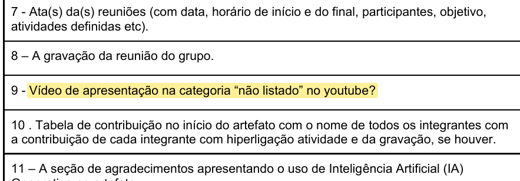{ loading=lazy }

    
Fonte: Sales (2026), p. 9 do PDF. O grifo indica o trecho usado no critério.

??? question "D10 · A contribuição de cada pessoa está identificada no início dos artefatos, com links para as atividades?"

    **Autor do item:** [Heitor Pinheiro Gonçalves das Chagas](https://github.com/Heitorovski01).

    **O que conferir.** Aceite tabela de contribuição própria ou incorporada ao início do documento. Confira pessoa, atividade atribuída e hiperligação para a atividade ou seção correspondente.

    **Rastreabilidade na V1.** [D10](../verificacao/listas/etapa-2.md#d10) · aceita tabela equivalente com os mesmos campos.

    { loading=lazy }

    
Fonte: Sales (2026), p. 9 do PDF. O grifo indica o trecho usado no critério.

??? question "D11 · O artefato declara a ferramenta de IA generativa usada e a finalidade do apoio?"

    **Autor do item:** [Heitor Pinheiro Gonçalves das Chagas](https://github.com/Heitorovski01).

    **O que conferir.** Use a seção de agradecimentos ou declaração, ou um registro de uso identificável no próprio artefato. Quando houver indicação de uso, confira o nome da ferramenta e as atividades apoiadas. Se a evidência for só genérica, marque Incompleto.

    **Rastreabilidade na V1.** [D11](../verificacao/listas/etapa-2.md#d11) · prioriza a declaração explícita, aceita local equivalente.

    { loading=lazy }

    
Fonte: Sales (2026), p. 3 do PDF. O grifo indica o trecho usado no critério.

## Conteúdo da disciplina

??? question "E2-01 · O levantamento do perfil e dos requisitos dos usuários combina no mínimo duas técnicas de coleta fundamentadas na literatura?"

    **Autor do item:** [Luís Henrique Arruda Luna](https://github.com/Donnk61).

    **O que conferir.** Confirme se a definição do perfil de usuário e dos requisitos emprega ao menos duas técnicas distintas (ex.: entrevistas semiestruturadas, observação de tarefa/investigação contextual, questionários, brainstorming, análise documental), apresentando autor do item, referência bibliográfica e imagem do trecho da fonte.

    **Rastreabilidade na V1.** [E2-C01](../verificacao/listas/etapa-2.md#e2-c01) + [E2-C08](../verificacao/listas/etapa-2.md#e2-c08) · consolidados na triangulação de técnicas de coleta.

    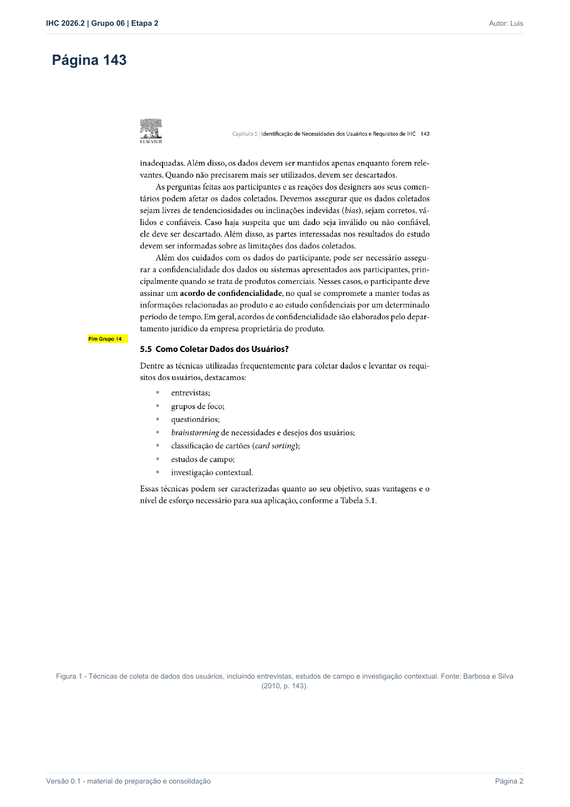{ loading=lazy }

    
Fonte: Barbosa e Silva (2010), p. 143.

    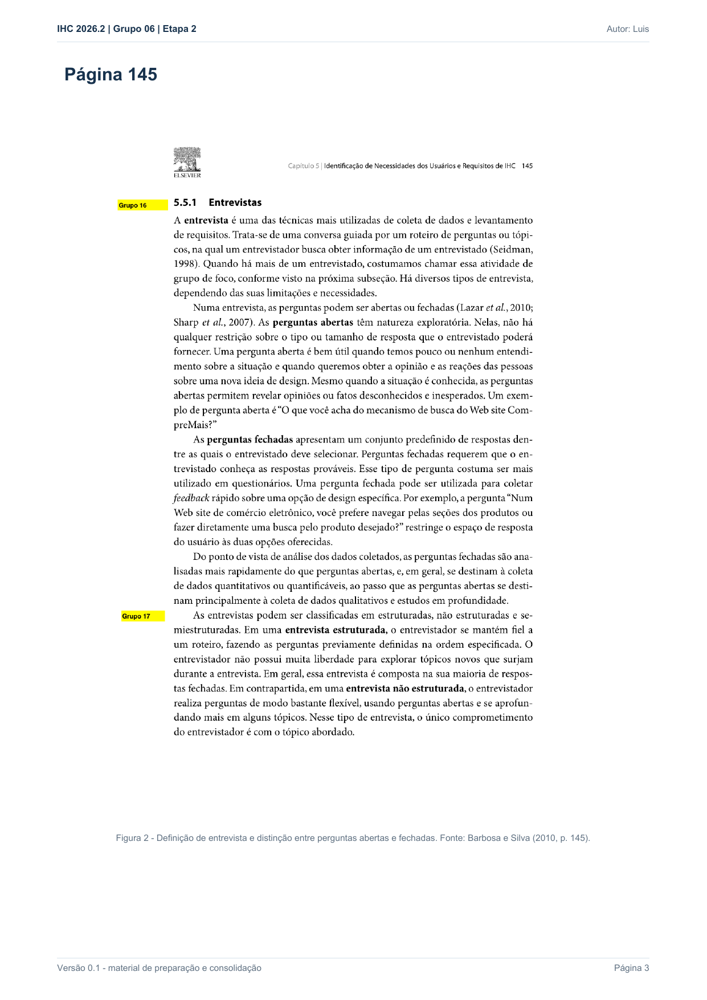{ loading=lazy }

    
Fonte: Barbosa e Silva (2010), p. 145.

??? question "E2-02 · O perfil do usuário documenta os atributos individuais propostos por Hackos e Redish (1998), com fundamentação e recorte da fonte?"

    **Autor do item:** [Bruno Ferreira Dornelas](https://github.com/brunnf).

    **O que conferir.** Confira no artefato de Perfil do Usuário a cobertura dos atributos de Hackos e Redish (1998 apud Barbosa e Silva, 2010, p. 134–135): dados demográficos (idade, sexo, status socioeconômico), experiência no cargo, informações sobre a empresa/organização, educação, experiência com computadores e com o produto, tecnologia disponível, treinamento, atitudes e valores, conhecimento do domínio, objetivos, tarefas, gravidade dos erros e idiomas/jargões, acompanhados de referência e foto do livro.

    **Rastreabilidade na V1.** [E2-C02](../verificacao/listas/etapa-2.md#e2-c02) · mantido com lista explícita de atributos verificáveis.

    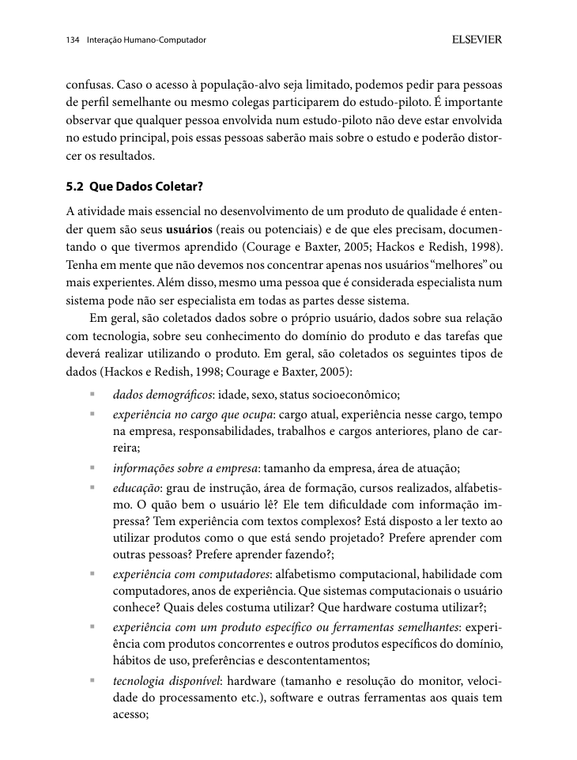{ loading=lazy }

    
Fonte: Barbosa e Silva (2010), p. 134.

    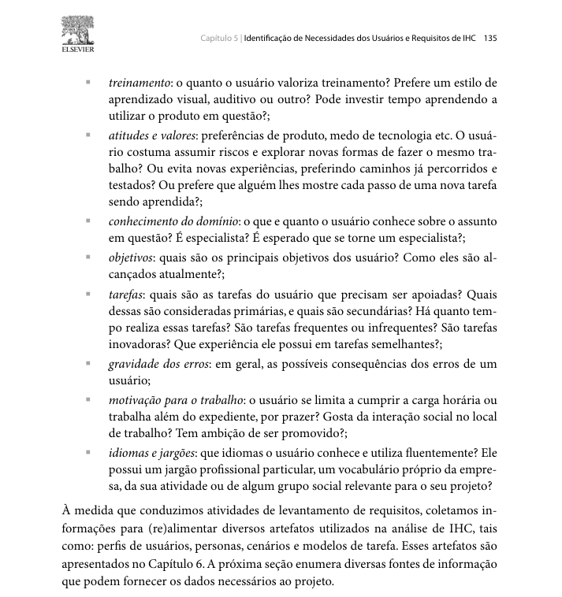{ loading=lazy }

    
Fonte: Barbosa e Silva (2010), p. 135.

??? question "E2-03 · O perfil do usuário sintetiza e agrupa as características por idade, experiência, atitudes e tarefas primárias?"

    **Autor do item:** [Bruno Ferreira Dornelas](https://github.com/brunnf).

    **O que conferir.** Verifique se o artefato classifica e agrupa os usuários segundo as quatro dimensões exemplificadas por Courage e Baxter (2005 apud Barbosa e Silva, 2010, p. 175): (1) idade; (2) experiência (leigo/novato, especialista); (3) atitudes (tecnófilos, tecnófobos); e (4) tarefas primárias, com referência e imagem do trecho utilizado.

    **Rastreabilidade na V1.** [E2-C03](../verificacao/listas/etapa-2.md#e2-c03) · mantido.

    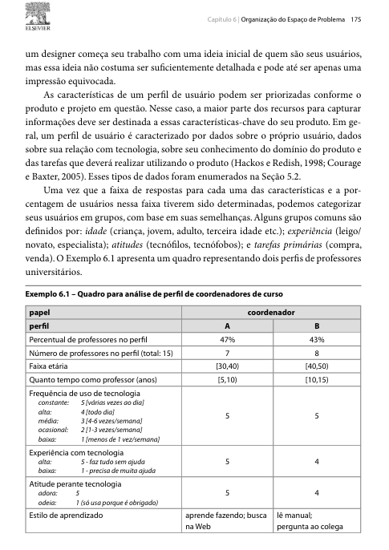{ loading=lazy }

    
Fonte: Barbosa e Silva (2010), p. 175.

??? question "E2-04 · O artefato de aspectos éticos fundamenta pesquisas envolvendo pessoas e explicita os quatro princípios éticos?"

    **Autor do item:** [Israel Soares de Paiva](https://github.com/IsraelSoares-25).

    **O que conferir.** Confira a documentação sobre cuidados éticos em pesquisas com seres humanos e a definição explícita dos quatro princípios éticos fundamentais — (1) autonomia, (2) beneficência, (3) não maleficência e (4) justiça e equidade —, com autor do item, referência bibliográfica e imagem do trecho da fonte.

    **Rastreabilidade na V1.** [E2-C04](../verificacao/listas/etapa-2.md#e2-c04) + [E2-C05](../verificacao/listas/etapa-2.md#e2-c05) · consolidados na fundamentação ética da etapa.

    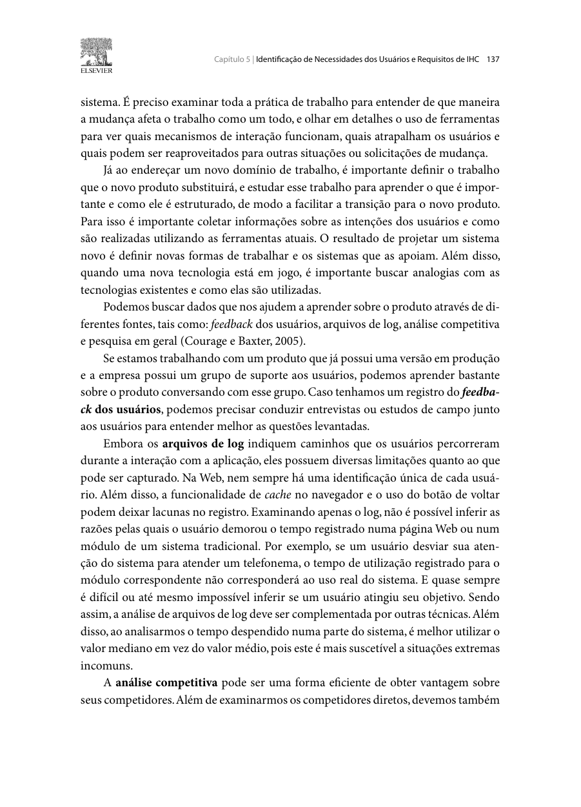{ loading=lazy }

    
Fonte: Barbosa e Silva (2010), p. 138–141.

??? question "E2-05 · A coleta de dados solicita e registra permissão explícita para gravar voz, tela ou imagem antes do início da gravação?"

    **Autor do item:** [Heitor Pinheiro Gonçalves das Chagas](https://github.com/Heitorovski01).

    **O que conferir.** Verifique no documento de ética e nos registros individuais das entrevistas se a permissão de captação audiovisual foi solicitada antes do início da gravação, especificando o escopo autorizado (áudio, tela e/ou imagem) e preservando fora do site público qualquer mídia não autorizada para divulgação.

    **Rastreabilidade na V1.** [E2-C06](../verificacao/listas/etapa-2.md#e2-c06) · explicita a verificação do escopo autorizado por sessão.

    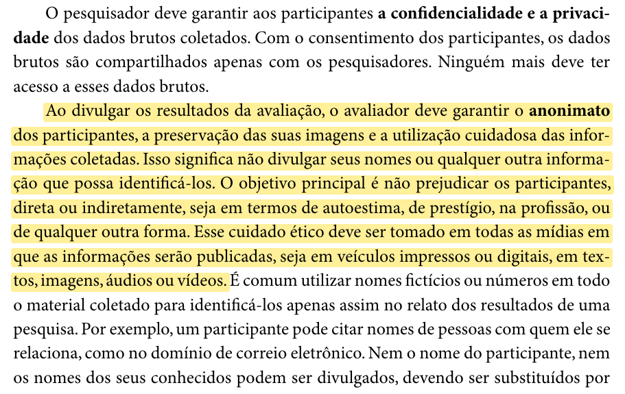{ loading=lazy }

    
Fonte: Barbosa e Silva (2010), p. 141. O grifo indica o trecho usado no critério.

??? question "E2-06 · O modelo de TCLE está disponível com garantias éticas completas e há registro da obtenção do consentimento dos participantes?"

    **Autor do item:** [Israel Soares de Paiva](https://github.com/IsraelSoares-25).

    **O que conferir.** Confirme a disponibilidade do modelo de Termo de Consentimento Livre e Esclarecido (TCLE) contendo objetivos, procedimentos, riscos/desconfortos, garantia de confidencialidade e anonimato e direito de recusa ou desistência a qualquer momento sem penalidades, além do quadro ou registro que comprove a aplicação aos participantes (mantendo dados civis sensíveis protegidos).

    **Rastreabilidade na V1.** [E2-C07](../verificacao/listas/etapa-2.md#e2-c07) + [E2-C17](../verificacao/listas/etapa-2.md#e2-c17) · consolidados, dispensando a exposição pública de assinaturas civis quando houver registro formal de aplicação.

    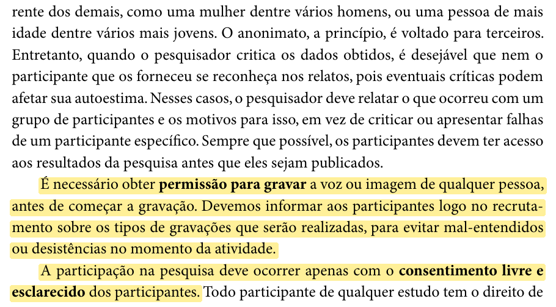{ loading=lazy }

    
Fonte: Barbosa e Silva (2010), p. 141. O grifo indica o trecho usado no critério.

??? question "E2-07 · Os relatos individuais das sessões de coleta documentam participante desidentificado, roteiro, respostas da entrevista e percurso observado?"

    **Autor do item:** [Heitor Pinheiro Gonçalves das Chagas](https://github.com/Heitorovski01).

    **O que conferir.** Para cada integrante do grupo, localize a página da sessão de coleta (ou análise documental complementar) e confirme se apresenta os atributos extraídos para o perfil, as respostas ou transcrição da entrevista e os passos observados na realização da tarefa, distinguindo relato de observação direta.

    **Rastreabilidade na V1.** [E2-C01](../verificacao/listas/etapa-2.md#e2-c01) + [E2-C08](../verificacao/listas/etapa-2.md#e2-c08) · torna verificável a execução individual da coleta que alimenta os artefatos do grupo.

    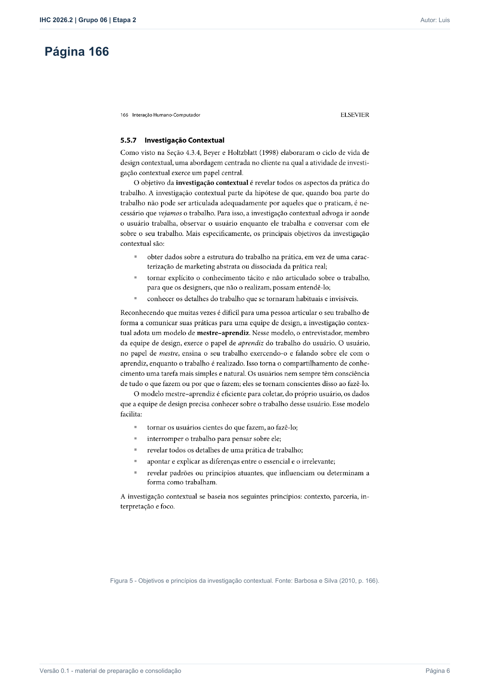{ loading=lazy }

    
Fonte: Barbosa e Silva (2010), p. 166.

??? question "E2-08 · O elenco de personas está fundamentado na literatura e define o status de priorização (primária ou secundária) de cada persona?"

    **Autor do item:** [Caio Breno de Souza Bezerra](https://github.com/CaioBezerra-Dev).

    **O que conferir.** Verifique no artefato de Elenco de Personas a definição conceitual com referência e imagem do livro, a quantidade adequada ao projeto (3 a 12 personas, com ao menos uma primária) e a justificativa do status de cada persona (primária ou secundária) em função dos objetivos de design.

    **Rastreabilidade na V1.** [E2-C14](../verificacao/listas/etapa-2.md#e2-c14) · separa a organização e priorização do elenco da estrutura interna de cada persona.

    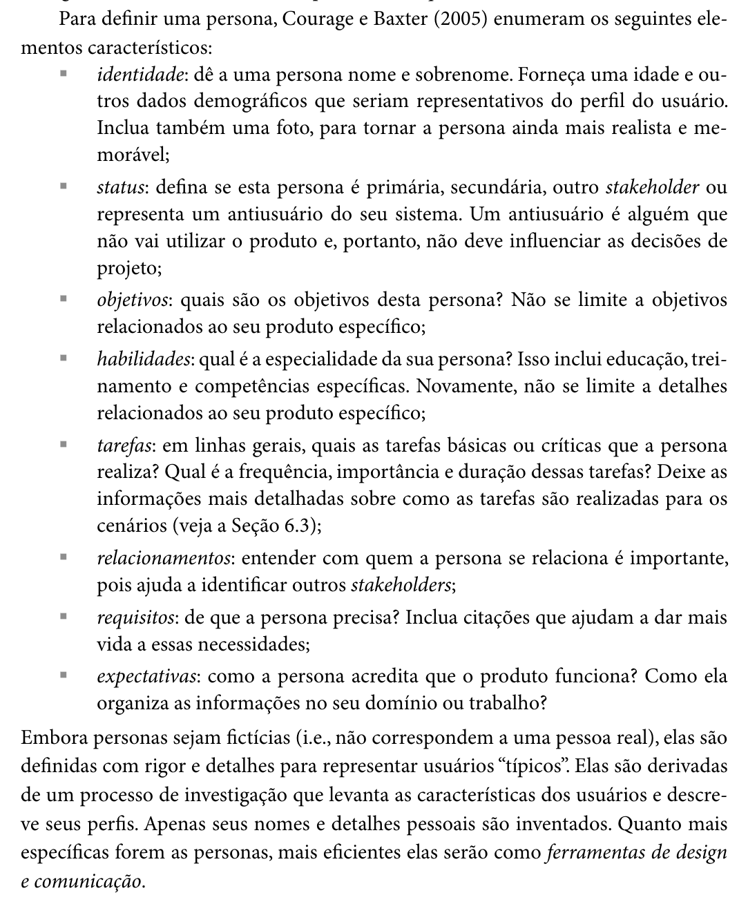{ loading=lazy }

    
Fonte: Barbosa e Silva (2010), p. 176–180.

??? question "E2-09 · Cada persona apresenta os oito elementos característicos de Courage e Baxter (2005) e mantém rastreabilidade com os dados coletados?"

    **Autor do item:** [Caio Breno de Souza Bezerra](https://github.com/CaioBezerra-Dev).

    **O que conferir.** Abra as páginas individuais de personas e confirme a presença dos oito elementos de Courage e Baxter (2005 apud Barbosa e Silva, 2010, p. 177): (1) identidade, (2) status, (3) objetivos, (4) habilidades, (5) tarefas, (6) relacionamentos, (7) requisitos e (8) expectativas, verificando se apenas o nome e detalhes pessoais foram inventados sobre a base empírica ou documental.

    **Rastreabilidade na V1.** [E2-C14](../verificacao/listas/etapa-2.md#e2-c14) · mantido.

    { loading=lazy }

    
Fonte: Barbosa e Silva (2010), p. 177.

??? question "E2-10 · Os cenários estão fundamentados na literatura e contemplam os sete elementos de Rosson e Carroll (2002)?"

    **Autor do item:** [Caio Breno de Souza Bezerra](https://github.com/CaioBezerra-Dev).

    **O que conferir.** Confira no artefato de Cenários a fundamentação com autor do item, referência e recorte da fonte, além da cobertura explícita dos sete elementos de Rosson e Carroll (2002 apud Barbosa e Silva, 2010, p. 183–184) nas narrativas: ambiente/contexto, atores, objetivos, planejamento, ações, eventos e avaliação.

    **Rastreabilidade na V1.** [E2-C09](../verificacao/listas/etapa-2.md#e2-c09) · explicita os sete elementos de Rosson e Carroll na verificação.

    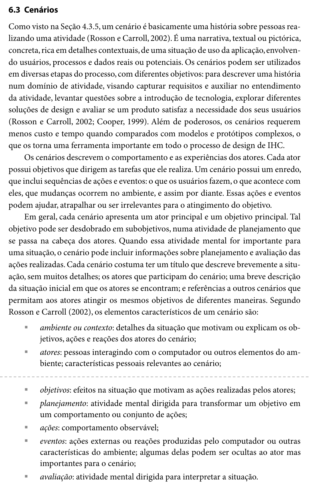{ loading=lazy }

    
Fonte: Barbosa e Silva (2010), p. 183–184.

??? question "E2-11 · Cada cenário individual apresenta título descritivo da situação, atores participantes e descrição da situação inicial?"

    **Autor do item:** [Bruno Ferreira Dornelas](https://github.com/brunnf).

    **O que conferir.** Abra os cenários individuais e o quadro síntese do grupo. Confirme se cada cenário apresenta: (1) título conciso que descreve a situação ou barreira enfrentada; (2) os atores que participam (vinculados à persona correspondente); e (3) uma breve descrição da situação inicial em que os atores se encontram.

    **Rastreabilidade na V1.** [E2-C13](../verificacao/listas/etapa-2.md#e2-c13) · mantido.

    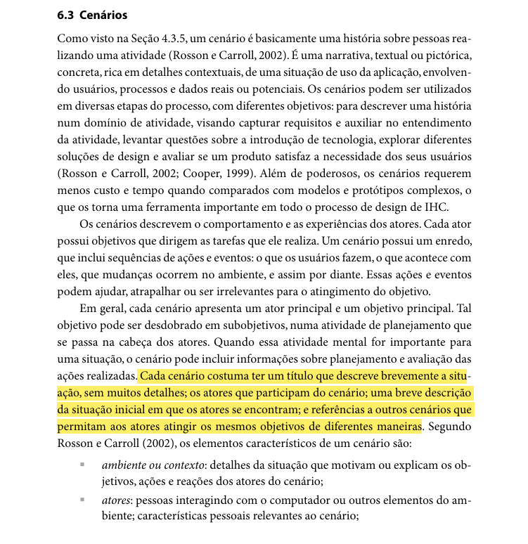{ loading=lazy }

    
Fonte: Barbosa et al. (2021), p. 183.

??? question "E2-12 · O artefato de análise de tarefas fundamenta o método na literatura e consolida as tarefas investigadas pela equipe?"

    **Autor do item:** [Heitor Pinheiro Gonçalves das Chagas](https://github.com/Heitorovski01).

    **O que conferir.** Verifique na página de Análise de Tarefas a explicação conceitual do método e das técnicas adotadas, acompanhada de autor do item, referência bibliográfica, foto do texto da fonte e índice estruturado vinculando cada integrante à persona e à tarefa modelada.

    **Rastreabilidade na V1.** [E2-C10](../verificacao/listas/etapa-2.md#e2-c10) · mantido.

    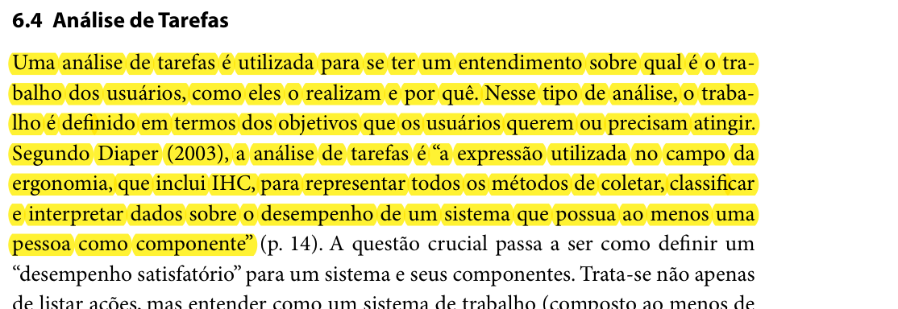{ loading=lazy }

    
Fonte: Barbosa e Silva (2010), p. 191.

??? question "E2-13 · Cada integrante modela ao menos uma atividade em duas técnicas de análise de tarefas (HTA com diagrama, legenda e tabela, e segunda técnica como CTT ou GOMS)?"

    **Autor do item:** [Heitor Pinheiro Gonçalves das Chagas](https://github.com/Heitorovski01).

    **O que conferir.** Abra as páginas individuais de análise de tarefas de todos os integrantes. Confirme se cada um modelou sua tarefa tanto em HTA (contendo representação gráfica/diagrama, legenda notacional e tabela detalhada) quanto em uma segunda técnica da literatura (como CTT ou GOMS/KLM).

    **Rastreabilidade na V1.** [E2-C11](../verificacao/listas/etapa-2.md#e2-c11) + [E2-C12](../verificacao/listas/etapa-2.md#e2-c12) · consolidados na exigência de dupla representação e especificação da tarefa por integrante.

    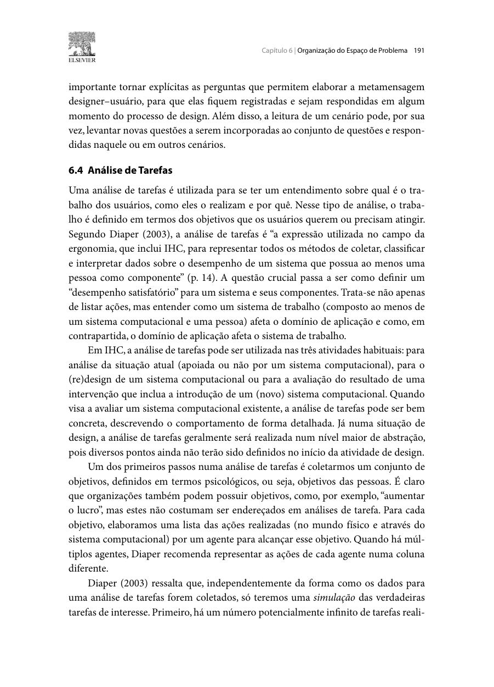{ loading=lazy }

    
Fonte: Barbosa e Silva (2010), p. 191–205.

??? question "E2-14 · Cada análise hierárquica de tarefas (HTA) relaciona o que as pessoas fazem, por que o fazem e quais as consequências caso não o façam corretamente, especificando inputs, ações e feedbacks?"

    **Autor do item:** [Caio Breno de Souza Bezerra](https://github.com/CaioBezerra-Dev).

    **O que conferir.** Nas tabelas e descrições da HTA de cada integrante, verifique se estão registrados os objetivos e operações relacionando: (1) o que as pessoas fazem (*ações*); (2) por que o fazem / circunstâncias de ativação (*input* e objetivo); e (3) as condições de término (*feedback*) e as consequências ou problemas caso não o façam corretamente.

    **Rastreabilidade na V1.** [E2-C15](../verificacao/listas/etapa-2.md#e2-c15) · mantido com verificação da tabela de operações da HTA.

    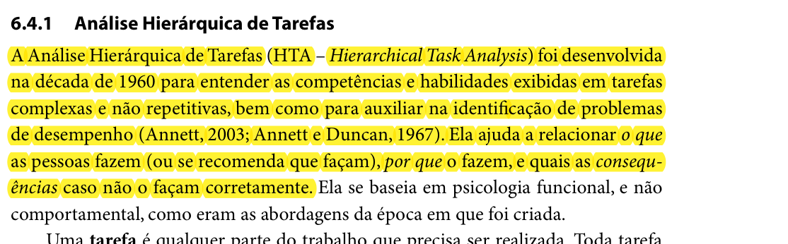{ loading=lazy }

    
Fonte: Barbosa e Silva (2010), p. 192–193.

??? question "E2-15 · Na HTA, a decomposição dos objetivos em subobjetivos define planos que especificam a ordem e as condições de execução?"

    **Autor do item:** [Heitor Pinheiro Gonçalves das Chagas](https://github.com/Heitorovski01).

    **O que conferir.** Verifique nos diagramas e tabelas HTA de cada integrante se todo objetivo decomposto em subobjetivos possui um **plano** associado que especifica a ordem e as condições sob as quais os subobjetivos são executados (como sequência fixa `>`, seleção/decisão `/` ou paralelismo `+`).

    **Rastreabilidade na V1.** [E2-C16](../verificacao/listas/etapa-2.md#e2-c16) · mantido.

    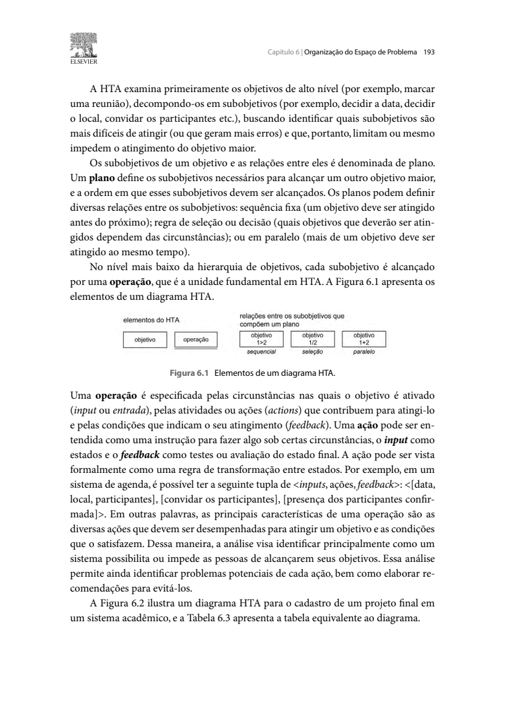{ loading=lazy }

    
Fonte: Barbosa e Silva (2010), p. 192–195.

??? question "E2-16 · Nos diagramas CTT, as tarefas estão classificadas nos quatro tipos da notação e articuladas por operadores temporais de LOTOS?"

    **Autor do item:** [Luís Henrique Arruda Luna](https://github.com/Donnk61).

    **O que conferir.** Abra os diagramas CTT de cada integrante e confira se cada nó está classificado de acordo com sua natureza — (1) tarefa do usuário, (2) tarefa do sistema, (3) tarefa interativa ou (4) tarefa abstrata — e se as relações entre tarefas irmãs utilizam operadores temporais da notação CTT (como habilitação `>>` ou `[]>>`, escolha `[]`, interdependência `|[]|`, desativação `[>` ou suspensão `|>`).

    **Rastreabilidade na V1.** [E2-C18](../verificacao/listas/etapa-2.md#e2-c18) · amplia a conferência visual da notação CTT com o recorte de Barbosa e Silva (2010, p. 203–204).

    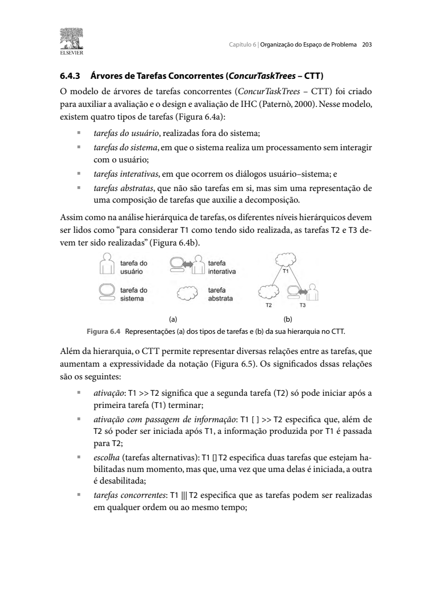{ loading=lazy }

    
Fonte: Barbosa e Silva (2010), p. 203.

    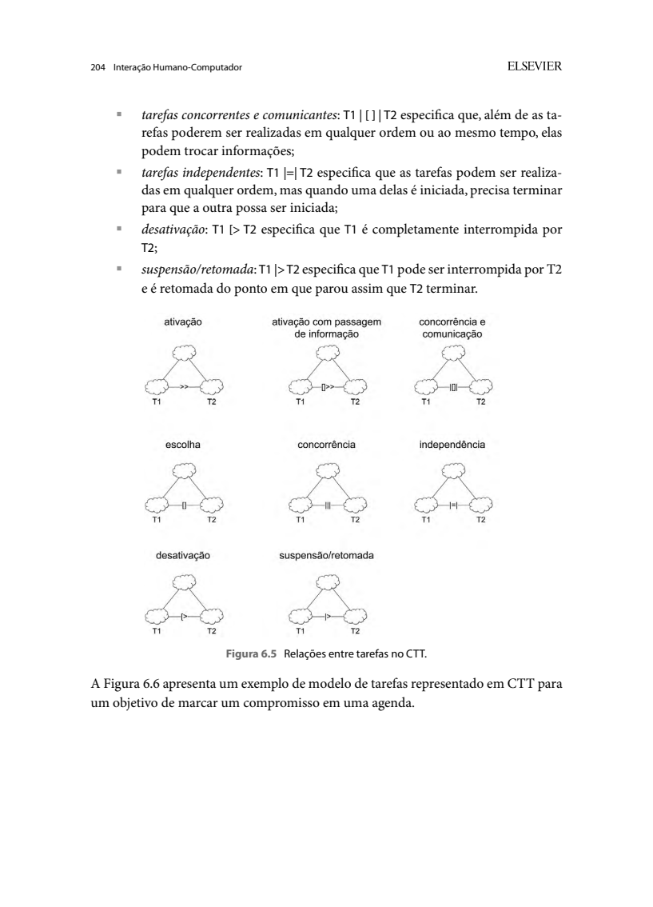{ loading=lazy }

    
Fonte: Barbosa e Silva (2010), p. 204.

## Conferência da lista

A exigência destacada na V1 de que cada integrante elabore ao menos um item de conteúdo da disciplina com autor, referência bibliográfica e imagem do trecho da fonte passa a compor o controle de qualidade desta lista V2. Todos os 16 critérios de conteúdo acima preservam a autoria nominal dos cinco integrantes do Grupo 06, a regra de julgamento e o recorte da fonte.

## Agradecimentos

O Antigravity e o Google Gemini apoiaram a consolidação dos critérios oficiais e dos itens adicionais elaborados pelo grupo na Etapa 2 para o formato V2 da Etapa 8. Heitor Pinheiro Gonçalves das Chagas responde pela organização desta lista V2, preservando as contribuições originais de Bruno Ferreira Dornelas, Caio Breno de Souza Bezerra, Israel Soares de Paiva e Luís Henrique Arruda Luna.

## Histórico de versão

| Versão | Data | Descrição | Autor(es) | Revisor(es) |
| :---: | :---: | --- | --- | --- |
| `2.0` | 21/11/2026 | Elaboração da Lista de Verificação V2 da Etapa 2 com 11 critérios de desenvolvimento e 16 de conteúdo, rastreabilidade para a V1 e recortes das fontes. | [Heitor Pinheiro Gonçalves das Chagas](https://github.com/Heitorovski01) | [Bruno Ferreira Dornelas](https://github.com/brunnf) |
| 2.1 | 23/11/2026 | Atualiza os links de rastreabilidade para a Lista V1 da Etapa 2 | [Bruno Ferreira Dornelas](https://github.com/brunnf) | [Caio Breno de Souza Bezerra](https://github.com/CaioBezerra-Dev) |

## Referências

1. SALES, André Barros de. *Plano de Ensino FIHC 022026 — Turma 01*. v1. Brasília: FCTE/UnB, 2026.

2. BARBOSA, Simone Diniz Junqueira; SILVA, Bruno Santana da. *Interação humano-computador*. Rio de Janeiro: Elsevier, 2010. p. 134–145, 164–166, 174–195, 203–205.

3. BARBOSA, Simone Diniz Junqueira; SILVA, Bruno Santana da; SILVEIRA, Milene Selbach; GASPARINI, Isabela; DARIN, Ticianne; BARBOSA, Gabriel Diniz Junqueira. *Interação Humano-Computador e Experiência do Usuário*. Autopublicação, 2021. Cap. 6, p. 183.
