Responsável: Israel Soares de Paiva · Grupo 06

# Lista de verificação da Etapa 3 · V2

## Tabela de contribuição

| Integrante | Contribuição | Artefato / atividade |
| --- | --- | --- |
| [Israel Soares de Paiva](https://github.com/IsraelSoares-25) | Revisão dos 11 critérios de desenvolvimento com base no plano de ensino e indicação da evidência esperada | [Desenvolvimento do projeto](#desenvolvimento-do-projeto) |
| [Israel Soares de Paiva](https://github.com/IsraelSoares-25) | Formulação dos 19 critérios sobre princípios gerais, metas de usabilidade e guia de estilo, com recortes grifados das fontes | [Conteúdo da disciplina](#conteudo-da-disciplina) |
| [Israel Soares de Paiva](https://github.com/IsraelSoares-25) | Definição das regras de julgamento e registro das correspondências entre V1 e V2 | [Como aplicar](#como-aplicar) · [Conferência da lista](#conferencia-da-lista) |
| [Bruno Ferreira Dornelas](https://github.com/brunnf) | Aplicação da lista na reinspeção do Grupo 07 (+1) e vinculação dos resultados e gráficos da Etapa 3 | [Resultados e gráficos](resultados/etapa-3.md) · [Grupo 07](grupo-07/etapa-3.md) |
| Codex (OpenAI) e Antigravity (Google DeepMind) | Apoio à consulta do livro e do plano de ensino, à edição do texto, à preparação dos recortes e aos vínculos de aplicação | [Agradecimentos](index.md#agradecimentos) |

Tabela 1 — Contribuição neste artefato.

Fonte: elaboração para o Grupo 06 (2026).

[Etapa 8](index.md) · [Resultados e gráficos](resultados/etapa-3.md) · [Autoinspeção do Grupo 06](grupo-06/etapa-3.md) · [Inspeção do Grupo 07 (+1)](grupo-07/etapa-3.md) · [Lista V1 da Etapa 3](../verificacao/listas/etapa-3.md) · [Ficha V1 · Grupo 06](../verificacao/grupo-06/etapa-3/lista-verificacao.md) · [Ficha V1 · Grupo 07](../verificacao/grupo-07/etapa-3/lista-verificacao.md)

## Como aplicar

Use a mesma redação na autoinspeção do Grupo 06 e na inspeção externa do Grupo 07 (+1 · PCI Concursos) sobre os artefatos da Etapa 3 (Características da Plataforma, Princípios Gerais, Metas de Usabilidade e Guia de Estilo). A resposta resume a cobertura dos artefatos daquela etapa. Cada item traz a evidência esperada, o vínculo rastreável com a lista antiga (V1) e um recorte da literatura com o trecho relevante da fonte.

- **Sim** quando a evidência atende plenamente à pergunta em todo o recorte aplicável dos documentos da Etapa 3.
- **Incompleto** quando existe evidência parcial, contraditória ou sem cobertura em todos os artefatos correspondentes.
- **Não** quando o requisito é aplicável e a evidência essencial está ausente nos locais consultados ou contraria frontalmente a afirmação.

Na ficha de avaliação, registre grupo, etapa, ID do critério, versão, data, fonte bibliográfica e trecho que sustenta o julgamento. Para uma lacuna, indique exatamente onde procurou. [Método e escopo](index.md#metodo-de-inspecao).

## Desenvolvimento do projeto

??? question "D01 · O histórico identifica a versão, a data e a mudança de cada artefato?"

    **Autor do item:** [Israel Soares de Paiva](https://github.com/IsraelSoares-25).

    **O que conferir.** Abra a seção de histórico de versão em cada documento principal da Etapa 3 ([Plataforma](../entrega-3/plataforma.md), [Princípios Gerais](../entrega-3/principios-gerais.md), [Tópicos dos Princípios](../entrega-3/topicos-principios.md), [Metas de Usabilidade](../entrega-3/metas-usabilidade.md), [Guia de Estilo](../entrega-3/guia-de-estilo.md) e [Telas de Interface](../entrega-3/telas-interface.md)). Confira se as entradas permitem distinguir a versão corrente, a data, a descrição da alteração, os autores e os revisores.

    **Rastreabilidade na V1.** [D01](../verificacao/listas/etapa-3.md#d01) · mantido com campos explícitos e verificação individualizada.

    { loading=lazy }

    
Fonte: Sales (2026), p. 8 do PDF. O grifo indica o trecho usado no critério.

    **Aplicação:** [Grupo 06](grupo-06/etapa-3.md#etapa-3-d01) · [Grupo 07](grupo-07/etapa-3.md#etapa-3-d01).

??? question "D02 · A versão consultada identifica quem escreveu e quem revisou o artefato?"

    **Autor do item:** [Israel Soares de Paiva](https://github.com/IsraelSoares-25).

    **O que conferir.** Leia a entrada da versão corrente em cada documento da Etapa 3. O revisor deve ser um integrante distinto do autor para garantir a independência da revisão por pares. Campo vazio, autor repetido na revisão ou pendência sem atribuição indicam lacuna.

    **Rastreabilidade na V1.** [D02](../verificacao/listas/etapa-3.md#d02) · refinado para a versão examinada e independência de pares.

    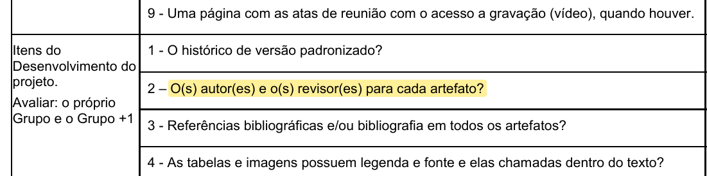{ loading=lazy }

    
Fonte: Sales (2026), p. 8 do PDF. O grifo indica o trecho usado no critério.

    **Aplicação:** [Grupo 06](grupo-06/etapa-3.md#etapa-3-d02) · [Grupo 07](grupo-07/etapa-3.md#etapa-3-d02).

??? question "D03 · Os artefatos principais apresentam referências bibliográficas?"

    **Autor do item:** [Israel Soares de Paiva](https://github.com/IsraelSoares-25).

    **O que conferir.** Confira a seção de referências bibliográficas ao final de cada documento da Etapa 3. Devem estar formatadas conforme as normas ABNT e fundamentar conceitualmente os métodos, conceitos e modelos empregados (ex.: Barbosa e Silva, Mayhew, Nielsen).

    **Rastreabilidade na V1.** [D03](../verificacao/listas/etapa-3.md#d03) · delimita os documentos principais e padronização ABNT.

    { loading=lazy }

    
Fonte: Sales (2026), p. 8 do PDF. O grifo indica o trecho usado no critério.

    **Aplicação:** [Grupo 06](grupo-06/etapa-3.md#etapa-3-d03) · [Grupo 07](grupo-07/etapa-3.md#etapa-3-d03).

??? question "D04 · Figuras e tabelas têm identificação, fonte e chamada no texto?"

    **Autor do item:** [Israel Soares de Paiva](https://github.com/IsraelSoares-25).

    **O que conferir.** Percorra todas as tabelas e figuras presentes nos artefatos da Etapa 3. Procure número sequencial, legenda explicativa no topo ou base, indicação explícita da fonte e chamadas ativas no corpo do texto antes da inserção do elemento.

    **Rastreabilidade na V1.** [D04](../verificacao/listas/etapa-3.md#d04) · mantido com escopo em todos os elementos visuais.

    { loading=lazy }

    
Fonte: Sales (2026), p. 8 do PDF. O grifo indica o trecho usado no critério.

    **Aplicação:** [Grupo 06](grupo-06/etapa-3.md#etapa-3-d04) · [Grupo 07](grupo-07/etapa-3.md#etapa-3-d04).

??? question "D05 · Os artefatos apresentam objetivo e escopo antes de detalhar o conteúdo?"

    **Autor do item:** [Israel Soares de Paiva](https://github.com/IsraelSoares-25).

    **O que conferir.** Verifique se cada documento da Etapa 3 abre com uma seção de Introdução que delimita o objetivo do artefato, seu escopo no ciclo de vida de IHC e o papel daquele produto na engenharia de usabilidade.

    **Rastreabilidade na V1.** [D05](../verificacao/listas/etapa-3.md#d05) · mantido com foco em contextualização prévia.

    { loading=lazy }

    
Fonte: Sales (2026), p. 8 do PDF. O grifo indica o trecho usado no critério.

    **Aplicação:** [Grupo 06](grupo-06/etapa-3.md#etapa-3-d05) · [Grupo 07](grupo-07/etapa-3.md#etapa-3-d05).

??? question "D06 · O cronograma executado registra as tarefas realizadas, as datas de início e fim e quem as executou?"

    **Autor do item:** [Israel Soares de Paiva](https://github.com/IsraelSoares-25).

    **O que conferir.** Acesse a tabela de cronograma executado da Etapa 3 em [Cronograma](../entrega-1/cronograma.md). Verifique se todas as atividades de elaboração e revisão contam com data de início e término efetivas, horários e indicação do integrante responsável.

    **Rastreabilidade na V1.** [D06](../verificacao/listas/etapa-3.md#d06) · validação da completude temporal e responsabilidades.

    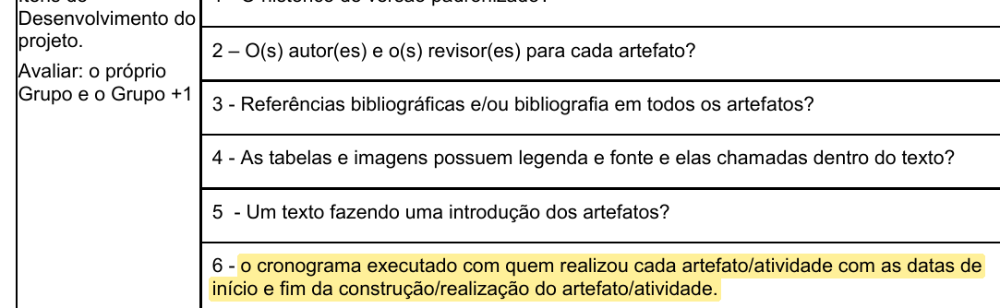{ loading=lazy }

    
Fonte: Sales (2026), p. 8 do PDF. O grifo indica o trecho usado no critério.

    **Aplicação:** [Grupo 06](grupo-06/etapa-3.md#etapa-3-d06) · [Grupo 07](grupo-07/etapa-3.md#etapa-3-d06).

??? question "D07 · As atas de reunião registram data, horário, participantes, pauta, deliberações e tarefas?"

    **Autor do item:** [Israel Soares de Paiva](https://github.com/IsraelSoares-25).

    **O que conferir.** Consulte o índice de atas em [Atas de Reunião](../atas/index.md). Verifique se as reuniões ocorridas durante o período da Etapa 3 possuem ata formalizada com registro de data, horário de início e fim, participantes presentes, pauta discutida e decisões tomadas.

    **Rastreabilidade na V1.** [D07](../verificacao/listas/etapa-3.md#d07) · verificação da ata formal e deliberações.

    { loading=lazy }

    
Fonte: Sales (2026), p. 8 do PDF. O grifo indica o trecho usado no critério.

    **Aplicação:** [Grupo 06](grupo-06/etapa-3.md#etapa-3-d07) · [Grupo 07](grupo-07/etapa-3.md#etapa-3-d07).

??? question "D08 · A reunião do grupo está gravada e acessível no artefato correspondente?"

    **Autor do item:** [Israel Soares de Paiva](https://github.com/IsraelSoares-25).

    **O que conferir.** Verifique se a gravação da reunião de alinhamento ou inspeção da Etapa 3 está disponível com link público/incorporado, permitindo validar a presença dos membros e a discussão dos temas.

    **Rastreabilidade na V1.** [D08](../verificacao/listas/etapa-3.md#d08) · link acessível para a gravação da reunião.

    { loading=lazy }

    
Fonte: Sales (2026), p. 8 do PDF. O grifo indica o trecho usado no critério.

    **Aplicação:** [Grupo 06](grupo-06/etapa-3.md#etapa-3-d08) · [Grupo 07](grupo-07/etapa-3.md#etapa-3-d08).

??? question "D09 · O vídeo de apresentação está na categoria 'não listado' no YouTube e incorporado no documento?"

    **Autor do item:** [Israel Soares de Paiva](https://github.com/IsraelSoares-25).

    **O que conferir.** Acesse [Apresentações da Etapa 3](../apresentacoes/etapa-03.md). Confira se o vídeo de apresentação da etapa está publicado no YouTube como "não listado" e se o player responsivo está incorporado diretamente na página.

    **Rastreabilidade na V1.** [D09](../verificacao/listas/etapa-3.md#d09) · vídeo não listado e incorporação na wiki.

    { loading=lazy }

    
Fonte: Sales (2026), p. 8 do PDF. O grifo indica o trecho usado no critério.

    **Aplicação:** [Grupo 06](grupo-06/etapa-3.md#etapa-3-d09) · [Grupo 07](grupo-07/etapa-3.md#etapa-3-d09).

??? question "D10 · A tabela de contribuição identifica o que cada integrante fez e em qual artefato?"

    **Autor do item:** [Israel Soares de Paiva](https://github.com/IsraelSoares-25).

    **O que conferir.** Confira a abertura de cada página da Etapa 3. Deve constar uma Tabela de Contribuição discriminando o nome do integrante, o papel ou atividade desempenhada e o link direto para a seção que documenta sua entrega.

    **Rastreabilidade na V1.** [D10](../verificacao/listas/etapa-3.md#d10) · detalhamento da contribuição por seção.

    { loading=lazy }

    
Fonte: Sales (2026), p. 8 do PDF. O grifo indica o trecho usado no critério.

    **Aplicação:** [Grupo 06](grupo-06/etapa-3.md#etapa-3-d10) · [Grupo 07](grupo-07/etapa-3.md#etapa-3-d10).

??? question "D11 · O artefato declara o uso de ferramentas de IA generativa e detalha em quais atividades foram empregadas?"

    **Autor do item:** [Israel Soares de Paiva](https://github.com/IsraelSoares-25).

    **O que conferir.** Procure a seção de Agradecimentos ao final de cada documento da Etapa 3. O texto deve declarar nominalmente as ferramentas de IA Generativa consultadas (ex.: ChatGPT, Claude, Codex) e detalhar seu escopo de uso (ex.: revisão gramatical, conferência de normas, sugestão de estrutura).

    **Rastreabilidade na V1.** [D11](../verificacao/listas/etapa-3.md#d11) · declaração explícita de IA e escopo de atuação.

    { loading=lazy }

    
Fonte: Sales (2026), p. 3 do PDF. O grifo indica o trecho usado no critério.

    **Aplicação:** [Grupo 06](grupo-06/etapa-3.md#etapa-3-d11) · [Grupo 07](grupo-07/etapa-3.md#etapa-3-d11).

## Conteúdo da disciplina

??? question "E3-01 · As características da plataforma do projeto estão descritas com base na literatura e acompanhadas de recortes da fonte?"

    **Autor do item:** [Israel Soares de Paiva](https://github.com/IsraelSoares-25).

    **O que conferir.** Abra o artefato [Características da Plataforma](../entrega-3/plataforma.md). Confira se há identificação clara do ambiente de execução (plataforma web responsiva), limitações técnicas e possibilidades operacionais, acompanhadas de citação de Barbosa e Silva (2010, pp. 109–110) e do recorte do livro.

    **Rastreabilidade na V1.** [E3-C10](../verificacao/listas/etapa-3.md#e3-c10) · identificação das características da plataforma e recorte bibliográfico.

    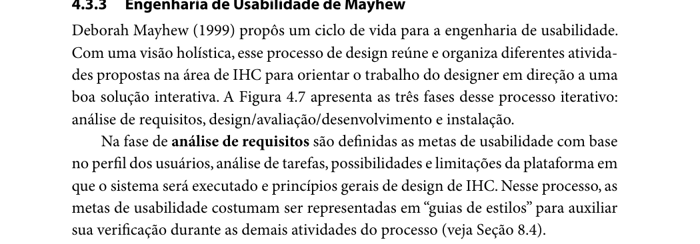{ loading=lazy }

    
Fonte: Barbosa e Silva (2010), p. 109. O grifo indica o trecho usado no critério.

    **Aplicação:** [Grupo 06](grupo-06/etapa-3.md#etapa-3-e3-01) · [Grupo 07](grupo-07/etapa-3.md#etapa-3-e3-01).

??? question "E3-02 · Os Princípios Gerais de Projeto selecionados estão declarados com fundamentação bibliográfica e recorte da fonte?"

    **Autor do item:** [Israel Soares de Paiva](https://github.com/IsraelSoares-25).

    **O que conferir.** Acesse [Princípios Gerais de Projeto](../entrega-3/principios-gerais.md). Verifique se o artefato declara formalmente os princípios de design adotados no projeto, cita a literatura de referência (Barbosa e Silva, 2010; Barbosa et al., 2021) e inclui o recorte ilustrativo da fonte.

    **Rastreabilidade na V1.** [E3-C11](../verificacao/listas/etapa-3.md#e3-c11) · declaração dos princípios com citação e foto da referência.

    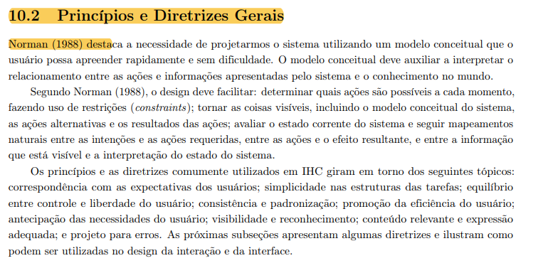{ loading=lazy }

    
Fonte: Barbosa et al. (2021), p. 238. O grifo indica o trecho usado no critério.

    **Aplicação:** [Grupo 06](grupo-06/etapa-3.md#etapa-3-e3-02) · [Grupo 07](grupo-07/etapa-3.md#etapa-3-e3-02).

??? question "E3-03 · Os tópicos dos princípios gerais abrangem os 8 eixos clássicos da literatura com referência teórica e recortes?"

    **Autor do item:** [Israel Soares de Paiva](https://github.com/IsraelSoares-25).

    **O que conferir.** Acesse [Tópicos dos Princípios](../entrega-3/topicos-principios.md). Confira se os oito tópicos canônicos estão contemplados: (1) correspondência com expectativas, (2) simplicidade nas tarefas, (3) controle e liberdade, (4) consistência e padronização, (5) antecipação de necessidades, (6) visibilidade e reconhecimento, (7) conteúdo relevante e (8) projeto para erros, com recortes da literatura de suporte.

    **Rastreabilidade na V1.** [E3-C12](../verificacao/listas/etapa-3.md#e3-c12) · cobertura completa dos 8 tópicos estruturantes.

    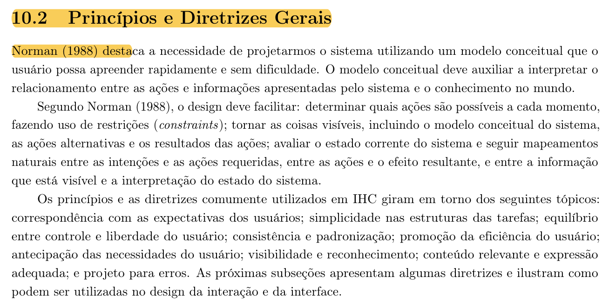{ loading=lazy }

    
Fonte: Barbosa et al. (2021), p. 238. O grifo indica o trecho usado no critério.

    **Aplicação:** [Grupo 06](grupo-06/etapa-3.md#etapa-3-e3-03) · [Grupo 07](grupo-07/etapa-3.md#etapa-3-e3-03).

??? question "E3-04 · As metas de usabilidade do projeto estão formalizadas com embasamento bibliográfico e recorte explicativo?"

    **Autor do item:** [Israel Soares de Paiva](https://github.com/IsraelSoares-25).

    **O que conferir.** Consulte [Metas de Usabilidade](../entrega-3/metas-usabilidade.md). Verifique se as metas que o projeto deve alcançar estão definidas (M0 a M6), fundamentadas na literatura clássica (Nielsen, 1993; Barbosa e Silva, 2010) e acompanhadas de recorte explicativo da fonte.

    **Rastreabilidade na V1.** [E3-C13](../verificacao/listas/etapa-3.md#e3-c13) · formalização das metas com referência bibliográfica e recorte.

    { loading=lazy }

    
Fonte: Barbosa e Silva (2010), p. 105. O grifo indica o trecho usado no critério.

    **Aplicação:** [Grupo 06](grupo-06/etapa-3.md#etapa-3-e3-04) · [Grupo 07](grupo-07/etapa-3.md#etapa-3-e3-04).

??? question "E3-05 · O artefato justifica a razão da seleção e a priorização das metas de usabilidade com base nas etapas anteriores?"

    **Autor do item:** [Israel Soares de Paiva](https://github.com/IsraelSoares-25).

    **O que conferir.** Verifique se o artefato de [Metas de Usabilidade](../entrega-3/metas-usabilidade.md) explica por que certas metas foram priorizadas em detrimento de outras, ancorando as justificativas nas dores diagnosticadas no [Perfil do Usuário](../entrega-2/perfil-usuario.md) e na [Análise de Tarefas](../entrega-2/analise-tarefas.md) da Etapa 2.

    **Rastreabilidade na V1.** [E3-C14](../verificacao/listas/etapa-3.md#e3-c14) · justificativa e priorização das metas com dados da Etapa 2.

    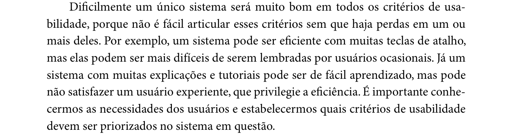{ loading=lazy }

    
Fonte: Barbosa e Silva (2010), p. 32. O grifo indica o trecho usado no critério.

    **Aplicação:** [Grupo 06](grupo-06/etapa-3.md#etapa-3-e3-05) · [Grupo 07](grupo-07/etapa-3.md#etapa-3-e3-05).

??? question "E3-06 · O Guia de Estilo define seu propósito e escopo conceitual respaldado em citação e recorte do livro?"

    **Autor do item:** [Israel Soares de Paiva](https://github.com/IsraelSoares-25).

    **O que conferir.** Acesse [Guia de Estilo](../entrega-3/guia-de-estilo.md). Verifique se a abertura do guia define seu papel normativo na equipe de desenvolvimento, citando explicitamente a literatura (Barbosa e Silva, 2010, p. 282) e trazendo o recorte do livro.

    **Rastreabilidade na V1.** [E3-C15](../verificacao/listas/etapa-3.md#e3-c15) · definição formal do guia com referência e foto da fonte.

    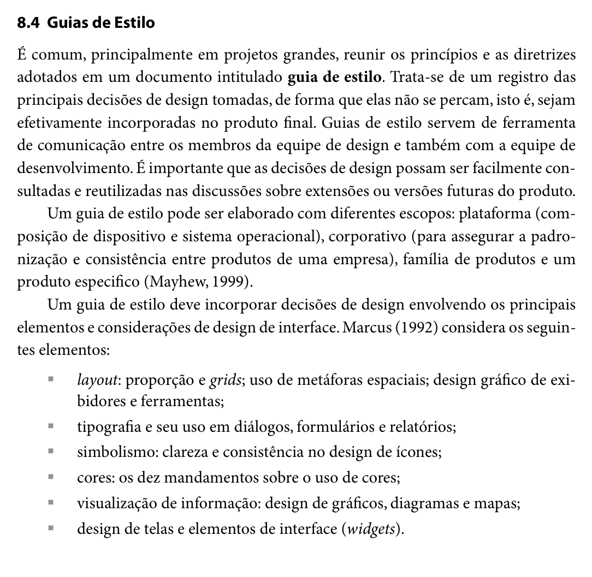{ loading=lazy }

    
Fonte: Barbosa e Silva (2010), p. 282. O grifo indica o trecho usado no critério.

    **Aplicação:** [Grupo 06](grupo-06/etapa-3.md#etapa-3-e3-06) · [Grupo 07](grupo-07/etapa-3.md#etapa-3-e3-06).

??? question "E3-07 · O Guia de Estilo contempla os 6 grandes tópicos estruturais clássicos da literatura com recorte comprobatório?"

    **Autor do item:** [Israel Soares de Paiva](https://github.com/IsraelSoares-25).

    **O que conferir.** Confira se o [Guia de Estilo](../entrega-3/guia-de-estilo.md) organiza seu conteúdo nas seis seções previstas por Mayhew (1999) e Barbosa e Silva (2010, p. 283): 1. Introdução, 2. Resultados de análise, 3. Elementos de interface, 4. Elementos de interação, 5. Elementos de ação e 6. Vocabulário e padrões.

    **Rastreabilidade na V1.** [E3-C16](../verificacao/listas/etapa-3.md#e3-c16) · conferência da estrutura clássica completa dos 6 tópicos.

    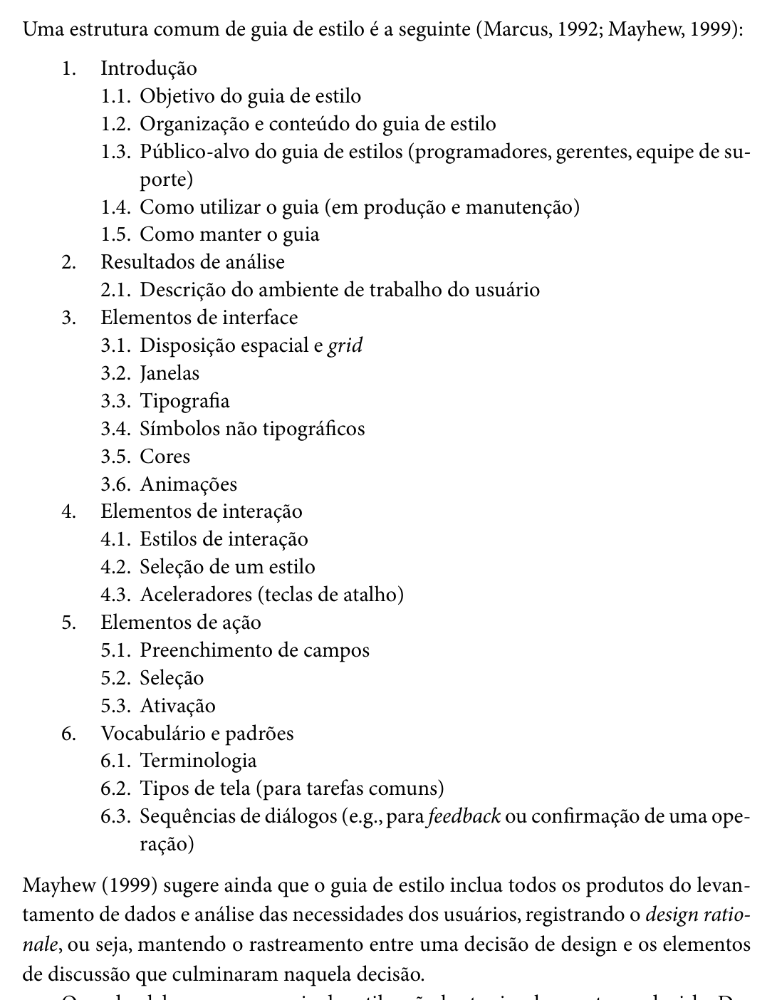{ loading=lazy }

    
Fonte: Barbosa e Silva (2010), p. 283. O grifo indica o trecho usado no critério.

    **Aplicação:** [Grupo 06](grupo-06/etapa-3.md#etapa-3-e3-07) · [Grupo 07](grupo-07/etapa-3.md#etapa-3-e3-07).

??? question "E3-08 · As diretrizes do Guia de Estilo e as telas de interface correspondem às deficiências reais diagnosticadas no portal avaliado?"

    **Autor do item:** [Israel Soares de Paiva](https://github.com/IsraelSoares-25).

    **O que conferir.** Acesse [Correspondência com o Site](../entrega-3/guia-de-estilo.md#correspondencia-com-o-site-avaliado) e [Telas de Interface](../entrega-3/telas-interface.md). Confira se os padrões estéticos e de diálogo propostos respondem a gargalos reais do Portal do Senado Federal, com capturas do site original e propostas de reprojeto.

    **Rastreabilidade na V1.** [E3-C17](../verificacao/listas/etapa-3.md#e3-c17) · correspondência entre o guia, as telas e o portal real.

    { loading=lazy }

    
Fonte: Barbosa e Silva (2010), p. 282. O grifo indica o trecho usado no critério.

    **Aplicação:** [Grupo 06](grupo-06/etapa-3.md#etapa-3-e3-08) · [Grupo 07](grupo-07/etapa-3.md#etapa-3-e3-08).

??? question "E3-09 · As metas de usabilidade explicitam indicadores, procedimentos de avaliação e faixas inaceitáveis, aceitáveis e ideais?"

    **Autor do item:** [Israel Soares de Paiva](https://github.com/IsraelSoares-25).

    **O que conferir.** Na seção de [Metas de Usabilidade](../entrega-3/metas-usabilidade.md#regras-de-medicao), confira se cada indicador possui definição da métrica (tempo, taxa de conclusão, contagem de erros), método de coleta e faixas numéricas de aceitação: inaceitável, aceitável e ideal (Barbosa e Silva, 2010, pp. 105–106).

    **Rastreabilidade na V1.** [E3-C18](../verificacao/listas/etapa-3.md#e3-c18) · operacionalização das metas em três faixas de valores.

    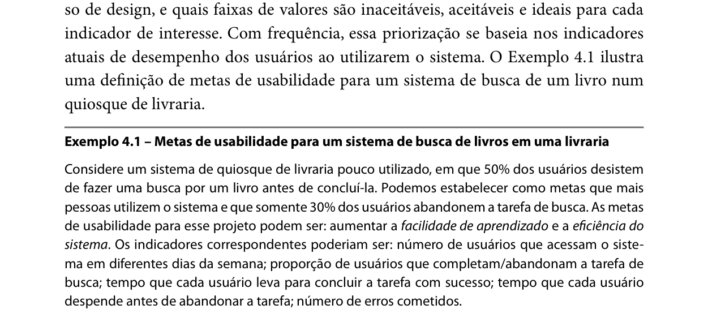{ loading=lazy }

    
Fonte: Barbosa e Silva (2010), p. 106. O grifo indica o trecho usado no critério.

    **Aplicação:** [Grupo 06](grupo-06/etapa-3.md#etapa-3-e3-09) · [Grupo 07](grupo-07/etapa-3.md#etapa-3-e3-09).

??? question "E3-10 · As características da plataforma registram possibilidades e limitações e servem de insumo explícito para as metas?"

    **Autor do item:** [Israel Soares de Paiva](https://github.com/IsraelSoares-25).

    **O que conferir.** Verifique se o artefato [Características da Plataforma](../entrega-3/plataforma.md) divide a análise em possibilidades e limitações, e se o documento de [Metas de Usabilidade](../entrega-3/metas-usabilidade.md) conecta diretamente essas restrições tecnológicas à formulação de suas métricas, cumprindo a engenharia de Mayhew.

    **Rastreabilidade na V1.** [E3-C19](../verificacao/listas/etapa-3.md#e3-c19) · possibilidades e limitações da plataforma como insumo das metas.

    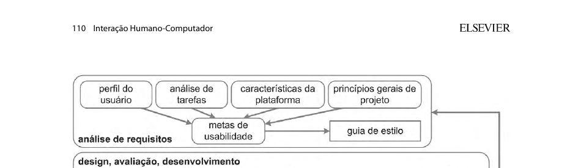{ loading=lazy }

    
Fonte: Barbosa e Silva (2010), p. 110. O grifo indica o trecho usado no critério.

    **Aplicação:** [Grupo 06](grupo-06/etapa-3.md#etapa-3-e3-10) · [Grupo 07](grupo-07/etapa-3.md#etapa-3-e3-10).

??? question "E3-11 · O Guia de Estilo registra o design rationale das decisões vinculando elementos ao perfil, tarefas e plataforma?"

    **Autor do item:** [Israel Soares de Paiva](https://github.com/IsraelSoares-25).

    **O que conferir.** Abra o [Guia de Estilo](../entrega-3/guia-de-estilo.md) e [Telas de Interface](../entrega-3/telas-interface.md). Confira se as escolhas de cores, fontes, componentes e atalhos contêm o *design rationale* explícito, rastreando a decisão até as características das personas em [Perfil do Usuário](../entrega-2/perfil-usuario.md), fluxos em [Análise de Tarefas](../entrega-2/analise-tarefas.md) e requisitos em [Características da Plataforma](../entrega-3/plataforma.md) (Barbosa e Silva, 2010, p. 283).

    **Rastreabilidade na V1.** [E3-C20](../verificacao/listas/etapa-3.md#e3-c20) · design rationale e rastreabilidade no guia de estilo.

    { loading=lazy }

    
Fonte: Barbosa e Silva (2010), p. 283. O grifo indica o trecho usado no critério.

    **Aplicação:** [Grupo 06](grupo-06/etapa-3.md#etapa-3-e3-11) · [Grupo 07](grupo-07/etapa-3.md#etapa-3-e3-11).

??? question "E3-12 · Os Princípios Gerais justificam quais diretrizes foram selecionadas e explicam o motivo da não priorização das demais?"

    **Autor do item:** [Israel Soares de Paiva](https://github.com/IsraelSoares-25).

    **O que conferir.** No artefato [Princípios Gerais](../entrega-3/principios-gerais.md), verifique se cada princípio adotado possui justificativa contextualizada no sistema do Senado, e se os princípios não selecionados têm o motivo da exclusão explicitado (Barbosa et al., 2021, p. 238).

    **Rastreabilidade na V1.** [E3-C21](../verificacao/listas/etapa-3.md#e3-c21) · seleção e justificativa dos princípios adotados e descartados.

    { loading=lazy }

    
Fonte: Barbosa et al. (2021), p. 238. O grifo indica o trecho usado no critério.

    **Aplicação:** [Grupo 06](grupo-06/etapa-3.md#etapa-3-e3-12) · [Grupo 07](grupo-07/etapa-3.md#etapa-3-e3-12).

??? question "E3-13 · Cada tópico dos princípios é detalhado por suas diretrizes e ilustrado com exemplos concretos do portal avaliado?"

    **Autor do item:** [Israel Soares de Paiva](https://github.com/IsraelSoares-25).

    **O que conferir.** Acesse [Tópicos dos Princípios](../entrega-3/topicos-principios.md). Verifique se cada um dos oito tópicos apresenta a explicação detalhada de suas diretrizes (com página de referência) e pelo menos uma situação real de uso ou deficiência identificada na interface do Senado (Barbosa et al., 2021, pp. 237–238).

    **Rastreabilidade na V1.** [E3-C22](../verificacao/listas/etapa-3.md#e3-c22) · explicação das diretrizes e manifestação empírica no portal.

    { loading=lazy }

    
Fonte: Barbosa et al. (2021), pp. 237–238. O grifo indica o trecho usado no critério.

    **Aplicação:** [Grupo 06](grupo-06/etapa-3.md#etapa-3-e3-13) · [Grupo 07](grupo-07/etapa-3.md#etapa-3-e3-13).

??? question "E3-14 · O Guia de Estilo vincula diretamente as regras de diálogo e navegação aos fluxos das tarefas modeladas na HTA e GOMS?"

    **Autor do item:** [Israel Soares de Paiva](https://github.com/IsraelSoares-25).

    **O que conferir.** Verifique se as orientações de navegação, estilos de interação e telas típicas do [Guia de Estilo](../entrega-3/guia-de-estilo.md) dialogam com as tarefas mapeadas na [Análise de Tarefas](../entrega-2/analise-tarefas.md) (como agendamento de visita, consulta a proposições ou notícias).

    **Rastreabilidade na V1.** Desdobramento do [E3-C16](../verificacao/listas/etapa-3.md#e3-c16) · conexão com tarefas modeladas na Etapa 2.

    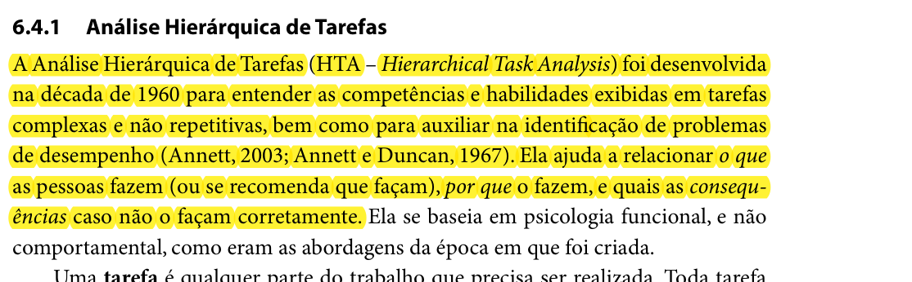{ loading=lazy }

    
Fonte: Barbosa e Silva (2010), p. 193. O grifo indica o trecho usado no critério.

    **Aplicação:** [Grupo 06](grupo-06/etapa-3.md#etapa-3-e3-14) · [Grupo 07](grupo-07/etapa-3.md#etapa-3-e3-14).

??? question "E3-15 · Os wireframes e protótipos de baixa e média fidelidade seguem fielmente os padrões e a grade do Guia de Estilo?"

    **Autor do item:** [Israel Soares de Paiva](https://github.com/IsraelSoares-25).

    **O que conferir.** Acesse [Telas de Interface](../entrega-3/telas-interface.md). Verifique se as propostas de tela aplicam a grade de 12 colunas, paleta institucional, hierarquia tipográfica e disposição espacial descritas no [Guia de Estilo](../entrega-3/guia-de-estilo.md), assegurando consistência prévia às etapas de prototipação física e digital.

    **Rastreabilidade na V1.** Desdobramento do [E3-C17](../verificacao/listas/etapa-3.md#e3-c17) · consistência visual dos protótipos com o guia.

    { loading=lazy }

    
Fonte: Barbosa e Silva (2010), p. 283. O grifo indica o trecho usado no critério.

    **Aplicação:** [Grupo 06](grupo-06/etapa-3.md#etapa-3-e3-15) · [Grupo 07](grupo-07/etapa-3.md#etapa-3-e3-15).

??? question "E3-16 · Os elementos de interação e ação padronizam mecanismos de feedback, prevenção e reversibilidade de erros?"

    **Autor do item:** [Israel Soares de Paiva](https://github.com/IsraelSoares-25).

    **O que conferir.** No [Guia de Estilo](../entrega-3/guia-de-estilo.md) (seções 4 e 5), confira a especificação de estados de elementos interativos (ativo, inativo, foco, hover), mensagens claras de erro e avisos antes de ações irreversíveis (prevenção de erros).

    **Rastreabilidade na V1.** Desdobramento do [E3-C16 (Seções 4 e 5)](../verificacao/listas/etapa-3.md#e3-c16) · feedback, tolerância e prevenção de falhas.

    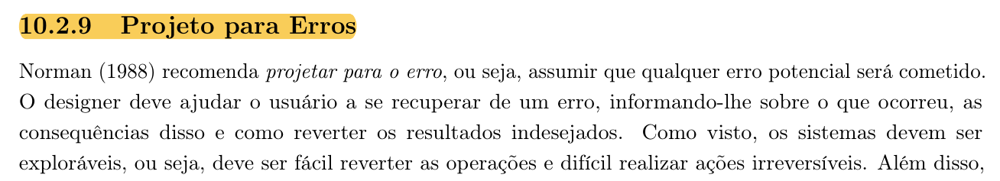{ loading=lazy }

    
Fonte: Barbosa et al. (2021), p. 247. O grifo indica o trecho usado no critério.

    **Aplicação:** [Grupo 06](grupo-06/etapa-3.md#etapa-3-e3-16) · [Grupo 07](grupo-07/etapa-3.md#etapa-3-e3-16).

??? question "E3-17 · O vocabulário e padrões adotam terminologia acessível e coerente com o modelo mental do cidadão?"

    **Autor do item:** [Israel Soares de Paiva](https://github.com/IsraelSoares-25).

    **O que conferir.** Na seção 6 do [Guia de Estilo](../entrega-3/guia-de-estilo.md), confira o glossário e a padronização de rótulos. Deve-se verificar a substituição de termos técnicos legislativos complexos por nomenclaturas intuitivas ou com explicações contextuais de suporte.

    **Rastreabilidade na V1.** Desdobramento do [E3-C16 (Seção 6)](../verificacao/listas/etapa-3.md#e3-c16) · clareza terminológica e alinhamento conceitual.

    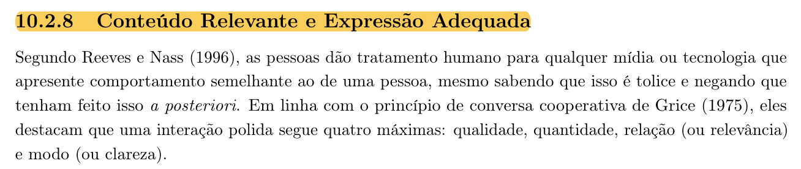{ loading=lazy }

    
Fonte: Barbosa et al. (2021), p. 246. O grifo indica o trecho usado no critério.

    **Aplicação:** [Grupo 06](grupo-06/etapa-3.md#etapa-3-e3-17) · [Grupo 07](grupo-07/etapa-3.md#etapa-3-e3-17).

??? question "E3-18 · A sessão de verificação da etapa possui registro formal com participantes, minutogramas e temas inspecionados?"

    **Autor do item:** [Israel Soares de Paiva](https://github.com/IsraelSoares-25).

    **O que conferir.** Verifique se o [relato de inspeção da Etapa 3](../verificacao/grupo-06/etapa-3/lista-verificacao.md) associa as constatações aos minutos da gravação realizada em 06/10/2026 em [Vídeo de Verificação](../verificacao/grupo-06/etapa-3/lista-verificacao.md#video-de-verificacao), discriminando participantes, artefatos conferidos e decisões deliberadas.

    **Rastreabilidade na V1.** Desdobramento de [D07](../verificacao/listas/etapa-3.md#d07) e [D08](../verificacao/listas/etapa-3.md#d08) · registro minucioso e vínculo vídeo-ata.

    { loading=lazy }

    
Fonte: Sales (2026), p. 8 do PDF. O grifo indica o trecho usado no critério.

    **Aplicação:** [Grupo 06](grupo-06/etapa-3.md#etapa-3-e3-18) · [Grupo 07](grupo-07/etapa-3.md#etapa-3-e3-18).

??? question "E3-19 · Os Princípios Gerais analisam e documentam os trade-offs entre princípios potencialmente conflitantes?"

    **Autor do item:** [Israel Soares de Paiva](https://github.com/IsraelSoares-25).

    **O que conferir.** Acesse [Princípios Gerais de Projeto](../entrega-3/principios-gerais.md). Verifique se o artefato discute formalmente os compromissos de projeto (*trade-offs*) decorrentes da aplicação prática de diretrizes conflitantes (como o equilíbrio entre simplicidade da interface e poder/flexibilidade de recursos para usuários avançados).

    **Rastreabilidade na V1.** Desdobramento do [E3-C21](../verificacao/listas/etapa-3.md#e3-c21) · trade-offs e compromissos de design reflexivo.

    { loading=lazy }

    
Fonte: Barbosa et al. (2021), p. 238. O grifo indica o trecho usado no critério.

    **Aplicação:** [Grupo 06](grupo-06/etapa-3.md#etapa-3-e3-19) · [Grupo 07](grupo-07/etapa-3.md#etapa-3-e3-19).

## Conferência da lista

A Lista de Verificação V2 da Etapa 3 preserva integralmente os 11 critérios gerais de desenvolvimento e os itens oficiais e próprios da V1, desdobrando-os em 19 critérios de conteúdo específicos devidamente ancorados nos capítulos 4, 8 e 10 de Barbosa e Silva (2010) e no referencial de Barbosa et al. (2021). A rastreabilidade item a item com a lista antiga assegura que nenhuma exigência metodológica original seja perdida.

## Histórico de versão

| Versão | Data | Descrição | Autor(es) | Revisor designado |
| :---: | :---: | --- | --- | --- |
| `2.0` | 19/11/2026 | Criação da lista de verificação expandida V2 da Etapa 3 no padrão da Etapa 8, com correspondência explícita à V1 e recortes bibliográficos. | [Israel Soares de Paiva](https://github.com/IsraelSoares-25) | [Caio Breno de Souza Bezerra](https://github.com/CaioBezerra-Dev) |
| `2.1` | 23/11/2026 | Vincula a ficha do Grupo 07 (+1) e os resultados da Etapa 3 | [Bruno Ferreira Dornelas](https://github.com/brunnf) | [Israel Soares de Paiva](https://github.com/IsraelSoares-25) |
| `2.2` | 23/11/2026 | Atualiza os links de rastreabilidade para a Lista V1 da Etapa 3 | [Bruno Ferreira Dornelas](https://github.com/brunnf) | [Caio Breno de Souza Bezerra](https://github.com/CaioBezerra-Dev) |

## Referências

1. SALES, André Barros de. *Plano de Ensino FIHC 022026 — Turma 01*. v1. Brasília: FCTE/UnB, 2026.

2. BARBOSA, Simone Diniz Junqueira; SILVA, Bruno Santana da. *Interação humano-computador*. Rio de Janeiro: Elsevier, 2010.

3. BARBOSA, Simone Diniz Junqueira et al. *Interação Humano-Computador e Experiência do Usuário*. Autopublicação, 2021.

4. MAYHEW, Deborah J. *The usability engineering lifecycle: a practitioner's handbook for user interface design*. San Francisco: Morgan Kaufmann, 1999.

5. FAGAN, Michael E. *Design and code inspections to reduce errors in program development*. IBM Systems Journal, v. 15, n. 3, p. 182–211, 1976. [DOI 10.1147/sj.153.0182](https://doi.org/10.1147/sj.153.0182).
