Responsável: Bruno Ferreira Dornelas · Grupo 06

# Lista de verificação da Etapa 4 · V2

## Tabela de contribuição

| Integrante / ferramenta | Contribuição | Artefato / atividade |
| --- | --- | --- |
| [Bruno Ferreira Dornelas](https://github.com/brunnf) | Organização da lista V2 em blocos de conteúdo, definição das regras de verificação e registro da rastreabilidade entre V1 e V2 | [Como aplicar](#como-aplicar) · [Desenvolvimento do projeto](#desenvolvimento-do-projeto) · [Conferência da lista](#conferencia-da-lista) |
| [Bruno Ferreira Dornelas](https://github.com/brunnf) | Formulação dos critérios sobre Storyboard com recortes grifados de Vianna et al. (2012) e Preece, Rogers e Sharp (2005) | [Storyboard](#storyboard) |
| [Bruno Ferreira Dornelas](https://github.com/brunnf) | Formulação e revisão dos critérios sobre Planejamento da avaliação (DECIDE) e Planejamento do relato com recortes grifados de Barbosa e Silva (2010) | [E4-19](#e4-19) · [E4-20](#e4-20) · [E4-21](#e4-21) · [E4-22](#e4-22) · [E4-27](#e4-27) |
| [Caio Breno de Souza Bezerra](https://github.com/CaioBezerra-Dev) | Autoria original na V1 do critério sobre salvaguardas, desistência livre e autorização de gravação no TCLE | [E4-24](#e4-24) |
| [Heitor Pinheiro Gonçalves das Chagas](https://github.com/Heitorovski01) | Autoria original na V1 do critério sobre decomposição de subobjetivos na HTA | [E4-22](#e4-22) |
| [Israel Soares de Paiva](https://github.com/IsraelSoares-25) | Autoria original na V1 dos critérios sobre classificação de severidade/gravidade e limites de generalização do relato | [E4-28](#e4-28) · [E4-29](#e4-29) |
| [Luís Henrique Arruda Luna](https://github.com/Donnk61) | Autoria original na V1 do critério sobre diretrizes operacionais e postura neutra do avaliador na sessão | [E4-23](#e4-23) |
| Google Gemini e Antigravity | Apoio à extração dos recortes grifados, conferência de paginação bibliográfica e estruturação Markdown | [Agradecimentos](#agradecimentos) |

Tabela 1 — Contribuição neste artefato.

Fonte: elaboração para o Grupo 06 (2026).

[Etapa 8](index.md) · [Resultados e gráficos](resultados/etapa-4.md) · [Lista V1 da Etapa 4](../verificacao/listas/etapa-4.md)

## Como aplicar

Use a mesma redação na **autoinspeção do Grupo 06** e na **inspeção externa do Grupo 05 (−1)** na Etapa 4 (*etapa par*). Os **40 critérios** estão organizados em **quatro blocos de conteúdo**: *Desenvolvimento do projeto*, *Storyboard*, *Planejamento da avaliação — Storyboard e Análise de Tarefas* e *Planejamento do relato dos resultados*. Cada item apresenta o autor, a evidência esperada, o vínculo com a V1 e um recorte da fonte de referência com o trecho relevante grifado.

- **Sim** quando a evidência cumpre integralmente a pergunta em todos os artefatos e integrantes aplicáveis do recorte.
- **Incompleto** quando há evidência parcial, inconsistência entre documentos relacionados ou pendência em ao menos um integrante/fluxo enquanto os demais atendem.
- **Não** quando o requisito é aplicável à etapa e a evidência essencial está ausente em todo o recorte consultado.

Na ficha de inspeção, registre a resposta agregada do grupo, a constatação sintética e os links permanentes para a página publicada no GitHub Pages e para as linhas exatas do código-fonte no commit de referência. [Método e escopo](index.md#metodo-de-inspecao).

## Desenvolvimento do projeto

??? question "D01 · O GitHub Pages possui o histórico de versão padronizado?"

    **Autor do item:** André Barros de Sales.

    **O que conferir.** Abra o histórico de versão em cada artefato principal da Etapa 4 (storyboards e planejamentos). Confira se há tabela padronizada identificando número da versão, data, descrição objetiva da alteração, autor(es) e revisor(es).

    **Rastreabilidade na V1.** [D01](../verificacao/listas/etapa-4.md#d01) · mantido.

    { loading=lazy }

    
Fonte: Sales (2026), p. 8 do PDF. O grifo indica o trecho usado no critério.

    **Aplicação:** [Grupo 05](grupo-05/etapa-4.md#etapa-4-d01) · [Grupo 06](grupo-06/etapa-4.md#etapa-4-d01).

??? question "D02 · O GitHub Pages possui o(s) autor(es) e o(s) revisor(es) para cada artefato?"

    **Autor do item:** André Barros de Sales.

    **O que conferir.** Verifique na versão vigente de cada artefato a identificação nominal de autor(es) e revisor(es) distintos. Campos em branco, travessões, autor repetido como próprio revisor ou marcação “a definir” configuram lacuna (`Incompleto` quando restrito a parte dos documentos; `Não` quando ausente em todo o recorte).

    **Rastreabilidade na V1.** [D02](../verificacao/listas/etapa-4.md#d02) · mantido.

    { loading=lazy }

    
Fonte: Sales (2026), p. 8 do PDF. O grifo indica o trecho usado no critério.

    **Aplicação:** [Grupo 05](grupo-05/etapa-4.md#etapa-4-d02) · [Grupo 06](grupo-06/etapa-4.md#etapa-4-d02).

??? question "D03 · O GitHub Pages possui referências bibliográficas e/ou bibliografia em todos os artefatos?"

    **Autor do item:** André Barros de Sales.

    **O que conferir.** Confira nos documentos de conteúdo da Etapa 4 a presença de seção final de Referências e/ou Bibliografia em formato padronizado (ABNT), coerente com as obras citadas no corpo do texto.

    **Rastreabilidade na V1.** [D03](../verificacao/listas/etapa-4.md#d03) · mantido.

    { loading=lazy }

    
Fonte: Sales (2026), p. 8 do PDF. O grifo indica o trecho usado no critério.

    **Aplicação:** [Grupo 05](grupo-05/etapa-4.md#etapa-4-d03) · [Grupo 06](grupo-06/etapa-4.md#etapa-4-d03).

??? question "D04 · As tabelas e imagens possuem legenda e fonte e são chamadas dentro do texto?"

    **Autor do item:** André Barros de Sales.

    **O que conferir.** Inspecione quadros de Storyboard, diagramas de tarefas, recortes bibliográficos e tabelas de planejamento/relato. Confirme numeração e título/legenda, indicação de fonte e chamada explícita no texto antes ou junto ao elemento.

    **Rastreabilidade na V1.** [D04](../verificacao/listas/etapa-4.md#d04) · mantido.

    { loading=lazy }

    
Fonte: Sales (2026), p. 8 do PDF. O grifo indica o trecho usado no critério.

    **Aplicação:** [Grupo 05](grupo-05/etapa-4.md#etapa-4-d04) · [Grupo 06](grupo-06/etapa-4.md#etapa-4-d04).

??? question "D05 · O GitHub Pages possui um texto fazendo uma introdução dos artefatos?"

    **Autor do item:** André Barros de Sales.

    **O que conferir.** Localize a seção de abertura de cada documento e verifique se contextualiza finalidade, escopo, funcionalidade/persona abordada e vínculo com as etapas anteriores antes de iniciar as tabelas ou quadros técnicos.

    **Rastreabilidade na V1.** [D05](../verificacao/listas/etapa-4.md#d05) · mantido.

    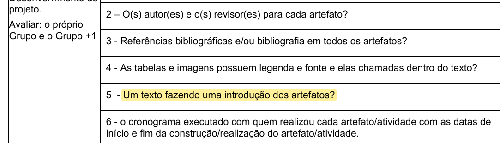{ loading=lazy }

    
Fonte: Sales (2026), p. 8 do PDF. O grifo indica o trecho usado no critério.

    **Aplicação:** [Grupo 05](grupo-05/etapa-4.md#etapa-4-d05) · [Grupo 06](grupo-06/etapa-4.md#etapa-4-d05).

??? question "D06 · O GitHub Pages possui o cronograma executado com quem realizou cada artefato/atividade com as datas de início e fim?"

    **Autor do item:** André Barros de Sales.

    **O que conferir.** Confira na página de cronograma do projeto a tabela de **execução real** da Etapa 4 com atividade, responsável nominal e datas efetivas de início e fim para todos os integrantes. Cronograma apenas planejado não substitui o quadro executado.

    **Rastreabilidade na V1.** [D06](../verificacao/listas/etapa-4.md#d06) · mantido.

    { loading=lazy }

    
Fonte: Sales (2026), p. 8 do PDF. O grifo indica o trecho usado no critério.

    **Aplicação:** [Grupo 05](grupo-05/etapa-4.md#etapa-4-d06) · [Grupo 06](grupo-06/etapa-4.md#etapa-4-d06).

??? question "D07 · O GitHub Pages possui ata(s) da(s) reuniões (com data, horário de início e fim, participantes, objetivo, atividades definidas etc.)?"

    **Autor do item:** André Barros de Sales.

    **O que conferir.** Procure na seção de Atas o registro formal da(s) reunião(ões) referente(s) à Etapa 4 contendo data, horário de abertura e de encerramento, participantes presentes, pauta/objetivo e deliberações. Ficha de inspeção sem ata formal ou ata sem horário de término configura pendência.

    **Rastreabilidade na V1.** [D07](../verificacao/listas/etapa-4.md#d07) · mantido.

    { loading=lazy }

    
Fonte: Sales (2026), p. 9 do PDF. O grifo indica o trecho usado no critério.

    **Aplicação:** [Grupo 05](grupo-05/etapa-4.md#etapa-4-d07) · [Grupo 06](grupo-06/etapa-4.md#etapa-4-d07).

??? question "D08 · O GitHub Pages possui a gravação da reunião do grupo?"

    **Autor do item:** André Barros de Sales.

    **O que conferir.** Verifique se o site disponibiliza link funcional associado à gravação da reunião do grupo / verificação referente à Etapa 4.

    **Rastreabilidade na V1.** [D08](../verificacao/listas/etapa-4.md#d08) · mantido.

    { loading=lazy }

    
Fonte: Sales (2026), p. 9 do PDF. O grifo indica o trecho usado no critério.

    **Aplicação:** [Grupo 05](grupo-05/etapa-4.md#etapa-4-d08) · [Grupo 06](grupo-06/etapa-4.md#etapa-4-d08).

??? question "D09 · O GitHub Pages possui vídeo de apresentação na categoria “não listado” no YouTube?"

    **Autor do item:** André Barros de Sales.

    **O que conferir.** Confira na página de apresentações da Etapa 4 o link/incorporação do vídeo no YouTube e a indicação de publicação como **não listado**, cobrindo o grupo ou os integrantes conforme a organização adotada.

    **Rastreabilidade na V1.** [D09](../verificacao/listas/etapa-4.md#d09) · mantido.

    { loading=lazy }

    
Fonte: Sales (2026), p. 9 do PDF. O grifo indica o trecho usado no critério.

    **Aplicação:** [Grupo 05](grupo-05/etapa-4.md#etapa-4-d09) · [Grupo 06](grupo-06/etapa-4.md#etapa-4-d09).

??? question "D10 · O GitHub Pages possui tabela de contribuição no início do artefato com o nome dos integrantes e hiperligação da atividade?"

    **Autor do item:** André Barros de Sales.

    **O que conferir.** Confira no início de cada artefato da Etapa 4 a presença de tabela identificando nominalmente quem atuou naquele documento, a contribuição específica realizada e a hiperligação para a seção ou atividade correspondente.

    **Rastreabilidade na V1.** [D10](../verificacao/listas/etapa-4.md#d10) · mantido.

    { loading=lazy }

    
Fonte: Sales (2026), p. 9 do PDF. O grifo indica o trecho usado no critério.

    **Aplicação:** [Grupo 05](grupo-05/etapa-4.md#etapa-4-d10) · [Grupo 06](grupo-06/etapa-4.md#etapa-4-d10).

??? question "D11 · O GitHub Pages possui a seção de agradecimentos apresentando o uso de Inteligência Artificial (IA) Generativa no artefato?"

    **Autor do item:** André Barros de Sales.

    **O que conferir.** Verifique na seção de agradecimentos (ou declaração equivalente no documento) a identificação nominal das ferramentas de IA generativa empregadas (ex.: ChatGPT/Codex, Gemini, Claude, Grok), a finalidade do apoio e a responsabilidade humana pelo conteúdo. Menção genérica apenas a “IA” sem nomear a ferramenta configura `Incompleto`.

    **Rastreabilidade na V1.** [D11](../verificacao/listas/etapa-4.md#d11) · mantido.

    { loading=lazy }

    
Fonte: Sales (2026), p. 3 do PDF. O grifo indica o trecho usado no critério.

    **Aplicação:** [Grupo 05](grupo-05/etapa-4.md#etapa-4-d11) · [Grupo 06](grupo-06/etapa-4.md#etapa-4-d11).

## Storyboard

Este bloco reúne **10 critérios** dedicados à cobertura, ao vínculo com a análise de tarefas e à qualidade narrativa e visual dos **Storyboards** entregues na Etapa 4.

??? question "E4-01 · A quantidade de storyboards é igual à quantidade de integrantes do grupo?"

    **Autor do item:** André Barros de Sales.

    **Referência:** SALES, André Barros de. *Plano de Ensino FIHC 022026 — Turma 01*. Brasília: FCTE/UnB, 2026. Lista da Apresentação 4, Item 10.

    **O que conferir.** Conte os storyboards completos e acessíveis publicados para a Etapa 4 e compare com o número total de integrantes ativos da equipe (`5` integrantes no Grupo 06; `7` integrantes no Grupo 05). Caso falte o storyboard de algum integrante ou o material esteja incompleto/inacessível na entrega da etapa, registre `Incompleto`.

    **Rastreabilidade na V1.** [E4-C10](../verificacao/listas/etapa-4.md#e4-c10) · mantido.

    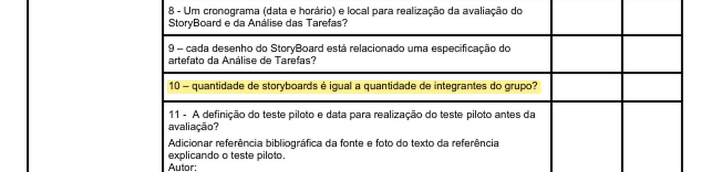{ loading=lazy }

    
Fonte: Sales (2026), Apresentação 4 (Item 10). O grifo indica o trecho usado no critério.

    **Aplicação:** [Grupo 05](grupo-05/etapa-4.md#etapa-4-e4-01) · [Grupo 06](grupo-06/etapa-4.md#etapa-4-e4-01).

??? question "E4-02 · Cada desenho do Storyboard está relacionado a uma especificação do artefato da Análise de Tarefas?"

    **Autor do item:** André Barros de Sales.

    **Referência:** SALES, André Barros de. *Plano de Ensino FIHC 022026 — Turma 01*. Brasília: FCTE/UnB, 2026. Lista da Apresentação 4, Item 9.

    **O que conferir.** Verifique se cada storyboard publicado possui vínculo explícito e rastreável (por tabela de correspondência, identificadores de quadros ou mapeamento direto) com uma tarefa e seus respectivos subobjetivos/operações especificados na Análise de Tarefas (HTA e/ou CTT, hospedada na Etapa 4 ou referenciada da Etapa 2).

    **Rastreabilidade na V1.** [E4-C09](../verificacao/listas/etapa-4.md#e4-c09) + [E4-C19](../verificacao/listas/etapa-4.md#e4-c19) · mantido.

    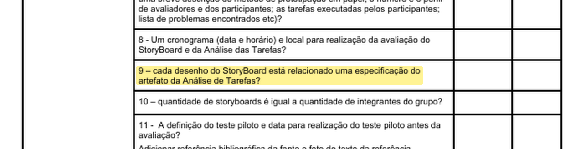{ loading=lazy }

    
Fonte: Sales (2026), Apresentação 4 (Item 9). O grifo indica o trecho usado no critério.

    **Aplicação:** [Grupo 05](grupo-05/etapa-4.md#etapa-4-e4-02) · [Grupo 06](grupo-06/etapa-4.md#etapa-4-e4-02).

??? question "E4-03 · Cada storyboard representa visualmente a história por meio de quadros estáticos elaborados com técnica gráfica adequada ao objetivo comunicativo (desenhos, colagens, fotografias ou esboços impressos ou digitais)?"

    **Autor do item:** [Bruno Ferreira Dornelas](https://github.com/brunnf).

    **Referência:** VIANNA, Maurício; VIANNA, Ysmar; ADLER, Isabel K.; LUCENA, Brenda de F.; RUSSO, Beatriz. *Design Thinking: inovação em negócios*. Rio de Janeiro: MJV Press, 2012. Cap. Prototipação — Storyboard, p. 135.

    **O que conferir.** Abra as imagens dos storyboards de todos os integrantes e confirme que não se reduzem a texto puro ou fluxograma abstrato, apresentando quadros visuais estáticos legíveis (desenhos manuais digitalizados, quadrinhos ilustrados, colagens ou fotografias) capazes de representar visualmente o conteúdo que se deseja comunicar.

    **Rastreabilidade na V1.** Novo · fundamentado em Vianna et al. (2012, p. 135) sobre representação em quadros estáticos e técnica gráfica.

    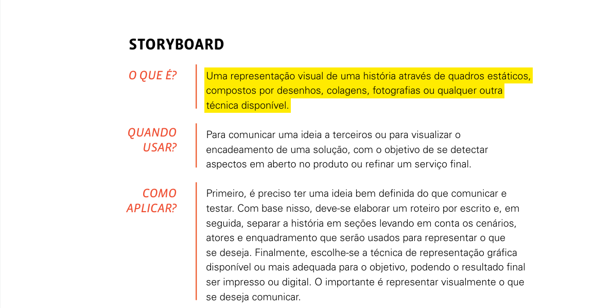{ loading=lazy }

    
Fonte: Vianna et al. (2012), p. 135. O grifo indica a definição de storyboard em quadros estáticos.

    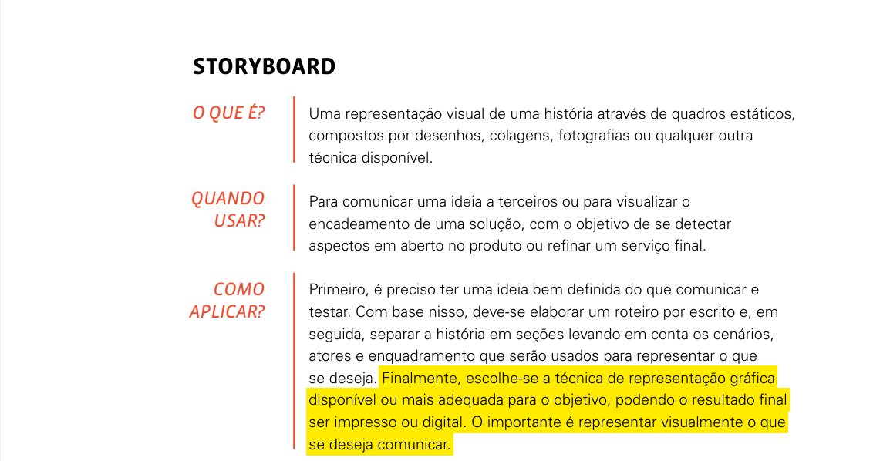{ loading=lazy }

    
Fonte: Vianna et al. (2012), p. 135. O grifo indica a escolha da técnica gráfica adequada ao objetivo.

    **Aplicação:** [Grupo 05](grupo-05/etapa-4.md#etapa-4-e4-03) · [Grupo 06](grupo-06/etapa-4.md#etapa-4-e4-03).

??? question "E4-04 · O artefato explicita a finalidade do storyboard — (1) comunicar o conceito da solução a usuários e terceiros e (2) visualizar o encadeamento da proposta para detectar aspectos em aberto ou refinar o serviço?"

    **Autor do item:** [Bruno Ferreira Dornelas](https://github.com/brunnf).

    **Referência:** VIANNA, Maurício et al. *Design Thinking: inovação em negócios*. Rio de Janeiro: MJV Press, 2012. Cap. Prototipação — Storyboard, p. 135–136.

    **O que conferir.** Verifique na contextualização ou fundamentação de cada storyboard se está declarada sua função de comunicar a ideia de design às partes interessadas/usuários e inspecionar pontos em aberto do fluxo antes de construir telas definitivas. Marque `Incompleto` quando algum integrante publicar apenas a imagem sem explicitar o propósito comunicativo/exploratório da narrativa.

    **Rastreabilidade na V1.** Novo · fundamentado em Vianna et al. (2012, p. 135–136) sobre finalidade comunicativa e detecção de aspectos em aberto.

    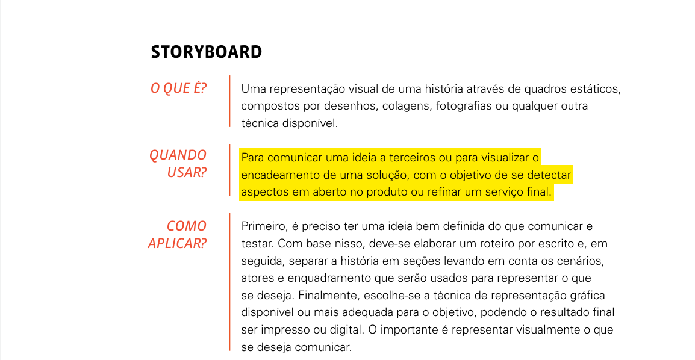{ loading=lazy }

    
Fonte: Vianna et al. (2012), p. 135. O grifo indica a finalidade comunicativa e de detecção de aspectos em aberto.

    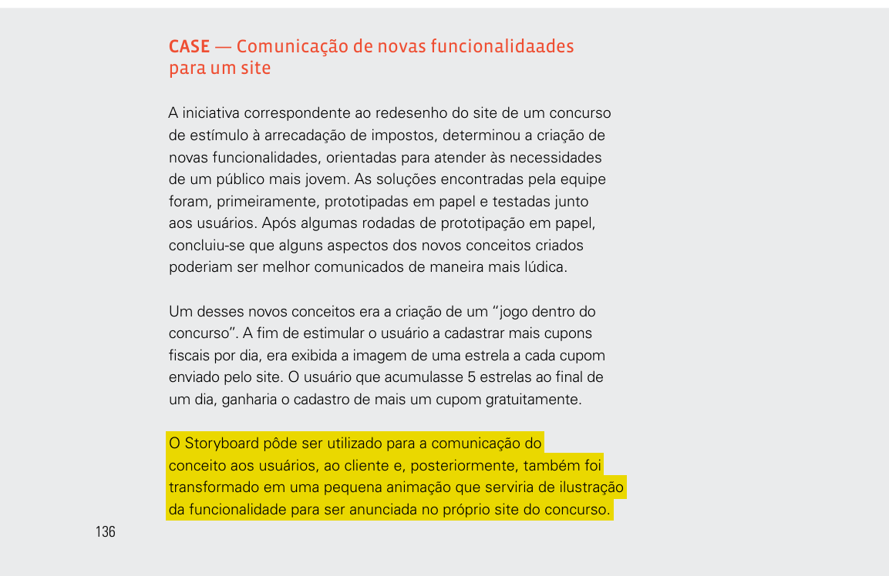{ loading=lazy }

    
Fonte: Vianna et al. (2012), p. 136. O grifo indica a comunicação do conceito aos usuários e interessados.

    **Aplicação:** [Grupo 05](grupo-05/etapa-4.md#etapa-4-e4-04) · [Grupo 06](grupo-06/etapa-4.md#etapa-4-e4-04).

??? question "E4-05 · Cada storyboard parte de uma ideia bem delimitada do que comunicar e testar, acompanhada de um roteiro por escrito que orienta os quadros desenhados?"

    **Autor do item:** [Bruno Ferreira Dornelas](https://github.com/brunnf).

    **Referência:** VIANNA, Maurício et al. *Design Thinking: inovação em negócios*. Rio de Janeiro: MJV Press, 2012. Cap. Prototipação — Storyboard, p. 135.

    **O que conferir.** Confirme se cada storyboard delimita claramente a funcionalidade/proposta sob teste e apresenta roteiro textual estruturado (descrição escrita da narrativa ou tabela de roteiro por quadro) coerente com as cenas ilustradas.

    **Rastreabilidade na V1.** Novo · fundamentado em Vianna et al. (2012, p. 135) sobre delimitação da ideia e roteiro escrito.

    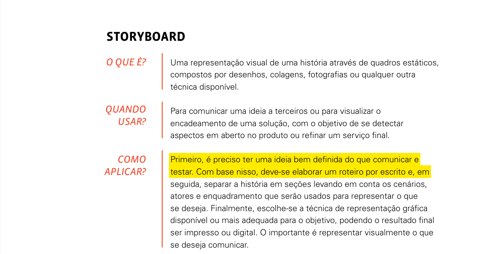{ loading=lazy }

    
Fonte: Vianna et al. (2012), p. 135. O grifo indica a exigência de ideia definida e roteiro escrito.

    **Aplicação:** [Grupo 05](grupo-05/etapa-4.md#etapa-4-e4-05) · [Grupo 06](grupo-06/etapa-4.md#etapa-4-e4-05).

??? question "E4-06 · A história do storyboard está dividida em seções (quadros) que explicitam (1) o cenário/contexto ambiental, (2) os atores/personas envolvidos e (3) o enquadramento utilizado em cada cena?"

    **Autor do item:** [Bruno Ferreira Dornelas](https://github.com/brunnf).

    **Referência:** VIANNA, Maurício et al. *Design Thinking: inovação em negócios*. Rio de Janeiro: MJV Press, 2012. Cap. Prototipação — Storyboard, p. 135.

    **O que conferir.** Verifique nos quadros e em sua especificação textual se ficam identificáveis o ambiente/situação onde ocorre a cena, quem é o ator/persona protagonista (e agentes externos, se houver) e o foco/enquadramento de cada momento (contexto amplo, ação do usuário ou detalhe da resposta do sistema).

    **Rastreabilidade na V1.** Novo · fundamentado em Vianna et al. (2012, p. 135) sobre divisão em seções com cenário, atores e enquadramento.

    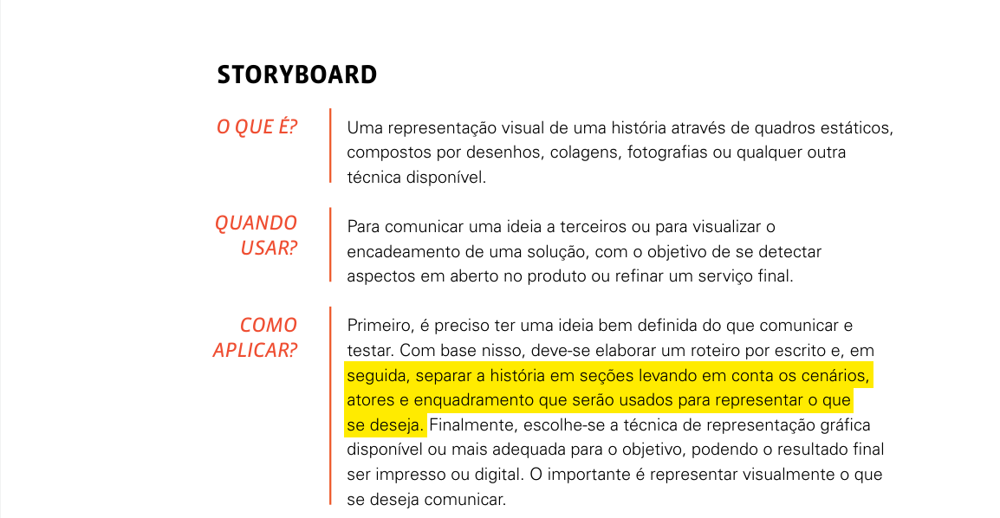{ loading=lazy }

    
Fonte: Vianna et al. (2012), p. 135. O grifo indica a divisão em seções com cenários, atores e enquadramento.

    **Aplicação:** [Grupo 05](grupo-05/etapa-4.md#etapa-4-e4-06) · [Grupo 06](grupo-06/etapa-4.md#etapa-4-e4-06).

??? question "E4-07 · O storyboard apresenta uma série encadeada de desenhos que mostra como o usuário progride em uma tarefa utilizando o produto — seja por (1) cenas desenhadas da execução da tarefa em contexto ou (2) telas esboçadas da interface — até o desfecho?"

    **Autor do item:** [Bruno Ferreira Dornelas](https://github.com/brunnf).

    **Referência:** PREECE, Jennifer; ROGERS, Yvonne; SHARP, Helen. *Design de interação: além da interação homem-computador*. Tradução de Viviane Possamai. Porto Alegre: Bookman, 2005. Cap. 8, Seção 8.2.3, p. 263.

    **O que conferir.** Inspecione a progressão entre o primeiro e o último quadro de cada storyboard: confirme se há início motivador, etapas intermediárias de interação com a solução proposta e estado final/desfecho observável da tarefa, evitando quadros isolados que não mostrem a evolução da atividade.

    **Rastreabilidade na V1.** Novo · fundamentado em Preece, Rogers e Sharp (2005, p. 263) sobre progressão encadeada da tarefa.

    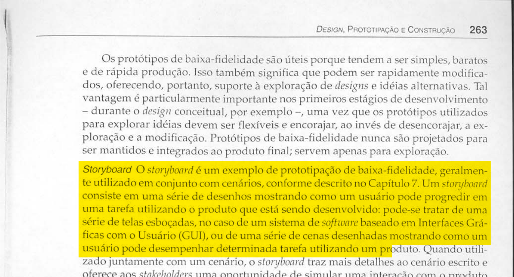{ loading=lazy }

    
Fonte: Preece, Rogers e Sharp (2005), p. 263. O grifo indica a progressão em uma tarefa por cenas desenhadas ou telas esboçadas.

    **Aplicação:** [Grupo 05](grupo-05/etapa-4.md#etapa-4-e4-07) · [Grupo 06](grupo-06/etapa-4.md#etapa-4-e4-07).

??? question "E4-08 · Quando utilizado em conjunto com cenários do projeto, o storyboard acrescenta detalhes concretos ao cenário escrito e oferece às partes interessadas (stakeholders) oportunidade de observar e simular mentalmente a interação com o produto?"

    **Autor do item:** [Bruno Ferreira Dornelas](https://github.com/brunnf).

    **Referência:** PREECE, Jennifer; ROGERS, Yvonne; SHARP, Helen. *Design de interação: além da interação homem-computador*. Porto Alegre: Bookman, 2005. Cap. 8, Seção 8.2.3, p. 263.

    **O que conferir.** Confira se cada storyboard referencia ou concretiza um cenário/persona do projeto, acrescentando elementos visuais e situacionais (motivo de acesso, falas, retornos percebidos e pontos de decisão) suficientes para que um participante ou stakeholder compreenda e discuta a experiência durante a avaliação.

    **Rastreabilidade na V1.** Novo · fundamentado em Preece, Rogers e Sharp (2005, p. 263) sobre articulação com cenários e simulação pelos interessados.

    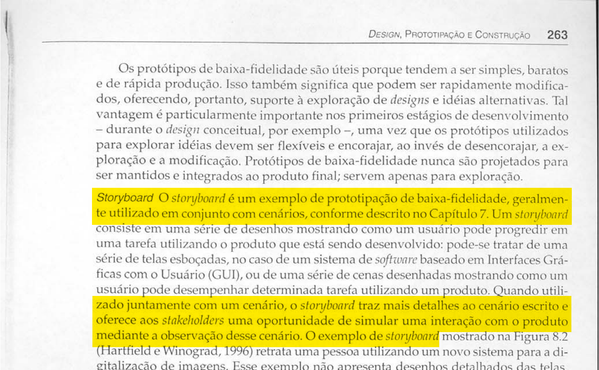{ loading=lazy }

    
Fonte: Preece, Rogers e Sharp (2005), p. 263. O grifo indica o detalhamento do cenário escrito para observação pelos interessados.

    **Aplicação:** [Grupo 05](grupo-05/etapa-4.md#etapa-4-e4-08) · [Grupo 06](grupo-06/etapa-4.md#etapa-4-e4-08).

??? question "E4-09 · O storyboard preserva o caráter de protótipo de baixa fidelidade — (1) simples, barato e fácil de modificar para explorar ideias alternativas, (2) concebido apenas para exploração sem intenção de ser integrado ao produto final e (3) representado com símbolos e traços descomplicados (como esboços livres ou *stick figures*)?"

    **Autor do item:** [Bruno Ferreira Dornelas](https://github.com/brunnf).

    **Referência:** PREECE, Jennifer; ROGERS, Yvonne; SHARP, Helen. *Design de interação: além da interação homem-computador*. Porto Alegre: Bookman, 2005. Cap. 8, Seção 8.2.3, p. 263–264.

    **O que conferir.** Verifique se os storyboards mantêm foco conceitual e baixa fidelidade exploratória (esboços manuais ou quadrinhos esquemáticos simples, fáceis de revisar após feedback), evitando confundir storyboard com protótipo navegável de alta fidelidade ou artefato definitivo de interface.

    **Rastreabilidade na V1.** Novo · fundamentado em Preece, Rogers e Sharp (2005, p. 263–264) sobre baixa fidelidade exploratória.

    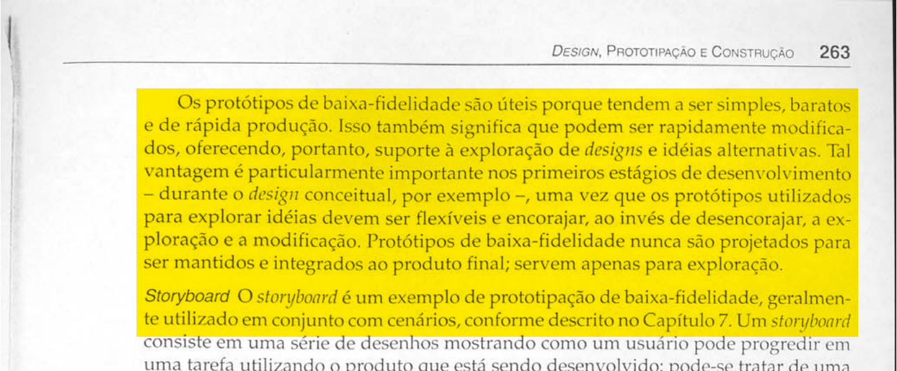{ loading=lazy }

    
Fonte: Preece, Rogers e Sharp (2005), p. 263. O grifo indica as propriedades exploratórias da prototipação de baixa fidelidade.

    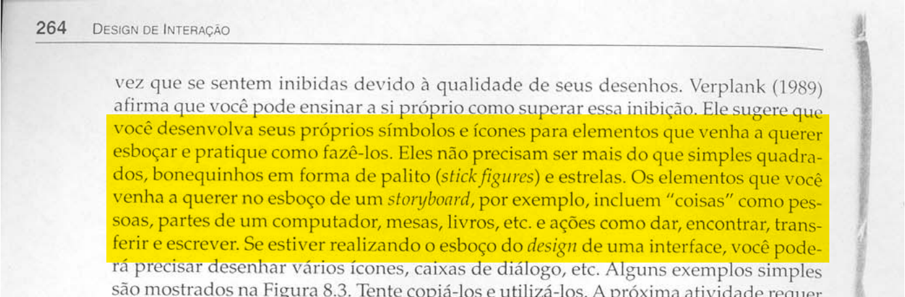{ loading=lazy }

    
Fonte: Preece, Rogers e Sharp (2005), p. 264. O grifo indica a representação com traços e símbolos simples.

    **Aplicação:** [Grupo 05](grupo-05/etapa-4.md#etapa-4-e4-09) · [Grupo 06](grupo-06/etapa-4.md#etapa-4-e4-09).

??? question "E4-10 · Os quadros do storyboard estão organizados em sequência ordenada de passos (por exemplo, numerados de 1 a N), cada um acompanhado de legenda curta que descreve a ação representada para leitura contínua do início ao fim?"

    **Autor do item:** [Bruno Ferreira Dornelas](https://github.com/brunnf).

    **Referência:** VIANNA, Maurício et al. *Design Thinking: inovação em negócios*. Rio de Janeiro: MJV Press, 2012. Cap. Prototipação — Storyboard, p. 137.

    **O que conferir.** Confira em todos os storyboards se os quadros trazem numeração ou ordenação inequívoca (`Quadro 1..N` ou `QD01..QDn`) e legendas/balões curtos legíveis que permitam acompanhar a narrativa do primeiro ao último passo sem ambiguidade de ordem de leitura.

    **Rastreabilidade na V1.** Novo · fundamentado em Vianna et al. (2012, p. 137) sobre ordenação sequencial e legendas curtas por quadro.

    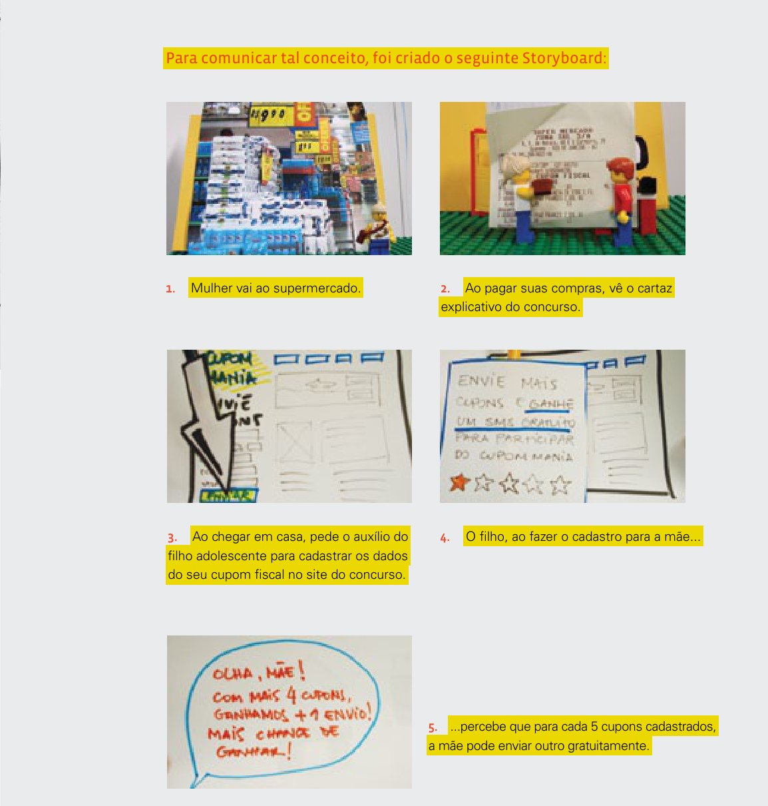{ loading=lazy }

    
Fonte: Vianna et al. (2012), p. 137. O grifo indica a numeração sequencial e as legendas curtas por quadro.

    **Aplicação:** [Grupo 05](grupo-05/etapa-4.md#etapa-4-e4-10) · [Grupo 06](grupo-06/etapa-4.md#etapa-4-e4-10).

## Planejamento da avaliação — Storyboard e Análise de Tarefas

Este bloco reúne **14 critérios** sobre o planejamento metodológico e operacional da avaliação formativa do **Storyboard** e da **Análise de Tarefas** pelo framework **DECIDE**. Planos comuns a todo o grupo são aceitos quando cobrem de forma rastreável as funcionalidades e tarefas dos integrantes.

??? question "E4-11 · O planejamento da avaliação segue o Framework DECIDE?"

    **Autor do item:** André Barros de Sales.

    **Referência:** SALES, André Barros de. *Plano de Ensino FIHC 022026 — Turma 01*. Brasília: FCTE/UnB, 2026. Lista da Apresentação 4, Item 2.

    **O que conferir.** Verifique se os planejamentos da avaliação do Storyboard e da Análise de Tarefas articulam explicitamente as seis atividades do DECIDE: **(D)** determinar objetivos gerais, **(E)** explorar perguntas específicas, **(C)** escolher métodos de avaliação, **(I)** identificar e administrar questões práticas, **(D)** decidir como lidar com questões éticas e **(E)** avaliar, interpretar e apresentar os dados.

    **Rastreabilidade na V1.** [E4-C02](../verificacao/listas/etapa-4.md#e4-c02) · mantido.

    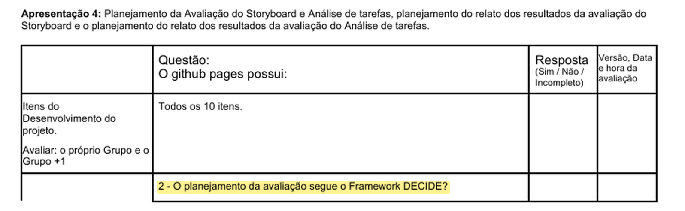{ loading=lazy }

    
Fonte: Sales (2026), Apresentação 4 (Item 2). O grifo indica o trecho usado no critério.

    **Aplicação:** [Grupo 05](grupo-05/etapa-4.md#etapa-4-e4-11) · [Grupo 06](grupo-06/etapa-4.md#etapa-4-e4-11).

??? question "E4-12 · Descreve o(s) objetivo(s) da avaliação? (apropriação de tecnologia pelos usuários; ideias e alternativas de design; conformidade com um padrão; e/ou problemas na interação e na interface na fase do modelo conceitual)?"

    **Autor do item:** André Barros de Sales.

    **Referência:** SALES, André Barros de. *Plano de Ensino FIHC 022026 — Turma 01*. Brasília: FCTE/UnB, 2026. Lista da Apresentação 4, Item 3.

    **O que conferir.** Confira na atividade **D (Determinar os objetivos)** de cada planejamento a indicação clara de qual(is) objetivo(s) de avaliação de IHC orienta(m) o estudo na fase conceitual e como seus resultados guiarão as decisões de projeto da equipe.

    **Rastreabilidade na V1.** [E4-C03](../verificacao/listas/etapa-4.md#e4-c03) · mantido.

    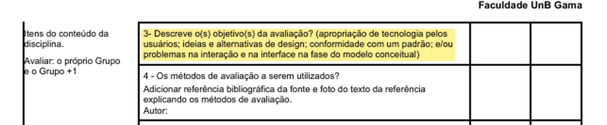{ loading=lazy }

    
Fonte: Sales (2026), Apresentação 4 (Item 3). O grifo indica o trecho usado no critério.

    **Aplicação:** [Grupo 05](grupo-05/etapa-4.md#etapa-4-e4-12) · [Grupo 06](grupo-06/etapa-4.md#etapa-4-e4-12).

??? question "E4-13 · Apresenta os métodos de avaliação a serem utilizados, acompanhados de referência bibliográfica da fonte, foto do texto da referência explicando os métodos e identificação do autor do item?"

    **Autor do item:** André Barros de Sales.

    **Referência:** SALES, André Barros de. *Plano de Ensino FIHC 022026 — Turma 01*. Brasília: FCTE/UnB, 2026. Lista da Apresentação 4, Item 4.

    **O que conferir.** Confira na seção de escolha dos métodos (**C** do DECIDE ou apêndice vinculado ao planejamento) a presença simultânea de: **(1)** explicação do método adotado para o Storyboard e para a Análise de Tarefas, **(2)** referência bibliográfica da obra, **(3)** imagem/recorte legível da página da fonte explicando o método e **(4)** identificação nominal do autor daquele item no artefato. A ausência de recorte da fonte ou de autoria explícita em parte dos planos caracteriza `Incompleto`.

    **Rastreabilidade na V1.** [E4-C04](../verificacao/listas/etapa-4.md#e4-c04) · mantido.

    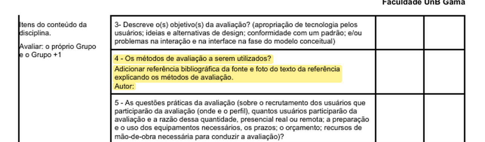{ loading=lazy }

    
Fonte: Sales (2026), Apresentação 4 (Item 4). O grifo indica o trecho usado no critério.

    **Aplicação:** [Grupo 05](grupo-05/etapa-4.md#etapa-4-e4-13) · [Grupo 06](grupo-06/etapa-4.md#etapa-4-e4-13).

??? question "E4-14 · Descreve as questões práticas da avaliação (recrutamento: onde e perfil; quantidade de usuários e justificativa dessa quantidade; modalidade presencial real ou remota; preparação e uso de equipamentos; prazos; orçamento; e mão de obra necessária)?"

    **Autor do item:** André Barros de Sales.

    **Referência:** SALES, André Barros de. *Plano de Ensino FIHC 022026 — Turma 01*. Brasília: FCTE/UnB, 2026. Lista da Apresentação 4, Item 5.

    **O que conferir.** Verifique na etapa **I (Questões práticas)** de todos os planejamentos a cobertura dos sete elementos operacionais: **(1)** canal/local de recrutamento e perfil desejado, **(2)** número previsto de participantes acompanhado de justificativa metodológica ou operacional, **(3)** modalidade presencial ou remota, **(4)** preparação e equipamentos, **(5)** prazos, **(6)** orçamento (inclusive custo zero declarado) e **(7)** papéis/mão de obra da equipe.

    **Rastreabilidade na V1.** [E4-C05](../verificacao/listas/etapa-4.md#e4-c05) · mantido.

    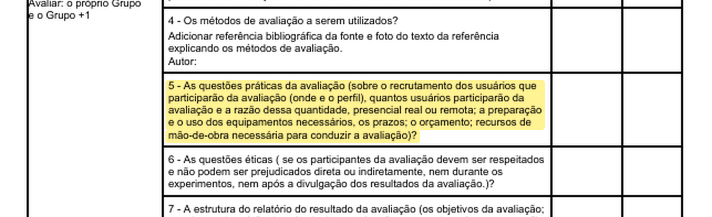{ loading=lazy }

    
Fonte: Sales (2026), Apresentação 4 (Item 5). O grifo indica o trecho usado no critério.

    **Aplicação:** [Grupo 05](grupo-05/etapa-4.md#etapa-4-e4-14) · [Grupo 06](grupo-06/etapa-4.md#etapa-4-e4-14).

??? question "E4-15 · Aborda as questões éticas (garantindo que os participantes sejam respeitados e não sejam prejudicados direta ou indiretamente, nem durante os experimentos nem após a divulgação dos resultados)?"

    **Autor do item:** André Barros de Sales.

    **Referência:** SALES, André Barros de. *Plano de Ensino FIHC 022026 — Turma 01*. Brasília: FCTE/UnB, 2026. Lista da Apresentação 4, Item 6.

    **O que conferir.** Confira na etapa **D (Questões éticas)** a garantia explícita de respeito, conforto, não maleficência e proteção à privacidade/autoestima dos participantes tanto durante as sessões quanto na publicação posterior dos resultados no site público da disciplina.

    **Rastreabilidade na V1.** [E4-C06](../verificacao/listas/etapa-4.md#e4-c06) · mantido.

    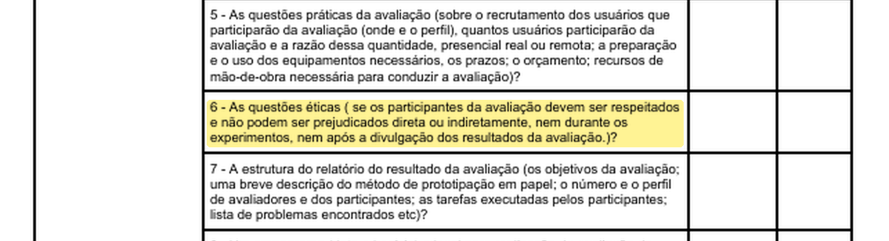{ loading=lazy }

    
Fonte: Sales (2026), Apresentação 4 (Item 6). O grifo indica o trecho usado no critério.

    **Aplicação:** [Grupo 05](grupo-05/etapa-4.md#etapa-4-e4-15) · [Grupo 06](grupo-06/etapa-4.md#etapa-4-e4-15).

??? question "E4-16 · Apresenta um cronograma (data e horário) e local para realização da avaliação do Storyboard e da Análise de Tarefas?"

    **Autor do item:** André Barros de Sales.

    **Referência:** SALES, André Barros de. *Plano de Ensino FIHC 022026 — Turma 01*. Brasília: FCTE/UnB, 2026. Lista da Apresentação 4, Item 8.

    **O que conferir.** Confirme nos planejamentos individuais ou na agenda logística comum da Etapa 4 a indicação explícita de **datas**, **horários** (ou janelas horárias definidas) e **local físico ou plataforma remota** previstos para as sessões de avaliação tanto do Storyboard quanto da Análise de Tarefas. Planos que deixem datas ou horários totalmente em aberto configuram `Incompleto`.

    **Rastreabilidade na V1.** [E4-C08](../verificacao/listas/etapa-4.md#e4-c08) · mantido.

    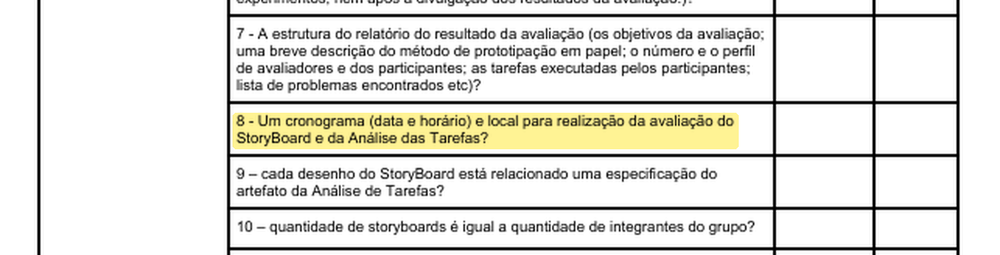{ loading=lazy }

    
Fonte: Sales (2026), Apresentação 4 (Item 8). O grifo indica o trecho usado no critério.

    **Aplicação:** [Grupo 05](grupo-05/etapa-4.md#etapa-4-e4-16) · [Grupo 06](grupo-06/etapa-4.md#etapa-4-e4-16).

??? question "E4-17 · Apresenta a definição do teste-piloto e a data para sua realização antes da avaliação oficial, com referência bibliográfica, foto do texto da referência explicando o teste-piloto e autor do item?"

    **Autor do item:** André Barros de Sales.

    **Referência:** SALES, André Barros de. *Plano de Ensino FIHC 022026 — Turma 01*. Brasília: FCTE/UnB, 2026. Lista da Apresentação 4, Item 11.

    **O que conferir.** Verifique nos planejamentos (ou no protocolo comum de teste-piloto da etapa) a presença simultânea dos cinco requisitos: **(1)** definição e finalidade do teste-piloto, **(2)** data agendada estritamente **anterior** ao início das sessões oficiais, **(3)** referência bibliográfica, **(4)** imagem/recorte legível do trecho do livro sobre teste-piloto e **(5)** identificação nominal do autor do item.

    **Rastreabilidade na V1.** [E4-C11](../verificacao/listas/etapa-4.md#e4-c11) + [E4-C22](../verificacao/listas/etapa-4.md#e4-c22) · mantido.

    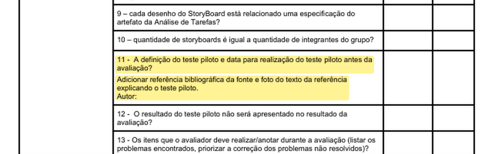{ loading=lazy }

    
Fonte: Sales (2026), Apresentação 4 (Item 11). O grifo indica o trecho usado no critério.

    **Aplicação:** [Grupo 05](grupo-05/etapa-4.md#etapa-4-e4-17) · [Grupo 06](grupo-06/etapa-4.md#etapa-4-e4-17).

??? question "E4-18 · Explicita que o resultado do teste-piloto não será apresentado junto ao resultado oficial da avaliação?"

    **Autor do item:** André Barros de Sales.

    **Referência:** SALES, André Barros de. *Plano de Ensino FIHC 022026 — Turma 01*. Brasília: FCTE/UnB, 2026. Lista da Apresentação 4, Item 12.

    **O que conferir.** Confirme a existência de regra expressa determinando que a sessão piloto utiliza participante/ensaio separado da amostra oficial e que seus dados destinam-se apenas a calibrar roteiro, tempo e ferramentas, sendo descartados/excluídos da consolidação dos resultados definitivos.

    **Rastreabilidade na V1.** [E4-C12](../verificacao/listas/etapa-4.md#e4-c12) + [E4-C22](../verificacao/listas/etapa-4.md#e4-c22) · mantido.

    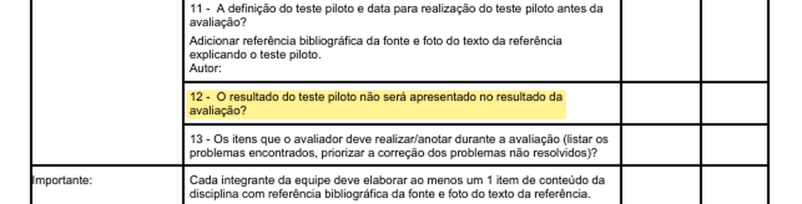{ loading=lazy }

    
Fonte: Sales (2026), Apresentação 4 (Item 12). O grifo indica o trecho usado no critério.

    **Aplicação:** [Grupo 05](grupo-05/etapa-4.md#etapa-4-e4-18) · [Grupo 06](grupo-06/etapa-4.md#etapa-4-e4-18).

??? question "E4-19 · O planejamento caracteriza explicitamente a avaliação como formativa (realizada durante a concepção da solução, antes de haver interface pronta, usando insumos como storyboards e modelos) e delimita o escopo justificado dos caminhos de interação, tarefas e perfis incluídos?"

    **Autor do item:** [Bruno Ferreira Dornelas](https://github.com/brunnf).

    **Referência:** BARBOSA, Simone Diniz Junqueira; SILVA, Bruno Santana da. *Interação humano-computador*. Rio de Janeiro: Elsevier, 2010. Cap. 9, Seção 9.3, p. 294; Seção 9.7.2, p. 304.

    **O que conferir.** Confira se os planejamentos situam o momento do ciclo de design como **avaliação formativa/construtiva** e delimitam objetivamente quais fluxos, caminhos principais/alternativos, tarefas e perfis de usuário entram na avaliação (e o que fica fora do recorte), justificando a seleção perante os objetivos definidos.

    **Rastreabilidade na V1.** Novo · fundamentado em Barbosa e Silva (2010, p. 294, 304) sobre avaliação formativa e delimitação do escopo.

    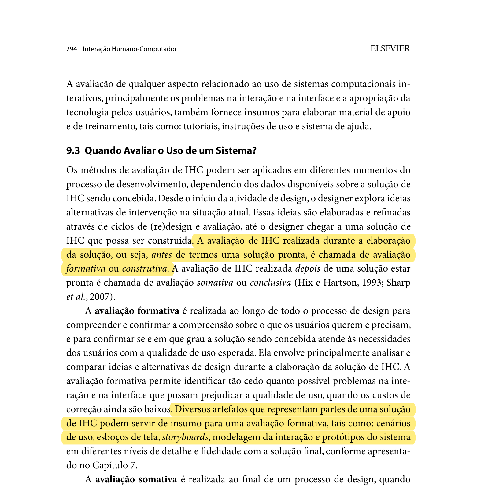{ loading=lazy }

    
Fonte: Barbosa e Silva (2010), p. 294. O grifo indica a definição de avaliação formativa e seus artefatos de entrada.

    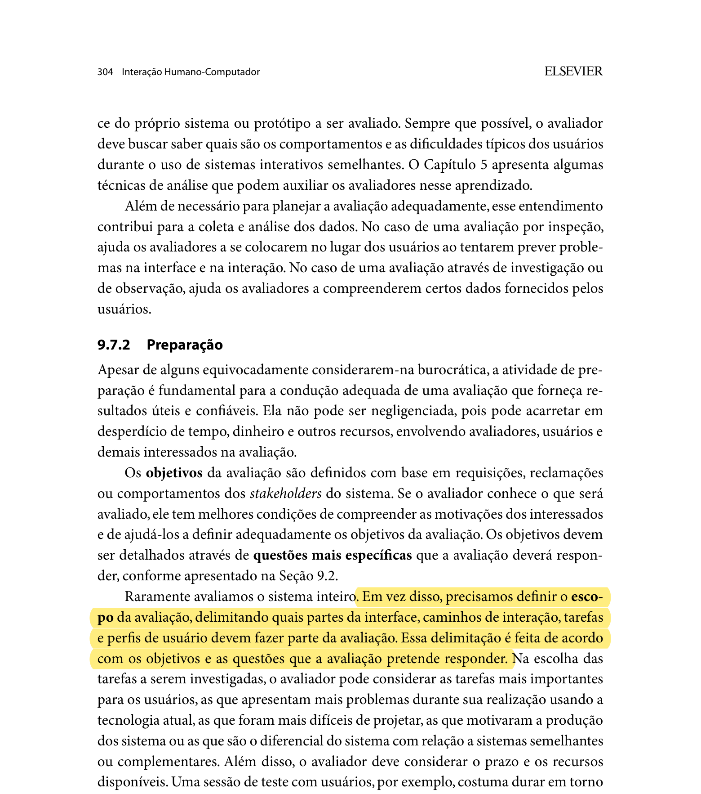{ loading=lazy }

    
Fonte: Barbosa e Silva (2010), p. 304. O grifo indica a delimitação justificada do escopo da avaliação.

    **Aplicação:** [Grupo 05](grupo-05/etapa-4.md#etapa-4-e4-19) · [Grupo 06](grupo-06/etapa-4.md#etapa-4-e4-19).

??? question "E4-20 · Na atividade E (Explorar perguntas) do DECIDE, cada objetivo geral é desdobrado em perguntas específicas operacionais — alinhadas ao perfil dos usuários-alvo, às atividades e aos artefatos conceituais (Storyboard e Análise de Tarefas) — distinguindo as questões analíticas do avaliador das perguntas feitas ao participante?"

    **Autor do item:** [Bruno Ferreira Dornelas](https://github.com/brunnf).

    **Referência:** BARBOSA, Simone Diniz Junqueira; SILVA, Bruno Santana da. *Interação humano-computador*. Rio de Janeiro: Elsevier, 2010. Cap. 9, Seção 9.2, p. 292–293; Seção 9.8, p. 313.

    **O que conferir.** Examine a seção **E — Explorar perguntas** dos planejamentos de Storyboard e de Análise de Tarefas. Confirme se há questões específicas rastreáveis aos objetivos declarados e adequadas a artefatos conceituais (compreensão da narrativa, adequação da proposta, completude/ordem das tarefas), sem confundir perguntas analíticas do pesquisador com estímulos diretos do roteiro de entrevista, nem cobrar métricas de interface implementada (como contagem de cliques ou tempo de tela).

    **Rastreabilidade na V1.** Novo · detalha a atividade E (Explorar perguntas) do DECIDE com base em Barbosa e Silva (2010, p. 292–293, 313).

    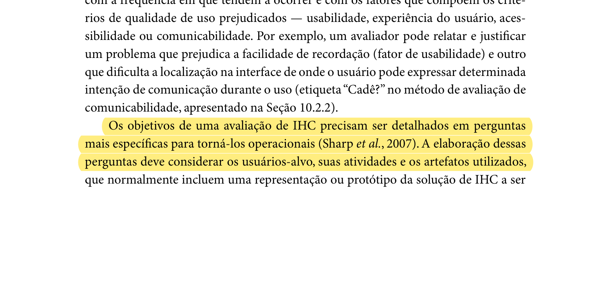{ loading=lazy }

    
Fonte: Barbosa e Silva (2010), p. 292. O grifo indica a operacionalização dos objetivos em perguntas específicas.

    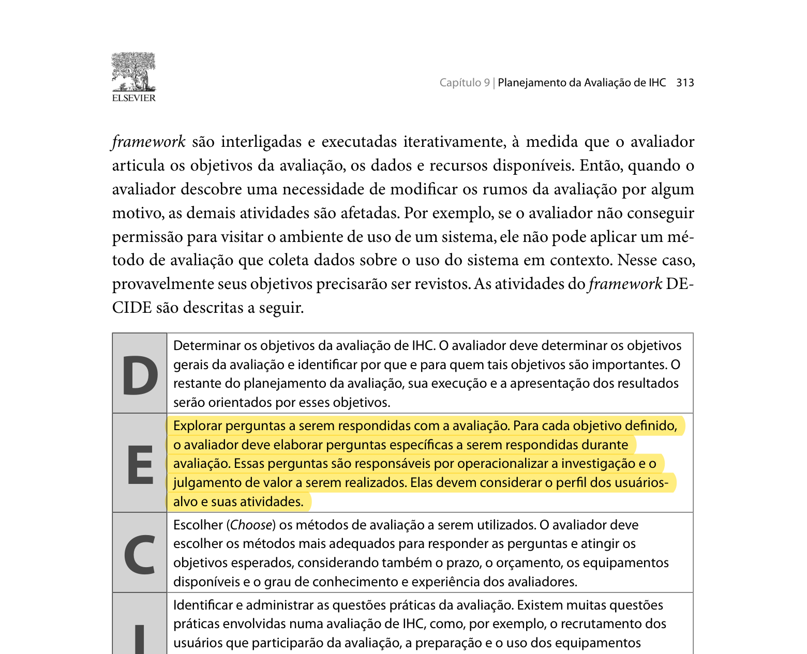{ loading=lazy }

    
Fonte: Barbosa e Silva (2010), p. 313. O grifo indica a atividade E do framework DECIDE.

    **Aplicação:** [Grupo 05](grupo-05/etapa-4.md#etapa-4-e4-20) · [Grupo 06](grupo-06/etapa-4.md#etapa-4-e4-20).

??? question "E4-21 · O planejamento classifica e justifica o método escolhido dentre os grupos de avaliação de IHC — (1) investigação (entrevistas, questionários ou grupos de foco apoiados em imagens/cenários para coletar concepções e expectativas) e/ou (2) inspeção (exame analítico por avaliadores sem envolver usuários) — em coerência com o estágio conceitual estático, o prazo e os recursos disponíveis?"

    **Autor do item:** [Bruno Ferreira Dornelas](https://github.com/brunnf).

    **Referência:** BARBOSA, Simone Diniz Junqueira; SILVA, Bruno Santana da. *Interação humano-computador*. Rio de Janeiro: Elsevier, 2010. Cap. 9, Seção 9.6, p. 301 e 303.

    **O que conferir.** Verifique na etapa **C (Escolher os métodos)** se o método selecionado é compatível com representações estáticas (Storyboard e diagramas/tabelas HTA/CTT, onde ainda não há sistema interativo para observação de uso real) e se o texto justifica por que a técnica escolhida (ex.: entrevista semiestruturada apoiada nos artefatos e/ou conferência analítica) responde às perguntas dentro das restrições práticas da equipe.

    **Rastreabilidade na V1.** Novo · fundamentado em Barbosa e Silva (2010, p. 301, 303) sobre classificação e justificativa do método de avaliação.

    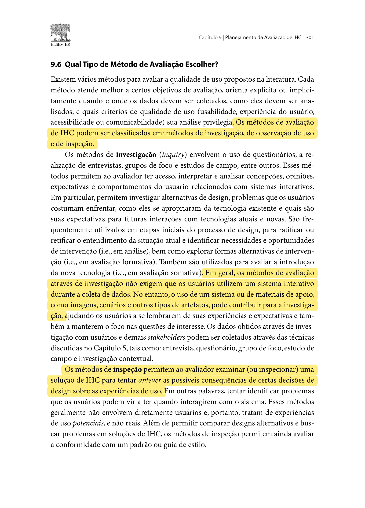{ loading=lazy }

    
Fonte: Barbosa e Silva (2010), p. 301. O grifo indica os grupos de métodos de avaliação e o uso de materiais de apoio na investigação.

    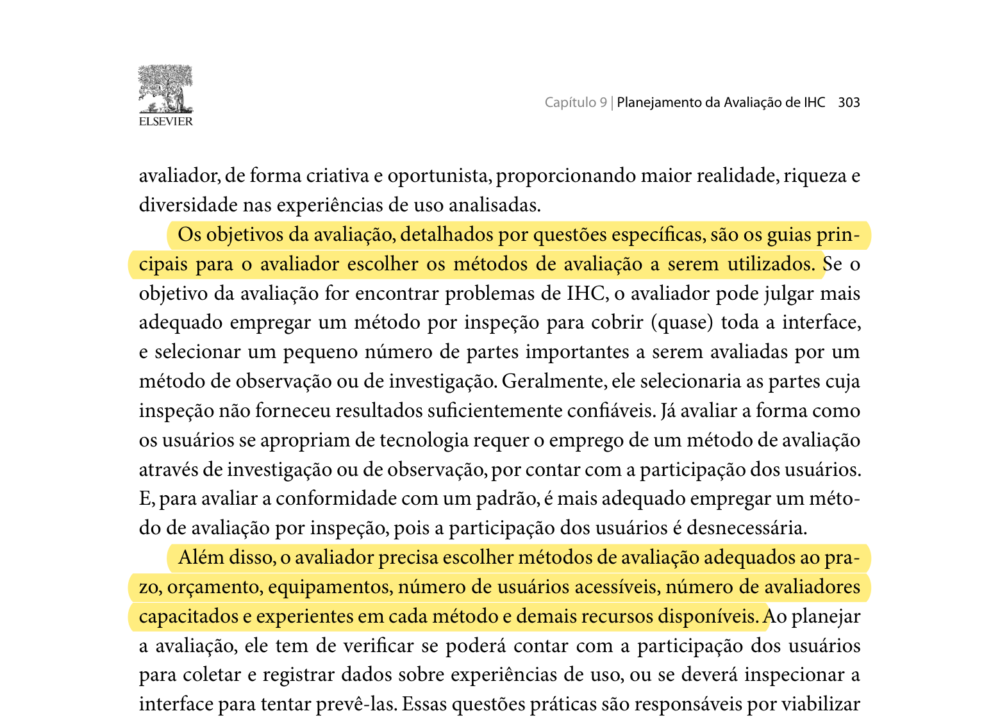{ loading=lazy }

    
Fonte: Barbosa e Silva (2010), p. 303. O grifo indica os critérios metodológicos e práticos para escolha do método.

    **Aplicação:** [Grupo 05](grupo-05/etapa-4.md#etapa-4-e4-21) · [Grupo 06](grupo-06/etapa-4.md#etapa-4-e4-21).

??? question "E4-22 · O planejamento da avaliação da Análise de Tarefas identifica o modelo avaliado (HTA e/ou CTT, na Etapa 4 ou referenciado da Etapa 2) e prevê verificar sua validade e completude junto às partes interessadas (stakeholders), conduzindo a discussão em linguagem acessível sem exigir domínio prévio de jargões técnicos da notação?"

    **Autor do item:** [Bruno Ferreira Dornelas](https://github.com/brunnf) e [Heitor Pinheiro Gonçalves das Chagas](https://github.com/Heitorovski01).

    **Referência:** BARBOSA, Simone Diniz Junqueira; SILVA, Bruno Santana da. *Interação humano-computador*. Rio de Janeiro: Elsevier, 2010. Cap. 5, Seção 5.5.1, p. 148; Cap. 6, Seção 6.4.1, p. 196.

    **O que conferir.** Abra os planejamentos da avaliação da Análise de Tarefas (ou o roteiro correspondente quando unificado) e confirme: **(1)** referência explícita ao modelo de tarefas avaliado; **(2)** previsão de checar junto ao participante/stakeholder se objetivos, etapas, ordem e exceções correspondem à atividade esperada; e **(3)** cuidado explícito de apresentar/perguntar sobre o fluxo sem jargão técnico opaco (ex.: sem exigir que o entrevistado conheça previamente símbolos de operadores CTT ou regras formais da HTA).

    **Rastreabilidade na V1.** [E4-C14](../verificacao/listas/etapa-4.md#e4-c14) + [E4-C18](../verificacao/listas/etapa-4.md#e4-c18) · reorientados para a validação da decomposição de tarefas junto às partes interessadas na Etapa 4.

    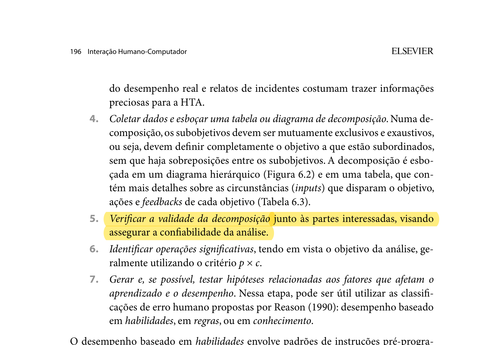{ loading=lazy }

    
Fonte: Barbosa e Silva (2010), p. 196. O grifo indica a verificação da validade da decomposição com stakeholders.

    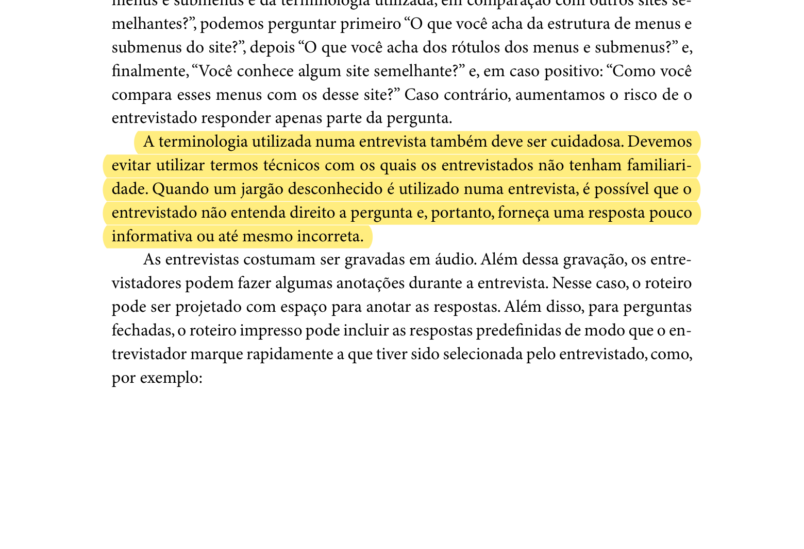{ loading=lazy }

    
Fonte: Barbosa e Silva (2010), p. 148. O grifo indica o cuidado com terminologia e jargões técnicos nas entrevistas.

    **Aplicação:** [Grupo 05](grupo-05/etapa-4.md#etapa-4-e4-22) · [Grupo 06](grupo-06/etapa-4.md#etapa-4-e4-22).

??? question "E4-23 · O planejamento prepara previamente o material de apoio padronizado (termo, artefatos/instruções, roteiro e ficha de observação), organiza as etapas da sessão (apresentação, aquecimento, exploração principal e conclusão) e fixa diretrizes de postura neutra para não induzir respostas do participante?"

    **Autor do item:** [Luís Henrique Arruda Luna](https://github.com/Donnk61).

    **Referência:** BARBOSA, Simone Diniz Junqueira; SILVA, Bruno Santana da. *Interação humano-computador*. Rio de Janeiro: Elsevier, 2010. Cap. 5, Seção 5.5.1, p. 146–147; Cap. 9, Seção 9.7.2, p. 306.

    **O que conferir.** Verifique se os planejamentos incluem ou vinculam o roteiro efetivo da sessão com **(1)** materiais padronizados para todos os participantes, **(2)** etapas estruturadas de condução (acolhimento/apresentação, contextualização/aquecimento, leitura e exploração aberta dos quadros/tarefas e encerramento) e **(3)** regras explícitas evitando perguntas indutoras (como pressupor aprovação da proposta ou antecipar a resposta esperada antes da leitura livre).

    **Rastreabilidade na V1.** [E4-C23](../verificacao/listas/etapa-4.md#e4-c23) · detalha material de apoio padronizado, etapas da sessão e postura neutra.

    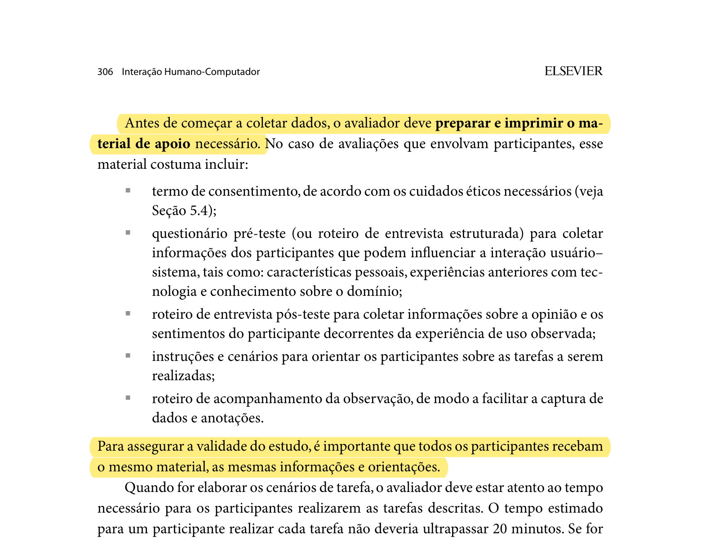{ loading=lazy }

    
Fonte: Barbosa e Silva (2010), p. 306. O grifo indica os materiais de apoio e a padronização das orientações.

    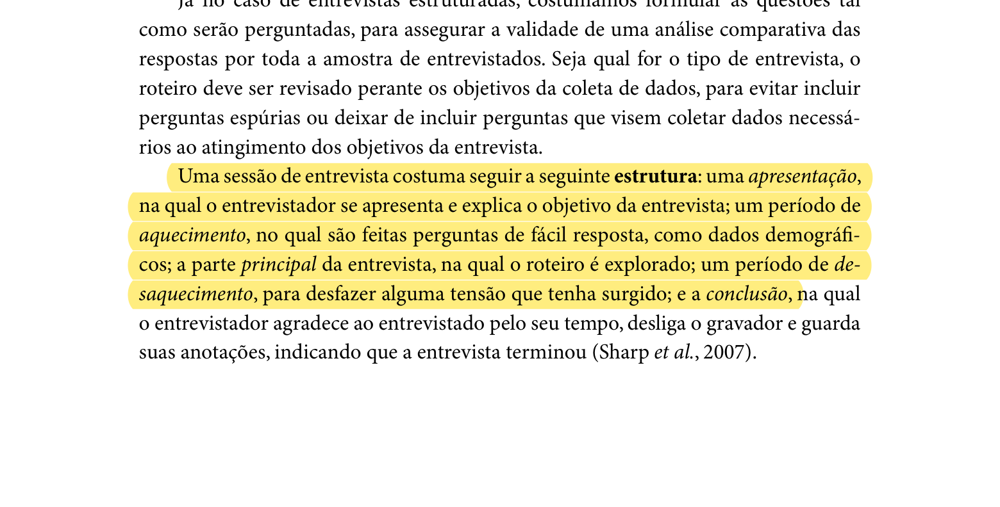{ loading=lazy }

    
Fonte: Barbosa e Silva (2010), p. 146. O grifo indica a estrutura recomendada para a sessão de entrevista.

    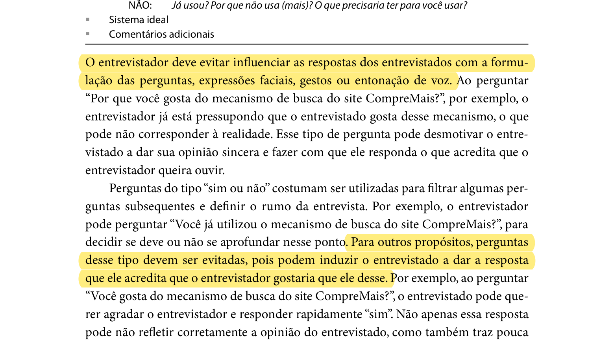{ loading=lazy }

    
Fonte: Barbosa e Silva (2010), p. 147. O grifo indica a postura neutra e a vedação a perguntas indutoras.

    **Aplicação:** [Grupo 05](grupo-05/etapa-4.md#etapa-4-e4-23) · [Grupo 06](grupo-06/etapa-4.md#etapa-4-e4-23).

??? question "E4-24 · O planejamento disponibiliza minuta ou modelo de Termo de Consentimento Livre e Esclarecido (TCLE) assegurando (1) esclarecimento sobre objetivo, duração, procedimentos e uso dos dados, (2) liberdade de recusa ou desistência sem penalização, (3) anonimato em todas as mídias publicadas e (4) permissão específica prévia para gravação de voz, imagem ou tela?"

    **Autor do item:** [Caio Breno de Souza Bezerra](https://github.com/CaioBezerra-Dev).

    **Referência:** BARBOSA, Simone Diniz Junqueira; SILVA, Bruno Santana da. *Interação humano-computador*. Rio de Janeiro: Elsevier, 2010. Cap. 5, Seção 5.4, p. 140–141.

    **O que conferir.** Além dos princípios gerais verificados em `E4-15`, localize o modelo/minuta do TCLE (sem expor dados pessoais de termos assinados) e confira se contempla explicitamente os quatro pontos: informações do estudo e contato responsável, direito de interromper ou retirar consentimento a qualquer momento sem ônus, preservação do anonimato em textos/áudios/vídeos divulgados e autorização prévia para gravação.

    **Rastreabilidade na V1.** [E4-C17](../verificacao/listas/etapa-4.md#e4-c17) · refinado com recortes específicos sobre TCLE, gravação e anonimato.

    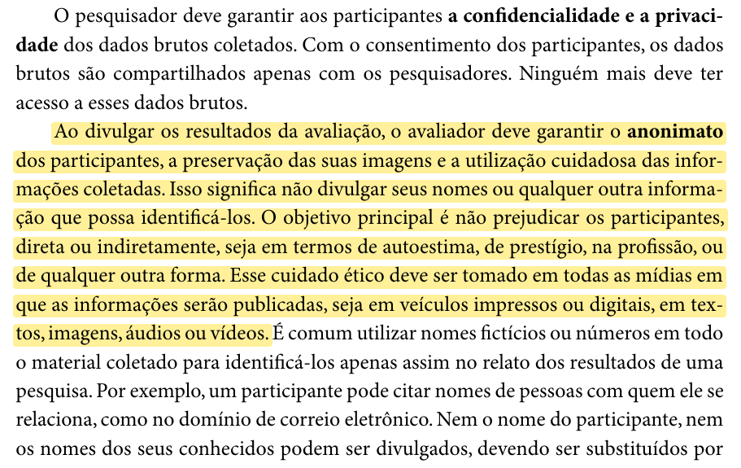{ loading=lazy }

    
Fonte: Barbosa e Silva (2010), p. 140. O grifo indica a preservação do anonimato em todas as mídias divulgadas.

    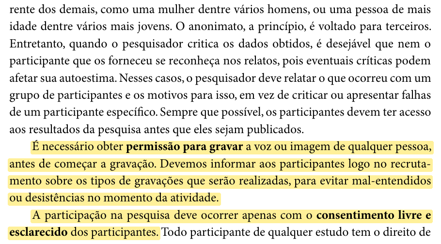{ loading=lazy }

    
Fonte: Barbosa e Silva (2010), p. 140. O grifo indica a permissão prévia para gravação e o consentimento esclarecido.

    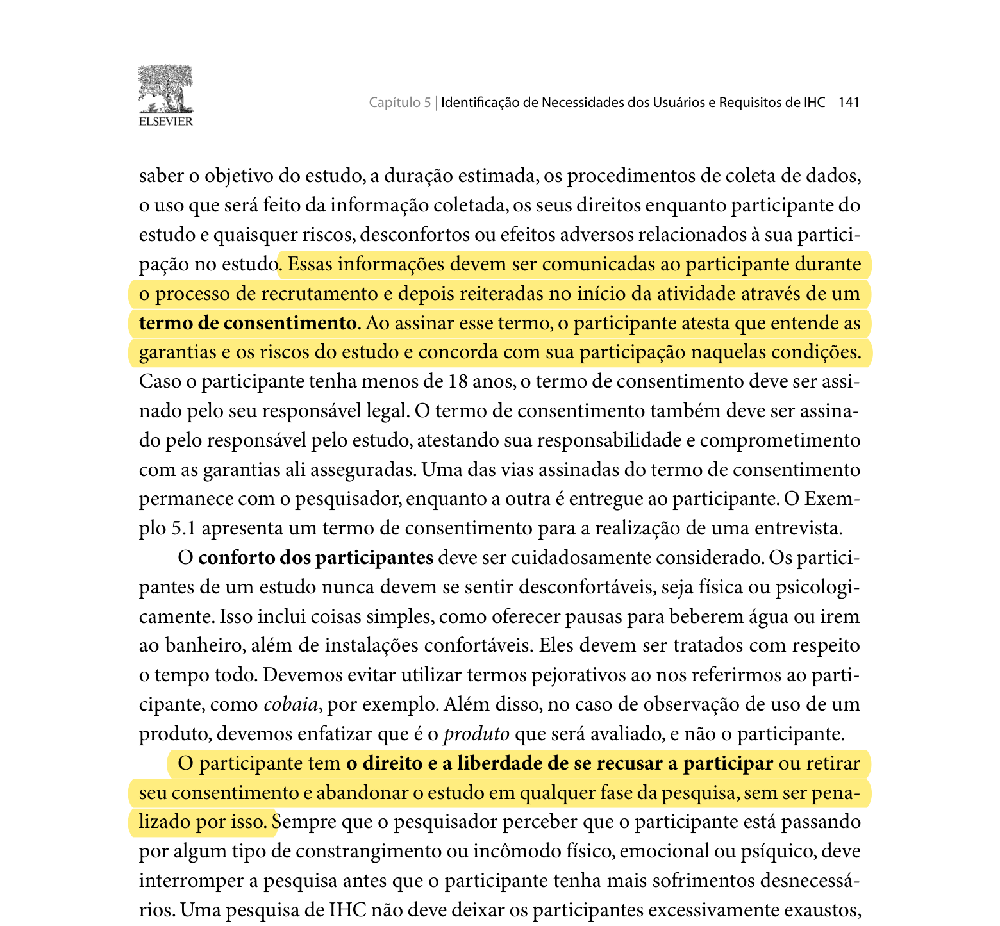{ loading=lazy }

    
Fonte: Barbosa e Silva (2010), p. 141. O grifo indica a formalização no TCLE e o direito de desistência sem ônus.

    **Aplicação:** [Grupo 05](grupo-05/etapa-4.md#etapa-4-e4-24) · [Grupo 06](grupo-06/etapa-4.md#etapa-4-e4-24).

## Planejamento do relato dos resultados

Este bloco reúne **5 critérios** voltados aos artefatos de **Planejamento do Relato dos Resultados** da avaliação do Storyboard e da Análise de Tarefas.

??? question "E4-25 · Define a estrutura do relatório do resultado da avaliação (objetivos da avaliação; breve descrição do método utilizado; número e perfil de avaliadores e participantes; tarefas/roteiros avaliados; lista de problemas encontrados etc.)?"

    **Autor do item:** André Barros de Sales.

    **Referência:** SALES, André Barros de. *Plano de Ensino FIHC 022026 — Turma 01*. Brasília: FCTE/UnB, 2026. Lista da Apresentação 4, Item 7.

    **O que conferir.** Examine os documentos de planejamento do relato (do Storyboard e da Análise de Tarefas, individuais ou compartilhados com cobertura explícita) para confirmar se preveem todas as seções estruturais que receberão os dados coletados na etapa seguinte: objetivos e escopo, método efetivamente empregado na Etapa 4 (sem exigir dados empíricos antes da coleta e adaptando a menção literal a “prototipação em papel” da tabela impressa ao método planejado para Storyboard/Tarefas), número e perfil de participantes e avaliadores, quadros/tarefas percorridos e lista de problemas encontrados.

    **Rastreabilidade na V1.** [E4-C07](../verificacao/listas/etapa-4.md#e4-c07) · mantido.

    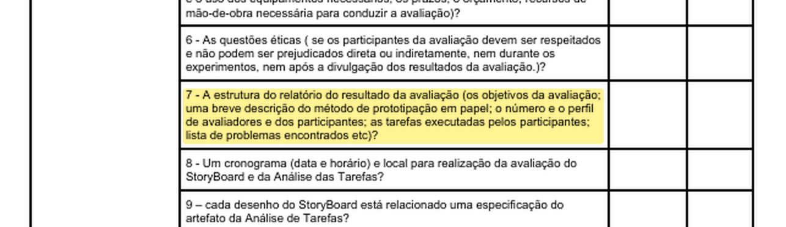{ loading=lazy }

    
Fonte: Sales (2026), Apresentação 4 (Item 7). O grifo indica o trecho usado no critério.

    **Aplicação:** [Grupo 05](grupo-05/etapa-4.md#etapa-4-e4-25) · [Grupo 06](grupo-06/etapa-4.md#etapa-4-e4-25).

??? question "E4-26 · Especifica os itens que o avaliador deve realizar/anotar durante a avaliação (listar os problemas encontrados, priorizar a correção dos problemas não resolvidos)?"

    **Autor do item:** André Barros de Sales.

    **Referência:** SALES, André Barros de. *Plano de Ensino FIHC 022026 — Turma 01*. Brasília: FCTE/UnB, 2026. Lista da Apresentação 4, Item 13.

    **O que conferir.** Confira nos instrumentos de registro e nos planejamentos do relato se estão descritos os campos que o avaliador preencherá durante e logo após cada sessão, incluindo o modelo de listagem dos problemas observados e a indicação de priorização das correções pendentes.

    **Rastreabilidade na V1.** [E4-C13](../verificacao/listas/etapa-4.md#e4-c13) · mantido.

    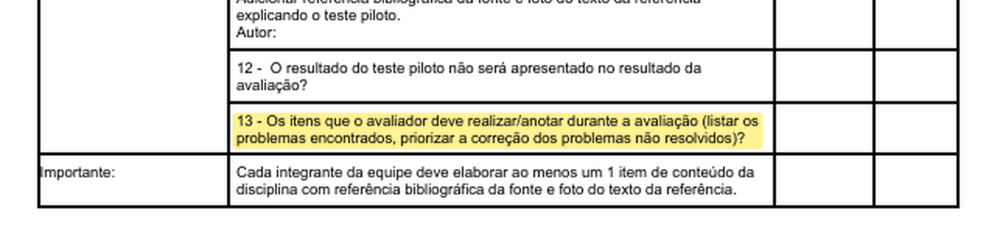{ loading=lazy }

    
Fonte: Sales (2026), Apresentação 4 (Item 13). O grifo indica o trecho usado no critério.

    **Aplicação:** [Grupo 05](grupo-05/etapa-4.md#etapa-4-e4-26) · [Grupo 06](grupo-06/etapa-4.md#etapa-4-e4-26).

??? question "E4-27 · O planejamento do relato define fichas ou matrizes para vincular cada achado a evidências localizáveis (participante, quadro do Storyboard ou nó da tarefa e minuto/registro) e orienta a interpretação por participante para responder às questões específicas do DECIDE (incluindo justificativa quando alguma pergunta permanecer inconclusiva)?"

    **Autor do item:** [Bruno Ferreira Dornelas](https://github.com/brunnf).

    **Referência:** BARBOSA, Simone Diniz Junqueira; SILVA, Bruno Santana da. *Interação humano-computador*. Rio de Janeiro: Elsevier, 2010. Cap. 9, Seção 9.7.4, p. 310; Seção 9.7.5, p. 312.

    **O que conferir.** Verifique se os planejamentos do relato estruturam como os dados brutos de cada participante serão interpretados (análise intraparticipante e consolidação) e cruzados com as questões específicas formuladas no plano da avaliação, prevendo localizadores verificáveis e registro transparente caso os dados não bastem para responder alguma questão. Inconsistências de amostra ou de questões entre o plano da avaliação e o plano do relato configuram `Incompleto`.

    **Rastreabilidade na V1.** Novo · fundamentado em Barbosa e Silva (2010, p. 310, 312) sobre interpretação intraparticipante e consolidação das questões do DECIDE.

    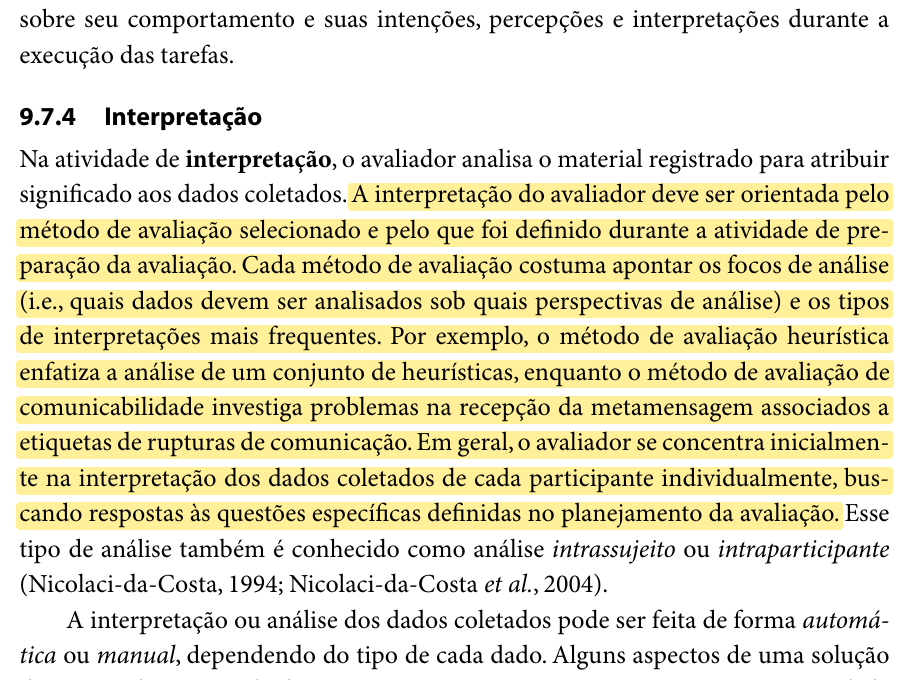{ loading=lazy }

    
Fonte: Barbosa e Silva (2010), p. 310. O grifo indica a interpretação intraparticipante voltada às questões específicas.

    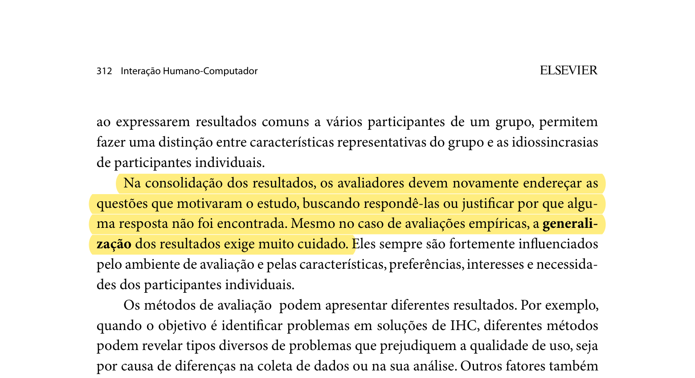{ loading=lazy }

    
Fonte: Barbosa e Silva (2010), p. 312. O grifo indica o fechamento das questões do estudo na consolidação.

    **Aplicação:** [Grupo 05](grupo-05/etapa-4.md#etapa-4-e4-27) · [Grupo 06](grupo-06/etapa-4.md#etapa-4-e4-27).

??? question "E4-28 · O planejamento do relato estabelece critérios objetivos de gravidade/priorização dos problemas (com base no grau de impacto nocivo, na frequência esperada e nos fatores de qualidade de uso afetados, por escala qualitativa fundamentada ou de severidade) e prevê seção de planejamento de reprojeto direcionando melhorias para a Etapa 5?"

    **Autor do item:** [Israel Soares de Paiva](https://github.com/IsraelSoares-25).

    **Referência:** BARBOSA, Simone Diniz Junqueira; SILVA, Bruno Santana da. *Interação humano-computador*. Rio de Janeiro: Elsevier, 2010. Cap. 9, Seção 9.2, p. 292; Seção 9.7.5, p. 312.

    **O que conferir.** Procure no planejamento do relato: **(1)** regras explícitas para classificar a gravidade/urgência de cada problema encontrado (aceitando tanto categorias qualitativas de impacto/compreensão quanto escalas numéricas de severidade, desde que os níveis estejam definidos) e **(2)** seção ou tabela de encaminhamento ao **reprojeto** indicando como os achados alimentarão os ajustes dos modelos e a construção do Protótipo de Papel na Etapa 5.

    **Rastreabilidade na V1.** [E4-C21](../verificacao/listas/etapa-4.md#e4-c21) · reformulado com base em Barbosa e Silva (2010, p. 292, 312) para contemplar gravidade, frequência, qualidade de uso e planejamento de reprojeto.

    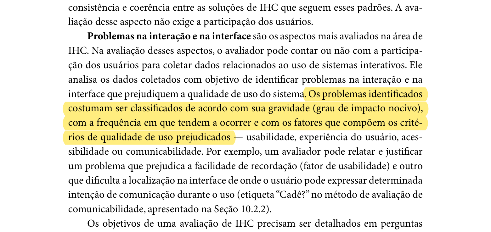{ loading=lazy }

    
Fonte: Barbosa e Silva (2010), p. 292. O grifo indica os critérios de classificação de problemas de IHC.

    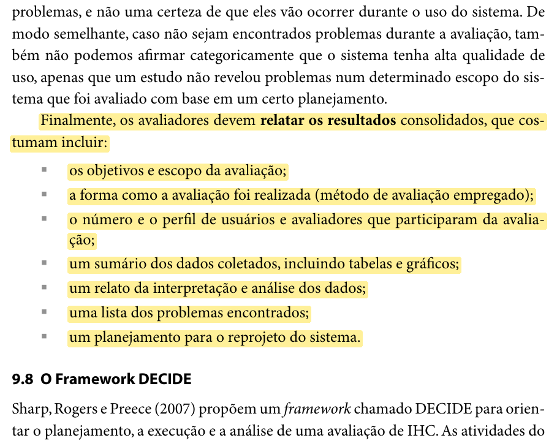{ loading=lazy }

    
Fonte: Barbosa e Silva (2010), p. 312. O grifo indica a inclusão da lista de problemas e do planejamento de reprojeto no relato.

    **Aplicação:** [Grupo 05](grupo-05/etapa-4.md#etapa-4-e4-28) · [Grupo 06](grupo-06/etapa-4.md#etapa-4-e4-28).

??? question "E4-29 · O planejamento do relato prevê documentar explicitamente os limites metodológicos e de generalização do estudo — considerando confiabilidade e validades interna, externa e ecológica (amostra exploratória reduzida, leitura de representações estáticas em vez de uso real e efeito de intervenções) — tratando os achados como indícios dentro do escopo avaliado?"

    **Autor do item:** [Israel Soares de Paiva](https://github.com/IsraelSoares-25).

    **Referência:** BARBOSA, Simone Diniz Junqueira; SILVA, Bruno Santana da. *Interação humano-computador*. Rio de Janeiro: Elsevier, 2010. Cap. 9, Seção 9.7.5, p. 312; Seção 9.8, p. 313.

    **O que conferir.** Confira se o planejamento do relato reserva seção ou diretriz analítica para explicitar as limitações da amostra, do artefato estático (Storyboard/HTA/CTT) e do ambiente de coleta, evitando afirmar que a ausência de críticas comprova qualidade definitiva ou que opiniões isoladas generalizam-se automaticamente para toda a população de usuários.

    **Rastreabilidade na V1.** [E4-C20](../verificacao/listas/etapa-4.md#e4-c20) · focaliza os limites metodológicos, a generalização e as validades do DECIDE.

    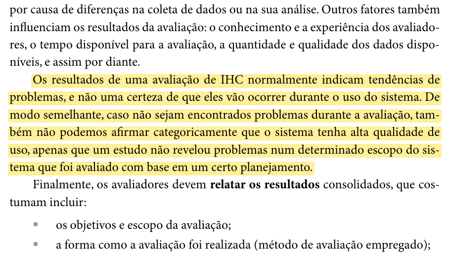{ loading=lazy }

    
Fonte: Barbosa e Silva (2010), p. 312. O grifo indica os limites de interpretação e generalização dos achados.

    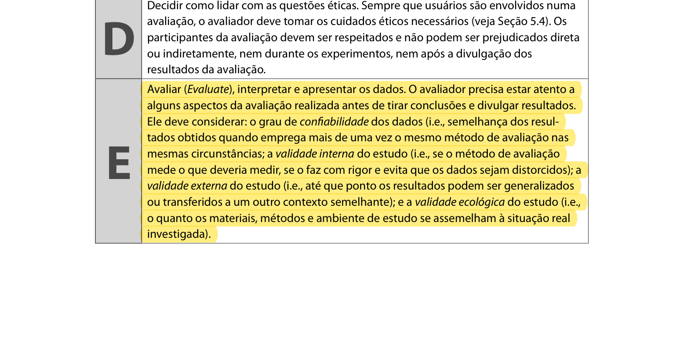{ loading=lazy }

    
Fonte: Barbosa e Silva (2010), p. 313. O grifo indica a verificação de confiabilidade e validades antes de divulgar conclusões.

    **Aplicação:** [Grupo 05](grupo-05/etapa-4.md#etapa-4-e4-29) · [Grupo 06](grupo-06/etapa-4.md#etapa-4-e4-29).

## Conferência da lista

O requisito geral de [Conteúdo da disciplina](../verificacao/listas/etapa-4.md#conteudo-da-disciplina) da V1 (*elaboração de itens de conteúdo da disciplina com referência bibliográfica, foto do texto da fonte e nome do autor*) passa a compor o controle de qualidade desta lista V2: cada critério identifica seu autor, a evidência esperada, a referência bibliográfica e o recorte grifado da fonte.

Na revisão da [Lista V1 da Etapa 4](../verificacao/listas/etapa-4.md#itens-elaborados-pelo-grupo), as perguntas voltadas à construção e à sintaxe gráfica da HTA (`E4-C15` e `E4-C16`, além dos aspectos formais de `E4-C14` e `E4-C18`) permaneceram no escopo da **Etapa 2**, mantendo-se na Etapa 4 a validação da decomposição com stakeholders em [E4-22](#e4-22); já `E4-C19` e `E4-C22` foram unificadas com [E4-02](#e4-02), [E4-17](#e4-17) e [E4-18](#e4-18) para eliminar sobreposições internas.

## Agradecimentos

O Google Gemini e o Antigravity apoiaram a extração dos recortes com destaque amarelo nos exemplares de referência, a conferência da paginação impressa e a estruturação Markdown desta Lista V2. Bruno Ferreira Dornelas responde pela consolidação desta lista V2 em blocos de conteúdo, preservando a autoria original dos critérios provenientes da V1.

## Histórico de versão

| Versão | Data | Descrição | Autor(es) | Revisor designado |
| :---: | :---: | --- | --- | --- |
| `2.0` | 21/11/2026 | Elaboração da Lista V2 da Etapa 4 com 40 critérios por conteúdo | [Bruno Ferreira Dornelas](https://github.com/brunnf) | [Caio Breno de Souza Bezerra](https://github.com/CaioBezerra-Dev) |

## Referências

1. SALES, André Barros de. *Plano de Ensino FIHC 022026 — Turma 01*. v1. Brasília: FCTE/UnB, 2026.

2. BARBOSA, Simone Diniz Junqueira; SILVA, Bruno Santana da. *Interação humano-computador*. Rio de Janeiro: Elsevier, 2010. (Série SBC).

3. VIANNA, Maurício; VIANNA, Ysmar; ADLER, Isabel K.; LUCENA, Brenda de F.; RUSSO, Beatriz. *Design Thinking: inovação em negócios*. Rio de Janeiro: MJV Press, 2012.

4. PREECE, Jennifer; ROGERS, Yvonne; SHARP, Helen. *Design de interação: além da interação homem-computador*. Tradução de Viviane Possamai. Porto Alegre: Bookman, 2005.

5. FAGAN, Michael E. *Design and code inspections to reduce errors in program development*. IBM Systems Journal, v. 15, n. 3, p. 182–211, 1976. [DOI 10.1147/sj.153.0182](https://doi.org/10.1147/sj.153.0182).
